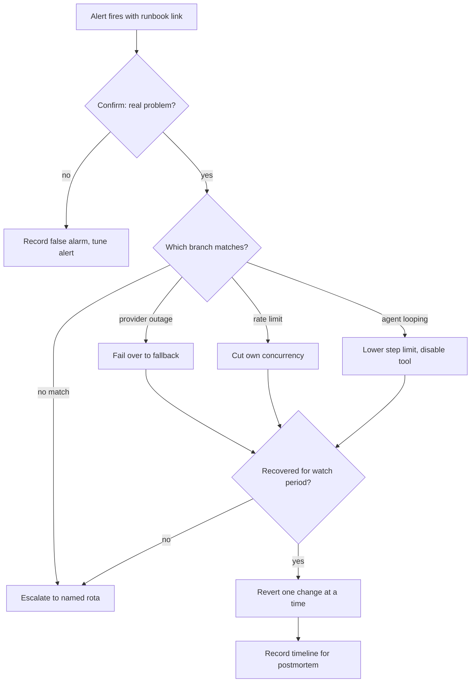

## TL;DR
A runbook is a tested procedure for one operational situation of your agent: trigger, impact check,
exact mitigation, recovery check and escalation. The on-call rarely built the agent, so good runbooks are
alert-linked, mitigation-first and rehearsed.

## For agent builders
- **Why it matters for agents.** Agents fail in ways a generic service runbook never covers: a loop that
  burns budget, a tool returning garbage the agent trusts, a prompt injection arriving through a retrieved
  document, a write tool updating the wrong records. Each needs a lever and a written step to pull it.
- **Where it shows up in your stack.** A `runbook_url` on every paging alert, flags for fallback model,
  per-tool disable and per-tenant limits, and trace queries that find the failing run by ID.
- **What you control.** Which levers the agent exposes (kill switch per tool, max-step override, read-only
  mode), which actions the on-call may take without approval, and the trace fields responders need.
- **What you can skip.** Writing a runbook per code path. Write one per alert or symptom, starting with
  provider outage, rate limits, cost runaway and unsafe actions.

## Why it exists
- **Fix-it knowledge lives in a few heads.** Which dashboard shows the real problem, which flag switches
  to the fallback model, which log query finds the failing tenant. That works until those engineers are
  asleep, on holiday, or on another project.
- **Forward-deployed work fails structurally.** After handoff the customer's operations team is on call
  for an agent they did not build, often in an environment the vendor cannot access. At 3 a.m. under
  pressure nobody reasons well from first principles.
- **"The on-call will figure it out" fails.** Every incident becomes an investigation, stretching time to
  mitigation from minutes to hours while users are affected.
- **An architecture document fails too.** It explains how the system works, not what to do when the
  provider returns 429s, and nobody reads twenty pages during an outage.
- **AI adds unfamiliar failure modes.** Provider degradation or rate limits, cost spikes from a prompt loop
  or abusive user, guardrail-block surges, a stale or partially rebuilt index, jailbreak or
  prompt-injection reports, confident wrong answers after an upstream change. Some responses (pausing
  write tools, notifying security) need explicit permission, which the runbook writes down in advance.

## How it works
### One situation per runbook
- **One alert or symptom, not a whole service**, because the reader arrives from a specific page and
  needs the steps for that situation, not a tour.
- **Every alert links to its runbook.** An alert with no runbook means the alert is unnecessary or the
  knowledge is missing.

### A fixed structure
1. **Trigger:** the alert name and threshold, or the user-reported symptom.
2. **Impact:** who is affected and how badly, with a severity guide, because severity decides who is
   woken up and how fast customers are told.
3. **Confirm:** one or two checks that tell a real problem from a false alarm, with exact dashboard links
   or queries.
4. **Mitigate:** the steps that stop user harm, in order, with exact commands or flag names. Mitigation
   comes before diagnosis because restoring service is urgent and root cause can wait for the postmortem.
5. **Verify:** what metric must return to normal, and for how long, before declaring recovery.
6. **Escalate:** who to call if mitigation fails or the situation does not match, with names or rotas,
   not "the platform team".
7. **Afterwards:** what to record for the postmortem (timeline, traces, request IDs).

### Precision over prose
- **Imperative, copy-pasteable steps:** the flag name, the query, the expected output.
- **Explicit decision points:** "if 429s are from one tenant, go to step 6; otherwise continue".
- **No vague steps.** "Check the logs" is where incidents stall.

### Pre-authorised actions
- **State what the on-call may do without asking:** switch to a fallback model, disable an agent's write
  tools, block a tenant, shed load.
- **Why:** waiting for a manager's approval at night extends the incident.

### Agent-specific runbooks to write first
| Situation | Typical trigger | First mitigation |
|---|---|---|
| **Cost runaway or loop** | Cost per task or step-budget hits above threshold | Lower the max-step limit, disable the looping tool, cap the tenant |
| **Tool misbehaving** | Tool-call error rate up, or a tool returning malformed data | Disable that tool; the agent answers without it or hands off to a human |
| **Unsafe or wrong write actions** | User report, audit alert on unusual writes | Switch write tools to approval-only or read-only mode, export affected run IDs |
| **Prompt injection reported** | Report, guardrail alert on tool results | Disable the source tool or connector, preserve the traces, notify security |

### Automation is the next step, not a replacement
- **Promote repeated steps:** a step run identically every time becomes a script, then automatic
  remediation.
- **Keep the runbook after automating**, describing what the automation does and what to do when it
  fails, because automation fails in exactly the unusual situations where humans need context.

### Store them where the outage is not
- **Do not share fate with the system:** not only on a wiki behind the same single sign-on that may be
  failing, and not only in a cloud account the customer's on-call cannot access.
- **Keep an offline or mirrored copy** for scenarios (identity outage, network partition into an
  air-gapped site) where the primary location goes down too.
- **The alert carries the link**, because searching for the right page costs minutes the incident does
  not have.

### Runbook vs playbook
- **Terminology varies:** some teams say *playbook* for the broader incident-handling process (roles,
  communication, severity) and *runbook* for the per-situation procedure described here.
- **Have both**, and do not expect one to do the other's job.

### Keep them alive
- **Owner and last-tested date** on every runbook.
- **Rehearse in game days** (deliberately injected failures in staging), and update after every incident
  where the runbook was wrong or missing.
- **Untested means broken:** a runbook that has never been executed should be assumed not to work.

## Diagram
The responder's path through one runbook: confirm before acting, mitigate before diagnosing, and
escalate when the steps do not match or do not work.



## Examples
### An LLM provider-degraded runbook
An abridged runbook for an LLM-backed agent, written for a customer operations team after handoff. Flag
names, dashboards and thresholds are illustrative stand-ins for the team's own.

```markdown
### RB-07 LLM provider degraded (429s / 5xx / timeouts)
Trigger: alert `llm_upstream_error_rate > 5% for 5 min` (any tenant)
Impact: answers fail or slow down for all users. SEV2; SEV1 if > 25% for 15 min.

Confirm
1. Dashboard "LLM upstream" -> panel "errors by status code".
   429 = rate limit, 5xx/timeout = provider outage. Check the provider status page.
2. Panel "requests by tenant": is one tenant > 50% of traffic? If yes, go to step 6.

Mitigate (pre-authorised, no approval needed)
3. 5xx/timeouts: set flag `llm.route=fallback` (secondary provider/region). Expect
   slightly lower answer quality; banner `degraded_mode=on` informs users.
4. 429s, no single hot tenant: set `llm.max_concurrency=40` (default 80) to stop retry storms.
5. Pause batch jobs: set `jobs.summarise_nightly.enabled=false`.
6. One tenant flooding: set `tenant.<id>.rate_limit_rps=2`; notify their admin (template T-3).

Verify
7. Upstream error rate < 1% and p95 < 8 s for 15 min. Then revert step 3 first, watch 15 min,
   then restore concurrency, then re-enable batch jobs last.

Escalate
8. Not recovered 30 min after step 3, or fallback also failing: page vendor on-call
   (rota "assistant-l3"), open a ticket with the provider quoting request IDs from the trace.
Afterwards: export the incident timeline and five failing trace IDs to the postmortem doc.
```

What it encodes:
- **A rate-limit vs outage split**, because the same alert has opposite fixes. For an outage you move
  traffic away; for rate limiting you reduce your own pressure, and failing over a rate-limited workload
  can simply exhaust the fallback's quota too.
- **A hot-tenant branch** and **actions the operator may take without approval**.
- **An explicit recovery condition** before anything is reverted.
- **A deliberate revert order:** one change at a time with a watch period, so if errors return you know
  which reverted change they depended on. The most load-generating change (batch jobs) comes back last,
  when the system has proven it is stable.

### An agent cost-runaway runbook
The agent-specific counterpart: a loop or a misbehaving tool drives cost per task up. Again, flag names
and thresholds are illustrative stand-ins for the levers your own agent exposes.

```markdown
### RB-12 Agent cost runaway / looping
Trigger: alert `agent_cost_per_task > 2x 7-day median for 15 min`, or step-budget hits > 2% of tasks
Impact: spend climbs, tasks time out at the step limit. SEV2; SEV1 if daily budget will be hit today.

Confirm
1. Dashboard "Agent tasks" -> "steps per task" and "tool calls by tool": did one tool's call count jump?
2. Open three runs at the step limit (trace search: status=step_limit, last 1 h).
   Same tool called repeatedly with similar arguments = loop. Go to step 3.

Mitigate (pre-authorised)
3. Disable the looping tool: set `tools.<name>.enabled=false`. The agent answers without it or hands off.
4. If no single tool: lower `agent.max_steps` from 15 to 8 for all tenants.
5. One tenant driving the spend: set `tenant.<id>.daily_task_cap` to its 7-day average.

Verify
6. Cost per task back within 1.2x median and step-budget hits < 0.5% for 30 min.
   Re-enable the tool on the internal tenant first, watch 30 min, then everyone.

Escalate
7. Not recovered 30 min after step 3 or 4: page vendor on-call (rota "assistant-l3") with trace IDs.
Afterwards: attach three looping traces and the tool's recent changes to the postmortem.
```

- **The confirm step reads traces, not logs**, because a loop is visible as a repeated tool call in one
  run, not as an error line.
- **Disabling one tool is the smallest lever**, which is why the agent must be built to degrade (answer
  without it or hand off) rather than crash when a tool is missing.

### Linking alerts to runbooks, and linting the link
Prometheus alerting rules conventionally carry a `runbook_url` annotation, so the page that wakes the
on-call contains the link.

```yaml
groups:
  - name: assistant
    rules:
      - alert: LLMUpstreamErrorRate
        expr: llm_upstream_error_rate > 0.05
        for: 5m
        labels:
          severity: sev2
        annotations:
          summary: "LLM upstream errors above 5% for 5 minutes"
          runbook_url: "https://runbooks.example.internal/RB-07"
```

A CI check fails the build when an alert has no runbook or a runbook has gone untested too long.

```python
from datetime import date

alerts = [  # parsed from the alert rules file
    {"alert": "LLMUpstreamErrorRate", "runbook_url": "https://runbooks.example.internal/RB-07"},
    {"alert": "GuardrailBlockSurge"},                       # no runbook link
]
runbooks = {"RB-07": {"owner": "cust-ops", "last_tested": date(2026, 3, 2)}}

def lint(alerts, runbooks, today, max_age_days=180):
    problems = []
    for a in alerts:
        url = a.get("runbook_url")
        if not url:
            problems.append(f"{a['alert']}: no runbook_url")
            continue
        rb = runbooks.get(url.rsplit("/", 1)[-1])
        if rb is None:
            problems.append(f"{a['alert']}: runbook {url} not found")
        elif (today - rb["last_tested"]).days > max_age_days:
            problems.append(f"{a['alert']}: runbook last tested {rb['last_tested']}")
    return problems

print(lint(alerts, runbooks, date(2026, 10, 20)))
# ['LLMUpstreamErrorRate: runbook last tested 2026-03-02', 'GuardrailBlockSurge: no runbook_url']
```

## Production patterns
- **Alert-embedded runbook links.** Put the runbook URL in every paging alert (for example the
  `runbook_url` annotation in Prometheus rules) so it travels into the pager notification. Monitor the
  share of paging alerts without a link; target zero.
- **Levers built into the agent.** For every runbook step, the agent exposes a flag: per-tool disable,
  max-step override, read-only mode for write tools, fallback model, per-tenant caps. Monitor runbooks
  that reference a lever that does not exist (they should fail review).
- **Game days before handoff.** Inject the failure in staging (block the provider endpoint, throttle a
  connector, corrupt an index alias, make a tool return malformed data) and have the customer's on-call
  run the runbook unaided. Monitor time to mitigate and every step where they hesitated.
- **Runbook review in the postmortem template.** Each postmortem asks "was the runbook right, missing or
  wrong?" and opens an update task. Monitor incidents where the runbook was wrong.
- **Mirrored copy outside the blast radius.** Export runbooks to a location that does not depend on the
  system's identity provider or network, refreshed on every change. Monitor the mirror's last sync time.
- **Step-to-script promotion.** When a step is run identically in several incidents, wrap it in a script
  or chat-ops command and reference that command from the runbook. Monitor how often automated
  remediations fail and fall back to manual steps.

## Trade-offs
- **Speed for strangers vs staleness.** Detailed, command-level runbooks make incidents fast for
  unfamiliar operators but go stale quickly as the agent changes; the cost flips when nobody owns
  updates, and a wrong runbook is worse than none.
- **Fast mitigation vs over-reaction.** Pre-authorising disruptive actions shortens incidents but risks
  over-reaction on false alarms; keep the confirm step strict so disruptive mitigation follows evidence.
- **No human delay vs hidden behaviour.** Automating remediation removes human delay but hides the
  system's behaviour from operators; keep humans in the loop for actions with customer-visible or
  irreversible effects.
- **Precision vs navigability.** Many narrow runbooks match alerts precisely but become hard to navigate;
  a short index by symptom helps when the triggering alert is not obvious.

## Pitfalls
- **Explaining the architecture instead of giving steps.** Symptom: an on-call who read the page and still
  had to page the original engineer. Fix: imperative, exact steps.
- **Never testing them.** Symptom: a step references a flag, dashboard or command renamed months ago,
  discovered mid-incident. Fix: game days and a last-tested date.
- **Alerts with no linked runbook.** Symptom: repeated pages that each get the same ad-hoc response and no
  consistent mitigation time. Fix: lint for the link in CI.
- **Leaving out AI-specific situations** such as cost spikes, agent loops, guardrail-block surges or
  prompt-injection reports. Symptom: a generic "service degraded" response to a problem that needed a kill
  switch.
- **A runbook step with no lever behind it.** Symptom: "disable the CRM tool" is written down, but the
  agent has no per-tool flag, so the only option is a full redeploy. Fix: build the lever with the tool.
- **Keeping runbooks only behind the system's own login** or on infrastructure that fails with it.
  Symptom: in an identity or network outage the on-call cannot open the page that tells them what to do.
- **Writing them only for the vendor team.** Symptom: a customer operations team that escalates every page
  during hypercare because the runbooks assume access and context they do not have.

## When to use
- **Use for:** every alert that pages a human, and every known failure mode a different team will
  handle, before go-live and as a readiness-review item.
- **Start with the likeliest and most harmful situations:** provider outage, rate limits, cost runaway,
  agent loops, index staleness, unsafe output or action reports, authentication failures to customer
  systems.
- **Measure:** time to mitigate, how often responders escalate despite the runbook, and how often an
  incident finds a runbook wrong.
- **Interviews:** alert-linked runbooks with pre-authorised mitigations and rehearsal show operational
  maturity beyond "we have monitoring".

## Role lens
- **Engineer:** Writes runbooks for the failure modes they built in, with exact flags and queries, and
  adds a kill switch or fallback path wherever a runbook needs one that does not exist.
- **Architect:** Ensures the system exposes the levers runbooks need (fallback routing, per-tenant limits,
  tool disablement) and defines which actions are pre-authorised for on-call.
- **FDE:** Rewrites runbooks for the customer's operators, in their tools and access model, and runs a
  game day with them before handoff so the procedures are proven in their environment.

## Check yourself
**Q:** During hypercare the customer's on-call escalated every one of six incidents to your team, even
though runbooks existed. What would you investigate and change?
**A:** I would review each incident with the on-call to see where they stopped. Common causes: the
runbook assumed access they lack (a vendor dashboard or cloud account); steps were vague ("check the
model") instead of exact; the confirm step did not distinguish their situation so they did not trust the
mitigation; or disruptive actions were not explicitly pre-authorised, so they waited for permission. Fixes
follow from the cause: rewrite with their tools and links, add decision branches, state pre-authorisation
in writing with their management's agreement, then run a game day so they execute each runbook once
under realistic conditions.

## Interview questions
### What makes a runbook different from system documentation?
- **Scope:** one alert or symptom with trigger, impact, confirm, mitigate, verify and escalate steps,
  rather than an explanation of how the system works.
- **Why it matters:** the responder is often not the builder, and under pressure needs exact commands, not
  a twenty-page tour.

### Your provider alert fires with 429s. Would you fail over to the fallback provider?
- **Not first:** 429s mean you are being rate-limited, so the fix is reducing your own pressure (lower
  concurrency, pause batch jobs, throttle a hot tenant).
- **Failing over can backfire:** the same load can exhaust the fallback's quota too. Failover fits 5xx and
  timeouts, which signal a provider outage.

### Your agent's cost per task doubled overnight. Walk me through the runbook.
- **Confirm from traces:** open runs that hit the step limit and look for one tool called repeatedly with
  similar arguments, and check per-tool call counts on the dashboard.
- **Mitigate with the smallest lever:** disable that tool or lower the max-step limit, cap a hot tenant,
  then verify cost and step-budget hits return to baseline before re-enabling on one tenant first.

### Which actions would you pre-authorise for the on-call, and which not?
- **Pre-authorise reversible, harm-stopping actions:** switch to a fallback model, disable an agent's write
  tools, block or rate-limit a tenant, shed load.
- **Keep approval for irreversible or customer-contract changes**, and keep the confirm step strict so
  disruptive steps follow evidence rather than false alarms.

### What must you build into an agent so its runbooks can actually be executed?
- **Levers per risk:** a disable flag per tool, a read-only mode for write tools, a max-step override, a
  fallback model route and per-tenant caps, all changeable without a redeploy.
- **Graceful degradation and traceability:** the agent must keep working (or hand off) with a tool
  disabled, and every run needs a searchable trace ID so the confirm step can find it.

### How do you know a runbook still works six months after handoff?
- **Last-tested date and owner on each one**, with a CI check that flags stale runbooks and alerts missing
  a link.
- **Game days and postmortem reviews:** rehearse in staging and update the runbook after every incident
  where it was wrong or missing. Store runbooks outside the system's blast radius, with a mirrored or
  offline copy, so an identity outage does not hide them.

## Quiz
### Q: Why do runbooks put mitigation steps before diagnosis?
- [ ] Diagnosis is the vendor's responsibility, not the on-call's
- [x] Stopping user harm is urgent, while root cause can be found afterwards from preserved evidence
- [ ] Diagnosis cannot be written down in advance
- [ ] Mitigation steps are easier to automate
> The incident's cost accrues while users are affected, so restoring service comes first. Recording
> timelines and trace IDs preserves what the postmortem needs, so diagnosis is deferred, not lost.

### Q: Which runbook step is most likely to stall an incident?
- [ ] "Set flag llm.route=fallback"
- [ ] "If one tenant exceeds 50% of traffic, go to step 6"
- [x] "Check the logs for anything unusual"
- [ ] "Verify upstream error rate stays below 1% for 15 minutes"
> Vague instructions force the responder to reason from scratch, which is what runbooks exist to avoid.
> The other steps are exact actions, explicit branches or measurable recovery conditions.

### Q: A team automated a runbook's mitigation as an auto-remediation job. What should happen to the runbook?
- [ ] Delete it, since the automation now handles the situation
- [ ] Freeze it as historical documentation
- [x] Keep it, describing what the automation does and what to do if the automation fails or does not fire
- [ ] Convert it into a postmortem template
> Automation fails in unusual conditions, which is when operators most need context. The runbook becomes
> the fallback for the automation and explains its behaviour so responders do not fight it.

## Use cases & projects
### Use cases
- **Handing an agent to a customer's on-call team.** Runbooks in their tools and access model let them
  mitigate provider outages and agent loops without escalating.
- **Cost runaway on a tool-calling agent.** A runbook with a per-tool disable and a max-step override
  stops spend within minutes instead of hours.
- **Prompt injection through a connector.** A pre-authorised "disable the connector, preserve traces,
  notify security" procedure removes the need for a 3 a.m. approval call.
- **Readiness reviews.** "Every paging alert links to a tested runbook" is a blocking checklist item.

### Mini project
**Write and rehearse two agent runbooks (2 hours).**
- **Goal:** prove a stranger can stop an agent loop and a provider outage using only your runbooks.
- **Steps:** add three flags to a toy agent (per-tool disable, `max_steps`, fallback model); write RB-07
  style runbooks for "provider degraded" and "agent looping"; inject each failure (a stub tool that always
  asks to be called again, a stub provider returning 429s); ask a colleague, or yourself a day later, to
  follow the runbook without reading the code.
- **Done when:** both failures are mitigated within 10 minutes using only the runbook, every step that
  caused hesitation is rewritten, and a lint script confirms each alert links to a runbook tested in the
  last 180 days.
