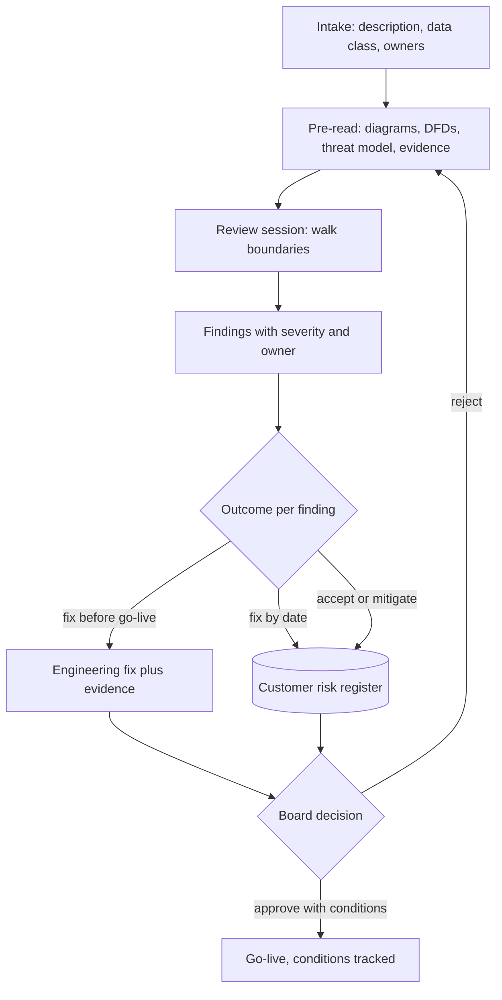

## TL;DR
A security and architecture review tests a proposed system's design before go-live: data flows, trust
boundaries, identity, network paths and, for AI, prompt injection and tool permissions. Pass it with an
accurate diagram, a threat model and evidence; leave with dated findings.

## Why it exists
- **A questionnaire captures claims; a review tests the design.** It cannot tell the buyer how your
  system fits theirs: which networks it touches, what identity reads their SharePoint, whether an agent
  could email a customer, where a prompt containing patient data is logged.
- **Those answers depend on the deployment**, so large organizations route new systems through an
  architecture review board and a security review before production access is granted. Good engineering
  teams run the same review on their own designs before building.
- **Without a review, problems surface in the worst places:** an over-privileged service account noticed
  during an incident, a data path to an unapproved region found by an auditor, an agent's tool that can
  modify records discovered by a user. Fixing design after deployment costs far more than changing a diagram.
- **Marketing slides fail.** Reviewers want specifics: every data store, every boundary crossing, every
  credential. Vague answers produce a long list of open actions and a second meeting weeks later.
- **AI makes it harder.** Reviewers often meet LLM-specific risks for the first time and need you to
  explain how the model can be manipulated and what bounds the damage. The vendor who brings that
  analysis unprompted earns trust a slide deck cannot.

## How it works
### The typical flow
1. **Intake.** The sponsor files a request with a system description, data classification and owners.
   Data classification sets the depth: a system touching regulated personal data gets more scrutiny than
   an internal FAQ bot.
2. **Pre-read package.** You submit documents in advance, because reviewers want to come with questions,
   not discover the design in the meeting.
3. **Review session.** Reviewers walk the diagram, probe boundaries and ask "what happens if" questions.
4. **Findings.** Each gets a severity, an owner and an outcome: fix before go-live, fix by a date, accept
   the risk with a named approver, or mitigate with a compensating control.
5. **Decision.** Approve, approve with conditions, or reject; conditions are tracked to closure, usually
   in the customer's risk register.

### What the pre-read contains
- **Architecture diagram** at container level (C4-style is common): every service, data store, external
  dependency and trust boundary, including model providers and observability tools.
- **Data flow diagram** for each sensitive flow: what data, from where, to where, encrypted how, retained
  how long. Reviewers scrutinize this most, because breaches follow data.
- **Identity and access:** how users authenticate (their SSO), how services authenticate to each other
  and to customer systems, which permissions each role and service account has, and why.
- **Network:** ingress and egress paths, private endpoints, VPNs, what is publicly reachable.
- **Encryption and keys:** in transit, at rest, who holds keys, whether customer-managed keys are used.
- **Logging and monitoring:** what is logged, where, for how long, whether prompts or outputs are included.
- **Threat model:** for example STRIDE per boundary, plus AI-specific threats from the OWASP LLM list:
  prompt injection (direct and via retrieved documents), sensitive information disclosure, excessive
  agency of tools, improper output handling (called insecure output handling in the 2023 list), vector
  and embedding weaknesses, and supply chain of models and datasets.
- **Evidence:** penetration test summary, vulnerability scanning, SBOM, SOC 2 or ISO reports.

### Applying STRIDE at a boundary
A threat model is not a list of scary words; it is the same six questions asked wherever data or control
crosses a trust boundary. It works *because* boundaries are finite and enumerable, while "think of
attacks" is not.

| Letter | Question | At "retrieved document text enters the model prompt" |
|---|---|---|
| **S**poofing | can someone pretend to be a legitimate caller? | (ask per caller of the retrieval API) |
| **T**ampering | can data be altered in transit or at rest? | a planted instruction in a document (indirect prompt injection) |
| **R**epudiation | could an actor deny an action because nothing recorded it? | an action with no log tying it to a user and a source document |
| **I**nformation disclosure | can data reach someone not entitled to it? | the model quoting a passage the user may not see |
| **D**enial of service | can the path be exhausted? | (ask per path: index size, prompt length) |
| **E**levation of privilege | can a caller gain rights it was not given? | the injected instruction causing a tool call with the agent's broader credentials |

Each answer points to a control, which is exactly what the reviewer wants to see written down.

### The architecture half
An architecture review board asks questions a security reviewer may not:
- **Fit:** does the design use approved technologies and integration patterns, or introduce a new
  database the customer's operations team has never run?
- **Resilience:** what are the availability target and the recovery point and time objectives, and does
  the design meet them?
- **Operations:** who operates it, and does its monitoring land in their tooling?
- **Cost:** what does it cost at expected volume, and how does that scale?
- **Exit:** can data and indexes be exported if the vendor is replaced?

These exist *because* the customer will live with the system long after the project team moves on, so fit
with their estate matters as much as internal elegance.

### AI-specific questions to prepare for
| Reviewer asks | Prepared control |
|---|---|
| Can a document in the index instruct the model to leak other documents? | permission-filtered retrieval, output validation |
| Does retrieval respect the user's permissions in the source system? | permission-filtered retrieval |
| Which tools can the agent call, with whose credentials, and which actions need human approval? | least-privilege tool credentials, approval gates |
| What happens when the model is wrong, and how would you know? | evaluation results and monitoring |
| Can a user's data be deleted from indexes, caches and fine-tuned weights? | documented deletion path per store |

### Your own reviews
- **Run the same process internally first.** A design review with a peer architect and a security
  engineer catches the obvious findings cheaply.
- **Record decisions as ADRs** so the reasoning survives staff changes.

## Diagram
The review is a loop: findings return to the design until each one has a fix, a mitigation or a named
acceptance.



## Examples
### Worked scenario: a bank's review of a policy assistant
An FDE prepares a bank's architecture review for an internal-policy assistant that retrieves from
SharePoint and can draft, but not send, emails. The pre-read has a container diagram, two data-flow
diagrams (indexing and query), an access matrix and a threat model. The review produces five findings:

1. **High:** the indexing service account can read all SharePoint sites, so retrieval would ignore
   per-user permissions.
   - Fix before go-live: each chunk carries the source document's access list captured at index time;
     retrieval filters by the user's group memberships synced from the identity provider; the indexer's
     scope is reduced to the approved site collections.
   - Residual risk, noted in the finding, is staleness: a permission revoked in SharePoint still applies
     in the index until the next sync, so the sync interval becomes a documented, agreed number.
2. **High:** full prompts and retrieved passages are written to the vendor-hosted trace store. Fix before
   go-live: traces stay in the bank's log platform; vendor telemetry receives only metadata.
3. **Medium:** indirect prompt injection through a malicious document could make the assistant produce a
   misleading draft. Mitigation accepted: drafts are never auto-sent, the UI marks generated text, and
   red-team results on injection are attached as evidence.
4. **Medium:** no documented response if the model provider changes the model version. Fix by date: pin
   the model version and add a regression eval gate before upgrades.
5. **Low:** the internal ingress still accepts TLS 1.2 with legacy CBC-mode cipher suites, while the
   bank's standard requires AEAD-only suites. Risk accepted by the bank's security lead with a review in
   six months.

| Finding | Severity | Outcome | Closed by |
|---|---|---|---|
| 1 Indexer reads all sites | High | fix before go-live | two weeks, with a permission-filter test |
| 2 Prompts in vendor traces | High | fix before go-live | two weeks, with a log-flow screenshot |
| 3 Indirect injection in drafts | Medium | mitigation accepted | red-team evidence |
| 4 Unpinned model version | Medium | fix by date | condition on approval |
| 5 TLS 1.2 CBC suites | Low | risk accepted | review in six months, condition on approval |

The board approves with conditions on findings 4 and 5, tracked in the bank's risk register.

### Evidence test for finding 1: user A cannot retrieve user B's restricted file
The reviewer wants a test, not a promise. This pure-Python sketch shows the shape: filter by the
caller's groups before ranking, then assert on the restricted document.

```python
"""Evidence for finding 1: retrieval honours source-system permissions."""
CHUNKS = [
    {"doc": "travel-policy.docx", "text": "Economy class for flights under 6 hours", "acl": {"all-staff"}},
    {"doc": "layoffs-2026.docx", "text": "Restructuring plan for the retail unit", "acl": {"hr-leads"}},
]
GROUPS = {"user_a": {"all-staff"}, "user_b": {"all-staff", "hr-leads"}}   # synced from the IdP

def retrieve(user, query, chunks=CHUNKS):
    allowed = GROUPS.get(user, set())
    visible = [c for c in chunks if c["acl"] & allowed]                 # filter BEFORE ranking
    return [c["doc"] for c in visible if any(w in c["text"].lower() for w in query.lower().split())]

def test_user_a_cannot_retrieve_restricted_file():
    assert "layoffs-2026.docx" not in retrieve("user_a", "restructuring plan")

def test_user_b_can_retrieve_it():
    assert retrieve("user_b", "restructuring plan") == ["layoffs-2026.docx"]

def test_unknown_user_gets_nothing():
    assert retrieve("mallory", "policy plan") == []

if __name__ == "__main__":
    for t in (test_user_a_cannot_retrieve_restricted_file, test_user_b_can_retrieve_it,
              test_unknown_user_gets_nothing):
        t(); print("pass", t.__name__)
```

- **Against the real system**, run the same three assertions through the deployed retrieval API with two
  test identities, and attach the run output to the finding.

## Production patterns
- **Reusable pre-read template.** Keep a standard package (container diagram, one DFD per sensitive
  flow, access matrix, STRIDE table per boundary, AI threats from the OWASP LLM list, evidence index) and
  update it per deployment. Track high findings per review; they should fall as the template matures.
- **Diagram generated from or checked against production.** Reconcile the architecture diagram with the
  deployed inventory (cloud resource listings, egress destinations) before each review, because a
  missing service destroys reviewer confidence.
- **Findings as tickets with dates.** Every finding gets an owner, severity, outcome and due date in the
  tracker, mirrored to the customer's risk register. Monitor the percentage closed by due date.
- **Expiring risk acceptances.** Each accepted risk records the approver and a review date, such as the
  six-month TLS review above, and resurfaces automatically. Count acceptances past their date.
- **Change triggers for re-review.** New data sources, new agent tools, new model providers and new
  regions require a delta review before release; add the check to the release checklist.
- **Evidence tests in CI.** Keep the permission-filter and log-destination checks as automated tests, so
  the evidence stays true after go-live.

## Trade-offs
- **Early vs late engagement.** Engaging reviewers at design stage finds structural problems while they
  are cheap, but the design may change and need re-review. Late engagement saves meetings but risks
  findings that force a redesign.
- **Thorough pre-read vs preparation time.** It shortens the meeting and the follow-up cycle, but takes
  days to prepare. For a low-risk internal tool, a lightweight review with a short template is proportionate.
- **Risk acceptance vs invisible debt.** Accepting risks with a named approver keeps launches moving, but
  accumulated accepted risks become invisible debt unless they carry expiry dates and are re-reviewed.
- **Frameworks vs deployment specifics.** STRIDE and the OWASP LLM list give reviewers shared vocabulary,
  but checklists miss deployment-specific risks; the data-flow walkthrough is what finds those.

## Pitfalls
- **A diagram that does not match production.** Symptom: a reviewer asks about a service the diagram
  omits, and the review loses confidence in everything else presented.
- **Omitting the model provider and observability vendors from data flows.** Symptom: a high-severity
  finding for undisclosed data transfer, often discovered from a network-egress question.
- **Agreeing to findings without owners and dates.** Symptom: the same findings reappear at the next
  review, or block go-live at the last minute.
- **Treating the review as a one-time gate.** Symptom: a later feature, such as a new agent tool or a
  cross-region fallback, ships without review and is flagged by an audit.
- **Arguing every finding.** Symptom: a reviewer escalates to a reject, when a compensating control or a
  dated fix would have closed it.

## When to use
- **Expect a customer review** for any system touching confidential or regulated data, integrating with
  identity or internal systems, or taking actions.
- **Run your own internal review** for every new system and for significant changes: new data sources,
  new tools for an agent, new model providers, new regions.
- **Scale the depth** to data classification and blast radius.
- **Measure:** time from intake to approval, the number of high findings per review (it should fall as
  your template matures) and the percentage of findings closed by their due date.
- **Interviews:** a strong candidate describes the pre-read package and names AI-specific threats with
  concrete controls, rather than claiming the system is secure.

## Role lens
- **Engineer:** Produces the evidence reviewers ask for, such as a test proving permission-filtered retrieval
  and log configuration excerpts, and implements fixes against named findings.
- **Architect:** Owns the diagrams, data flows, threat model and ADRs, presents the design, and negotiates
  findings into fixes, mitigations or formally accepted risks with expiry dates.
- **FDE:** Navigates the customer's review process, books the right reviewers, translates their concerns into
  engineering tickets and keeps the findings tracker moving until approval.

## Check yourself
**Q:** In a customer's review, the security architect asks: "If someone uploads a document containing
instructions to the model, what stops your agent from emailing our customer list to an outside address?"
What is a strong answer?
**A:** Acknowledge that indirect prompt injection cannot be fully prevented at the model level, then show
layered controls that bound impact. The agent's email tool can only create drafts, so a human must send;
recipients are restricted to internal domains by the tool, not the prompt; the agent's credentials cannot
read the customer list because retrieval is filtered by the requesting user's permissions and the CRM is not
connected; outputs are validated and links stripped; and actions are logged for audit. Add evidence: red-team
results for injection attempts and the tool's permission policy. Then offer monitoring and an alert on
anomalous tool use. The key point is that safety rests on capability limits, not on the model obeying.

## Interview questions
### How is a security review different from a security questionnaire?
- **Questionnaire:** standardized written claims about your controls, largely independent of how you are
  deployed.
- **Review:** an examination of this specific deployment's design: which networks it touches, which
  identities it uses, where sensitive data flows and is logged, and what an agent can do.
- **So prepare differently:** a library answers questionnaires; a review needs accurate diagrams, data
  flows, a threat model and evidence for this system.

### Walk me through threat-modelling one boundary in a RAG agent.
- **Pick the boundary:** "retrieved document text enters the model prompt".
- **Ask STRIDE:** tampering is a planted instruction; information disclosure is quoting a passage the user
  may not see; elevation is an injected tool call with the agent's credentials; repudiation is an
  unlogged action.
- **Map each to a control:** permission-filtered retrieval, least-privilege tools, approval gates, and
  logs tying actions to user and source document.

### A reviewer raises a finding you think is overstated. How do you handle it?
- **Do not argue it away.** Understand the risk they see and restate it in your own words.
- **Offer options:** a compensating control, a dated fix, or a formal acceptance by their named approver
  with a review date.
- **Bring evidence** (a test, a config excerpt) rather than assertions; reviewers escalate when they
  feel resisted.

### When is a full architecture review overkill?
- **Low-risk internal tools** with no sensitive data, no integrations with identity or internal systems,
  and no actions: a short template review is proportionate.
- **Small changes inside an approved design** need a delta review, not the whole process.
- **Not overkill** when an agent gains a new tool, a new model provider or a new region, because those
  change the data flows the original approval rested on.

### Which numbers would you track to show your review process is working?
- **Time from intake to approval**, per data classification.
- **High findings per review**, which should fall as the pre-read template matures.
- **Percentage of findings closed by due date**, plus the count of risk acceptances past their review date.

## Quiz
### Q: Which pre-read document do reviewers usually scrutinize most closely, and why?
- [ ] The product roadmap, because it shows future security features
- [x] The data-flow diagrams, because they show what sensitive data crosses which boundaries and where it is stored
- [ ] The penetration test report, because it proves there are no vulnerabilities
- [ ] The pricing sheet, because it determines the review tier
> Breaches and compliance problems follow data, so reviewers trace each sensitive flow across trust
> boundaries. A penetration test is useful evidence but shows only what testers found, not the absence of flaws.

### Q: A review finding says the indexing service account can read every SharePoint site. Why is this rated high for a RAG assistant?
- [ ] Because SharePoint APIs are rate-limited
- [ ] Because broad read access slows down indexing
- [ ] Because the account password might expire
- [x] Because without per-user permission filtering at retrieval, any user could receive content they are not entitled to read
> The assistant would answer from documents the requesting user cannot access, bypassing the source
> system's permissions. The fix is permission-aware retrieval and a narrower indexing scope, not tuning throughput.

### Q: A finding cannot be fixed before launch. What is the most appropriate way to proceed?
- [ ] Remove it from the findings list since it cannot be fixed now
- [ ] Launch and revisit it if an incident occurs
- [x] Record a risk acceptance or compensating control with a named approver and a review or fix date
- [ ] Ask the reviewer to downgrade the severity so it does not block
> Formal acceptance makes the decision visible and owned, and a date ensures it is revisited. Deleting or
> downgrading the finding hides the risk, which is what the review exists to prevent.
