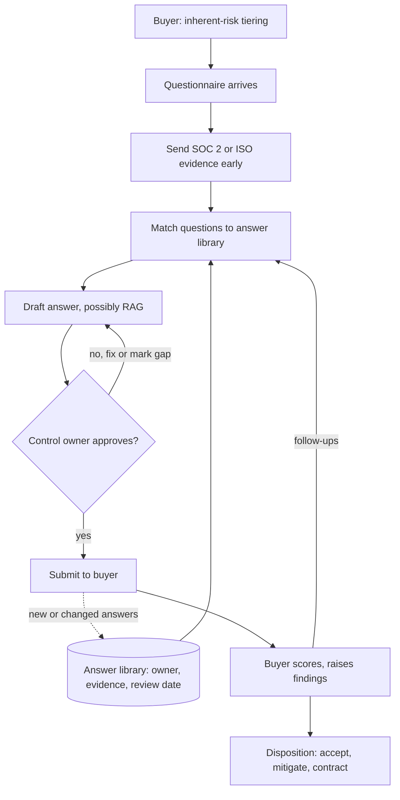

## TL;DR
A security questionnaire is the buyer's written audit of a vendor: hundreds of questions on encryption,
access, incidents, subprocessors and AI data use. Answers become contract commitments, so answer from
one maintained source of truth, precisely and never aspirationally.

## Why it exists
- **Buyers cannot inspect every vendor.** A large company may have thousands of vendors, each a possible
  path to a breach, so its risk team standardizes the inquiry: an industry template such as the Shared
  Assessments SIG or the Cloud Security Alliance's CAIQ, or a custom spreadsheet built from the buyer's
  own control framework.
- **Answers have consequences.** They are scored, gaps become findings, and serious gaps block
  procurement or become contract clauses.
- **AI vendors get extra scrutiny** because the product's core function is sending customer data to a
  model. Buyers ask what they never asked a CRM vendor: is our data used to train any model, which model
  providers see it, how long do they retain prompts, can your agent take actions, how do you stop prompt
  injection from exfiltrating data.
- **The naive approaches fail.** Answering from memory gives inconsistent answers across customers, which
  a sophisticated buyer or a later dispute will expose. Answering "Yes" to everything creates
  misrepresentation risk, because questionnaires are often incorporated by reference into the contract.
- **It is an interface, not paperwork.** Treated as separate from engineering, answers drift as the
  system changes. The questionnaire is a structured interface between your actual controls and the
  buyer's risk model, and should be maintained like one.

## How it works
### What arrives
- **Format.** Typically a spreadsheet or a portal from a third-party risk platform, with
  yes/no/not-applicable columns, a free-text comment and an evidence-upload field per question.
- **Domains:** governance and policies, access control and identity, encryption in transit and at rest,
  key management, network security, vulnerability management and penetration testing, logging and
  monitoring, incident response and notification, business continuity, data retention and deletion,
  privacy, subprocessors, secure development, and increasingly an AI section.

### What happens on the buyer's side
Understanding the reviewer's workflow explains what they reward:
1. **Inherent-risk tiering.** Before sending anything, the risk team classifies the engagement by what
   you will touch: data sensitivity, volume, network or system access, and how critical you are to
   operations.
   - A vendor processing patient records with agent tool access lands in the top tier; one that sees only
     marketing copy does not.
   - The tier sets the depth, *because* the team's review hours are the scarce resource.
   - Templates are built for this: the SIG comes in a shorter Lite and a fuller Core form, and CAIQ maps
     each question to a control in the CSA Cloud Controls Matrix.
2. **Scoring and findings.** Each answer is compared with the buyer's required control. A "No" or a vague
   answer on a required control becomes a finding with a severity.
3. **Follow-up and evidence requests.** Reviewers ask for proof on the answers that matter most to their
   tier; precise first answers mean fewer rounds.
4. **Disposition.** Findings are accepted as risk, mitigated by a compensating control, or turned into
   remediation commitments with dates, which often land in the contract.
5. **Reassessment.** High-tier vendors are typically re-reviewed periodically and on material change, so
   today's answer will be compared with next year's.

The upshot: a reviewer wants residual risk they can sign off on, not a perfect score, so a clearly scoped
gap with a mitigation is easier to approve than an ambiguous "Yes".

### Evidence that shortcuts it
Buyers accept independent assurance in place of many answers:

| Evidence | What it shows |
|---|---|
| SOC 2 Type II report | an auditor's opinion that controls operated effectively over a period |
| SOC 2 Type I report | control design at a point in time only |
| ISO/IEC 27001 certificate | a certified information security management system |
| Recent penetration test summary | independent testing, without the full findings |
| Public subprocessor list, trust center page | answers many questions at once |

Sending the report early, under NDA, often removes a large share of the questionnaire.

### The answer library
- **One library of approved answers**, each tied to the underlying control, an owner (security,
  infrastructure, legal, ML), the evidence that proves it and a review date.
- **Answering is retrieval.** New questionnaires are answered by matching each question to library
  entries and adapting wording; many teams use RAG over the library to draft responses.
- **A human owner approves every answer**, because a confidently wrong generated answer is precisely the
  misrepresentation you are trying to avoid.

### Writing a good answer
- **Fact, scope, mechanism, evidence.** State the fact, its scope and the mechanism, and say where it is
  evidenced.
- **Answer the question asked**, not a neighbouring one.
- **Honest gaps.** When the answer is "No" or "Partially", say so and add the compensating control or a
  dated roadmap item; reviewers deal with gaps constantly, but discovered misstatements destroy trust.
- **"Not applicable" only with a one-line reason.**

### The AI section
- **Expect questions on:** training use of customer data (yours and every model provider's), prompt and
  output retention by each subprocessor, region of processing, model provenance and evaluation, human
  oversight, guardrails against prompt injection and data leakage, tool permissions for agents, and how
  customers can delete their data including embeddings and caches.
- **Answer per data flow**, because the honest answer often differs between the hosted-API path and a
  self-hosted model path.

## Diagram
A questionnaire flows from the buyer's tiering through your answer library, where every draft passes
an accountable owner before it becomes a commitment.



## Examples
### Worked scenario: three answers in a 300-question health-tech review
| Question | Weak answer | Strong answer | Why |
|---|---|---|---|
| "Is customer data used to train AI models?" | "No." | "No. Customer prompts, documents and outputs are not used to train or fine-tune our models. Our LLM subprocessor processes data under API terms that exclude training use; its retention terms and region are listed on our subprocessor page. Evidence: DPA section 4, subprocessor list." | covers the subprocessor, which is what the buyer really wants to know |
| "Is all data encrypted at rest with customer-managed keys?" | "Yes." | "Partially": data at rest is encrypted with provider-managed keys; customer-managed keys exist only on the dedicated-deployment tier. Explain both tiers and point to the dedicated option. | "Yes" is true for one tier and false for the one this customer bought |
| "Do you retain prompts and responses?" | "No." | "Yes, for 30 days for debugging, access-restricted, deletable on request." | engineers found traces with full prompts kept for 30 days in the observability tool, which nobody had listed |

- **The third answer surfaced a real gap** before an audit did; the observability vendor was added to
  the subprocessor list.
- **Overall**, the SOC 2 report removed about a third of the questions as covered (an illustrative
  proportion), and the remaining answers were drafted from the library and approved by owners within the
  week.

### Answer library: match a new question and flag stale entries
A minimal sketch of the retrieval and freshness checks. Real libraries use embeddings or a
questionnaire platform; the routing to an owner and the review-date check are the parts that matter.

```python
from datetime import date

LIBRARY = [
    {"id": "AI-01", "q": "is customer data used to train ai models",
     "owner": "ml", "evidence": "DPA s4, subprocessor list", "reviewed": date(2026, 6, 1)},
    {"id": "ENC-03", "q": "is data encrypted at rest with customer managed keys",
     "owner": "infra", "evidence": "SOC 2 report, tier matrix", "reviewed": date(2025, 9, 15)},
    {"id": "RET-02", "q": "do you retain prompts and responses",
     "owner": "security", "evidence": "retention policy, trace config", "reviewed": date(2026, 8, 20)},
]

def words(text):
    return set(text.lower().replace("?", "").replace("-", " ").split())

def best_match(question, library=LIBRARY):
    q = words(question)
    score = lambda e: len(q & words(e["q"])) / len(q | words(e["q"]))
    entry = max(library, key=score)
    return entry, round(score(entry), 2)

def stale(library=LIBRARY, today=date(2026, 10, 20), max_age_days=180):
    return [e["id"] for e in library if (today - e["reviewed"]).days > max_age_days]

entry, s = best_match("Are customer prompts used to train or fine-tune models?")
print(entry["id"], s, "-> route to owner:", entry["owner"])
print("needs review before reuse:", stale())
# AI-01 0.38 -> route to owner: ml
# needs review before reuse: ['ENC-03']
```

## Production patterns
- **Answer library with owners and review dates.** Store each answer with its control, owner, evidence
  link and last-reviewed date; block reuse of entries past their review window (for example six months)
  until the owner re-approves. Track the share of stale entries.
- **Architecture-change trigger.** Add a pull-request template question such as "does this change a
  data flow, region, retention or subprocessor?" that pings the library owner. Monitor answers changed
  after engineering review; a high count means the library lags the system.
- **Trust center plus NDA-gated reports.** Publish the subprocessor list, data-flow summary and AI
  data-use statement; share the SOC 2 report and full pen-test results only under NDA. Measure
  questions answered by reference to it.
- **Subprocessor list reconciled with egress.** Periodically compare the published list with the
  vendors seen in DNS and egress logs and billing, because an unlisted observability or model vendor is
  the classic miss. Alert on any new external domain in production egress.
- **Per-flow AI answers.** Keep separate entries for the hosted-API path and the self-hosted path for
  training use, retention and region, and quote the one matching the customer's tier.
- **Measure the process.** Turnaround time, follow-up rounds per questionnaire and findings per review,
  tracked per buyer tier.

## Trade-offs
- **Templates vs custom forms.** Industry templates such as SIG or CAIQ let you answer once and reuse
  widely, but buyers with their own frameworks still send custom forms, so the library must map to both.
- **Independent reports vs cost.** Reports like SOC 2 shortcut many questions and carry weight, but cost
  significant time and money annually. For an early-stage vendor with few enterprise deals, a strong
  library may suffice first.
- **Specific answers vs commitments.** Detailed answers build trust and reduce follow-ups, but each
  detail is a commitment. Where the system changes often, describe the control and its guarantee rather
  than its exact implementation.
- **AI drafting vs accuracy.** Drafts from the library save hours per questionnaire, but only work when
  every generated answer is reviewed by the owner of the underlying control.

## Pitfalls
- **Answering aspirationally to unblock a deal.** Symptom: a later audit or incident shows the
  contract-referenced answer is false, turning a technical gap into a legal one.
- **Forgetting subprocessors in the data-flow story**, especially model providers and observability
  tools. Symptom: a buyer finds an unlisted vendor in your trace exports or DNS logs.
- **Letting answers diverge across customers.** Symptom: two customers compare notes, or the same
  question is answered differently in a renewal, prompting a full re-review.
- **Never revisiting answers after architecture changes.** Symptom: stale claims, for example "data
  never leaves the EU" after someone added a US-hosted model fallback route.
- **Attaching sensitive evidence without controls.** A full penetration-test report with unfixed
  findings or a detailed network diagram, on a portal outside an NDA. Symptom: your internal security
  detail circulates among people you have never met. Share summaries and attestation letters by
  default, full reports under NDA on request.
- **Treating "not applicable" as a shortcut.** Symptom: reviewer follow-ups asking why, which slow the
  review more than a one-line justified answer would have.

## When to use
- **Prepare before the first deal.** Every sale to a regulated or large enterprise passes through one:
  write the answer library, the subprocessor list, a data-flow diagram and the AI data-use statement
  while the architecture is fresh.
- **Pursue SOC 2 or ISO 27001** when the volume of questionnaires and deal size justify the audit cost.
- **Route through control owners**, not the account team alone.
- **Measure:** turnaround time, follow-up rounds and the number of answers changed after engineering review.
- **Interviews (FDE and architect):** expect "how do you answer a question where the honest answer is
  no?" The answer: honestly, with compensating controls and a dated plan.

## Role lens
- **Engineer:** Owns accurate answers about the systems they build, such as retention in traces,
  embedding deletion and model routing, and flags when a change invalidates a published answer.
- **Architect:** Designs data flows so the answers are good ones, for example a no-retention model path or
  a region-pinned tier, and keeps the authoritative data-flow diagram the answers rest on.
- **FDE:** Shepherds the customer's questionnaire through internal owners, explains gaps and compensating
  controls on calls, and feeds recurring asks back to product as roadmap items.

## Check yourself
**Q:** A prospect's questionnaire asks "Does any customer data leave the EU?" Your app runs in an EU
region, but its fallback model route goes to a US-hosted provider when the EU model is rate-limited, and
your error tracker is US-hosted. How do you answer, and what do you do beyond answering?
**A:** The honest answer is "Yes, in specific cases," followed by each flow: the fallback route may send
prompts to a US region when the EU model is throttled, and error events may contain request fragments sent
to a US-hosted tracker. Name the subprocessors, the transfer mechanism in the DPA, and any mitigations such
as scrubbing payloads from error events. Beyond the answer, offer a configuration that keeps data in the EU:
disable cross-region fallback for this tenant, accepting more throttling or degraded responses, and switch
the tracker to an EU instance or strip content. Then update the answer library and subprocessor list so the
next questionnaire is correct, and tell engineering the routing change has compliance consequences.

## Interview questions
### Why do enterprises send security questionnaires, and why do the answers matter so much?
- **Scale:** a buyer with thousands of vendors cannot inspect each one, so it collects standardized
  written claims and evidence, tiered by how much risk the vendor carries.
- **Consequence:** answers are scored into findings and are often incorporated by reference into the
  contract, so a false answer becomes a legal problem, not just a technical one.

### A questionnaire asks whether you retain prompts. You are not sure. What do you do?
- **Do not guess.** Route it to the owner of the data flow and check every place prompts can land:
  application logs, traces, error trackers, caches, and each model provider's retention terms.
- **Answer what you find**, with duration, access controls and deletion path, for example "Yes, 30 days
  for debugging, access-restricted, deletable on request".
- **Fix the record:** add any newly found vendor to the subprocessor list and update the library entry.

### When is pursuing SOC 2 not yet worth it?
- **Low deal volume:** an early-stage vendor with few enterprise deals may get further with a strong
  answer library, a clear data-flow diagram and a pen-test summary.
- **Cost:** a Type II audit costs significant time and money every year and covers a period, so it pays
  off once questionnaire volume and deal size justify it.
- **Signal to watch:** repeated deals stalling on "do you have a SOC 2 report?"

### How would you use an LLM to speed up questionnaire responses safely?
- **RAG over the approved library**, not over raw documents, so drafts reuse wording an owner already
  signed off.
- **Owner approval on every answer**, because a fluent wrong answer is a misrepresentation; track which
  answers were edited before sending.
- **Freshness gate:** refuse to draft from entries past their review date.

### What does a strong answer to an AI training-use question contain?
- **The direct answer** for your own models, then the same for every model subprocessor and their
  retention and region.
- **The mechanism and evidence:** the API terms that exclude training, the DPA section, the subprocessor list.
- **Per data flow:** separate statements for the hosted-API path and a self-hosted path, because the
  honest answers differ.

## Quiz
### Q: Why does sending a SOC 2 Type II report early often shorten a security questionnaire?
- [ ] It certifies the product is free of vulnerabilities
- [x] It is an independent auditor's opinion that controls operated over a period, which buyers accept in place of many individual answers
- [ ] It replaces the need for a data processing agreement
- [ ] It proves compliance with HIPAA and GDPR
> A Type II report gives third-party assurance on control operation over time, so buyers can mark whole
> domains as covered. It is not a vulnerability guarantee, a legal agreement or proof of any regulation.

### Q: The honest answer to "Do you support customer-managed encryption keys?" is "only on our dedicated tier," and this buyer is on the shared tier. What is the best response?
- [ ] Answer "Yes", since the product supports the feature
- [ ] Answer "Not applicable", since this buyer did not purchase that tier
- [x] Answer "Partially", explain which tier offers it and what protects data on the shared tier
- [ ] Leave the question blank and raise it on a call later
> A scoped, accurate answer with the alternative is both honest and useful. "Yes" would misstate this
> buyer's protection, and "not applicable" is wrong because the question applies to them.

### Q: Your team uses an LLM over the answer library to draft questionnaire responses. What control matters most?
- [ ] Using the largest available model to reduce errors
- [ ] Letting the model answer only yes/no questions
- [ ] Re-running the model until two drafts agree
- [x] Requiring the owner of each underlying control to approve the drafted answer before it is sent
> Retrieval speeds drafting, but answers are commitments, and a fluent wrong answer is a misrepresentation.
> Model size and agreement between drafts do not establish truth; an accountable owner's review does.
