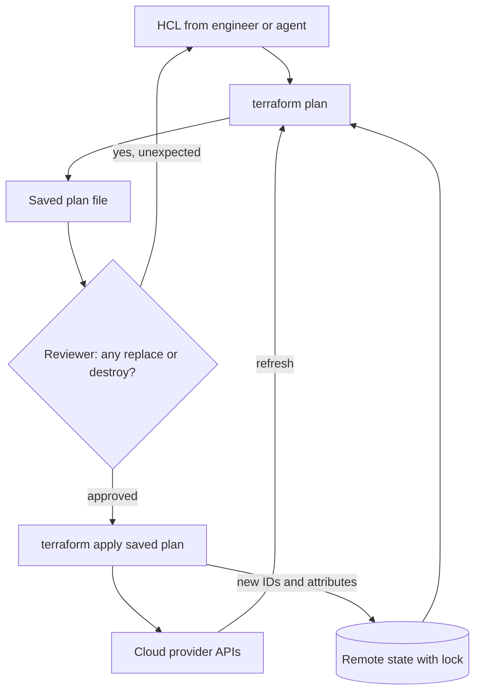

## TL;DR
Terraform declares an agent platform's infrastructure (private model endpoints, vector store, memory
tables, GPU node pools, tool IAM roles) as versioned HCL, shows a plan and applies only the difference,
so every environment and customer account is reproducible and reviewable.

## For agent builders
- **Why it matters for agents.** An agent in production rests on infrastructure: a private path to the
  model API, a vector database, a memory or checkpoint store, KMS keys, and IAM roles that decide what
  each tool may touch. Terraform makes that stack identical across staging, prod and each customer.
- **Where it shows up in your stack.** Modules for `aws_vpc_endpoint` and buckets, the IAM policy behind
  your agent's tool role, the remote state backend, and the CI pipeline that runs `terraform plan`.
- **What you control.** Least-privilege roles per tool, `prevent_destroy` on the vector store and memory
  tables, and the rule that an infra or coding agent may run plan but never apply without a human
  approval gate.
- **What you can skip.** Writing providers and the internals of the dependency graph. Know state, plan,
  the replace hazard, `moved` blocks and how to ship into an isolated account.

## Lab
### Task
Build the plan guard that sits behind an internal infra agent's `terraform plan` tool. It reads the JSON
form of a saved plan (`terraform show -json tfplan`) and blocks destroys and replaces of stateful
resources.

It also spots a rename that needs a `moved` block, counts the plan like Terraform does, and returns the
result to the model as a tool error it can act on.

The agent goal is the worked scenario's step 3: the model sees a harmless rename, the guard sees a
deleted bucket and a replaced memory table in prod, and the agent is told what to fix instead of being
allowed to ask for apply. Time box: 45-60 min.
- **Prerequisites:** CI/CD; this lesson's How it works (plan symbols, resource addresses) and the CI
  guard example.
- **Setup:** Python 3.10+ standard library, `pip install pytest` (checked with Python 3.12 and pytest 9).
  Save the starter as `lab.py` and the tests as `test_lab.py`. No Terraform install or cloud account is
  needed: the fixtures are trimmed `resource_changes` entries in the real JSON shape.

### Starter code
```python
"""Lab: a plan guard behind an infra agent's plan tool. Run: python lab.py"""
import json

# Stateful types: replacing or destroying one loses an index, memory or keys.
PROTECTED = {"aws_s3_bucket", "aws_db_instance", "aws_dynamodb_table", "aws_opensearch_domain", "aws_kms_key"}

def classify(actions: list) -> str:
    """Map change.actions from `terraform show -json` to one word:
    noop, read, create, update, delete or replace (either order of delete and create)."""
    # YOUR CODE HERE (1)
    raise NotImplementedError

def guard(plan: dict) -> dict:
    """Return {"ok", "blocked", "review", "hints", "summary"} for one plan.
    - Skip data sources (mode "data"); they are reads, not changes.
    - blocked / review: "REPLACE <address>" or "DESTROY <address>", blocked when the type is PROTECTED,
      in plan order.
    - hints: when a type has exactly one pure delete and exactly one pure create, the change is
      probably a rename: "moved { from = <deleted> to = <created> }".
    - summary: "N to add, M to change, K to destroy", counted like terraform plan (a replace adds 1
      and destroys 1).
    - ok is True only when nothing is blocked."""
    # YOUR CODE HERE (2)
    raise NotImplementedError

def plan_tool_result(plan: dict) -> dict:
    """What the agent's plan tool returns to the model.
    ok:      {"is_error": False, "content": "PASS: <summary>"}
    blocked: {"is_error": True, "content": "BLOCKED: " + "; ".join(blocked)}, then one line per hint,
             then a last line "Do not re-plan unchanged code; fix the configuration first."
    """
    # YOUR CODE HERE (3)
    raise NotImplementedError

# ---- fixtures: trimmed `terraform show -json tfplan` output -----------------------------------------
def rc(address, actions, mode="managed"):
    rtype = address.split(".")[-2]
    return {"address": address, "mode": mode, "type": rtype, "change": {"actions": actions}}

# The agent "tidied" names inside the shared rag module, then re-planned prod.
PROD_PLAN = {"resource_changes": [
    rc("data.aws_iam_policy_document.read_contract", ["read"], mode="data"),
    rc("module.rag.aws_s3_bucket.documents", ["delete"]),
    rc("module.rag.aws_s3_bucket.docs", ["create"]),
    rc("module.rag.aws_dynamodb_table.memory", ["delete", "create"]),
    rc("module.rag.aws_launch_template.gpu", ["create", "delete"]),
    rc("module.rag.aws_iam_policy.read_contract", ["update"]),
    rc("module.rag.aws_vpc_endpoint.model_runtime", ["no-op"]),
]}

# A new staging root calling the same module: three creates, nothing existing touched.
STAGING_PLAN = {"resource_changes": [
    rc("module.rag.aws_s3_bucket.documents", ["create"]),
    rc("module.rag.aws_dynamodb_table.memory", ["create"]),
    rc("module.rag.aws_vpc_endpoint.model_runtime", ["create"]),
]}

if __name__ == "__main__":
    g = guard(PROD_PLAN)
    for line in g["blocked"]:
        print("BLOCK ", line)
    for line in g["review"]:
        print("review", line)
    for line in g["hints"]:
        print("hint  ", line)
    print("prod:   ", g["summary"], "| ok:", g["ok"])
    print("staging:", json.dumps(plan_tool_result(STAGING_PLAN)))
    print("agent sees error:", plan_tool_result(PROD_PLAN)["is_error"])
```

### Expected output
On the starter, `python lab.py` stops at the first `guard` call with `NotImplementedError`. A correct
solution prints exactly:

```
BLOCK  DESTROY module.rag.aws_s3_bucket.documents
BLOCK  REPLACE module.rag.aws_dynamodb_table.memory
review REPLACE module.rag.aws_launch_template.gpu
hint   moved { from = module.rag.aws_s3_bucket.documents to = module.rag.aws_s3_bucket.docs }
prod:    3 to add, 1 to change, 3 to destroy | ok: False
staging: {"is_error": false, "content": "PASS: 3 to add, 0 to change, 0 to destroy"}
agent sees error: True
```

### Tests
Run `pytest -q test_lab.py`. On the starter all 12 fail with `NotImplementedError`; a correct solution
passes all 12.

```python
import pytest
from lab import PROD_PLAN, STAGING_PLAN, classify, guard, plan_tool_result, rc

@pytest.mark.parametrize("actions, word", [
    (["no-op"], "noop"), (["read"], "read"), (["create"], "create"), (["update"], "update"),
    (["delete"], "delete"), (["delete", "create"], "replace"), (["create", "delete"], "replace"),
])
def test_classify(actions, word):
    assert classify(actions) == word

def test_prod_blocks_protected_destroy_and_replace():
    g = guard(PROD_PLAN)
    assert g["blocked"] == ["DESTROY module.rag.aws_s3_bucket.documents",
                            "REPLACE module.rag.aws_dynamodb_table.memory"]
    assert g["review"] == ["REPLACE module.rag.aws_launch_template.gpu"]
    assert g["ok"] is False

def test_rename_hint_and_summary():
    g = guard(PROD_PLAN)
    assert g["hints"] == ["moved { from = module.rag.aws_s3_bucket.documents "
                          "to = module.rag.aws_s3_bucket.docs }"]
    assert g["summary"] == "3 to add, 1 to change, 3 to destroy"

def test_data_sources_and_noops_ignored():
    g = guard({"resource_changes": [rc("data.aws_kms_key.ext", ["read"], mode="data"),
                                    rc("aws_kms_key.rag", ["no-op"])]})
    assert g == {"ok": True, "blocked": [], "review": [], "hints": [],
                 "summary": "0 to add, 0 to change, 0 to destroy"}

def test_no_hint_when_ambiguous():
    plan = {"resource_changes": [rc("aws_s3_bucket.a", ["delete"]), rc("aws_s3_bucket.b", ["create"]),
                                 rc("aws_s3_bucket.c", ["create"])]}
    assert guard(plan)["hints"] == []

def test_tool_result_for_agent():
    assert plan_tool_result(STAGING_PLAN) == {"is_error": False,
                                              "content": "PASS: 3 to add, 0 to change, 0 to destroy"}
    r = plan_tool_result(PROD_PLAN)
    assert r["is_error"] is True
    lines = r["content"].splitlines()
    assert lines[0] == ("BLOCKED: DESTROY module.rag.aws_s3_bucket.documents; "
                        "REPLACE module.rag.aws_dynamodb_table.memory")
    assert lines[1].startswith("moved { from = module.rag.aws_s3_bucket.documents")
    assert lines[-1] == "Do not re-plan unchanged code; fix the configuration first."
```

### Failure scenarios
- **Test `"create" in actions` before checking for delete.** Both replace orders classify as create:
  the memory table's replace passes silently, the launch template leaves the review list, and the
  summary says 1 to destroy against Terraform's 3. Debug: print each address with its raw `actions`
  list next to your label, and diff your summary with the `Plan:` line of `terraform plan`.
- **Recognise only `["delete", "create"]` as replace.** `create_before_destroy` resources
  (`["create", "delete"]`) count as plain creates, so the launch template vanishes from review and the
  summary says 2 to destroy. Debug: the parametrized `classify` case for `["create", "delete"]` fails.
- **Pair any delete with the first create of its type.** With one delete and two creates the guard
  invents a `moved` hint; an agent that applies it moves state onto the wrong address. Debug:
  `test_no_hint_when_ambiguous` fails; only suggest a move when the pairing is unique.
- **Return the BLOCKED text with `is_error` false.** The model reads it as a successful plan and asks a
  human to approve the apply, or re-plans the same code. Debug: in the agent trace, look for a
  plan tool result containing BLOCKED followed by an approval request or an identical plan call.

### Submission
- **Code:** `lab.py` with the three `YOUR CODE HERE` parts implemented, standard library only, no edits to the fixtures.
- **Test run:** the output of `pytest -q test_lab.py` showing 12 passed.
- **Output:** the output of `python lab.py`, matching Expected output line for line.
- **A real plan:** the guard run on `terraform show -json` from one of your own roots (or a scratch
  root with a renamed bucket and `prevent_destroy` removed), with the printed lines.
- **Short note (5-8 sentences):** why a replace counts as both an add and a destroy, why the rename hint
  is only a hint a human confirms, and where `prevent_destroy` still catches what the guard misses.
- **Evaluation:** the tests pass unchanged, the output matches, and the note names the agent-facing
  behaviour (error result, no apply without a human).

## Why it exists
- **An AI platform is a lot of infrastructure.** A VPC with private subnets, private endpoints to the
  model API and storage, a Kubernetes cluster with a GPU node pool, a vector database, KMS keys, IAM
  roles, log sinks. An agent adds a memory store, checkpoint tables and one role per tool.
- **Console work works once.** Then you need a staging copy, the customer wants it in their own account
  in another region, and an auditor asks who opened port 443 to the world and when. Console changes
  leave no reviewable record, cannot be reproduced exactly, and drift: the third environment is never
  quite like the first.
- **Imperative scripts are brittle.** A shell file of CLI calls encodes steps rather than outcomes, so
  running it twice fails ("already exists") or duplicates resources, and it cannot say what would change
  before changing it.
- **Declarative IaC makes the files the source of truth.** You state what should exist; the tool works
  out the create, update and delete calls and shows them to a reviewer first. Changes go through pull
  requests, so a security reviewer approves the diff rather than trusting a screenshot.
- **Decisive for forward-deployed work.** The same reviewed module can be run by the customer's own
  platform team, in their account, under their change control.

## How it works
### Configuration, providers and the resource graph
- **Resources in HCL.** You write `.tf` files declaring resources (`aws_vpc_endpoint`,
  `google_container_node_pool`, `azurerm_private_endpoint`) with arguments.
- **Providers are plugins** translating each resource type into API calls for a cloud or service; that
  plugin model is why one tool covers AWS, Azure, Google Cloud, Kubernetes, DNS providers and many SaaS
  products.
- **A dependency graph.** References between resources (a security group ID used by an endpoint) become
  a graph; independent resources are created in parallel and dependent ones in order, which is why you
  rarely write ordering by hand.

### State
- **What it records.** What Terraform created, and the real IDs, in a state file.
- **Why it exists.** The tool must map `aws_s3_bucket.documents` in your code to one specific bucket in
  the account, and know which resources it owns so it can delete one you removed from the code.
- **Remote with locking.** Teams store state remotely (object storage, Terraform Cloud/HCP, or similar)
  with locking so two applies cannot run at once and corrupt it (the S3 backend's native lock file is
  `use_lockfile`), and version the state bucket so a bad write can be rolled back.
- **It is a secret.** State holds every attribute the provider returns, including generated passwords and
  keys, in plain text, so encrypt and access-control it like a secret. Never give an agent's tools read
  access to it.

### Plan and apply
1. **Plan.** `terraform plan` refreshes state from the real APIs, compares with your configuration and
   prints the create/update/replace/destroy actions.
2. **Read "replace" carefully.** Some argument changes cannot be updated in place and force
   destroy-then-create, which for a database or bucket means data loss: for an agent, an empty vector
   index or lost conversation memory.
3. **Apply exactly what was reviewed.** `terraform apply` executes a plan; in CI you save the plan file
   and apply exactly that plan after approval, so what was reviewed is what runs.

### How the diff decides update versus replace
- **Three inputs per resource:** the configuration, the last-recorded state, and what the refresh read
  from the API.
- **The provider schema decides.** If an argument differs, the schema says whether the API can change it
  in place (a tag, an instance count) or whether it is immutable once created (a bucket name, a
  cluster's subnet), in which case the action becomes replace.
- **Order of replacement.** Defaults to destroy-then-create *because* many names must be unique;
  `lifecycle { create_before_destroy = true }` reverses the order for stateless things like launch
  templates or certificates, so there is no gap.

| Plan symbol | Action | Risk |
|---|---|---|
| `+` | create | low |
| `~` | update in place | usually low; read the changed arguments |
| `-/+` | destroy then create (replace) | data loss for stateful resources |
| `+/-` | create then destroy (`create_before_destroy`) | brief duplicate; names must allow it |
| `-` | destroy | check it was intended |

### Resource addresses are identity
- **State keys objects by code address** (`module.rag.aws_s3_bucket.documents`), not by cloud ID.
- **So refactors look like replacement.** Renaming a block, moving it into a module or switching `count`
  to `for_each` reads as "delete the old address, create a new one", even though nothing real changed.
- **The fix.** A `moved { from = ..., to = ... }` block (or `terraform state mv`) says the object merely
  changed address, and the plan becomes a no-op. This is the mechanism behind most "harmless refactor
  recreated the database" stories.

### Modules, environments and drift
- **Modules are functions.** They package resources behind input variables and outputs. A "customer
  agent deployment" module might take a VPC ID, subnet IDs, region and KMS key, and output the agent
  service URL; each environment or customer is a small root configuration calling it with different
  inputs.
- **Drift.** If someone changes a resource in the console, the next plan shows drift and proposes
  reverting it.
- **Import.** Existing hand-built resources are adopted with an `import` block (Terraform 1.5+) or
  `terraform import`, so
  they come under management without being recreated.

### One state per environment
Each environment or customer gets its own state, so a plan for staging cannot touch production.

| Layout | Pros | Cons |
|---|---|---|
| Separate root directories per environment | explicit; each has its own backend key and credentials | some duplication |
| CLI workspaces sharing one configuration | less duplication | same credentials; an easy-to-forget `terraform workspace select` |

For customer accounts with separate change boards, separate roots with separate backends is the usual
choice *because* the isolation boundary should match the approval boundary.

### When an agent drives Terraform
Infra and coding agents increasingly propose infrastructure changes. Treat `plan` as a read-only tool
and `apply` as a consequential action:
- **Plan is safe to automate** in a sandboxed workspace with read-only cloud credentials, because it
  changes nothing real.
- **Apply needs a human gate** on the saved plan file, because the model cannot be trusted to read a
  `-/+` line on a stateful resource correctly every time.
- **The plan guard is the agent's guardrail too:** run it on the agent's plan and return blocked changes
  to the model as a tool error.

### Alternatives
| Tool | Shape | Note |
|---|---|---|
| CloudFormation (AWS), Bicep/ARM (Azure) | native, single-cloud | no state file to manage, since the provider tracks it |
| Pulumi, AWS CDK | general-purpose languages | helps loops and abstraction; reviews depend on reading code rather than a declarative file |
| OpenTofu | community fork of Terraform | created after HashiCorp moved Terraform to the Business Source License in 2023; keeps HCL and the provider ecosystem; open source |

## Diagram
The reviewed plan, not the code, is what gets applied, whether a human or an agent wrote the code;
state is the bridge between code addresses and real objects.



## Examples
### Module for private model access
- **What it contains.** A locked remote state, a security group that only admits the app subnet, an
  interface endpoint for the model runtime with private DNS, and a document bucket protected from
  accidental destruction. This is the base layer a RAG agent needs.
- **Check the names.** Argument names follow the AWS provider; check them against the provider version
  you pin.

```hcl
terraform {
  required_providers {
    aws = { source = "hashicorp/aws", version = "~> 5.0" }
  }
  backend "s3" {
    bucket         = "acme-tfstate"
    key            = "ai-platform/prod.tfstate"
    region         = "eu-west-1"
    use_lockfile   = true         # S3-native lock file (added in 1.10, GA in 1.11); supersedes dynamodb_table
    encrypt        = true
  }
}

variable "vpc_id"             { type = string }
variable "private_subnet_ids" { type = list(string) }
variable "app_cidr"           { type = string }

resource "aws_security_group" "model_ep" {
  name   = "model-runtime-endpoint"
  vpc_id = var.vpc_id
  ingress {
    from_port   = 443
    to_port     = 443
    protocol    = "tcp"
    cidr_blocks = [var.app_cidr]
  }
}

resource "aws_vpc_endpoint" "model_runtime" {
  vpc_id              = var.vpc_id
  service_name        = "com.amazonaws.eu-west-1.bedrock-runtime"
  vpc_endpoint_type   = "Interface"
  subnet_ids          = var.private_subnet_ids     # one subnet per availability zone
  security_group_ids  = [aws_security_group.model_ep.id]
  private_dns_enabled = true
}

resource "aws_s3_bucket" "documents" {
  bucket = "acme-rag-documents-prod"
  lifecycle { prevent_destroy = true }   # plan fails instead of deleting customer data
}
```

- **Fresh account:** `terraform plan` shows three resources to add.
- **Changing `bucket` later** would show a replace, and `prevent_destroy` turns that into an error
  rather than a deleted archive.
- **Limit of the guard.** It lives in the resource block, so it does not protect against someone
  deleting the block itself; pair it with bucket versioning or a deletion-protection setting on the
  cloud side.

### A least-privilege role for one agent tool
Each tool gets its own role, so a prompt-injected agent can only do what that tool's policy allows. Here
the `read_contract` tool may read objects under one prefix of the documents bucket and nothing else.

```hcl
data "aws_iam_policy_document" "read_contract" {
  statement {
    actions   = ["s3:GetObject"]
    resources = ["${aws_s3_bucket.documents.arn}/contracts/*"]
  }
}

resource "aws_iam_policy" "read_contract" {
  name   = "agent-tool-read-contract"
  policy = data.aws_iam_policy_document.read_contract.json
}
```

- **Review it as a diff.** Widening `resources` to the whole bucket shows up in the plan as a `~` on the
  policy, which a security reviewer can reject before the agent ever gains the access.

### Refactor and adopt without recreating anything
Moving the bucket into a module, and adopting a hand-built KMS key, both as plan-visible code.

```hcl
moved {
  from = aws_s3_bucket.documents
  to   = module.rag.aws_s3_bucket.documents
}

import {
  to = aws_kms_key.rag
  id = "1234abcd-12ab-34cd-56ef-1234567890ab"   # the existing key's ID
}
```

Expected plan: zero destroys, one import, and no change for the moved bucket. Anything else means the
refactor is not what you think.

### CI guard that blocks replacing data resources
Reads the JSON form of a saved plan (`terraform show -json tfplan`) and fails the pipeline if a protected
resource type would be destroyed or replaced. The same script can sit behind an agent's plan tool.

```python
"""Fail CI if a Terraform plan deletes or replaces protected resources.
Usage: terraform show -json tfplan > plan.json && python plan_guard.py plan.json"""
import json, sys

PROTECTED = {"aws_s3_bucket", "aws_db_instance", "aws_opensearch_domain", "aws_kms_key"}

def risky_changes(plan):
    for rc in plan.get("resource_changes", []):
        actions = rc["change"]["actions"]          # e.g. ["update"], ["delete", "create"]
        if "delete" in actions:
            kind = "REPLACE" if "create" in actions else "DESTROY"
            yield kind, rc["address"], rc["type"]

def main(path):
    plan = json.load(open(path))
    blocked = 0
    for kind, address, rtype in risky_changes(plan):
        flag = "BLOCK" if rtype in PROTECTED else "review"
        blocked += flag == "BLOCK"
        print(f"{flag:6} {kind:7} {address}")
    sys.exit(1 if blocked else 0)

if __name__ == "__main__":
    main(sys.argv[1])
# BLOCK  REPLACE module.rag.aws_s3_bucket.documents
# review REPLACE aws_launch_template.gpu
```

### Worked scenario: an infra agent proposes a change
An internal platform agent receives "add a staging copy of the RAG stack" and edits HCL in a branch. Its
only Terraform tool runs plan; apply waits for a human.

| Step | What happens | Gate |
|---|---|---|
| 1. Agent edits modules | adds a staging root calling `module.rag` | code review |
| 2. Agent calls plan tool | plan: 3 to add, 0 to change, 0 to destroy | plan guard passes |
| 3. Agent "tidies" resource names inside the shared `rag` module | prod re-plan: 3 destroys, 3 creates | guard returns BLOCK to the agent |
| 4. Agent adds `moved` blocks in the module | prod: no changes; staging: 3 to add | guard passes |
| 5. Human approves saved plan | `terraform apply tfplan` in CI | change ticket |

Step 3 is the one that matters: the model saw a harmless rename, the guard saw a replaced bucket in an
environment that already exists. A rename in the not-yet-applied staging root alone would destroy nothing.

## Production patterns
- **Saved plan, exact apply.** In CI run `terraform plan -out=tfplan` on every pull request, attach the
  rendered plan to the review or change ticket, and apply with `terraform apply tfplan` after approval.
  Monitor applies that ran without a matching reviewed plan; the target is none.
- **One role per agent tool.** Define each tool's IAM role in Terraform next to the agent service, scoped
  to the resources that tool needs, so tool permissions are reviewed as diffs. Monitor access-denied
  errors per tool role; a spike means a tool needs a scoped change, not a wildcard.
- **Scheduled drift detection.** Run `terraform plan -detailed-exitcode` nightly against main; exit code
  2 means changes are pending. Alert on non-empty plans and trace each to a console change or a missing
  back-port.
- **Pin providers and commit the lock file.** Use version constraints like `~> 5.0` and commit
  `.terraform.lock.hcl`; upgrade deliberately with `terraform init -upgrade` in its own pull request.
  Watch for plans that change resources nobody touched.
- **Provider mirror for isolated accounts.** Build it with `terraform providers mirror <dir>`, ship it in
  the release bundle, and point the customer's CLI configuration at it with a `filesystem_mirror` block,
  so `terraform init` never reaches the public registry.
- **Split state by layer and guard data twice.** Separate network, cluster and application states so a
  routine app change cannot plan against the VPC; pass values with outputs and data sources, and track
  plan duration per state. Protect the
  vector store and memory tables with `prevent_destroy`, cloud-side deletion protection, and the
  plan-guard script in CI.

## Trade-offs
- **Reviewable plans vs critical state.** Declarative plans make every change reviewable before it
  happens, but the state file becomes critical shared infrastructure; losing or corrupting it is worse
  than losing the code.
- **Multi-cloud breadth vs native simplicity.** One tool across clouds and SaaS providers helps teams
  deploying agents into varied customer accounts, but a single-cloud team may find native CloudFormation
  or Bicep simpler since there is no state to operate.
- **Restricted HCL vs expressive code.** HCL keeps configurations readable for security reviewers, but
  complex logic (dynamic topologies, heavy loops) is awkward; general-purpose IaC tools win when logic
  dominates.
- **One big state vs split states.** Large single state files give one view of everything but make plans
  slow and blast radius big. Splitting by layer (network, cluster, app) limits damage at the cost of
  cross-state references.
- **Agent-written IaC vs review load.** An agent can draft modules and plans fast, but every plan still
  needs a human to read replace lines. Worth it when the guard catches the dangerous cases and review
  stays on the diff.

## Pitfalls
- **Committing state or secrets to git, or storing state unencrypted.** Symptom: a secret scanner alert,
  or an auditor finding database passwords readable by everyone with repository access. Diagnose:
  `git log --all -- '*.tfstate'` and the backend's encryption and access settings. Fix: remote encrypted
  state, rotate every secret it held.
- **Approving a plan without reading "must be replaced" lines.** Symptom: a vector database or bucket
  recreated empty, and the agent answers with no retrieval hits. Cause: an immutable argument changed.
  Diagnose: in `terraform show -json`, list changes whose actions contain both delete and create. Fix:
  the plan guard in CI.
- **Refactoring names or module structure without `moved` blocks.** Symptom: equal destroys and creates
  for a pull request that "only renamed things". Diagnose: pair each destroyed address with a created
  one of the same type. Fix: `moved` blocks until the plan is a no-op.
- **Unpinned provider versions or an uncommitted `.terraform.lock.hcl`.** Symptom: a plan proposing
  changes nobody made, after a provider release changed a default. Diagnose: diff the provider version
  in `terraform version` against the last good run.
- **Emergency console fixes never back-ported.** Symptom: the next routine apply silently reverts the
  fix and re-causes the incident. Diagnose: nightly `-detailed-exitcode` drift plans; exit code 2 flags it.
- **Giving an agent apply rights.** Symptom: an infra agent "fixes" a failing plan by applying it, and a
  stateful resource is replaced. Fix: plan-only credentials and human approval of the saved plan.
- **Assuming an air-gapped environment can download providers.** Symptom: `terraform init` fails. Fix:
  ship a provider mirror.

## When to use
- **Use IaC for** anything that must exist in more than one environment or survive an audit: every
  production AI deployment, and every customer-VPC deployment of an agent.
- **Terraform or OpenTofu by default** when you deploy across clouds or into many customer accounts, or
  when the customer's platform team already uses it.
- **Native templates** when an organization is single-cloud and mandates them.
- **Not for application rollout.** Keep container versions and model weights in a deploy tool such as
  Helm or Argo rather than Terraform, since those change far more often. Prompts and tool definitions
  belong with the agent's code and release process, not in Terraform.
- **Measure:** drift (plans that are not empty on main) and time to stand up a new environment.
- **Interviews:** expect probes on state, plan review and the replace hazard.

## Exercise
**Goal:** extend the plan guard into the safety layer an infra agent's plan tool returns.
- **Inputs:** hand-written plan JSON fixtures in the `terraform show -json` shape: a clean add, a bucket
  replace, a rename with and without a `moved` block (moved resources carry `previous_address`), and an
  IAM policy update widening `Resource` to `*`.
- **Deliver:** a function returning a structured summary for the model (adds, changes, destroys, blocked
  addresses with a reason), plus a rule flagging wildcard widenings in IAM policy diffs.
- **Acceptance:** pytest passes on every fixture; the replace and the wildcard return BLOCK; the moved
  rename returns zero destroys; if Terraform is installed, a real `terraform_data` rename reproduces the
  fixture.

## Role lens
- **Engineer:** Writes modules for GPU node pools, endpoints and buckets, runs plan in CI on every pull
  request, and reads each replace or destroy action before approving.
- **Architect:** Sets the state layout, module boundaries and versioning, decides which layer IaC owns
  versus the deploy tool, and makes plan output part of the change-approval evidence.
- **FDE:** Hands the customer a versioned module and variables file their platform team can run in their
  own account, plus a provider mirror when their environment cannot reach the registry.

## Check yourself
**Q:** A customer's platform team must run your deployment in their own AWS account under their change
board, and they forbid your engineers from having write access. How do you structure the Terraform
delivery so it is reviewable, repeatable and safe for them to run?
**A:** Ship a versioned module with a narrow, documented variable interface (VPC and subnet IDs, KMS key,
region, sizing), no hard-coded account details, and pinned provider versions. Their root configuration
calls it, with state in their backend under their access controls and locking. Their CI runs plan and
attaches the saved plan to the change ticket; the board reviews it, and apply executes exactly that
plan. Protect data resources with `prevent_destroy`, document every replace-triggering argument, and
publish an IAM policy listing the permissions the apply role needs. For upgrades, release a new module
version with a changelog and an expected-plan summary so they can compare. If the account is isolated,
include a provider mirror.

## Interview questions
### What is declarative IaC, and why is it better than a script of CLI calls?
- **Declarative:** you describe the desired end state and the tool computes create, update and delete
  calls by diffing code, state and the real APIs.
- **Why better:** it is idempotent (running twice changes nothing), it can show a plan before acting, and
  changes go through code review instead of screenshots.
- **Scripts encode steps**, so re-runs fail with "already exists" or duplicate resources.

### A pull request that only renamed modules shows 14 destroys and 14 creates. What happened and what do you do?
- **Cause:** state keys objects by address, so new addresses look like new resources and old ones look
  removed.
- **Fix:** add `moved` blocks from each old address to the new one (or `terraform state mv`) and re-plan
  until it is a no-op.
- **Guard:** a CI check that fails on destroys of stateful types would have stopped the apply.

### You are giving an internal infra agent the ability to change Terraform. How do you make that safe?
- **Split the tools:** a plan tool with read-only cloud credentials in a sandboxed workspace, and no apply
  tool at all; apply runs in CI from the saved plan after a human approves.
- **Guard the plan:** run the plan guard on every agent plan and return blocked replaces or destroys to
  the model as an error it must resolve, for example with `moved` blocks.
- **Keep secrets away:** the agent never reads state, since state holds generated passwords and keys in
  plain text.

### How do you deliver Terraform into an air-gapped customer account?
- **Ship providers with the release:** build a mirror with `terraform providers mirror`, and configure a
  filesystem mirror so `terraform init` never contacts the registry.
- **Pin versions and include the lock file** so the mirror and the plan agree.
- **Ship modules as files** with an expected-plan summary, since the customer cannot pull them from a
  registry either.

## Quiz
### Q: Why does Terraform need a state file at all, when it could just query the cloud APIs?
- [ ] To cache API responses so plans run faster
- [x] To map each resource in the code to the specific real object it manages, including ones removed from code that must be deleted
- [ ] Because cloud APIs do not report resource attributes
- [ ] To store the HCL source in a binary form
> Without state, Terraform cannot know which real bucket corresponds to a resource block, or which objects
> it owns when a block is deleted. Refreshing does query the APIs, but only for objects state identifies.

### Q: A reviewer sees a plan line saying the vector database cluster "must be replaced" after a minor-looking argument change. What is the right response?
- [ ] Approve it, since Terraform preserves data during replacement
- [ ] Run apply twice so the second run cancels the replacement
- [x] Treat it as destroy-and-recreate with data loss, and find an in-place path or a planned migration before applying
- [ ] Delete the state file so Terraform forgets the cluster exists
> Replacement destroys the existing resource and creates a new one, so stored data is lost unless
> migrated. Deleting state would make Terraform try to create a duplicate and abandon the original unmanaged.

### Q: Why might an AWS-only team reasonably prefer CloudFormation over Terraform?
- [ ] CloudFormation supports more third-party SaaS providers
- [ ] Terraform cannot manage AWS networking resources
- [ ] CloudFormation lets you write infrastructure in Python
- [x] AWS tracks the stack state itself, so there is no separate state file and locking setup to operate
> The native service manages state and rollback for you, which removes an operational burden. Terraform's
> advantage is breadth across clouds and SaaS, and Python-based infrastructure belongs to CDK or Pulumi.

## Mastery test
**Problem:** a customer's change board must approve every apply in their account. Your team switches a
module's three vector-store collections from `count` to `for_each` and bumps the AWS provider from 5.x
to 6.x in the same pull request.

The plan shows 3 destroys, 3 creates and 2 unexpected in-place updates. What do you do before anything
reaches the board?

**A strong answer:**
- splits the PR, because two causes in one plan make neither reviewable;
- explains the 3 replaces as address changes (`[0]` to `["name"]`) and adds `moved` blocks until zero
  destroys;
- isolates the provider upgrade with `terraform init -upgrade` alone and traces each update to a changed
  default in the changelog, knowing state written by 6.x may not load under 5.x;
- hands the board a saved plan per change, applied exactly, with the guard output attached.

## Use cases & projects
### Use cases
- **Reproducible agent stacks per customer.** One module stands up the private model endpoint, vector
  store, memory tables and tool roles in each customer account under their change board.
- **Least-privilege tool permissions.** Each agent tool's IAM role lives in code, so security reviews
  every widening as a plan diff.
- **Protecting agent memory and indexes.** `prevent_destroy` and the plan guard stop a refactor from
  recreating the vector database or conversation store empty.
- **Infra agents with approval gates.** A platform agent drafts HCL and runs plan; humans approve the
  saved plan before apply.

### Mini project
**Build a plan-only Terraform tool for an agent (2-3 hours).**
- **Goal:** let an agent propose infrastructure changes while a guard and a human keep apply safe.
- **Steps:** apply a small baseline yourself first (against LocalStack, or with `terraform_data`
  resources and the guard's `PROTECTED` set adjusted), so state exists; write a tool that runs
  `terraform plan -out=tfplan -input=false` and `terraform show -json tfplan`; run the plan guard on the
  JSON and return a summary (adds, changes, destroys, blocked addresses) to the model; give a small
  tool-calling agent the task "rename the documents bucket block" and observe it respond to a BLOCK.
- **Done when:** the agent's first attempt is blocked, it recovers by adding a `moved` block until the plan
  shows zero destroys, and there is no apply tool anywhere in its tool list.
