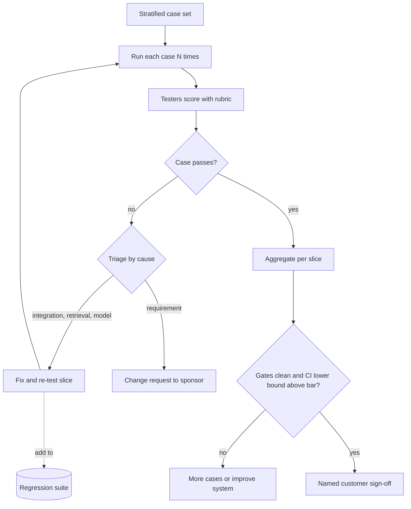

## TL;DR
In UAT the customer's real users run the system on realistic tasks against criteria agreed up front.
For AI systems it scores samples with a rubric, sizes the sample for a meaningful pass rate, and
separates model defects from integration bugs.

## Why it exists
- **"Passes our tests" is not "does the job".** Engineering tests check the builders' understanding of
  the requirement. They miss a misunderstood requirement, an unmentioned workflow step, or a correct but
  useless output: a claims summary missing the one field adjusters always check, or a cited policy in a
  format compliance cannot file.
- **Only users know those things**, and they often discover them only by using the system.
- **Acceptance is often contractual.** In enterprise and forward-deployed work it triggers payment or the
  pilot-to-production move. Without a defined UAT it becomes a negotiation over impressions: two bad demo
  answers stall the project, or everyone says "looks good" and the system is abandoned three weeks after
  launch.
- **The naive version fails for AI.** "Give users access for two weeks and ask what they think" means a
  handful of queries per person, judged on memorable failures. Output varies run to run, so one tester
  passes what another fails, and without a rubric nobody can settle it.
- **So design it like an experiment:** fixed criteria, representative cases, a scoring rubric, and a
  sample large enough to separate "good enough" from "not quite".

## How it works
### 1. Fix acceptance criteria before testing starts
- **Criteria come from scoping, written as measurable statements:** "at least 85% of triage
  recommendations rated correct or acceptable by adjusters", "zero responses that disclose another
  customer's data", "p95 response under 8 seconds".
- **Hard gates** (safety, privacy, legal): any single failure blocks.
- **Rate thresholds** (quality metrics): judged on a sample.
- **Keep them separate**, because a single privacy leak is not averaged away by 99 good answers.

### 2. Build a representative case set
- **Draw from real historical work**, stratified by the slices the business cares about (claim type,
  language, document quality, customer tier), plus deliberately chosen edge cases.
- **Representativeness matters** because the pass rate on easy cases tells you nothing about the hard
  ones.
- **Store a reference answer per case**, written by subject-matter experts, so scoring is not improvised.

### 3. Run in a production-like environment
- **Use the real integrations** (identity, document stores, downstream systems) with production-shaped
  data, isolated from production writes.
- **Not mocks**, because mocks hide the integration failures UAT is best at catching: permission errors,
  slow connectors, malformed documents.

### 4. Score with a rubric, not a thumbs-up
- **A small scale with written definitions**, for example *correct*, *acceptable with minor edit*,
  *wrong*, *harmful*.
- **Overlap a fraction of cases between testers and measure agreement**, because if two adjusters
  disagree on the same output, the criterion is ambiguous and must be fixed before the numbers mean
  anything.

### 5. Size the sample and handle non-determinism
A rate threshold is a claim about the true pass rate, so the lower end of the confidence interval must
clear the bar. A planning estimate with the normal approximation:

```
n ≈ z² · p(1 − p) / m²        z = 1.96 for 95%, p = expected pass rate, m = margin you can afford
```

| Expected rate | Bar | Margin | Normal estimate | Wilson (reporting) |
|---|---|---|---|---|
| 88% | 85% | 3 points | 1.96² × 0.88 × 0.12 / 0.03² ≈ 450 cases | roughly 550 cases (slightly more conservative) |

- **The m² in the denominator is the lesson:** halving the margin quadruples the cases. A criterion set
  just below the expected rate is expensive to prove, so negotiate the bar and the sample together during
  scoping rather than at sign-off.
- **Repeated runs are not independent samples.** Running each case three times does not turn 200 cases
  into 600 observations, because runs of one case share input and difficulty and fail together.
- **Score at the case level:** for example "passes on at least 2 of 3 runs", or the per-case pass
  fraction averaged across cases.
- **Report the run-to-run flip rate separately.** A case that passes once and fails once is a stability
  defect in its own right, even if the average looks fine.

### 6. Triage defects by cause
Every failure gets a severity (blocker, major, minor) and a cause; the cause decides the fix and whether
a re-test is needed.

| Cause | Meaning |
|---|---|
| **Integration** | Wrong data reached the model |
| **Retrieval** | Right data existed, was not found |
| **Model/prompt** | Right context, wrong answer |
| **Requirement** | System did what was specified; the specification was wrong |

- **A requirement finding is a change request, not a defect.** Treating it as a defect is how UAT never
  ends.

### 7. Exit and sign off
1. Hard gates are clean.
2. Rate thresholds are met with enough confidence.
3. No open blockers remain.
4. A named person on the customer side signs off, recorded.
5. Every failing case found during UAT goes into the customer-specific regression suite so it stays
   fixed.

## Diagram
Each case is run, scored against the rubric and, if it fails, triaged by cause; exit needs clean gates
and a confident pass rate.



## Examples
### Is 88% on 200 cases enough? A Wilson interval check
```python
from math import sqrt

def wilson(passed, n, z=1.96):
    p = passed / n
    denom = 1 + z * z / n
    centre = (p + z * z / (2 * n)) / denom
    half = z * sqrt(p * (1 - p) / n + z * z / (4 * n * n)) / denom
    return centre - half, centre + half

bar = 0.85
for passed, n in [(176, 200), (352, 400), (528, 600)]:
    lo, hi = wilson(passed, n)
    print(f"{passed}/{n}: {lo:.1%} to {hi:.1%}  clears bar: {lo >= bar}")
# 176/200: 82.8% to 91.8%  clears bar: False
# 352/400: 84.4% to 90.8%  clears bar: False
# 528/600: 85.2% to 90.4%  clears bar: True
```

### Worked scenario: an insurer's triage sign-off
The criterion is "at least 85% of triage recommendations rated correct or acceptable". Adjusters score
200 stratified cases and 176 pass: **88%**. The project manager wants to sign off.

| Sample at 88% | 95% Wilson interval | Clears 85%? |
|---|---|---|
| 200 cases | roughly **82.8% to 91.8%** | No |
| 400 cases | roughly 84.4% to 90.8% | No, still not clear |
| about 600 cases | roughly 85.2% to 90.4% | Yes |

- **The sample cannot tell** "comfortably above the bar" from "slightly below it", because the lower bound
  is below 85%.
- **The options are concrete:** score about 400 more cases, renegotiate to judge on the point estimate (an
  explicit, recorded decision), or improve the system so the observed rate rises.

The slice view changes the story:

| Slice | Cases | Passed | Rate |
|---|---|---|---|
| Handwritten claim forms | 40 of 200 (20%) | 25 of 40 | about 62% |
| Typed forms | 160 | 151 of 160 | about 94% |

- **The aggregate hides an unfit slice.** Of the 24 failures, 15 are handwritten forms.
- **Triage points to integration:** 11 of the 15 are OCR-quality failures, not model reasoning. The fix
  is the document parser, followed by a re-test of that slice only.

### Case-level scoring with repeated runs
```python
runs = {  # case_id -> pass/fail for 3 runs
    "c1": [True, True, True], "c2": [True, False, True],
    "c3": [False, False, False], "c4": [True, False, False],
}
case_pass = {c: sum(r) >= 2 for c, r in runs.items()}          # "passes on at least 2 of 3"
flip_rate = sum(len(set(r)) > 1 for r in runs.values()) / len(runs)
print(sum(case_pass.values()) / len(runs), flip_rate)        # 0.5 0.5 -> report both
```

## Production patterns
- **Pre-registered acceptance doc.** At scoping, write hard gates, rate thresholds, sample size and the
  slices to report, and get the sponsor's sign-off on that document. Monitor how many criteria change
  after UAT starts (should be zero without a recorded change request).
- **Calibration round before scoring.** Testers score the same 20 to 30 outputs, discuss disagreements,
  and tighten rubric definitions before the main round. Monitor inter-rater agreement (for example Cohen's
  kappa) on the overlap set throughout.
- **Repeated runs with case-level verdicts.** The harness runs each case several times, records a
  case-level verdict, and reports flip rate as its own metric. Monitor flip rate per slice; a rising flip
  rate after a prompt change is a stability regression.
- **Defect tracker with a cause field.** Every failure is filed with severity and one of integration,
  retrieval, model/prompt or requirement; requirement findings route to the change-request process.
  Monitor defects by cause per round to see whether rounds converge.
- **Failures become regression cases.** Each failing UAT case is exported with its trace into the
  customer-specific regression suite, which then gates every later release.

## Trade-offs
- **Statistical power vs SME time.** Larger, stratified case sets give meaningful results but consume
  scarce expert time; when experts are expensive, spend the budget on high-risk slices and accept wider
  intervals elsewhere.
- **Scripted vs exploratory.** Scripted cases make results comparable and repeatable, while exploratory
  use surfaces unknown workflow needs; run both, and weight exploratory findings more heavily early in
  UAT.
- **Absolute bar vs baseline.** Strict exit criteria protect the customer, but may block a system already
  better than the current manual process; when a baseline exists, judging against it can be the more
  honest criterion.
- **Realism vs lead time.** Production-like data catches real integration failures but needs data access
  approvals that can take weeks; start those at kickoff, not at UAT.

## Pitfalls
- **Defining criteria during UAT.** Symptom: a moving target where each round of fixes surfaces a new
  expectation nobody wrote down. Fix: pre-register criteria in scoping.
- **Letting the build team score outputs.** Symptom: a high UAT pass rate followed by low adoption and
  complaints in the first week of hypercare. Fix: the customer's users score.
- **Running each case once.** Symptom: a failure the engineers "cannot reproduce" because a re-run happens
  to pass. Fix: repeated runs with case-level verdicts.
- **Treating every change request as a defect.** Symptom: UAT rounds that never converge and a backlog
  where scope creep is indistinguishable from bugs. Fix: a requirement cause class.
- **Judging on the aggregate only.** Symptom: a passing headline number while one slice, such as one
  language or document type, fails badly. Fix: per-slice reporting.

## When to use
- **Use when:** people other than the builders will use the system and acceptance carries weight: a
  customer go-live, a pilot-to-production gate, a contractual milestone.
- **Plan it during scoping**, because the case set, rubric, environment and data approvals take longer
  than the testing itself.
- **Go lighter for internal tools** with a small user group: a few power users and a short rubric.
- **Measure:** pass rate with a confidence interval, per-slice pass rates, inter-rater agreement and
  defect counts by cause.
- **Interviews:** the depth signal is criteria fixed in advance, sample size, non-determinism and triage
  by cause, rather than "users tried it and liked it".

## Role lens
- **Engineer:** Builds the UAT harness: case loading, repeated runs per case, rubric capture, and export
  of every failure into the regression suite with its trace attached.
- **Architect:** Defines the UAT environment boundary, ensuring production-like integrations and data
  without production writes, and owns how acceptance criteria map to measurable signals.
- **FDE:** Recruits the customer's testers, runs calibration on the rubric, triages findings with them,
  and separates genuine defects from change requests in front of the sponsor.

## Check yourself
**Q:** UAT testers rate a summarisation feature at 90% acceptable, but two senior adjusters say it is
unusable. How do you reconcile this before sign-off?
**A:** First check whether the disagreement is about the rubric or the cases. Have the seniors and other
testers score the same overlapping outputs; low agreement means "acceptable" is defined differently and
the rubric needs tightening, perhaps because seniors need a field others ignore. Then check slices: the
seniors may handle complex claims that are under-represented in the case set. If so, stratify, add cases
from their workload and report per-slice rates. If their concern is a workflow need never in the
criteria, record it as a change request with the sponsor rather than a defect, and decide whether it
blocks.

## Interview questions
### How is UAT different from your own eval suite?
- **Who judges:** the customer's real users score outputs on realistic tasks, so misunderstood
  requirements and missing workflow steps surface; builders' evals only check the builders'
  understanding.
- **What it decides:** acceptance is often a contractual milestone, so criteria, rubric and sign-off owner
  are fixed in advance rather than argued from impressions.

### Your UAT shows 88% against an 85% bar on 150 cases. Would you sign off?
- **Not on the point estimate alone:** the 95% interval at that size reaches well below 85%, so the data
  is consistent with being under the bar.
- **Offer options:** score more cases (around 600 total at 88% clears the bar), explicitly agree to judge
  on the point estimate, or improve the system.
- **Check slices first:** a weak slice may matter more than the headline number.

### How do you handle non-determinism in UAT scoring?
- **Repeated runs are correlated:** three runs of 200 cases are not 600 independent samples, so the
  confidence interval uses the case count.
- **Use a case-level rule** such as passes on at least 2 of 3 runs, and report flip rate separately as a
  stability defect.

### A tester files a "bug": the output matches the spec but does not fit their filing process. What do you do?
- **Classify it as a requirement finding:** the system did what was specified; the spec was wrong.
- **Route it as a change request** with the sponsor, so its cost and priority are explicit; filing it as a
  defect hides scope change and stops UAT from converging.

### When would you judge against a baseline instead of an absolute bar?
- **When a current process exists:** if manual triage is right 80% of the time, a system at 84% may be
  worth launching even below an 85% absolute bar.
- **Cost:** you must measure the baseline on the same cases and rubric, and hard gates (privacy, safety)
  still apply regardless.

## Quiz
### Q: Why split UAT criteria into hard gates and rate thresholds?
- [ ] Hard gates are tested by engineers and rate thresholds by users
- [x] Some failures, like a privacy leak, are unacceptable even once, so they cannot be averaged into a pass rate
- [ ] Rate thresholds only apply to latency, not quality
- [ ] Hard gates make UAT shorter by skipping sampling
> A pass rate averages over cases, which is right for quality but wrong for safety, privacy or legal
> failures where a single occurrence is a blocker regardless of how many other cases succeed.

### Q: UAT shows 88% pass on 200 cases against an 85% bar. What is the most defensible conclusion?
- [ ] The system passes because 88% exceeds 85%
- [ ] The system fails because some cases failed
- [x] The sample is too small to show the true rate clears 85%, so either test more cases or explicitly agree to judge on the point estimate
- [ ] The result is invalid because AI outputs are non-deterministic
> The 95% interval for 176 of 200 reaches below 85%, so the data is consistent with being under the bar.
> Non-determinism does not invalidate sampling; it is one more reason to treat the rate statistically.

### Q: A tester reports that the system correctly followed the specification, but the specified output format does not fit their filing process. How should it be classified?
- [ ] As a blocker defect in the model
- [ ] As a retrieval failure
- [ ] As a minor integration bug
- [x] As a requirement finding, handled as a change request with the sponsor
> The system did what was specified; the specification was wrong or incomplete. Treating it as a defect
> hides scope change and stops UAT from converging, while a change request makes the cost explicit.
