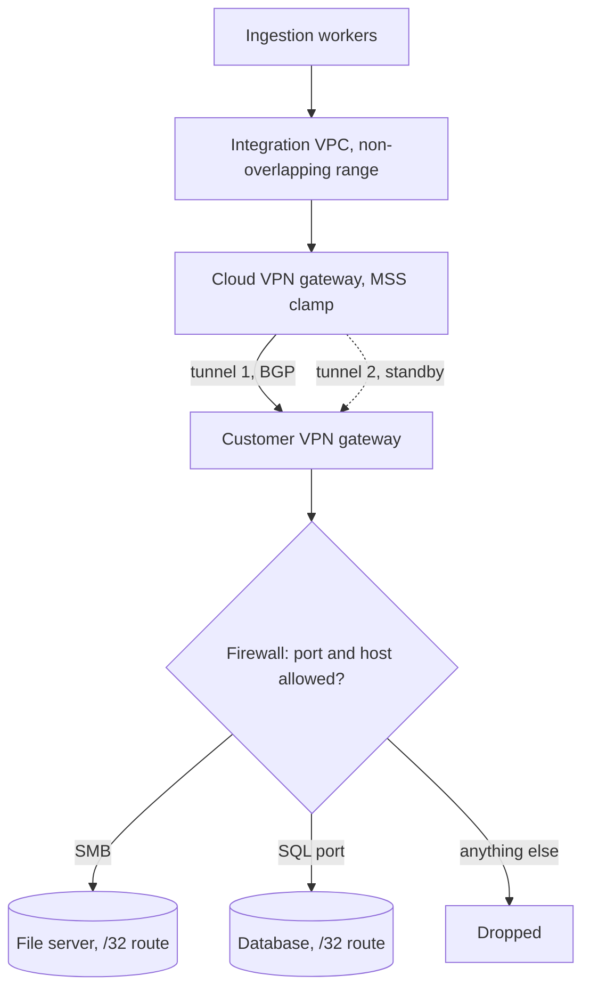

## TL;DR
A VPN joins two private networks, or a device to a network, through an encrypted tunnel over the
internet, so AI workloads reach on-prem data privately. It is quick and cheap, but it joins
address spaces, so scope, routing and MTU need design.

## Why it exists
- **The data has no public IP.** Your RAG product runs in the cloud; the customer's contracts live in an
  on-prem document store and their ticket history in a database in the same data center. Neither has,
  nor will ever have, a public IP, yet ingestion workers must reach them on private addresses.
- **Exposing them publicly is rejected.** A database or file share on the internet behind a firewall rule
  fails the first security meeting, rightly: credentials become the only barrier.
- **Disks or nightly SFTP exports go stale.** They work once, but give you stale data, a manual process
  and no way to run live queries or tool calls.
- **Dedicated circuits are slow to get.** AWS Direct Connect, Azure ExpressRoute or Google Cloud
  Interconnect are right for heavy, permanent traffic, but take weeks to months through a carrier and
  cost accordingly.
- **A VPN is the middle path.** It reuses both sides' internet connections, adds encryption and mutual
  authentication, and can be up in days, which matters during a pilot. Its weakness is the flip side:
  once networks are joined, anything routable can talk unless you narrow it, so a VPN is a network
  integration, not just an encryption feature.

## How it works
### Site-to-site IPsec
Most enterprise site-to-site VPNs, including the managed VPN gateways of the major clouds, use IPsec
negotiated by IKEv2. Two phases:

1. **IKE SA (authentication and key agreement).**
   - The gateways exchange Diffie-Hellman values to derive shared keys, then authenticate each other with
     a pre-shared key or certificates.
   - Certificates are preferable at scale because a leaked PSK compromises every tunnel that shares it.
   - The result is an encrypted control channel, usually over UDP 500, moving to UDP 4500 when NAT is
     detected (NAT traversal), which is why firewalls on both sides must open those ports.
   - Without NAT, data packets travel as raw ESP (IP protocol 50, not TCP or UDP), which firewalls must
     permit as well.
2. **Child SAs (the data plane).** Inside that channel the peers agree keys and traffic selectors for ESP,
   the protocol that encrypts and authenticates each packet. Keys are rekeyed on a timer so a single
   compromised key exposes only a bounded window.

| Port or protocol | Used for | Firewall must allow |
|---|---|---|
| UDP 500 | IKE negotiation | both directions between peer IPs |
| UDP 4500 | IKE and ESP when NAT is detected | both directions |
| IP protocol 50 (ESP) | data packets without NAT | both directions |

### Routing: policy-based vs route-based
| | Policy-based | Route-based, static | Route-based, BGP |
|---|---|---|---|
| What decides encryption | configured source/destination prefixes | tunnel is a virtual interface; routes point at it | same, routes learned dynamically |
| Adding a subnet | edit both ends | add a route | the other side advertises it |
| Failover | manual or vendor-specific | needs tunnel monitoring | automatic: routes withdrawn when a tunnel fails |

- **BGP is preferred for production** because each side advertises its prefixes and withdraws them when
  a tunnel fails, so failover between redundant tunnels is automatic.
- **Configure both tunnels.** Cloud VPN gateways typically give you two tunnels per connection,
  terminating on different endpoints, precisely so the provider can maintain one without an outage.

### What the packet pays
- **Overhead.** Each packet gains ESP headers, padding and an authentication tag plus an outer IP header,
  tens of bytes in total.
- **Full-size packets no longer fit.** A 1,500-byte packet is fragmented or, if the "don't fragment" bit
  is set and ICMP is blocked, silently dropped.
- **MSS clamping.** Gateways clamp the TCP maximum segment size (MSS) in the SYN handshake so endpoints
  send smaller segments. Cloud VPN docs typically recommend a clamp somewhere in the 1,350–1,400-byte
  range, but use your provider's figure.
- **Why at the gateway.** You cannot rely on every host's path-MTU discovery when firewalls drop the ICMP
  messages it depends on. Clamping fixes TCP only; UDP traffic must be sized by the application.
- **Throughput ceiling.** Per tunnel it is bounded by the gateway's crypto capacity and the internet path,
  typically gigabit-class rather than the tens of gigabits a dedicated circuit offers (check your
  provider's documented limits).

### Remote-access VPN and WireGuard
- **Client VPNs** connect a single device, for example an FDE's laptop, into a customer network.
- **WireGuard** is a newer, deliberately small protocol: fixed modern cryptography, peers identified by
  public keys, and a configuration of a few lines.
- **Where you meet it.** Its simplicity makes it easy to audit and fast, but many enterprises standardize
  on IPsec appliances, so you meet WireGuard more in your own infrastructure than in a bank's.

### When address spaces overlap
Routing only works if each side can tell local addresses from remote ones, so overlapping CIDRs are the
first thing to check, not the last. Three ways out, in rough order of preference:
1. **Terminate in a fresh network** whose range neither side uses; cheap when you control one end, as a
   vendor usually does.
2. **NAT on the gateway**, so the customer sees your traffic from an agreed non-overlapping range and you
   reach their hosts through translated addresses. It works, but every log and firewall rule now speaks
   two address vocabularies.
3. **Re-address one side**, which is correct and almost never quick inside an enterprise.

### Narrowing the blast radius
Because a tunnel joins networks, scope it:
- **Advertise only the specific subnets needed.**
- **Filter on both ends:** firewall rules or security groups allowing only the required ports to the
  required hosts.
- **Terminate in a dedicated integration VPC**, not your core production network.

## Diagram
Traffic from cloud workers to two on-prem hosts: scoped routes, a clamped MSS and two BGP tunnels are
the three design points.



## Examples
### Worked scenario: a legal-tech pilot over site-to-site VPN
A vendor pilots contract search for a firm whose 2 TB document archive sits on an on-prem file server,
with case metadata in a SQL Server instance. Plan: a site-to-site VPN from the firm's data center to a
dedicated "customer-integration" VPC in the vendor's cloud account.

1. **Addressing.** The firm uses 10.0.0.0/8 broadly and the vendor's VPC is 10.20.0.0/16, which overlaps.
   Rather than re-IP anything, the vendor confirms the firm uses nothing in 172.16.0.0/12 and creates the
   integration VPC as 172.31.240.0/22.
2. **Scope.** The firm advertises only two /32 host routes (the file server and the database) over BGP.
   Firewall rules on its side allow only SMB and the SQL Server port, from the ingestion workers' subnet,
   to those two hosts.
3. **Capacity.** The uplink and tunnel yield an effective 400 Mbit/s for bulk transfer (an assumption to
   measure, not a promise). See the table below.
4. **The classic failure.** Small metadata queries work, but large file reads stall after a few
   kilobytes. Packet captures show oversized packets dropped with ICMP blocked; enabling MSS clamping on
   the gateway fixes it.
5. **Redundancy.** Both tunnels are configured, and the vendor tests failover by disabling one during a
   sync and confirming BGP shifts traffic without dropping the job.

| Transfer | Size | Arithmetic | Time |
|---|---|---|---|
| Initial sync | 2 TB | 2 TB × 8 = 16 Tbit; at 0.4 Gbit/s that is 40,000 seconds | about 11 hours, scheduled over a weekend with rate limiting to protect business traffic |
| Daily delta | around 5 GB | 40 Gbit ÷ 0.4 Gbit/s | about 100 s, under two minutes |

### Capacity and MSS calculator
Plan the sync window and the clamp value before the change request goes in.

```python
def bulk_sync_hours(data_tb, effective_mbit_s):
    bits = data_tb * 1e12 * 8
    return bits / (effective_mbit_s * 1e6) / 3600

def mss_for(tunnel_mtu, ip_header=20, tcp_header=20):
    return tunnel_mtu - ip_header - tcp_header

for tb, mbit in ((2, 400), (2, 100), (0.005, 400)):
    h = bulk_sync_hours(tb, mbit)
    print(f"{tb} TB at {mbit} Mbit/s: {h:.1f} h ({h*3600:.0f} s)")
for mtu in (1500, 1400):
    print(f"tunnel MTU {mtu}: clamp MSS to {mss_for(mtu)}")
# 2 TB at 400 Mbit/s: 11.1 h (40000 s)
# 2 TB at 100 Mbit/s: 44.4 h (160000 s)
# 0.005 TB at 400 Mbit/s: 0.0 h (100 s)
# tunnel MTU 1500: clamp MSS to 1460
# tunnel MTU 1400: clamp MSS to 1360
```

- **MSS is the MTU minus 40 bytes** of IPv4 and TCP headers (without options), so a 1,400-byte tunnel
  MTU means clamping MSS to 1,360.

### Remote access with WireGuard
A minimal client config for an engineer's laptop that routes only the integration range through the
tunnel. Keys are placeholders; each side holds its own private key.

```ini
[Interface]
PrivateKey = <laptop private key>
Address = 172.31.250.10/32

[Peer]
PublicKey = <gateway public key>
Endpoint = vpn.example.com:51820
AllowedIPs = 172.31.240.0/22      # only the integration VPC, not 0.0.0.0/0
PersistentKeepalive = 25
```

## Production patterns
- **Two tunnels, BGP, tested failover.** Configure both provider tunnels with BGP and, before go-live,
  disable one during a sync to confirm traffic shifts. Monitor tunnel state and BGP session flaps
  (on AWS Site-to-Site VPN, the CloudWatch `TunnelState` metric per tunnel).
- **Clamp MSS on self-managed gateways.** On a Linux gateway, the iptables `TCPMSS` target rewrites
  MSS in SYN packets (rule below). Verify with `ping -M do -s <size> <host>` and watch for
  retransmissions of large segments.

  ```
  iptables -t mangle -A FORWARD -p tcp --tcp-flags SYN,RST SYN -j TCPMSS --clamp-mss-to-pmtu
  ```
- **Host routes and port filters only.** Ask the customer to advertise /32 routes for the hosts you need
  and allow only those ports from your worker subnet. Review the advertised prefix list in every change.
- **Integration VPC per customer.** Terminate each customer tunnel in its own small VPC with a range
  chosen to avoid theirs, so overlaps never touch production. Keep an address-allocation register.
- **Rate-limited bulk sync.** Schedule large initial syncs off-hours with a bandwidth cap, then switch to
  incremental deltas. Monitor throughput against plan and the customer's uplink utilisation.
- **DNS across the tunnel.** Forward the customer's internal domain to their resolvers over the tunnel
  so workers use hostnames, not IPs. Alert when a configured hostname stops resolving.

## Trade-offs
- **Quick and cheap vs predictable.** A VPN stands up quickly over existing internet links, but
  throughput and latency vary with the internet path. Once traffic is large and permanent, a dedicated
  circuit pays for itself.
- **Any protocol vs attack surface.** Joining networks enables any protocol in either direction, which
  helps legacy integrations, but widens the attack surface compared with a one-way private endpoint to a
  single service.
- **Dedicated circuit vs encryption.** A circuit gives predictable bandwidth and latency, but is private
  rather than encrypted by default, so regulated customers often still run IPsec (or MACsec where
  offered) over it. The choice flips back to VPN alone when volumes are modest and lead time matters.
- **Static routes vs BGP.** Static routes are simple for one or two subnets but carry no liveness signal,
  so failover depends on vendor-specific tunnel monitoring (dead-peer detection, route tracking) or
  manual edits. BGP adds configuration and debugging skill in return for standard, automatic failover.
- **Client VPN vs zero-trust access.** Remote-access VPN gives engineers broad network access easily, but
  identity-aware zero-trust access per application is safer when many people need narrow access to a
  few internal tools.

## Pitfalls
- **Overlapping CIDR ranges discovered after the tunnel is up.** Symptom: a healthy tunnel status with
  traffic that never arrives, because each side routes the other's addresses locally.
- **No MSS clamping or path MTU discovery when ICMP is filtered.** Symptom: small requests succeed while
  large uploads, file reads or long model responses hang mid-transfer.
- **Configuring only one of the two provided tunnels.** Symptom: an outage during the provider's routine
  maintenance window, often in the middle of the night.
- **Advertising whole corporate supernets "to keep it simple".** Symptom: the security review finds the
  vendor network can reach thousands of customer hosts it never needed.
- **Leaving DNS out of the design.** Symptom: IP addresses hard-coded in config because internal
  hostnames do not resolve across the tunnel, which then break when the customer re-IPs a server.

## When to use
- **Use a site-to-site VPN when** cloud workloads need private, bidirectional or multi-protocol access to
  a customer's on-prem systems: databases, file shares, legacy APIs, internal identity providers. It is
  the default for pilots and moderate steady-state traffic.
- **Prefer a private endpoint** when the flow is one-way to a single cloud service, and a dedicated
  circuit when sustained volume or latency guarantees matter.
- **For people rather than systems**, prefer per-application zero-trust access over a full-network
  client VPN.
- **Measure:** tunnel uptime, BGP state changes, throughput against the plan, and dropped or fragmented
  packets.
- **Interviews and design reviews:** mentioning address planning, scope and MTU unprompted signals that
  you have actually operated one.

## Role lens
- **Engineer:** Configures ingestion workers to use internal DNS names over the tunnel, sets timeouts and
  retries that survive tunnel failover, and recognises an MTU stall from its distinctive symptom.
- **Architect:** Chooses VPN versus private endpoint versus dedicated circuit, plans non-overlapping
  address space, and decides where the tunnel terminates so its blast radius stays small.
- **FDE:** Fills in the customer's VPN request form with exact peer IPs, prefixes and ports, schedules the
  bulk sync around their business hours, and joins the call when the tunnel will not come up.

## Check yourself
**Q:** Your ingestion job reads from a customer's on-prem database over a new site-to-site VPN. Short
queries return instantly, but any query returning more than a few kilobytes hangs until timeout. The
tunnel shows "up". What is happening and how do you confirm and fix it?
**A:** That size-dependent pattern points to MTU. IPsec encapsulation adds tens of bytes, so full-size
packets exceed the tunnel MTU; if "don't fragment" is set and ICMP "fragmentation needed" messages are
blocked by a firewall, those packets are silently dropped while small ones pass. Confirm by sending pings
with the don't-fragment flag (on Linux, `ping -M do -s 1400 <host>`) at decreasing sizes to find the largest packet that passes, or by capturing
traffic and seeing retransmissions of large segments. Fix it by enabling TCP MSS clamping on the VPN
gateway to a value that fits the tunnel overhead, or by allowing the relevant ICMP messages so path MTU
discovery works. Then retest with a large result set.

## Interview questions
### What does a site-to-site IPsec VPN actually set up, and why does it need certain firewall ports?
- **Two phases:** an IKE SA authenticates the gateways and agrees keys, then child SAs carry data
  encrypted with ESP and rekeyed on a timer.
- **Ports follow from that:** UDP 500 for IKE, UDP 4500 when NAT traversal is detected, and IP protocol
  50 for raw ESP without NAT, so both firewalls must allow all three between the peers.

### The tunnel is up but no traffic from your VPC reaches the customer's hosts. How do you debug it?
- **Check addressing first:** if ranges overlap, each side routes the other's addresses locally and
  packets never enter the tunnel.
- **Then routes:** confirm the needed prefixes are advertised over BGP (or statically configured) on both
  ends and that your subnet route tables point at the gateway.
- **Then filters:** security groups and the customer's firewall must allow your worker subnet to the
  specific host and port; a capture on each gateway shows where packets stop.

### When would you not use a VPN for a customer integration?
- **One-way calls to one cloud service:** a private endpoint is narrower and does not join address spaces.
- **Large, permanent traffic or latency guarantees:** a dedicated circuit gives predictable bandwidth,
  often with IPsec or MACsec on top for regulated customers.
- **People needing a few internal tools:** per-application zero-trust access beats a full-network client VPN.

### How long will a 2 TB initial sync take over the tunnel, and how do you plan it?
- **Arithmetic:** 2 TB × 8 = 16 Tbit; at an effective 400 Mbit/s that is 40,000 s, about 11 hours.
- **Plan:** treat the rate as an assumption to measure, run the sync over a weekend with a bandwidth cap,
  then switch to daily deltas (around 5 GB takes under two minutes).
- **Make it resumable**, so a tunnel failover mid-sync does not restart the job.

### Why clamp MSS at the gateway instead of relying on path MTU discovery?
- **PMTUD depends on ICMP** "fragmentation needed" messages, which many enterprise firewalls block, so
  oversized don't-fragment packets vanish silently.
- **Clamping rewrites the SYN handshake** so both ends send segments that fit, fixing every TCP flow
  without touching hosts.
- **Limit:** it fixes TCP only; UDP traffic must be sized by the application.

## Quiz
### Q: Why do production site-to-site VPNs usually use BGP rather than static routes?
- [ ] BGP encrypts traffic more strongly than static routing
- [x] BGP advertises and withdraws prefixes dynamically, so traffic fails over to the redundant tunnel automatically
- [ ] Static routes cannot be used with IPsec
- [ ] BGP removes the need for non-overlapping address ranges
> A static route says nothing about whether its tunnel is alive, so failover relies on vendor-specific
> tunnel monitoring or manual action. BGP withdraws routes from a failed tunnel as part of the protocol. Encryption is ESP's job, and overlapping ranges remain a problem
> with either routing method.

### Q: A customer asks for a VPN so your SaaS can call their single internal REST API. Their network team worries about exposure. What is the strongest scoping you can offer?
- [ ] Use a pre-shared key instead of certificates to keep configuration simple
- [ ] Advertise the customer's full 10.0.0.0/8 so routing never needs updating
- [x] Terminate in a dedicated integration network, advertise only the API host's address, and allow only its port from your worker subnet
- [ ] Enable split tunneling on every engineer's laptop
> Scoping routes to a single host and filtering ports on both sides limits what the joined networks can
> reach. Broad advertisements create the exposure the network team fears, and PSK choice affects
> authentication rather than reach.

### Q: When is a dedicated circuit such as Direct Connect or ExpressRoute a better choice than a VPN?
- [ ] When the integration is a two-week pilot that needs to start tomorrow
- [ ] Whenever the data is confidential, because VPNs are not encrypted
- [ ] When the customer has overlapping CIDR ranges
- [x] When traffic is large and permanent or needs predictable latency and bandwidth that the internet path cannot guarantee
> Dedicated circuits trade long lead times and higher fixed cost for consistent bandwidth and latency.
> VPNs are encrypted, and a circuit does nothing to fix overlapping address ranges, which still require
> re-addressing or NAT.
