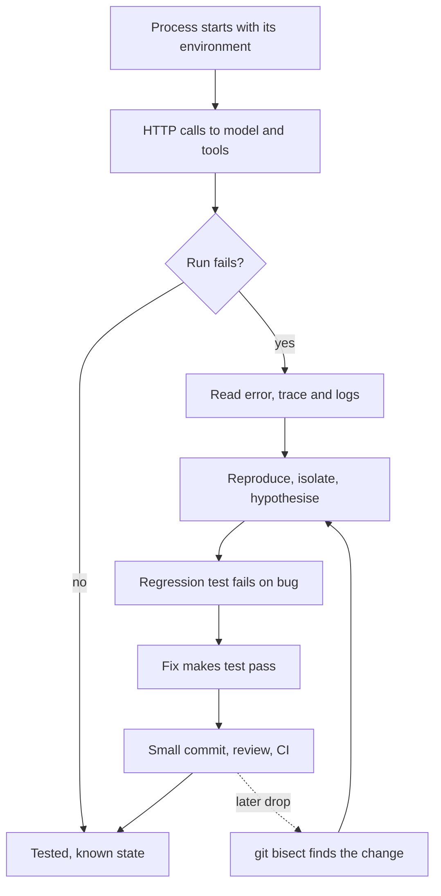

## Overview
This module covers the everyday engineering skills that every later module assumes. An agent is
ordinary software: a process that reads config from its environment, calls models and tools over HTTP,
writes logs, and lives in a git repository. When it breaks, these are the skills that find out why.

The six lessons form one working loop.

- **Environment:** the shell, processes, environment variables, exit codes and ports, which explain most "works on my machine" agent bugs.
- **The wire:** HTTP as plain messages over TCP and TLS, so status codes, timeouts, retries and connection reuse stop being SDK magic.
- **Reading failures:** error messages, stack traces read bottom-up, chained causes and structured logs joined by trace id.
- **Tests:** fast, deterministic unit and integration tests for tools, parsers and retrievers, with the model and network replaced by doubles.
- **Debugging:** a search, not a guess: reproduce, isolate one difference, state a falsifiable hypothesis, verify with a test.
- **Change control:** git snapshots, small reviewed branches, `bisect`, `revert` and `reflog`, which matter more when an assistant writes much of the diff.

All six lessons are agent core. None is background: you use each of them in the first week of any
agent project.

Afterwards you can:

- Start an agent service reliably from a fresh terminal and diagnose config, venv and port faults.
- Build an LLM client that retries only what is retryable and fails inside its timeouts.
- Find the root cause of an agent failure from logs and traces, then pin it with a regression test.
- Bisect a quality drop to the commit, prompt edit or tool change that caused it.

It connects forward to almost everything. Backend and FastAPI lessons build on HTTP and processes.
Observability extends structured logs and trace ids. Evals take over where tests stop, at model
quality. Agent reliability and deployment rely on timeouts, retries and reproducible runs.

## Why it matters
- **Engineer:** You read a traceback bottom-up to the frame in your own code, replay the failing tool call from its logged arguments, write a regression test that fails before the fix, and bisect any drop instead of guessing which edit caused it.
- **Architect:** You set the conventions every agent service inherits: config only from environment variables, explicit per-phase timeouts and status-based retry policy, one structured log line per failure with a trace id, and CI that runs tests on every pull request.
- **FDE:** You diagnose a customer's broken install from a terminal session in minutes, separating an unexported key, a wrong Python, a blocked port or a proxy timeout, and leave behind a reproduction script and a test so the fault cannot quietly return.

## Mental model
Treat every agent failure as evidence moving through one loop, and each lesson as one stage of it.

- **The system is processes talking HTTP.** Each process inherits an environment, has a PID, returns an exit code and may own a port. Each model or tool call is one request and one response.
- **Failures leave evidence.** Exit codes, status codes, chained stack traces and JSON log lines say what broke, where, and what the system was doing.
- **Debugging turns evidence into a cause.** Reproduce the failure, isolate the one difference between passing and failing, and test a hypothesis that could be wrong.
- **Tests lock the cause out.** A regression test that fails on the bug and passes on the fix makes the lesson permanent and cheap to recheck.
- **Git makes every change reversible and searchable.** Small reviewed commits let `bisect` find the breaking change, and `revert` or `reflog` undo it.
- **Tests stop where model quality begins.** Deterministic code gets tests; what the model says gets evals, covered in a later module.

The loop closes when the fix merges through review and CI, so the next failure starts from a known,
tested state.

## Suggested order
1. command-line-and-environment-basics — the process model (environment, PID, exit code, port) underlies every other lesson and every agent service you start.
2. http-from-first-principles — once you can run a process, learn what it says on the wire to models and tools, and how status codes drive retries.
3. reading-errors-logs-and-stack-traces — teaches reading the evidence that processes and HTTP failures leave, which debugging depends on.
4. testing-fundamentals — gives you fast, deterministic tests with doubles, needed to turn a found bug into a regression test.
5. debugging-method — combines reading evidence and tests into a disciplined reproduce, isolate, hypothesise, verify loop.
6. git-and-code-review-workflow — closes the loop: reviewed small commits, and `bisect` plus tests to find and undo the change that broke the agent.

## Capstone
### Brief
You inherit a small tool-using agent service that a teammate says "mostly works". It reads its model
id and key from the environment, serves `/health` and `/run` over HTTP, calls a fake LLM provider you
write, and uses two tools, one of which calls a retrieval function.

A colleague (or an LLM working in a branch you do not read) plants faults across the stack: an
unexported variable, a port clash, a retry that resends a 400, a missing read timeout, a renamed dict
key that surfaces as a wrapped `ToolError`, and a changed default buried in a run of 10+ commits.

Your job is to make the service start reliably, make its HTTP client correct, and find and fix every
planted fault from evidence alone, leaving each one pinned by a test. Work only in a fresh repository
under `/tmp`, use command-line git, and keep a written log with a prediction recorded before each probe.

Finish with a reviewed pull request whose every commit passes the test suite.

### Deliverables
- The repository: service, fake provider with scenario headers, `run.sh` with `set -euo pipefail`, and a `diagnose.sh` that never prints secret values.
- A pytest suite with unit tests using a stub model client and no network, plus one integration test against a real store, and one regression test per planted fault.
- JSON logs with `trace_id`, `step` and `level`, plus the `jq` command that isolates the failing run.
- A debugging log (hypothesis, prediction, probe, result) and a short root-cause note per fault naming file and line.
- A self-review of one assistant-written diff using the git lesson's checklist.

### Rubric
- Every planted fault is found, its root-cause note matches the planted file and line, and its regression test fails on the buggy commit and passes on the fix.
- `git bisect run ./repro.sh` names the commit with the buried default change, and `git rebase --exec "pytest -q" main` passes at every commit of the final branch.
- The client makes exactly 1 request for a 400, waits at least `Retry-After` on a 429, fails a stalled stream within the read timeout, and reuses one TCP connection for ten sequential calls.
- `env -i PATH="$PATH" bash run.sh` exits 2 naming the missing variables, and `diagnose.sh` names the PID holding the port without printing any secret.
- Unit tests run in under 5 s with sockets disabled, pass in random order, and no test asserts on exact generated text.
