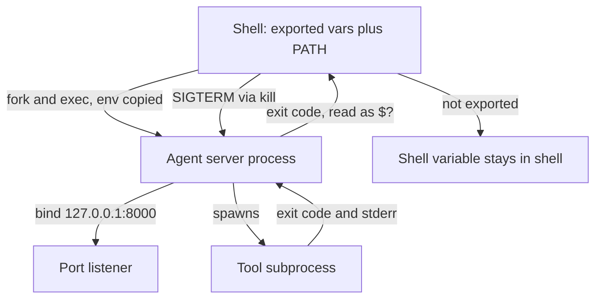

## TL;DR
The shell starts processes, and each process inherits a copy of its parent's environment, has a PID,
returns an exit code and may own ports. Most "it works on my machine" agent bugs are one of those four
things being different.

## For agent builders
- **Why it matters for agents.** Your agent reads its API key and model name from environment variables,
  runs as a process behind a port, and may itself run shell commands as a tool. Each of these fails in
  ways only the command line shows.
- **Where it shows up in your stack.** `.env` files, `export OPENAI_API_KEY=...`, `uvicorn` on port 8000,
  Ollama on 11434, MCP servers launched over stdio, Docker `-e` and `-p` flags, and `subprocess` calls in
  agent tools.
- **What you control.** Which variables are exported, which Python is on `PATH`, how processes are
  started and stopped, which port and interface a server binds, and how a tool reports exit codes.
- **What you can skip.** Shell scripting tricks and advanced `awk`. Master the process model; look up
  syntax as needed.

## Lab
### Task
Build the "run a command" tool a coding agent calls, plus two startup checks, so the model and the
operator see what the OS actually reported. The tool runs an argument list with `shell=False`, passes a
minimal environment, bounds time and output, and maps every way a process can end to an exit code.
Time box: 45-75 min.
- **Prerequisites:** How it works sections 2-4 (environment, exit codes and signals, ports); the bash
  example below; Reading errors, logs and stack traces is useful but optional.
- **Setup:** Python 3.9+ on macOS or Linux and `pip install pytest` (checked with Python 3.9.6 and pytest
  8.4.2 on macOS). Save the starter as `lab.py` and the tests as `test_lab.py`. Signals behave
  differently on Windows; use WSL there.
- **Conventions used:** 127 for "command not found" and 128 + N for "killed by signal N", as the shell
  reports them; 124 for a timeout, as the coreutils `timeout` command does.

### Starter code
```python
"""Lab: an agent's run-command tool and startup checks that report what the OS reports. Run: python lab.py"""
import os, signal, socket, subprocess, sys

PY = sys.executable                              # an absolute interpreter path, never "python" from PATH

def run_tool(argv, allow_env=(), timeout=5.0, max_output=2000):
    """Run argv with shell=False and a minimal environment. Returns a dict with
    exit_code (int), signal (name or None), timed_out (bool), stdout, stderr (str)."""
    # YOUR CODE HERE:
    # - env = PATH plus only the names in allow_env that the parent has (never the whole os.environ)
    # - a negative returncode -N means "killed by signal N": exit_code = 128 + N, signal = its name
    # - a missing program: exit_code 127, stderr = str(the error)
    # - a timeout: exit_code 124, timed_out True
    # - stdout longer than max_output: keep max_output chars + f"...[truncated {n} chars]"
    raise NotImplementedError

def port_in_use(port, host="127.0.0.1"):
    # YOUR CODE HERE: try to bind (host, port); EADDRINUSE means someone is listening
    raise NotImplementedError

def missing_config(required, environ=None):
    # YOUR CODE HERE: names from `required` that are absent or empty in environ (default os.environ),
    # in the order given; print names only, never values
    raise NotImplementedError

if __name__ == "__main__":
    os.environ["MODEL_ID"] = "small"             # exported: children may inherit it
    os.environ["SECRET_KEY"] = "sk-test-not-for-tools"
    show = "import os; print('MODEL_ID=%s SECRET_KEY=%s' % (os.environ.get('MODEL_ID'), os.environ.get('SECRET_KEY')))"
    print("env: child sees", run_tool([PY, "-c", show], allow_env=["MODEL_ID"])["stdout"].strip())

    r = run_tool([PY, "-c", "import sys; sys.exit(3)"])
    nf = run_tool(["no-such-cmd", "--version"])
    print("exit:", r["exit_code"], "| not found:", nf["exit_code"], nf["stderr"].split(":")[0])
    r = run_tool([PY, "-c", "import os, signal; os.kill(os.getpid(), signal.SIGKILL)"])
    print("killed:", r["exit_code"], r["signal"])
    r = run_tool([PY, "-c", "import time; time.sleep(5)"], timeout=0.5)
    print("timeout:", r["exit_code"], f"timed_out={r['timed_out']}")
    r = run_tool([PY, "-c", "print('x' * 10000, end='')"])
    print("stdout kept:", len(r["stdout"].split("...")[0]), "chars +", repr(r["stdout"][2000:]))

    s = socket.socket()
    s.bind(("127.0.0.1", 0)); s.listen()
    port = s.getsockname()[1]
    before = port_in_use(port)
    s.close()
    print("port in use:", before, "-> after close:", port_in_use(port))
    print("missing config:", missing_config(["MODEL_ID", "LLM_API_KEY"]))
```

### Expected output
`python lab.py` with a correct solution prints exactly:

```
env: child sees MODEL_ID=small SECRET_KEY=None
exit: 3 | not found: 127 [Errno 2] No such file or directory
killed: 137 SIGKILL
timeout: 124 timed_out=True
stdout kept: 2000 chars + '...[truncated 8000 chars]'
port in use: True -> after close: False
missing config: ['LLM_API_KEY']
```

- **Read the lines:** the secret was exported in the parent but never reached the tool; Python reports a
  SIGKILL as returncode -9, which the tool turns into the shell's 128 + 9 = 137; 10,000 chars of output
  became 2,000 plus a marker the model can read.

### Tests
Run `pytest -q test_lab.py`. On the starter all 8 fail with `NotImplementedError`; a correct solution
passes all 8 (Python 3.9.6, pytest 8.4.2, macOS).

```python
import json, socket
from lab import PY, missing_config, port_in_use, run_tool

SHOW = "import json, os; print(json.dumps(sorted(os.environ)))"

def test_child_gets_only_allow_listed_env(monkeypatch):
    monkeypatch.setenv("MODEL_ID", "small")
    monkeypatch.setenv("SECRET_KEY", "sk-test")
    monkeypatch.setenv("HOME", "/home/someone")
    r = run_tool([PY, "-c", SHOW], allow_env=["MODEL_ID", "NOT_SET_ANYWHERE"])
    keys = json.loads(r["stdout"])                 # the interpreter may add locale vars such as LC_CTYPE
    assert "MODEL_ID" in keys and "PATH" in keys
    assert not {"SECRET_KEY", "HOME", "NOT_SET_ANYWHERE"} & set(keys)

def test_exit_codes_are_reported_not_hidden():
    assert run_tool([PY, "-c", "import sys; sys.exit(3)"])["exit_code"] == 3
    nf = run_tool(["no-such-cmd"])
    assert nf["exit_code"] == 127 and "No such file or directory" in nf["stderr"]

def test_killed_by_signal_is_128_plus_n():
    r = run_tool([PY, "-c", "import os, signal; os.kill(os.getpid(), signal.SIGKILL)"])
    assert (r["exit_code"], r["signal"]) == (137, "SIGKILL")
    r = run_tool([PY, "-c", "import os, signal; os.kill(os.getpid(), signal.SIGTERM)"])
    assert (r["exit_code"], r["signal"]) == (143, "SIGTERM")

def test_timeout_is_bounded_and_flagged():
    r = run_tool([PY, "-c", "import time; time.sleep(5)"], timeout=0.5)
    assert (r["exit_code"], r["timed_out"]) == (124, True)

def test_long_output_is_truncated_with_a_marker():
    r = run_tool([PY, "-c", "print('x' * 10000, end='')"], max_output=2000)
    assert r["stdout"] == "x" * 2000 + "...[truncated 8000 chars]"

def test_stderr_stays_separate_from_stdout():
    r = run_tool([PY, "-c", "import sys; print('data'); print('log line', file=sys.stderr)"])
    assert (r["stdout"], r["stderr"]) == ("data\n", "log line\n")

def test_port_in_use_tracks_a_real_listener():
    s = socket.socket()
    s.bind(("127.0.0.1", 0)); s.listen()
    port = s.getsockname()[1]
    assert port_in_use(port) is True
    s.close()
    assert port_in_use(port) is False

def test_missing_config_names_only():
    env = {"MODEL_ID": "small", "LLM_API_KEY": ""}
    assert missing_config(["MODEL_ID", "LLM_API_KEY", "DATABASE_URL"], env) == ["LLM_API_KEY", "DATABASE_URL"]
```

### Failure scenarios
- **Pass the parent's environment** (`env=os.environ`, or no `env` at all). The first line prints
  `SECRET_KEY=sk-test-not-for-tools`: every command the model runs can now read and echo your keys.
  Diagnose by running `env` through the tool and diffing it against the allow-list.
- **Return `returncode` as is.** The kill line prints `-9 None`; the model and your logs see a negative
  number no shell or CI system uses. Map it with `signal.Signals(9).name` and 128 + N.
- **Drop the timeout.** The timeout scenario blocks for the full 5 s, and in an agent a hung `npm
  install` stalls the whole run. Look for steps whose duration equals the run's deadline.
- **Merge stderr into stdout** (`stderr=subprocess.STDOUT`). The separation test fails, and on an MCP
  stdio server the same mix corrupts the protocol channel, as the Mastery test describes.

### Submission
- **`lab.py`** with the three functions implemented; the main block unchanged.
- **A green run** of `pytest -q test_lab.py` (8 passed) and the output of `python lab.py`.
- **A table** of the ending kinds (success, error exit, not found, signal, timeout): the `exit_code`
  your tool returns, and what a shell prints in `$?` for the same case.
- **A note** (3-5 sentences): which variables your real agent's command tool would allow, and how you
  would sandbox it further (container, working directory, no network).
- **Evaluated on:** no secret reaches the child; every ending maps to the documented code; output is
  bounded; stderr stays separate.

## Why it exists
- **Configuration has to live outside code.** Keys, model ids and base URLs differ per environment;
  environment variables carry them without committing secrets to git.
- **Programs must report success without a human.** Exit code 0 means success and anything else means
  failure, which is what CI, `git bisect run`, Docker health checks and agent shell tools rely on.
- **Many processes share one machine.** PIDs and signals let you find and stop them; ports let two
  processes talk, and only one process can listen on a given address and port at a time.
- **The shell composes small tools.** A pipe such as `cat log | jq ... | sort | uniq -c` answers a log
  question in one line, without writing a program.

## How it works
### 1. Shell, commands and PATH
- **The shell resolves a command name through `PATH`,** a colon-separated list of directories searched in
  order. `which python3` or `command -v python3` shows which one wins.
- **A virtual environment just prepends to `PATH`.** `source .venv/bin/activate` puts `.venv/bin` first,
  so `python` and `pip` resolve there. "Module not found" after `pip install` usually means two Pythons.
- **Quoting matters.** `"$VAR"` keeps spaces intact; single quotes stop all expansion, which is why
  `python3 -c '...'` is quoted with single quotes.

### 2. Environment variables
| Form | Visible to child processes? | Lifetime |
|---|---|---|
| `NAME=value` | No, shell variable only | This shell |
| `export NAME=value` | Yes | This shell and its children |
| `NAME=value cmd` | Yes, for `cmd` only | One command |
| `.env` file | Only if something loads it (`python-dotenv`, Docker `--env-file`) | As loaded |

- **Inheritance is a copy at start time.** Changing a variable after a process started does not reach it;
  restart the server.
- **Children cannot change the parent.** A script that exports a variable does not affect your terminal
  unless you `source` it.

### 3. Processes, exit codes and signals
- **Every process has a PID** and a parent. `$!` is the PID of the last background job; `ps`, `pgrep`
  and `lsof` find others.
- **Exit codes:** `$?` holds the last one. 0 is success; 1 is a generic failure; 127 is "command not
  found"; 128 + N means killed by signal N (130 after Ctrl-C, 137 after `SIGKILL`).
- **Signals:** `SIGINT` (2, Ctrl-C) and `SIGTERM` (15, the default for `kill` and for Docker and
  Kubernetes stops) ask a process to exit cleanly; `SIGKILL` (9) cannot be caught, so nothing is
  flushed.
- **Streams:** stdout (1) carries data and stderr (2) carries diagnostics. `2>err.txt` and `2>&1` redirect
  them. An MCP server over stdio must keep logs off stdout, because stdout is the protocol channel.

### 4. Ports and interfaces
- **A server binds an address and a port.** `127.0.0.1:8000` accepts local connections only; `0.0.0.0`
  listens on all interfaces, which is what a server inside Docker needs to be reachable through `-p`.
- **One listener per address and port.** A second bind fails with "Address already in use"
  (`EADDRINUSE`).
- **Find the owner:** `lsof -nP -iTCP:8000 -sTCP:LISTEN` on macOS and Linux (or `ss -ltnp` on Linux)
  prints the PID; then `kill <pid>`.
- **Connection refused vs timeout.** Refused means the host answered but nothing listens on that port;
  a timeout means packets are dropped (firewall, wrong host, or a hung server).

## Diagram
A parent shell hands a copy of its exported environment to each child; the child then owns a PID, a
port and an exit code that the parent reads back.



## Examples
### Env vars, a background server, a port conflict and exit codes
The script plays out the four ideas with a stand-in model server. Run it with `bash env_and_ports.sh` in
an empty directory (tested with GNU bash 3.2.57 on macOS, Python 3.9.6 and 3.12.14, curl 8.7.1).

```bash
#!/usr/bin/env bash
# Env vars, processes, exit codes and ports, as an agent service meets them.
set -euo pipefail
PORT=18765

# 1. Shell variable vs environment variable: only exported names reach child processes.
LLM_MODEL="small-model"                 # shell variable: lives in this shell only
export LLM_BASE_URL="http://127.0.0.1:$PORT"
python3 -c 'import os; print("child sees MODEL:", os.environ.get("LLM_MODEL"), "| BASE_URL:", os.environ.get("LLM_BASE_URL"))'
LLM_MODEL="small-model" python3 -c 'import os; print("one-off prefix:", os.environ["LLM_MODEL"])'

# 2. Start a fake model server in the background; $! is its PID.
python3 -m http.server "$PORT" --bind 127.0.0.1 >server.log 2>&1 &
SERVER_PID=$!
trap 'kill "$SERVER_PID" 2>/dev/null || true' EXIT   # always clean up, even on error
sleep 1

# 3. Who owns the port? lsof maps a listening port to a PID.
lsof -nP -iTCP:"$PORT" -sTCP:LISTEN | awk 'NR>1 {print "listening:", $1, "pid", $2}'

# 4. A second server on the same port fails: read the exit code and the error, do not guess.
set +e
python3 -m http.server "$PORT" --bind 127.0.0.1 2>err.txt &
SECOND=$!
wait "$SECOND"; echo "second server exit code: $?"
set -e
grep -o 'Address already in use' err.txt | head -1

# 5. curl exit code vs HTTP status: -f makes HTTP errors non-zero exits.
curl -s -o /dev/null -w 'GET / -> HTTP %{http_code}\n' "$LLM_BASE_URL/"
curl -sf -o /dev/null "$LLM_BASE_URL/v1/missing" || echo "curl -f exit code: $? (HTTP error)"

kill "$SERVER_PID"; wait "$SERVER_PID" 2>/dev/null || true
curl -s "$LLM_BASE_URL/" >/dev/null || echo "after kill, curl exit code: $? (connection refused)"
# Output (PID varies):
# child sees MODEL: None | BASE_URL: http://127.0.0.1:18765
# one-off prefix: small-model
# listening: Python pid 64431
# second server exit code: 1
# Address already in use
# GET / -> HTTP 200
# curl -f exit code: 22 (HTTP error)
# after kill, curl exit code: 7 (connection refused)
```

- **`None` for the model** is the classic "my key is set but the SDK says it is missing" bug: the
  variable was assigned, never exported.
- **Exit codes are distinct signals.** curl's 22 means the server answered with an HTTP error (404 here);
  7 means it could not connect at all. An agent's HTTP tool should report which one happened.
- **`set -euo pipefail` and `trap`** make a script stop on the first failure and still clean up its
  background server.

### Worked scenario: the agent works in the terminal but not in Docker
A FastAPI agent runs fine with `uvicorn app:app` locally. In a container started with
`docker run -p 8000:8000 agent`, requests fail. Probing one layer at a time:

| Probe | Result | Conclusion |
|---|---|---|
| `curl -s localhost:8000/health` from the host | exit code 52 (empty reply) | the port is mapped, but the server is unreachable through it |
| `docker exec <id> curl -s localhost:8000/health` | `{"ok": true}` | the server is up inside the container |
| `docker exec <id> env \| grep -c OPENAI_API_KEY` | `0` | the key was never passed in |
| Container start command | `uvicorn app:app` (binds 127.0.0.1) | listens on the container's loopback only |

- **Two bugs, both environment.** Fix the bind with `--host 0.0.0.0` and pass the key with
  `--env-file .env` or `-e OPENAI_API_KEY`, not by baking it into the image.
- **Exact curl codes vary by setup** (empty reply or connection reset); the method of probing from
  outside, then inside, is what transfers.

## Production patterns
- **Fail fast on missing config.** At startup, read required variables (`OPENAI_API_KEY`, `MODEL_ID`,
  `DATABASE_URL`) with a settings class such as `pydantic-settings`, and exit non-zero with the missing
  names if any are absent. Monitor crash-loops on deploy.
- **Handle `SIGTERM` gracefully.** Finish or checkpoint the current agent step, close connections and
  exit within the platform's grace period (Kubernetes defaults to 30 s), since `SIGKILL` follows.
- **Bind deliberately.** `127.0.0.1` for local dev tools and model servers you do not want exposed;
  `0.0.0.0` inside containers behind a published port. Check with `lsof` or `ss` after starting.
- **Sandbox shell tools.** When an agent runs commands, use `subprocess.run([...], shell=False,
  timeout=..., env=minimal_env, capture_output=True)`, return exit code plus stderr to the model, and
  never pass your full environment with its secrets.
- **Keep secrets out of shell history and logs.** Load keys from a secrets manager or an `.env` that is
  in `.gitignore`; avoid `echo $KEY` and `set -x` in CI, which print values.

## Trade-offs
- **Env vars vs config files.** Env vars are universal and easy to override per deploy, but flat,
  untyped and easy to leak via `env` dumps; use files or a secrets manager for structured or sensitive
  config.
- **Shell scripts vs Python scripts.** Shell is unbeatable for gluing commands and pipes, but error
  handling and quoting get fragile past about 50 lines; switch to Python then.
- **`0.0.0.0` vs `127.0.0.1`.** All-interfaces binding makes a service reachable from containers and
  other hosts, and also from anyone on the network; choose it only behind a firewall or proxy.

## Pitfalls
- **Assigned but not exported.** Symptom: the SDK reports a missing API key you can `echo`. Diagnose:
  `python3 -c 'import os;print("KEY" in os.environ)'` from the same shell, or `env | grep KEY`. Fix:
  `export`, or load `.env` explicitly at startup.
- **Two Pythons.** Symptom: `ModuleNotFoundError` right after `pip install`. Diagnose: compare
  `which python`, `which pip` and `python -c 'import sys;print(sys.executable)'`. Fix: always run
  `python -m pip install` inside the activated venv.
- **Zombie server on the port.** Symptom: "Address already in use" after a crash or a closed terminal.
  Diagnose: `lsof -nP -iTCP:<port> -sTCP:LISTEN` to get the PID and command. Fix: `kill <pid>`, and
  add a `trap` or process manager so it does not recur.
- **Ignoring exit codes.** Symptom: CI is green although a step failed, or an agent shell tool reports
  success on failure. Diagnose: print `$?` after each step, check for missing `pipefail` in pipes.
  Fix: `set -euo pipefail`, and return exit codes to the model.
- **Stale environment.** Symptom: you changed `.env` but the server still uses the old model. Diagnose:
  log the effective config (secrets masked) at startup and compare. Fix: restart the process, since
  the environment is copied only at start.

## When to use
- **Use the command line first** when a service will not start, cannot be reached or behaves
  differently between machines: check env, `PATH`, process and port before reading code.
- **Use exit codes and stderr** as the contract for every script, CI step and agent shell tool.
- **Avoid** long shell scripts for logic with branching and data structures; write Python with
  `subprocess` instead.
- **Measure:** time to start a fresh clone (should be a few documented commands), and startup failures
  caused by missing config.

## Exercise
**Goal:** make a small agent service start reliably from a fresh terminal and diagnose three planted
environment faults. No solution is given.
- **Inputs:** any tiny HTTP server (FastAPI or `http.server`) that reads `MODEL_ID` and `LLM_API_KEY`
  from the environment and serves `/health`, plus a `Makefile` or shell script to run it.
- **Constraints:** no hard-coded config; work only in a fresh directory under `/tmp`; every probe is a
  terminal command you record.
- **Deliver:** a `run.sh` with `set -euo pipefail` that fails with a clear message and exit code 2 if a
  variable is missing; a `diagnose.sh` that prints the effective Python, the presence (not values) of
  required variables, and the PID listening on the port; and a log of how you found each of three
  planted faults (unexported variable, wrong venv, port already taken).
- **Acceptance:**
  - `env -i PATH="$PATH" bash run.sh; echo $?` prints the missing variable names and `2`;
  - with a second server on the port, `diagnose.sh` names its PID and command;
  - `kill -TERM` on the server makes it log a shutdown line and exit 0;
  - `diagnose.sh` never prints a secret value.

## Role lens
- **Engineer:** Diagnoses missing variables, wrong interpreters, port clashes and failed exit codes from
  the terminal in minutes, and writes scripts that fail loudly.
- **Architect:** Defines how config and secrets reach each process, which interfaces services bind, and
  how processes are stopped, so environments differ only in values.
- **FDE:** Gets an agent running on a customer machine or VPC by checking env, `PATH`, ports and
  firewall reachability methodically, without assuming their setup matches yours.

## Check yourself
**Q:** You run `OPENAI_API_KEY=sk-test` on one line and `python agent.py` on the next, and the SDK
raises "API key not found". `echo $OPENAI_API_KEY` prints the key. Why, and what are two fixes?
**A:** The first line created a shell variable, not an environment variable, so the child process
`python agent.py` did not inherit it; `echo` runs inside the shell, which is why it prints. Fix it with
`export OPENAI_API_KEY=...` before running, or with a one-off prefix
`OPENAI_API_KEY=... python agent.py`. In a project, load it from a git-ignored `.env` at startup and
fail fast if it is absent.

## Interview questions
### What happens to environment variables when one process starts another?
- **The child gets a copy** of the parent's exported environment at start time; shell-only variables
  are not included.
- **Changes do not flow back or forward.** The child cannot modify the parent, and later changes in the
  parent do not reach a running child, which is why config changes need a restart.

### A service says "Address already in use" on startup. Walk me through it.
- **Find the owner:** `lsof -nP -iTCP:<port> -sTCP:LISTEN` or `ss -ltnp` gives the PID and command.
- **Decide:** an old copy of your service (kill it, then find why it survived) or a different service
  (change one port).
- **Prevent:** clean shutdown on `SIGTERM`, a process manager, and configurable ports.

### Your agent has a "run shell command" tool. What do you do about exit codes and environment?
- **Return exit code, stdout and stderr** to the model separately, with output truncated, so it can tell
  failure from empty success.
- **Run with a minimal environment,** no secrets, a timeout, `shell=False` with an argument list, and
  ideally inside a container or sandbox.

### Why do containers stop "uncleanly", and how do you fix it for a long-running agent?
- **The platform sends `SIGTERM`, then `SIGKILL`** after a grace period (Kubernetes defaults to 30 s).
  If the process ignores `SIGTERM` or a shell wrapper does not forward it, work is cut off.
- **Fix:** run the server as the main process (`exec` in entrypoints), handle `SIGTERM` by
  checkpointing the current step, and keep steps shorter than the grace period.

## Quiz
### Q: You set `MODEL_ID=small` without `export` and then run `python app.py`. What does the app see?
- [ ] `small`
- [x] Nothing: the variable is not in the child's environment
- [ ] An empty string
- [ ] It depends on the Python version
> Only exported variables are copied into child processes. Use `export`, a one-off prefix, or load a
> `.env` file in the app.

### Q: A shell step exits with code 137. What most likely happened?
- [ ] The command was not found
- [ ] The script had a syntax error
- [x] The process was killed with `SIGKILL` (128 + 9), often by an out-of-memory killer or a timeout
- [ ] The process exited successfully
> Exit codes above 128 mean "killed by signal (code - 128)". 137 is signal 9, which cannot be caught.

### Q: curl prints "Connection refused" for `localhost:8000`. What does that tell you?
- [ ] The server is overloaded
- [ ] A firewall dropped the packets
- [x] The host answered but nothing is listening on that port and address
- [ ] TLS certificate validation failed
> Refused is an active "no listener" reply. A timeout, by contrast, means packets got no answer.

## Mastery test
**Problem:** an MCP server you wrote works when you run it by hand and test it with a client script.
When a desktop agent app launches it as a stdio subprocess, the app shows "server disconnected" right
away. Your server prints a startup banner and reads `DB_URL` from your shell profile.

Diagnose it with what you know about processes, streams and environments.

**A strong answer:**
- notes that stdio transport uses stdout as the protocol channel, so a banner or `print` on stdout
  corrupts the stream; logs must go to stderr or a file;
- notes that an app launched from the desktop does not run your interactive shell profile, so `DB_URL`
  (and possibly the `PATH` that finds your venv's Python) is missing; pass `env` and an absolute
  interpreter path in the client config;
- checks the working directory too: the app may start the server somewhere other than your project,
  so relative paths (a `.env`, a SQLite file) silently resolve elsewhere; use absolute paths;
- reproduces outside the app with `env -i PATH=/usr/bin:/bin <absolute python> server.py < /dev/null`
  and reads the exit code and stderr;
- adds a startup check that exits non-zero with a clear stderr message when config is missing.

## Use cases & projects
### Use cases
- **Local model and agent dev.** Running Ollama, a vector DB and the agent API on separate ports, with
  `lsof` to sort out clashes.
- **Config and secrets per environment.** The same image runs in dev, staging and production with only
  environment variables changing.
- **Agent shell tools.** Coding agents run tests and commands; exit codes and stderr are how the model
  learns a command failed.
- **CI and bisect scripts.** Scripted checks that exit 0 or 1 drive CI gates and `git bisect run`.

### Mini project
**A doctor script for your agent repo (1-2 hours).**
- **Goal:** one command that tells a new teammate why the agent will not start.
- **Steps:** check the Python path and version against the project's; check required env vars are
  present (print names, never values); check each configured port is free or owned by the expected
  process; check the model endpoint answers with curl and report curl's exit code; exit non-zero on any
  failure.
- **Done when:** on a fresh clone with nothing configured, the script lists every missing piece, and on
  a working setup it prints all green and exits 0.
