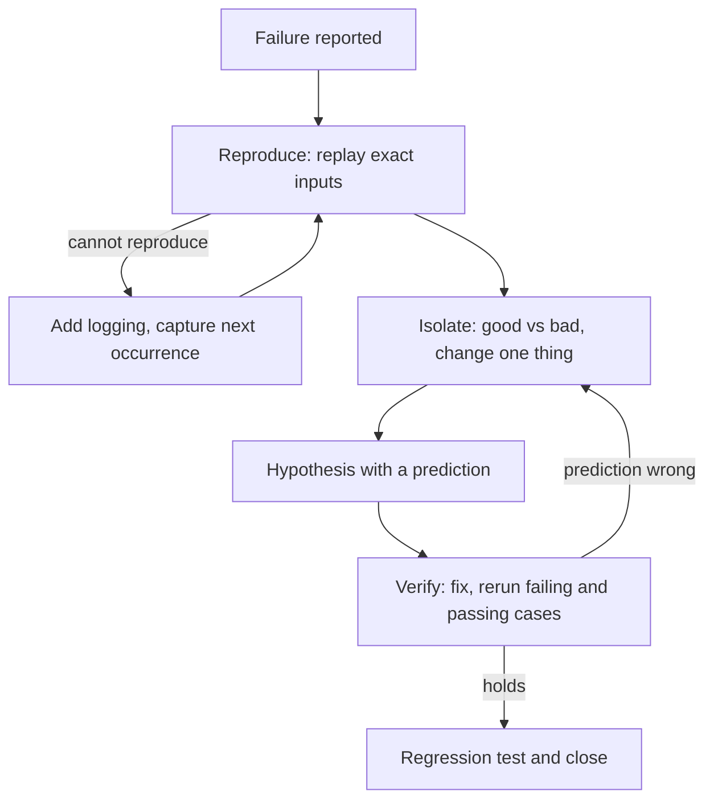

## TL;DR
Debugging is a search, not a guess: reproduce the failure, isolate the one difference between a passing
and failing case, state a falsifiable hypothesis, and verify with a test. For agents, reproduce by
replaying recorded tool calls.

## For agent builders
- **Why it matters for agents.** An agent failure crosses layers: prompt, model, tool arguments, tool
  code, network. Guessing at the layer wastes hours; isolating it takes minutes once you can replay a
  failing step.
- **Where it shows up in your stack.** Traces (Langfuse, LangSmith, OpenTelemetry spans) supply the exact
  inputs; `git bisect` finds the breaking commit; your eval set tells you whether a fix generalises.
- **What you control.** Logging enough to replay a step (model input, tool name, raw arguments, raw
  response), pinning model versions, and turning each fixed bug into a regression test.
- **What you can skip.** Debugger internals. A `print`, a `breakpoint()` and a disciplined loop beat any
  tool used without a hypothesis.

## Lab
### Task
A `search_orders` tool fails in production for one customer. You have the recorded arguments from a
passing and a failing run and the tool's config at each of the last 16 commits.

Run the four-step loop as code: reproduce from the trace, isolate the fields by one-change probes,
bisect the history for the commit that broke id handling, and fix at the tool boundary with a
regression test. Time box: 45-60 min.
- **Prerequisites:** Reading errors, logs and stack traces; the How it works steps; the differential
  replay example below.
- **Setup:** Python 3.9+ and `pip install pytest` (checked with Python 3.9.6 and pytest 8.4.2). Save the
  starter as `lab.py` and the tests as `test_lab.py`. No model calls: the trace is the input.
- **The twist:** the failing call has two differences from the passing one, and both matter at HEAD.
  Only one of them is a regression in history.

### Starter code
```python
"""Lab: debug a failing agent tool from its recorded trace, without guessing. Run: python lab.py"""
import json

ORDERS = {"C-1001": [{"id": f"o{i}", "total": 10 * i} for i in range(1, 9)]}

# The tool's config at each of the last 16 commits. Commit 0 is known good, commit 15 is HEAD.
# Somewhere a "cleanup" switched off id normalisation; the history is long, so do not read it, search it.
HISTORY = [{"normalize_ids": i < 11, "max_limit": 50} for i in range(16)]

def make_tool(cfg):
    def search_orders(customer_id, limit=5, status="any"):
        cid = customer_id.strip().upper() if cfg["normalize_ids"] else customer_id
        rows = ORDERS.get(cid)
        if rows is None:
            raise LookupError(f"order not found for {customer_id!r}")
        return rows[:limit]
    return search_orders

# Step 4 of a passing run and of the failing run, copied byte for byte from the trace.
GOOD = json.loads('{"customer_id": "C-1001", "limit": 3, "status": "open"}')
BAD = json.loads('{"customer_id": " c-1001", "limit": "3", "status": "open"}')

def run(tool, args):
    try:
        return "ok", tool(**args)
    except Exception as e:                      # record the failure, do not hide it
        return "fail", f"{type(e).__name__}: {e}"

def isolate(tool, good, bad):
    """Fields whose bad value ALONE, swapped into the good call, makes it fail. Sorted."""
    # YOUR CODE HERE: one change per probe, starting from the good call
    raise NotImplementedError

def first_bad(n, is_bad):
    """Binary search over commits 0..n-1, where 0 is good and n-1 is bad.
    Returns (first bad index, number of is_bad probes you made)."""
    # YOUR CODE HERE: keep lo good and hi bad; probe the midpoint until they are adjacent
    raise NotImplementedError

def fixed_tool(cfg):
    """The fix belongs at the tool boundary: normalise the id, coerce limit, reject garbage clearly."""
    inner = make_tool(dict(cfg, normalize_ids=True))
    def search_orders(customer_id, limit=5, status="any"):
        # YOUR CODE HERE: int(limit) when it is an int or a digit string, else raise
        # ValueError(f"limit must be an integer, got {limit!r}"); also reject limit > cfg["max_limit"]
        raise NotImplementedError
    return search_orders

def replay_is_bad(i):
    """The reproduction script: exit-code style check on the recorded BAD id with a known-good limit."""
    status, _ = run(make_tool(HISTORY[i]), dict(BAD, limit=3))
    return status == "fail"

if __name__ == "__main__":
    head = make_tool(HISTORY[-1])
    print("reproduce:", run(head, GOOD)[0], "|", run(head, BAD)[1])
    print("isolate:", isolate(head, GOOD, BAD))
    idx, probes = first_bad(len(HISTORY), replay_is_bad)
    print(f"first bad commit: {idx} after {probes} probes")
    fix = fixed_tool(HISTORY[-1])
    print("verify:", run(fix, BAD)[0], len(run(fix, BAD)[1]), "rows | good unchanged:", run(fix, GOOD) == run(make_tool(HISTORY[0]), GOOD))
    print("regression:", run(fix, dict(BAD, limit="three"))[1])
```

### Expected output
`python lab.py` with a correct solution prints exactly:

```
reproduce: ok | LookupError: order not found for ' c-1001'
isolate: ['customer_id', 'limit']
first bad commit: 11 after 4 probes
verify: ok 3 rows | good unchanged: True
regression: ValueError: limit must be an integer, got 'three'
```

- **Read the numbers:** 16 commits leave 15 gaps between the known-good and known-bad ends, so binary
  search needs ⌈log2 15⌉ = 4 probes (commits 7, 11, 9, 10). At commit 0 only `limit` isolates, because
  ids were still normalised: the id bug is the regression, the string `limit` was always latent.

### Tests
Run `pytest -q test_lab.py`. On the starter all 8 fail: the first three with `NotImplementedError`, the
fix tests with an `AssertionError` showing the `NotImplementedError` that `run()` recorded. A correct
solution passes all 8 (Python 3.9.6, pytest 8.4.2).

```python
import pytest
from lab import BAD, GOOD, HISTORY, ORDERS, first_bad, fixed_tool, isolate, make_tool, replay_is_bad, run

HEAD = make_tool(HISTORY[-1])

def test_isolate_finds_both_causes_at_head():
    assert isolate(HEAD, GOOD, BAD) == ["customer_id", "limit"]

def test_isolate_on_good_commit_finds_only_the_type_bug():
    assert isolate(make_tool(HISTORY[0]), GOOD, BAD) == ["limit"]

def test_bisect_finds_the_commit_in_log2_probes():
    assert first_bad(len(HISTORY), replay_is_bad) == (11, 4)
    seen = []
    first_bad(1024, lambda i: seen.append(i) or i >= 700)
    assert len(seen) == 10 and len(set(seen)) == 10

def test_fix_makes_the_recorded_bad_call_pass_and_keeps_good():
    fix = fixed_tool(HISTORY[-1])
    assert run(fix, BAD) == run(fix, GOOD) == ("ok", ORDERS["C-1001"][:3])

@pytest.mark.parametrize("limit", ["three", 2.5, None, 51])
def test_regression_garbage_limits_get_a_clear_error(limit):
    status, msg = run(fixed_tool(HISTORY[-1]), dict(BAD, limit=limit))
    assert status == "fail" and msg.startswith("ValueError: limit must be")
```

### Failure scenarios
- **Probe from the bad side** (put one good value into the bad call). Every probe still fails and
  `isolate` returns `[]`, because the two causes mask each other. Start from the passing call, so a
  single change can only add a failure.
- **Bisect with the full recorded call** (`run(..., BAD)` instead of the known-good `limit`). It prints
  `first bad commit: 1 after 3 probes`: the latent `limit` bug fails every commit, so the check no longer
  separates good from bad. A bisect check must test one hypothesis; confirm commit 0 passes it first.
- **Fix the symptom in the loop** (catch `LookupError` and return `[]`). The run "passes" with 0 rows and
  the agent tells the customer they have no orders. `test_fix_makes_...` catches it because it compares
  rows, not the absence of an exception.
- **Off-by-one in the search** (return `lo`). The answer is 10, a good commit; check that the commit you
  name fails the check and its parent passes it.

### Submission
- **`lab.py`** with `isolate`, `first_bad` and `fixed_tool` implemented; data, `run` and the main block
  unchanged.
- **A green run** of `pytest -q test_lab.py` (8 passed) and the output of `python lab.py`.
- **A debugging log:** four lines, one per step, each with the prediction written before the result.
- **A note** (3-5 sentences): which of the two causes you would also fix in the tool schema
  (`"type": "integer"`) and why the boundary check is still needed.
- **Evaluated on:** probes change one thing each; the named commit fails and its parent passes; the
  fix sits in the tool, not the agent loop; the regression test covers the recorded input.

## Why it exists
- **The failure is rarely where it surfaces.** A `KeyError` in the agent loop may start in an upstream
  API that renamed a field; the stack trace shows where it broke, not why.
- **Random changes destroy information.** Editing three things and re-running tells you nothing about
  which one mattered, and with a non-deterministic model a passing re-run may be luck.
- **Search is logarithmic, guessing is not.** Halving the suspect space each step finds one bad change
  among 1,000 commits in about 10 steps; reading them one by one could take all 1,000.
- **An unverified fix is a hypothesis.** Without a test that failed before and passes after, the bug
  returns at the next refactor or model upgrade.

## How it works
### 1. Reproduce
- **Capture the exact failing input.** For an agent step: the full model request (messages, tools,
  model id, temperature), the raw tool-call arguments as the model emitted them, and the raw tool
  response.
- **Make it deterministic.** Replay recorded model output instead of calling the model; stub the network
  with the recorded response. Temperature 0 reduces variation but does not guarantee identical output,
  so do not rely on it.
- **Measure the rate when it is intermittent.** "Fails 3 in 50 runs" is a reproduction; "failed once"
  is an anecdote. Run the case N times and count.

### 2. Isolate
Shrink the gap between a **good** case and a **bad** case until one difference remains.
| Axis | Good vs bad | Tool |
|---|---|---|
| Code history | last passing commit vs current | `git bisect run <test>` |
| Input | passing tool args vs failing ones | swap one field at a time; delta debugging |
| Transcript | step 3 fine, step 7 broken | replay from each recorded step |
| Environment | laptop vs container | diff env vars, versions, config |
| Layer | model vs tool vs network | call the tool directly with the recorded args |

- **Change one thing per probe**, because a probe that changes two things cannot attribute the result.
- **Prefer binary search** when the space is ordered (commits, transcript steps, document chunks).

### 3. Hypothesise
- **State it so it can be wrong:** "the tool fails because `limit` arrives as the string `\"3\"`" predicts
  that sending the integer 3 passes and any string fails.
- **Write the prediction down before running.** If the observation surprises you, the model in your head
  is wrong, which is the most useful thing a probe can tell you.

### 4. Verify
1. **The failing case passes** with the fix.
2. **The passing cases still pass** (run the suite or eval set, not just the one case).
3. **The fix sits at the cause**, not the symptom: coercing types at the tool boundary, not wrapping the
   agent loop in `try/except`.
4. **A regression test** captures the original failing input, so it can never silently return.

## Diagram
The loop runs until a hypothesis survives verification; a surprising observation sends you back to
isolate, not to random edits.



## Examples
### Isolating a failing agent tool by differential replay
A `search_orders` tool fails in one agent run and works in another. The script replays both recorded
argument sets, then swaps one field at a time from the good call to the bad one (tested with Python
3.9.6).

```python
import json

ORDERS = {"C-1001": [{"id": f"o{i}", "total": 10 * i} for i in range(1, 9)]}

def search_orders(customer_id, limit=5, status="any"):     # the agent tool under suspicion
    rows = ORDERS.get(customer_id.strip().upper(), [])
    return rows[:limit]

def run(args):
    try:
        return "ok", search_orders(**args)
    except Exception as e:                                  # record the failure, do not hide it
        return "fail", f"{type(e).__name__}: {e}"

# 1. Reproduce: replay the exact arguments from the trace, not a paraphrase of them.
good = json.loads('{"customer_id": "C-1001", "limit": 3, "status": "open"}')   # step 4 of a passing run
bad = json.loads('{"customer_id": " c-1001", "limit": "3", "status": "open"}') # step 4 of the failing run
print("good:", run(good)[0], "| bad:", run(bad))

# 2. Isolate: start from the good call and change ONE field at a time to the bad value.
for field in good:
    probe = dict(good, **{field: bad[field]})
    print(f"swap {field!r:14} ->", run(probe)[0])

# 3. Hypothesis: the model sends limit as a string; slicing a list with a str raises TypeError.
# 4. Verify: the fix must make the bad call pass AND keep the good call identical.
def search_orders(customer_id, limit=5, status="any"):
    rows = ORDERS.get(customer_id.strip().upper(), [])
    return rows[: int(limit)]                               # coerce at the tool boundary

assert run(bad) == run(good) == ("ok", ORDERS["C-1001"][:3])
print("verified: bad call now matches good call")
# Output:
# good: ok | bad: ('fail', 'TypeError: slice indices must be integers or None or have an __index__ method')
# swap 'customer_id'  -> ok
# swap 'limit'        -> fail
# swap 'status'       -> ok
# verified: bad call now matches good call
```

- **Two differences, one cause.** The customer id differs too (leading space, lower case), but the
  swap shows it is harmless. Without isolation you might have "fixed" the wrong field.
- **In production** the better fix is validating arguments with a schema (Pydantic) at the tool
  boundary and returning a clear error to the model, plus `"type": "integer"` in the tool schema.

### Worked scenario: task success dropped after a deploy
An agent's eval success rate fell from 86% to 71% after a release that bundled three changes
(illustrative numbers).

| Probe | Prompt edit | Model bump | Retriever `top_k` 8 to 4 | Success on 200-case eval |
|---|---|---|---|---|
| Baseline | old | old | 8 | 86% |
| Release | new | new | 4 | 71% |
| Revert `top_k` only | new | new | 8 | 84% |
| Revert prompt only | old | new | 4 | 72% |

- **Isolated:** `top_k` explains about 13 of the 15 points. The remaining 2 points are within the
  noise you measured by running the baseline twice (85% and 87%).
- **Hypothesis:** answers need evidence from chunks ranked 5-8. **Verified** by checking retrieval logs
  of the failing cases: 24 of 29 cited a chunk below rank 4 in the baseline run.

## Production patterns
- **Record enough to replay.** Log model input, raw tool-call arguments, raw tool responses and model
  version per step in your tracing tool, so any failed run can become a deterministic local test.
  Monitor the share of failed runs that can be replayed.
- **Bisect with a scripted check.** Turn the reproduction into a script that exits 0 on good and 1 on
  bad, then run `git bisect run ./check.sh`. Works for prompts in git too, not only code.
- **Turn every fix into a regression case.** Add the failing input to the unit tests (for tool code) or
  the eval set (for model behaviour), so CI catches the bug if it comes back.
- **Keep a debugging log during incidents.** Write each hypothesis, probe and result with timestamps in
  the incident channel; it stops the team re-testing ruled-out ideas and becomes the postmortem.
- **Measure flaky failures as rates.** Run an intermittent case 20-50 times before and after a fix and
  compare failure counts, because one green run proves little for a non-deterministic agent.

## Trade-offs
- **Replay vs live reproduction.** Recorded replays are deterministic and cheap, but miss bugs caused by
  live state (rate limits, changed upstream data); confirm the fix live once.
- **Binary search vs domain intuition.** Bisecting is guaranteed and mechanical, but a strong hunch
  checked first can be faster; time-box the hunch, then fall back to search.
- **Logging everything vs privacy and cost.** Full prompts and tool payloads make replay possible, but
  they hold user data; redact or sample, and set retention.
- **Fixing the symptom vs the cause.** A quick `try/except` restores service during an incident, but
  must be followed by the root-cause fix or the failure resurfaces elsewhere.

## Pitfalls
- **Shotgun debugging.** Symptom: several edits at once, the bug "goes away", nobody knows why.
  Diagnose: `git diff` the fix; if it touches more than the cause needs, revert pieces one at a time
  and rerun. Fix: one change per probe, written prediction first.
- **Trusting one green re-run of a flaky agent.** Symptom: the bug is "fixed" and returns the next day.
  Diagnose: run the case 30 times on the old and new code and compare failure counts. Fix: report
  failure rates, and remove the nondeterminism (stub the model) when testing tool code.
- **Debugging a paraphrase of the input.** Symptom: you cannot reproduce because you retyped the tool
  call by hand and normalised it. Diagnose: diff your test input byte for byte against the trace's raw
  arguments. Fix: copy raw payloads from the trace, never from memory.
- **Stopping at the line that raised.** Symptom: the fix guards against `None` but the bad value still
  flows in from upstream. Diagnose: walk the trace back to where the value was created and log it
  there. Fix: correct the producer, validate at the boundary.

## When to use
- **Use the full loop** for any bug that survives one quick look, any intermittent agent failure, and
  every production incident after service is restored.
- **Use `git bisect`** when "it worked last week" and you have a scripted check; use argument swapping
  or delta debugging when the input, not the code, changed.
- **Skip the ceremony** for obvious typos with a clear stack trace, but still add the regression test.
- **Measure:** time to reproduce, share of incidents with a regression test added, and recurrence rate.

## Exercise
**Goal:** debug a deliberately broken mini agent using only the four-step method, keeping a written
log. No solution is given.
- **Setup:** write a 3-tool agent with a scripted fake model that replays recorded tool calls, commit
  it, then have a colleague (or an LLM in a branch you do not read) plant two bugs: one type bug in a
  tool argument and one buried in a run of 10+ commits (for example a changed default). Bugs you
  planted yourself only rehearse the steps.
- **Constraints:** no edit to code until you have a reproduction script that exits 1 on failure; one
  change per probe.
- **Deliver:** the reproduction script, a debugging log (hypothesis, prediction, probe, result for each
  step), the fixes, and a regression test per bug.
- **Acceptance:**
  - `git bisect run ./repro.sh` names the commit with the planted history bug;
  - every log entry has a prediction written before its result;
  - each regression test fails on the buggy code and passes on the fix;
  - the full test suite passes after both fixes.

## Role lens
- **Engineer:** Turns a vague "the agent is broken" report into a replayable failing case, isolates the
  layer with one-change probes, and lands the fix with a regression test.
- **Architect:** Makes systems debuggable by design: every agent step logs replayable inputs, model
  versions are pinned, and tools validate arguments at their boundary.
- **FDE:** Reproduces customer-reported agent failures from shared traces without customer data
  access, and explains the root cause and fix in terms the customer can verify.

## Check yourself
**Q:** A support agent fails about 1 run in 10 with "order not found", only for some customers. A
colleague raises the retry count and the error rate drops to 1 in 25. Is it fixed? What would you do?
**A:** It is not fixed: retries hide a cause that is still there, and the improvement may be noise.
First reproduce: pull failing traces and replay the exact tool arguments; measure the failure rate over
dozens of runs. Then isolate by comparing failing and passing customers' arguments field by field. A
likely finding is a format difference (an id with a prefix, case or whitespace the model sometimes
changes). State the hypothesis with a prediction, fix it at the tool boundary with validation or
normalisation, verify the rate drops to zero on replay, and add the failing ids as regression tests.

## Interview questions
### Describe your debugging process for a bug you cannot reproduce locally.
- **Get the inputs first.** Pull the trace or logs for a failing case: request, arguments, environment,
  versions. If they are not logged, add logging and wait for the next occurrence.
- **Diff environments.** Compare versions, env vars, config and data between where it fails and where
  it passes; change them one at a time locally until it fails.
- **Then the usual loop:** hypothesis with a prediction, fix, regression test.

### How do you debug an agent whose behaviour is non-deterministic?
- **Separate the model from the code.** Replay recorded model outputs so tool code runs
  deterministically; most "agent bugs" are then ordinary bugs.
- **For model behaviour, use rates.** Run the case many times, report the failure rate with the model
  version pinned, and compare prompts on an eval set, not one run.

### When would you use `git bisect`, and what makes it work?
- **Use it** when a behaviour worked at a known commit and fails now, with many commits in between.
- **It needs** a scripted check that exits 0 for good and non-zero for bad (125 to skip an untestable
  commit), so the search is automatic and takes about log2(N) steps.

### A fix makes the failing case pass. Why is that not enough?
- **It may break other cases.** Run the full suite or eval set, because agent prompt fixes often trade
  one failure for another.
- **It may hit the symptom.** Check the fix sits where the bad value is produced, and add a regression
  test so the original input stays covered.

## Quiz
### Q: What is the main purpose of the isolate step?
- [ ] To collect as many logs as possible before changing anything
- [x] To shrink the difference between a passing and a failing case until one cause remains
- [ ] To rewrite the failing component so the bug disappears
- [ ] To decide who owns the bug
> Isolation compares a good and a bad case and changes one thing at a time, often by binary search,
> until a single difference explains the failure.

### Q: An agent tool fails intermittently. What is the best evidence that your fix worked?
- [ ] The next run passed
- [ ] The stack trace changed
- [x] The failure rate over many replayed runs dropped from a measured value to zero, and existing tests still pass
- [ ] The model's temperature was set to 0
> Intermittent failures need rates: one green run can be luck. Measuring before and after on many runs,
> plus the existing suite, shows the fix works and breaks nothing else.

### Q: Why replay recorded tool-call arguments instead of re-running the agent to reproduce a tool bug?
- [ ] Re-running the agent is not allowed in production
- [ ] Recorded arguments are smaller
- [x] The model may not emit the same arguments again, so the failure may not reappear
- [ ] Replays run on a faster model
> Model output varies between runs, even at temperature 0. Replaying the exact recorded arguments makes
> the tool failure deterministic and debuggable.

## Mastery test
**Problem:** a RAG agent answers correctly in staging but gives wrong, confidently cited answers in
production for about 15% of questions. Same code commit, same model id. You have traces from both
environments. Plan the investigation step by step.

**A strong answer:**
- reproduces with one failing production question replayed in staging using production's recorded
  retrieval results, to split "retrieval differs" from "generation differs";
- isolates by diffing environment inputs: index version, embedding model, chunking config, document
  set, env vars, `top_k`, and changes them one at a time in staging;
- forms a falsifiable hypothesis (for example "production's index was built with a different embedding
  model, so retrieved chunks differ") with a prediction it can fail;
- verifies by fixing the one difference, rerunning the 15% set and the passing set, and comparing
  rates;
- adds a regression check (index and embedding version asserted at startup, plus the failing questions
  in the eval set).

## Use cases & projects
### Use cases
- **Tool-call failures.** Replaying raw arguments isolates schema mismatches, type coercion bugs and
  upstream API changes in minutes.
- **Quality regressions after a release.** Toggling one change at a time on the eval set attributes a
  drop to the prompt, model or retrieval change responsible.
- **Production incidents.** A written hypothesis log keeps an on-call team from re-testing ideas and
  produces the postmortem timeline.
- **Customer-reported agent bugs.** Shared traces plus deterministic replay let an FDE reproduce a
  failure without access to the customer's systems.

### Mini project
**A replay harness for agent steps (2-3 hours).**
- **Goal:** turn any recorded agent step into a deterministic local test.
- **Steps:** log each step's model output and tool responses as JSON; write a `replay(step.json)` that
  feeds recorded model output to your tool code with network stubbed; add a CLI that runs one step or
  a whole run; plant a bug and use the harness plus `git bisect run` to find it.
- **Done when:** any failed run from your logs can be replayed locally in under a minute, and the
  harness found the planted bug without reading the diff.
