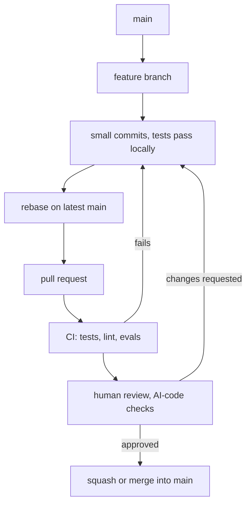

## TL;DR
Git stores snapshots linked by parent pointers; branches are movable labels on them. Small branches,
clear commits and review before merge keep a codebase safe to change, which matters more once an AI
assistant writes much of the diff.

## For agent builders
- **Why it matters for agents.** Agent behaviour lives in code, prompts, tool schemas and eval sets.
  Versioning all four in git lets you bisect a quality drop to the exact prompt edit that caused it.
- **Where it shows up in your stack.** Pull requests that run tests and evals in CI, prompts stored as
  files next to code, and AI coding assistants (including coding agents) proposing diffs you must
  review.
- **What you control.** Branch and commit size, what goes into each commit, when you rebase, and how
  hard you review generated code before it merges.
- **What you can skip.** Git's plumbing commands and exotic workflows. Master snapshots, branches,
  rebase versus merge, `revert`, `bisect` and `reflog`.

## Why it exists
- **Change needs history.** Without versioned snapshots you cannot answer "what changed between the
  agent that worked on Monday and the one failing today?", which is most of debugging.
- **Parallel work needs isolation.** Branches let several people (or several coding agents) change the
  same codebase without stepping on each other until they integrate.
- **One author misses things.** A second reader catches wrong assumptions, missing tests and security
  holes; it also spreads knowledge of the code.
- **Generated code raises the stakes.** An assistant can produce 300 plausible lines in a minute.
  Review is where you find the invented API, the swallowed exception or the test that tests nothing.

## How it works
### The model
| Concept | What it really is |
|---|---|
| Commit | a snapshot of the whole tree, plus author, message and parent commit id(s) |
| Branch | a file holding one commit id; committing moves it forward |
| `HEAD` | the branch (or commit) you currently have checked out |
| Staging area | the next commit being assembled: `git add` puts changes there |
| Remote | another copy of the repository; `fetch` copies its commits, `push` sends yours |

- **Commits are immutable.** "Editing" history (amend, rebase) creates new commits with new ids, which
  is why rewriting pushed history disrupts everyone who has the old ids.

### Everyday workflow
1. `git switch -c feat/rerank-tool` from an up-to-date `main`.
2. Small commits, each building and passing tests, with a message saying *why*.
3. `git fetch` then `git rebase origin/main` to replay your commits on the latest `main`.
4. Push and open a pull request; CI runs tests (and evals for prompt changes).
5. Address review with new commits or `fixup!` commits, squash them before merge.
6. Merge, delete the branch.

### Merge vs rebase
- **Merge** joins histories with a merge commit. It never rewrites anything, so it is always safe on
  shared branches, at the cost of a branchier history.
- **Rebase** replays your commits on a new base, producing a linear history. Use it on your own
  unpublished or personal branch; after rebasing a pushed branch, push with `git push --force-with-lease`,
  which refuses if someone else pushed in the meantime.
- **The rule:** never rebase a branch other people build on, such as `main`.

### Undoing safely
| Situation | Command | Rewrites history? |
|---|---|---|
| Undo a pushed commit | `git revert <id>` (new commit that inverts it) | no |
| Fold a fix into an earlier local commit | `git commit --fixup <id>` then `git rebase -i --autosquash` | yes |
| Find the commit that broke a check | `git bisect run <script>` | no |
| Recover a commit "lost" after reset or rebase | `git reflog`, then `git branch rescue <id>` | no |

### Reviewing code, including AI-generated code
1. **Does it do the stated thing?** Read the PR description, then the tests, then the code.
2. **Does it run?** Pull it and run the tests yourself for non-trivial changes; CI green is necessary,
   not sufficient.
3. **AI-specific checks:** every imported package and API actually exists at the pinned version (assistants
   invent plausible names, and attackers register such names on package indexes); tests assert behaviour
   rather than echo the implementation; errors are not silently swallowed; no unrelated "cleanups" ride
   along.
4. **Security:** no secrets, no `shell=True` with model or user input, SQL is parameterised, tool
   permissions are not widened.
5. **Size:** a diff too big to review well is sent back to be split.

## Diagram
A change flows from a branch through review and CI to `main`; a failure at any gate sends it back to
the branch, never around the gate.



## Examples
### Branch, bisect a bad AI "cleanup", revert it, and autosquash a fixup
Runs end to end in a throwaway repository. An assistant's "Simplify sort" commit silently inverts a
ranking; `git bisect run` finds it among five commits, `git revert` undoes it without rewriting
history, and a `fixup!` commit is folded into its target non-interactively (tested with git 2.56).

```bash
set -e
export GIT_CONFIG_GLOBAL=/dev/null                   # ignore personal config for a clean demo
export GIT_AUTHOR_NAME=demo GIT_AUTHOR_EMAIL=demo@example.com GIT_COMMITTER_NAME=demo GIT_COMMITTER_EMAIL=demo@example.com
rm -rf /tmp/efund/repo && mkdir /tmp/efund/repo && cd /tmp/efund/repo
git init -q -b main
printf 'def top_k(scores, k):\n    return sorted(scores, reverse=True)[:k]\n' > rank.py
printf 'from rank import top_k\nassert top_k([0.2, 0.9, 0.5], 2) == [0.9, 0.5]\n' > check.py
git add . && git commit -qm "Add top_k ranking with check"

git switch -qc feat/rerank                            # one branch per change
for i in 1 2 3; do echo "note $i" > note$i.md; git add .; git commit -qm "Add note $i"; done
sed -i.bak 's/reverse=True/reverse=False/' rank.py && rm rank.py.bak   # the AI-suggested "cleanup"
git commit -qam "Simplify sort"
echo "note 4" > note4.md; git add .; git commit -qm "Add note 4"

git bisect start HEAD main >/dev/null                        # bad, then good
git bisect run python3 check.py >/dev/null 2>&1
git log -1 --format="first bad: %h %s" refs/bisect/bad
git bisect reset >/dev/null 2>&1

git revert --no-edit HEAD~1 >/dev/null                 # undo the bad commit with a new commit
python3 check.py && echo "check passes after revert"
echo "typo fixed" >> note1.md
git commit -qam "fixup! Add note 1"                    # fold a fix into an earlier commit
GIT_SEQUENCE_EDITOR=: git rebase -qi --autosquash main # non-interactive autosquash
git log --oneline main..HEAD
# Output (ids differ per run):
# first bad: 46c3be3 Simplify sort
# check passes after revert
# ebf5444 Revert "Simplify sort"
# 9bde7f2 Add note 4
# be20f34 Simplify sort
# c17626e Add note 3
# 1585f5c Add note 2
# 1f0ce8f Add note 1          (now contains the fixup; no separate fixup commit remains)
```

- **Why the check script matters:** bisect is only as good as the command it runs. Exit 0 means good,
  1-127 bad, and 125 means "cannot test this commit, skip it".
- **On a real branch** you would drop the bad commit with an interactive rebase before review instead
  of reverting; revert is the tool once a commit is on a shared branch.

### Worked scenario: reviewing an assistant-written tool
An assistant produced a 180-line `fetch_invoice` tool with tests, all green in CI. Review found:

| Finding | Why it matters | Requested change |
|---|---|---|
| `from billing_sdk import InvoiceClient` | package not in the lockfile, name not on the internal index | use the existing internal client |
| `except Exception: return {}` | model sees "no invoice" instead of an error and invents one | raise a typed error, return an error message to the model |
| tests mock `InvoiceClient.get` and assert it was called | tests check the implementation, not behaviour | test parsing on recorded responses |
| `subprocess.run(f"pdftotext {path}", shell=True)` | `path` comes from tool args, so this is shell injection | pass an argument list, validate the path |
| reformatted 3 unrelated files | hides the real change, risks conflicts | split into a separate PR |

## Production patterns
- **Prompts, tool schemas and eval sets in git.** Store them as files reviewed like code, so `git log
  -p prompts/` and `git bisect` work on behaviour changes. Monitor eval scores per commit in CI.
- **Small pull requests with a required check.** Protect `main`: require passing CI and at least one
  approval, and aim for PRs a reviewer can read in one sitting. Track PR size and time to review.
- **Evals as a PR gate for prompt and model changes.** CI runs the eval set on any change under
  `prompts/` or model config and posts the score delta to the PR; block merges that regress past a
  threshold.
- **An AI-code review checklist.** Add the checks (packages exist and are pinned, no swallowed errors,
  behaviour-level tests, no widened permissions, no unrelated edits) to the PR template, because
  generated diffs fail in recognisable ways.
- **Squash or fixup before merge.** Keep `main` history one meaningful commit per change, so `revert`
  and `bisect` stay precise.

## Trade-offs
- **Rebase vs merge.** Rebase gives a linear history that bisects cleanly, but rewrites commits and
  needs care on pushed branches; merge is always safe but noisier.
- **Small PRs vs overhead.** Small diffs get better reviews and simpler reverts, but each costs a CI run
  and a reviewer context switch; stack related PRs when a change is large.
- **Strict review vs speed.** Required approvals catch defects and spread knowledge, but slow urgent
  fixes; allow an expedited path with review after merge for incidents.
- **Trusting AI-generated code vs verifying it.** Assistants speed up writing, but review time per line
  rises because plausible-looking errors are harder to spot.

## Pitfalls
- **Force-pushing over a teammate's work.** Symptom: commits vanish from a shared branch. Diagnose:
  `git reflog` on any machine that had them, and the remote's push log if the host provides one. Fix:
  restore from reflog; use `--force-with-lease`, never plain `--force`, and do not rebase shared
  branches.
- **Giant mixed commits.** Symptom: `git bisect` lands on a 2,000-line commit and you are no closer.
  Diagnose: `git show --stat <id>` shows unrelated files changed together. Fix: one logical change per
  commit, formatting changes separate.
- **Rubber-stamping green AI diffs.** Symptom: an invented package or swallowed exception reaches
  production. Diagnose: check the lockfile diff and grep the diff for broad `except` clauses and
  `shell=True` before reading the rest. Fix: the checklist, and run the code yourself.
- **Committing secrets.** Symptom: an API key appears in history, or a secret scanner alerts. Diagnose:
  `git log -p -S'sk-'` (or the key's prefix) to find every commit containing it. Fix: rotate the key
  first, then purge history; deleting the file in a new commit does not remove it from history.

## When to use
- **Always:** a branch and pull request for any change to code, prompts or tool schemas that others
  depend on.
- **Rebase** your own branch onto `main` before review; **merge** when integrating shared branches.
- **Bisect** whenever a check that used to pass now fails and the cause is not obvious.
- **Measure:** PR size, time to first review, reverts per month and escaped defects in generated code.

## Exercise
**Goal:** practise the full branch, review and recovery workflow in a throwaway repository. No solution
is given.
- **Setup:** create a repo with a small agent tool, its tests, and a `prompts/system.md` file; add 8-10
  commits on a feature branch, one of which (written by an assistant or you) silently breaks a test and
  one of which commits a fake key such as `FAKE_KEY_123`.
- **Constraints:** use only command-line git; no GUI.
- **Deliver:** a short log of the commands you ran and why, plus a written review of one assistant-made
  diff using the checklist from this lesson.
- **Acceptance:**
  - `git bisect run` identifies the breaking commit automatically;
  - the final branch history has no fixup commits and passes tests at every commit (check with
    `git rebase --exec "pytest -q" main`);
  - `git log -p -S'FAKE_KEY_123'` returns nothing on the final branch;
  - you recover a deliberately reset-away commit using `git reflog`.

## Role lens
- **Engineer:** Keeps commits small and bisectable, rebases personal branches, and reviews AI-generated
  diffs against a checklist before approving, running the code for anything non-trivial.
- **Architect:** Sets branch protection, required checks and eval gates for prompt changes, and decides
  how prompts, schemas and eval sets are versioned alongside code.
- **FDE:** Works in customer repositories with their conventions, delivers reviewable PRs, and uses
  history (`log`, `blame`, `bisect`) to explain when and why a customer's agent behaviour changed.

## Check yourself
**Q:** After rebasing your feature branch onto `main`, the push is rejected. A teammate suggests
`git push --force`. What is happening, what is the safer command, and when should you not rebase at all?
**A:** Rebasing rewrote your commits with new ids, so the remote branch is no longer an ancestor of your
local one and a normal push would lose the old commits. If only you use the branch, push with
`git push --force-with-lease`, which overwrites only if the remote still points where you last saw it,
so a teammate's new commits are not destroyed. Do not rebase a branch other people have built on (such
as `main` or a shared integration branch); merge instead, because rewriting it breaks everyone's
history. If commits were lost anyway, `git reflog` can recover them.

## Interview questions
### Explain the difference between merge and rebase, and your rule for choosing.
- **Merge** creates a commit with two parents and preserves history exactly; safe anywhere.
- **Rebase** replays commits onto a new base with new ids, giving linear history.
- **Rule:** rebase your own unshared branch to stay current; merge into shared branches; never rewrite
  history others have pulled.

### What do you look for when reviewing a pull request written mostly by an AI assistant?
- **Existence and pinning:** every package and API exists at the version in the lockfile.
- **Error handling:** no broad `except` returning empty results that the agent will treat as truth.
- **Tests:** assert behaviour on realistic inputs rather than mocking the code under test.
- **Security and scope:** no injection, secrets or widened permissions, and no unrelated edits.

### The agent's eval score dropped 10 points sometime in the last 40 commits. How do you find out why?
- **Script the check:** a command that runs a fixed, seeded subset of the eval and exits non-zero below a
  threshold.
- **Bisect:** `git bisect start HEAD <good>` then `git bisect run ./eval_check.sh`; about 6 steps for
  40 commits, using 125 to skip commits that cannot run.
- **Read the culprit diff**, then confirm by reverting it alone.

### When would you allow merging without a full review?
- **During an incident** for a minimal, revertible fix, with review immediately after merge.
- **Never** for changes that touch auth, payments, tool permissions or secrets, because those are where
  a missed defect is most expensive.

## Quiz
### Q: A bad commit is already on the shared `main` branch. What is the safest way to undo it?
- [ ] `git reset --hard HEAD~1` and force-push
- [x] `git revert <id>`, which adds a new commit that inverts it
- [ ] Delete the branch and recreate it
- [ ] Interactive rebase to drop the commit, then force-push
> Revert undoes the change without rewriting history, so everyone else's copy of `main` stays valid.
> Reset and rebase rewrite shared history and break other clones.

### Q: What does `git bisect run ./check.sh` need from `check.sh`?
- [ ] It must print the word "bad" on failure
- [x] Exit 0 for a good commit, non-zero (except 125) for a bad one, and 125 to skip
- [ ] It must be written in Python
- [ ] It must compare two commits itself
> Bisect reads only the exit code. 125 tells it the commit cannot be tested, and any other non-zero
> code up to 127 marks the commit bad.

### Q: Which is the most AI-specific risk to check in a generated diff?
- [ ] Inconsistent indentation
- [ ] Commit messages in the wrong tense
- [x] Imports of packages or APIs that do not exist or are not pinned
- [ ] Long function names
> Assistants generate plausible but non-existent package and API names, and attackers can register such
> names on public indexes. Checking imports against the lockfile and docs catches this.

## Mastery test
**Problem:** a coding agent opens 12 pull requests a day against your agent's repository. Two incidents
last month came from its PRs: one added a dependency with a typo-squatted name, one changed
`prompts/router.md` and dropped tool-choice accuracy by 8 points. Design the workflow changes.

**A strong answer:**
- requires CI on every PR, including a dependency check that fails on packages not in an allow-list or
  lockfile, and a secret scan;
- runs the eval set whenever `prompts/` or model config changes, posts the score delta, and blocks
  regressions past a threshold;
- limits the agent's PR size and scope, and keeps a human approval requirement on `main`;
- adds the two incidents as regression checks (the dependency rule and the router eval cases);
- tracks escaped defects per PR source to see whether the gates work.

## Use cases & projects
### Use cases
- **Prompt regressions.** Prompts in git plus `bisect` over an eval check find which edit dropped quality.
- **Reviewing coding-agent output.** A checklist for generated diffs catches invented packages,
  swallowed errors and hollow tests.
- **Safe rollback.** Small squashed commits make `git revert` a one-command rollback of a bad agent
  change.
- **Customer handover.** Clean history and PR descriptions let a customer's team own the agent code
  after an engagement.

### Mini project
**An eval-gated PR workflow for an agent repo (2-3 hours).**
- **Goal:** make prompt changes as safe to merge as code changes.
- **Steps:** move prompts and tool schemas into files; write `eval_check.sh` that runs 20 seeded eval
  cases and exits non-zero below a threshold; add a CI job that runs it on changes under `prompts/`;
  add a PR template with the AI-code checklist; break a prompt on purpose and open a PR.
- **Done when:** the broken prompt PR is blocked by CI with the score shown, and `git bisect run
  ./eval_check.sh` finds the bad commit locally.
