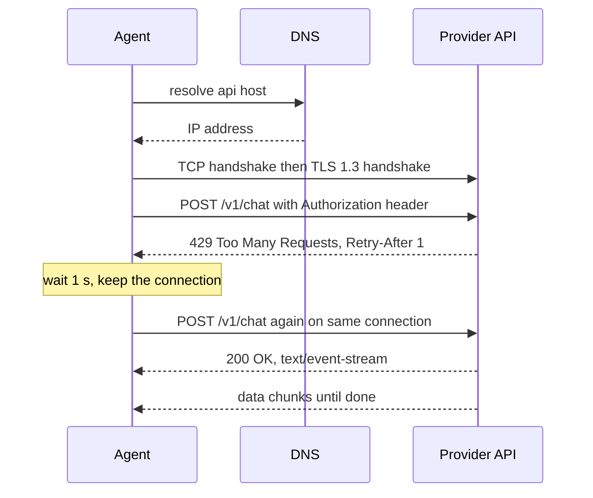

## TL;DR
HTTP is plain text messages (method, path, headers, body) over a TCP connection wrapped in TLS. Every
LLM call and most agent tools are one request and one response, so status codes, headers, timeouts and
connection reuse decide how your agent waits, retries and fails.

## For agent builders
- **Why it matters for agents.** One agent step may call a model, a vector store and three tool APIs.
  Each is an HTTP exchange that can be rate limited (429), overloaded (503 or 529), time out, or succeed
  twice when retried. Knowing which is which is the difference between a retry and a duplicate refund.
- **Where it shows up in your stack.** Provider SDKs (OpenAI, Anthropic) are HTTP clients built on httpx;
  MCP's remote transport is HTTP; streaming tokens arrive as server-sent events over one long response.
- **What you control.** Timeouts per phase, retry policy by status code, connection pooling, idempotency
  keys on writes, and which headers (request ids, rate-limit counters) you log.
- **What you can skip.** Writing your own HTTP parser or TLS. Read the wire format once so the SDK stops
  being magic, then use a real client.

## Why it exists
- **Programs on different machines need a shared contract.** HTTP fixes the shape of a request (method,
  target, headers, body) and a response (status, headers, body), so any client can talk to any server
  without custom framing.
- **Statelessness makes it scale.** Each request carries everything the server needs (credentials in
  `Authorization`, content type, body), so any replica behind a load balancer can answer it.
- **Status codes let machines decide.** A 4xx says "the request is wrong, do not retry as is"; a 5xx says
  "the server failed, a retry may work". An agent's retry logic is built on that split.
- **TLS makes the public internet usable.** Without encryption and server authentication, your API key in
  a header is readable by every hop between you and the provider.

## How it works
### The layers, bottom up
| Layer | What it gives you | Cost on a new connection |
|---|---|---|
| DNS | hostname to IP address | one lookup, often cached |
| TCP | reliable, ordered byte stream | 1 round trip (SYN, SYN-ACK, ACK) |
| TLS 1.3 | encryption plus proof of server identity via its certificate | 1 more round trip |
| HTTP | request and response messages on that stream | the request itself |

- **A fresh HTTPS request pays about 2 round trips before sending a byte of HTTP.** Over a 100 ms path
  that is roughly 200 ms of setup per call, which is why clients keep connections open and reuse them.
- **ALPN picks the HTTP version during the TLS handshake.** HTTP/2 multiplexes many requests on one
  connection; HTTP/1.1 sends one at a time per connection (the client opens a pool of them instead).

### The message
A request is literally these bytes (HTTP/1.1; HTTP/2 encodes the same fields in binary frames):

```
POST /v1/chat HTTP/1.1
Host: api.example.com
Authorization: Bearer <key>
Content-Type: application/json
Content-Length: 61

{"model": "demo", "messages": [{"role": "user", "content": "hi"}]}
```

1. **Request line:** method, target path, version.
2. **Headers:** `Name: value` lines. `Host` is required in HTTP/1.1; a blank line ends the headers.
3. **Body:** exactly `Content-Length` bytes, or chunks when `Transfer-Encoding: chunked` is used.

The response mirrors it: `HTTP/1.1 429 Too Many Requests`, headers such as `Retry-After: 1`, then a body.

### Methods and idempotency
- **Safe methods** (`GET`, `HEAD`) do not change server state; caches and retries treat them freely.
- **Idempotent methods** (`GET`, `PUT`, `DELETE`) give the same end state if repeated, so retrying after a
  timeout is safe.
- **`POST` is neither.** A retried `POST /refunds` after a lost response can refund twice. Some APIs
  (Stripe, for example) accept an `Idempotency-Key` header so the server deduplicates retries.
- **LLM calls are `POST` but usually harmless to repeat**: the cost is tokens, not side effects. Your
  agent's *tools* are where non-idempotent `POST`s hurt.

### Status codes an agent must route
| Code | Meaning | Agent action |
|---|---|---|
| 200 / 201 | success / created | parse body |
| 400 / 422 | malformed or invalid request | do not retry; fix the payload (often a bad tool schema or oversized prompt) |
| 401 / 403 | missing or bad credentials / not allowed | do not retry; alert, check key and scopes |
| 404 | no such resource | do not retry; often a wrong model name or path |
| 408 / 429 | timed out / rate limited | retry with backoff, honour `Retry-After` |
| 500 / 502 / 503 / 504 | server, gateway or upstream failure | retry with capped backoff |
| 529 | Anthropic's "overloaded" status | retry with backoff, like 503 |

### Headers worth logging
- **Request id.** Providers return one (`x-request-id` on OpenAI, `request-id` on Anthropic, checked
  2026). Log it on every call; it is what support asks for.
- **Rate-limit counters.** For example `x-ratelimit-remaining-requests` (OpenAI) or
  `anthropic-ratelimit-requests-remaining` (Anthropic). They warn you before the 429.
- **`Retry-After`.** Seconds or an HTTP date telling you when to come back (RFC 9110).
- **`Content-Type: text/event-stream`.** The response is a stream of server-sent events: `data: {...}`
  lines, one per token chunk, on a response that stays open until the model finishes.

### Timeouts are per phase
- **Connect timeout** bounds DNS plus TCP plus TLS; a few seconds is plenty.
- **Read timeout** bounds the gap between bytes. For a streaming completion it is the longest pause
  between tokens, not the whole answer.
- **Total deadline** bounds the whole call and belongs to your agent step budget. SDK defaults are long
  (the OpenAI and Anthropic Python SDKs default to 10 minutes with 2 retries; verify for your version).

## Diagram
Follow one model call: connection setup is paid once, a 429 is retried after `Retry-After`, and the
second request reuses the same connection.



## Examples
### HTTP on the wire: a raw-socket client against a fake LLM
Stdlib only. A local server plays a provider that rate limits the first call. The client writes the
request bytes by hand, parses the status line and headers, honours `Retry-After`, and reuses one TCP
connection for both attempts (tested with Python 3.9.6).

```python
import json, socket, threading, time
from http.server import BaseHTTPRequestHandler, HTTPServer

calls = {"n": 0}

class FakeLLM(BaseHTTPRequestHandler):           # stands in for a model provider
    protocol_version = "HTTP/1.1"                 # keep-alive: one TCP connection, many requests
    def do_POST(self):
        body = json.loads(self.rfile.read(int(self.headers["Content-Length"])))
        calls["n"] += 1
        if calls["n"] == 1:                       # first call: rate limited
            status, payload, extra = 429, {"error": "rate_limited"}, {"Retry-After": "1"}
        else:
            status, payload, extra = 200, {"content": f"echo: {body['messages'][-1]['content']}"}, {}
        data = json.dumps(payload).encode()
        self.send_response(status)
        for k, v in {"Content-Type": "application/json", "Content-Length": str(len(data)), **extra}.items():
            self.send_header(k, v)
        self.end_headers(); self.wfile.write(data)
    def log_message(self, *a): pass

srv = HTTPServer(("127.0.0.1", 0), FakeLLM)
threading.Thread(target=srv.serve_forever, daemon=True).start()
port = srv.server_address[1]

def call(sock, prompt):
    body = json.dumps({"model": "demo", "messages": [{"role": "user", "content": prompt}]}).encode()
    head = (f"POST /v1/chat HTTP/1.1\r\nHost: 127.0.0.1:{port}\r\n"
            f"Authorization: Bearer test-key\r\nContent-Type: application/json\r\n"
            f"Content-Length: {len(body)}\r\n\r\n").encode()
    sock.sendall(head + body)                    # the request is just these bytes
    f = sock.makefile("rb")
    status_line = f.readline().decode().strip()
    headers = {}
    while (line := f.readline().decode().strip()):
        k, v = line.split(": ", 1); headers[k.lower()] = v
    return status_line, headers, json.loads(f.read(int(headers["content-length"])))

sock = socket.create_connection(("127.0.0.1", port), timeout=5)
for attempt in range(3):
    status, headers, data = call(sock, "hello")
    print(attempt, status, data)
    if status.split()[1] == "429":
        time.sleep(float(headers.get("retry-after", "1")))   # honour the server's hint
        continue
    break
# Output:
# 0 HTTP/1.1 429 Too Many Requests {'error': 'rate_limited'}
# 1 HTTP/1.1 200 OK {'content': 'echo: hello'}
```

### Where the time goes: curl's phase timings
`-w` prints cumulative timestamps for each phase; `-v` shows the TLS version and the ALPN choice.

```bash
curl -sS -o /dev/null -w 'dns=%{time_namelookup} tcp=%{time_connect} tls=%{time_appconnect} ttfb=%{time_starttransfer} total=%{time_total} code=%{http_code}\n' https://example.com
# dns=0.022190 tcp=0.033125 tls=0.056185 ttfb=0.077328 total=0.077414 code=200
curl -sv -o /dev/null https://api.anthropic.com/v1/messages 2>&1 | grep -E 'SSL connection|ALPN|^< HTTP'
# * ALPN: server accepted h2
# * SSL connection using TLSv1.3 / ...
# < HTTP/2 405            (GET on a POST-only endpoint: the server is reachable, the method is wrong)
```

| Phase | Cumulative | This phase |
|---|---|---|
| DNS | 22 ms | 22 ms |
| TCP connect | 33 ms | 11 ms |
| TLS handshake | 56 ms | 23 ms |
| First byte | 77 ms | 21 ms |

For a model call the first-byte phase dominates (prefill on the provider side), but on a cold
connection to a distant region the setup rows can rival it. That is the argument for a shared client.

## Production patterns
- **One shared client per process.** Create one `httpx.Client` (or SDK client) at startup and reuse it,
  so agent steps reuse pooled TLS connections instead of paying handshakes. Monitor connection-pool
  waits and new-connection counts.
- **Retry by status class, with jittered backoff.** Retry 408, 429, 500, 502, 503, 504 and 529 a capped
  number of times; never retry other 4xx. Honour `Retry-After` when present. Monitor retries per call
  and give up inside the agent's step budget.
- **Idempotency keys on side-effecting tools.** Generate one key per logical tool action (for example a
  hash of run id plus step), send it on every retry, and have the tool server deduplicate. Monitor
  duplicate-write counts.
- **Explicit timeouts per phase.** Set connect around a few seconds, read to the longest acceptable
  pause between streamed tokens, and a total deadline from the step budget. Alert on timeout rate per
  upstream.
- **Log the request id and rate-limit headers.** Attach provider request ids and remaining-quota headers
  to the agent trace span, so a slow or failed step can be matched to the provider's side.

## Trade-offs
- **Connection reuse vs stale connections.** Pooled connections save round trips, but a server or proxy
  may silently close idle ones; clients must retry once on a reset connection.
- **Aggressive retries vs load amplification.** Retries recover transient 503s, but every client
  retrying at once during an outage multiplies load; cap attempts and add jitter.
- **Streaming vs simplicity.** Server-sent events give fast first tokens, but long-lived responses need
  read timeouts per chunk, proxy buffering disabled, and partial-response handling.
- **HTTP/2 multiplexing vs head-of-line risk.** One connection carries many parallel tool calls, but a
  lost TCP packet stalls all of them; HTTP/3 over QUIC exists to remove that.

## Pitfalls
- **Retrying a non-idempotent tool call.** Symptom: duplicate tickets, emails or refunds after a
  timeout. Diagnose: search tool-server logs for two writes with the same run id and arguments seconds
  apart, and check whether the first one actually succeeded. Fix: idempotency keys, or retry only reads.
- **Treating every error as retryable.** Symptom: the agent loops on a 400 or 401 until the step budget
  runs out. Diagnose: group failed calls by status code in the trace; repeated identical 4xx bodies are
  the tell. Fix: route by status class and surface 4xx bodies to the model or the operator.
- **No timeout, or only a total one.** Symptom: an agent run hangs for ten minutes on one stalled
  stream. Diagnose: compare time to first byte against total time in the trace; a long silence after
  the first chunk means the read timeout is missing. Fix: set connect, read and total limits.
- **A new client per request.** Symptom: latency per call has a constant extra 50-300 ms and
  `time_appconnect` is non-zero on every call. Diagnose: count new TLS connections per minute against
  requests per minute; they should differ by orders of magnitude. Fix: one shared client.
- **Proxies buffering streams.** Symptom: tokens arrive all at once at the end. Diagnose: `curl -N`
  directly against the backend versus through the proxy and compare first-chunk times. Fix: disable
  response buffering for `text/event-stream` routes.

## When to use
- **Use this model when** an agent call is slow, fails intermittently, or behaves differently in
  production: name the phase (DNS, connect, TLS, first byte, stream) before touching code.
- **Reach for raw tools** (`curl -v`, `-w` timings) to separate "the network" from "the model" from
  "my code" in one command.
- **Avoid hand-rolled HTTP in production.** The raw-socket example is for understanding; real clients
  handle chunked bodies, redirects, pooling and TLS correctly.
- **Measure:** status-code mix per upstream, retries per call, time to first byte, and new connections
  per minute.

## Exercise
**Goal:** build and instrument a resilient HTTP client for a fake LLM provider, then prove each
behaviour from the terminal. No solution is given.
- **Inputs:** a stdlib or FastAPI fake server you write that can return 200, 400, 429 with
  `Retry-After`, 503, a slow first byte, and a stalled stream, chosen by a request header.
- **Constraints:** Python with httpx or the stdlib; one shared client; connect, read and total timeouts
  set explicitly; retries only for retryable codes.
- **Deliver:** the client, the fake server, and a short table of each scenario with status, attempts and
  elapsed time.
- **Acceptance:**
  - the 400 scenario makes exactly 1 request (count it in the server log);
  - the 429 scenario waits at least the `Retry-After` value before the second attempt;
  - the stalled stream fails within your read timeout, not the total deadline;
  - `curl -v` against your server shows the same status line and headers your client logged;
  - ten sequential calls open one TCP connection (verify with server-side connection logging or
    `lsof -i`).

## Role lens
- **Engineer:** Sets per-phase timeouts, retry rules by status class and a shared client for every model
  and tool call, and debugs slow agent steps with `curl -w` phase timings before changing code.
- **Architect:** Decides which agent tools must be idempotent, where idempotency keys are generated, and
  how timeouts nest from tool call to agent step to user request so budgets add up.
- **FDE:** Diagnoses customer-network problems (proxies buffering streams, TLS inspection, egress
  allow-lists) with `curl -v` in the customer's environment, and explains a 403 versus a 429 to them.

## Check yourself
**Q:** Your agent's ticket-creation tool calls `POST /tickets`. The call times out after 30 s, your
client retries, and the customer finds two identical tickets. What happened, and how do you fix it
without losing the retry?
**A:** The first request reached the server and created the ticket, but the response was lost or arrived
after the client's timeout, so the client could not distinguish "failed" from "succeeded slowly".
`POST` is not idempotent, so the retry created a second ticket. Fix it by sending an idempotency key
derived from the run id and step, identical on every retry, and having the ticket service store keys
and return the original result for a repeat. Also check the timeout: if ticket creation normally takes
25 s, a 30 s timeout invites this race; raise it or make the operation asynchronous.

## Interview questions
### Walk me through everything that happens when your agent calls an LLM API over HTTPS.
- **Resolve and connect.** DNS turns the host into an IP, TCP takes one round trip, TLS 1.3 another,
  during which the certificate is checked and ALPN picks HTTP/2 or HTTP/1.1.
- **Exchange.** The client sends `POST` with an `Authorization` header and JSON body; the server
  replies with a status, headers such as a request id and rate-limit counters, and a body, often a
  server-sent event stream.
- **Reuse.** The connection goes back to the pool so the next agent step skips setup.

### Which status codes should an agent retry, and how?
- **Retry:** 408, 429, 500, 502, 503, 504 and provider overload codes such as 529, with capped,
  jittered exponential backoff and `Retry-After` honoured when present.
- **Do not retry:** 400, 401, 403, 404, 422; the same request will fail the same way, so surface the
  error body to the model or the operator instead.

### Model calls in production sometimes take 90 s and then fail. How do you find out why?
- **Split the phases.** Log connect time, time to first byte and time between stream chunks; reproduce
  with `curl -w` from the same host.
- **Read the boundaries.** A failure at a round number like 60 s or 90 s usually points to a proxy or
  load-balancer idle timeout, not the provider.
- **Fix at the right layer:** stream to keep bytes flowing, raise the proxy timeout, or set a read
  timeout that fails fast.

### When is HTTP/2 multiplexing worth it for an agent, and when does it not matter?
- **Worth it** when an agent fires many parallel tool or model calls to the same host, because they
  share one connection instead of a pool of HTTP/1.1 connections each paying a handshake.
- **Does not matter** for one sequential call per step with a warm connection; time is dominated by the
  model's time to first token, not transport.

## Quiz
### Q: A tool call returns 422 with a validation error body. What should the agent's HTTP layer do?
- [ ] Retry with exponential backoff up to 5 times
- [x] Not retry, and pass the error body back so the model or caller can fix the arguments
- [ ] Open a new connection and retry once in case the connection was stale
- [ ] Treat it as a rate limit and wait for Retry-After
> 4xx codes mean the request itself is wrong, so repeating it unchanged fails the same way. Returning the
> validation error lets the model correct its tool arguments on the next step.

### Q: Why does reusing one HTTP client across agent steps reduce latency?
- [ ] It caches model responses between steps
- [ ] It compresses request bodies more efficiently
- [x] It keeps TCP and TLS connections open, so later calls skip the handshakes
- [ ] It switches the provider to a faster model tier
> A new HTTPS connection costs about two round trips (TCP plus TLS 1.3) before any request bytes move.
> A pooled connection pays that once and reuses it for every later call.

### Q: A streaming completion stalls after the first few tokens. Which timeout catches this fastest?
- [ ] The connect timeout
- [x] The read timeout, which bounds the gap between received bytes
- [ ] The DNS cache TTL
- [ ] The TLS session ticket lifetime
> The connection is already established and bytes have started flowing, so only a read timeout, which
> limits silence between chunks, fires before the much longer total deadline.

## Mastery test
**Problem:** an agent books meetings through an internal calendar API behind a corporate proxy. Users
report two things: some bookings appear twice, and long "find a free slot across 40 calendars" calls
fail with 504 after exactly 60 s. Logs show your client retries 504s up to 3 times. Diagnose both and
propose changes.

**A strong answer:**
- identifies the exact 60 s failure as the proxy's upstream or idle timeout, not the calendar service,
  and confirms it with `curl -w` timings directly against the service and through the proxy;
- explains the duplicates: `POST /bookings` succeeded upstream, the proxy returned 504 to the client,
  and the retry booked again because the call is not idempotent;
- adds an idempotency key per booking action and server-side deduplication, and stops retrying 504 on
  writes without one;
- fixes the slow search with an asynchronous job (`202 Accepted` plus polling) or by narrowing the
  query, rather than only raising the proxy timeout;
- names what to measure afterwards: duplicate bookings per day, 504 rate, and p95 search latency.

## Use cases & projects
### Use cases
- **Debugging a slow agent step.** Phase timings separate a cold TLS connection from model prefill
  time from a proxy buffering the stream.
- **Designing tool APIs for agents.** Status codes and idempotency rules decide whether an agent can
  safely retry a tool after a timeout.
- **Handling provider rate limits.** Reading 429s, `Retry-After` and rate-limit headers keeps a
  multi-agent system under quota instead of in a retry storm.
- **Operating MCP servers over HTTP.** Remote MCP transport is HTTP, so the same headers, status codes
  and streaming rules apply to every tool server you expose.

### Mini project
**A transport-aware LLM client (1-3 hours).**
- **Goal:** wrap any provider SDK or raw httpx call so every agent model call records phase timings,
  status, request id, retries and rate-limit headers.
- **Steps:** create one shared client; add event hooks or a transport wrapper that logs these fields
  as JSON; force a 429 (tiny rate limit on a fake server) and a timeout; run a 10-step agent loop.
- **Done when:** one JSON line per call shows status, attempts, time to first byte and request id, and
  you can explain each slow call from those lines alone.
