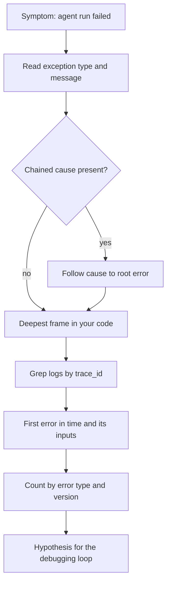

## TL;DR
An error message, a stack trace and a log line each answer a different question: what broke, where in
the code, and what the system was doing at the time. Read traces bottom-up, follow the cause chain, and
join logs by trace id.

## For agent builders
- **Why it matters for agents.** An agent failure usually shows up far from its cause: the loop raises
  `ToolError`, but the root is a model that emitted a trailing comma in JSON arguments. You find it only
  by following the chain.
- **Where it shows up in your stack.** Python tracebacks, Node `error.stack` and `error.cause`, SDK
  exceptions carrying HTTP status and request ids, JSON logs in CloudWatch or Loki, and spans in
  Langfuse, LangSmith or an OpenTelemetry backend.
- **What you control.** Chaining exceptions with `raise ... from e`, logging one structured line per
  failure with a `trace_id`, and keeping the raw tool arguments in the log so the step can be replayed.
- **What you can skip.** Memorising exception classes. Learn the reading order; the class name and
  message are always printed for you.

## Lab
### Task
Build the trace explainer an on-call engineer runs first: parse a messy JSON-lines log, pull one run by
`trace_id`, name the first error in time and list the rest as consequences, then walk the exception's
cause chain to the deepest frame in your own code. Time box: 45-60 min.
- **Prerequisites:** Command line and environment basics; How it works steps 1-4; the wrapped tool
  error example below.
- **Setup:** Python 3.9+ and `pip install pytest` (checked with Python 3.9.6 and pytest 8.4.2). Save the
  starter as `lab.py` byte for byte (the expected line number depends on it) and the tests as
  `test_lab.py`.
- **The data:** the worked scenario's run `t-91`, shipped out of time order, interleaved with run
  `t-92`, plus a stray stderr line, as real log pipelines deliver them.

### Starter code
```python
"""Lab: a trace explainer for a failed agent run: logs by trace id, then the cause chain. Run: python lab.py"""
import json, traceback

# JSON lines as shipped from three services: out of time order, two runs interleaved, one stray stderr line.
LOG = """\
{"ts": "12:00:35.060", "trace_id": "t-91", "service": "api", "level": "ERROR", "event": "request timeout after 30 s"}
{"ts": "12:00:01.120", "trace_id": "t-91", "service": "api", "level": "INFO", "event": "run started"}
{"ts": "12:00:01.300", "trace_id": "t-92", "service": "api", "level": "INFO", "event": "run started"}
{"ts": "12:00:05.050", "trace_id": "t-91", "service": "worker", "level": "ERROR", "event": "ToolError: get_invoice failed"}
{"ts": "12:00:02.480", "trace_id": "t-91", "service": "worker", "level": "WARNING", "event": "model call 429, retry 1 after 2 s"}
Traceback (most recent call last):
{"ts": "12:00:04.910", "trace_id": "t-91", "service": "worker", "level": "INFO", "event": "model call 200, tool_call get_invoice"}
{"ts": "12:00:03.900", "trace_id": "t-92", "service": "worker", "level": "ERROR", "event": "RateLimitError: 429 after 3 retries"}
{"ts": "12:00:05.030", "trace_id": "t-91", "service": "tool-svc", "level": "ERROR", "event": "KeyError: 'amount_due' in format_invoice"}
{"ts": "12:00:06.000", "trace_id": "t-92", "service": "api", "level": "ERROR", "event": "run failed"}
"""

class ToolError(Exception):
    """Raised at the tool boundary; the model sees this message."""

def format_invoice(inv):
    return f"{inv['amount_due']:.2f} {inv['currency']}"

def get_invoice(raw):                           # chains deliberately: raise ... from e
    try:
        return format_invoice(json.loads(raw))
    except KeyError as e:
        raise ToolError("get_invoice failed") from e

def get_invoice_buggy(raw):                     # a second bug inside the except block
    try:
        return format_invoice(json.loads(raw))
    except KeyError as e:
        return {"error": e.missing_field}       # AttributeError while handling the KeyError

def parse(text):
    """Returns (records, skipped): every line that is a JSON object, and the count of lines that are not."""
    # YOUR CODE HERE: never crash on a non-JSON line; count it instead
    raise NotImplementedError

def explain(records, trace_id):
    """{"first_error": record, "consequences": [records], "warnings": int} for one trace, in time order."""
    # YOUR CODE HERE: filter by trace_id, sort by ts, the first ERROR is the lead, later ERRORs are
    # consequences, count WARNINGs
    raise NotImplementedError

def cause_chain(err):
    """[(type name, how)] from the outer exception to the root. how is "raised" for the outer one, then
    "cause" for `raise ... from` links and "context" for errors raised while handling another."""
    # YOUR CODE HERE: follow __cause__ first, else __context__ unless __suppress_context__ is set
    raise NotImplementedError

def deepest_frame(err, filename):
    """'func:lineno' of the deepest frame in `filename` for the ROOT exception of the chain."""
    # YOUR CODE HERE: walk to the root as in cause_chain, then traceback.extract_tb(root.__traceback__)
    raise NotImplementedError

def catch(fn, *args):
    try:
        fn(*args)
    except Exception as e:
        return e

if __name__ == "__main__":
    records, skipped = parse(LOG)
    print(f"parsed: {len(records)} records, skipped {skipped} non-JSON line")
    story = explain(records, "t-91")
    first = story["first_error"]
    print("first error:", first["ts"], first["service"], first["event"])
    print("consequences:", [f"{r['service']}: {r['event']}" for r in story["consequences"]])
    print("warnings:", story["warnings"])
    raw = '{"total": 42.0, "currency": "EUR"}'      # the invoice API renamed amount_due to total
    err = catch(get_invoice, raw)
    print("chain:", cause_chain(err))
    print("root frame:", deepest_frame(err, __file__))
    print("buggy handler chain:", cause_chain(catch(get_invoice_buggy, raw)))
```

### Expected output
`python lab.py` with a correct solution prints exactly:

```
parsed: 9 records, skipped 1 non-JSON line
first error: 12:00:05.030 tool-svc KeyError: 'amount_due' in format_invoice
consequences: ['worker: ToolError: get_invoice failed', 'api: request timeout after 30 s']
warnings: 1
chain: [('ToolError', 'raised'), ('KeyError', 'cause')]
root frame: format_invoice:22
buggy handler chain: [('AttributeError', 'raised'), ('KeyError', 'context')]
```

- **Read the lines:** the KeyError at 12:00:05.030 leads by 20 ms; the 429 stays a warning because it
  was retried; line 22 is the `inv['amount_due']` lookup, the deepest frame of ours under the wrapper;
  the buggy handler shows a "context" link, the printed "During handling" case.

### Tests
Run `pytest -q test_lab.py`. On the starter all 7 fail with `NotImplementedError`; a correct solution
passes all 7 (Python 3.9.6, pytest 8.4.2).

```python
import lab
from lab import LOG, catch, cause_chain, deepest_frame, explain, get_invoice, get_invoice_buggy, parse

RAW = '{"total": 42.0, "currency": "EUR"}'

def test_parse_skips_non_json_lines_without_crashing():
    records, skipped = parse(LOG + "not json\n[1, 2]\n")
    assert (len(records), skipped) == (9, 3)

def test_first_error_in_time_is_the_lead_not_the_last_or_loudest():
    story = explain(parse(LOG)[0], "t-91")
    assert story["first_error"]["service"] == "tool-svc"
    assert [r["service"] for r in story["consequences"]] == ["worker", "api"]
    assert story["warnings"] == 1

def test_other_runs_do_not_leak_in():
    story = explain(parse(LOG)[0], "t-92")
    assert story["first_error"]["event"].startswith("RateLimitError")
    assert len(story["consequences"]) == 1 and story["warnings"] == 0

def test_cause_chain_reaches_the_root():
    assert cause_chain(catch(get_invoice, RAW)) == [("ToolError", "raised"), ("KeyError", "cause")]

def test_bug_in_handler_is_a_context_link():
    assert cause_chain(catch(get_invoice_buggy, RAW)) == [("AttributeError", "raised"), ("KeyError", "context")]

def test_suppressed_context_stops_the_chain():
    def wrap():
        try:
            {}["x"]
        except KeyError:
            raise ValueError("clean message") from None
    assert cause_chain(catch(wrap)) == [("ValueError", "raised")]

def test_deepest_frame_is_in_our_code_at_the_bad_line():
    line = lab.format_invoice.__code__.co_firstlineno + 1
    assert deepest_frame(catch(get_invoice, RAW), lab.__file__) == f"format_invoice:{line}"
```

### Failure scenarios
- **Skip the sort.** The first `ERROR` in file order is the api timeout, the consequence the Pitfalls
  warn about. Ship times are not event times: sort by `ts` within the trace before reading.
- **Follow only `__cause__`.** The buggy handler's chain stops at `AttributeError` and the `KeyError`
  that started it disappears. Print the traceback and look for "During handling of the above
  exception" to see the link you dropped.
- **Take frames from the outer exception.** `deepest_frame` returns `get_invoice:28`, the `raise
  ToolError` line: where the code noticed, not where the bad value broke it. Walk to the root first.
- **Let `parse` raise on the stderr line.** The explainer crashes on the one log where a process died
  mid-write, which is the log you most need. Count and skip, and report the count.

### Submission
- **`lab.py`** with the four functions implemented; the log, tools and main block unchanged.
- **A green run** of `pytest -q test_lab.py` (7 passed) and the output of `python lab.py`.
- **A `jq` one-liner** over `LOG` saved to a file that prints run `t-91`'s lines in time order (stray
  line skipped, for example with `jq -cR 'fromjson? | select(.trace_id == "t-91")'` piped into a
  `jq -s 'sort_by(.ts)[]'`), with its output.
- **A note** (3-5 sentences): the root cause of run `t-91` and the fix at the tool boundary.
- **Evaluated on:** the lead error is the earliest in time; no other run leaks in; the chain reaches
  the root through both link kinds; the named frame is in your code.

## Why it exists
- **The surface is not the cause.** The frame that raises is where the program noticed the problem, often
  2-5 calls away from the bad value. The trace records that path so you do not have to guess it.
- **Wrapped errors hide the original.** Agent frameworks and SDKs wrap low-level errors in their own
  types. Without the cause chain you see `ToolError` and never see the `JSONDecodeError` under it.
- **One request touches many processes.** An agent run spans the API server, a worker, a tool service and
  a model provider. Logs from each are useless separately and decisive once joined on one id.
- **Text logs do not scale.** Grepping 2 GB of free-text logs is slow and ambiguous; JSON lines with fixed
  fields are filterable with `jq` or a log query in seconds.

## How it works
### 1. The error message: type, then text
- **Read the last line first.** `json.decoder.JSONDecodeError: Expecting property name enclosed in
  double quotes: line 1 column 38 (char 37)` gives the type, the reason and an exact position.
- **Positions are gold.** "column 38" points at the character in the raw arguments; print the input and
  count, rather than reasoning about it.
- **SDK errors carry HTTP facts.** Provider SDK exceptions usually include the status code (401, 429,
  500) and a request id; quote the request id when you contact the provider.

### 2. The stack trace: bottom-up, then find your frame
| Python | Node.js |
|---|---|
| Header `Traceback (most recent call last)` | `Error: message` first line |
| Frames oldest first; **raising frame last** | Frames newest first; **raising frame first** |
| Exception line at the bottom | Exception line at the top |
| Chained cause printed **above**, joined by "The above exception was the direct cause" | `console.log(err)` prints `error.cause` as `[cause]: ...`; `err.stack` alone omits it (checked on Node 24) |

1. **Read the exception line.** It tells you what to look for in the frames.
2. **Find the deepest frame in your code.** Library frames (`json/decoder.py`, `site-packages/...`,
   `node_modules/...`) are rarely wrong; the bug is usually in what your code passed them.
3. **Walk the chain.** "direct cause" means `raise ... from e` (deliberate wrap); "During handling of the
   above exception, another exception occurred" means a second bug inside an `except` block.
4. **Read the frames above as the call path** that brought the bad value there.

### 3. Logs: events with context
- **Levels mean something.** `ERROR` is a failure someone may need to act on; `WARNING` is degraded but
  handled (a retry that succeeded); `INFO` is lifecycle; `DEBUG` is off in production by default.
- **Structured beats free text.** One JSON object per line with fixed keys (`trace_id`, `step`, `tool`,
  `error`, `latency_ms`) lets you filter exactly instead of matching text.
- **Correlation ids join processes.** A `trace_id` passed in headers (W3C `traceparent` in
  OpenTelemetry) and logged everywhere turns scattered lines into one timeline.

### 4. Reading order for an incident
1. Find **the first error** in time for that trace, not the loudest or the last one, because later errors
   are often consequences.
2. Read its stack trace and cause chain to the deepest frame in your code.
3. Pull **all lines for that trace id** across services to see the inputs that led there.
4. Check whether the error is **one case or a pattern**: count it by error type and version.

## Diagram
Start at the symptom, follow the cause chain down to your code, then widen out through logs to the
inputs and the frequency.



## Examples
### Following a wrapped tool error to its root
An agent tool wraps a JSON parse failure in its own `ToolError`. The script prints the chained trace,
walks `__cause__` to the root, finds the deepest frame in our own file and emits one structured log
line (tested with Python 3.9.6 and 3.12.14, jq 1.7.1).

```python
import json, logging, sys, traceback

class ToolError(Exception):
    """Raised at the tool boundary; the model sees this message."""

def parse_tool_args(raw):                      # 3. where the bad data finally breaks
    return json.loads(raw)

def call_tool(name, raw_args):                 # 2. the tool boundary wraps the low-level error
    try:
        args = parse_tool_args(raw_args)
    except json.JSONDecodeError as e:
        raise ToolError(f"{name}: model sent invalid JSON arguments") from e
    return {"tool": name, "args": args}

def agent_step(step, raw_args):                # 1. the agent loop, where the error surfaces
    return call_tool("search_orders", raw_args)

logging.basicConfig(stream=sys.stdout, format="%(message)s", level=logging.INFO)
log = logging.getLogger("agent")
raw = '{"customer_id": "C-1001", "limit": 3,}'  # trailing comma, as a model sometimes emits

try:
    agent_step(4, raw)
except ToolError as err:
    print(traceback.format_exc())               # cause block prints first, wrapper second
    root = err
    while root.__cause__ is not None:          # walk "raise ... from" to the original error
        root = root.__cause__
    ours = [f for f in traceback.extract_tb(root.__traceback__) if f.filename == __file__]
    frame = ours[-1]                           # deepest frame in OUR code, not the stdlib
    log.error(json.dumps({"level": "error", "trace_id": "t-7f3a", "step": 4,
                          "error": type(err).__name__, "root_cause": type(root).__name__,
                          "root_msg": str(root), "where": f"{frame.name}:{frame.lineno}",
                          "raw_args": raw}))
```

Output, with the stdlib frames trimmed and paths shortened (Python 3.11+ also underlines each failing
expression with `^^^^` markers):

```text
Traceback (most recent call last):
  File "read_trace.py", line 11, in call_tool
    args = parse_tool_args(raw_args)
  File "read_trace.py", line 7, in parse_tool_args
    return json.loads(raw)
  ... 3 frames inside json/__init__.py and json/decoder.py ...
json.decoder.JSONDecodeError: Expecting property name enclosed in double quotes: line 1 column 38 (char 37)

The above exception was the direct cause of the following exception:

Traceback (most recent call last):
  File "read_trace.py", line 24, in <module>
    agent_step(4, raw)
  File "read_trace.py", line 17, in agent_step
    return call_tool("search_orders", raw_args)
  File "read_trace.py", line 13, in call_tool
    raise ToolError(f"{name}: model sent invalid JSON arguments") from e
ToolError: search_orders: model sent invalid JSON arguments

{"level": "error", "trace_id": "t-7f3a", "step": 4, "error": "ToolError", "root_cause": "JSONDecodeError", ...}
```

Then filter the log from the terminal: `python3 read_trace.py | tail -1 | jq -c '{root_cause, where}'`
prints `{"root_cause":"JSONDecodeError","where":"parse_tool_args:7"}`.

- **Two blocks, one story.** The bottom block is where the agent noticed; the top block is the cause.
  Reading only the bottom one you would debug the agent loop, where nothing is wrong.
- **char 37 is the closing brace** right after the trailing comma, so the fix is at the boundary: return
  a clear error to the model, or validate with a schema, not a `try/except` in the loop.

### Worked scenario: which error is the real one?
An agent run failed. Grepping one trace id across three services gives these lines (illustrative):

| Time | Service | Level | Event |
|---|---|---|---|
| 12:00:01.120 | api | INFO | run started, trace t-91 |
| 12:00:02.480 | worker | WARNING | model call 429, retry 1 after 2 s |
| 12:00:04.910 | worker | INFO | model call 200, tool_call `get_invoice` |
| 12:00:05.030 | tool-svc | ERROR | `KeyError: 'amount_due'` in `format_invoice` |
| 12:00:05.050 | worker | ERROR | `ToolError: get_invoice failed` |
| 12:00:35.060 | api | ERROR | request timeout after 30 s |

- **The 429 is a red herring.** It was retried and succeeded; it is a `WARNING` for that reason.
- **The timeout is a consequence.** The first `ERROR` in time is the `KeyError` in the tool service;
  everything after follows from it.
- **Next step:** count `KeyError: 'amount_due'` by tool-service version. If it starts at one deploy, the
  invoice API likely renamed a field, and the debugging loop takes over from there.

## Production patterns
- **One JSON line per event.** Use `structlog` or `python-json-logger` in Python and `pino` in Node,
  with fixed keys: `trace_id`, `run_id`, `step`, `tool`, `model`, `error`, `latency_ms`. Monitor parse
  failures of your own log pipeline too.
- **Propagate a trace id end to end.** Accept or create it at the API edge, pass it in headers to
  workers and tools (OpenTelemetry does this with `traceparent`), and attach it to every log line and
  span.
- **Chain, do not swallow.** Wrap with `raise ToolError(...) from e` in Python or
  `new Error(msg, { cause: err })` in Node, and log with `log.exception(...)` inside `except` so the trace
  is recorded.
- **Group errors by fingerprint.** Error trackers such as Sentry group by exception type and stack; alert
  on a new fingerprint or a rate jump, not on every single error.
- **Log the raw tool payload, redacted.** Keep raw model arguments and tool responses (with secrets and
  personal data masked) so any error line can be replayed, and set a retention period.

## Trade-offs
- **Verbose vs cheap logs.** `DEBUG` everywhere makes any failure readable but multiplies log volume and
  cost; keep `INFO` by default and raise the level per service or per trace when investigating.
- **Wrapping vs transparency.** Domain errors (`ToolError`) give the model and callers a clean message,
  but hide the root unless you chain; always chain, and show the model only the outer message.
- **Full payloads vs privacy.** Raw arguments make replay possible but may contain user data; redact
  fields and restrict access rather than dropping payloads entirely.

## Pitfalls
- **Reading the trace top-down in Python.** Symptom: you study `<module>` and the agent loop and find
  nothing. Diagnose: jump to the last line, then up to the deepest frame from your own repository path.
  Fix: train the habit of last line first, then the cause block above it.
- **Swallowed exceptions.** Symptom: the agent "silently" returns an empty answer and no error is logged.
  Diagnose: grep the code for bare `except:` or `except Exception: pass` and for logs without a trace.
  Fix: log with `log.exception` and re-raise or return an explicit error result.
- **Chasing the last error instead of the first.** Symptom: you fix a timeout and the run still fails.
  Diagnose: sort all lines for the trace id by timestamp and read the first `ERROR`. Fix: treat later
  errors as consequences until proven otherwise.
- **Logs you cannot join.** Symptom: three services each show an error and nobody can tell if they are
  the same run. Diagnose: check whether every line carries the same `trace_id`. Fix: propagate the id in
  headers and add it in logging middleware.
- **Trusting the message over the data.** Symptom: "invalid JSON" but the JSON "looks fine". Diagnose:
  print `repr(raw)` and the character at the reported position. Fix: inspect raw bytes, not a pretty
  printed copy.

## When to use
- **Use this reading order** on every failure before changing code; it usually takes under five minutes
  and picks the layer to debug.
- **Use structured logs and trace ids** from day one of any agent with more than one process; adding
  them after an incident is too late for that incident.
- **Avoid** logging full prompts and payloads in plain text where user data is regulated, unless
  redaction and retention are in place.
- **Measure:** share of errors with a trace id, time from alert to root-cause frame, and errors grouped
  by fingerprint per release.

## Exercise
**Goal:** build a small agent with three processes' worth of logs, break it, and find the root cause
from logs and traces alone. No solution is given.
- **Inputs:** a Python script with an agent loop, two fake tools and a fake model that emits JSON
  arguments from a fixture file; one tool calls a second "service" function that reads a field from a
  dict.
- **Constraints:** every log line is JSON with `trace_id`, `step` and `level`; exceptions are chained
  with `from`; you may not use a debugger.
- **Deliver:** a run that fails because of a planted bug (renamed dict key or malformed arguments), the
  log file, a `jq` command that prints only the lines for the failing `trace_id` in time order, and a
  one-paragraph root-cause note naming the deepest frame in your code.
- **Acceptance:**
  - `jq` over the log returns all and only the failing run's lines;
  - the first `ERROR` line for that run names the root cause type, not the wrapper;
  - the note's file and line match the planted bug;
  - removing `from e` changes the printed trace, and you can explain how.

## Role lens
- **Engineer:** Reads a chained traceback to the deepest frame in their own code within minutes, and
  writes errors and logs that the next person can read the same way.
- **Architect:** Sets the logging contract for the agent platform: JSON lines, required fields, trace id
  propagation, redaction rules and retention.
- **FDE:** Diagnoses customer incidents from exported logs and SDK request ids, and tells the customer
  exactly which line in which service failed first.

## Check yourself
**Q:** An agent run logs a 429 warning, a `ToolError`, a `KeyError` in a tool service, and finally a
gateway timeout. Which do you investigate first, and how do you confirm the order?
**A:** Sort every line for the run's trace id by timestamp and take the first `ERROR`. A 429 that was
retried and succeeded is a warning, not a failure. The timeout is almost always a consequence. If the
`KeyError` comes first, the `ToolError` is its wrapper (check the cause chain) and the timeout follows
from the failed step. Read the `KeyError` trace to the deepest frame in your code and check which input
field is missing.

## Interview questions
### How do you read a Python traceback that contains two exception blocks?
- **Bottom block first for the symptom.** Its last line is the exception the caller saw; its frames show
  where the program noticed.
- **Top block for the cause.** "The above exception was the direct cause" means a deliberate
  `raise ... from e`; "During handling of the above exception" means a second bug in an `except` block.
- **Then the deepest frame in your code** in the cause block, since library frames rarely hold the bug.

### An agent fails in production only for some users. What do you look for in the logs?
- **Join by trace id.** Pull every line for a few failing and a few passing runs across all services.
- **Find the first error in time** for each failing run and compare its inputs with passing runs:
  tool arguments, tenant, model version, tool-service version.
- **Count by fingerprint.** Group by error type and release to see whether it is one bug or several.

### What makes a log line useful during an incident, and what does it cost?
- **Useful:** structured fields, a trace id, the error type and root cause, the step and tool, latency,
  and the redacted raw inputs needed to replay.
- **Cost:** volume and storage, plus privacy exposure from payloads; manage it with levels, sampling of
  successful runs and retention limits.

### Why is wrapping exceptions in a domain type both good and dangerous for an agent?
- **Good:** the model and callers get a stable, readable error such as "invalid JSON arguments" that it
  can react to, instead of a stack of library internals.
- **Dangerous:** without chaining, the original type, message and frames are lost and every failure
  looks the same; always chain and log the root cause field.

## Quiz
### Q: In a Python traceback, where is the frame that actually raised the exception?
- [ ] At the top, just under "Traceback (most recent call last)"
- [x] At the bottom of the block, just above the exception line
- [ ] In the first frame that mentions your main module
- [ ] Python does not show it
> Python prints frames oldest first, so the raising frame is the last one before the exception line.
> Node prints the opposite order.

### Q: A trace shows "The above exception was the direct cause of the following exception". What does it mean?
- [ ] Two unrelated errors happened at the same time
- [ ] The interpreter crashed while printing the trace
- [x] Code caught the first exception and raised a new one with `raise ... from`, so the first is the root cause
- [ ] The second exception was raised inside a `finally` block
> Explicit chaining links the wrapper to its cause. The root cause is in the upper block.

### Q: Several services log errors for one failed agent run. Which line should you read first?
- [ ] The last error, because it is the final outcome
- [ ] The error with the longest message
- [x] The earliest error in time for that trace id
- [ ] Any warning-level line
> Later errors are usually consequences of the first. Sorting by time within one trace id finds where the
> failure started.

## Mastery test
**Problem:** a Node.js agent service calls a Python retrieval service over HTTP. Users report that some
answers say "I could not find any documents". The Node logs show no errors at all. The Python logs show
occasional `WARNING embedding timeout, returning []`. There are no trace ids.

Explain what is happening and what you change so the next occurrence is diagnosable in minutes.

**A strong answer:**
- identifies a swallowed failure: the retriever converts a timeout into an empty result with a 200, so the
  agent sees "no documents" and nothing logs an `ERROR`;
- explains why the two logs cannot be joined today and proposes a trace id generated in Node, sent in
  a header, and logged by both services;
- changes the retriever to return an explicit error (or a 503 or 504 status) and the agent to log it
  and tell the user retrieval failed, instead of answering from nothing;
- proposes a metric or log count of empty-result retrievals by cause, and an alert on its rate;
- verifies by forcing a timeout and finding both services' lines with one log query.

## Use cases & projects
### Use cases
- **Tool failures in agent loops.** Following the cause chain from `ToolError` to the root error shows
  whether the model, the tool code or the upstream API is at fault.
- **Provider API errors.** Reading the SDK exception's status and request id separates a rate limit
  (429), a bad key (401) and a provider outage (5xx) at a glance.
- **Multi-service incidents.** Joining logs by trace id gives an on-call engineer one timeline across the
  API, worker, tool and retrieval services.
- **Customer escalations.** An FDE can point at the first failing line in exported logs instead of
  reproducing the whole system.

### Mini project
**A trace explainer CLI (2 hours).**
- **Goal:** a command that takes a JSON-lines log file and a trace id and prints the failure story.
- **Steps:** parse the log; filter by `trace_id` and sort by time; print the first `ERROR` with its root
  cause and location fields; list later errors as "consequences"; summarise warnings; test it on logs
  from the Exercise.
- **Done when:** for three planted bugs, the CLI's first printed line names the correct root cause and
  location, and it handles lines that are not valid JSON without crashing.
