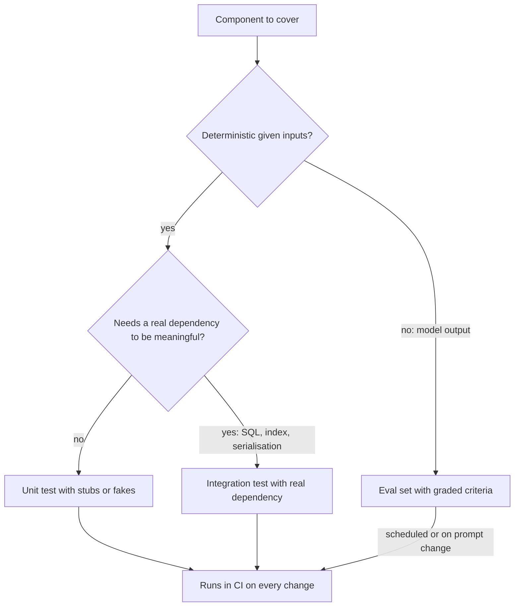

## TL;DR
A test is an executable claim about behaviour that runs in seconds and fails loudly. In an agent, test
the deterministic code (tools, parsers, retrievers, routing) with unit and integration tests, replace
the model and network with test doubles, and leave model quality to evals.

## For agent builders
- **Why it matters for agents.** Most agent failures are ordinary code bugs in tools, argument parsing,
  retrieval and state handling. Those are cheap to catch with tests and expensive to catch in a
  user-visible run.
- **Where it shows up in your stack.** pytest for Python, a fake LLM client that returns recorded tool
  calls, integration tests against a real vector store in a container, and CI that runs them on every
  pull request.
- **What you control.** Which behaviours you pin down, where you cut dependencies with doubles, and
  whether your suite is deterministic enough to trust.
- **What you can skip.** Coverage-percentage targets as a goal in themselves, and asserting on the exact
  wording of model output; those belong to evals with graded criteria.

## Why it exists
- **Manual checking does not scale.** An agent with 10 tools and 3 retrieval modes has too many paths
  to click through before every release; a suite runs them all in seconds.
- **Change is the risk.** Prompts, model versions, dependencies and refactors change weekly. Tests turn
  "I think nothing broke" into a command that exits 0 or 1.
- **Bugs come back.** A fixed bug without a regression test tends to return at the next refactor; the
  test is the memory.
- **Tests are a design check.** Code that is hard to test (a tool that builds its own HTTP client and
  reads env vars inside) is usually hard to change; injecting dependencies fixes both.

## How it works
### What to test
- **Behaviour at boundaries, not implementation.** Assert what a function returns or does, not which
  private helpers it calls, so refactors do not break tests.
- **Contracts.** Tool argument schemas, the JSON shape a parser accepts, the order a retriever returns.
- **Edge cases.** Empty input, no results, the maximum `k`, unicode, a malformed model tool call.
- **Every bug you fixed.** The failing input becomes a test before the fix lands.
- **Not the model's prose.** "The answer contains the refund window" is an eval criterion; exact string
  matching on generated text makes tests brittle.

### Unit, integration, end to end
| Level | Scope | Speed | Agent example |
|---|---|---|---|
| Unit | one function, no I/O | milliseconds | tool argument parser, ranking logic, prompt builder |
| Integration | your code plus a real dependency | seconds | retriever against a real Postgres with pgvector in a container |
| End to end | the whole system through its API | seconds to minutes | full agent run with a fake or real model |
| Eval (not a test) | model behaviour on a dataset | minutes, costs tokens | success rate on 200 graded tasks |

- **Many units, fewer integration tests, a handful of end-to-end.** Unit tests locate failures
  precisely and run fast; integration tests catch wrong assumptions about the dependency (SQL, index
  config, serialisation) that doubles cannot.

### Test doubles
| Double | What it does | Use for |
|---|---|---|
| Dummy | fills a parameter, never used | a required `embed` argument the test path ignores |
| Stub | returns canned answers | a model client that always returns one recorded tool call |
| Fake | working lightweight implementation | an in-memory vector store, a dict-backed cache |
| Spy | records how it was called | checking the agent sent the tool result back to the model |
| Mock | pre-programmed expectations, fails on unexpected calls | asserting a payment tool is never called twice |

- **Prefer fakes and stubs over mocks.** Mocks couple tests to call sequences, so harmless refactors
  break them; verify outcomes where you can.
- **Double what you do not own at your boundary.** Wrap the provider SDK in your own small client and
  stub that, rather than patching deep inside the SDK.

### Flaky tests
A flaky test passes and fails on the same code. Common causes:
1. **Hidden ordering:** set or dict iteration, unordered database results, ties in a sort.
2. **Time:** `now()`, timeouts, sleeps racing with background work.
3. **Randomness:** unseeded sampling, shuffles, real model calls.
4. **Shared state:** tests that pass alone but fail after another test mutates a global or a database.
5. **Network:** real APIs, rate limits, DNS.

## Diagram
Decide per component: deterministic code gets a test at the lowest level that can catch the bug;
model behaviour goes to evals.



## Examples
### Testing a retriever, and catching a flaky tie
A tiny keyword retriever with a test double for its embedder. The fourth test is flaky: two documents
tie, and their order comes from set iteration, which depends on Python's per-process string hash seed.
Pinning `PYTHONHASHSEED` reproduces it on demand (tested with Python 3.9.6, pytest 8.3.3).

```python
# retriever.py
import re

def tokens(text):
    return set(re.findall(r"[a-z0-9]+", text.lower()))

class Retriever:
    def __init__(self, docs, embed=None):
        self.docs = docs                       # {doc_id: text}
        self.embed = embed                     # injected dependency: a real model or a fake

    def search(self, query, k=2):
        q = tokens(query)
        scored = {d: len(q & tokens(t)) for d, t in self.docs.items()}
        hits = {d for d, s in scored.items() if s > 0}          # a set: iteration order varies per process
        return sorted(hits, key=lambda d: -scored[d])[:k]       # ties keep that arbitrary order
```

```python
# test_retriever.py
import pytest
from retriever import Retriever

DOCS = {
    "refunds": "Refund policy: refunds within 30 days",
    "shipping": "Shipping policy: ships in 2 days",
    "returns": "Returns policy: return within 30 days",
}

@pytest.fixture
def r():
    return Retriever(DOCS, embed=lambda text: [0.0])   # test double: no model, no network

def test_relevant_doc_is_first(r):
    assert r.search("how do refunds work")[0] == "refunds"

def test_no_overlap_returns_nothing(r):
    assert r.search("pricing for enterprise") == []

def test_k_caps_results(r):
    assert len(r.search("policy", k=1)) == 1

def test_tie_order_is_stable(r):
    # "policy" and "30 days" tie refunds with returns: 4 shared tokens each
    assert r.search("policy within 30 days") == ["refunds", "returns"]
```

```bash
for s in 0 1 2 3 4 5; do printf "seed $s: "; PYTHONHASHSEED=$s pytest -q test_retriever.py | tail -1; done
# seed 0: 1 failed, 3 passed     AssertionError: assert ['returns', 'refunds'] == ['refunds', 'returns']
# seed 1: 4 passed
# seed 2: 1 failed, 3 passed
# seed 3: 4 passed
# seed 4: 4 passed
# seed 5: 1 failed, 3 passed
```

- **Which seeds fail depends on the Python version**, because the string hash changed in 3.11: on
  Python 3.12.14 seeds 3 and 4 fail instead. Only some seeds fail, so loop over 10 or more to be sure.
- **The fix is in the code, not the test:** break ties deterministically with
  `sorted(hits, key=lambda d: (-scored[d], d))`. With that change all six seeds pass.
- **Why it matters for agents:** an unstable tie decides which chunk lands in the context window, so
  the same question can get different answers on different replicas.

### Worked scenario: choosing the level for each part of a RAG agent
| Component | Bug it could have | Cheapest test that catches it |
|---|---|---|
| Tool argument parser | `limit` arrives as `"5"` | unit test with recorded raw arguments |
| Prompt builder | tool schemas reordered, breaking prefix cache | unit test asserting a byte-identical prefix |
| Retriever ranking | unstable ties, wrong filter | unit test with a fake index; integration test for the SQL filter |
| Vector store query | wrong distance operator or metadata filter | integration test against a real container |
| Agent loop | stops before sending tool result back | end-to-end test with a stubbed model scripted to call one tool |
| Answer quality | misses the refund window | eval case with a graded criterion |

## Production patterns
- **A fake LLM client for agent-loop tests.** Wrap the provider SDK behind your own interface and give
  tests a stub that returns scripted tool calls, then a final answer. The loop, tools and state
  handling run deterministically with zero tokens spent.
- **Integration tests against real dependencies in containers.** Start Postgres with pgvector or a
  vector database in Docker (for example with Testcontainers) in CI, so SQL, index and filter bugs show
  up before production. Keep them few and seeded.
- **Regression test per incident.** Every production bug adds its raw failing input to the suite in the
  same pull request as the fix; track the share of incidents that did.
- **Hunt flakes systematically.** Rerun suspect tests many times, randomise order (the pytest-randomly
  plugin), and vary `PYTHONHASHSEED`; quarantine a confirmed flaky test with an owner and a deadline
  rather than retrying it silently.
- **Fast suite on every pull request.** Keep the unit layer under a minute so it runs on every push;
  run slower integration and eval jobs on merge or on a schedule.

## Trade-offs
- **Doubles vs realism.** Stubs make tests fast and deterministic, but can encode wrong assumptions
  about the real dependency; back them with a few integration tests.
- **Many tests vs maintenance.** Each test is code to maintain; tests coupled to implementation details
  slow refactors more than they protect them.
- **Retries on flaky tests vs signal.** Auto-retrying keeps CI green, but hides real races that will
  also flake in production; retry only with a tracked quarantine.
- **Tests vs evals for model behaviour.** Exact assertions give crisp failures but break on harmless
  wording changes; graded evals tolerate variation but cost tokens and time.

## Pitfalls
- **Asserting on exact model text.** Symptom: tests break whenever the model version or prompt changes,
  and people start ignoring red builds. Diagnose: list failing assertions; if they compare generated
  strings, the test is checking an eval criterion. Fix: assert on structure (valid JSON, tool name) and
  move quality checks to evals.
- **Over-mocking.** Symptom: all tests pass but production fails on a wrong SQL filter or a changed API
  shape. Diagnose: for the failed path, check whether any test exercised the real dependency. Fix: add
  one integration test per external boundary.
- **Ignoring a flaky test.** Symptom: "just re-run CI" becomes routine. Diagnose: rerun the test 50
  times, then with randomised order and different hash seeds; record which condition fails. Fix: remove
  the nondeterminism in the code (stable sort, injected clock, seeded RNG).
- **Order-dependent tests.** Symptom: a test passes alone and fails in the full suite. Diagnose: run
  the pair in both orders (`pytest test_a.py test_b.py` and reversed) to find the polluter. Fix: fresh
  fixtures per test, no shared mutable globals.

## When to use
- **Unit tests** for every tool, parser, ranking rule and prompt builder; they are cheap enough to have
  many.
- **Integration tests** at each external boundary you own the query for (database, vector store,
  queue), a few per boundary.
- **End-to-end tests** for the main agent paths with a stubbed model; evals for answer quality.
- **Avoid** testing third-party library internals or private helpers.
- **Measure:** suite runtime, flaky-test count, and bugs that reached production without a failing test.

## Exercise
**Goal:** build a test suite for a small RAG tool that is fast, deterministic and catches planted bugs.
No solution is given.
- **Inputs:** a retriever you write (keyword or embedding based) over 20 short documents, plus an
  `answer_with_sources(question)` tool that calls a model client through an interface you define.
- **Constraints:** unit tests use a stub model client and a fake embedder; at least one integration test
  uses a real store (SQLite FTS5 or Postgres in Docker); no network in the unit layer.
- **Deliver:** the suite, a one-paragraph note on what each level covers, and a list of three bugs you
  planted.
- **Acceptance:**
  - unit tests run in under 5 s with networking disabled (for example the pytest-socket plugin's
    `pytest --disable-socket`, which fails any test that opens a socket);
  - each planted bug (wrong tie order, empty-result crash, missing source id) makes at least one test
    fail;
  - the suite passes under `PYTHONHASHSEED` values 0 to 9 and in random order;
  - no test asserts on exact generated text.

## Role lens
- **Engineer:** Writes unit tests for tools, parsers and retrievers with stubbed models, adds an
  integration test per database or vector store boundary, and fixes flaky tests at the source.
- **Architect:** Designs agents so model clients, stores and clocks are injected, sets the split
  between tests and evals, and keeps CI fast enough to run on every pull request.
- **FDE:** Adds the customer's failing cases as regression tests and shows them a green suite before a
  rollout, so confidence rests on evidence rather than a demo.

## Check yourself
**Q:** Your agent's end-to-end test calls the real model and fails about 1 time in 15 because the model
sometimes picks a different tool. What is wrong with the test, and how do you restructure coverage?
**A:** The test mixes two concerns: deterministic orchestration code and non-deterministic model
choice, so it is flaky by design. Split it. Test the agent loop with a stub model scripted to call the
expected tool, which makes it deterministic and checks routing, tool execution and result handling.
Move "does the model pick the right tool" into an eval set with many cases and a success-rate
threshold, run on prompt or model changes. Keep at most a small, clearly labelled live smoke test that
alerts rather than blocks merges.

## Interview questions
### What is the difference between a stub, a fake and a mock? When do you use each?
- **Stub:** returns canned answers, for example a model client that returns one recorded tool call.
- **Fake:** a working lightweight version, such as an in-memory vector store, for tests that need
  realistic behaviour without infrastructure.
- **Mock:** verifies interactions; use it sparingly, such as asserting a payment tool is called exactly
  once, because it couples tests to call order.

### How would you test an agent that calls an LLM and three tools?
- **Unit:** each tool and the argument parser with recorded raw tool calls, no network.
- **Loop:** an end-to-end test with a stubbed model that scripts tool calls and a final answer, checking
  that results flow back and stop conditions work.
- **Quality:** an eval set for tool choice and answers, run on prompt and model changes.

### A test is flaky in CI. Walk me through finding the cause.
- **Reproduce the rate:** run it 50 times alone, then in the full suite, then in random order.
- **Vary the suspects one at a time:** hash seed, clock, network, parallelism, shared fixtures.
- **Fix the code's nondeterminism**, such as an unstable sort or an unseeded RNG, rather than adding a
  retry.

### When would you not write a unit test?
- **Pure glue** that only passes values to a library is better covered by an integration test that
  exercises the real call.
- **Model output quality** belongs in evals, and throwaway spikes do not need tests until they become
  code someone depends on.

## Quiz
### Q: Which belongs in an eval rather than a unit test?
- [ ] Whether the tool argument parser rejects a negative limit
- [ ] Whether the retriever breaks ties by document id
- [x] Whether the model's answer mentions the correct refund window across 200 questions
- [ ] Whether the prompt builder puts tool schemas before the user message
> Model answers vary and need graded, dataset-level judgement, which is what evals do. The other three
> are deterministic code behaviours that unit tests check precisely and cheaply.

### Q: A retriever test passes on some CI runs and fails on others with the same code. What is the likeliest class of cause?
- [ ] The test file is too long
- [x] Hidden nondeterminism, such as unstable ordering of tied results
- [ ] The assertion uses `==` instead of `is`
- [ ] pytest caches results between runs
> Same code with different results means something varies between runs: ordering, time, randomness,
> shared state or network. Ties sorted by set iteration order are a classic retriever case.

### Q: Why prefer a stub model client over patching inside the provider SDK?
- [ ] Stubs run on the GPU
- [ ] Patching SDK internals is forbidden by the provider's licence
- [x] A small interface you own is stable, while SDK internals change between versions and break the patches
- [ ] Stubs automatically generate realistic model text
> Wrapping the SDK behind your own client gives tests one stable seam to replace, so tests survive SDK
> upgrades and stay focused on your code.

## Mastery test
**Problem:** your team's agent passes all 140 tests, yet in production it double-charges customers
about once a week. The charge tool is called through a mocked payments client in every test. Explain
how this can happen and design the tests that would have caught it.

**A strong answer:**
- explains that the mocks only checked the agent called `charge()` with the right arguments, never what
  happens on timeout and retry, or when the model emits the same tool call twice;
- adds a unit test with a stub client that times out once and succeeds on retry, asserting a single
  charge via an idempotency key;
- adds an end-to-end test with a scripted model that repeats the charge tool call, asserting the second
  call is deduplicated;
- adds an integration test against the payment provider's sandbox for the idempotency header;
- turns the incident's real trace into a regression test.

## Use cases & projects
### Use cases
- **Tool reliability.** Unit tests on argument parsing and validation catch the most common agent
  failures before any model call.
- **Retriever changes.** Ranking and filter tests make chunking or scoring changes safe to ship.
- **Model or SDK upgrades.** A deterministic suite with a stubbed model isolates code breakage from
  model behaviour changes, which evals then measure.
- **Incident follow-up.** Each production bug becomes a regression test, so the suite grows from real
  failures.

### Mini project
**A deterministic test harness for a tool-calling agent (2-3 hours).**
- **Goal:** test an agent loop end to end without spending a token.
- **Steps:** define a `ModelClient` protocol; write a `ScriptedModel` that replays a list of tool calls
  and a final answer; write tests for a normal run, a malformed tool call, a tool error and a step
  limit; add one integration test for your retriever's store.
- **Done when:** the suite runs in seconds offline, passes in random order, and fails when you break the
  loop's tool-result handling.
