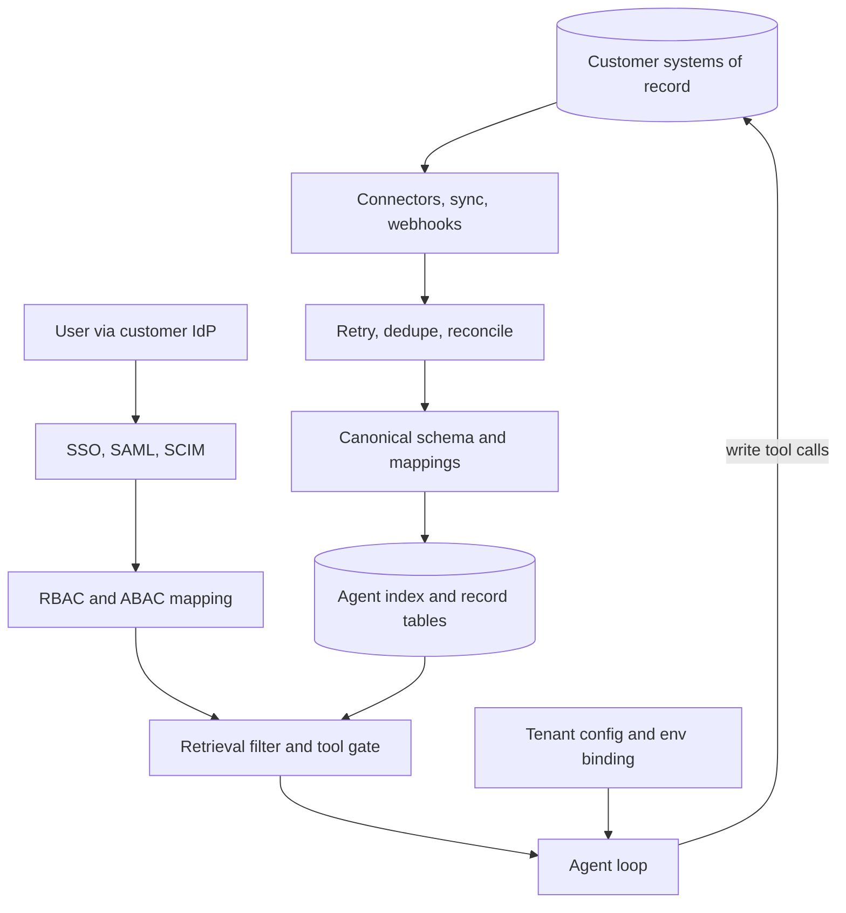

## Overview
This module covers the work between "the model works" and "the model works on this customer's systems,
for their people, with their rules". For an agent builder, that gap decides what the agent can know, how
stale its answers are, and whose permissions each retrieval and tool call runs under.

It has three strands, plus two operating lessons that tie them together:

- **Data strand (moves customer data in):** connectors handle auth, enumeration, change tracking, permissions and normalization for each system of record. Ingestion picks the least invasive channel the client will approve and lands a raw copy you can replay.
- **Keeping the copy fresh and correct:** incremental sync, CDC and webhooks keep that copy fresh. Retry, deduplication and reconciliation keep it correct when calls fail, writes are ambiguous and events go missing. Legacy integration puts an anti-corruption layer around systems you cannot change.
- **Data-understanding strand (makes the data fit to use):** staged onboarding with exit criteria, profiling against the use case, canonical schemas with versioned per-source mappings, and per-page triage of messy document estates.
- **Identity strand (decides who can see what):** SSO and SAML authenticate users through the customer's IdP. SCIM tells you who exists and when they leave. RBAC/ABAC mapping turns their groups and attributes into your permissions, enforced in retrieval and agent tools.
- **Operating lessons:** binding each of your environments to the customer's sandbox or production with hard guards, and expressing per-tenant differences as typed configuration and flags instead of forks.

**Core versus background for agent builders:**

- **Core (6 lessons):** enterprise-connectors, webhooks, retry-deduplication-reconciliation, data-mapping-and-canonical-schemas, rbac-abac-mapping-to-customer-identity and tenant-specific-configuration-and-feature-flags. You use these directly when you build an agent's tools, its retrieval filter and its per-tenant assembly.
- **Useful (9 lessons):** data-ingestion-from-client-systems, incremental-synchronization-and-cdc, legacy-system-integration, data-onboarding, data-profiling-and-quality-assessment, client-document-parsing, sso-iam-integration, scim-provisioning and sandbox-vs-production-environments. You meet them when you deploy and operate an agent for a real customer.
- **Background (1 lesson):** saml-sso. Recognise the flow and its validation checklist; let a maintained library do the work.

**What you can build afterwards:**

- **A production integration:** scope, build and operate one with a new enterprise customer that stays fresh, does not leak data and does not need a fork for every tenant.
- **Agent tools over customer systems:** idempotent, rate-limited, permission-checked and speaking one canonical schema.
- **A permission-aware RAG index:** fed by sync and webhooks, proved by reconciliation, filtered per user.
- **One agent for many tenants:** typed configuration and flags instead of per-customer forks.

It matters most for FDEs, who do this in every deployment, and for Engineers and Architects building
the shared platform underneath.

## Why it matters
- **Engineer:** You build what an agent's tools and index stand on: the connector contract, the webhook receiver that verifies, acks fast and queues, the idempotent writers, the watermark-with-overlap and delete handling, the SCIM endpoint whose deactivation revokes tokens and agent jobs, and the reconciliation job whose repair count tells you whether the whole pipeline is healthy.
- **Architect:** You decide where the boundaries go in an agent platform: one canonical schema so N sources and M consumers need N + M mappings, an anti-corruption layer in front of every legacy system, permission checks enforced in retrieval filters and agent tool calls rather than in prompts, a stable user key of issuer plus subject, and tenant differences held as versioned data so one codebase serves fifty customers.
- **FDE:** You put an agent into a customer's estate: you negotiate what the client's security and platform teams will approve, size the backfill against their real rate limits, profile their data before anyone promises a date, run the mapping sessions with their data owners, wire up their Okta or Entra tenant, and make sure nothing built against their sandbox writes into production by accident.

## Mental model
Think of every enterprise integration as a copy of someone else's world, held under three contracts.
Your index, feature table or agent's view of a customer system is a derived copy of data you do not own.

| Contract | What it says | Lessons that serve it |
|---|---|---|
| **Freshness** | How far behind the source the copy may be | Connectors, sync, CDC and webhooks serve it; reconciliation proves it |
| **Meaning** | What the copy's fields and documents actually mean | Profiling, mapping, canonical schemas and document triage, all at one translation boundary so source quirks do not spread |
| **Access** | Who may see or change each piece | SSO, SAML, SCIM and RBAC/ABAC mapping, re-checked on every request because the customer's directory, not yours, is the source of truth |

- **Every lesson strengthens one contract:** sandbox discipline and tenant configuration let you change how a contract is met for one customer without breaking it for the others.
- **Debug by contract:** when something goes wrong in production, ask first which contract broke: stale, misread, or over-shared.

Data flows down the left into the agent's index under the freshness and meaning contracts. Identity
flows down the right into the filter and tool gate under the access contract. Tenant configuration and
the sandbox or production binding decide which version of each the agent runs with.

## Suggested order
1. enterprise-connectors — introduces the five responsibilities (auth, enumeration, change, permissions, normalization) that most later lessons expand on, and the sync-versus-live-tool choice behind every agent tool.
2. data-ingestion-from-client-systems — choosing a channel the client will approve, landing raw data and checkpointing after the write are the base for any recurring pull and for the webhook lesson next.
3. webhooks — adds a push channel for low lag and the trigger for event-driven agent runs, built on the checkpoint ideas you just learned.
4. retry-deduplication-reconciliation — explains the three distinct ways the channels above fail and the mechanism that covers each, which is what makes agent write tools safe to retry.
5. data-mapping-and-canonical-schemas — gives every agent tool one internal model with versioned, reviewed per-source mappings, building on the connector's normalization step.
6. sso-iam-integration — starts the identity strand: per-tenant IdP configuration, tenant-bound issuer checks and stable user keys.
7. scim-provisioning — closes the gap SSO leaves by telling you who exists, which groups they are in and when they leave.
8. rbac-abac-mapping-to-customer-identity — needs both SSO claims and SCIM groups, and connects them to connector ACLs and agent scope.
9. sandbox-vs-production-environments — once connectors and identity exist per customer, binds each to the right customer environment and blocks cross-wiring.
10. tenant-specific-configuration-and-feature-flags — after the core lessons, because it is how every per-tenant choice from earlier lessons is stored, rolled out and audited.
11. incremental-synchronization-and-cdc — once a full pull works, this shows how to fetch only changes, deletes included, and why naive watermarks miss rows.
12. legacy-system-integration — applies the same ingestion and safe-write habits to systems with batch windows, fixed record formats and no API.
13. data-onboarding — the gated process that wraps these channels into a customer rollout, setting up the profiling stage next.
14. data-profiling-and-quality-assessment — measures what the landed sample really contains before you commit to mappings or build.
15. client-document-parsing — the unstructured counterpart to mapping, routing each page by type and keeping provenance for citations.
16. saml-sso — the older, still-required protocol, best learned after the general SSO model, along with its specific validation checklist.

## Capstone
This is the module's major project: a multi-day build, about a week, that combines most of the lessons
into one working agent component.

### Brief
**Use case:** an AI support assistant that answers support agents' questions from past tickets and policy
documents, onboarding two enterprise tenants from one codebase.

- **Tenant A:** runs a ServiceNow-like ticketing system with a REST API, webhooks and a sandbox instance, and authenticates through Okta over OIDC.
- **Tenant B:** exports tickets from an old in-house system as a nightly fixed-width file on SFTP, keeps policies as a mix of born-digital and scanned PDFs, and uses Entra ID over SAML.

Using mock services and synthetic data (generated or provided), build the integration slice that feeds
the assistant's retrieval tool and serves both tenants in about a week.

- **Data:** ingest both sources incrementally, with deletes. Receive Tenant A's webhooks safely and reconcile what they miss.
- **Meaning:** profile both datasets and map them into one canonical ticket schema. Triage and parse Tenant B's documents.
- **Access:** authenticate both tenants' users, provision them via SCIM, and enforce their group- and region-based permissions in retrieval.
- **Operations:** keep Tenant A's sandbox and production bindings impossible to mix up, and express every tenant difference as configuration.

### Deliverables
- A connector and ingestion service for both sources that lands immutable raw copies, advances checkpoints only after a successful write, applies deletes, throttles to a configured share of the source's rate limit, and includes a webhook receiver that verifies signatures, acks within a second, queues events and processes them idempotently.
- A reconciliation job that compares source keys and content hashes with the index for each tenant, repairs drift, and reports missing, extra and stale counts per run.
- A profiling report for each tenant's sample that classifies each finding as usable, fixable or blocking, with an owner, and a canonical ticket schema with versioned per-source mappings, a quarantine path and automated checks that run on every load.
- A document triage pipeline for Tenant B that routes each page to text extraction, OCR or a layout model, records per-page confidence, sends low-confidence pages to a review queue, and stores page-level provenance used in citations.
- OIDC login for Tenant A and SAML login for Tenant B with tenant-bound issuer and audience checks and users keyed by issuer plus subject, a SCIM 2.0 endpoint whose deactivation revokes sessions, tokens and scheduled jobs, and a per-tenant mapping config that turns IdP group IDs into roles and region attributes into ABAC rules applied as retrieval filters.
- A typed, versioned tenant configuration file and a release flag for the new retriever, plus an environment binding with a guard that refuses to start when a sandbox credential points at a production index or the reverse.

### Rubric
- Killing the webhook receiver for ten minutes and deleting three source records during the outage leads to all three being removed from the index on the next reconciliation run, and the run's repair count shows it.
- Replaying the same webhook batch twice, and retrying a timed-out write-back, produces no duplicate index entries or duplicate notes in the mock ticketing system.
- A synthetic user in Tenant B's EMEA group never retrieves an APAC ticket or a restricted policy page, a SCIM deactivation removes their access within a stated, measured time, and a Tenant A token is rejected at Tenant B's workspace.
- Every canonical field can be traced to a mapping version and a source field, an unmapped status value goes to quarantine with an open question for the data owner, and no consumer reads a source's native shape.
- Scanned pages with no text layer show up in the route mix and the review queue, none silently drop out of the index, and every answer cites a document and page.
- Grepping the codebase for either tenant's name or ID finds nothing outside configuration and test fixtures, and enabling the new retriever for one tenant leaves the other tenant's behavior unchanged.
