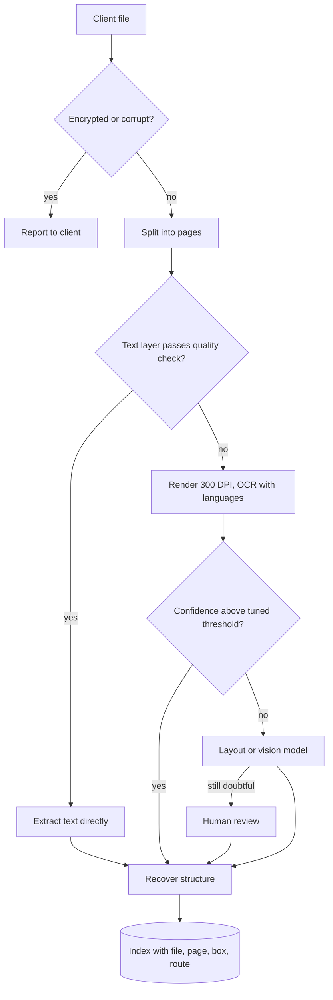

## TL;DR
A RAG agent can only cite what parsing extracted. Client documents mix digital PDFs, scans and faxes, so
triage each page to the cheapest working route (text layer, OCR, layout or vision model), score
confidence, review doubtful pages, and keep page provenance.

## For agent builders
- **Why it matters for agents.** A scanned contract parsed to an empty string is invisible to the agent's
  retrieval tool; a misread table digit becomes a confident wrong answer with a real citation. Most
  "the agent doesn't know about X" reports on a document corpus are parsing failures.
- **Where it shows up in your stack.** The ingestion pipeline before chunking and embedding, a
  `parse_document` tool when users upload files mid-conversation, the citation metadata the agent returns,
  and the eval set that checks the right page is retrieved.
- **What you control.** Per-page routing rules, confidence thresholds tuned on the client's pages, which
  routes may run outside the client boundary, and the provenance fields (file, page, box, route) returned
  in every retrieval result.
- **What you can skip.** OCR and layout-model internals; the RAG and multimodal lessons cover them. Know
  the silent failures and the routing pattern.

## Why it exists
- **Enterprise knowledge lives in messy documents.** Contracts, claims files, policies, invoices and
  engineering reports. A demo corpus is a dozen clean PDFs exported from Word; a client's is hundreds of
  thousands of files accumulated over years, with a large share scanned, skewed, stamped, handwritten on,
  or exported by an old system with a broken font encoding.
- **The mix is unknown until profiled,** which is why parsing is a per-client problem rather than a solved
  library choice.
- **One text extractor fails silently:**
  - A scanned PDF has no text layer, so the extractor returns an empty string and the document disappears
    from the index without an error.
  - A born-digital PDF with a bad character map returns plausible-looking garbage that is embedded and
    retrieved.
  - A two-column contract is read across the columns, interleaving clauses.
  - A table of policy limits becomes a run of numbers detached from their headers, so the model answers
    with the wrong limit and cites a real page.
- **OCR or a vision model on every page is the opposite mistake:** slow and expensive at enterprise
  volume, and it can degrade born-digital text that was already exact.
- **Scope of this lesson.** The mechanics of OCR, layout analysis and table extraction are in the RAG
  document-parsing and multimodal OCR lessons. This lesson applies them to one client's corpus: triage,
  routing, confidence, review and provenance.

## How it works
### 1. Profile the corpus first
From a stratified sample, measure file type mix, share of PDFs with a usable text layer, encrypted or
corrupt files, page counts, languages, and recurring templates (the same form from the same system). This
sets the routing rules and the cost and time estimate for the backfill.

### 2. Triage each file, ideally each page
| Case | Route | Why |
|---|---|---|
| **Encrypted or corrupt** | report to the client with the file list | only they can supply passwords or exclude files |
| **Born-digital with a text layer** | extract directly | cheapest and most exact, *because* the characters are already in the file |
| **Image-only pages** | OCR | hybrid PDFs (a scanned contract with a digital cover page) are common, so decide per page, not per file |
| **Text layer present but unusable** | treat as image | broken font encodings produce text that exists but means nothing |
| **Text layer that is itself old OCR** | quality check; re-OCR on failure | passes a naive "has text" test, but its quality is unknown |
| **Text plus embedded images** | OCR the image regions or the page | the text check passes and the image's content is lost |

The details behind the harder rows:
- **Detect unusable text** with a quality check: the share of characters that are letters, the share of
  tokens found in a dictionary for the expected language, or replacement and private-use characters.
- **Old OCR layers are common.** Many scanners and document-management systems save "searchable PDFs" with
  an invisible OCR layer under the page image, produced by whatever engine and settings were in use at the
  time. Give it the same quality check.
- **Embedded images hide content.** A born-digital page can carry a pasted scan, a screenshot of a table
  or a stamped signature block as an image. Measure the share of page area covered by images (PDF
  libraries expose image bounding boxes) and send those regions, or the whole page, to OCR when it is
  large.

### 3. OCR with preprocessing and confidence
1. **Render at sufficient resolution** (Tesseract's documentation recommends at least 300 DPI), deskew,
   and set the expected languages explicitly, *because* OCR accuracy depends heavily on image quality and
   on the language model the engine applies.
2. **Keep word-level confidence.** OCR engines report it, and the page's mean or low-percentile confidence
   is the routing signal.
3. **Treat confidence as a ranking, not a probability.** It is not calibrated against your documents: it
   can be high on a confidently misread stamp or low on a perfectly read unusual font.
4. **Set the threshold from data.** Plot confidence against measured error rate on labelled pages from
   this client and choose the point where the error becomes unacceptable for the use case.

### 4. Escalate the hard pages
- **What escalates:** pages with low OCR confidence, complex layouts, dense tables, handwriting or stamps.
- **Where to:** a layout-aware document model, a cloud document-AI service if the data may leave the
  boundary, or a vision-language model prompted to transcribe; below a further threshold, human review.
- **Why tiers:** a tiered route spends the cost where it buys accuracy, instead of on every page.

### 5. Recover structure
- **Keep** reading order, headings, list items and tables (cells tied to row and column headers).
- **Drop** repeated headers, footers and page numbers, *because* chunking and retrieval quality depend on
  structure.
- **Write rules for recurring templates.** A dedicated extraction rule or schema is worth it, since one
  form type can be a large share of a corpus.

### 6. Keep provenance
- **Store per text span:** source file, page number and, where available, bounding box, parse route and
  confidence.
- **Citations then point to a page the user can open,** and a later parser improvement can target exactly
  the pages that used the weak route.

### 7. Evaluate on the client's documents
- **Build a small labelled set** from their corpus, stratified by route and template, and measure text
  accuracy against a human transcription, table cell accuracy and, end to end, whether retrieval finds the
  right page.
- **Character error rate** is the edit distance between output and reference divided by the reference
  length: `CER = (S + D + I) / N`, counting substituted, deleted and inserted characters against *N*
  reference characters (word error rate is the same over words). Because insertions count, CER can exceed
  100% on a page of hallucinated text.
- **Report per route and per template,** not only averaged.
- **Add a field-level check** for values the use case depends on (amounts, dates, policy numbers), since a
  1% CER that lands on the digits of a limit is worse than 5% spread over boilerplate.
- **Rerun the set** when you change a parser or a threshold.

### 8. What the agent gets from parsing
- **Retrieval results carry provenance and quality.** Each chunk returned by the agent's search tool
  includes file, page, route and confidence, so the agent cites a page and can hedge on low-confidence
  text instead of stating a misread number as fact.
- **Critical values get a verify step.** For amounts or limits, the agent can call a tool that returns the
  page image region or the field-validated value, rather than trusting one OCR read.
- **Uploads mid-conversation use the same triage.** A `parse_document` tool runs the cheap routes inline
  and returns "pages 4-6 need review" when they escalate, rather than handing the model empty text.
- **Coverage gaps are explained.** When a file failed parsing, the tool says so ("encrypted, excluded"),
  so the agent does not claim the document says nothing.

### Boundary and sensitivity
Scanned documents frequently contain signatures, ID numbers and health or financial details. Where
residency or contract requires it, OCR and any vision model must run inside the client's boundary, which
constrains which services you can use; settle this before choosing tools.

## Diagram
Each page takes the cheapest route that passes its quality gate; low confidence escalates to stronger
and costlier routes, and every route writes text with page provenance that the agent's retrieval tool
returns with each chunk.



## Examples
### Per-page triage with pdfplumber and Tesseract
Per-page triage routing each page to text extraction, OCR, or escalation. Thresholds are illustrative
and should be tuned on a labelled sample.

```python
import pdfplumber, pytesseract

def text_is_usable(text: str, min_chars=200, min_alpha=0.6):
    if len(text) < min_chars: return False
    alpha = sum(c.isalpha() or c.isspace() for c in text) / len(text)
    return alpha >= min_alpha and "\ufffd" not in text     # replacement char hints at broken encoding

def parse_pdf(path, lang="eng+deu", ocr_ok=70):
    pages = []
    with pdfplumber.open(path) as pdf:
        for i, page in enumerate(pdf.pages, start=1):
            text = page.extract_text() or ""
            if text_is_usable(text):
                pages.append({"page": i, "route": "text_layer", "text": text, "conf": None})
                continue
            img = page.to_image(resolution=300).original          # PIL image
            data = pytesseract.image_to_data(img, lang=lang, output_type=pytesseract.Output.DICT)
            words = [(w, float(c)) for w, c in zip(data["text"], data["conf"]) if w.strip() and float(c) >= 0]
            conf = sum(c for _, c in words) / len(words) if words else 0.0
            route = "ocr" if conf >= ocr_ok else "escalate"           # VLM / layout model / human
            pages.append({"page": i, "route": route, "conf": round(conf, 1),
                          "text": " ".join(w for w, _ in words)})
    return pages

for p in parse_pdf("claim_88213.pdf"):
    print(p["page"], p["route"], p["conf"], len(p["text"]))
```

- **Typical output.** On a scanned claim file this might print a text-layer cover page, several OCR pages
  in the 80s, and one handwritten page in the 40s routed to escalation.
- **Routes become a forecast.** Across the backfill, the share of pages per route becomes a cost forecast,
  and the escalation queue size tells you how much review capacity the client must provide.
- **The usability check has its own failure mode.** A born-digital rate table or invoice is mostly digits
  and punctuation, falls under the alphabetic threshold, and gets sent to OCR, which can only make its
  exact text worse, so count digits as valid characters for such templates.
- **Two more simplifications to remove before production.** Joining OCR words with spaces discards the
  line and block numbers Tesseract returns, which is where reading order and table rows live; and the
  200-character floor sends short but genuine digital pages (a signature page) to OCR for no gain.

### Measuring CER, and why field checks matter
A runnable, dependency-free CER computation showing that a low overall rate can still corrupt the one
value that matters.

```python
def edit_distance(a: str, b: str) -> int:
    prev = list(range(len(b) + 1))
    for i, ca in enumerate(a, 1):
        cur = [i]
        for j, cb in enumerate(b, 1):
            cur.append(min(prev[j] + 1, cur[j - 1] + 1, prev[j - 1] + (ca != cb)))
        prev = cur
    return prev[-1]

def cer(output: str, reference: str) -> float:
    return edit_distance(output, reference) / len(reference)   # (S + D + I) / N

ref = "Liability limit per occurrence: EUR 2,500,000. Deductible: EUR 5,000."
ocr = "Liability limit per occurrence: EUR 2,800,000. Deductible: EUR 5,000."
print(f"CER {cer(ocr, ref):.1%}")                 # 1.4%: one substituted character
print("limit ok:", "2,500,000" in ocr)            # False: the one field that matters is wrong
print(f"hallucinated page CER {cer(ref * 3, ref):.0%}")  # 200%: insertions push CER past 100%
```

### Agent tool: search results that carry parse quality
The retrieval tool returns each chunk with its provenance so the model can cite and hedge. `index.search`
stands for your vector store query; the field names are this lesson's convention.

```python
def search_policy_docs(query: str, user: str, k: int = 5) -> list[dict]:
    hits = index.search(query, k=k, filter={"acl": user})
    results = []
    for h in hits:
        m = h["metadata"]
        results.append({
            "text": h["text"],
            "cite": f'{m["file"]} p.{m["page"]}',
            "route": m["route"],                      # text_layer | ocr | escalate
            "low_confidence": m["route"] != "text_layer" and (m.get("conf") or 0) < 80,
        })
    return results   # system prompt: quote numbers from low_confidence chunks only with a caveat
```

### Worked scenario: route mix as a cost and staffing forecast
Profiling a 1,500-document sample of an archive (illustrative numbers) gives a page-route mix to plan the
backfill.

| Route | Share of pages | Relative cost per page | Note |
|---|---|---|---|
| Text layer | 55% | lowest | includes digital cover pages of hybrid PDFs |
| OCR, confident | 35% | low | scans at 300 DPI with language set |
| Vision or layout model | 8% | high | tables, stamps, low-confidence scans |
| Human review | 2% | highest | handwriting and limits or amounts below threshold |

Running the vision route on everything would multiply cost on the 90% of pages that cheaper routes handle;
the 2% review share tells the client how many reviewer hours to book.

## Production patterns
- **Per-page route tagging.** Use on every corpus. Store route, confidence and parser version on each
  page and chunk. Monitor the share of pages per route per batch; a jump in OCR share often means a new
  scanner or source.
- **Empty-extraction coverage alert.** Use for every batch. Count files and pages that produced zero or
  near-zero text, grouped by folder and year, and alert above a baseline. Monitor this as a coverage
  metric next to ingestion counts.
- **Threshold tuned on a client labelled set.** Use before the backfill. Label a stratified set of pages,
  plot OCR confidence against CER, and set the escalation threshold where error becomes unacceptable.
  Monitor CER per route and template on the set after each parser change.
- **Field-level validation for critical values.** Use when answers cite amounts, dates or policy numbers.
  Re-check extracted values against format rules or a second route, and send mismatches to review. Monitor
  mismatch rate per template.
- **In-boundary OCR where residency requires it.** Use when images may not leave the client network. Run a
  self-hosted engine (for example Tesseract) next to the data and reserve hosted services for approved
  classes. Monitor throughput against the backfill window, since self-hosted capacity is the bottleneck.
- **Provenance and confidence in the agent's tool results.** Use for any RAG agent over parsed documents.
  Return file, page, route and confidence with each chunk, and instruct the agent to caveat numbers from
  OCR routes. Monitor the share of cited chunks that came from OCR or escalated routes, and user-reported
  wrong numbers per route.

## Trade-offs
- **Per-page routing vs simplicity.** It spends expensive OCR and vision calls only where needed, but adds
  triage logic and thresholds to maintain; for a small corpus, running the strongest route on everything
  can be simpler and still affordable.
- **Vision-language models vs classic OCR.** They handle messy layouts, tables and handwriting better in
  many cases, but are slower, costlier, and can produce fluent transcriptions of text that is not there;
  use them where classic OCR confidence is low and verify on a labelled sample.
- **Cloud document-AI vs the boundary.** Hosted services are accurate and low-effort, but send document
  images outside the client's boundary; residency or contractual limits flip the choice to a self-hosted
  engine inside the boundary.
- **Human review vs client staff time.** It gives the highest accuracy but costs client time; reserve it
  for pages that matter to the use case, such as limits, amounts and signatures, rather than every page.
- **Template rules vs form changes.** Template-specific extraction is very accurate for recurring forms,
  but breaks when the client changes the form; detect template version and fall back to the generic route
  on a mismatch.

## Pitfalls
- **Treating empty extraction as an empty document.** Symptom: a coverage gap of scanned files that never
  appear in retrieval, found only when a user asks about one.
- **Trusting any non-empty text layer.** Symptom: garbled text from broken font encodings embedded and
  retrieved, producing confident answers grounded in nonsense.
- **Treating OCR confidence as an accuracy guarantee,** with a threshold never checked against labelled
  pages. Symptom: a page that passed at high confidence with a misread amount, found by a user comparing
  the answer with the original scan.
- **Deciding route per file instead of per page.** Symptom: hybrid PDFs where the digital cover page is
  indexed and the scanned body is lost.
- **OCR with the wrong language setting.** Symptom: high error rates on accented and non-Latin characters,
  which also breaks keyword search on names and terms.
- **Discarding page numbers and positions.** Symptom: citations that point to a whole 200-page file, so
  users cannot verify answers and stop trusting them.
- **Hiding parse failures from the agent.** Symptom: the agent answers "the contract does not mention a
  termination clause" because the scanned pages were empty. Fix: tool results report excluded or
  escalated pages so the agent says what it could not read.
- **Evaluating the parser on public sample PDFs.** Symptom: a parser that looked accurate in testing and
  fails on the client's faxed, stamped and skewed originals.

## When to use
- **Apply this triage** whenever a client corpus is more than a handful of born-digital files, which in
  enterprise work is nearly always.
- **Start by profiling** a stratified sample to learn the route mix, then set thresholds on a small
  labelled set from the client's own documents.
- **Measure:** share of pages per route, OCR confidence distribution, escalation queue size, parse
  failures, and end-to-end retrieval of the right page.
- **Revisit routing** when a new document source or template appears.
- **Interviews:** the strong answer names silent failures (empty and garbled text layers) and per-page
  routing rather than a favourite parser.

## Role lens
- **Engineer:** Implements per-page triage, text-layer quality checks, OCR with confidence capture and an
  escalation path, and stores page and bounding-box provenance with every chunk.
- **Architect:** Chooses the parsing tiers and where each runs relative to the client boundary, and sets
  the accuracy targets and review policy for each document class.
- **FDE:** Profiles the client's actual document estate, gets passwords or exclusions for protected files,
  arranges reviewers for escalated pages, and builds the labelled sample with client staff.

## Check yourself
**Q:** After indexing a client's 120,000-document archive, users say the assistant "doesn't know about"
many older contracts, though they are in the source library. What is your diagnosis process?
**A:** First compare per-document coverage: how many files produced zero or near-zero text, grouped by
year and folder. Older contracts are likely scans with no text layer, extracted as empty strings and
silently indexed as nothing, or hybrid PDFs where only a digital cover page was read. Also check for
garbled text layers by measuring alphabetic ratio and dictionary hit rate, including the invisible OCR
layers that older scanners wrote, which "have text" but may be too poor to retrieve on. The fix is per-page triage:
route image-only and unusable pages to OCR with the right languages, escalate low-confidence pages, and
reprocess from the stored raw files. Then add a coverage check per batch so empty extractions alert.

## Interview questions
### Why not just run one PDF text extractor over the whole client corpus?
- **It fails silently.** Scans return empty strings and vanish from the index, broken font encodings
  return garbage that gets embedded, and multi-column layouts and tables lose their structure.
- **Triage instead:** detect each page's type and route it to direct extraction, OCR, or a stronger model,
  with quality and confidence gates between them.

### How do you set the OCR confidence threshold for escalation?
- **Not from the engine's number alone,** because confidence is a ranking signal, not a calibrated
  probability on your documents.
- **Label a stratified set of the client's pages,** plot confidence against measured CER or field errors,
  and pick the point where error becomes unacceptable for the use case.
- **Re-tune** when a new source, scanner or template appears.

### A user found an answer citing the wrong policy limit, though the cited page is correct. How do you debug it?
- **Check the page's route and confidence in provenance;** a table read as a run of numbers, or a
  confidently misread digit, both produce this.
- **Compare the extracted table to the scan** to see whether cells lost their headers.
- **Fix with structure recovery or escalation** for dense tables, plus a field-level check on amounts,
  since a 1% CER on a limit's digits is worse than 5% on boilerplate.

### Users upload scanned PDFs to your agent mid-conversation. How do you design the parse tool?
- **Run the same per-page triage inline:** text layer first, OCR for image pages, and return escalated
  pages as "needs review" rather than empty text, so the agent never treats unread pages as blank.
- **Return provenance and confidence** with the text and keep the parsed result for later turns, so
  the agent cites pages and does not re-parse on every step.

### When would you send every page through a vision-language model?
- **For a small corpus,** where per-page triage adds more maintenance than it saves and the cost is still
  affordable.
- **Not at enterprise volume,** because it is slow and expensive, can degrade exact born-digital text, and
  can fluently transcribe text that is not there.

### The client forbids document images leaving their network. What changes?
- **Hosted OCR and document-AI services are out** for those classes, because they send page images to a
  third party.
- **Run OCR and any vision model inside the boundary,** and plan backfill time around self-hosted
  capacity; text-layer extraction and chunking can still run wherever approved.

## Quiz
### Q: Why should the parsing route be decided per page rather than per file?
- [ ] OCR engines can only process one page at a time
- [x] Hybrid PDFs mix digital and scanned pages, so a per-file decision loses one kind or overpays for the other
- [ ] Per-page decisions make provenance unnecessary
- [ ] Text layers are always stored per page in the PDF format
> A scanned contract with a digital cover page passes a per-file text check, and the scanned body is lost.
> Per-page triage extracts digital pages directly and OCRs only the image pages.

### Q: A PDF's text layer extracts to non-empty text. What is the main remaining risk?
- [ ] The text is always in the wrong reading order
- [ ] The file must still be OCRed to obtain confidence scores
- [x] A broken font encoding can produce text that exists but is meaningless, so it needs a quality check
- [ ] Non-empty text layers cannot contain tables
> Some PDFs map glyphs to the wrong characters. The extractor returns garbage without error; checks such
> as alphabetic ratio, dictionary hits or replacement characters catch it before it is indexed.

### Q: A client forbids document images from leaving their network. Which choice does this most directly constrain?
- [ ] Whether you can chunk documents by heading
- [x] Whether you can use a hosted cloud OCR or document-AI service instead of an engine running inside their boundary
- [ ] Whether you keep page numbers for citations
- [ ] Whether you can extract text layers from born-digital PDFs
> Text-layer extraction and chunking can run anywhere approved, but a hosted OCR or vision service sends
> page images to a third party. Residency constraints push OCR and vision models inside the boundary.

## Use cases & projects
### Use cases
- **Claims and contract agents over scanned archives.** Per-page triage makes old scanned contracts
  retrievable instead of silently empty.
- **Agents that answer with amounts and limits.** Field-level checks and confidence in tool results stop
  a misread digit from becoming a confident answer.
- **Document upload in chat.** A parse tool with the same triage handles a user's scanned PDF inside a
  conversation.
- **Regulated deployments.** In-boundary OCR keeps document images inside the client network while the
  agent still searches the extracted text.

### Mini project
**Parse a mixed PDF set for a citing agent (2-3 hours).**
- **Goal:** a small RAG agent that answers from a mix of digital and scanned PDFs and cites page numbers
  with confidence.
- **Steps:** collect or make 10 PDFs including two scans and one hybrid file; run the per-page triage with
  pdfplumber and Tesseract; chunk and index with file, page, route and confidence; build a search tool
  that returns provenance; write 15 questions, three of them about numbers on scanned pages; measure CER
  on three labelled pages.
- **Done when:** every answer cites a page, questions on scanned pages are answered rather than missed,
  and low-confidence numbers come with a caveat in the agent's reply.
