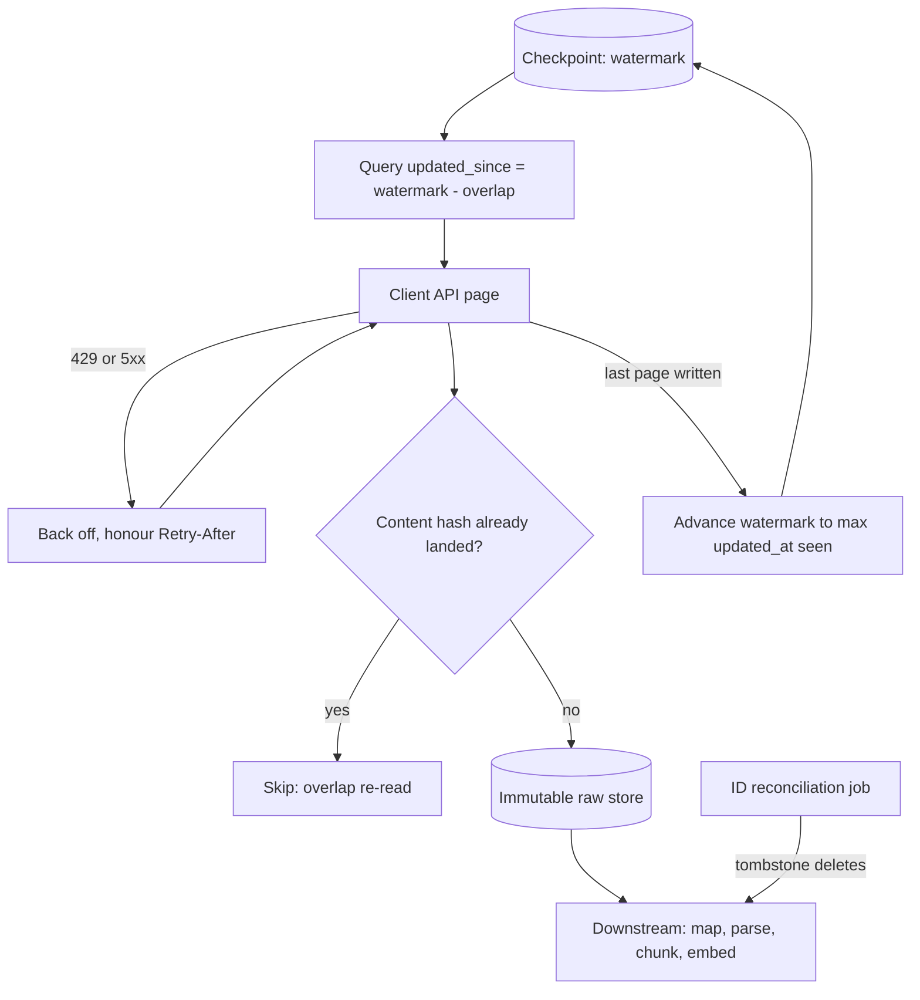

## TL;DR
An agent's retrieval index is fed from client systems you do not own. Pick the least invasive channel,
land an immutable raw copy, advance the checkpoint only after a durable write, throttle to protect the
source, and reconcile for deletes.

## For agent builders
- **Why it matters for agents.** Ingestion decides what the agent can know and how stale it is. A missed
  update means the agent confidently cites an old ticket status; a missed delete means it cites a document
  the customer removed; missing ACLs mean it shows users what the source would hide.
- **Where it shows up in your stack.** The sync jobs behind the agent's vector store and record tables,
  the raw zone you re-chunk from when you change embedding models, and the choice between pre-ingesting
  data and letting the agent call the live API as a tool.
- **What you control.** Channel per source, watermark overlap, what goes into the content hash, which
  permission fields are landed, and a freshness target the agent's answers depend on.
- **What you can skip.** Building a general streaming platform. A watermark poll with overlap, a raw zone
  and an ID reconciliation cover most agent knowledge bases.

## Decision case
### Scenario
An IT-helpdesk agent for a bank answers employees from past tickets and knowledge articles, and checks a
ticket's live status before replying. The ticketing system runs on-premises. All figures are
illustrative.

- **Volume:** 2 million historical tickets; about 6,000 created or changed per day.
- **Freshness:** a changed ticket must be searchable within 30 minutes; a deleted or erased ticket
  must leave the index within 24 hours.
- **Network:** security approves outbound connections from inside the bank only; no inbound path.
- **Quota:** the ticketing API allows your integration 40 requests per minute, shared between sync jobs
  and the agent's live `get_ticket_status` tool.
- **People:** the bank's DBA team has no capacity this quarter for replicas or CDC.

### Options
| Option | How it works | Freshness | Deletes | Network and people |
|---|---|---|---|---|
| A. API pull from an in-network connector | Connector inside the bank polls every 15 minutes from watermark minus overlap, lands raw records, pushes outbound; nightly ID reconciliation | within 15 minutes | nightly ID diff | outbound only; no DBA work |
| B. Read-replica views | SQL over replica views from your cloud | minutes | SQL anti-join | needs an inbound path and DBA work: fails |
| C. Nightly SFTP file drop | Full or delta export once a night | up to 24 hours: fails 30 minutes | full snapshot diff | outbound push; little DBA work |
| D. CDC from the database log | Connector reads the change log | seconds | native | needs DBA work: fails this quarter |

### Decision
Choose **A**, because it is the only option that meets the 30-minute freshness target over an
outbound-only path without DBA work. The quota arithmetic, at 200 records per page:

| Job | Calls | At 40 per minute |
|---|---|---|
| Backfill | 2,000,000 / 200 = 10,000 | 250 minutes, about 4.2 hours off-peak |
| Incremental, every 15 minutes | 96 polls per day; about 6,000 / 96 = 62.5 changes each, so 1 page | 96 calls per day |
| Nightly ID reconciliation | 10,000 id pages | 250 minutes of an 8-hour (480-minute) night |

- **Agent calls get priority.** In business hours the live tool may use up to 20 per minute, so sync
  runs at the remaining 20; the incremental job's 1 page per poll fits easily.
- **Deletes meet 24 hours** because the ID diff runs nightly and tombstones go through the same index
  path.
- **Raw landing keeps ACLs** with content, so the index can enforce them and be rebuilt without asking
  the bank again.

**What would change it.**
- **DBA capacity appears:** move to CDC for ordered deletes and lower source load.
- **Freshness relaxes to next-day:** a nightly file drop is simpler to approve and operate.
- **The id listing is too slow:** if 250 minutes grows past the night, partition the diff by count
  first and compare ids only where counts disagree.

### Trade-offs accepted
- **You run software inside the bank.** The connector needs patching and monitoring; alert on its
  heartbeat and last successful poll.
- **Deletes lag up to a day.** Erasure requests that must be faster are handled by a targeted delete
  call; track time from request to removal.
- **Overlap re-reads cost calls.** Content-hash keys make them no-ops; watch the duplicate-skip rate.
- **Sync and agent share 40 per minute.** Track 429s by caller; agent 429s mean the split is wrong.

### Review rubric
- **The channel is chosen from what the client can approve,** with network direction and team capacity
  stated.
- **Quota arithmetic is shown** for backfill, incremental and reconciliation, and adds up against the
  limit.
- **The watermark is safe:** overlap, dedupe key and advance-after-durable-write are all named.
- **Deletes and permissions have a mechanism,** not an assumption that polling catches them.
- **Ingest versus live tool is decided per field:** searchable history is ingested, current status is
  called live, and both share one budget.

## Why it exists
- **Ingestion at a client is a negotiation.** The data sits in their CRM, ERP, ticketing system or file
  shares; their security team decides which network paths exist; their platform team decides whether you
  may touch a database; their operations team notices if your job slows the system staff use all day.
- **You get what they can approve,** rarely the interface you would design: often a REST API with rate
  limits, a nightly CSV on SFTP, a read replica, or an on-premises system reachable only from an agent
  inside their network.
- **The naive script breaks in a characteristic order.** Call the API, paginate through everything, write
  straight into the index on a schedule:
  1. Rate limits return 429s and the script dies halfway, so the next run starts over.
  2. A full nightly re-pull takes longer than the night as volume grows.
  3. Records updated during the run are skipped or duplicated because pagination shifted under it.
  4. Deleted records stay in the index forever, because a pull of "what exists" says nothing about what
     stopped existing unless you diff it.
  5. Raw responses were never kept, so a parser bug found a month later means re-pulling everything from
     a source that took weeks to get access to.
- **What the pattern buys:** ingestion that is resumable, incremental, gentle on the source, and
  replayable without going back to the client.

## How it works
For the generic landing-zone and pipeline design, see the data-architecture ingestion lesson; this lesson
covers what changes when the source belongs to a client.

### 1. Choose the channel from what the client can offer
| Channel | Strength | Cost |
|---|---|---|
| **Vendor API pull** (Salesforce, ServiceNow, Zendesk, Graph for SharePoint) | the usual default: respects the vendor's permission model and is supported | rate limits, pagination quirks, per-object API shapes |
| **Database read replica or read-only views** | fastest for bulk data, allows SQL filtering | couples you to an internal schema that can change without notice; ask for views as a stable contract |
| **File drop** (SFTP, shared object-storage bucket) | common for legacy systems and teams that cannot grant live access; simple and auditable | batch-only, prone to format drift |
| **Events or webhooks** | low latency | at-least-once and can be lost, so needs a periodic pull or reconciliation behind it |
| **CDC from the database log** | inserts, updates and deletes in order, low source load | needs DBA cooperation and connector infrastructure, so usually a phase-two upgrade |

### 2. Decide where the connector runs
- **Inside the client network when needed.** If the source is only reachable there, run a small agent that
  pushes outbound to you, *because* outbound connections usually pass security review far more easily
  than inbound ones.
- **Otherwise private connectivity** (private endpoints, VPN).
- **Credentials:** a dedicated service account or OAuth client with read-only scope, stored in a secrets
  manager and rotated.

### 3. Backfill, then incremental
- **Backfill once:** in bounded batches, off-peak, resumable per batch.
- **Then incremental:** fetch only what changed since a **watermark**, typically a `modified_at` timestamp
  or a sequence number from the source.

### 4. Make the watermark safe
Timestamps lie at the boundaries: several records can share the watermark's exact timestamp, clocks skew,
and long transactions commit with earlier timestamps. So:
1. **Query from `watermark - overlap`** and accept that some records arrive twice.
2. **Deduplicate by `(source_id, version or content_hash)`.**
3. **Advance the watermark only *after* the batch is durably written,** so a crash re-reads rather than
   skips. This is the whole reason ingestion can be at-least-once without being wrong.

### 5. Land raw, immutably
- **Write each record as received** to a raw store, keyed by source system, object type, ID and content
  hash, before any parsing or mapping.
- **Why:** everything downstream (mapping, parsing, chunking, embedding) can be re-run from raw without
  re-contacting the client, which matters because access is slow to get and downstream logic will change.
- **Hash only content-bearing fields.** Many APIs return volatile fields (a computed "last viewed", a
  signed download URL that expires, a request timestamp), and hashing those makes every re-read look like
  a new version.
- **Land permissions with content** (ACLs, sharing, owning group), because retrieval must enforce them at
  query time and a raw zone without them cannot be replayed into a permission-aware index.

### 6. Protect the source
- **Honour rate limits and `Retry-After`,** and cap concurrency.
- **Schedule heavy work outside business hours** and prefer replicas over primaries.
- **Expose a client-side switch to pause ingestion.** Being a good neighbour is what keeps your access
  approved.

### 7. Catch what the channel misses
- **Polling by `modified_at` misses hard deletes** and some permission changes.
- **It only sees what bumps the polled field.** Salesforce, for example, updates `SystemModstamp` on
  system and automated changes that leave `LastModifiedDate` untouched, so a sync keyed on the latter
  misses them.
- **Fill the gap** with the source's deleted-items endpoint or tombstones where it has one, CDC where
  available, and otherwise a periodic ID reconciliation comparing source and target key sets.

### 8. Ingest ahead, or let the agent call live
An agent can reach client data two ways, and most deployments use both.

| Approach | Good for | Cost |
|---|---|---|
| **Ingest into an index** (this lesson) | semantic search over documents, large history, cross-record questions | freshness lag, a second copy, permissions to mirror |
| **Live tool call** to the client API at question time | current status of one record, actions | rate limits shared with the client's users, latency per step, no semantic search |

- **Rule of thumb:** ingest what the agent searches, call live for what must be current, such as a ticket's
  status before the agent writes to it.
- **Live tools share the ingestion quota.** Agent tool calls and sync jobs hit the same rate limit, so
  budget them together and give the agent's calls priority during business hours.
- **Re-embedding comes from raw.** Changing chunking or the embedding model re-runs from the raw zone,
  never from the client API.

## Diagram
An incremental run reads from the watermark minus an overlap, lands raw records keyed by content hash,
and moves the watermark only after every write succeeds before chunks reach the agent's index;
reconciliation covers deletes separately.



## Examples
### Incremental pull with a safe watermark
An incremental pull from a paginated REST API with a safe watermark, backoff on rate limits, raw landing
and deduplication. `api`, `raw_store` and `state` stand in for your HTTP client, object store and
checkpoint table.

```python
import time, hashlib, json
from datetime import datetime, timedelta

OVERLAP = timedelta(minutes=10)

def get_with_backoff(api, path, params, max_tries=6):
    for attempt in range(max_tries):
        r = api.get(path, params=params, timeout=30)
        if r.status_code == 429 or r.status_code >= 500:
            ra = r.headers.get("Retry-After", "")      # seconds, or an HTTP-date we ignore here
            wait = float(ra) if ra.isdigit() else 2 ** attempt
            time.sleep(min(wait, 120)); continue
        r.raise_for_status()
        return r.json()
    raise RuntimeError(f"gave up on {path} after {max_tries} tries")

def sync_tickets(api, raw_store, state, tenant):
    wm = datetime.fromisoformat(state.get(tenant, "tickets_wm", "1970-01-01T00:00:00+00:00"))
    since, newest, cursor = (wm - OVERLAP).isoformat(), wm, None
    while True:
        params = {"updated_since": since, "page_size": 200, "order": "updated_at"}
        if cursor: params["cursor"] = cursor
        page = get_with_backoff(api, "/tickets", params)
        for rec in page["items"]:
            body = json.dumps(rec, sort_keys=True).encode()   # assumes rec has no volatile fields
            key = f"{tenant}/tickets/{rec['id']}/{hashlib.sha256(body).hexdigest()[:16]}.json"
            if not raw_store.exists(key):          # dedupe the overlap window
                raw_store.put(key, body)
            newest = max(newest, datetime.fromisoformat(rec["updated_at"]))
        cursor = page.get("next_cursor")
        if not cursor: break
    state.set(tenant, "tickets_wm", newest.isoformat())  # advance only after all writes succeeded
```

- **Overlap re-reads are no-ops.** The run re-reads ten minutes of records each time; the content-hash key
  makes those re-reads no-ops, and an unchanged record never produces a second raw object.
- **The watermark comes from the data.** It is the largest `updated_at` *seen in the data*, never your own
  clock at the end of the run, because the two clocks disagree and a watermark from your clock can jump
  past records the source stamped slightly earlier.
- **Sizing the overlap.** It should exceed the worst clock skew plus the longest transaction you expect at
  the source; ten minutes is a starting value, not a derived one. Content-hash dedupe makes a generous
  overlap cheap, so err on the large side.
- **Crashes resume.** A crash mid-run leaves the watermark where it was, so the next run resumes.
- **What it cannot see.** A ticket hard-deleted in the source never appears in `updated_since`, which is
  why a separate reconciliation job compares ID sets.

### Why a strict `>` with no overlap loses records
A runnable simulation: a long transaction commits after the previous run, but with an earlier
timestamp than the watermark.

```python
source = [  # (id, updated_at as minutes since midnight)
    ("T1", 100), ("T2", 105), ("T3", 105),
]
watermark = 105                        # run 1 saw T1, T2, T3 and stopped at 105
source.append(("T4", 104))             # long transaction commits late, stamped 104
source.append(("T5", 110))             # ordinary later edit

strict = [i for i, ts in source if ts > watermark]
overlap = [i for i, ts in source if ts >= watermark - 10]
already = {"T1", "T2", "T3"}

print(strict)                               # ['T5']        T4 is lost forever
print([i for i in overlap if i not in already])  # ['T4', 'T5'] overlap catches it
```

The overlap also re-reads T1 to T3; in the real pipeline the content-hash key turns those into no-ops.

### Agent scenario: a stale answer traced to the sync
A support agent tells a user that ticket INC-2207 is "awaiting customer" though it closed two hours ago.
Trace of the investigation (illustrative numbers).

| Question | Finding |
|---|---|
| What did the agent retrieve? | the chunk for INC-2207 indexed at 06:00, status "awaiting customer" |
| When did the source change? | closed and stamped 09:12, inside a long transaction that committed at 09:20 |
| Did the hourly syncs see it? | no: the 09:15 run had already set the watermark to 09:14 from other records, and the 10:15 run queried strictly `updated_at > 09:14` |
| Fix for freshness | query from the watermark minus an overlap, and add a live `get_ticket_status` tool the agent calls before stating a status |
| Fix for trust | show the chunk's indexed-at time in the tool result so the model can say how current it is |

### Worked scenario: choosing channels for one client
A client with three sources and different constraints (illustrative).

| Source | What the client could approve | Channel chosen | Delete handling |
|---|---|---|---|
| ServiceNow tickets | API service account, shared quota | API pull with watermark overlap | nightly ID reconciliation |
| On-premises ERP | no inbound connections | agent inside their network, outbound push | CDC requested for phase two |
| Policy PDFs | nightly export only | SFTP file drop, validated per file | full listing diff per drop |

## Production patterns
- **Overlap watermark with content-hash dedupe.** Use for every polling sync. Query from the watermark
  minus an overlap larger than skew plus the longest transaction, key raw objects by ID and content hash,
  advance after writes. Monitor duplicate-skip counts; if they equal the whole overlap window every run,
  volatile fields are leaking into the hash.
- **Outbound-only agent for on-premises sources.** Use when security forbids inbound connections. A small
  connector inside the client network pushes over a monitored outbound channel with read-only
  credentials. Monitor agent heartbeat, version and push lag, since you cannot log in freely.
- **Source-protection controls.** Use against any production system. Cap concurrency, honour
  `Retry-After`, schedule backfills off-peak, and give the client a pause switch. Monitor 429 rate per
  tenant and the source's latency during your runs.
- **Validate file drops before loading.** Use for SFTP or bucket exports. Check expected columns and order,
  row counts against the previous drop and an end-of-file marker or manifest, and quarantine failures.
  Monitor missed nights and rejected files.
- **ID-set reconciliation for deletes.** Use whenever the channel cannot report deletes. Periodically list
  source IDs, diff with target IDs and tombstone the difference through to the index. Monitor tombstones
  per run and raw-versus-target counts.
- **Freshness metadata in every retrieval result.** Use for agents that state facts from indexed records.
  Store the source's `updated_at` and your indexed-at time on each chunk and return both in the tool
  result, so the agent can prefer a live tool call when data is old. Monitor index lag p95 per source.

## Trade-offs
- **API pull vs replica.** API pull respects the vendor's permission model and is supported, but rate
  limits make large backfills slow; a read replica flips the balance for bulk history when the client's
  DBAs will provide one.
- **Polling vs events or CDC.** Watermark polling is simple and works with almost any API, but adds
  latency of up to one polling interval and misses deletes; events or CDC win once freshness or delete
  propagation becomes a requirement.
- **In-network agent vs operability.** An agent inside the client network reaches on-premises systems and
  passes security review more easily, but you now operate software in an environment you cannot log into
  freely, so upgrades, monitoring and support get harder.
- **Immutable raw copy vs a second copy of sensitive data.** It makes every downstream fix replayable, but
  stores client data twice; retention, encryption and deletion propagation must cover the raw zone too.
- **File drops vs inherited failures.** They are the easiest channel to get approved, but you inherit the
  export job's failures, such as partial files, changed column orders and missed nights, so validate each
  file before loading it.

## Pitfalls
- **Advancing the watermark before writes are durable.** Symptom: a small, permanent gap of records that
  were fetched during a crash and never re-fetched. Fix: advance after the write.
- **A strict `>` comparison on a timestamp watermark with no overlap.** Symptom: occasional missing
  records that share a timestamp with the previous run's last record, or committed late with an earlier
  stamp. Fix: query from the watermark minus an overlap.
- **Offset pagination over a set that changes during the run.** Symptom: records skipped or seen twice
  when inserts shift page boundaries. Fix: cursor or keyset pagination ordered on a stable key.
- **Ignoring `Retry-After` and retrying immediately.** Symptom: the client's API gateway throttles or
  blocks your service account, sometimes for the whole tenant's integrations. Fix: honour it and cap
  concurrency.
- **Hashing the whole API response, volatile fields included, for the dedupe key.** Symptom: a raw zone
  that grows by roughly the full overlap window on every run and "changed" counts that never fall,
  although nobody edited those records. Fix: hash only content-bearing fields.
- **Writing straight to the index with no raw copy.** Symptom: a parser or mapping fix requires a full
  re-pull, which can take days against a rate-limited API. Fix: land raw first.
- **Giving agent tool calls and sync jobs separate, uncoordinated rate budgets.** Symptom: during a
  backfill the agent's live lookups start failing with 429s and users see "tool unavailable". Fix: one
  quota budget per client instance with priority for interactive calls.
- **Assuming polling sees deletes.** Symptom: answers citing documents or records the customer deleted
  weeks ago, often found by the customer. Fix: deleted-items endpoint, CDC or ID reconciliation.

## When to use
- **Use for** any recurring pull from a system you do not own.
- **Ask what the client can approve first,** not your ideal: an API with a service account is usually
  fastest to get, a file drop is the fallback for legacy systems, and CDC is worth requesting once
  freshness or deletes matter.
- **Measure:** lag (source change to landed), records per run, retry and 429 rates, raw-versus-target
  counts from reconciliation, and run duration against the window you have.
- **Interviews:** the tell of experience is mentioning the watermark overlap, advancing the checkpoint
  after the write, and deletes.

## Role lens
- **Engineer:** Writes connectors with cursor pagination, backoff that honours `Retry-After`, overlap
  watermarks and content-hash deduplication into an immutable raw zone.
- **Architect:** Chooses the channel per source, where connectors run relative to the client network, and
  how raw data is retained, encrypted and deleted across the boundary.
- **FDE:** Negotiates service accounts, network paths and off-peak windows with the client's security and
  platform teams, and is the first to hear when ingestion load annoys their operations staff.

## Check yourself
**Q:** Your nightly sync uses `updated_at > last_watermark` against a client API. Users report a few
missing tickets each week and some deleted tickets still being cited. Diagnose both and fix them.
**A:** Missing tickets come from the strict comparison at the boundary: records sharing the watermark
timestamp, clock skew, or late-committing transactions fall behind it and are never re-read. Fix by
querying from the watermark minus an overlap, deduplicating by ID plus version or content hash, and
advancing the watermark only after writes succeed. Deleted tickets persist because a `updated_at`
query cannot return records that no longer exist. Fix with the API's deleted-records endpoint if it has
one, CDC if the client can provide it, or a scheduled reconciliation that diffs source and target ID sets
and tombstones the difference through to the index.

## Interview questions
### Why land an immutable raw copy before parsing or mapping?
- **Replay without the client.** Every downstream fix (mapping, parsing, chunking, embedding) can be re-run
  from raw, which matters because access took weeks to get and downstream logic will change.
- **The cost** is storing sensitive client data a second time, so retention, encryption and deletion
  propagation must cover the raw zone.

### Your raw zone grows by thousands of objects every run though nobody edits records. What is wrong?
- **The content hash includes volatile fields,** such as a signed download URL or a request timestamp, so
  every overlap re-read looks like a new version.
- **Fix:** hash only content-bearing fields and keep permissions alongside; expect duplicate skips to
  roughly match the overlap window once fixed.

### The client offers either API access or a read replica. How do you choose?
- **API pull** respects the vendor's permission model and is supported, but rate limits make large
  backfills slow.
- **A replica** is fastest for bulk history and allows SQL filtering, but couples you to an internal
  schema; ask for read-only views as a stable contract.
- **Often both:** a replica or views for the backfill and the API for incremental sync and permissions.

### Security will not open any inbound port to the on-premises system. What do you propose?
- **An outbound-only agent** inside their network, on a host they control, pushing to you over a channel
  their security team can monitor.
- **The trade-off** is operating software you cannot log into freely, so build heartbeat, version reporting
  and remote diagnostics in from the start.

### Should your agent read ticket data from an index or call the ticketing API live?
- **Index what the agent searches:** semantic search over descriptions and comments needs ingested,
  chunked and embedded data with permissions attached.
- **Call live for what must be current,** such as status before the agent updates a ticket, because the
  index lags by up to one sync interval. Budget live calls inside the same API quota as the sync.

### Your agent states a ticket status that changed two hours ago. How do you find the cause?
- **Start from the trace:** which chunk the retrieval tool returned and its indexed-at time, against the
  source's change time, so you know whether the sync or the agent is at fault.
- **Then check the sync runs after the change:** did the query window cover the change's timestamp
  (watermark overlap, late commits), and does the polled field move on this kind of change?
- **Fix both layers:** an overlap sized above skew plus the longest transaction (ten minutes is a starting
  value, not a derived one), plus a live status tool and indexed-at time in the tool result.

## Quiz
### Q: Why should the watermark be advanced only after the batch has been durably written?
- [ ] Because APIs reject requests whose watermark is in the future
- [x] Because a crash between fetch and write would otherwise skip those records permanently
- [ ] Because writing first makes the batch smaller
- [ ] Because the watermark must equal the earliest record in the batch
> If the checkpoint moves first and the write then fails, the next run starts after records that were
> never stored. Advancing after the write makes failures re-read instead of skip.

### Q: A client's security team will not allow any inbound connection to their on-premises database. What is the usual design?
- [ ] Ask for a nightly full database dump emailed to you
- [ ] Use the vendor's public API from your cloud regardless of the policy
- [x] Run a connector agent inside their network that makes outbound connections to your service
- [ ] Wait for them to migrate the database to the cloud
> Outbound-only agents are a common, reviewable compromise: no inbound ports open, the client controls
> the host, and data is pushed to you over a channel their security team can monitor.

### Q: What does a timestamp-watermark poll fundamentally fail to capture?
- [ ] Records created after the last run
- [ ] Records whose fields were edited in the source since the last run
- [ ] Records returned on the second page of results
- [x] Records that were hard-deleted in the source
> A query for recently modified records can only return records that still exist. Hard deletes need a
> deleted-items endpoint, CDC, or a key-set reconciliation between source and target.

## Use cases & projects
### Use cases
- **Knowledge bases for support and IT agents.** Ticketing and wiki content is synced incrementally into
  the agent's vector store with ACLs attached.
- **Re-embedding without re-pulling.** Changing the chunker or embedding model re-runs from the raw zone in
  hours instead of weeks of rate-limited API calls.
- **Agents over on-premises systems.** An outbound-only connector inside the client network feeds an agent
  hosted in your cloud.
- **Hybrid agents.** Indexed history for search plus live tools for current status, sharing one quota
  budget.

### Mini project
**Incremental sync feeding a retrieval agent (2-3 hours).**
- **Goal:** a fake ticket API synced into a small vector index that a question-answering agent searches,
  with freshness and deletes handled.
- **Steps:** build a fake paginated API with `updated_at` and random 429s; write the overlap-watermark sync
  with a content-hash raw zone; chunk and index into any local vector store; add a reconciliation that
  tombstones deleted ids; build an agent with `search_tickets` and a live `get_ticket_status` tool; edit
  and delete tickets between runs.
- **Done when:** after edits and deletes the agent never cites a deleted ticket, states current status via
  the live tool, and the sync survives a mid-run crash without losing or duplicating records.
