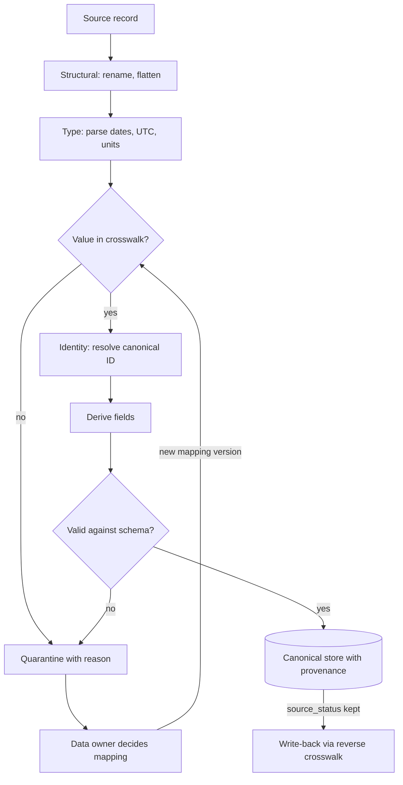

## TL;DR
A canonical schema is the one shape your agent's tools read and write; schema mapping is the per-source,
versioned translation into it. N sources and M consumers need about N + M mappings, not N × M, and one
tool schema serves every customer.

## For agent builders
- **Why it matters for agents.** Without a canonical model every tool schema, retrieval filter and prompt
  has to know each customer's field names and codes. With one, the agent's `update_case(status=...)` tool
  takes the same closed enum for every tenant, and the adapter maps it to that tenant's source code.
- **Where it shows up in your stack.** Tool argument and result schemas, metadata filters in the vector
  store, the mapping layer inside each tool adapter, and the eval harness that compares agent outputs
  field by field.
- **What you control.** Which concepts are canonical, the closed enums the model may emit, the reverse
  crosswalk for write tools, and quarantine of values the mapping does not know.
- **What you can skip.** Enterprise-wide data modelling. Model only the concepts your agent reasons about
  and keep the rest in extensions.

## Why it exists
- **Every client represents the same concepts differently.** One CRM's "Account" is another's
  "Customer", dates arrive in three formats, and a status of "Closed" may mean won, lost or cancelled.
- **Point-to-point puts every source in every consumer.** Say your product consumes tickets from Zendesk,
  ServiceNow and Jira Service Management across twelve customers, feeding a retriever, a summarizer,
  analytics and an eval harness. Read natively, the summarizer must know ServiceNow's `priority` is an
  integer from 1 (critical) to 5, derived from impact and urgency, while Zendesk uses strings such as
  `urgent` and `low`; the retrieval filter must know which field holds the product name in each system.
- **That is the N × M problem.** Adding a source means editing every consumer; changing a consumer means
  testing it against every source.
- **"Let the LLM cope" fails three ways.** Dumping raw JSON into the prompt works in a demo, but:
  1. Retrieval filters, access control and analytics are not LLM calls; they need a queryable field, so
     they still need the mapping.
  2. Model interpretation is inconsistent across records and model versions, so the same code can be read
     two ways on two days.
  3. Meaning is often not in the data: whether `STATUS=7` means "escalated" or "awaiting customer" is held
     by the client's data owner, and no inference recovers it reliably.
- **The canonical data model puts that knowledge in one place per source.** It is a named pattern in Hohpe
  and Woolf's catalogue: a mapping, reviewed with the people who know the data, tested, and versioned.

## How it works
### Designing the canonical schema
- **Model *your* domain,** the concepts your product reasons about (case, party, document, interaction),
  not a union of every source's fields.
- **Keep it small and stable,** *because* each field is a promise every mapping must keep.
- **Keep its scope to your product.** At enterprise scale, a single company-wide canonical model tries to
  make "customer" mean the same to sales, billing and support, needs every team's agreement to change, and
  becomes the bottleneck. Domain-driven design's answer is a model per bounded context with translation at
  the edges. Your product's schema is one such context; it need not be the client's enterprise data model,
  and should not try.

Typical choices:

| Choice | Rule | Why |
|---|---|---|
| Normalized types | timestamps in UTC with zone, money as amount plus ISO currency, explicit units | consumers never guess formats |
| Closed enumerations | documented, e.g. `status ∈ {open, pending, resolved, closed}` | downstream logic branches on them |
| Provenance on every record | source system, source ID, source version, mapping version | any canonical value can be traced back |
| **Extensions** bag | source fields with no canonical home | mapping is lossless; a field can be promoted later without re-ingesting |
| Additive, versioned evolution | new optional fields cheap; renames and meaning changes are a new version with a migration | as with any data contract |

### Layers of a mapping
Mapping is more than renaming, and the layers fail in different ways:
1. **Structural:** field renames, flattening or nesting, splitting one field into two or joining two.
2. **Type and format:** parse dates and numbers, normalize time zones, convert units and currencies.
3. **Value or semantic mapping:** crosswalks from source codes to canonical enums, agreed with the data
   owner. This is where meaning lives and where most real errors happen.
4. **Identity:** resolve source keys to canonical IDs and link entities across sources (the same customer
   in the CRM and in billing), which may need matching rules rather than equality.
5. **Derivation:** computed fields such as a canonical `is_escalated` from several source flags.

### Mappings as declarative, versioned config
- **Express each mapping as data** (a field table and value crosswalks) interpreted by one engine, not
  hand-written code per customer, *because* data can be reviewed by non-engineers, diffed, validated and
  reused for the next tenant on the same system.
- **Layer tenant overrides on a per-system base mapping,** since two customers on the same CRM often
  customize the same fields differently.

### Mapping back: write paths need the reverse direction
- **Read-only needs only inbound.** An assistant that writes back (updating a ticket's status, filing a
  case) needs the reverse too.
- **The reverse is not automatic,** *because* crosswalks are often many-to-one. If source codes `W` and
  `K` both map to canonical `pending`, then `pending` has no single source code to write.
- **Two fixes:** keep the original source value on the canonical record (provenance makes this cheap) and
  write it back unchanged when the meaning has not changed; or define an explicit reverse crosswalk agreed
  with the data owner (`pending` writes `W`).
- **Test the round trip,** source → canonical → source, as a fixture.

### Unmapped values are errors, not defaults
- **Quarantine with the reason** when a value has no crosswalk entry, and report it to the data owner.
- **Never default** to `other` or the most common value: every downstream result for that category
  becomes silently wrong, which is worse than a visible gap.

### Testing and validating
- **Fixture tests per mapping:** source record in, expected canonical record out, built from profiled
  samples.
- **Validate every mapped record** against the canonical schema before it is written.
- **Track per-field null and quarantine rates per source** after each load, because a sudden rise is
  usually a source-side change rather than a data trend.

### The canonical schema is the agent's tool contract
- **Tool schemas use canonical types.** A write tool's JSON schema declares `status` as the canonical enum
  (`open`, `pending`, `resolved`, `closed`), so the model never sees or invents a tenant's source codes,
  and argument validation rejects anything else before the adapter runs.
- **Tool results return canonical records,** trimmed to the fields the agent needs, with source detail
  left in extensions. The same prompt then works across Zendesk, ServiceNow and Jira tenants.
- **The adapter does both directions.** Inbound it maps source to canonical for results; outbound it uses
  the reverse crosswalk and the kept source value, so the agent's write changes only what it meant to.
- **Retrieval filters are canonical fields.** A filter such as `status = open AND product = X` works for
  every tenant only because mapping produced queryable canonical values at ingestion.

### LLM-assisted mapping
- **Good for *proposing*.** Given source field names, descriptions and sample values, an LLM drafts a field
  table and crosswalk quickly.
- **A human confirms with the data owner, then it is frozen as config.** The model accelerates authoring;
  it should not be the runtime mapping.

## Diagram
A source record passes through the mapping layers in order before the agent's tools can read it;
anything without a crosswalk entry goes to quarantine and back to the data owner, and the original value
is kept for the agent's write-back.



## Examples
### A declarative mapping with quarantine
A declarative mapping for one customer's ticket export with a structural rename, type normalization, a
value crosswalk, an extensions bag and quarantine on unknown values.

```python
from datetime import datetime, timezone
from zoneinfo import ZoneInfo

MAPPING = {  # versioned config for tenant "acme", source "legacy_helpdesk"
    "version": "acme-helpdesk-v3",
    "fields": {"TicketNo": "source_id", "Subj": "title", "Opened": "opened_at", "Stat": "status"},
    "tz": "Europe/Berlin",                       # source writes naive local time
    "status_crosswalk": {"N": "open", "W": "pending", "K": "pending", "E": "resolved", "Z": "closed"},
}

class Unmapped(Exception): pass                     # caller sends the record to quarantine

def map_ticket(src: dict, m=MAPPING) -> dict:
    out = {"source_system": "legacy_helpdesk", "mapping_version": m["version"]}
    out.update({m["fields"][k]: v for k, v in src.items() if k in m["fields"]})
    ext = {k: v for k, v in src.items() if k not in m["fields"]}   # lossless: nothing is dropped
    missing = {"source_id", "opened_at", "status"} - out.keys()
    if missing:
        raise Unmapped(f"missing {missing} in {src.get('TicketNo')!r}")
    local = datetime.strptime(out["opened_at"], "%d.%m.%Y %H:%M").replace(tzinfo=ZoneInfo(m["tz"]))
    out["opened_at"] = local.astimezone(timezone.utc).isoformat()
    code = out["status"]
    if code not in m["status_crosswalk"]:
        raise Unmapped(f"status={code!r} for ticket {out['source_id']}")
    out["status"], out["source_status"] = m["status_crosswalk"][code], code   # keep original for write-back
    out["extensions"] = ext
    return out

print(map_ticket({"TicketNo": "T-1042", "Subj": "VPN drops", "Opened": "03.11.2025 09:15",
                  "Stat": "W", "Kostenstelle": "4711"}))
# opened_at becomes 2025-11-03T08:15:00+00:00 (CET is UTC+1 in November); "Kostenstelle" is kept in extensions.
```

- **The crosswalk is a human decision.** It maps two source codes, `W` and `K`, to one canonical
  `pending`; that came from the client's helpdesk lead, not from the data.
- **New codes become visible.** A code `X` appearing next quarter raises `Unmapped` and lands in quarantine
  with a message the FDE can forward, instead of becoming a silently wrong status.
- **Write-back stays exact.** Keeping `source_status` means a later write-back can restore `K` rather than
  guessing between `W` and `K`.
- **One edge it does not handle.** Naive local times are ambiguous for one hour each autumn (the clock
  repeats 02:00 to 03:00) and nonexistent for one hour each spring, and `replace(tzinfo=...)` silently
  picks one reading. If ordering within that hour matters, flag those values rather than trusting the
  default.

### Round-trip fixture for the write path
A runnable test that the reverse direction never rewrites a code the user did not change.

```python
CROSSWALK = {"N": "open", "W": "pending", "K": "pending", "E": "resolved", "Z": "closed"}
REVERSE = {"open": "N", "pending": "W", "resolved": "E", "closed": "Z"}   # agreed with data owner

def to_source(canonical: dict) -> str:
    # unchanged meaning: write back the original code; changed meaning: use the reverse crosswalk
    if CROSSWALK.get(canonical["source_status"]) == canonical["status"]:
        return canonical["source_status"]
    return REVERSE[canonical["status"]]

for code in CROSSWALK:
    rec = {"status": CROSSWALK[code], "source_status": code}
    assert to_source(rec) == code, code                     # round trip is exact
rec = {"status": "resolved", "source_status": "K"}           # user resolved a K ticket
print(to_source(rec))                                        # E
naive = {v: k for k, v in CROSSWALK.items()}                 # inverted many-to-one map
print(naive["pending"])                                      # K: every W ticket would become K
```

### A canonical write tool for an agent
The model sees one tool schema for every tenant; the adapter validates against the canonical enum and
writes back through `to_source` from the fixture above. `client` stands for the tenant's API wrapper.

```python
UPDATE_STATUS_TOOL = {
    "name": "update_ticket_status",
    "description": "Set a ticket's status. Use only the listed values.",
    "input_schema": {
        "type": "object",
        "properties": {"ticket_id": {"type": "string"},
                       "status": {"type": "string", "enum": ["open", "pending", "resolved", "closed"]}},
        "required": ["ticket_id", "status"],
    },
}

def run_update_status(args: dict, canonical_store: dict, client) -> dict:
    if args["status"] not in REVERSE:                       # validate before any write
        return {"error": f"status must be one of {sorted(REVERSE)}"}
    rec = dict(canonical_store[args["ticket_id"]], status=args["status"])
    code = to_source(rec)                                    # exact round trip when meaning unchanged
    client.patch(args["ticket_id"], {"Stat": code})
    return {"ticket_id": args["ticket_id"], "status": args["status"]}   # canonical result to the model
```

### Worked scenario: counting translations
| Sources × consumers | Point-to-point (N × M) | Canonical (N + M) |
|---|---|---|
| 3 × 4 (Zendesk, ServiceNow, Jira; retriever, summarizer, analytics, eval) | 12 | 7 |
| 6 × 4 | 24 | 10 |
| 10 × 6 | 60 | 16 |

With one source and one consumer both columns are 1 versus 2, which is why mapping directly is fine there.

## Production patterns
- **Base mapping per system, overrides per tenant.** Use when several customers run the same SaaS.
  Store a versioned base field table and crosswalk per source system and layer each tenant's
  customizations on top. Monitor how many tenants override each crosswalk entry.
- **Quarantine queue routed to the data owner.** Use for every value crosswalk. Unmapped values go to a
  table with record id, field, value and mapping version, and a weekly digest goes to the named owner.
  Monitor quarantine rate per source and age of the oldest open question.
- **Mapping version stamped on every record.** Use always. After a crosswalk fix, select records by the
  old version and remap them from raw instead of remapping everything. Monitor the count of records still
  on superseded versions.
- **Fixture tests from profiled samples.** Use for every mapping change. Source-in, canonical-out fixtures,
  plus a round-trip fixture for any field on a write path, run in CI. Monitor per-field null rate after
  each load against the previous load.
- **LLM-drafted, human-approved crosswalks.** Use when onboarding a large unfamiliar schema. Prompt with
  field names, descriptions and sample values, then have the data owner approve each value mapping before
  it is frozen as config. Monitor the share of proposals the owner changes.
- **Canonical enums in tool schemas.** Use for every agent tool that takes a categorical argument. Declare
  the canonical values as an enum in the tool's input schema and validate in the adapter before mapping
  back. Monitor rejected tool arguments per tool; a rise means the model or the prompt drifted.

## Trade-offs
- **N + M vs upfront modelling.** A canonical schema turns N × M translations into roughly N + M, but
  costs modelling effort and an extra hop; with one source and one consumer, mapping directly is simpler
  and fine.
- **Small schema vs useful detail.** A small schema is stable and easy to map to, but pushes useful
  source detail into extensions; promote a field once several consumers need it, not before.
- **Declarative vs complex logic.** Declarative mappings are reviewable and reusable, but awkward for
  genuinely complex logic such as multi-record identity resolution; allow a code escape hatch for those
  cases, tested like any code.
- **Strict quarantine vs coverage.** It keeps results correct but lowers coverage and creates support
  work. It is the right default when values drive filters, routing or access, and too strict for a
  free-text field only shown to users.
- **LLM-proposed mappings vs hidden errors.** They speed authoring considerably, but a confident wrong
  crosswalk is hard to spot; the saving holds only if a data owner reviews every proposed value mapping.

## Pitfalls
- **Designing the canonical schema as the union of every source's fields.** Symptom: hundreds of mostly
  null columns and no consumer able to tell which fields are reliably populated.
- **Mapping by field name alone without checking values.** Symptom: two sources with a `priority` field
  whose scales run in opposite directions, so high-priority tickets from one source sort to the bottom.
- **Dropping naive timestamps into UTC without the source zone.** Symptom: events shifted by hours and
  off-by-one-day errors around midnight and daylight-saving changes.
- **Defaulting unknown codes.** Symptom: a canonical category that grows quietly and contains records that
  belong elsewhere.
- **No mapping version on records.** Symptom: after a crosswalk fix you cannot tell which records were
  mapped under the old rule and need remapping from raw.
- **Writing back through an inverted many-to-one crosswalk.** Symptom: source records whose status changes
  from `K` to `W` when the assistant updates an unrelated field, and the client's reports shifting for no
  visible reason.
- **Exposing source codes in tool schemas.** Symptom: the agent writes `W` for one tenant and `pending`
  for another, and a prompt tuned on one customer fails on the next. Fix: canonical enums in the tool,
  mapping inside the adapter.
- **Letting the LLM interpret raw source records at query time instead of mapping.** Symptom: filters and
  permissions that do not work and answers that vary across model versions.

## When to use
- **Introduce a canonical schema** once you have more than one source system or more than one consumer of
  the same data, which in enterprise AI is almost immediately.
- **Keep it focused** on the concepts your product reasons about, and agree crosswalks with the client's
  data owners during onboarding.
- **Measure** per source and mapping version: quarantine rate, per-field null rate and the count of
  outstanding unmapped values.
- **Day to day:** in FDE work this is where most onboarding questions come from.
- **Interviews:** expect to explain why a canonical model reduces coupling and where it hurts.

## Role lens
- **Engineer:** Builds the mapping engine, fixture tests and quarantine path, and stamps every canonical
  record with source identity and mapping version for replay.
- **Architect:** Owns the canonical schema and its versioning policy, decides what is canonical versus an
  extension, and keeps the model focused on the product's domain concepts.
- **FDE:** Sits with the client's data owners to agree crosswalks, chases unmapped values, and writes the
  tenant-specific mapping overrides for each customer's customizations.

## Check yourself
**Q:** A colleague proposes skipping canonical mapping for a new CRM source: "just put the raw record in
the prompt, the model understands Salesforce fields." When is that acceptable and when is it not?
**A:** It is acceptable for content the model only reads and shows, in a prototype with one source, where
inconsistency costs little. It breaks for anything that is not an LLM call: retrieval filters, access
control, analytics and evaluation need a concrete field and value set. It also ties meaning to the
model's guesses, which vary across records and model versions, and cannot know a customer's custom
picklist meanings. With a second source or consumer, every component inherits every source's quirks.
I would map the fields used for filtering, routing and permissions to the canonical schema, keep
everything else in extensions, and let the LLM draft the mapping for review, not perform it at runtime.

## Interview questions
### What problem does a canonical schema solve, and what does it cost?
- **It decouples sources from consumers.** Each source maps in once and each consumer reads one shape, so
  translations grow as N + M rather than N × M.
- **The cost** is upfront modelling, an extra hop, and governance of a shared model; with one source and
  one consumer it is not worth it.

### Two customers on the same CRM use the same status field differently. How do you model the mapping?
- **A per-system base mapping** holds the shared field table and default crosswalk.
- **Tenant overrides layer on top** for each customer's customized picklist values, agreed with that
  customer's data owner.
- **Stamp the mapping version** that includes the tenant override, so fixes can be replayed precisely.

### Your assistant now writes status back to the source, and the client says statuses are changing on their own. What happened?
- **A many-to-one crosswalk was inverted.** Canonical `pending` came from both `W` and `K`, and the naive
  reverse writes one of them for every record.
- **Fix:** keep the original source value on the canonical record and write it back when meaning is
  unchanged, use an agreed reverse crosswalk otherwise, and add a round-trip fixture.

### When would you not quarantine an unmapped value?
- **When the field is free text only shown to users,** strict quarantine lowers coverage for no
  correctness gain.
- **Always quarantine** when the value drives filters, routing or access, because a defaulted value makes
  every downstream result for that category silently wrong.

### How do you design an agent's ticket tools so one prompt works for every customer's helpdesk?
- **Canonical schema as the tool contract:** tool inputs and results use canonical fields and closed
  enums, never source field names or codes.
- **Mapping lives in the per-tenant adapter,** inbound for results and reverse crosswalk for writes, with
  round-trip fixtures so the agent's writes change only what it intended.

### What do you monitor on mappings in production?
- **Per-field null rate and quarantine rate per source after each load;** a sudden rise usually means a
  source-side change, not a data trend.
- **Outstanding unmapped values and their age,** which measure how fast data owners are answering.
- **Records on superseded mapping versions,** which should drain to zero after a remap from raw.

## Quiz
### Q: With 6 source systems and 4 consumers, roughly how many translations does a canonical schema need compared with point-to-point?
- [ ] 24 with a canonical schema versus 10 point-to-point
- [x] About 10 with a canonical schema versus 24 point-to-point
- [ ] 6 in both cases
- [ ] 4 with a canonical schema versus 6 point-to-point
> Point-to-point needs one translation per source-consumer pair, 6 × 4 = 24. A canonical model needs one
> mapping in per source and one read per consumer, about 6 + 4 = 10.

### Q: Why should every canonical record carry the mapping version it was produced with?
- [ ] To let the index sort records by recency
- [ ] Because canonical schemas cannot be changed otherwise
- [x] So that after a mapping fix you can find and re-map exactly the affected records from raw
- [ ] So that consumers can parse each version differently
> When a crosswalk is corrected, records mapped under the old rule must be reprocessed. Without a version
> stamp you cannot tell which ones, so you either remap everything or leave errors in place.

### Q: What is the strongest reason to keep an extensions bag on canonical records?
- [ ] It lets consumers ignore the canonical schema entirely
- [x] It makes mapping lossless, so a source field can be promoted later without re-ingesting from the client
- [ ] It replaces the need for value crosswalks
- [ ] It stores the LLM's interpretation of each field
> Source fields without a canonical home are kept rather than dropped. If a consumer later needs one, it
> can be promoted and backfilled from stored data instead of negotiating a new pull from the client.

## Use cases & projects
### Use cases
- **One support agent across many helpdesks.** Canonical ticket tools let the same prompt and evals run
  on Zendesk, ServiceNow and Jira tenants.
- **Agents that write back to systems of record.** Reverse crosswalks and kept source values stop the
  agent from silently rewriting statuses it did not mean to change.
- **Filtered retrieval for RAG agents.** Canonical metadata fields make filters such as status or product
  work identically for every tenant.
- **Fast onboarding of a new tenant.** An LLM drafts the crosswalk, the data owner approves it, and the
  agent's tools work unchanged.

### Mini project
**Canonical tools over two fake helpdesks (2 hours).**
- **Goal:** one agent with `get_ticket` and `update_ticket_status` tools that works against two sources
  with different field names and status codes.
- **Steps:** define a canonical ticket schema; write declarative mappings for two fake sources, one with a
  many-to-one crosswalk; build adapters that map results inbound and writes back through a reverse
  crosswalk; add quarantine for unknown codes; run the same 8-task agent script against both sources.
- **Done when:** both sources pass the same tasks with one prompt, round-trip fixtures pass, and an
  injected unknown code lands in quarantine instead of reaching the model.
