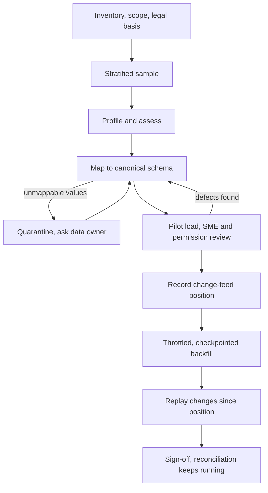

## TL;DR
Before an agent can answer from a customer's data, onboarding takes it from "access granted" to "loaded,
validated and syncing" in gated stages: inventory, sample, profile, map, SME-checked pilot, backfill and
sync. The data, not the model, is usually slowest and riskiest.

## For agent builders
- **Why it matters for agents.** A RAG agent or a tool-calling agent that reads records is only as right
  as the index and tables behind its tools. Most "the agent is wrong" reports in a new deployment trace to
  onboarding: unmapped codes, missing permissions, scanned files with no text, stale snapshots.
- **Where it shows up in your stack.** The ingestion jobs that fill the agent's vector store and record
  tables, the ACL metadata the retrieval tool filters on, the golden set the agent is evaluated against,
  and the change feed that keeps tool results fresh.
- **What you control.** The pilot slice, the stratified sample, quarantine rules, the seeded-role checks
  run through the agent itself, and the acceptance criteria that include agent eval scores.
- **What you can skip.** Building a general data platform first; onboard the slice the pilot agent needs
  and turn each stage into a reusable job as you go.

## Why it exists
- **The data is the per-customer cost.** An AI product is only as good as the data it retrieves or learns
  from, and every customer differs in systems, field meanings, quality, permission models and legal
  constraints. Model and pipeline code are shared; the data is not, so onboarding dominates time to value.
- **Big-bang imports fail late.** "Get a full export, load it, see what happens" takes weeks to arrange
  and transfer, so the first real feedback arrives late, and then all at once at production volume: a
  third of documents are scanned images, the "status" field has forty undocumented values, timestamps are
  local time with no zone, half the records are duplicates from a past migration.
- **No agreed "correct" means no sign-off.** Without acceptance criteria agreed in advance there is no
  basis for sign-off, and the customer's first view is answers built on bad data, which damages trust
  that is hard to rebuild.
- **One-off onboardings repeat discovery.** The tenth customer goes through the same discovery as the
  first, with findings in someone's notes rather than in reusable checks and mappings.
- **A staged, gated, documented process fixes both.** Problems surface on a sample when they are cheap to
  fix, each stage has an exit criterion the customer agrees to, and findings become reusable mappings,
  checks and connector settings.

## How it works
This lesson orients the whole sequence; each stage has its own lesson in this module.

| Stage | Output | Exit criterion |
|---|---|---|
| 1. Inventory and scope | source list, legal basis, permission models | in-scope slice agreed |
| 2. Access and sample | least-privilege access, stratified sample | sample covers time, type, state |
| 3. Profile and assess | written quality assessment | blockers known and owned |
| 4. Map to canonical schema | recorded mapping decisions, quarantine | open questions with the data owner |
| 5. Pilot load and SME validation | pilot tenant, reviewed answers, permission checks | SMEs accept the sample |
| 6. Backfill, then incremental sync | full load, live change feed | counts reconcile per batch |
| 7. Sign-off and handover | acceptance record, versioned artifacts | customer signs off |

### 1. Inventory and scope
- **List each needed source** (from discovery) with owner, system, approximate volume, change rate,
  sensitivity classification, and how it can be reached.
- **Scope the first subset** to the slice that serves the pilot use case, *because* onboarding everything
  before proving value multiplies cost and approval work.
- **Confirm the legal basis:** data processing agreement, residency constraints, whether PII may leave the
  customer boundary, retention rules.
- **Record each source's permission model** (document ACLs, sharing groups, record-level visibility
  rules), because an assistant that ingests content without its permissions will show a user what the
  source would have hidden, and permissions are much harder to retrofit than to ingest from the first
  load.

### 2. Access and a representative sample
- **Use a dedicated, least-privilege service identity** for read access, ideally against a sandbox or
  replica first.
- **Sample representatively, not conveniently:** across time periods, departments, document types and
  record states. The first 1,000 rows of a table are often the oldest and least like current data, so
  stratify deliberately.

### 3. Profile and assess quality
- **Profile the sample:** null rates, cardinalities, value distributions, formats, duplicates, and for
  documents the mix of born-digital and scanned files, languages and sizes.
- **Write the assessment** of what is usable, what needs cleaning and what blocks the use case, and share
  it with the customer.

### 4. Map to the canonical schema
- **Map source fields and value sets** to your canonical model and record each decision.
- **Quarantine values you cannot map** rather than defaulting them, and send them to the customer's data
  owner as questions, because only they know what `STATUS=7` means.

### 5. Pilot load and SME validation
1. **Load the sample end to end** (parse, map, chunk, embed or index) into a non-production tenant.
2. **Have the customer's subject-matter experts check it:** are these records right, are answers grounded
   in the right documents, is anything missing. A small golden set often starts here, *because* the same
   experts who validate the data can write the first evaluation questions.
3. **Validate permissions in the same pass:** log in as two or three seeded users with different roles
   and confirm each sees only what the source shows them.

### 6. Backfill, then incremental sync
- **Run the historical load safely:** batches with throttling (the source is someone's production
  system), checkpointing so a failure resumes rather than restarts, and count reconciliation per batch.
- **Order the hand-over correctly.** A large backfill takes days and the source keeps changing. Start the
  change feed only after the backfill finishes and every record edited during the backfill, after its
  batch was read, is lost: the backfill saw the old version, the feed starts too late for the new one.

The safe sequence:
1. **Record the change-feed position first:** a CDC log position, or a `modified_at` watermark taken
   *before* the first batch.
2. **Run the backfill.**
3. **Replay changes from the recorded position.** Records touched in both arrive twice; that is safe as
   long as the apply step is idempotent and keeps the higher source version.
4. **Keep periodic reconciliation running,** because the backfill is a snapshot and the change feed can
   still miss deletes and lost events.

### What changes when the consumer is an agent
- **Validate through the agent, not only the tables.** In the pilot, SMEs ask the agent real questions and
  check both the answer and the tool calls behind it (which records it fetched, which chunks it cited),
  because a correct table can still be retrieved wrongly.
- **Permissions are a tool-level filter.** Every retrieval or record tool call carries the end user's
  identity and filters on the ACL metadata ingested with each item, so the seeded-role check runs through
  the agent's own tools.
- **The golden set becomes the agent's regression suite.** The SME questions written in stage 5 are
  replayed against the agent after every mapping change, backfill and prompt change.
- **Freshness is part of acceptance.** A tool that returns a stale claim status is a wrong answer, so sync
  lag is an acceptance metric, not an ops detail.

### 7. Sign-off and handover
- **Exit with an agreed acceptance record:** coverage (records and documents loaded versus in scope),
  reject and quarantine counts with reasons, quality findings and their owners, sync freshness, and the
  runbook for re-onboarding a source.
- **Encode mappings, checks and connector config as versioned artifacts** so the next customer on the
  same system starts from them.

## Diagram
Each stage gates the next, and problems found at a gate loop back to mapping or the data owner instead
of flowing into the agent's index; the pilot is reviewed through the agent, and the change-feed position
is recorded before the backfill starts.



## Examples
### Worked scenario: an insurer's claims assistant
An insurer wants an assistant for claims handlers over two sources: a claims system (a relational
database, roughly 2 million claim records) and a SharePoint document library (roughly 300,000 files).
Figures are illustrative.

| When | Stage | What happened |
|---|---|---|
| Week 1 | Inventory | scope narrowed to motor claims from the last three years: about 400,000 records and about 90,000 files; legal confirms claimant PII may be processed only in the customer's cloud region, which fixes the deployment target before any code |
| Week 2 | Sample and profile | stratified 2,000 claims (by year, region, status) and 1,500 documents (by folder, file type); 38% of documents are scanned PDFs with no text layer, 6% are password-protected, `loss_date` is 11% null for one region, `status` has 27 distinct codes where documentation lists 9 |
| Week 3 | Mapping and fixes | 18 status codes mapped with the claims operations lead; the remaining 9 are legacy migration codes, mapped to "closed, legacy"; scans routed to OCR; protected files reported back, because only the customer can supply passwords or exclude them |
| Week 4 | Pilot | three claims handlers review 50 claim summaries and 40 question-answer pairs; adjuster notes attached to the wrong claim for one region, traced to a join on a non-unique key; fixed and re-run |
| Weeks 5 to 6 | Backfill and sync | CDC connector started and log position recorded before the first batch; nightly batches throttled off peak hours, with per-batch count reconciliation; changes since the position applied at the end, and the version check keeps the later edit for claims edited in both paths |

The sign-off record lists coverage of 99.1% of in-scope claim records, the password-protected files
(counted on the full library, not extrapolated from the sample's 6%) as excluded with a named owner, and
a nightly reconciliation job.

### Agent scenario: the pilot review that caught the join bug
In the insurer pilot above, the claims agent has two tools, `search_claim_docs` and `get_claim`. The 40
SME questions were scored by how the agent answered and which tool results it used (illustrative split).

| Finding in review | Questions | Root cause | Fixed in stage |
|---|---|---|---|
| Correct answer, correct citations | 29 | none | none |
| Cited an adjuster note from another claim | 6 | join on a non-unique key | 4, mapping |
| "No information found" | 3 | answer sat in a scan loaded before its OCR pass finished | 5, re-run pilot load |
| Showed a document a handler should not see | 2 | folder ACL not ingested | 1, permission model |

Re-run after fixes: 38 of 40 pass and zero permission leaks; the 40 questions stay as the agent's
regression suite for every later backfill.

### Stratified sampling and the watermark-first hand-over
A runnable sketch of two stage rules: sample across strata instead of taking the first rows, and replay
changes from a position recorded before the backfill.

```python
import random
from collections import defaultdict

random.seed(7)
rows = [{"id": i, "year": 2018 + i * 7 // 10_000, "status": random.choice("ABCDEFG"), "ver": 1}
        for i in range(10_000)]                   # ordered by insert time, like a real table

def stratified(rows, keys, per_stratum):
    groups = defaultdict(list)
    for r in rows:
        groups[tuple(r[k] for k in keys)].append(r)
    return [r for g in groups.values() for r in random.sample(g, min(per_stratum, len(g)))]

first_n = rows[:1000]
sample = stratified(rows, ("year", "status"), 20)
print(len({(r["year"], r["status"]) for r in first_n}),     # 7: first 1,000 rows are all 2018
      len({(r["year"], r["status"]) for r in sample}))      # 49: every year x status stratum

# Hand-over: record the position BEFORE the backfill, then replay from it.
changes, target = [], {}
position = len(changes)                      # watermark taken first
for r in rows[:5000]:                        # backfill batch 1 read
    target[r["id"]] = r["ver"]
changes.append({"id": 42, "ver": 2})         # edit lands mid-backfill, after its batch was read
for r in rows[5000:]:
    target[r["id"]] = r["ver"]
for c in changes[position:]:                 # replay; keep the higher version
    target[c["id"]] = max(target.get(c["id"], 0), c["ver"])
print(target[42])                            # 2: the mid-backfill edit survived
```

Because the table is ordered by insert time, the first 1,000 rows see only the oldest year. Starting the
feed after the backfill would have left record 42 at version 1.

## Production patterns
- **Stage gates as commands, not notebooks.** Use when onboarding more than one customer. Each stage
  (sample, profile, map, pilot load) is a repeatable job with its output saved per tenant and source.
  Monitor time from access granted to first validated pilot load.
- **Watermark-first backfill.** Use for any source that changes during the load. Record the CDC log
  position or a `modified_at` watermark before batch 1, backfill with checkpoints, then replay from the
  position through the idempotent apply. Monitor feed lag after hand-over and records whose indexed
  version is older than the source's.
- **Throttled, off-peak batches.** Use against the customer's production database. Cap concurrent queries
  and batch size, schedule outside business hours, and back off on rising source latency. Monitor source
  response times alongside your batch throughput.
- **Quarantine with an owner.** Use for unmappable values and unreadable files. Route them to a quarantine
  table with a reason and a named customer owner instead of defaulting them. Monitor quarantine counts and
  outstanding mapping questions per source.
- **Seeded-role permission checks.** Use in every pilot. Two or three seeded users with different roles
  run the same queries and the results are compared with what the source shows them. Monitor any result a
  user should not see as a release blocker.
- **Golden set from the pilot, replayed on every change.** Use for any agent over onboarded data. Store
  the SME questions with expected answers and expected source records, and run the agent against them
  after each mapping update or backfill. Monitor pass rate and citation accuracy per source.

## Trade-offs
- **Staged vs fast.** Staged onboarding finds problems on a sample when they are cheap but takes more
  calendar time before "all the data" is in. It pays off whenever the data is unfamiliar, and is overkill
  for a second tenant on an identical, already-mapped system.
- **Narrow scope vs generality.** Narrowing to the pilot slice gets to value faster but risks a design
  that does not generalize; include at least one awkward source in the first slice to keep the design
  honest.
- **SME validation vs SME time.** Experts catch meaning errors no automated check can see, but their time
  is scarce and expensive; ask for short, structured reviews of specific samples rather than open-ended
  exploration.
- **Reusable artifacts vs rot.** Mappings, checks and connector templates make later customers faster,
  but only if kept in version control and tested; otherwise they rot into misleading defaults.

## Pitfalls
- **Loading the full export before profiling a sample.** Symptom: a multi-week load followed by the
  discovery that a key field is unusable, and a restart. Fix: profile a sample first.
- **Sampling the first N rows or the most convenient folder.** Symptom: a pilot that looks clean and a
  production load full of formats and states the sample never contained. Fix: stratify.
- **Defaulting unmappable values to a catch-all bucket.** Symptom: answers and analytics that are quietly
  wrong for a whole category of records. Fix: quarantine with an owner.
- **No agreed acceptance criteria.** Symptom: a sign-off meeting that turns into a debate, with the
  customer judging success by individual bad answers. Fix: agree the acceptance record up front.
- **An unthrottled backfill against the customer's production database.** Symptom: a call from their
  operations team about slow screens during business hours. Fix: throttled, off-peak batches.
- **Starting the incremental feed only after the backfill completes.** Symptom: records whose indexed
  version is older than the source's, all with source edit times inside the backfill window. Fix: record
  the feed position first.
- **Ingesting content without its permissions.** Symptom: a pilot user sees a document or record in an
  answer that the source system would not have shown them. Fix: ingest ACLs with the first load.
- **Validating tables but not the agent's tool results.** Symptom: every count reconciles, yet the agent
  cites the wrong claim's notes. Fix: review answers and the tool calls behind them in the pilot.
- **Treating onboarding as finished at backfill.** Symptom: a slowly diverging index because deletes and
  late updates after the snapshot were never reconciled. Fix: keep reconciliation running.

## When to use
- **Run every stage** for an unfamiliar system or a regulated dataset.
- **Go faster on known systems:** a new tenant on a system you have already mapped can reuse mappings and
  go from sample to backfill quickly, but still needs profiling, because two customers on the same
  software use its fields differently.
- **Measure:** time from access granted to first validated pilot load, coverage against scope, quarantine
  and reject rates, and the number of mapping questions outstanding.
- **Interviews and customer conversations:** the strong signal is describing onboarding as a gated
  sequence with exit criteria rather than as "we import their data".

## Role lens
- **Engineer:** Builds the sample, profile and pilot-load tooling so each stage is a command rather than
  a notebook, with checkpointed backfills and per-batch count reconciliation.
- **Architect:** Defines the canonical schema and onboarding stages, decides what is reusable across
  customers, and sets the acceptance criteria every onboarding must meet before production.
- **FDE:** Runs onboarding inside the customer's environment, chases access and data-owner answers, and
  turns each finding into an agreed decision recorded with a named owner.

## Check yourself
**Q:** A customer offers to send a full database dump "so you have everything" on day one. Why might you
still insist on a staged onboarding, and what would you do with the dump?
**A:** The dump does not remove the need for profiling, mapping and SME validation; it only changes where
the sample comes from. Loading it all first means finding unusable fields, unmapped codes and
duplicates at full volume, after weeks of work, with no agreed definition of correct. I would accept the
dump if legal and residency allow it, but pull a stratified sample from it, profile and map that, run a
pilot load reviewed by their experts, and only then backfill the rest. I would also note a dump is a
snapshot: I would ask exactly when it was taken (ideally a log position or transaction timestamp), start
incremental sync from that point rather than from the day we finish loading, and keep reconciliation
running, or every change made in between is silently missing and the system drifts from the source.

## Interview questions
### Walk me through how you would onboard a new customer's data for a RAG assistant.
- **Inventory and scope first:** sources, owners, volumes, sensitivity, legal basis and permission models,
  narrowed to the pilot slice.
- **Then sample, profile and map** a stratified sample, quarantining what cannot be mapped and sending it
  to the data owner.
- **Pilot with SMEs and seeded users** to check correctness and permissions, then backfill with a
  recorded change-feed position, replay, and reconcile; close with an agreed acceptance record.

### Why must the change-feed position be recorded before the backfill starts?
- **The source keeps changing during a multi-day backfill.** A record edited after its batch was read is
  missed by the backfill, and a feed started afterwards begins too late to see the edit.
- **Recording first and replaying closes the gap.** Records touched in both paths arrive twice, which is
  safe because the apply is idempotent and keeps the higher source version.

### The pilot looked clean but the full load is full of formats you never saw. What went wrong?
- **The sample was convenient, not representative,** such as the first N rows (often the oldest) or one
  folder.
- **Fix:** re-sample stratified by time, department, document type and record state, re-profile, and
  update the mappings before resuming the load.

### When would you skip stages of this process?
- **For a second tenant on an already-mapped system,** reuse mappings and connector templates and move
  quickly from sample to backfill.
- **Never skip profiling,** because two customers on the same software use its fields differently, and
  never skip permission checks.

### Pilot users say the agent is wrong on a third of questions. How do you tell a data problem from an agent problem?
- **Inspect the traces per failed question:** did the right record or chunk come back from the tool, and
  did the model use it? Wrong or missing tool results point to onboarding; right results misused point
  to the prompt or model.
- **Group data failures by cause** (mapping, parsing, permissions, freshness) and fix them at their stage,
  then replay the same questions.

### What goes in the sign-off record, and how would you set the numbers?
- **Coverage** of records and documents loaded versus in scope (for example 99.1% of claim records in the
  worked scenario), with exclusions named and owned.
- **Reject and quarantine counts with reasons,** quality findings with owners, and sync freshness.
- **The re-onboarding runbook,** so the acceptance record is also the operating manual.

## Quiz
### Q: Why should the onboarding sample be stratified rather than the first N rows of each table?
- [ ] Stratified samples are smaller and faster to load
- [x] The first rows are often old or atypical, so a convenient sample can miss formats and states common in current data
- [ ] Database exports always return rows in random order
- [ ] Stratification is required by most data processing agreements
> Convenient samples are biased toward whatever the source returns first, often legacy records. Sampling
> across time, region, type and state surfaces the variety the production load will actually contain.

### Q: What is the right handling of source values that cannot be mapped to the canonical schema during onboarding?
- [ ] Map them to the most common canonical value to keep coverage high
- [ ] Drop the records silently so they do not pollute the index
- [x] Quarantine them and send them to the customer's data owner as questions
- [ ] Let the LLM infer the meaning at query time
> Only the data owner knows what an undocumented code means. Defaulting or dropping makes results quietly
> wrong; quarantining keeps the record and makes the gap visible and assignable.

### Q: Why does onboarding not end when the historical backfill completes?
- [ ] The embedding model must be retrained after each backfill
- [ ] Backfills always miss a fixed percentage of records
- [x] The backfill is a snapshot, and later changes and deletes need incremental sync and reconciliation
- [ ] Customers require a second full import before sign-off
> The source keeps changing after the snapshot. Without incremental sync and periodic reconciliation, the
> system drifts from the source and serves deleted or outdated content.

## Use cases & projects
### Use cases
- **Standing up a RAG agent for a new enterprise customer.** The staged process turns their document
  library and records into an index the agent can cite, with permissions attached.
- **Adding a new source to an existing agent.** A new system goes through sample, profile, map and pilot
  before its tool is registered with the agent.
- **Agent acceptance with the customer.** The sign-off record pairs data coverage with the agent's pass
  rate on the SME golden set.
- **Re-onboarding after a customer migration.** Versioned mappings and checks make the second load a
  rerun, not a new project.

### Mini project
**Onboard a messy dataset for a small retrieval agent (2-3 hours).**
- **Goal:** take a deliberately messy CSV plus a folder of documents to a validated agent with a golden
  set.
- **Steps:** draw a stratified sample; profile nulls and value sets; map one status field and quarantine
  unknown codes; load the sample into a vector store with an ACL field per document; build an agent with a
  search tool that filters by user role; write 15 questions with expected sources and run them as two
  different roles.
- **Done when:** a profile report, a quarantine list and a per-question table show pass or fail with the
  cause, and neither role ever sees a document outside its ACL.
