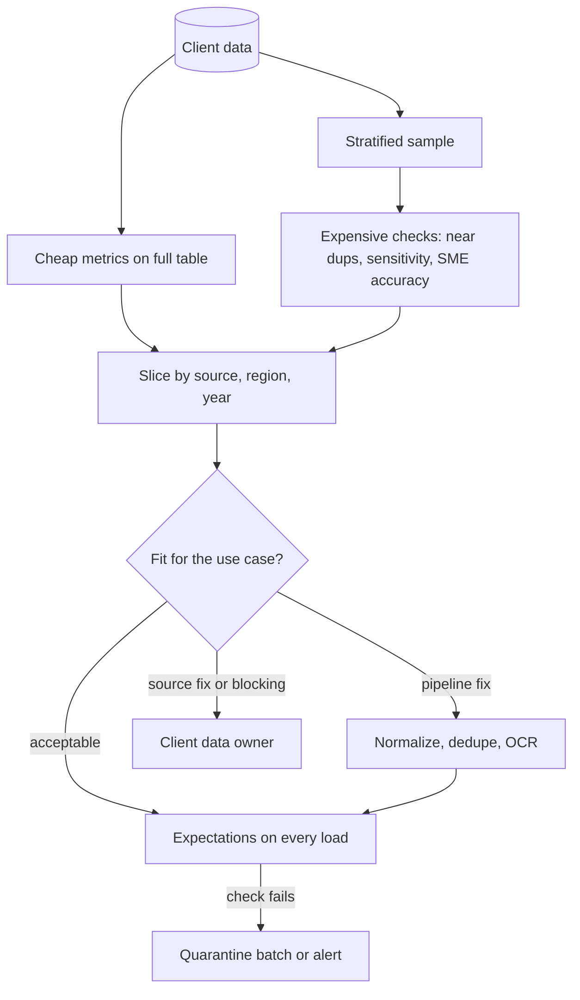

## TL;DR
Agents fail quietly on bad data. Profiling measures what a client's data contains (nulls, value sets,
formats, duplicates, freshness); assessment judges it against what the agent reads as usable, fixable or
blocking, and findings become checks on every load.

## For agent builders
- **Why it matters for agents.** A retrieval tool that returns "see email" or five drafts of one policy
  makes the agent hallucinate or cite the wrong version, and it looks like a model problem. Profiling
  the fields and documents behind each tool is how you tell a data failure from an agent failure.
- **Where it shows up in your stack.** The ingestion pipeline feeding the agent's index, metadata filters
  the retrieval tool applies, redaction before content reaches the model, and the eval set whose slices
  should mirror the profile's slices.
- **What you control.** Which fields each tool reads, placeholder registries that turn disguised nulls into
  real missing values, near-duplicate collapse before indexing, and load-time expectations that stop a bad
  batch reaching the agent.
- **What you can skip.** Full data-quality frameworks for fields no tool, filter or prompt ever reads.

## Why it exists
- **Schemas and documentation hide the quirks.** A column called `resolution_notes` is a text field; the
  schema does not say 40% of rows contain "see email", one region writes in French, or rows before a 2021
  migration are truncated at 255 characters. Documentation describes the system as designed, and the
  people who know the quirks are busy.
- **AI fails quietly on bad data.** A pipeline that crashes on a bad date gets fixed the same day. A
  retriever that indexes 30,000 empty notes returns them as top results, and a summarizer given "see
  email" invents a resolution; both look like model quality problems.
- **Eyeballing misses what matters,** which is distributional: the 11% null rate in one region, the
  duplicate records from a merge, the share of scanned PDFs.
- **Quality is fitness for a purpose, not absolute.** A field 30% null is irrelevant if the use case never
  reads it and blocking if it is the retrieval filter. Wang and Strong's framing of quality as defined by
  the data's consumers is the useful one.
- **What it buys:** measurements instead of impressions early, when findings change the plan cheaply, and
  a decision someone owns for every measurement.

## How it works
### What to profile in structured data
Per column:

| Metric | What it reveals |
|---|---|
| Type conformance | values that do not parse as the declared type |
| Null and empty rate | completeness |
| Distinct count and cardinality | free text vs codes; undocumented values |
| Top values and frequencies | dominant values, disguised nulls |
| Min and max; length distribution for text | out-of-range values, truncation |
| **Format patterns** | value shapes after replacing digits and letters with placeholders, e.g. `9999-99-99` versus `99/99/9999` for dates |

Across columns and tables:
- **Candidate key uniqueness.**
- **Referential integrity:** do child rows point to existing parents.
- **Functional dependencies** you rely on.
- **Exact and near duplicates.**
- **Freshness:** how old is the newest record, how often does it change.

Two checks that standard null counts miss:
- **Disguised missing values.** Placeholders that are not null: `N/A`, `-`, `0`, `1900-01-01`, `unknown`,
  "see email". They show as one value with suspiciously high frequency in the top-values list, or a date
  distribution with a spike on one day. Real completeness is the null rate *plus* their share.
- **Sensitivity scan.** Pattern and dictionary detection of emails, phone numbers, national ID formats,
  card numbers and names in free text tells you which fields need redaction or tighter handling before
  anything is indexed or sent to a model; free-text fields often hold identifiers the schema never
  declared.

### How big a sample
A sample can only report problems it contains.
- **Detection probability.** If a defect affects a share *p* of records, a random sample of *n* contains at
  least one with probability `1 − (1 − p)^n`, which is about `1 − e^(−np)`.

| Defect rate | Sample size | Chance the sample contains one |
|---|---|---|
| 0.1% | 2,000 rows | about 86% |
| 0.1% | 5,000 rows | over 99% |

- **The converse, the "rule of three":** if *n* rows show zero defects, the 95% upper bound on the true
  rate is roughly `3 / n`. A clean 5,000-row sample still allows up to about 0.06%.
- **Apply it per slice, not overall:** a stratum with 200 sampled rows can hide a defect rate up to about
  1.5%.
- **So run cheap metrics on the full table** and reserve the sample for checks that need human eyes or
  heavy compute.

### What to profile in document corpora
- **File type mix,** and the share of PDFs with a usable text layer versus image-only scans.
- **Encrypted or corrupt files;** page counts and sizes; languages; date range.
- **Exact duplicates by content hash** and near duplicates by shingling or MinHash (drafts, versions,
  forwarded copies).
- **Share of boilerplate** (signatures, disclaimers, templates).

These determine parsing routes, chunking and cost estimates.

### Slice everything
Compute every metric per meaningful slice (source system, region, year, department, document folder),
*because* aggregate numbers hide the problems: an overall 3% null rate can be 0% everywhere and 40% in
the one region the pilot serves.

### Assess against quality dimensions
| Dimension | Question for the use case |
|---|---|
| **Completeness** | are the fields the use case reads populated? |
| **Validity** | do values conform to type, format and allowed sets? |
| **Consistency** | do related fields and systems agree (a closed ticket with no close date)? |
| **Uniqueness** | are entities represented once? |
| **Timeliness** | is data fresh enough for the decisions it supports? |
| **Accuracy** | does the data match reality? |

Accuracy cannot be profiled; it needs a sample checked by the client's experts against ground truth,
*because* a perfectly formatted wrong value passes every automated test.

### From findings to decisions
Classify each finding:
1. **Acceptable.**
2. **Fixable in the pipeline:** normalize, deduplicate, route scans to OCR.
3. **Fixable only at the source:** the client's data owner must act.
4. **Blocking:** the use case cannot work without it.

The assessment names an owner for each and is shared with the client, because many fixes are theirs.

### Profile from the agent's point of view
Start from the agent, not the schema, because the use case defines fitness.
1. **List what each tool reads:** the fields a record tool returns, the metadata a retrieval tool filters
   on, the text that gets chunked and embedded.
2. **Profile exactly those, per slice the agent serves** (tenant, region, department).
3. **Translate findings into agent symptoms:** disguised nulls become invented answers, near duplicates
   become crowded-out retrieval results, a 37% null slice becomes "no information found" for one region.
4. **Mirror the slices in the agent's eval set,** so a weak slice in the profile shows up as a weak slice
   in the scores.
- **Tell the model what is missing.** Return placeholder values as explicit nulls in tool results, so the
  agent says "no resolution recorded" instead of reading "see email" as content.

### From one-off profile to continuous checks
- **Thresholds become expectations on every load:** null rate of `loss_date` below 2%, `status` within the
  agreed set, row count within a band of yesterday's.
- **Express them declaratively** with tools such as Great Expectations or dbt tests.
- **A failed check quarantines the batch or alerts,** *because* source-side changes (an upgrade, a new
  form, a renamed picklist) are a common cause of sudden AI quality drops.

## Diagram
Profiling runs per slice on the full table for cheap metrics and on a sample for expensive ones; each
finding gets a decision and an owner, and accepted thresholds become load-time checks in front of the
agent's index.



## Examples
### A sliced profiler for a ticket export
A compact profiler over a client's ticket export using pandas, sliced by region. It computes the
measurements that most often change an onboarding plan.

```python
import pandas as pd, re

def shape(v):  # format pattern: digits -> 9, letters -> A
    return re.sub(r"[A-Za-z]", "A", re.sub(r"\d", "9", str(v)))

def profile(df: pd.DataFrame, slice_col: str, key: str):
    report = {"rows": len(df), "dup_keys": int(df[key].duplicated().sum())}
    for col in df.columns:
        s = df[col]
        report[col] = {
            "null_pct": round(s.isna().mean() * 100, 1),
            "distinct": int(s.nunique()),
            "top": s.value_counts().head(5).to_dict(),
            "shapes": s.dropna().map(shape).value_counts().head(3).to_dict(),
        }
    report["null_pct_by_slice"] = (df.isna().groupby(df[slice_col]).mean() * 100).round(1)
    return report

df = pd.read_csv("tickets_sample.csv", dtype=str)
r = profile(df, slice_col="region", key="ticket_id")
print(r["dup_keys"], r["status"]["distinct"], r["opened_at"]["shapes"])
print(r["null_pct_by_slice"][["closed_at", "resolution_notes"]])
```

Illustrative output on a 5,000-row stratified sample, and the assessment it leads to:

| Finding | Decision |
|---|---|
| 212 duplicate `ticket_id` values (a past migration loaded one year twice) | deduplicate on key plus latest version (pipeline fix) |
| `status` has 23 distinct values against 8 documented | crosswalk the 23 statuses with the support lead (mapping) |
| `opened_at` has two shapes, `9999-99-99 99:99` and `99/99/9999 99:99` | parse dates per source once the order is confirmed (pipeline fix) |
| `resolution_notes` is 4% null overall but 37% null in the APAC slice | ask whether notes live in another system; a resolution assistant without resolutions is blocked there (source question) |

- **Slash dates hide their order.** The shape cannot reveal whether one source writes US `MM/DD` or
  European `DD/MM`, so you check for values with a first field above 12 and confirm with the source owner.
- **Disguised nulls show in `top`.** If "see email" is the most common `resolution_notes` value, the
  field's effective completeness is far below what `null_pct` reports.

### Sample sizing and disguised nulls in plain Python
A runnable helper: how many rows you need to see a rare defect, and the effective completeness once
placeholders are counted.

```python
import math
from collections import Counter

def rows_to_detect(p, confidence=0.95):
    return math.ceil(math.log(1 - confidence) / math.log(1 - p))

def rule_of_three_bound(n):
    return 3 / n                          # 95% upper bound when n rows show zero defects

print(rows_to_detect(0.001))              # 2995 rows for a 0.1% defect at 95%
print(f"{rule_of_three_bound(5000):.2%}") # 0.06%
print(f"{rule_of_three_bound(200):.1%}")  # 1.5% per 200-row slice

PLACEHOLDERS = {"", "n/a", "-", "0", "unknown", "1900-01-01", "see email"}
notes = ["see email"] * 40 + [None] * 4 + ["Reset VPN token"] * 30 + ["Replaced dock"] * 26
real = [v for v in notes if v is not None and v.strip().lower() not in PLACEHOLDERS]
print(f"null rate {notes.count(None) / len(notes):.0%}, "
      f"effective completeness {len(real) / len(notes):.0%}")   # 4% null, 56% complete
print(Counter(notes).most_common(1))      # [('see email', 40)] is the tell
```

### Agent scenario: linking eval failures to profile findings
A resolution-suggestion agent scores 81% on its 200-question eval overall. Splitting the failures by the
profile's slices (illustrative numbers):

| Slice | Eval pass rate | Profile finding behind it | Action |
|---|---|---|---|
| EMEA | 90% | none material | none |
| APAC | 52% | `resolution_notes` 37% null | source question: notes kept elsewhere? |
| Pre-2021 tickets | 64% | notes truncated at 255 characters | exclude from retrieval or mark truncated |
| All regions | (citations) | 212 duplicate `ticket_id` values | dedupe before indexing |

No prompt change would have fixed APAC; the profile shows the agent had nothing to retrieve.

## Production patterns
- **Baseline profile per tenant and source.** Use from onboarding on. Store the onboarding profile (per
  slice) as a versioned artifact and diff each new profile against it. Monitor per-slice null rate,
  distinct count and shape changes on the fields retrieval and prompts read.
- **Load-time expectations, warn first.** Use for every recurring load. Declare thresholds in Great
  Expectations or dbt tests, run them as warnings until their natural variance is known, then promote
  stable ones to blocking with quarantine. Monitor check failure rate and false-alarm rate.
- **Disguised-null registry.** Use for free-text and date fields. Keep a per-source list of placeholder
  values found during profiling and report effective completeness alongside the raw null rate. Monitor the
  placeholder share per load.
- **Sensitivity scan before indexing.** Use for any field or document sent to a model. Pattern and
  dictionary detection on a sample and on new loads, routing hits to redaction. Monitor detections per
  field, especially in fields the schema did not declare as sensitive.
- **SME accuracy review on a schedule.** Use where answers drive decisions. A small, structured sample per
  quarter or per source change, checked against ground truth by the client's experts. Monitor the share
  of sampled values rejected.
- **Eval slices aligned to profile slices.** Use for any agent over client data. Tag every eval question
  with the same slice keys the profile uses, and report pass rate per slice next to the slice's profile
  metrics. Monitor slices where a profile shift and an eval drop coincide.

## Trade-offs
- **Sample vs full scan.** Profiling a stratified sample is fast and cheap but can miss rare problems;
  profile the full dataset for cheap metrics (counts, nulls, key uniqueness) and use samples for expensive
  ones such as near duplicate detection and manual accuracy review.
- **Strict checks vs fresh data.** Strict load-time checks stop bad batches before they reach users, but
  every false alarm blocks fresh data; start as warnings, learn natural variance, then promote stable ones
  to blocking.
- **Pipeline fix vs source fix.** Fixing quality in your pipeline is fast and under your control, but hides
  the problem from the client and must be maintained forever; for errors that originate at entry, pushing
  the fix to the source costs more time now and less over the life of the deployment.
- **Automated metrics vs SME review.** Automated metrics scale across tenants but cannot measure accuracy;
  SME review of a sample is slow and expensive yet is the only way to learn whether correctly formatted
  data is actually right.

## Pitfalls
- **Reporting only aggregate metrics.** Symptom: a dataset judged healthy that fails badly for the one
  department or region the pilot serves. Fix: slice every metric.
- **Profiling once at onboarding and never again.** Symptom: a sudden quality drop months later traced to
  a source-side upgrade that renamed a picklist value. Fix: load-time expectations and baseline diffs.
- **Counting only true nulls.** Symptom: a field reported 98% complete whose most frequent value is `N/A`
  or `1900-01-01`, and prompts or filters that treat the placeholder as real data. Fix: a disguised-null
  registry.
- **Treating format validity as accuracy.** Symptom: clean-looking data that SMEs reject because values
  are stale, defaulted or entered into the wrong field. Fix: SME review of a sample.
- **Ignoring duplicates and near duplicates in document corpora.** Symptom: retrieval returning five
  versions of the same policy and answers citing an outdated draft. Fix: hash and MinHash before indexing.
- **A profile report with no decisions or owners.** Symptom: the same findings rediscovered in the pilot,
  after users have already seen the consequences. Fix: classify each finding and name an owner.
- **Tuning the agent's prompt for what is a data gap.** Symptom: weeks of prompt iterations that lift one
  slice and hurt another, while the failing slice simply has no content to retrieve. Fix: split eval
  failures by profile slice before touching the prompt.
- **Copying production data to a laptop to profile it.** Symptom: a security finding, because profiling
  exposes the most sensitive columns first. Fix: profile inside the approved environment.

## When to use
- **Profile every new source** during onboarding before mapping or building.
- **Profile again** whenever a source changes version, a new tenant joins on the same system, or AI quality
  drops without a model or prompt change.
- **Tie the profile to the use case:** start from the fields and documents the product reads and the
  slices users care about.
- **Measure:** per-slice null rates, quarantine counts and check failures over time.
- **Customer conversations:** a short written assessment with owners is often the most valuable artifact
  of the first weeks.
- **Interviews:** distinguishing profiling (measurement) from assessment (fitness for a purpose) is the
  point to make.

## Role lens
- **Engineer:** Writes the profiling job and the load-time expectations, slices metrics by source and
  region, and wires failed checks to quarantine and alerts instead of silent loads.
- **Architect:** Defines the quality dimensions and thresholds that gate production per use case, and
  decides which fixes belong in the pipeline versus at the client's source.
- **FDE:** Presents the assessment to the client's data owners, gets source-side fixes assigned, and
  arranges the SME sample review that measures accuracy.

## Check yourself
**Q:** Your RAG assistant's answer quality for one customer fell noticeably last month. No model,
prompt or code changed. How would you use profiling to investigate?
**A:** Compare the current data profile with the onboarding baseline, per slice. Check volumes first:
did a sync stop, or did ingestion double-load a period. Then per-field null rates, value sets and format
shapes on the fields retrieval and prompts use: a source upgrade may have renamed a status, moved notes
to a new field, or switched documents to scanned attachments with no text layer. Check duplicates and
freshness of the newest records. Any shift localized to a slice points to a source-side change. Then I
would add an expectation that would have caught it, so the next one quarantines a batch instead of
reaching users.

## Interview questions
### What is the difference between data profiling and quality assessment?
- **Profiling is measurement:** null rates, value sets, format shapes, duplicates and freshness, computed
  per slice.
- **Assessment is judgement against a purpose:** the same 30% null rate is irrelevant for an unused field
  and blocking for a retrieval filter, so each finding becomes acceptable, pipeline fix, source fix or
  blocking, with an owner.

### A field shows 2% nulls but your agent keeps inventing answers from what its tool returns. What do you check?
- **Disguised missing values:** look at the top values for placeholders like `N/A`, `-` or "see email"
  with suspiciously high frequency.
- **Recompute effective completeness** as nulls plus placeholder share, and add the placeholders to a
  per-source registry so filters and prompts treat them as missing.
- **Change the tool result:** return placeholders as explicit nulls, so the agent says "no resolution
  recorded" instead of building an answer around "see email".

### How big a sample do you profile, and what can a clean sample tell you?
- **Detection:** a sample of *n* catches a defect of rate *p* with probability `1 − (1 − p)^n`; a 0.1%
  defect needs roughly 3,000 rows for 95% confidence.
- **Upper bound:** zero defects in *n* rows bounds the true rate at about `3 / n`, so 5,000 clean rows
  still allow 0.06%, and a 200-row slice allows 1.5%.
- **So** cheap metrics run on the full table and samples are reserved for expensive checks.

### Your agent fails 48% of eval questions for one region. How do you decide whether to fix the prompt or the data?
- **Split failures by slice and read the traces:** if the retrieval tool returned empty, placeholder or
  truncated content, it is a data problem, and the profile for that slice should show it.
- **Fix data at its stage** (source question, pipeline fix, exclusion), re-run the eval slice, and only
  then tune the prompt on what remains.

### When would you fix quality at the source rather than in your pipeline?
- **When the error originates at data entry** and will keep recurring, such as a form that lets users skip
  a required field; a pipeline patch must then be maintained forever and hides the problem from the client.
- **Fix in the pipeline** when it is a stable format issue you can normalize reliably, such as known date
  formats per source.

### How would you turn an onboarding profile into production monitoring?
- **Convert thresholds into expectations** evaluated on every load, such as null rate of a key field below
  2% or status within the agreed set.
- **Start as warnings** to learn natural variance, then make stable checks blocking with quarantine.
- **Diff each load's per-slice profile against the baseline,** because source-side upgrades are a common
  cause of sudden AI quality drops.

## Quiz
### Q: Why should profiling metrics be computed per slice (region, source, year) rather than only overall?
- [ ] Sliced metrics are cheaper to compute
- [x] Aggregates can hide a severe problem concentrated in one slice the use case depends on
- [ ] Data quality tools require a slice column
- [ ] Overall metrics are always biased upward
> A 4% overall null rate can be 0% in most regions and 37% in one; if the pilot serves that region, the
> aggregate leads to a wrong go decision.

### Q: Which quality dimension cannot be established by automated profiling alone?
- [ ] Completeness
- [ ] Validity
- [ ] Uniqueness
- [x] Accuracy
> Profiling checks presence, format and consistency, but a well-formed wrong value passes all of them.
> Accuracy needs comparison against ground truth, usually SME review of a sample.

### Q: A field is 30% null. What determines whether that is a problem?
- [ ] Whether the null rate exceeds an industry-standard threshold
- [ ] Whether the column is indexed in the source database
- [x] Whether the use case reads that field, for example as a retrieval filter or prompt input
- [ ] Whether the nulls are stored as empty strings or as NULL
> Quality is fitness for purpose. A sparse field the product never uses is irrelevant; the same rate on
> a field used for filtering or answering can block the use case.

## Use cases & projects
### Use cases
- **Pre-launch checks for a RAG agent.** Profiling the fields and documents behind each tool finds
  disguised nulls, duplicates and scanned files before users see invented answers.
- **Debugging an agent quality drop.** Diffing the current profile against the baseline separates a
  source-side change from a model or prompt regression.
- **Designing the eval set.** Profile slices tell you which regions, years and document types the agent's
  eval questions must cover.
- **Guarding the index.** Load-time expectations quarantine bad batches before the agent can retrieve
  them.

### Mini project
**Profile, then explain an agent's failures (2 hours).**
- **Goal:** show that a retrieval agent's weak slice is caused by the data, using a profile and a sliced
  eval.
- **Steps:** generate a ticket dataset with a region slice that has many placeholder notes and duplicates;
  run the sliced profiler and the disguised-null check; index the notes and build a small agent that
  suggests resolutions; write 30 eval questions tagged by region; fix the data (placeholders to nulls,
  dedupe) and re-run.
- **Done when:** a table pairs per-slice pass rate with per-slice profile metrics before and after the
  data fix, with no prompt change in between.
