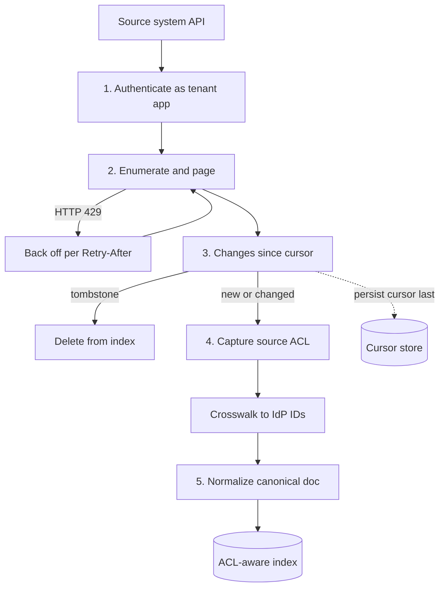

## TL;DR
A connector pulls content, metadata and permissions out of a system of record and keeps that copy
current, or lets an agent act in it. The hard parts are auth, rate limits, change, deletions and
permissions; missing one makes the assistant stale or leaky.

## Why it exists
- **Knowledge is scattered.** Enterprise knowledge lives in a dozen SaaS and on-prem systems (Salesforce,
  SAP, ServiceNow, SharePoint, Confluence, Jira, Slack, Teams), each with its own API, object model, query
  language, auth scheme and permission semantics.
- **Reach decides value.** A RAG assistant or agent is only as useful as the systems it can see, so "can it
  read our Confluence and Jira?" is usually the first question in a deal.
- **The naive script demos well and fails in production.** Authenticate with an admin token, page through
  everything, dump text into a vector store. It fails for four reasons:
  1. it reads with admin rights and discards source ACLs, so a junior employee gets a page from a
     restricted HR space;
  2. nightly full re-fetches burn API quotas the customer's other integrations also depend on, and get
     throttled;
  3. it never notices deletions, so documents removed for legal reasons keep surfacing;
  4. it hard-codes one tenant's quirks, so the second customer breaks it.
- **A connector is the disciplined version.** A repeatable contract for auth, enumeration, change
  tracking, permissions and normalization that every source implements.

## How it works
### The connector contract
Every connector implements the same five responsibilities, *because* the downstream pipeline (chunking,
embedding, ACL-aware retrieval, tool calling) should not care where a document came from:

1. **Authenticate** as an app registered in the customer's tenant (OAuth client credentials, a service
   account, or delegated user tokens), with the narrowest scopes that work.
2. **Enumerate** the containers in scope (sites, spaces, projects, channels, objects) and page through
   items, honouring pagination cursors and rate-limit responses (HTTP 429, `Retry-After`).
3. **Track change**: store a cursor (delta token, change-event replay ID, or `updated` watermark) so the
   next run fetches only what changed, including deletions.
4. **Capture permissions** alongside content: who can see this item, expressed as source principals that
   can later be resolved to users.
5. **Normalize** into a canonical document (id, source URL, title, body, author, timestamps, ACL, source
   metadata) so one indexing pipeline serves all sources.

### What differs per system
| System | Access and query | Change tracking | Permission model |
|---|---|---|---|
| Salesforce | SOQL over REST; Bulk API for large extracts, because per-record REST calls burn the org's API allocation | Change Data Capture events or `SystemModstamp` watermarks | Profiles, permission sets, role hierarchy, sharing rules |
| SAP | OData services (S/4HANA, SAP Gateway), RFC/BAPI calls, IDoc messages for async document exchange | Usually live calls rather than a synced corpus | Fine-grained authorization objects, enforced by calling SAP as the user |
| ServiceNow | Table API (incidents, knowledge articles, CMDB items) with encoded queries | Record update timestamps | ACLs scripted per table and field |
| SharePoint, Teams | Microsoft Graph | Drive and list items support delta queries returning changes and deletions since a token | Per site, library, folder and item, inheritance breakable at any level |
| Confluence, Jira | Atlassian REST with CQL and JQL | Query by `lastmodified` or `updated` | Space permissions plus page restrictions inheriting down the tree; Jira project permission schemes plus optional issue security levels |
| Slack | Web API (`conversations.history`, `conversations.replies`) for backfill | Events API for live changes | Channel membership, which changes often |

Per-system caveats that change the design:
- **Salesforce visibility is too complex to replicate faithfully**, so many connectors restrict scope to
  objects with simple sharing or check access at query time.
- **SAP data is structured transactional records, not prose**, so the connector is more often a tool an
  agent calls (look up an order, check stock) than a corpus to embed.
- **A ServiceNow service account's view is not a user's view**, because ACLs are scripted per table and field.
- **Teams messages may need approval.** Channel messages are in Graph, but some message-export APIs are
  classed as protected and require an approval or licensing step, so check before promising them.
- **Slack limits vary by app type.** It uses method-specific rate-limit tiers and has tightened
  history-read limits for some classes of apps (the 2025 changes for apps not distributed through its
  Marketplace). Check current limits before sizing a backfill. Private channels and DMs are visible only
  to apps added or granted the right scopes.

### From source principals to people
- **Each ACL is in the source's own vocabulary.** SharePoint and Teams use Entra object IDs plus SharePoint
  site groups; Confluence and Jira use Atlassian account IDs and groups; Slack uses its own user IDs and
  channel membership; Salesforce uses user IDs, roles and public groups. None is the sign-in identity.
- **Maintain a principal crosswalk.** Map source principal ID to the IdP's immutable user or group ID,
  built from each source's user directory API. Join on the IdP object ID where the source records it
  (Microsoft sources do), or on a verified email where it does not.
- **Expand groups.** Source-local groups are expanded to members, nested groups recursively, *because* the
  retrieval filter can only test identities it knows.
- **Model the special cases explicitly.** Sharing links ("anyone in the organization with the link",
  anonymous links) grant access to a scope, not a listed principal. Guest or external users have no IdP
  account. Neither may be dropped.
- **Fail closed.** A principal that resolves to nobody grants nothing; it must never be ignored in a way
  that widens access.

### Sizing the first crawl
The initial backfill, not the steady state, decides the project plan.

| Input (illustrative SharePoint tenant) | Value |
|---|---|
| Files | 2 million |
| Calls per file | 1 content download + 1 permissions call |
| Total requests | about 4 million |
| Sustained rate (illustrative; real one depends on throttling for your app and tenant) | 10 requests per second |
| Duration | 400,000 seconds, roughly four and a half days, plus every retry after a 429 |

Levers that follow from the arithmetic:
- **Batch where the API allows it.** Graph JSON batching groups up to 20 requests per call, though
  throttling still counts the individual requests.
- **Read permissions once per folder** whose inheritance is intact, instead of once per file.
- **Crawl the highest-value containers first**, so the pilot is useful before the crawl finishes.
- **Make the crawl resumable** by checkpointing per container.
- **Expect steady state to be cheap.** After the backfill, cost scales with the change rate, typically a
  small fraction of the corpus per day.

### Build, buy or use MCP
- **Buy** when unified-API vendors or the AI platforms' own connector catalogues cover the source.
- **Build** when you need permissions, fields or freshness they do not provide.
- **MCP for agent actions.** Wrapping each system as an MCP server gives a standard tool interface, but it
  does not remove any of the auth, quota or permission work above.

## Diagram
Every source runs the same five-step contract; only the cursor and the ACL vocabulary differ.



## Examples
### SharePoint library sync with Graph delta queries
The first call returns every item; later calls with the saved `deltaLink` return only changes, and
deleted items carry a `deleted` facet, which is how the connector removes them from the index.

```python
import time, requests

GRAPH = "https://graph.microsoft.com/v1.0"

def sync_drive(token: str, drive_id: str, saved_delta: str | None, index) -> str:
    """Pull changes since saved_delta into `index`; return the new delta link to persist."""
    url = saved_delta or f"{GRAPH}/drives/{drive_id}/root/delta"
    headers = {"Authorization": f"Bearer {token}"}
    while True:
        r = requests.get(url, headers=headers, timeout=30)
        if r.status_code == 429:                       # throttled: honour the server's hint
            time.sleep(int(r.headers.get("Retry-After", "10")))
            continue
        r.raise_for_status()
        page = r.json()
        for item in page["value"]:
            key = f"sharepoint:{drive_id}:{item['id']}"
            if "deleted" in item:
                index.delete(key)                      # deletions arrive as tombstones
            elif "file" in item:
                perms = requests.get(f"{GRAPH}/drives/{drive_id}/items/{item['id']}/permissions",
                                     headers=headers, timeout=30).json()["value"]
                index.upsert(key, {
                    "title": item["name"],
                    "url": item["webUrl"],
                    "modified": item["lastModifiedDateTime"],
                    # sharing links carry a "link" facet with a scope instead of a named principal
                    "acl": [p.get("grantedToV2") or p.get("grantedToIdentitiesV2")
                            or {"link": p.get("link", {}).get("scope")} for p in perms],
                })                                     # content download + parsing happens downstream
        if "@odata.nextLink" in page:
            url = page["@odata.nextLink"]              # more pages in this round
        else:
            return page["@odata.deltaLink"]            # persist; next run starts here
```

What the code commits to:
- **One permissions call per changed file.** Fine for incremental runs, expensive for a 2-million-file
  initial crawl, which is where batching and a separate permission-sync job come in. The permissions call
  also needs the same 429 handling as the delta call, omitted here for length.
- **Ordering makes it crash-safe.** The `deltaLink` is persisted only after the last page is processed, so
  a crash mid-round replays the round from the previous token. Upserts and deletes are idempotent by key,
  so replaying them is harmless.
- **Sharing changes are not fully reported.** By default a delta round surfaces content and metadata
  changes; a sharing change on a folder does not list every descendant whose effective access changed.
  Graph has request options for reporting sharing changes on business drives; without them, or in
  addition, run a periodic permission resync.

### Backfill planner: will the pilot be ready in time?
Plug in the item count, calls per item and the rate the source really gives you.

```python
def backfill_days(items, calls_per_item, rps, retry_overhead=0.0, perms_per_folder=None):
    """Days for an initial crawl. perms_per_folder: folder count if permissions are read per folder."""
    calls = items * 1                                   # content download per item
    calls += perms_per_folder if perms_per_folder else items * (calls_per_item - 1)
    seconds = calls * (1 + retry_overhead) / rps
    return round(seconds / 86_400, 1)

print(backfill_days(2_000_000, 2, 10))                        # 4.6  per-file permissions
print(backfill_days(2_000_000, 2, 10, retry_overhead=0.2))    # 5.6  with 20% retried after 429
print(backfill_days(2_000_000, 2, 10, perms_per_folder=50_000))  # 2.4  inheritance intact per folder
```

| Plan | Requests | Days at 10 req/s |
|---|---|---|
| Content + permissions per file | 4,000,000 | 4.6 |
| Same, 20% of calls retried after 429 | 4,800,000 | 5.6 |
| Permissions once per folder (50,000 folders, illustrative) | 2,050,000 | 2.4 |

The per-folder plan only holds where inheritance is intact; folders with broken inheritance still need
per-item reads.

## Production patterns
- **Persist the cursor after the batch commits.** For every container, write items first and the delta
  token or watermark last, in the same job step. Monitor sync lag (source change to searchable) and the age
  of each container's cursor.
- **Run permission sync on its own, faster cadence.** A separate job re-reads ACLs and group membership
  (Slack channels, Entra groups) more often than content, because access changes matter more than edits.
  Monitor permission-sync lag and unresolved-principal count.
- **Budget the customer's quota explicitly.** Agree a share of the API allocation with the customer's
  admins, throttle the crawler to it, and honour `Retry-After` on every call. Salesforce reports org API
  usage in a response header and a limits endpoint; Graph returns 429 with `Retry-After`. Monitor 429 rate
  and calls per sync.
- **Canary as a restricted test user.** Keep test users with known narrow access per source and run
  scheduled queries as them; any hit on a document they cannot open in the source is a P1. Monitor the
  permission-mismatch rate.
- **Reconcile deletions periodically.** Even with tombstones, list all live IDs per container on a slow
  schedule (weekly, say) and delete index entries the source no longer has. Monitor items deleted by
  reconciliation; a non-zero trend means the delta path is missing deletes.

## Trade-offs
- **Copy-and-index vs federated live search.** Your own index gives fast, rankable retrieval but creates
  a second copy whose permissions and freshness you must keep in sync. Federated search through source APIs
  avoids the copy and flips the cost to latency and per-query rate limits.
- **Service accounts vs delegated tokens.** Application-level service accounts make crawling simple but
  see more than any user, so you must replicate ACLs. Delegated user tokens enforce source permissions
  natively but see only one user's slice and stop working when the refresh token or consent is revoked.
- **Buy vs build.** A connector platform gets twenty sources quickly, but you inherit its permission
  fidelity and sync cadence. Building wins when one source is business-critical and needs field-level control.
- **Index-time vs query-time permissions.** Syncing permissions at index time makes queries cheap, but
  changes lag by one sync cycle. Checking access live is exact but adds a source API call per candidate
  document.

## Pitfalls
- **Crawling with an admin token and dropping ACLs.** Symptom: a user reports the assistant quoted a
  document they cannot open in the source system.
- **Nightly full re-fetches instead of delta cursors.** Symptom: HTTP 429s, and the customer's other
  integrations fail during your crawl window.
- **Ignoring deletions and permission removals.** Symptom: retrieval returns links that 404 or show
  "access denied" in the source.
- **Treating broken inheritance as rare in SharePoint or Confluence.** Symptom: a few sensitive folders
  indexed with their parent site's wider audience.
- **Joining users by display name or unverified email.** Symptom: ACL entries resolve to nobody (users see
  less than in the source) or to the wrong person after a name collision.
- **Dropping sharing-link permissions because they name no principal.** Symptom: documents shared "with
  the organization" are invisible to everyone, or, if mapped carelessly, visible to guests.
- **Promising a source before checking scope, approval or licence.** Teams messages, Slack DMs or a SAP
  module can need extra steps. Symptom: a blocked project in week three.

## When to use
- **Use when** an AI feature must read or act on a customer system more than once.
- **Pilot shortcut:** for a one-off pilot, an export file may be enough.
- **Production minimum:** delta sync, deletion handling and permission capture from day one, because
  retrofitting ACLs onto a populated index means re-crawling it.
- **Size before committing:** item count times calls per item divided by the sustained rate the source
  will actually give you.
- **Measure:** sync lag (source change to searchable), API calls per sync and share of the customer's
  quota, 429 rate, permission-mismatch rate from spot checks as restricted test users, unresolved-principal
  count, and items in error.
- **Interviews:** name the five responsibilities and explain how one specific source models permissions
  and change.

## Role lens
- **Engineer:** Implements the connector contract per source: OAuth app, paging with backoff, delta
  cursors persisted per container, tombstone handling and ACL extraction into the canonical document.
- **Architect:** Decides copy-and-index versus federated query per source, build versus buy, and where
  permission enforcement lives so every connector feeds one ACL-aware retrieval path.
- **FDE:** Gets the app registered and admin consent granted in the customer tenant, negotiates API quota
  with the customer's admins and verifies permissions on real restricted spaces before go-live.

## Check yourself
**Q:** A customer wants their assistant to answer from Confluence and Slack. Security asks how you prevent
a user from seeing content they cannot see in the source. What is your design?
**A:** Capture permissions as source principals during sync: Confluence space permissions plus inherited page
restrictions, Slack channel membership. Resolve principals to users through the customer IdP (groups via
SCIM or Graph) and store them on each chunk. At query time, filter retrieval by the requesting user's
resolved principal set before ranking, never after generation. Because Slack membership changes often, sync
membership more frequently than content, or check membership live for private channels. Log every answer's
source documents so access can be audited, and spot-check by querying as a restricted test user.

## Interview questions
### What are the core responsibilities of an enterprise connector, and why standardise them?
- **Five jobs:** authenticate as a tenant app, enumerate and page with backoff, track change with a cursor,
  capture permissions, and normalize into a canonical document.
- **Why standardise:** chunking, embedding, ACL-aware retrieval and tool calling then work identically for
  every source, so adding the ninth source is a connector, not a pipeline rewrite.

### Your first SharePoint crawl for a 2-million-file tenant is projected at five days. How do you shorten it?
- **Do the arithmetic first:** about 4 million calls at the sustained rate the tenant gives you, plus 429
  retries.
- **Cut calls:** read permissions per folder where inheritance is intact, and use Graph JSON batching where
  it helps, remembering throttling still counts each inner request.
- **Change the order, not just the speed:** crawl high-value sites first and checkpoint per container so a
  crash resumes instead of restarting.

### A user says the assistant quoted a document they cannot open. How do you debug it?
- **Find the chunk and its stored ACL**, then compare with the item's current permissions in the source.
- **Common causes:** admin-token crawl with no ACL, broken inheritance indexed with the parent's audience, a
  sharing link mapped too widely, or a permission removal not yet synced.
- **Fix the class, not the item:** add a restricted-user canary and a faster permission-sync job.

### When would you check permissions live at query time instead of syncing them?
- **When the model is too complex to replicate**, as with Salesforce sharing rules or ServiceNow scripted
  ACLs, or SAP authorization objects.
- **When membership churns fast**, as with Slack private channels.
- **Cost:** a source API call per candidate document, so it suits small candidate sets and sources with
  generous rate limits.

### Does wrapping a source as an MCP server solve integration?
- **It standardises the tool interface** an agent sees, which helps reuse across agents and hosts.
- **It does not remove** OAuth app registration, scopes, rate limits, change tracking or permission
  enforcement; the MCP server still has to implement all of them.

## Quiz
### Q: Why do production connectors use delta tokens or change events rather than nightly full crawls?
- [ ] Full crawls cannot read file contents
- [x] They fetch only changes and deletions, staying within API quotas and noticing removals
- [ ] Delta tokens make the content more accurate for embedding
- [ ] Source systems forbid full crawls after the first one
> A full crawl repeats work, competes for the customer's shared API allocation and cannot easily see what
> disappeared. Delta mechanisms return just the changes, including deletion tombstones, so the index stays
> fresh and consistent cheaply.

### Q: A connector indexes SharePoint using an app-only token with read access to all sites. What must it add to be safe?
- [ ] A higher rate limit so crawling finishes faster
- [ ] Encryption of the vector store at rest
- [x] Per-item permissions captured at sync and enforced as a retrieval filter for the requesting user
- [ ] A rule that only site owners may use the assistant
> An app-only token sees everything, so the index must carry each item's ACL, including broken inheritance,
> and filter by the user's principals. Encryption protects storage but does nothing about authorized users
> seeing too much.

### Q: Why is SAP more often integrated as an agent tool than as a document corpus?
- [ ] SAP has no API of any kind
- [ ] SAP data is always encrypted and cannot be read
- [x] Its data is structured transactional records with fine-grained authorization best enforced by calling SAP itself
- [ ] Embedding models cannot process German text
> Orders, materials and invoices are rows, not prose, and change constantly; querying them live through
> OData or BAPI calls returns current values and lets SAP's own authorization objects apply, which embedding
> snapshots would bypass.
