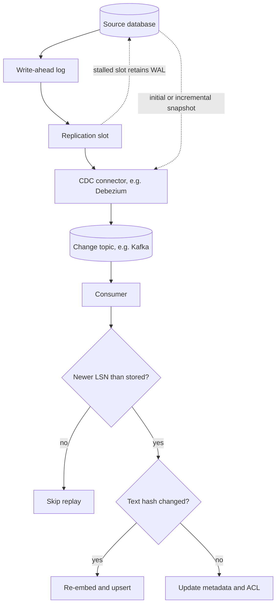

## TL;DR
Incremental sync copies only what changed; change data capture (CDC) reads every insert, update and
delete from the database log. Watermarks are simple but miss deletes and late commits, so the mechanism
you pick sets how fresh and costly an AI index is.

## Why it exists
- **The index is a derived copy of a moving source.** Tickets are edited, records reassigned, documents
  deleted for legal reasons, permissions revoked. Reloading on a schedule is fine for small sources.
- **Full reloads stop scaling.** Illustratively, a 2-million-record source where 0.5% of records change per
  day has about 10,000 changes daily. A nightly reload re-reads and potentially re-embeds 2 million records
  to apply them, about 200 times the necessary work, hammers source APIs, and still leaves up to 24 hours of
  staleness.
- **Reloads hide "what changed?"**, so downstream consumers cannot react to specific changes.
- **`updated_at > last_run` is where subtle bugs live:**
  - hard-deleted rows never match the query;
  - rows from transactions that commit after your run but carry an earlier timestamp are skipped forever;
  - rows sharing the boundary timestamp are dropped or duplicated;
  - bulk updates that bypass the application may not touch `updated_at` at all.
- **Incremental sync and CDC get changes, deletes included, completely and in a defined order.** Delta
  tokens move the bookkeeping to the source; log-based CDC sees every committed change, at the price of
  operating a replication pipeline.

## How it works
### The spectrum of mechanisms
| # | Mechanism | Deletes? | Cost and caveat |
|---|---|---|---|
| 1 | **Full snapshot plus diff**: reload and compare hashes | Yes | Correct, but cost scales with total size; fine for small or rarely changing sources |
| 2 | **Watermark queries**: `WHERE updated_at > :hw` | Only with a soft-delete column or tombstone table | Needs a reliable, database-maintained (not app-maintained) modified column with an index |
| 3 | **Source-provided change APIs** | Often reported | Tokens can expire, forcing a resync |
| 4 | **Trigger-based CDC**: triggers write each change to a changelog table | Yes | Adds write cost to every transaction on the source |
| 5 | **Log-based CDC**: read the write-ahead log | Yes | Every committed change, in commit order per table key, no polling load; you operate the pipeline |

Watermark mitigations, each with its reason:
- **Re-read an overlap window**, *because* transactions can commit after rows with later timestamps became visible.
- **Page by the tuple `(updated_at, id)`**, *because* many rows can share one timestamp.
- **Take the upper bound from the database clock**, not the worker's.

Source change APIs:
- **Examples:** Microsoft Graph delta tokens, Salesforce Change Data Capture events and
  `getUpdated`/`getDeleted` calls, Jira and Confluence `updated` queries with JQL/CQL.
- **Persist an opaque cursor per container**, *because* a token is only meaningful to the API that issued it.

Log-based CDC sources:
- **Logs:** PostgreSQL logical decoding via a replication slot, MySQL binlog, SQL Server CDC, Oracle redo via
  a supported tool.
- **Debezium** is the common open-source connector, publishing change events to Kafka with `before`, `after`
  and `op` (`c` create, `u` update, `d` delete, `r` snapshot read).

### What log-based CDC events actually contain
The log records what the database needs for replication, which is not always what a consumer expects:
- **The `before` image depends on `REPLICA IDENTITY`.** With the PostgreSQL default, an update or delete
  carries only the primary key as `before`. A consumer that needs old values (to remove a document from the
  right shard, say) must set `REPLICA IDENTITY FULL` and pay for larger log records.
- **Untouched TOASTed values may be placeholders.** Large out-of-line column values that an update did not
  touch may arrive as a placeholder, so a consumer that blindly writes `after` can overwrite a document body
  with it.
- **Transactions arrive as per-row events.** A consumer can observe a multi-row transaction half-applied
  unless it groups by transaction ID.
- **Schema changes flow through the same pipeline.** A renamed or retyped column changes the event shape,
  which is why CDC deployments usually pair with a schema registry and a consumer that tolerates added fields.
- **Delivery is at-least-once.** Every consumer is an idempotent upsert keyed by primary key, ideally guarded
  by the log position (LSN) so a replayed older event cannot overwrite a newer one.

### Snapshot, then stream
1. **Every incremental system starts with an initial snapshot**, then follows changes.
2. **The hand-off must not lose changes made during the snapshot.** Log-based tools record the log position
   before snapshotting and stream from it, so overlap is resolved by idempotent upserts.
3. **Avoid hours-long snapshot transactions.** A one-shot snapshot of a large table can hold a long-running
   read transaction on the source for hours.
4. **Use incremental snapshots.** Debezium reads the table in key-ordered chunks interleaved with the
   stream, using watermarks in the log to resolve conflicts between a chunk and concurrent changes (the
   approach described in Netflix's DBLog work), so a table can be re-snapshotted without pausing the stream.

### Applying changes downstream
- **Upsert by primary key; apply deletes as deletes** (remove chunks and embeddings).
- **Make application idempotent**, *because* every mechanism above can redeliver after a crash.
- **Hash-gate re-embedding**, *because* many updates touch only metadata, such as a status or assignee, not
  the text. Update metadata in place; re-embed only when the text changed.
- **Route permission changes through the same path**, or the index serves revoked content.

### Operating it
- **Persist cursors transactionally with the applied changes** (or after them, with idempotent replays).
- **Monitor lag:** for watermarks, now minus high-water mark; for CDC, consumer offset behind the log head.
- **Treat slot lag as a production alert.** A stalled PostgreSQL replication slot makes the server retain
  WAL, which can fill the source's disk.
- **Cap retained WAL where you can.** PostgreSQL 13+ offers `max_slot_wal_keep_size`, at the price of
  invalidating a slot that falls too far behind, which then forces a re-snapshot.

## Diagram
Snapshot first, then stream from the recorded log position; the consumer's LSN guard and hash gate keep
replays and metadata churn cheap.



## Examples
### Watermark sync with overlap, keyset paging and hash-gated re-embedding
A PostgreSQL table with soft deletes. `conn` is a psycopg connection; `index` is your vector store.

```python
import hashlib
from datetime import timedelta

OVERLAP = timedelta(minutes=10)  # illustrative; must exceed your longest write transaction

def sync_once(conn, state: dict, index, page: int = 500) -> None:
    hi = conn.execute("SELECT clock_timestamp()").fetchone()[0]  # DB clock; now() is frozen per txn
    cursor = (state["high_water"] - OVERLAP, "")              # overlap; "" sorts first for text ids
    while True:
        rows = conn.execute(
            """SELECT id, updated_at, deleted_at, title, body, acl FROM documents
               WHERE (updated_at, id) > (%s, %s) AND updated_at <= %s
               ORDER BY updated_at, id LIMIT %s""",
            (*cursor, hi, page)).fetchall()
        for doc_id, updated_at, deleted_at, title, body, acl in rows:
            if deleted_at is not None:
                index.delete(doc_id)                          # soft delete makes deletes visible
                continue
            digest = hashlib.sha256(body.encode()).hexdigest()
            if index.content_hash(doc_id) == digest:
                index.update_metadata(doc_id, title=title, acl=acl)  # no re-embedding needed
            else:
                index.upsert(doc_id, title=title, body=body, acl=acl, content_hash=digest)
        if len(rows) < page:
            break
        cursor = (rows[-1][1], rows[-1][0])                   # keyset: last (updated_at, id)
    state["high_water"] = hi                                  # persist only after a full pass
```

- **`clock_timestamp()` rather than `now()`** matters if the connection is reused inside one open
  transaction: `now()` returns the transaction's start time, so the upper bound would never advance.
- **Cost at five-minute runs:** the illustrative 10,000 daily changes cost a few tens of thousands of row
  reads (each changed row is re-read by every run whose 10-minute overlap window covers it, about three runs
  here), plus re-embedding only the subset whose text changed. The hash gate keeps the overlap cheap.
- **Starting id:** the `""` assumes text ids; with integer or UUID keys start from 0 or the nil UUID instead.
- **Still blind to hard deletes** that bypass `deleted_at`, which is the argument for log-based CDC or a
  periodic full key comparison.

### Applying Debezium-style change events safely
Pure Python, runnable. It guards by LSN, keeps a tombstone so a late update cannot resurrect a deleted row,
and never writes the unchanged-TOAST placeholder into the index.

```python
PLACEHOLDER = "__debezium_unavailable_value"   # Debezium's default placeholder for unchanged TOAST

def apply_change(index: dict, ev: dict) -> str:
    """Apply one Debezium-style change event idempotently, guarded by log position (LSN)."""
    op, lsn = ev["op"], ev["source"]["lsn"]
    key = (ev["after"] or ev["before"])["id"]          # default replica identity: before = key only
    current = index.get(key)
    if current and current["lsn"] >= lsn:
        return "skip: replayed or older event"
    if op == "d":
        index[key] = {"row": None, "lsn": lsn}          # tombstone keeps the LSN guard working
        return "delete chunks and embeddings"
    row = dict(ev["after"])
    for col, val in row.items():
        if val == PLACEHOLDER:                          # column untouched by this update
            if not (current and current["row"] and col in current["row"]):
                return "re-fetch row from source"       # never saw the value: do not write the marker
            row[col] = current["row"][col]
    index[key] = {"row": row, "lsn": lsn}
    return "upsert"

idx = {}
print(apply_change(idx, {"op": "r", "before": None, "source": {"lsn": 100},
                         "after": {"id": 7, "status": "open", "body": "long text"}}))   # upsert
print(apply_change(idx, {"op": "u", "before": {"id": 7}, "source": {"lsn": 140},
                         "after": {"id": 7, "status": "closed", "body": PLACEHOLDER}}))  # upsert
print(idx[7]["row"]["body"])                                                          # long text
print(apply_change(idx, {"op": "u", "before": {"id": 7}, "source": {"lsn": 120},
                         "after": {"id": 7, "status": "open", "body": "old"}}))         # skip
```

### Worked incident: a stalled replication slot
A consumer was decommissioned but its slot was left behind. Figures are illustrative.

| Quantity | Value |
|---|---|
| WAL generated by the source | 2 GB per hour |
| Free disk on the source volume | 50 GB |
| Time until the disk fills with no cap | about 25 hours |
| With `max_slot_wal_keep_size` set to 20 GB | slot invalidated after about 10 hours; the database is safe |
| Cost of the cap | the consumer must re-snapshot before streaming again |

The fix was a slot-lag alert at a fraction of free disk, a runbook to drop orphaned slots, and the cap as a
last line of defence.

## Production patterns
- **Alert on retained WAL per slot.** Query `pg_replication_slots` with
  `pg_wal_lsn_diff(pg_current_wal_lsn(), restart_lsn)` on a schedule and page well before it threatens free
  disk; agree the threshold with the customer's DBA. Monitor inactive slots as well as lagging ones.
- **Heartbeats for quiet databases.** On low-traffic sources, configure the connector's heartbeat (Debezium
  has `heartbeat.interval.ms`) so the slot's confirmed position keeps advancing. Monitor slot position age.
- **Schema registry plus tolerant consumers.** Register change-event schemas, ignore unknown added fields,
  and fail loudly on removed or retyped ones you depend on. Monitor consumer deserialization errors after
  every source migration.
- **Hash-gated re-embedding with a ratio metric.** Store a content hash per document and re-embed only when
  it changes. Monitor the re-embed ratio; near 1 on a metadata-heavy source means the gate is missing.
- **Periodic key and hash reconciliation.** Weekly, compare primary keys and content hashes between source
  and index, and repair drift. Monitor drift counts; non-zero trends point at a lost-delete or cursor bug.

## Trade-offs
- **Watermarks: no infrastructure vs trust.** They depend on a trustworthy `updated_at` and soft deletes.
  Move to log-based CDC when hard deletes, bulk updates or sub-minute freshness matter.
- **Log-based CDC: completeness vs operations.** It captures every committed change with minimal query load,
  but adds Kafka or a similar log, connector operations, schema-change handling and slot monitoring. It
  rarely pays off for one small table.
- **Source delta APIs: the only SaaS option vs vendor variance.** They handle deletes for you, but tokens
  expire and semantics vary per vendor, so you still need a full-resync path.
- **Wider overlap vs re-reads.** A wider window catches later-committing transactions but re-reads more rows
  each run; cheap with idempotent, hash-gated upserts and expensive without them.

## Pitfalls
- **`updated_at > last_run` with the worker's clock and no overlap.** Symptom: a small, steady number of
  records never appear in the index.
- **No delete path.** Symptom: the assistant cites documents deleted from the source weeks ago.
- **Re-embedding on every update.** Symptom: embedding cost tracks metadata churn, like ticket status
  changes, rather than content changes.
- **An abandoned PostgreSQL replication slot** after decommissioning a consumer. Symptom: the source
  database's disk usage climbs until the customer's DBA pages you.
- **Applying Debezium `after` images blindly** on a PostgreSQL source with default replica identity.
  Symptom: document bodies become a placeholder string after an unrelated metadata update, or deletes cannot
  be routed because `before` holds only the key.
- **Saving the cursor before changes are applied.** Symptom: changes lost permanently after a worker crash
  mid-batch.

## When to use
- **Full reloads:** small sources and early pilots.
- **Watermark or source delta sync:** once reload cost or staleness hurts, insisting on a delete mechanism.
- **Log-based CDC:** when you own or can access the database, need every change including hard deletes, or
  need low lag, and when someone will operate the pipeline.
- **Always:** keep a periodic full reconciliation.
- **Measure:** sync lag, changes applied per run, re-embed ratio (re-embeds over changes; a ratio near 1 on a
  metadata-heavy source means the hash gate is missing), deletes applied, replication-slot retained WAL for
  log-based CDC, and drift found by reconciliation (keys or hashes that differ between source and index).
- **Interviews:** explain why naive watermarks miss changes and how CDC avoids it; that is the expected depth.

## Role lens
- **Engineer:** Implements cursors, overlap windows, keyset paging, idempotent upserts with hash-gated
  re-embedding, and delete propagation into the vector index.
- **Architect:** Picks the mechanism per source (reload, watermark, delta API, log-based CDC), defines
  freshness targets and owns the snapshot-to-stream and full-resync strategies.
- **FDE:** Negotiates with the customer's DBA for replica access or a replication slot, confirms how deletes
  are recorded, and agrees on monitoring so CDC never threatens their database.

## Check yourself
**Q:** A sync uses `WHERE updated_at > :last_run` every five minutes. A few records modified during busy periods
never appear in the index, and deleted records never disappear. Explain both and fix them.
**A:** Missing records: `updated_at` is set when the write happens (with `DEFAULT now()`, at transaction start,
even earlier), but the row becomes visible only when its transaction commits. A long transaction can commit after the sync advanced past that timestamp, so the row is
skipped forever; worker clock skew and shared boundary timestamps make it worse. Fix with the database clock
for the upper bound, an overlap window longer than the longest transaction, keyset paging on `(updated_at,
id)`, and idempotent upserts. Deleted records: hard deletes leave no row to match. Fix with soft deletes or a
tombstone table, or move to log-based CDC, which emits delete events, plus periodic key reconciliation.

## Interview questions
### Compare watermark sync, source delta APIs and log-based CDC.
- **Watermarks** need no infrastructure but trust `updated_at`, miss hard deletes and late commits without
  overlap and soft deletes.
- **Delta APIs** are the only option for SaaS sources and often report deletes, but tokens expire and
  semantics vary per vendor.
- **Log-based CDC** sees every committed change including deletes, at the cost of operating slots,
  connectors, a log and schema changes.

### After a metadata-only update, some indexed documents show a strange placeholder as their body. Why?
- **Unchanged TOASTed columns** can arrive in Debezium `after` images as a placeholder rather than the value.
- **The consumer wrote `after` blindly**, replacing the real body.
- **Fix:** keep the stored value when a column carries the placeholder, re-fetch when you never had it, or set
  `REPLICA IDENTITY FULL` if the larger log records are acceptable.

### When is log-based CDC not worth it?
- **One small table**, or a source that changes rarely: a full reload or watermark is simpler.
- **No one to operate it:** slots, connector upgrades and schema changes are ongoing work.
- **No database access:** for SaaS systems the vendor's delta API is the only path anyway.

### How would you size and protect a replication slot on a customer's production database?
- **Estimate WAL rate** and free disk to find how long a stalled consumer can survive.
- **Alert on retained WAL** per slot well before that, and on inactive slots.
- **Cap it** with `max_slot_wal_keep_size` on PostgreSQL 13+, accepting that an invalidated slot forces a
  re-snapshot.

### Why must the snapshot-to-stream hand-off record a log position first?
- **Changes keep happening during the snapshot.** Recording the position first and streaming from it means
  none are lost.
- **Overlap is then harmless** because upserts are idempotent and guarded by LSN.

## Quiz
### Q: Why can a watermark query on updated_at miss rows even with a correct clock?
- [ ] Indexes on timestamps are approximate
- [x] A row can carry a timestamp earlier than the watermark but commit and become visible after the sync ran
- [ ] PostgreSQL does not store microseconds
- [ ] Rows with NULL ids are skipped
> The timestamp reflects when the write happened, not when it committed. A late commit lands behind an
> already-advanced watermark, which is why overlap windows or log-based CDC are needed.

### Q: What does log-based CDC capture that a soft-delete-free watermark query cannot?
- [ ] Rows inserted in the last minute
- [x] Hard deletes, as explicit delete events from the transaction log
- [ ] Changes to columns with indexes
- [ ] Rows larger than one page
> Deleted rows leave nothing to match a query, but the log records the delete, so CDC emits an event (op d in
> Debezium) that the consumer applies to the index.

### Q: An index re-embeds a document whenever its row changes. Most changes are status updates. What fixes the cost?
- [ ] Switch to a larger embedding model
- [ ] Sync less often so changes are batched
- [x] Compare a content hash and update metadata in place unless the text changed
- [ ] Delete and re-insert every changed document
> Embeddings depend on text, so metadata-only changes should update filters like status or ACL without calling
> the embedding model; batching reduces frequency but not the wasted re-embeds.
