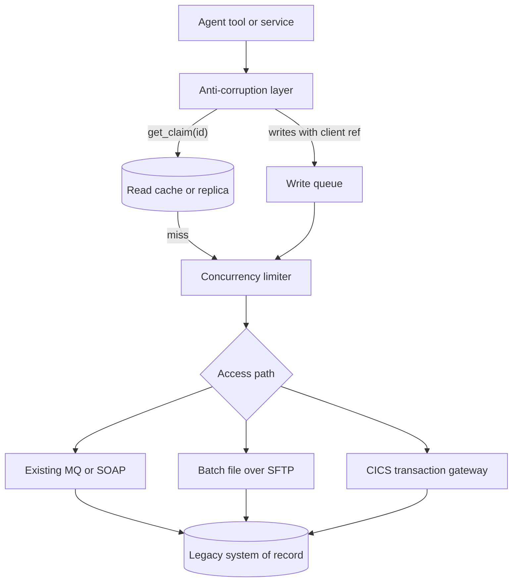

## TL;DR
Enterprise agents often need a mainframe or old ERP with no modern API that cannot be changed
or overloaded. Back agent tools with an anti-corruption layer that uses the least invasive access
path and translates legacy codes, so quirks stop at one boundary.

## For agent builders
- **Why it matters for agents.** "What is the status of claim 4471?" and "raise a return for this order"
  are tool calls that end in a legacy system. Agents call faster, retry more eagerly and loop more than
  humans at terminals, so an unprotected legacy tool turns one confused agent into an outage.
- **Where it shows up in your stack.** Behind your function tools or MCP server: a domain operation such as
  `get_claim(id)`, a concurrency limiter, a read cache, a write queue with client references, and a batch
  calendar the tool checks before calling.
- **What you control.** Which access path each tool uses, what the tool returns to the model (named states,
  never raw codes like `07`), how timeouts are reported (in-doubt, not failed), and the agent-visible
  message during maintenance windows.
- **What you can skip.** Writing COBOL or CICS programs. You need to read a copybook, decode `COMP-3`, apply
  Little's law and make writes idempotent; the legacy owners run the rest.

## Why it exists
- **The system of record is old and staying.** In most large enterprises policies, accounts, claims or
  inventory live in mainframes, AS/400s, old ERPs or in-house databases. They work, they are audited, and
  nobody will rewrite them for your assistant.
- **Only they can answer.** "What is the status of claim 4471?" or "raise a return for this order" can only
  be answered by that system.
- **Ad-hoc SQL on production competes for capacity.** It fights the batch jobs and online transactions the
  system was sized for, and on a mainframe CPU consumption can translate directly into the customer's
  software bill.
- **Writing to its tables corrupts state.** It bypasses business rules that live in application code, in
  ways nobody notices until month-end.
- **Copying its model spreads legacy semantics.** Cryptic eight-character field names, status code `07` and
  dates as `YYDDD` leak everywhere, so every later change touches every consumer. Treating it like a cloud
  API (retry instantly, call per user request, expect sub-second latency) collides with nightly batch
  windows, single-threaded transaction monitors and maintenance freezes.

## How it works
### 1. Choose the access path, least invasive first
Ordered roughly from safest to riskiest, *because* each step down couples you (and every agent tool) more
tightly to internals:

| Path | What it is | Why choose or avoid |
|---|---|---|
| **Existing interface** | A SOAP service, an MQ queue (IBM MQ is common on mainframes), a published batch extract, or an ESB/iPaaS flow someone maintains | Reusing it inherits its rules and its support |
| **Batch file exchange** | Fixed-width or delimited files over SFTP on a schedule | Crude but decoupled: the legacy side controls load, and files are replayable |
| **Read replica or CDC** | Read a replica, or capture changes from the database log | Reads never touch the primary; writes still go through the application |
| **Transaction wrappers** | Expose an existing transaction program (for example a CICS transaction) through a gateway | Business rules still run on writes |
| **Screen automation (RPA)** | Drive the green-screen or desktop UI | Last resort *because* any UI change breaks it, but sometimes the only path that runs full validation |

### 2. Build an anti-corruption layer
A translation service owned by your side converts legacy records into your canonical model and back:
- **Decodes encodings:** EBCDIC, COBOL `COMP-3` packed decimal, implied decimal points.
- **Maps codes to named states**, and normalizes dates and time zones, so the model reads "pending
  assessor review" instead of guessing what `07` means.
- **Exposes domain operations** such as `get_claim(id)`, hiding access-path details.
- **Is the only interface consumers see, including LLM tools**, *because* when the legacy system is
  eventually replaced, only this layer changes and the agent's tool schemas stay put.

Two encoding traps cause most "the numbers are wrong" incidents:
1. **Zoned signs.** Signed numeric fields stored as display digits (`PIC S9(5)V99` without `COMP-3`) carry
   the sign in the zone half of the last byte. After conversion the final character looks like a letter or
   brace rather than a digit.
2. **Mixed records converted as text.** Text fields beside packed binary fields must be transferred as
   binary and decoded field by field from the copybook, *because* a transfer step that converts the whole
   file from EBCDIC to ASCII rewrites the packed bytes as characters and destroys them without any error.

### 3. Protect the legacy system from the agent
- **Cache or replica in front of reads, a queue in front of writes**, and explicit concurrency limits
  everywhere.
- **Size the limit with Little's law:** concurrent calls = arrival rate × call latency.
- **Worked number:** an illustrative 20 lookups per second at 1.5 seconds per legacy transaction means
  about 30 calls in flight. If operations allows 10 concurrent sessions, you must cache, batch, or shed load,
  *because* the gateway will otherwise queue requests until user-facing timeouts fire and retries make it worse.
- **Agents amplify load.** One user question can fan out into several tool calls, and a model that sees an
  error often retries the same call, so budget legacy calls per agent session as well as per second.
- **Respect batch windows.** Schedule bulk extracts when the system says, and make agent tools return
  "system unavailable, try after 06:00" rather than hammering it.

### 4. Make writes safe
A timeout on a legacy transaction has three possible meanings, and legacy transactions are rarely idempotent:

| Meaning | Is a blind retry safe? |
|---|---|
| The request never arrived | Yes |
| It ran and the reply was lost | No: duplicate write |
| It is still running | No: duplicate write |

So:
1. **Attach a client reference** to every write and record it in your own store before sending.
2. **Put it in a field the legacy system persists and can be queried by** (a customer reference or batch
   reference field, agreed with the system's owners).
3. **After a timeout, look the reference up before retrying**; if it exists, the write happened.
4. **No queryable field?** Route writes through a single queue consumer and confirm them against the next
   extract, *because* only reconciliation can then tell you which in-doubt writes landed.
5. **Tell the model the truth.** The tool result says "applied", "scheduled" or "in doubt, reference X", so
   the agent never tells a customer a change is done when it is only queued.

### 5. Migrate incrementally if replacing
- **Strangler fig:** route one capability at a time from the legacy system to the new one behind a facade,
  *because* big-bang rewrites of systems with decades of undocumented rules routinely fail. The agent's
  tools sit on the facade, so they survive the migration.

## Diagram
Agent tools only ever see domain operations; protection and translation sit between them and the legacy system.



## Examples
### Decoding a fixed-width EBCDIC extract
A nightly SFTP extract contains fixed-width 30-byte records in EBCDIC: customer id `PIC X(10)`, name
`PIC X(16)`, balance `PIC S9(5)V99 COMP-3` (seven digits plus a sign nibble = 4 bytes, two implied
decimals). The anti-corruption layer decodes it into a typed record the agent's lookup tool can return.

```python
from decimal import Decimal
from dataclasses import dataclass

@dataclass
class Customer:
    customer_id: str
    name: str
    balance: Decimal

def unpack_comp3(raw: bytes, scale: int) -> Decimal:
    """COBOL packed decimal: two digits per byte, last nibble is the sign (C/F positive, D negative)."""
    nibbles = []
    for b in raw:
        nibbles += [b >> 4, b & 0x0F]
    sign = nibbles.pop()                       # final nibble
    if sign < 0x0A or any(n > 9 for n in nibbles):   # A-F are signs, 0-9 digits
        raise ValueError(f"corrupt packed field {raw.hex()}")
    value = int("".join(map(str, nibbles)))
    if sign in (0x0B, 0x0D):                   # D preferred negative, B alternate
        value = -value
    return Decimal(value).scaleb(-scale)

def parse_record(rec: bytes) -> Customer:
    assert len(rec) == 30, len(rec)
    return Customer(
        customer_id=rec[0:10].decode("cp037").strip(),   # cp037 = EBCDIC US/Canada
        name=rec[10:26].decode("cp037").strip(),
        balance=unpack_comp3(rec[26:30], scale=2),
    )

# 12345.67 packs to 12 34 56 7C; -1.50 packs to 00 00 15 0D
assert unpack_comp3(bytes.fromhex("1234567C"), 2) == Decimal("12345.67")
assert unpack_comp3(bytes.fromhex("0000150D"), 2) == Decimal("-1.50")
```

- **Wrong decoding fails silently.** Reading the file as UTF-8 raises decode errors or produces garbage
  names. Worse, treating the packed bytes as text (or decoding them with `cp037`, which maps every byte to
  some character) silently produces plausible-looking wrong balances that an agent will quote.
- **So the layout comes first.** The COBOL copybook is the first artifact to request from the customer.

### Idempotent write tool for an in-doubt timeout
The reference is recorded before sending and looked up after a timeout, so a lost reply never becomes a
second write even if the agent calls the tool again. The fake gateway applies the write and then loses the
reply once.

```python
import uuid

class LegacyTimeout(Exception):
    pass

def update_contact(pending: dict, gateway, claim_id: str, address: str) -> str:
    ref = uuid.uuid4().hex[:12].upper()            # client reference, agreed field width
    pending[ref] = (claim_id, address)             # 1. record BEFORE sending
    for _ in range(3):
        try:
            gateway.send(claim_id, address, ref)   # 2. ref goes in a field the system persists
            break
        except LegacyTimeout:
            # 3. wait out the transaction's max run time (not shown), then look before retrying
            if gateway.find_by_reference(ref):
                break                              # it ran; only the reply was lost
    else:
        return f"in-doubt {ref}: confirm against next extract"
    del pending[ref]
    return f"applied {ref}"

class FakeGateway:                                 # applies the write, then loses the reply once
    def __init__(self):
        self.rows, self.lose_reply = {}, True
    def send(self, claim_id, address, ref):
        self.rows[ref] = (claim_id, address)
        if self.lose_reply:
            self.lose_reply = False
            raise LegacyTimeout()
    def find_by_reference(self, ref):
        return ref in self.rows

gw, pending = FakeGateway(), {}
print(update_contact(pending, gw, "CLM4471", "1 New St"))
print(len(gw.rows), pending)                       # 1 {}: applied once, nothing in doubt
```

- **The string goes back to the model.** "in-doubt" tells the agent to report a pending change and stop,
  rather than calling the tool a fourth time.
- **Key the agent's retries too.** If the agent framework retries a whole tool call, pass a stable
  idempotency key from the agent step so the second call reuses the first reference.

### Worked capacity check with Little's law
Agent lookups against a claims mainframe that allows 10 concurrent sessions (illustrative figures).

| Scenario | Arrival rate to legacy | Latency | In flight | Fits 10? |
|---|---|---|---|---|
| Every lookup hits the mainframe | 20/s | 1.5 s | 30 | No |
| Read cache absorbs 70% of lookups | 6/s | 1.5 s | 9 | Yes, barely |
| Cache plus batching 2 lookups per call | 3 calls/s | 1.5 s | 4.5 | Yes, with headroom |

The cache is the lever, because latency is fixed by the legacy system and arrival rate is the only thing
you control. An agent that averages 2.5 claim lookups per conversation turns 8 user questions per second
into those 20 lookups per second, so per-session caching of the same claim matters as much as the shared cache.

## Production patterns
- **Bulkhead the legacy calls.** Wrap every call in a limiter sized to the session count operations agrees
  (for example `asyncio.Semaphore(10)` per gateway in Python), and fail fast with a clear message when it is
  full. Monitor in-flight calls, queue wait time and rejections.
- **Maintenance-aware tools.** Keep the batch and maintenance calendar in config and check it before calling,
  so agent tools answer "system unavailable, try after 06:00" during the window. Monitor calls attempted
  inside windows (should be zero).
- **Per-session tool budgets.** Cap legacy calls per agent conversation and return a "limit reached"
  result the model can explain, because a retry loop in one session can consume the shared session pool.
  Monitor calls per session at p50 and p99.
- **Binary transfer plus copybook-driven parsing.** Move mixed files without code-page conversion (FTP in
  binary mode, or SFTP, which does not convert), then decode per field from the copybook. Quarantine records
  that fail validation and alert on parse rejects per extract.
- **Reference-tagged writes with daily reconciliation.** Every write carries a client reference; a daily job
  matches pending references against the next extract and pages on any still in doubt. Monitor in-doubt
  writes and how they resolved.
- **Status-code translation table, owned and versioned.** Keep the mapping from codes like `07` to named
  states in one reviewed table in the anti-corruption layer, and fail on unknown codes rather than passing
  them through to the model. Monitor unknown-code counts.

## Trade-offs
- **Batch files: decoupled vs stale.** Files are decoupled and replayable, but data is as stale as the last
  extract. It flips to CDC or a queue when users need answers about changes made in the last hour, and the
  agent must say how old its data is.
- **Replica: protects the primary vs lag.** Replication lag means a just-submitted transaction may be
  invisible; read-your-writes flows (the agent writes, then reads back to confirm) must query the primary or wait.
- **Screen automation: reach vs fragility.** It reaches logic no API exposes, but breaks on any UI change and
  is slow. Acceptable only when volumes are low and a proper interface is on the roadmap; computer-use agents
  do not change that trade-off.
- **Anti-corruption layer: a service to run vs leaked semantics.** Without it every consumer, including
  every prompt, learns legacy codes; it stops paying off only for a single throwaway consumer.

## Pitfalls
- **Querying production during the batch window.** Symptom: the nightly job overruns and operations asks
  who is running unplanned queries. Fix: a maintenance-aware tool.
- **Wrong code page or ignored packed decimals.** Symptom: mojibake in names or balances off by orders of
  magnitude.
- **Retrying non-idempotent writes on timeout.** Symptom: duplicate orders or payments discovered at
  reconciliation.
- **Raw legacy codes as tool output.** Symptom: the model guesses what status `07` means and confidently
  tells a customer the wrong thing. Fix: map to named states in the layer.
- **Text-mode transfer of mixed text-and-packed files**, or a gateway converting code pages for the whole
  record. Symptom: names look fine while numeric fields are garbage or fail validation.
- **Assuming 24/7 availability.** Symptom: agent tools fail every night during maintenance with unhelpful
  error messages, and the agent retries them.

## When to use
- **Use when** an AI feature or agent tool must read from or write to a system you cannot change.
- **Ask first, code second:** existing interfaces, the batch schedule, the record layouts and the capacity
  constraints.
- **Release order:** read-only tools first; add write tools only through a path that runs the system's own
  business rules, with idempotency references and, for consequential writes, human approval.
- **Measure:** data freshness against the batch schedule, load on the legacy system (calls, concurrency, CPU
  where the owners can report it), in-doubt writes and how they resolved, parse rejects per extract, and
  reconciliation mismatches.
- **Interviews:** explain why you would not point an agent at the mainframe database directly, and what you
  would do instead; that is the core signal.

## Role lens
- **Engineer:** Writes the anti-corruption layer: copybook-driven parsers, code-to-state mappings,
  idempotent write wrappers and concurrency limits around legacy calls.
- **Architect:** Chooses the access path per capability, sets the boundary where legacy semantics stop,
  and plans strangler-style replacement rather than coupling new AI features to internals.
- **FDE:** Finds the person who knows the batch schedule and copybooks, gets SFTP or MQ access approved,
  and validates parsed records against what the legacy screens show.

## Check yourself
**Q:** An insurer wants an agent that can update a claim's contact address. The claims system is a mainframe
with no API, a nightly batch and a green-screen UI. How do you approach it?
**A:** First look for an existing interface: an MQ-fed transaction, a CICS transaction exposed through a
gateway, or a batch update file the system already ingests. Any of these runs the system's own validation.
Prefer them over direct table writes, which bypass rules, and over screen automation, which is brittle.
Wrap the chosen path in an anti-corruption layer with a domain operation like `update_contact(claim_id,
address, ref)`, record the reference before sending and, after a timeout, look it up in the claims system before
retrying, so an in-doubt write is never applied twice, and queue requests so the
agent never overloads the system or calls during batch. If only a nightly file exists, make the agent say
the change is scheduled, not done.

## Interview questions
### What is an anti-corruption layer and why put one in front of a legacy system?
- **Definition:** a translation service you own that decodes legacy formats, maps codes to named states and
  exposes domain operations like `get_claim(id)`.
- **Why:** legacy semantics stop at one boundary, so consumers (including LLM tools) never learn status
  codes or copybook layouts, and replacing the legacy system later changes only this layer.

### Balances from a new mainframe extract are wildly wrong but names look fine. How do you debug it?
- **Suspect the transfer first:** a text-mode transfer or gateway converting the whole record from EBCDIC
  to ASCII rewrites packed `COMP-3` bytes without any error.
- **Check against the copybook:** confirm field offsets, `COMP-3` versus zoned display digits, and implied
  decimals.
- **Fix:** transfer as binary, decode field by field, and validate nibbles so corruption raises instead of
  producing plausible numbers.

### An agent tool needs 20 lookups per second but the mainframe allows 10 sessions at 1.5 s each. What do you do?
- **Little's law:** 20 × 1.5 = 30 calls in flight, three times the limit.
- **Levers:** a read cache or replica, batching lookups, nightly extracts for data that tolerates staleness,
  and load shedding with a clear message.
- **Never** just raise timeouts and retry, because that grows the queue and the retries make it worse.

### When would you accept screen automation, and when would you refuse it?
- **Accept** when volumes are low, it is the only path that runs full validation, and a proper interface is
  on the roadmap.
- **Refuse** for high-volume or latency-sensitive paths, because any UI change breaks it and it runs at
  human interaction speed.

### How do you make a write to a non-idempotent legacy transaction safe to retry?
- **Client reference recorded before sending**, carried in a field the system persists and can be queried by.
- **After a timeout, look it up before retrying**, because the request may have run with the reply lost, or
  still be running.
- **No queryable field:** single queue consumer plus reconciliation against the next extract.

### Your agent keeps calling a legacy lookup tool after it times out, and operations complain. How do you fix the agent side?
- **Return a structured result, not an exception string.** "System busy, retry not useful for 10 minutes"
  or "in maintenance until 06:00" gives the model a reason to stop.
- **Enforce a per-session budget in the runtime**, so the model cannot exceed N legacy calls whatever it
  decides.
- **Cache per conversation** so the same claim is fetched once, and trace tool calls per session to find
  prompts that trigger loops.

## Quiz
### Q: Why is screen automation usually the last-resort integration path?
- [ ] It cannot read data, only write it
- [x] Any UI change breaks it and it is slow, even though it does run the application's business rules
- [ ] Mainframes do not allow terminal sessions
- [ ] It requires rewriting the legacy application
> Driving the UI does pass through full validation logic, which is its appeal, but it couples you to screen
> layouts that change without notice and runs at human interaction speed, so it suits low volumes only.

### Q: What is the main purpose of an anti-corruption layer?
- [ ] To encrypt legacy data before it leaves the data centre
- [ ] To replace the legacy system with a modern one
- [x] To translate the legacy model into your own so legacy semantics do not spread into every consumer
- [ ] To filter malicious prompts before they reach the mainframe
> The layer decodes formats, maps codes to named states and exposes domain operations, so only it changes
> when the legacy system changes or is replaced; replacement itself is the strangler fig's job.

### Q: A packed-decimal balance field is read as text. What is the most likely outcome?
- [ ] An exception is always raised immediately
- [ ] The value is correct but loses its sign
- [x] Garbled or plausible-but-wrong values flow through unless the parser validates the field
- [ ] The database rejects the record
> Packed decimal stores two digits per byte plus a sign nibble, so text decoding yields nonsense characters
> or numbers that look valid; explicit COMP-3 decoding with nibble validation is required.

## Use cases & projects
### Use cases
- **Insurance claims agents.** Look up claim status and update contact details through a CICS gateway,
  with client references on every write.
- **Order and returns agents on old ERPs.** Read order state from a replica; raise returns through the
  existing MQ interface so business rules run.
- **Banking assistants over nightly extracts.** Answer balance and transaction questions from parsed
  EBCDIC files, stating the as-of time.
- **Strangler migrations.** Agent tools sit on a facade that routes each capability to the old or new
  system as it migrates.

### Mini project
**Protected legacy lookup tool for an agent (2-3 hours).**
- **Goal:** give a tool-calling agent a `get_customer` tool backed by a fake slow legacy system that allows
  only 3 concurrent calls.
- **Steps:** generate a fixed-width EBCDIC fixture with `COMP-3` balances and parse it; wrap a fake gateway
  with 1.5-second latency in a semaphore, a read cache and a maintenance calendar; map status codes to named
  states; run 20 concurrent agent conversations against it.
- **Done when:** in-flight calls never exceed 3, the agent reports maintenance windows instead of retrying,
  balances match the fixture exactly, and a trace shows each customer fetched once per conversation.
