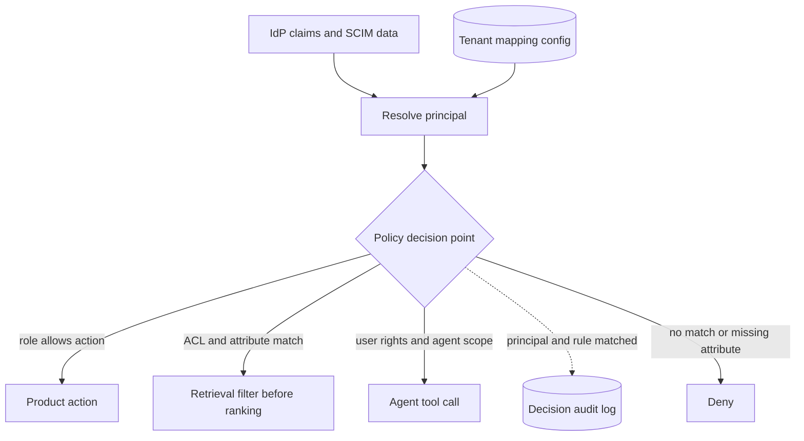

## TL;DR
Every agent tool call and retrieval needs an allow or deny for this user. The mapping layer turns customer
IdP group IDs into your roles (RBAC) and attributes into policy inputs (ABAC), kept as per-tenant config
and evaluated per request.

## For agent builders
- **Why it matters for agents.** Retrieval and tool calls are where wrong mappings leak. An agent can
  paraphrase a restricted document or run an action the user could never click, so the allow or deny must
  happen in code before the model sees data or a tool executes.
- **Where it shows up in your stack.** The retrieval filter in front of the vector store, a gate wrapped
  around every tool your agent runtime exposes, the list of tools offered to the model per user, and the
  decision log next to your agent traces.
- **What you control.** The rule that effective permission = user rights ∩ agent scope, fail-closed
  defaults, which tools a principal is even shown, and per-tenant mapping config keyed by immutable group IDs.
- **What you can skip.** Formal access-control theory and building your own policy language. Pick an
  in-process function first, and Cedar, OPA or OpenFGA when rules or object graphs grow.

## Why it exists
- **Nobody designed the two sides to fit.** A customer's Entra or Okta directory has groups like
  `GRP-FIN-EMEA-RO`, `All Staff` and `Contractors-2023`, and attributes like `department=Legal` and
  `country=DE`. Your product has roles such as `viewer`, `editor` and `admin`, plus documents synced with
  their own ACLs.
- **The naive approaches fail predictably.**
  - Hard-coding group names ("if 'Admins' in groups") works for one customer, is wrong for the next, and
    breaks on rename.
  - Granting everyone in the tenant the same access ignores that source systems already restrict HR, M&A
    and legal content.
  - Re-implementing their whole permission model creates a second source of truth that drifts.
- **Pure RBAC explodes on contextual rules.** "Regional managers see deals in their region" with six
  functions, five regions and three seniority levels is 90 roles; adding one region adds 18 more, each bound
  and reviewed by a customer admin. ABAC states the rule once, `subject.region == resource.region`, and
  adding a region adds no policy.
- **AI adds a new principal.** An agent acting for a user must not exceed that user's rights, nor be granted
  broader rights because it runs as a service. A mapping layer gives each customer a reviewable, testable
  statement of who can do what.

## How it works
### Three kinds of permission inputs
| Input | Examples | Model | Why that model |
|---|---|---|---|
| 1. **Product permissions** | configure workspace, run agent X, export | RBAC (your roles) | *Because* the action set is small and stable |
| 2. **Data permissions** | who may see each document or record | Carried source ACLs (users and groups) | You carry them rather than invent them |
| 3. **Contextual rules** | region, department, data classification, device, time | ABAC | *Because* these combinations would otherwise multiply roles |

### The mapping record (per tenant)
- **`role_bindings`:** IdP group *object ID* to product role, e.g. Entra group `3f2a…` to
  `workspace_admin`. IDs, *because* display names are neither unique nor stable.
- **`attribute_map`:** IdP claim name to your attribute, e.g. `extension_region` to `region`, with allowed values.
- **`policies`:** ABAC rules over subject, resource and action attributes, e.g.
  `resource.classification == "confidential" requires subject.clearance >= 2`.
- **`default`:** what an authenticated user with no matching binding gets, usually nothing beyond basic access.

### Translating source ACLs into the customer's identities
Carried ACLs name principals in each source's vocabulary (SharePoint site groups, Confluence groups, Slack
channels, Salesforce public groups), not the IdP groups your role bindings use. Two ways to join them:

| | Expand at index time | Resolve at query time |
|---|---|---|
| Stored on documents | ACL resolved to user IDs | Source principal IDs |
| Query cost | Simple membership test | Look up the user's set of held source principals |
| What membership churn costs | One person joining a 10,000-member group rewrites the ACL of every document that group can see | Documents change only when their own ACL changes |
| Where effort goes | Index churn | Keeping the per-user principal set current and fast (crosswalk of source identities to IdP IDs plus synced source-group membership) |
| Typical choice | Small groups | More common once groups are large |

- **Either way, an unresolvable source principal grants nothing**, *because* guessing (by display name, say)
  is how one person's access lands on another.

### Resolving a principal
1. **At login (OIDC/SAML) and on SCIM updates**, build the principal: stable user key, group IDs (including
   nested groups resolved by the IdP or Graph), mapped roles and attributes.
2. **Cache with a short TTL** and invalidate on SCIM events.
3. **Hand the principal to the agent runtime, not to the model.** Tools read it from the session; the model
   never supplies user, tenant or role as an argument.

### Enforcing
- **One policy decision point**, *because* scattered `if` statements cannot be audited.
- **Explicit combining rules:** deny by default; an explicit deny overrides any allow; a policy whose
  attribute is missing evaluates to deny (fail closed).
- **Monitor the missing-attribute rate**, so fail-closed shows up as a data-quality alert rather than as
  silent lockouts.
- **Engine options:** a small in-process function; a policy engine (OPA/Rego, Cedar); or a
  relationship-based system (Zanzibar-style, e.g. OpenFGA or SpiceDB) when permissions follow object graphs
  like folders and shares.

### AI-specific enforcement
- **Retrieval:** filter candidate chunks by the principal's source groups and attributes *before* ranking
  and generation, never by asking the model to withhold.
- **Agents:** effective permission = user permission ∩ agent's granted scope. The agent never gains rights
  the user lacks, and a broadly entitled user does not make a narrow agent broad.
- **Tool exposure:** offer the model only tools the principal may call, *and* re-check at execution,
  because the model can still emit a call to a tool name it saw elsewhere (or was told about by injected text).
- **Resource-level checks inside tools:** a `read_ticket(id)` tool allowed by role must still check that
  this ticket is visible to this user, because the model picks the ID.
- **Audit:** log the decision inputs (principal, rule matched) so a customer can ask "why could Ana see this?"

## Diagram
Identity claims become a principal once; every product action, retrieval and agent call asks the same
decision point.



## Examples
### In-process evaluator with the three layers
Tenant config is data, not code; agent scope intersects with user rights.

```python
TENANT_CFG = {
    "acme": {
        "role_bindings": {"3f2a9c1e": "workspace_admin", "8b7d0e44": "analyst"},  # Entra group IDs
        "attribute_map": {"extension_region": "region", "department": "department"},
    }
}
ROLE_ACTIONS = {"workspace_admin": {"configure", "query", "export"}, "analyst": {"query"}}

def principal(tenant: str, claims: dict) -> dict:
    cfg = TENANT_CFG[tenant]
    groups = set(claims.get("groups", []))
    roles = {r for g, r in cfg["role_bindings"].items() if g in groups}
    attrs = {ours: claims.get(theirs) for theirs, ours in cfg["attribute_map"].items()}
    return {"tenant": tenant, "groups": groups, "roles": roles, "attrs": attrs}

def can_act(p: dict, action: str, agent_scope: set | None = None) -> bool:
    allowed = set().union(*(ROLE_ACTIONS[r] for r in p["roles"])) if p["roles"] else set()
    if agent_scope is not None:
        allowed &= agent_scope                       # agent never exceeds the user, nor vice versa
    return action in allowed

def can_read(p: dict, doc: dict) -> bool:
    if doc["tenant"] != p["tenant"]:
        return False                                 # tenant boundary first, always
    if not (p["groups"] & set(doc["acl_groups"])):   # source-system ACL (RBAC on data)
        return False
    if doc.get("region") and doc["region"] != p["attrs"].get("region"):
        return False                                 # ABAC: regional restriction
    return True

ana = principal("acme", {"groups": ["8b7d0e44", "g-sales-emea"], "extension_region": "EMEA"})
deal = {"tenant": "acme", "acl_groups": ["g-sales-emea", "g-sales-amer"], "region": "AMER"}
print(can_act(ana, "query"), can_act(ana, "export"), can_read(ana, deal))   # True False False
print(can_act(ana, "query", agent_scope={"export"}))                       # False
```

- **Ana is an analyst in the EMEA sales group.** She can query but not export.
- **The ACL matches but ABAC denies.** She is in a group on the deal's ACL, yet the regional attribute rule
  denies the AMER deal.
- **The agent cannot amplify her.** An agent scoped only to `export` cannot query on her behalf.

### Gating every agent tool call
Runnable standard library, reusing the idea above: the runtime filters the tool list per principal and
re-checks each call, including the resource the model chose.

```python
AGENT_SCOPE = {"deal_assistant": {"query", "summarize"}}
TOOL_ACTION = {"search_deals": "query", "summarize_deal": "summarize", "export_deals": "export"}
USER_ACTIONS = {"ana": {"query", "export"}}            # from role bindings
DEAL_REGION = {"D-1": "EMEA", "D-2": "AMER"}
USER_REGION = {"ana": "EMEA"}

def allowed_actions(user: str, agent: str) -> set:
    return USER_ACTIONS.get(user, set()) & AGENT_SCOPE.get(agent, set())   # intersection

def tools_for_model(user: str, agent: str) -> list[str]:
    return [t for t, a in TOOL_ACTION.items() if a in allowed_actions(user, agent)]

def execute(user: str, agent: str, tool: str, args: dict) -> dict:
    action = TOOL_ACTION.get(tool)
    if action not in allowed_actions(user, agent):
        return {"error": f"denied: {tool} not permitted", "rule": "user ∩ agent scope"}
    deal = args.get("deal_id")
    if deal and DEAL_REGION.get(deal) != USER_REGION.get(user):
        return {"error": f"denied: {deal} outside your region", "rule": "abac.region"}
    return {"ok": f"{tool}({args})"}

print(tools_for_model("ana", "deal_assistant"))                    # ['search_deals'] only
print(execute("ana", "deal_assistant", "export_deals", {}))        # denied: not in agent scope
print(execute("ana", "deal_assistant", "search_deals", {"deal_id": "D-2"}))  # denied: ABAC
```

- **Denials go back to the model as tool results** with a reason, so the agent can explain instead of
  retrying, and the rule name lands in the decision log.

### Query-time resolution of source principals
Pure Python, runnable. Documents keep source principal IDs; each user gets a cached set of principals they
hold, built from the crosswalk and synced source-group membership.

```python
# Synced from each source: source group -> member source identities (nested groups pre-expanded)
SOURCE_GROUP_MEMBERS = {
    "confluence:group:legal": {"atl:5b10"},                 # Atlassian account IDs
    "sharepoint:sitegroup:hr-owners": {"entra:9a1f"},       # SharePoint uses Entra object IDs
    "slack:channel:C-deals": {"slack:U02ABC", "slack:U07XYZ"},
}
# Crosswalk: source identity -> IdP object ID, joined on IdP ID or verified email
CROSSWALK = {"atl:5b10": "entra:9a1f", "slack:U02ABC": "entra:9a1f", "entra:9a1f": "entra:9a1f"}

def principal_set(idp_user: str) -> set:
    """Every source principal this IdP user holds; computed per user, cached, invalidated on change."""
    mine = {src for src, idp in CROSSWALK.items() if idp == idp_user}
    return mine | {g for g, members in SOURCE_GROUP_MEMBERS.items() if members & mine}

def visible(doc_acl: set, held: set) -> bool:
    return bool(doc_acl & held)          # unresolved principals never match anyone: fail closed

held = principal_set("entra:9a1f")
print(visible({"confluence:group:legal"}, held))          # True: via crosswalked Atlassian ID
print(visible({"slack:channel:C-board"}, held))           # False: not a member
print(visible({"confluence:user:unknown-guest"}, held))   # False: unresolved grants nothing
```

### Worked numbers: roles vs attributes, index vs query time
| Change | RBAC-only or index-time cost | ABAC or query-time cost |
|---|---|---|
| Regional rule, 6 functions × 5 regions × 3 levels | 90 roles to bind and review | 1 rule |
| Add a sixth region | 18 more roles | 0 new rules; tag deals with the new region |
| One person joins a 10,000-member group that can see 200,000 documents (illustrative) | 200,000 document ACL rewrites | 1 user's principal set recomputed |

## Production patterns
- **Mapping as versioned, reviewed config.** Store each tenant's `role_bindings`, `attribute_map` and
  policies as data with change history, edited through an admin UI or reviewed change, never in code.
  Monitor unmapped-user counts per tenant after each change.
- **A tool gate in the agent runtime.** Wrap every tool with one check (user ∩ agent scope, then the
  resource-level rule) and filter the tool list shown to the model per principal. Monitor denied tool calls
  by tool and rule; a spike often means a prompt or injection is pushing the agent toward a forbidden tool.
- **Fail closed with a data-quality alarm.** Deny when a required attribute is missing, and alert when the
  missing rate for `region` or `department` exceeds a threshold you agree with the customer. Monitor
  denied-request reasons.
- **Externalised policies when rules grow.** Move rules to an engine such as Cedar, where the regional rule is
  `permit (principal, action == Action::"read", resource) when { principal.region == resource.region };`,
  or to OpenFGA/SpiceDB for folder-and-share graphs. Monitor decision latency on the request path, which
  is paid on every agent step.
- **Decision logs that answer "why".** Log principal, resource, action and the rule that matched for every
  retrieval and agent decision, linked to the agent trace. Monitor by sampling: a customer admin reviews a
  set of decisions each quarter.
- **Canary users per sensitive group.** Keep test users in HR, legal and each region, and run scheduled
  agent queries as them that must and must not return known documents. Alert on any wrong answer.

## Trade-offs
- **RBAC reviewability vs role explosion.** Role bindings are easy for customer admins to review, but
  encoding contextual rules as roles explodes their number. Switch to ABAC when roles start encoding region
  × function × level.
- **ABAC compactness vs attribute quality.** Decisions depend on the customer's directory; if `department` is
  blank for a third of users, policies silently deny or over-grant.
- **Carried ACLs vs live checks.** Carrying source ACLs keeps you consistent with existing permissions, but
  inherits their mistakes and lags by a sync cycle. Live checks against the source are exact but slow, and
  an agent may make several retrieval calls per answer.
- **Central engine vs in-process library.** A central policy engine gives auditability and consistent
  decisions but adds a dependency on the request path. An in-process library is faster and enough while
  rules stay simple.
- **Hiding tools vs showing and denying.** Hiding forbidden tools keeps the model from trying them and saves
  prompt tokens; showing them and returning denials lets the agent explain what the user cannot do. Either
  way the execution-time check is mandatory.

## Pitfalls
- **Binding roles to group display names.** Symptom: a customer renames a group and all its members lose or
  gain access overnight.
- **A permissive default for unmapped users.** Symptom: a newly onboarded department sees the whole
  workspace because no binding matched.
- **Filtering after generation, or relying on the prompt to withhold.** Symptom: restricted facts appear in
  answers, paraphrased.
- **Agents with a service identity broader than the user.** Symptom: an agent completes an action the user
  could not perform directly in the UI.
- **Checking the tool but not the resource.** Symptom: a user allowed to `read_ticket` gets another team's
  ticket because the model guessed its ID. Fix: resource-level check inside the tool.
- **Index-time expansion for large groups.** Symptom: index write volume and permission lag spike whenever
  HR moves people between big groups.
- **Ignoring nested groups.** Symptom: users whose access comes through a parent group see nothing.

## When to use
- **Use when** a second customer brings its own directory, and before any AI feature indexes customer content.
- **Start with** role bindings by group ID plus carried source ACLs.
- **Add ABAC** when customers ask for regional, classification or clearance restrictions.
- **Gate every tool** from the first agent release; retrofitting permissions after tools ship is how
  incidents happen.
- **Measure:** unmapped-user counts per tenant, denied-request reasons, and periodic access reviews where a
  customer admin checks a sample of decisions.
- **Interviews:** explain how user rights, agent scope and document ACLs combine, and where the decision is
  enforced.

## Role lens
- **Engineer:** Implements principal resolution, the policy decision function or engine integration, and
  pre-retrieval filters that use source ACL groups and attributes.
- **Architect:** Defines the product permission model, chooses RBAC, ABAC or relationship-based enforcement,
  and sets the rule that agent permissions are the intersection with the user's.
- **FDE:** Runs the mapping workshop with the customer's IAM admin, records group-ID bindings and attribute
  sources, and validates with test users from each sensitive group.

## Check yourself
**Q:** A customer wants: admins configure the workspace, everyone else queries, and deal documents are visible
only within the user's region unless they are in the global deals team. How do you model this?
**A:** Product permissions are RBAC: bind the customer's admin group ID to `workspace_admin`, and a default or
all-staff group ID to `analyst`. Document visibility starts from carried source ACLs. The regional rule is
ABAC: map the IdP region attribute and tag each deal with its region, then allow read when regions match or
the user is in the global-deals group ID. Enforce in one policy function used by the retrieval filter and by
agent tools, and verify attribute coverage first, because users with no region would otherwise be denied
everything.

## Interview questions
### What is the difference between RBAC and ABAC, and why do enterprise AI products usually need both?
- **RBAC** grants actions through roles; it fits product permissions because the action set is small and
  stable and admins can review bindings.
- **ABAC** evaluates rules over subject, resource and action attributes; it fits region, classification and
  clearance rules that would otherwise multiply roles.
- **Both, plus carried source ACLs**, because data visibility is already defined in the customer's systems.

### A user who changed teams still gets answers from the old team's documents. Where do you look?
- **Principal cache:** was it invalidated on the SCIM group-removal event, or is it waiting out its TTL?
- **Source-group sync:** has the source system's own group membership been resynced, since carried ACLs lag
  by a sync cycle?
- **Index-time expansion:** if ACLs were expanded to users, the rewrite for that group may be queued or failed.

### Would you expand document ACLs to users at index time or resolve them at query time?
- **Index time** for small, stable groups: queries are a cheap membership test.
- **Query time** once groups are large: one join to a 10,000-member group otherwise rewrites every document
  that group can see.
- **Either way**, unresolved principals grant nothing.

### How do agent permissions combine with user permissions, and why not a union?
- **Effective permission is the intersection** of the user's rights and the agent's granted scope.
- **A union lets either side amplify the other:** a narrow agent becomes broad for an admin, or a service
  identity gives a junior user admin actions.

### A third of the customer's users have a blank `department`. What happens to your ABAC rules?
- **With fail-closed evaluation**, those users are denied anything that depends on department, which looks
  like an outage to them.
- **With careless defaults**, they may be over-granted, which is worse.
- **Fix it upstream:** alert on missing-attribute rate, agree a cleanup or fallback attribute with the IAM
  admin, and test before rollout.

### Where exactly do you enforce permissions in a tool-calling agent, and why not in the system prompt?
- **Three places in code:** the retrieval filter before ranking, the tool list offered per principal, and a
  gate at execution that re-checks the action and the specific resource.
- **Not the prompt**, because instructions can be overridden by injected content or ignored, and the model
  chooses IDs and arguments you must not trust.
- **Log each decision with the trace**, so a customer can see why the agent could or could not act.

## Quiz
### Q: Why should role bindings reference IdP group object IDs rather than names?
- [ ] IDs are shorter, so tokens are smaller
- [x] Names can be duplicated and renamed, while object IDs are unique and stable
- [ ] SAML cannot transmit group names
- [ ] Names leak information about the customer's org chart
> A rename or a second group with the same display name would silently change who holds a role; immutable IDs
> keep bindings correct, with names shown only for readability.

### Q: An agent with scope {query, summarize} runs for a user who can {query, export}. What may it do?
- [ ] query, summarize and export
- [ ] summarize only
- [x] query only
- [ ] export only
> Effective permissions are the intersection of the user's rights and the agent's scope, so only query is
> allowed; a union would let either party amplify the other.

### Q: When does ABAC become preferable to adding more roles?
- [ ] When the product has fewer than five actions
- [ ] When the customer uses SAML instead of OIDC
- [x] When access depends on combinations of attributes such as region, classification and department
- [ ] When users belong to only one group each
> Expressing attribute combinations as roles multiplies them, one per combination; ABAC states the rule once
> over attributes, at the cost of depending on attribute quality.

## Use cases & projects
### Use cases
- **ACL-aware RAG assistants.** Retrieval filters on source ACLs and region or classification attributes
  before ranking, so answers never paraphrase restricted content.
- **Tool-gated action agents.** A deal or support agent sees only the tools its scope and the user's role
  allow, with resource checks inside each tool.
- **Multi-tenant agent platforms.** Each customer's mapping config binds its own group IDs to your roles
  without code changes.
- **Access reviews and audits.** Decision logs linked to agent traces answer "why could Ana see this?"

### Mini project
**Permission gate for a three-tool agent (2-3 hours).**
- **Goal:** enforce user ∩ agent scope plus one ABAC rule on every tool call and retrieval of a small agent.
- **Steps:** define two tenants' mapping configs keyed by fake group IDs; build `search_deals`,
  `read_deal` and `export_deals` tools; filter the tool list per principal; add a region rule inside
  `read_deal`; log each decision with the rule matched; try a prompt that asks the agent to export or to
  read another region's deal.
- **Done when:** forbidden tools never execute, cross-region reads return a denial the agent explains, a
  renamed group display name changes nothing, and the decision log names the rule for every call.
