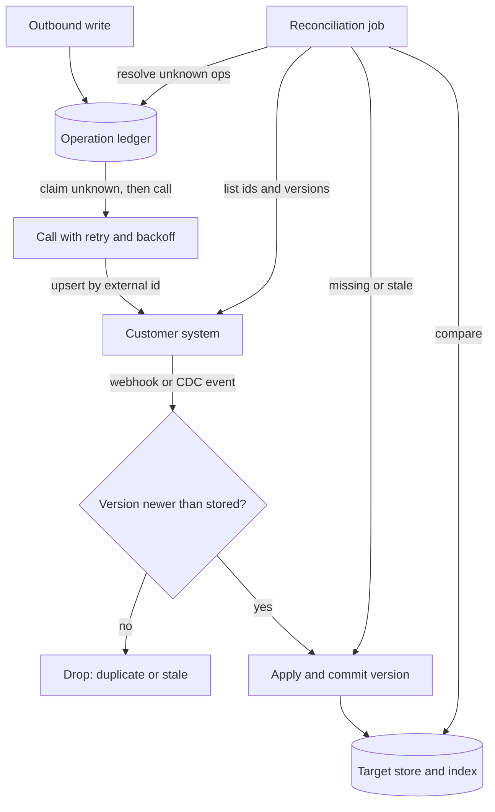

## TL;DR
Retry handles failed calls, deduplication makes retries safe against writes that succeeded silently, and
reconciliation (a scheduled source-versus-target comparison) catches events that never arrived. Each
covers a failure the other two cannot see, so mature integrations run all three.

## Why it exists
Take a concrete integration: your assistant ingests ServiceNow incidents into a retrieval index through
webhooks and writes resolution notes back through the REST API. Three things go wrong in a normal week,
none of them your bug.
- **Calls fail transiently.** The instance returns 429 because your sync shares the API quota with their
  own users, a 503 during their maintenance window, or a connection reset through their proxy. These need
  a careful retry, because synchronised retries from every worker become a thundering herd that throttles
  the customer's own staff, the fastest way to get an integration switched off.
- **Outcomes are ambiguous.** A write times out after the customer's server committed it but before the
  response reached you. Retrying creates a second resolution note; not retrying may lose the first. No
  retry policy fixes this; only a key that lets the target recognise the repeat does.
- **Losses are silent.** A webhook delivery fails and the platform exhausts its own retry budget; a CDC
  connector is down for forty minutes; a record changes between two pages of a paginated pull and lands
  on neither; a deletion produces no event. You have no record of an event you never received, so only
  comparing the source with your copy finds the gap.
- **Each naive fix fails on one leg.** "Retry until success" creates duplicates and retry storms. "Trust
  the event feed" accumulates drift that surfaces weeks later as a confident answer about a closed ticket.
  "Re-sync everything nightly" is expensive, re-embeds unchanged documents, and does nothing about
  duplicated writes.
- **Three mechanisms, three failures.** The integration is only correct with all three, and the
  reconciliation job's repair count becomes the health metric of the whole pipeline.

## How it works
### Retry: classify, then back off
Not every error should be retried, because retrying a non-retryable error wastes quota and hides a bug
behind a delay.

| Class | Codes and cases | Why |
|---|---|---|
| Retryable | 408, 429, 5xx, connection resets, timeouts | transient; a timed-out request may nevertheless have succeeded |
| Not retryable | 400 and 422 | the payload is wrong and will be wrong again |
| Not retryable | 401 once a token refresh has been tried | credentials, not load |
| Not retryable | 403 | a permission the customer must grant |
| Not retryable | 404 on a record deleted at source | it will never come back |

For the retryable class:
1. **Grow the delay exponentially, with jitter, and cap it.**
2. **Honour `Retry-After`** when the platform sends it.
3. **Bound both attempts and total elapsed time.**

Two enterprise-specific additions:
- **Retry budget per integration.** For example, retries may be at most a small percentage of calls over
  a rolling window. This stops an outage at the customer turning your workers into a load generator
  against the instance their employees share.
- **Circuit breaker per endpoint.** Stop calling an instance that keeps failing and probe it
  occasionally, *because* SaaS API quotas are commonly metered per customer instance per day, so a burst
  of failed calls during an incident can lock the customer's own integrations out until the quota resets.
- **Reads vs writes.** Reads can be retried freely. Writes can be retried only when the target can detect
  a repeat, which is the next mechanism. The serving module's retry lesson covers the backoff arithmetic;
  this lesson is about which calls are safe to retry at all.

### Deduplication: make at-least-once look like once
- **Why it is unavoidable.** A sender with no acknowledgement cannot tell "the request was lost" from "the
  request was applied and the reply was lost". It must resend (at-least-once, possible duplicates) or give
  up (at-most-once, possible loss).
- **Exactly once is an effect, not delivery.** No protocol removes that ambiguity over an unreliable
  network, so you build "exactly once" from at-least-once delivery plus a receiver that recognises
  repeats. Every reliable feed duplicates; the only design question is where the repeat is detected.

Duplicates arrive from three directions:

**1. Inbound events** (webhooks, CDC, polled changes) are delivered at least once by every reliable
mechanism, and sometimes out of order.
- **Key on the version.** Use the delivery's own id or, better, `(tenant, record_id, source_version)`,
  where the version is a sequence number or the source's last-modified stamp.
- **Commit the version with the effect.** Store the last applied version per record *in the same
  transaction* as the effect (the inbox pattern) and reject anything whose version is already applied or
  exceeded.
- **Why version beats delivery id.** It handles redelivery and reordering: a stale update arriving after
  a newer one is dropped instead of overwriting it.
- **Scope keys per tenant,** because two customers' systems can legitimately produce the same record id.

The key also decides how long dedupe state must live:

| Dedupe state | Size | Lifetime | Late replay |
|---|---|---|---|
| Seen *delivery ids* | grows with traffic | TTL longer than the sender's redelivery window (retry schedule plus any admin "replay events" button) | after the TTL, applied twice |
| *Last-applied version per record* | bounded by number of records | never expires | rejected, however late |

Prefer the version store whenever the source provides a version.

**2. Outbound writes** need the target to recognise a repeat. In order of preference:
1. **An idempotency key header** where the API supports one. Payment and messaging APIs usually do; most
   enterprise SaaS APIs do not.
2. **An *upsert on an external id* field you control,** so a repeated write with the same external id
   updates instead of inserting.
3. **Your own operation ledger** as the fallback: claim an operation id with status `unknown` before
   calling, record the remote id after, and never issue a write the ledger does not know about. The ledger
   has a race window (a crash between the remote commit and your record), which is exactly what
   reconciliation closes.

**3. Content duplicates:** the same policy document uploaded to two SharePoint sites, or the same
attachment on three tickets. Deduplicate by a hash of the normalised content before chunking and
embedding, otherwise retrieval returns the same passage three times and crowds out everything else.

### Reconciliation: assume the first two leak
A scheduled job compares source and target directly and repairs the difference. It runs in tiers
*because* full comparison is expensive:
1. **Compare counts** per partition (records by day of last modification).
2. **Compare the set of ids and versions** for partitions that disagree or fall inside a recent window.
3. **Compare field-level content hashes** for ids whose versions match but which are suspected of partial
   writes.

The diff has three classes:

| Class | Meaning | Repair |
|---|---|---|
| Missing in target | never arrived | fetch and apply |
| Stale in target | version behind | re-fetch |
| Extra in target | deleted at source without an event | tombstone and remove from the index |

- **Deletes need a full-id sweep.** They only show up when every id is compared, so the job keeps a slow
  background sweep over everything alongside the frequent window over the last few days.
- **Repairs reuse the idempotent apply path.** That makes a reconciliation run safe to retry and safe to
  overlap with the live feed.
- **It closes the ledger.** Every operation still marked `unknown` is resolved by querying the target for
  its external id, then recorded or re-issued.
- **Its numbers are the health signal.** A healthy feed repairs a handful of records per run. A rising
  repair count means the event path is broken (an expired webhook subscription, a filter that silently
  excludes a record type, a stopped connector), usually well before any user notices.
- **It is the customer artefact.** The reconciliation report is what you show the customer when they ask
  whether your copy matches their system of record.

### How the three fit
| Path | Steps |
|---|---|
| Live | event arrives → dedupe by `(tenant, record, version)` → apply and commit the version together |
| Write | claim a ledger entry → call with retry → record the result |
| Audit | compare source and target on a schedule → repair through the apply path → resolve unknown ledger entries → report drift |

The first two make the system fast and mostly right; the third makes it eventually exactly right and
tells you when the first two have failed.

## Diagram
Live events and outbound writes are both idempotent; reconciliation reads the source independently and
feeds its repairs back through the same apply path.



## Examples
### The three mechanisms around one integration
The stores (`versions`, `records`, `ledger`) stand in for tables committed in the same transaction as the
effect; `client` wraps the customer-side API. Each function is safe to call twice, including `reconcile`
itself.

```python
import random, time

class ApiError(Exception):
    def __init__(self, status, retry_after=None): self.status, self.retry_after = status, retry_after

RETRYABLE = {408, 429, 500, 502, 503, 504}

def call_with_retry(fn, max_attempts=5, base=0.5, cap=30.0):
    for attempt in range(1, max_attempts + 1):
        try:
            return fn()
        except (ApiError, TimeoutError, ConnectionError) as e:
            status = getattr(e, "status", None)         # None: timeout/reset, outcome unknown
            if (status is not None and status not in RETRYABLE) or attempt == max_attempts:
                raise                                   # 4xx: wrong request, do not loop on it
            delay = min(cap, base * 2 ** (attempt - 1)) * random.uniform(0.5, 1.5)
            time.sleep(getattr(e, "retry_after", None) or delay)  # honour Retry-After if sent

def apply_event(db, tenant, event):
    """Inbound: idempotent by (tenant, record id, source version); version committed with the write."""
    key = (tenant, event["record_id"])
    seen = db.versions.get(key)
    if seen is not None and event["version"] <= seen:
        return "duplicate-or-stale"                     # redelivery or out-of-order: no-op
    db.records[key] = event["payload"]
    db.versions[key] = event["version"]
    return "applied"

def write_with_ledger(db, client, tenant, op_id, payload):
    """Outbound: never issue a write the ledger does not know about."""
    if db.ledger.get(op_id) not in (None, "unknown", "needs-replay"):
        return db.ledger[op_id]                         # retry of a completed op returns the saved result
    db.ledger[op_id] = "unknown"                        # claimed before the call; survives a crash mid-call
    # Re-issuing an "unknown" op is safe only because upsert-by-external-id turns a repeat into an update.
    # Against an insert-only API, resolve "unknown" by lookup (as reconcile does) before any re-issue.
    remote_id = call_with_retry(lambda: client.upsert(external_id=op_id, body=payload))
    db.ledger[op_id] = remote_id
    return remote_id

def reconcile(db, client, tenant, since):
    """Catch what retry and dedupe cannot: events that never arrived, writes with unknown outcomes."""
    source = {r["id"]: r["version"] for r in client.list_changed(since=since)}   # paginated pull
    target = {rid: v for (t, rid), v in db.versions.items() if t == tenant}
    missing = [rid for rid in source if rid not in target]
    stale = [rid for rid, v in source.items() if rid in target and v > target[rid]]
    for rid in missing + stale:
        apply_event(db, tenant, client.fetch(rid))      # repairs reuse the idempotent path
    for op_id, status in list(db.ledger.items()):
        if status == "unknown":
            db.ledger[op_id] = client.find_by_external_id(op_id) or "needs-replay"
    return {"missing": len(missing), "stale": len(stale)}  # alert when this stops trending to zero
```

Deletes are not in this sketch: `list_changed` only sees records that still exist, so a separate full-id
sweep (or the platform's deleted-records endpoint) is what produces the "extra in target" class.

### Version dedupe vs delivery-id dedupe on a reordered feed
A runnable check of why the key matters. Two updates to one ticket arrive out of order, then the first is
redelivered.

```python
deliveries = [  # (delivery_id, record_id, version, status)
    ("d2", "INC1", 2, "closed"),
    ("d1", "INC1", 1, "open"),    # older update arrives late
    ("d1", "INC1", 1, "open"),    # and is redelivered
]

def by_delivery_id(feed):
    seen, state = set(), {}
    for did, rid, ver, status in feed:
        if did in seen:
            continue
        seen.add(did); state[rid] = status
    return state

def by_version(feed):
    versions, state = {}, {}
    for did, rid, ver, status in feed:
        if versions.get(rid, -1) >= ver:
            continue
        versions[rid] = ver; state[rid] = status
    return state

print(by_delivery_id(deliveries))  # {'INC1': 'open'}   wrong: closed ticket reopened
print(by_version(deliveries))      # {'INC1': 'closed'} right: stale update dropped
```

### Worked scenario: a week of repair counts
An hourly reconciliation over the last 3 days of changes, plus a nightly full-id sweep (illustrative
numbers).

| Day | Repairs per hourly run | Extra in target (nightly) | Reading |
|---|---|---|---|
| Mon | 0-3 | 1 | healthy: occasional lost webhook |
| Tue | 0-2 | 0 | healthy |
| Wed | 40-60 | 2 | webhook subscription expired at 09:00 |
| Thu | 0-2 | 0 | subscription renewed, backlog repaired |

The Wednesday spike paged on-call within the hour; no user had reported a stale answer yet.

## Production patterns
- **Retry budget plus circuit breaker per tenant.** Use when many workers share one customer instance's
  quota. Track retries as a fraction of calls over a rolling window and stop retrying above it; open a
  breaker per endpoint after repeated failures and send occasional probe calls. Monitor retry ratio,
  breaker state and 429 rate per tenant.
- **Inbox table keyed on source version.** Use for every inbound feed. A table with primary key
  `(tenant, record_id)` holding the last applied version, updated in the same transaction as the write,
  with the write skipped when the incoming version is not newer. Monitor the duplicate-or-stale rate; a
  sudden jump often means the source replayed events.
- **Acknowledge after the durable write.** Use for webhooks. Return 200 only once the event is committed
  (or durably queued), so the sender's own retries cover your crashes. Monitor sender-side failed
  deliveries and your queue lag.
- **Tiered reconciliation with an alerted repair count.** Use for any copy of customer data. Run a
  frequent window over recent changes and a slow full-id sweep for deletes; emit missing, stale and extra
  counts per run as metrics. Alert when repairs stop trending to zero or the same ids recur.
- **Ledger plus upsert for outbound writes.** Use when an agent writes into a system of record. Claim an
  operation id as `unknown`, write with the operation id in an external-id field, and resolve every
  `unknown` entry by lookup in the reconciliation run. Monitor the age of the oldest `unknown` entry.

## Trade-offs
- **Aggressive retries vs the customer's quota.** More retries raise the chance a transient failure heals
  itself, but they consume the shared API quota. Past a modest fraction of calls (the Google SRE book's
  example per-client budget is retries below 10% of requests) extra retries mostly add load to an instance
  that is already struggling, which is why a retry budget exists.
- **Version dedupe vs source quality.** It handles reordering and redelivery but needs a trustworthy
  version. When the source only offers a timestamp with second resolution, two edits in the same second
  collapse and you must fall back to comparing content hashes.
- **Reconciliation certainty vs read load.** You pay with read load on the customer's system and a second
  code path. A narrow frequent window plus a slow full sweep is the usual balance; widen the window only
  when measured drift shows the event path is unreliable.
- **Ledger safety vs a write per call.** A ledger makes outbound writes safe to retry but adds a database
  write before every call. For high-volume, low-value writes (metrics, heartbeats) the cost is not worth
  it and an occasional duplicate is accepted instead.

## Pitfalls
- **Acknowledging a webhook with 200 before the internal write is durable.** Symptom: the customer's
  delivery logs show success, the feed looks healthy, and reconciliation keeps finding the same class of
  record missing. Fix: acknowledge after commit.
- **Deduplicating by delivery id only.** Symptom: a stale update that arrived late overwrites a newer one
  and a ticket flips from closed back to open in your index. Fix: key on source version.
- **Retrying 4xx errors.** Symptom: a validation error loops through the full backoff schedule, burning
  quota and delaying every other call in the queue, with a real bug hidden behind what looks like a slow
  dependency. Fix: classify before retrying.
- **Treating reconciliation output as a log nobody reads.** Symptom: the repair count has climbed for
  weeks because a webhook subscription expired, and no alert was ever set on it. Fix: alert on it.
- **A delivery-id dedupe TTL shorter than the source's redelivery window.** Symptom: duplicate notes or
  double-applied updates that cluster after a source outage or an admin's bulk "resend events", exactly
  when redeliveries arrive late. Fix: size the TTL from the window, or switch to versions.
- **Comparing source timestamps with timestamps generated on your side** (different clocks, different
  time zones). Symptom: records are perpetually judged stale and re-fetched every run, so the repair count
  never reaches zero. Fix: store and compare the source's own version.

## When to use
All three apply whenever your system holds a copy of customer data or writes into a customer system,
which is almost every enterprise AI deployment: a RAG index over their documents, an agent that files
tickets, a sync of CRM records into a feature table. Size them to the stakes.
- **Read-only index over a wiki:** a modest retry policy, content-hash dedupe and a nightly
  reconciliation.
- **Agent writing into a system of record:** an operation ledger, upsert-by-external-id and a
  reconciliation job that resolves every unknown outcome within hours.
- **Measure:** retry rate, duplicate rate and repair count per run; the last one is the one to alert on.
- **Interviews:** explain why exactly-once delivery is impossible, why dedupe therefore has to be keyed and
  committed with the effect, and why reconciliation is still required afterwards.

## Role lens
- **Engineer:** Writes the error classifier, the inbox check keyed on source version, the ledger around
  every outbound write, and the tiered reconciliation job with its repair metrics and alerts.
- **Architect:** Decides which writes need a ledger and which may tolerate duplicates, sets retry budgets
  per customer instance, and owns the reconciliation SLA that the parity promise to the customer rests on.
- **FDE:** Negotiates with the customer's admin for an external-id field, a changes endpoint and a
  workable API quota, and uses the reconciliation report as the evidence that the integration is correct.

## Check yourself
**Q:** A customer's Jira webhook feed into your RAG index has run for six months with retries and dedupe
in place. A user reports that an issue closed three weeks ago still appears open in the assistant's
answers. How did this happen, and what do you change?
**A:** Retries and dedupe only act on events your system saw. The close event almost certainly never
arrived or was lost after acknowledgement: Jira's delivery to your endpoint failed and its own retries
were exhausted during an outage, or your endpoint returned 200 before the write was durable and then
crashed. Nothing in your system records an event it never processed, so the index drifted silently. The
fix is reconciliation: an hourly job that pulls issues updated in the last few days from Jira's search
API, compares ids and `updated` versions against the index, and repairs through the same apply path,
plus a slow full sweep that catches deletions and anything older. Alert on the repair count per run, and
move the webhook acknowledgement to after the durable write.

## Interview questions
### Why is exactly-once delivery impossible, and what do you build instead?
- **The two-generals ambiguity.** A sender with no acknowledgement cannot distinguish a lost request from
  a lost reply, so it must choose possible duplicates (resend) or possible loss (give up).
- **So build exactly-once effects.** Use at-least-once delivery plus a receiver that recognises repeats,
  with the dedupe key committed in the same transaction as the effect so a crash cannot separate them.

### An agent's "create ticket" call to a customer's ServiceNow timed out. Walk me through making the retry safe.
- **Check for an idempotency key first.** If the API supports one, send the same key on the retry.
- **Otherwise upsert on an external id.** Put your operation id in a field you control so a repeat
  updates instead of inserting.
- **Fallback is a ledger.** Claim the op as `unknown` before the call, record the remote id after, and let
  reconciliation look up any op still `unknown` before anything re-issues it against an insert-only API.

### When would you skip the operation ledger?
- **When duplicates are cheap.** High-volume, low-value writes such as metrics or heartbeats do not
  justify an extra database write before every call.
- **When the target already dedupes.** An idempotency key or upsert-by-external-id gives the same safety
  without your own bookkeeping, though reconciliation is still needed for silent losses.

### Your reconciliation job runs hourly. How do you decide its scope and what to alert on?
- **Tier the comparison:** counts per partition, then ids and versions for disagreeing or recent
  partitions, then content hashes only where partial writes are suspected, because full comparison is
  expensive on the customer's API.
- **Add a slow full-id sweep,** because deletes produce no event and only show up when every id is
  compared.
- **Alert on repair count per run** trending away from zero, and on the same ids recurring, which means
  the repair does not converge.

### How long must a dedupe store keep delivery ids?
- **Longer than the sender's redelivery window,** which includes its retry schedule and any admin
  "replay events" button; a redelivery after the TTL is applied twice.
- **Better: store last-applied version per record.** It is bounded by the number of records, never
  expires and rejects arbitrarily late replays.

## Quiz
### Q: An integration already retries failed calls and deduplicates events by record id and version. Why does it still need a reconciliation job?
- [ ] To re-run retries that exceeded the attempt cap
- [x] Because events that were never delivered leave no trace in the target, and only comparing against the source reveals them
- [ ] To compress the dedupe store once the TTL expires
- [ ] Because retries are only safe for reads, so writes must be replayed nightly
> Retry and dedupe act on events the system received. A lost webhook, a connector outage or a delete
> with no event produce nothing to retry or dedupe; a source-versus-target comparison is the only
> mechanism that can see the gap.

### Q: A write to the customer's API timed out. Which approach is correct?
- [ ] Do not retry, because the write may have succeeded and a second attempt would duplicate it
- [ ] Retry immediately, because timeouts almost always mean the request never arrived
- [x] Retry only through a path the target can recognise as a repeat: an idempotency key, an upsert on an external id, or a ledger entry claimed before the call
- [ ] Retry after confirming by reading the record, which guarantees exactly one write
> A timeout is ambiguous, so the retry must be recognisable as a repeat by the target. A read-then-write
> check still has a race window between the read and the write; a ledger plus reconciliation closes it.

### Q: Every nightly reconciliation run reports the same 40 records as stale in the target, and each run "repairs" them. What is the most likely cause?
- [ ] The customer's API is rate-limiting the reconciliation job, so it cannot read the source
- [ ] The dedupe store's TTL is too short, so old events are being re-applied
- [x] The repair is not converging, for example the diff compares source versions against timestamps generated on your side, or the apply path rejects the re-fetched records
- [ ] The 40 records are duplicates in the source system
> A healthy job's repair set changes between runs and trends to zero. The same set recurring means the
> diff is detected but the repair never makes source and target compare equal, typically because the
> two sides are not compared like for like; monitor the job's repair outcome, not just its diff.
