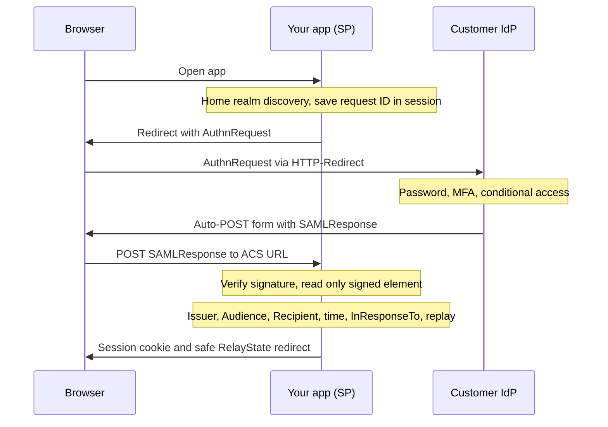

## TL;DR
SAML 2.0 lets a customer's IdP vouch for a user with a signed XML assertion sent through the browser,
and many enterprises still mandate it. XML signatures are subtle: use a maintained library and still
check audience, recipient, time, correlation and replay.

## Why it exists
- **Every app kept its own passwords.** Cross-domain single sign-on meant cookies that browsers would not
  share between companies.
- **Enterprises wanted their directory to vouch for users.** Active Directory, later Okta or Entra ID,
  needed to assert identity to an outside app without that app ever seeing a password.
- **SAML solved it through the browser.** Standardized in its 2.0 form in 2005, it passes signed XML
  statements via the browser, so the IdP and the service provider (SP) never need a direct network
  connection, which suited firewalled corporate networks.
- **The naive alternatives fail.** Sharing the customer's LDAP exposes credentials and violates every
  security policy. A username in a URL parameter is trivially forged.
- **Even "signed XML" is not enough.** Early implementations verified that *a* signature was valid, then
  read the user from a *different*, unsigned element, letting attackers impersonate anyone. SAML SSO is a
  protocol plus a checklist of validations that must be exactly right.

## How it works
### Setup: metadata exchange
Exchanged once per customer:

| Party | Publishes |
|---|---|
| SP (you) | Entity ID (a unique URI) and Assertion Consumer Service (ACS) URL |
| IdP | Entity ID, SSO URL and signing certificate |

- **Store the IdP's certificate per tenant**, *because* it is the only thing that makes an assertion trustworthy.

### SP-initiated flow
1. **Discover the tenant.** The user opens your app; home realm discovery finds their tenant.
2. **Send an `AuthnRequest`.** Redirect the browser to the IdP's SSO URL (HTTP-Redirect binding: deflated,
   base64, in the query string) with a fresh request ID and your entity ID. Save the ID.
3. **The IdP authenticates** the user (password, MFA, conditional access).
4. **The IdP posts back.** It returns an HTML form that auto-POSTs a base64 `SAMLResponse` to your ACS URL
   (HTTP-POST binding, *because* assertions are too large for a URL).
5. **You validate and create a session.**

### What the assertion contains
| Element | Holds |
|---|---|
| `Issuer` | The IdP entity ID |
| `Subject/NameID` | The user identifier, in a format such as persistent, email or unspecified |
| `SubjectConfirmationData` | `Recipient` (your ACS URL), `NotOnOrAfter`, `InResponseTo` (your request ID) |
| `Conditions` | `NotBefore`, `NotOnOrAfter`, `AudienceRestriction` (your entity ID) |
| `AttributeStatement` | Email, name, groups, roles |
| Signature | An XML digital signature over the assertion, the response, or both |

### The validation checklist
Each check exists *because* skipping it enables a known attack:

| Check | Attack it stops |
|---|---|
| Verify the signature with the tenant's stored certificate, require signing, and read every value **from the element the signature covers** | Signature wrapping: a forged unsigned assertion inserted next to a genuine signed one |
| `Issuer` matches the tenant's IdP | One customer's IdP asserting into another's workspace |
| `Audience` equals your entity ID | An assertion minted for another SP replayed at you |
| `Recipient` equals your ACS URL; time window holds with small clock skew | Misdirected or stale assertions |
| `InResponseTo` matches a request ID that *this browser session* started; assertion IDs recorded until expiry | Replay, and login CSRF |

- **Why bind to the session, not a global set of pending IDs:** otherwise an attacker can start a login,
  feed their own valid response into a victim's browser, and sign the victim in as the attacker.
- **IdP-initiated SSO** (no `AuthnRequest`, so no `InResponseTo`) loses request correlation; many teams
  disable it or accept it only with strict replay caching.

### Parsing, encryption, RelayState and logout
- **Parse defensively.** The response is attacker-controlled bytes until the signature checks out, and it is
  parsed *before* that check. Disable DTDs and external entity resolution, *because* otherwise an XXE payload
  can make your server read local files or call internal URLs during parsing.
- **Read text nodes carefully.** In 2018 several SAML libraries were found to read only the first text node
  of an element:
  - an attacker who legitimately held `ana@acme.com.evil.com` at the IdP inserted a comment into their own
    signed assertion, `<NameID>ana@acme.com<!---->.evil.com</NameID>`;
  - the signature still verified (canonicalization drops comments) but the SP read the user as `ana@acme.com`;
  - use a library version that has fixed this, and read the full canonicalized text.
- **Encrypted assertions.** The IdP can encrypt to the SP's public key so the browser cannot read the
  attributes. Decrypt, then verify the signature on the decrypted assertion; encryption hides data but does
  not authenticate it, so it never replaces the signature checks.
- **RelayState.** The opaque value the SP sends with the request and gets back, usually the page to return
  to. Treat it as untrusted and accept only relative paths or an allow-list, *because* redirecting to
  whatever it contains turns your login into an open redirect.
- **Logout.** SAML Single Logout depends on every party's front-channel redirects succeeding and is
  unreliable in practice. Do not rely on it for revocation; use short sessions and SCIM deactivation.

### Certificates
- **Support two active certificates per tenant during rotation**, *because* IdP signing certificates expire
  and rotate, and a single hard-coded certificate turns a routine rotation into an outage for that customer.

## Diagram
SP-initiated login: the request ID you save in step 2 is what `InResponseTo` must match at the end.



## Examples
### Validating a decoded response with `signxml` and `lxml`
The key design point: all values are read from `signed`, the element the verifier returns, never from the
raw document.

```python
from datetime import datetime, timedelta, timezone
from lxml import etree
from signxml import XMLVerifier

NS = {"saml": "urn:oasis:names:tc:SAML:2.0:assertion"}
SKEW = timedelta(minutes=2)

def ts(s: str) -> datetime:
    return datetime.fromisoformat(s.replace("Z", "+00:00"))

def consume(xml: bytes, tenant: dict, pending_ids: set, seen_ids: set) -> dict:
    # pending_ids: request IDs started by THIS browser session; seen_ids: shared, kept until expiry
    signed = XMLVerifier().verify(xml, x509_cert=tenant["idp_cert_pem"]).signed_xml
    a = signed if etree.QName(signed).localname == "Assertion" else signed.find("saml:Assertion", NS)
    if a is None:
        raise PermissionError("no signed assertion")
    now = datetime.now(timezone.utc)
    if a.findtext("saml:Issuer", namespaces=NS) != tenant["idp_entity_id"]:
        raise PermissionError("wrong issuer")
    cond = a.find("saml:Conditions", NS)
    nb = cond.get("NotBefore")                                # optional; NotOnOrAfter missing fails closed
    if (nb and now < ts(nb) - SKEW) or now >= ts(cond.get("NotOnOrAfter")) + SKEW:
        raise PermissionError("outside validity window")
    if tenant["sp_entity_id"] not in [x.text for x in cond.iterfind(".//saml:Audience", NS)]:
        raise PermissionError("wrong audience")
    scd = a.find("saml:Subject/saml:SubjectConfirmation/saml:SubjectConfirmationData", NS)
    if scd.get("Recipient") != tenant["acs_url"] or scd.get("InResponseTo") not in pending_ids:
        raise PermissionError("wrong recipient or unsolicited response")
    if now >= ts(scd.get("NotOnOrAfter")) + SKEW:             # bearer confirmation has its own expiry
        raise PermissionError("subject confirmation expired")
    if a.get("ID") in seen_ids:
        raise PermissionError("replayed assertion")
    seen_ids.add(a.get("ID")); pending_ids.discard(scd.get("InResponseTo"))
    attrs = {at.get("Name"): [v.text for v in at.iterfind("saml:AttributeValue", NS)]
             for at in a.iterfind(".//saml:Attribute", NS)}
    return {"name_id": a.findtext("saml:Subject/saml:NameID", namespaces=NS), "attrs": attrs}
```

- **In production, prefer a full SAML library per framework.** It also handles encrypted assertions and
  metadata, but this checklist is what you should be able to point to in its configuration.

### RelayState allow-list and an expiring replay cache
Pure standard library, runnable on Python 3.10+. Both are small, and both are commonly missing.

```python
from urllib.parse import urlsplit

def safe_relay_state(rs: str | None, default: str = "/") -> str:
    """Accept only same-site relative paths; anything else falls back to the home page."""
    if not rs or "\\" in rs or rs.startswith("//") or not rs.startswith("/"):
        return default
    parts = urlsplit(rs)
    return default if parts.scheme or parts.netloc else rs

class ReplayCache:
    """Remember assertion IDs until their NotOnOrAfter; reject a second use."""
    def __init__(self):
        self.seen: dict[str, float] = {}
    def first_use(self, assertion_id: str, not_on_or_after: float, now: float) -> bool:
        self.seen = {k: exp for k, exp in self.seen.items() if exp > now}   # expire old IDs
        if assertion_id in self.seen:
            return False
        self.seen[assertion_id] = not_on_or_after
        return True

for rs in ["/reports/42?tab=q3", "https://evil.example", "//evil.example", "/\\evil.example", None]:
    print(repr(rs), "->", safe_relay_state(rs))          # only the first survives

cache = ReplayCache()
print(cache.first_use("_a1", not_on_or_after=1300, now=1000))   # True: first use
print(cache.first_use("_a1", not_on_or_after=1300, now=1200))   # False: replay inside window
```

### Worked scenario: the negative test matrix
Every row is a tampered response your ACS endpoint must reject; run them in CI per library upgrade.

| Tampered response | Expected rejection |
|---|---|
| Genuine signed assertion plus a forged unsigned one | Only the signed element is read; exactly one assertion allowed |
| Valid assertion for another SP | Wrong audience |
| Valid assertion from another tenant's IdP | Wrong issuer or signature (different stored certificate) |
| `NotOnOrAfter` 10 minutes in the past, skew 2 minutes | Outside validity window |
| `InResponseTo` started in a different browser session | Unsolicited response |
| Same assertion posted twice | Replayed assertion |
| Comment injected into NameID | Library reads full canonicalized text, user unchanged |
| DOCTYPE with an external entity | Parser refuses DTDs |

## Production patterns
- **Two-certificate rotation with expiry alerts.** Store up to two IdP certificates per tenant, accept
  either, and alert well ahead (for example 30 days) of each expiry date captured from metadata. Monitor
  signature failures per tenant on rotation days.
- **Shared replay cache with TTL.** Keep seen assertion IDs in a store every app node shares, for example
  Redis `SET saml:<ID> 1 NX EX <seconds until NotOnOrAfter>`; a failed `NX` means replay. Monitor replay
  rejections, which should be near zero.
- **Clock discipline on every node.** Run NTP everywhere and keep skew allowance small (2 minutes in the
  example). Monitor "not yet valid" errors by node; one node's spike means its clock drifted.
- **Hardened parser configuration.** Parse with DTDs and external entities disabled (for `lxml`, a parser
  created with entity resolution and network access turned off), before any signature work. Monitor parse
  failures as a security signal.
- **Login failures by reason, per tenant.** Emit a reason code (audience, signature, expiry, recipient,
  unsolicited, replay) for each rejection so FDEs can tell a customer metadata mistake from an attack.

## Trade-offs
- **Ubiquity vs implementation risk.** SAML works with nearly every enterprise IdP and corporate policy, but
  XML signatures, canonicalization and certificate handling make it harder to implement safely than OIDC.
  Prefer OIDC when the customer allows it.
- **Browser delivery vs scope.** It needs no network path from the IdP to you, which suits locked-down
  networks, but it is only for interactive web login; API and agent calls still need OAuth tokens.
- **IdP-initiated convenience vs risk.** A tile in the user's portal is convenient, but it removes
  `InResponseTo` correlation and widens replay and login-CSRF risk. Enable it only with strict replay caching
  and short validity.
- **Persistent vs email NameIDs.** Persistent opaque NameIDs survive email changes; email NameIDs are easy to
  map but change. The choice flips if the customer cannot emit a persistent identifier.

## Pitfalls
- **Reading the user from the raw document** after checking that some signature verifies. Symptom: a pen
  tester logs in as an arbitrary user with a modified response.
- **No per-tenant audience or issuer check.** Symptom: an assertion from one customer's IdP is accepted for
  another customer's workspace.
- **One hard-coded IdP certificate.** Symptom: a single customer's logins fail on the day their IdP rotates
  its signing certificate.
- **Skipping replay protection.** Symptom: a captured `SAMLResponse` from browser history grants a new
  session hours later within a lax validity window.
- **DTDs and external entities enabled.** Symptom: a pen-test finding that the ACS endpoint fetched an
  attacker-supplied URL or echoed local file contents in an error.
- **Following `RelayState` to any URL.** Symptom: phishing links pass through your genuine login page and
  land on an attacker's site.
- **Server clock drift.** Symptom: intermittent "assertion not yet valid" errors on only some application nodes.

## When to use
- **Use when** customers require it, which in practice means most larger enterprise deals; offer OIDC
  alongside for those who can use it.
- **Never hand-roll** XML signature verification; use a maintained library and verify its configuration
  against the checklist above.
- **Measure:** login failures by reason (audience, signature, expiry) per tenant, and alert ahead of IdP
  certificate expiry dates captured from metadata.
- **Interviews:** walk the SP-initiated flow and explain signature wrapping and audience checks; that is the
  expected depth for anyone shipping B2B software.

## Role lens
- **Engineer:** Configures the SAML library per tenant, stores certificates and entity IDs, enforces replay
  caches and writes tests with tampered, expired and wrong-audience responses.
- **Architect:** Decides whether IdP-initiated SSO is allowed, how SAML coexists with OIDC, and how
  certificate rotation is handled without downtime across all tenants.
- **FDE:** Exchanges metadata with the customer's IAM team, maps their attribute names to required fields,
  and debugs failed logins using a SAML tracer on a test account.

## Check yourself
**Q:** Your app verifies the SAML response signature and then extracts NameID with an XPath query over the
whole document. Why is this vulnerable, and what is the fix?
**A:** XML signatures cover specific elements referenced by ID, not the whole document. An attacker can take a
genuine signed response, insert a second forged assertion elsewhere in the tree, and leave the signed one
intact so verification still passes. A document-wide XPath may then read the forged NameID. The fix is to
read every value only from the element the verifier reports as signed, require that exactly one assertion
exists and that it is the signed one, and use a maintained library with signature wrapping defenses.
Then still check issuer, audience, recipient, time window and InResponseTo.

## Interview questions
### Walk me through an SP-initiated SAML login.
- **Discovery and request:** home realm discovery picks the tenant, then the SP redirects with an
  `AuthnRequest` carrying a fresh ID it saves in the browser session.
- **IdP and response:** the IdP authenticates (MFA, conditional access) and auto-POSTs a signed
  `SAMLResponse` to the ACS URL.
- **Validation:** signature from the signed element only, then issuer, audience, recipient, time window,
  `InResponseTo` and replay, then a local session.

### One customer's SAML logins all started failing this morning. How do you debug it?
- **Read the rejection reason** for that tenant: a signature failure on one tenant usually means the IdP
  rotated its signing certificate.
- **Confirm with a SAML tracer** on a test account and compare the certificate in the response with the one
  stored.
- **Fix and prevent:** add the new certificate as a second active one, and alert on expiry dates from metadata.

### Would you enable IdP-initiated SSO? Why or why not?
- **Benefit:** users get a tile in their IdP portal, which some customers insist on.
- **Cost:** no `AuthnRequest` means no `InResponseTo`, so replay and login CSRF are easier.
- **If enabled:** strict shared replay cache, short validity, and a fixed landing page instead of an
  arbitrary RelayState.

### Why does encryption of the assertion not replace signature checks?
- **Encryption hides attributes from the browser**, but anyone with the SP's public key can encrypt, so it
  proves nothing about who produced the assertion.
- **So decrypt, then verify the signature** on the decrypted assertion, and run every other check as normal.

### How do you make replay protection work behind a load balancer with many app nodes?
- **Use a shared store**, because a per-node in-memory set lets a replay succeed on a different node.
- **Key by assertion ID with a TTL** until its `NotOnOrAfter`, using an atomic set-if-absent so two nodes
  cannot both accept it.

## Quiz
### Q: Why does the SAML HTTP-POST binding deliver the response through the user's browser?
- [ ] Browsers can decrypt assertions that servers cannot
- [x] The IdP and SP need no direct network connection, and assertions are too large for a redirect URL
- [ ] It avoids the need to sign the assertion
- [ ] POST requests cannot be replayed
> Browser-mediated delivery works across firewalls because both parties talk only to the browser, and POST
> carries a large signed XML payload; it is still replayable, which is why replay caches exist.

### Q: What does the AudienceRestriction check protect against?
- [ ] An expired IdP signing certificate
- [ ] A user without MFA
- [x] An assertion issued for a different service provider being replayed at yours
- [ ] Clock skew between servers
> The audience names the SP the assertion was minted for; without checking it, a valid signed assertion
> for another application trusted by the same IdP could be accepted by yours.

### Q: What is the main security cost of allowing IdP-initiated SSO?
- [ ] Users must re-enter passwords
- [ ] Assertions can no longer be signed
- [x] There is no AuthnRequest, so InResponseTo cannot tie the response to a request you made
- [ ] It disables attribute statements
> Unsolicited responses lose request correlation, which helps replay and login-CSRF attacks; mitigate with
> strict replay caching and short validity windows, or disable the flow.
