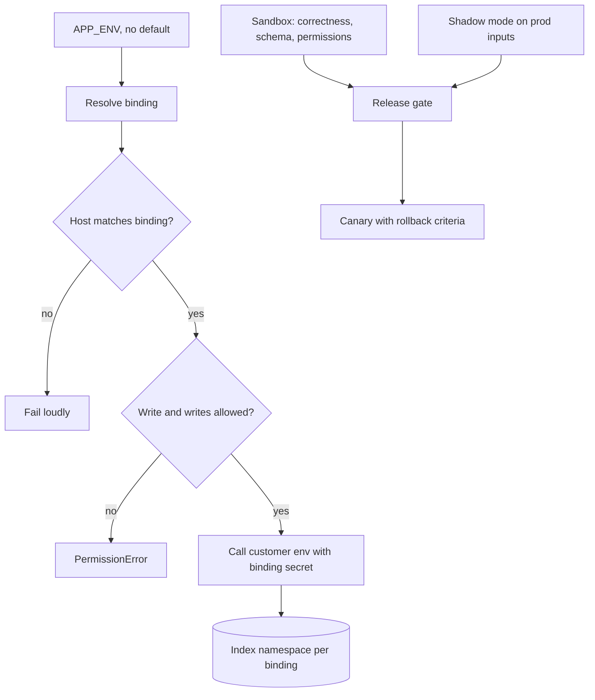

## TL;DR
Customer systems come in pairs: production with real data and side effects, and sandboxes that differ in
data, configuration and limits. Build and verify against the sandbox, promote deliberately, and use hard
guards so the two never mix.

## Why it exists
- **The customer has its own environments.** Software teams separate development, staging and
  production; enterprise integration adds a second axis the customer creates on their schedule, under
  their rules. A Salesforce org has sandboxes copied from production at a point in time; an SAP landscape
  moves configuration through development and quality systems before production; ServiceNow customers
  clone production into sub-production instances. Each of your environments must bind to one of theirs.
- **You cannot develop against production.** An agent that creates cases or sends emails would have real
  side effects on real customers on every test run, so you build against the sandbox.
- **But the sandbox is not production.** Its data is a copy from weeks ago, may be a subset and may be
  masked, so prompts, retrieval settings and extraction rules tuned on it meet a different distribution.
  Ids drift apart, integrations disabled in the sandbox silently work in production, and API quota and
  performance differ.
- **Both naive fixes fail.** "Test in production with a test account" leaks test data into production
  records, logs and the retrieval index, and the test account's permissions never match a real user's.
  "Assume the sandbox is production" ships behaviour never exercised on real data, volume or permissions.
- **The practice.** Use the sandbox for functional correctness, side effects, permissions and schema; use
  production-safe methods (read-only checks, shadow mode, canaries) for what only production shows; and
  make cross-wiring impossible rather than merely discouraged, because a system reading stale sandbox data
  behaves differently and one writing to production by mistake is an incident.

## How it works
### The environment matrix
Put your environments on one axis and the customer's on the other, with exactly one binding per row:

| Yours | Theirs |
|---|---|
| development | developer sandbox |
| staging or UAT | the customer's UAT or full-copy sandbox |
| production | production |

- **One-to-one.** No row ever points at two of theirs, and no two rows share one.
- **A binding is a versioned configuration artefact** holding: base URL, the *name* of the credential in
  the secret store (never the credential itself), whether writes are allowed, which index namespace
  ingested data lands in, and which identity provider issues tokens.
- **Credentials are per binding** *because* a customer's sandbox typically has its own connected app, API
  client or service account, and because a production credential that exists in a non-production secret
  store is the cross-wiring waiting to happen.

### What differs, and what to do about each
| Dimension | How it differs | What to do |
|---|---|---|
| **Data** | point-in-time copies, often partial, sometimes masked | functional tests with versioned fixtures you re-create after every refresh |
| **Identifiers** | record, picklist, user and object ids diverge | reference by stable business keys or external ids; resolve at runtime |
| **Configuration drift** | sandbox may be ahead of or behind production | introspect the schema at startup and fail fast |
| **Integrations and side effects** | outbound email, callouts, scheduled jobs often disabled or redirected | keep an explicit list per binding |
| **Limits and performance** | smaller capacity, different API quotas | verify throughput on a full-copy sandbox or a production canary |
| **Identity** | users missing or with different roles | seed sandbox users that mirror production roles |

The details behind each row:
- **Masked data misleads tuning.** Do not tune prompts or thresholds on masked data alone: a name replaced
  by `Contact 00123` changes what an extraction prompt sees. Evaluate on a sample of real data under the
  customer's data agreement, or in shadow mode in production.
- **Ids diverge even after a copy.** Some platforms keep record ids when they copy production (Salesforce
  full and partial copies do), but anything created afterwards on either side, and every record in a
  developer sandbox, gets its own id. A hard-coded id may work in UAT by coincidence and point at nothing,
  or at the wrong record, in production. Resolve ids through metadata or lookups, never in configuration.
- **Drift comes from the customer's change process.** Custom fields, validation rules and workflows move
  through change sets, transports or update sets. Failing fast at startup beats discovering a missing
  field as a 400 response in production.
- **Side-effect lists prevent surprises,** so a feature that "worked in UAT" is not sending its first real
  email in production.
- **Permission-sensitive behaviour** (what the assistant may retrieve for whom) is verified with the
  seeded users, not with an admin account.

### Guardrails against cross-wiring
Outbound:
1. **Every outbound request carries the binding pair** in its context and in its logs.
2. **The HTTP client checks the destination host** against the binding's allow-list and refuses anything
   else, so a mis-set environment variable produces a loud error, not a write to production.
3. **Non-production bindings have no path to production secrets;** production bindings reject sandbox
   hosts, so sandbox data cannot be ingested into the production index.
4. **Ingested records are tagged with their binding,** which is what lets you prove later that no sandbox
   fixture sits behind a production answer.

Inbound needs its own guard, because the customer's side can cross-wire too:
- **The problem.** A sandbox cloned from production inherits its configuration, including any webhook
  subscription, outbound message or notification rule that points at *your production receiver*. After
  the next refresh, sandbox test edits arrive at your production ingestion endpoint looking like real
  events. An outbound host allow-list cannot see this.
- **The fix.** Authenticate the sender per binding: a separate webhook signing secret or receiver URL per
  customer environment, plus a check of the source instance identifier that most platforms put in the
  payload or headers, so events from an unbound instance are rejected and counted rather than indexed.

### The promotion path
- **Same artefact, different bindings.** Your changes (prompts, mappings, flags, connector settings) move
  development → staging → production unchanged, aligned with the customer's release calendar.
- **Plan for sandbox refreshes.** A refresh replaces the sandbox's data and typically invalidates
  credentials and seeded fixtures, so staging breaks on the customer's schedule unless re-seeding is
  automated.
- **Negotiate full-copy refreshes.** They are rare (a Salesforce full sandbox, for example, can be
  refreshed at most once every 29 days), so a refresh is negotiated, not assumed.

### What only production can show
Behaviour on the real data distribution, real volume, real permissions and real integrations. The
production-safe tools:
- **Read-only smoke tests** after deployment.
- **Shadow mode:** the system runs on live inputs without acting.
- **A canary** to a small user slice with rollback criteria agreed in advance.

The sandbox proves the integration is *correct*; these prove it is *right for this customer*.

## Diagram
Each of your environments binds to exactly one customer environment, and the guard refuses any request
whose host does not match its binding; production behaviour is proven only through shadow and canary.



## Examples
### A guarded binding per environment
A binding resolved from a single environment variable with no default, and a guard that fails loudly on
any mismatch between the binding and the host it points at. `http` and `secrets` and `index` stand for
your HTTP client, secret-store client and retrieval index.

```python
import os
from dataclasses import dataclass
from urllib.parse import urlparse

@dataclass(frozen=True)
class Binding:
    ours: str              # dev | staging | prod
    theirs: str            # the customer's environment name
    base_url: str
    secret_ref: str        # name in the secret store; the value never lives in config
    writes_allowed: bool
    index_namespace: str   # where ingested data lands; never shared across bindings

BINDINGS = {
    "dev":     Binding("dev", "dev-sandbox", "https://dev-sandbox.crm.acme.example", "crm/dev", True, "acme-dev"),
    "staging": Binding("staging", "uat-sandbox", "https://uat-sandbox.crm.acme.example", "crm/uat", True, "acme-uat"),
    "prod":    Binding("prod", "production", "https://crm.acme.example", "crm/prod", True, "acme-prod"),
}
PROD_HOSTS = {"crm.acme.example"}

def binding() -> Binding:
    b = BINDINGS[os.environ["APP_ENV"]]       # KeyError if unset: there is no default, least of all prod
    host = urlparse(b.base_url).hostname
    if (host in PROD_HOSTS) != (b.ours == "prod"):
        raise RuntimeError(f"cross-wired: {b.ours} is bound to {host}")
    return b

def request(method: str, path: str, body=None):
    b = binding()
    if method != "GET" and not b.writes_allowed:
        raise PermissionError(f"writes are disabled in {b.ours}")
    return http(method, b.base_url + path, token=secrets.get(b.secret_ref), json=body,
                headers={"X-Env-Pair": f"{b.ours}->{b.theirs}"})   # tags your logs (and theirs, if logged)

def ingest(record: dict):
    b = binding()
    index.upsert(namespace=b.index_namespace, doc={**record, "env_pair": f"{b.ours}->{b.theirs}"})
```

The guard is deliberately dumb: it does not try to be clever about hostnames, it only refuses to run
when the two facts it knows (which binding, which host) disagree.

### Inbound guard: reject events from an unbound instance
A webhook receiver that verifies a per-binding HMAC signature and the source instance id before indexing.
The header names and the `instance_id` field are placeholders; use whatever your platform actually sends.

```python
import hmac, hashlib

EXPECTED = {  # one entry per customer environment bound to THIS deployment
    "prod": {"secret": b"from-secret-store", "instance_id": "acme-prod-instance"},
}
rejected = {"bad_signature": 0, "unbound_instance": 0}

def receive(env: str, raw_body: bytes, signature_hex: str, payload: dict) -> bool:
    cfg = EXPECTED[env]
    mac = hmac.new(cfg["secret"], raw_body, hashlib.sha256).hexdigest()
    if not hmac.compare_digest(mac, signature_hex):
        rejected["bad_signature"] += 1          # a sandbox clone signs with a different secret
        return False
    if payload.get("instance_id") != cfg["instance_id"]:
        rejected["unbound_instance"] += 1       # refreshed sandbox still pointing at prod receiver
        return False
    return True                                  # safe to queue for ingestion
```

### Worked scenario: what the sandbox proved and what it missed
A ticket-triage feature (illustrative numbers) passed UAT on a partial-copy sandbox.

| Check | Sandbox result | Production reality | Caught by |
|---|---|---|---|
| Field mapping and writes | pass | pass | sandbox |
| Validation rule on category | absent in sandbox | 400 on 3% of writes | startup schema introspection |
| Classification accuracy | 91% on masked text | 84% on real text | shadow mode, 1 week |
| Notification email on update | disabled | would email requesters | side-effect list per binding |

Two of four problems were invisible in the sandbox by construction; shadow mode and the per-binding list
found them before the canary.

## Production patterns
- **No-default environment resolution.** Use for every service and job that talks to a customer system.
  Read the environment from one variable and crash if it is unset, as `os.environ["APP_ENV"]` does above.
  Monitor startup failures in CI, which surface misconfiguration before it reaches a customer.
- **Host allow-list in the HTTP client.** Use wherever a write path exists. Compare the request host with
  the binding's allowed hosts before sending and raise on mismatch. Monitor refused-request counts by
  binding; any non-zero value is a configuration bug to fix, not noise.
- **Automated re-seed after refresh.** Use when the customer refreshes sandboxes on a schedule. A job that
  re-creates fixture records, test users and the sandbox credential, triggered from the customer's
  refresh calendar. Monitor time to a green staging run after each refresh.
- **Per-environment webhook secrets and instance checks.** Use for every inbound feed. A distinct signing
  secret and receiver URL per customer environment, plus a source-instance check. Monitor rejected
  events by reason; a spike after a refresh means a cloned subscription.
- **Shadow before canary.** Use for any AI behaviour whose quality depends on real text. Run on live
  inputs without writing, compare with human decisions, then canary one queue with an agreed rollback
  threshold. Monitor agreement rate and canary error rate.

## Trade-offs
- **Full-copy realism vs cost and exposure.** It gives the most realistic testing but costs the customer
  money, refreshes slowly, and holds a copy of production data that needs the same protection, which is
  why many customers only grant partial or developer sandboxes.
- **Masking vs signal.** Masking protects PII but changes text distributions; the more a feature depends
  on free text (extraction, summarisation), the less a masked sandbox tells you and the more you need
  shadow mode on real traffic.
- **Strict allow-lists vs friction.** They make cross-wiring impossible but add friction whenever the
  customer renames an instance or adds a sandbox; the friction is worth it wherever a write path exists.
- **Per-binding credentials vs onboarding steps.** They multiply steps with the customer's admin; the
  alternative, one credential reused across environments, removes the only hard boundary you have.

## Pitfalls
- **Hard-coding sandbox record ids in prompts, filters or fixtures.** Symptom: everything passes UAT, then
  production returns empty results or "record not found" on the first real request. Fix: resolve by
  business key at runtime.
- **Defaulting the environment to production when the variable is unset.** Symptom: a developer's laptop
  or a misconfigured CI job writes into the customer's live system. Fix: no default.
- **Forgetting that a sandbox refresh wipes seeded data and sandbox-only credentials.** Symptom: staging
  tests fail the morning after the customer's scheduled refresh with authentication errors that nobody's
  change explains. Fix: automate re-seeding.
- **Letting sandbox-ingested documents into the production index namespace.** Symptom: a production
  answer cites a test fixture or a months-old version of a policy. Fix: one namespace per binding.
- **Sharing one webhook receiver and signing secret across the customer's environments.** Symptom: after
  a sandbox refresh, records with test names or obviously fake values appear in the production index, and
  their source instance id is the sandbox's. Fix: per-environment secrets and instance checks.
- **Treating "works in sandbox" as the release gate.** Symptom: the first production run hits a
  validation rule, an email trigger or an API limit that the sandbox did not have. Fix: shadow and canary.

## When to use
- **Use the full practice** (a binding per environment, hard guards and a promotion path) for any
  integration that touches a customer system with side effects or permissions.
- **Start lighter** for a read-only pilot over an exported snapshot, but build the matrix the moment a
  connector or a write path appears.
- **Measure:** time to re-establish staging after a sandbox refresh, the number of ids or settings that
  differ between sandbox and production (each one is a latent production failure), and the share of
  behaviour verified only in the sandbox versus in shadow or canary.
- **Day to day:** "which environment is this pointed at?" must be answerable from any log line.
- **Interviews:** expect to be asked how you would prevent a development deployment from writing to a
  customer's production system, and why sandbox parity cannot be assumed for an AI feature.

## Role lens
- **Engineer:** Implements per-binding configuration, the host allow-list guard, environment tagging on
  ingested data, and automated re-seeding of fixtures after a sandbox refresh.
- **Architect:** Owns the environment matrix, the rule that credentials never cross bindings, and the
  decision of what must be verified in production through shadow mode or canary rather than in sandbox.
- **FDE:** Negotiates sandbox type, refresh schedule and credentials with the customer's admin, and
  explains why masked sandbox data cannot be the only evidence that the assistant works.

## Check yourself
**Q:** A customer offers only a developer sandbox with synthetic data for your ticket-triage assistant,
which writes a suggested category onto each new ticket. How do you reach a confident production release?
**A:** Use the sandbox for what it can prove: schema and field mappings, write permissions, validation
rules, the full create-read-update path and failure handling, with seeded tickets covering every
category and edge case. It cannot prove classification quality or behaviour on real text and volume.
For that, negotiate a read-only sample of real tickets under the data agreement and build an evaluation
set with the customer's SMEs, then run in shadow mode in production: the assistant reads live tickets and
records its suggested category without writing it, and you compare against what agents chose. Release
as a canary to one queue with writes enabled and a rollback criterion agreed in advance, with hard guards
ensuring the development binding can never reach the production host.

## Interview questions
### Why can't you treat a customer's full-copy sandbox as equivalent to production for an AI feature?
- **The data is a stale, sometimes masked snapshot.** Prompts and thresholds tuned on it meet a different
  text distribution in production.
- **Configuration and side effects differ.** Validation rules drift through the customer's change process,
  and outbound email or callouts are often disabled, so behaviour that passed UAT may differ live.
- **Limits and identity differ too,** so throughput and permission-sensitive retrieval need production-safe
  checks such as shadow mode and a canary.

### Design the guard that stops a staging deployment from writing to a customer's production CRM.
- **Bind each environment explicitly** with a base URL, a secret reference and a writes flag, resolved
  from a variable with no default.
- **Check the destination host in the client** against the binding and refuse on mismatch, so a typo
  fails loudly before any call.
- **Keep production credentials out of non-production secret stores,** so even a bypassed check has
  nothing to authenticate with.

### After a customer refreshed their sandbox, fake records started appearing in your production index. What happened and how do you fix it?
- **Diagnosis:** the sandbox cloned production's webhook subscription, which still points at your
  production receiver, so test edits arrive looking like real events.
- **Fix:** a signing secret and receiver URL per customer environment, plus a source instance id check,
  with rejected events counted by reason.
- **Clean-up:** use the binding tag on ingested records to find and delete what came from the sandbox.

### When is a lighter environment setup acceptable?
- **Read-only pilots over an exported snapshot** have no side effects and no live credentials, so a full
  binding matrix adds cost without removing risk.
- **The flip point is the first connector or write path:** from then on, one wrong environment variable
  can write to a customer's live system, so the matrix and guards become mandatory.

### What would you measure to know your environment practice is healthy?
- **Time to green staging after a sandbox refresh,** which shows whether re-seeding is automated.
- **Count of ids and settings that differ** between sandbox and production, each a latent failure.
- **Share of behaviour verified only in sandbox** versus shadow or canary, which should fall before
  release.

## Quiz
### Q: Why must record ids captured in a sandbox never be hard-coded into prompts, filters or configuration?
- [ ] Because sandbox ids are encrypted and cannot be read by the integration
- [x] Because ids of records and metadata created independently in each environment diverge, so a hard-coded value can resolve in UAT and point at nothing, or at the wrong record, after promotion
- [ ] Because ids change every time the sandbox is queried through the API
- [ ] Because production ids are longer and would overflow the prompt
> Even where a copy preserves the ids that existed at copy time, anything created later on either side
> gets its own id. Anything resolved by id must be looked up at runtime through stable business keys or
> metadata, otherwise it can break on the first production call.

### Q: Which measure most reliably prevents a non-production deployment from writing to a customer's production system?
- [ ] A code review checklist item reminding engineers to check the environment variable
- [ ] Logging the target host on every request so mistakes can be found afterwards
- [x] A per-binding host allow-list enforced in the client, with production credentials absent from non-production secret stores, so a mismatch fails loudly before any call
- [ ] Running all tests against the sandbox before each deployment
> Review and logging detect mistakes after the fact. A guard that refuses to run when binding and host
> disagree, combined with credentials that physically do not exist outside production, prevents the
> write from happening at all.

### Q: A feature passed every UAT test in a full-copy sandbox, but its first production run sent several hundred emails to customers. What was most likely missed?
- [ ] The production API quota was higher, so more records were processed
- [x] Outbound email was disabled in the sandbox, and the per-binding list of side-effect differences was never written down or tested for
- [ ] The sandbox's data was older, so fewer records matched
- [ ] Production users had more permissions than sandbox users
> Sandboxes commonly disable or redirect outbound integrations. A side effect that silently does nothing
> in the sandbox must be listed explicitly per binding and verified in shadow or canary mode, not inferred
> from a green UAT run.
