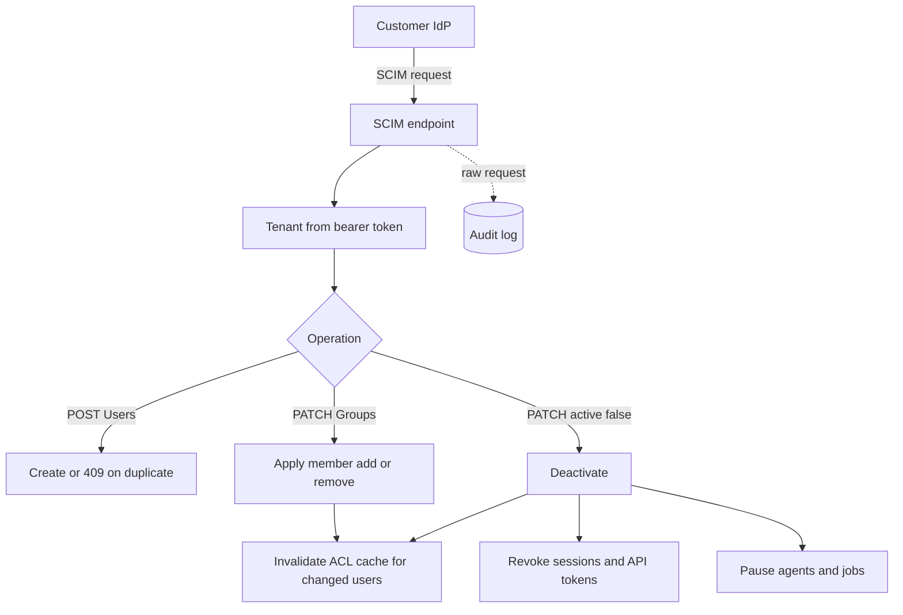

## TL;DR
SCIM 2.0 is the REST API you expose so the customer's IdP pushes user and group changes to your agent
platform. SSO says who logs in; SCIM says who exists, so leavers' agents stop and retrieval filters track
current group membership.

## For agent builders
- **Why it matters for agents.** Agents keep working when people do not: scheduled runs, stored tokens,
  long-lived memory. SCIM deactivation is the signal that stops them, and SCIM group changes are what keep
  ACL-aware retrieval from answering out of a team's documents after someone has left that team.
- **Where it shows up in your stack.** A `/scim/v2` endpoint on your platform, the user and group tables
  your retrieval filter and tool permissions read, the job scheduler that runs background agents, and the
  permission caches in front of your vector store.
- **What you control.** What deactivation triggers (revoke sessions and tokens, pause agents, invalidate
  ACL caches), the join key between SCIM and SSO identities, and how fast a group change reaches the
  retrieval filter.
- **What you can skip.** The full RFC schema catalogue and bulk operations. Know `/Users`, `/Groups`,
  `PatchOp` shapes, 409 on duplicates, paging and the per-IdP quirks.

## Why it exists
- **JIT provisioning never learns who left.** Creating an account at first SSO sign-in looks sufficient,
  but a leaver never signs in again. Their account, API tokens, scheduled agent jobs and shared documents
  remain.
- **Moves lag too.** A user who moves from Finance to Sales keeps Finance group membership in your app until
  their next login, and if sessions are long-lived, longer.
- **You cannot address people who have not logged in.** You cannot assign work or share a document with
  them, because they do not exist in your system yet.
- **AI products feel it sharper.** Retrieval filters, agent permissions and audit trails are keyed by users
  and groups; if membership lags the directory, the assistant keeps answering from documents a person
  should no longer see.
- **Naive fixes are bespoke and still lag.** A nightly CSV export or polling the customer's directory API is
  per customer and per IdP and needs credentials into their directory. SCIM inverts the direction: the IdP
  pushes changes to a standard endpoint you build once.

## How it works
### Resources and endpoints
RFC 7643 defines the schema, RFC 7644 the protocol. Under a per-tenant base URL you expose:
- **`/Users` and `/Groups`:** the core resources.
- **`/ServiceProviderConfig`, `/Schemas`, `/ResourceTypes`:** discovery, telling the IdP which features you
  support (PATCH, filtering, bulk, ETags).

| Resource | Key attributes |
|---|---|
| User | `id` (yours, server-assigned), `externalId` (the IdP's identifier), `userName`, `name`, `emails`, `active`, optional enterprise-extension attributes such as `department` and `manager` |
| Group | `displayName` and `members` |

- **Agent-relevant attributes.** `department` and `manager` are useful ABAC inputs for agent tool policies
  (an approval agent routes to the manager), so map them when the IdP sends them.

### The operations
| Request | Behaviour and why |
|---|---|
| `POST /Users` | Return 201 with your `id`; return 409 (`scimType: uniqueness`) if `userName` exists, *because* a retried create must not produce a second account. IdPs normally query by filter first and link to a match |
| `GET /Users?filter=userName eq "ana@acme.com"` | Lookup before create or match; support at least the `eq` filter on `userName` and `externalId` |
| `PATCH /Users/{id}` | A `PatchOp` body of `add`/`replace`/`remove` operations. Deprovisioning commonly arrives as `replace active=false`, *because* customers want the account recoverable and its history retained |
| `DELETE /Users/{id}` | Hard removal; some IdPs send it, often later than deactivation, if at all |
| `PATCH /Groups/{id}` | Adds or removes `members`; this is how group-based permissions stay current |

Group membership shapes:
- **Add:** `{"op":"add","path":"members","value":[{"value":"<user id>"}]}`
- **Remove:** `{"op":"remove","path":"members[value eq \"<user id>\"]"}`
- **Prefer these incremental operations to a `replace` of the whole list**, *because* a 5,000-member group
  replaced on every change is a 5,000-element write each time, and a replace racing another change can drop
  members.

Paging:
- **List and filter responses are a `ListResponse`** with `totalResults`, `startIndex` (1-based) and
  `itemsPerPage`.
- **Pagination must work before the first big customer turns provisioning on**, because IdPs page through
  `/Users` and `/Groups` during an initial sync.

### Authentication and tenancy
- **Per-tenant credential.** The IdP authenticates with a bearer token (or OAuth client credentials) that
  you issue per tenant.
- **The token, not the body, determines the tenant**, *because* an endpoint that trusts a tenant field in
  the payload lets one customer's IdP write into another's directory.

### Joining SCIM identities to SSO identities
SCIM and SSO are two channels describing the same person, and they must land on one account:
1. **Agree the join key with the customer's admin** when configuring provisioning.
2. **Ideally use the same immutable identifier the SSO token carries** (for example the Entra object ID or
   the Okta user ID), sent as `externalId` or a mapped attribute, so a SCIM-created user and the first SSO
   login resolve to the same row.
3. **Avoid email or `userName` joins.** They work until an address changes; then SCIM updates one account
   while login creates another, *because* the channels no longer agree on who the person is. Agent memory
   and history then split across two rows.
4. **If JIT stays enabled alongside SCIM**, it must look up by the same key before creating.

### What deactivation must do
`active=false` is a security event, not a profile edit. Immediately:
- revoke sessions and API tokens;
- pause the user's scheduled jobs and agents, and cancel in-flight agent runs at their next step;
- revoke stored OAuth refresh tokens the agent uses for downstream tools;
- invalidate any permission cache that includes them.

Deleting their data (including agent memory) is a separate retention decision.

### Robustness
- **Idempotent operations**, because IdPs retry and may resend the same change.
- **Lenient parsing**, because implementations differ: some send `op` values in different letter case,
  booleans as strings, or a `replace` with no `path` and an object value.
- **Log the raw request** and test against each IdP you support.

## Diagram
Every request is scoped by its credential first; deactivation fans out to every place access lives,
including running agents.



## Examples
### Deactivation-aware `PATCH /scim/v2/Users/{id}` in FastAPI
Handles the common deactivation shapes and does the security-relevant work, not just a column update.

```python
from fastapi import FastAPI, Header, HTTPException

app = FastAPI()

def as_bool(v):  # some IdPs send "False" as a string
    return v if isinstance(v, bool) else str(v).lower() == "true"

@app.patch("/scim/v2/Users/{user_id}")
async def patch_user(user_id: str, body: dict, authorization: str = Header(...)):
    tenant = await tenant_for_scim_token(authorization.removeprefix("Bearer "))  # tenant from token
    user = await db.get_user(tenant.id, user_id)
    if user is None:
        raise HTTPException(404, detail="User not found")
    if "urn:ietf:params:scim:api:messages:2.0:PatchOp" not in body.get("schemas", []):
        raise HTTPException(400, detail="Expected PatchOp")
    changes = {}
    for op in body.get("Operations", []):
        kind, path, value = op["op"].lower(), op.get("path"), op.get("value")
        if kind == "replace" and path is None and isinstance(value, dict):
            changes.update(value)                      # {"op":"replace","value":{"active":false}}
        elif kind in ("replace", "add") and path:
            changes[path] = value                      # {"op":"replace","path":"active","value":false}
    if "active" in changes:
        changes["active"] = as_bool(changes["active"])
        if user.active and not changes["active"]:      # idempotent: only act on the transition
            await sessions.revoke_all(tenant.id, user_id)
            await api_tokens.revoke_all(tenant.id, user_id)
            await agent_jobs.pause_for_user(tenant.id, user_id)
            await acl_cache.invalidate_principal(tenant.id, user_id)
    user = await db.update_user(tenant.id, user_id, changes)
    await audit.log(tenant.id, "scim.patch_user", user_id, raw=body)
    return to_scim_user(user)                          # full resource, 200
```

- **Still to handle in a real implementation:** filtered paths such as `emails[type eq "work"].value`,
  `remove` operations (ignored above) and group membership patches. The point here is that deactivation is
  a security event with side effects.
- **Add the agent's stored tool tokens to the transition block.** The handler revokes sessions and API
  tokens and pauses jobs; the deactivation list above also requires revoking the OAuth refresh tokens the
  agent holds for downstream tools, or a paused job's credentials stay live.

### The agent loop's side of deactivation
Runnable standard library: the agent runtime re-checks the principal before every tool step, so a run that
started before the SCIM event stops at its next step instead of finishing.

```python
ACTIVE = {("acme", "u1"): True}            # updated by the SCIM handler

class UserDeactivated(Exception):
    pass

def run_agent(tenant: str, user_id: str, planned_steps: list[str]) -> list[str]:
    done = []
    for i, step in enumerate(planned_steps):
        if not ACTIVE.get((tenant, user_id), False):         # checked before EVERY tool call
            raise UserDeactivated(f"stopped before step {i}: {step}")
        done.append(f"ran {step}")
        if i == 1:
            ACTIVE[("acme", "u1")] = False                   # SCIM active=false arrives mid-run
    return done

try:
    run_agent("acme", "u1", ["search_kb", "read_ticket", "send_email", "close_ticket"])
except UserDeactivated as e:
    print(e)                                                 # stopped before step 2: send_email
```

- **Why per step:** a long research or batch agent can run for minutes or hours; checking only at start
  leaves the window open for the whole run.

### Idempotent group-membership patches with an ACL delta
Pure Python, runnable. It returns who was added and removed, so only those principals' permission caches
are invalidated, and a replayed patch changes nothing.

```python
import re

REMOVE_FILTER = re.compile(r'^members\[value eq "([^"]+)"\]$')

def apply_group_patch(members: set, body: dict) -> tuple:
    """Apply a SCIM Group PatchOp; return (new_members, added, removed) for ACL invalidation."""
    out = set(members)
    for op in body.get("Operations", []):
        kind, path, value = op["op"].lower(), op.get("path"), op.get("value") or []
        if kind == "add" and path == "members":
            out |= {m["value"] for m in value}               # re-adding is a no-op: idempotent
        elif kind == "remove" and path == "members":
            out -= {m["value"] for m in value}               # some IdPs list removals in value
        elif kind == "remove" and path and (m := REMOVE_FILTER.match(path)):
            out.discard(m.group(1))                          # removing a non-member is a no-op
        elif kind == "replace" and path == "members":
            out = {m["value"] for m in value}                # legal, but a full rewrite each time
        else:
            raise ValueError(f"unsupported group operation: {op}")
    return out, out - members, members - out

body = {"schemas": ["urn:ietf:params:scim:api:messages:2.0:PatchOp"],
        "Operations": [{"op": "Add", "path": "members", "value": [{"value": "u3"}]},
                       {"op": "remove", "path": 'members[value eq "u1"]'}]}
new, added, removed = apply_group_patch({"u1", "u2"}, body)
print(sorted(new), added, removed)       # ['u2', 'u3'] {'u3'} {'u1'}
print(apply_group_patch(new, body)[1:])  # (set(), set()): replay changes nothing
```

### Worked scenario: one change to a 5,000-member group
| Approach | Elements written | ACL cache entries invalidated | Race risk |
|---|---|---|---|
| Incremental `add` of 1 member | 1 | 1 user | None: concurrent adds commute |
| `replace` of the full member list | 5,000 | all 5,000 users, unless you diff | A replace built from a stale list drops the other change's member |
| Daily: 20 changes as replaces | 100,000 | up to 100,000 | Grows with change rate |

- **Agent impact:** invalidating 5,000 users' retrieval caches at once makes every one of their next agent
  queries a cold, slower retrieval, so diffing also protects agent latency.

## Production patterns
- **Canary leaver test.** Keep a test user in each customer's IdP, deactivate it on a schedule, and measure
  time until its session, API token and a scheduled test agent stop working. Monitor that time against the
  bound you promised the security team.
- **Per-step principal checks in the agent runtime.** Before each tool call, confirm the user is still
  active (a cheap cached lookup invalidated by SCIM), so in-flight runs stop promptly. Monitor agent runs
  aborted by deactivation and steps executed after deactivation (should be zero).
- **Hashed, per-tenant SCIM tokens with rotation.** Store only a hash of each tenant's bearer token, scope it
  to the SCIM endpoints, and support two valid tokens during rotation. Monitor auth failures per tenant,
  which usually mean the customer rotated on their side.
- **Raw-request logging plus per-IdP contract tests.** Log each SCIM body (with personal data handled per
  policy) and replay captured Okta and Entra payloads in CI, including string booleans and path-less
  replaces. Monitor 4xx rate per IdP from your logs and the IdP's provisioning log.
- **Membership deltas drive ACL invalidation.** Compute added and removed members per patch and invalidate
  only those principals in retrieval caches. Monitor lag from a SCIM group change to the retrieval filter
  reflecting it.
- **Orphan and drift report.** Weekly, list accounts with no SCIM link (created only by JIT) and active users
  not seen in the IdP feed. Monitor both counts per tenant; a rising number means the join key or the push
  scope is wrong.

## Trade-offs
- **Near-real-time sync vs per-IdP quirks.** SCIM gives lifecycle sync with a standard you build once, but
  every IdP has quirks, so "SCIM compliant" still means per-IdP testing. JIT-only is acceptable for small
  customers without compliance requirements and without background agents.
- **Soft deactivation vs hard deletion.** Soft deactivation preserves history and allows reactivation, but
  inactive users must be excluded everywhere, including agent schedulers and memory retrieval. Hard deletion
  is simpler to reason about but conflicts with audit retention.
- **Pushed groups vs volume.** Pushing memberships enables group-based permissions in retrieval, but large
  groups generate many PATCH operations. Syncing only groups assigned to your app keeps volume and blast
  radius small.
- **Authoritative attributes vs self-service.** SCIM-managed attributes stay authoritative, but users can no
  longer edit them in your UI. The trade-off flips if customers expect self-service profile edits.

## Pitfalls
- **Treating `active=false` as a profile field update.** Symptom: a deactivated user's API token is still
  calling your API the next day.
- **Forgetting background agents.** Symptom: a leaver's nightly report agent keeps emailing customers.
  Fix: deactivation pauses schedules and revokes stored tool tokens.
- **Tenant from the payload or URL alone.** Symptom: a misconfigured IdP creates users in the wrong
  customer's directory.
- **Returning 201 for a duplicate `userName` instead of 409.** Symptom: duplicate accounts after the IdP
  retries a create.
- **Strict PATCH parsing.** Symptom: provisioning works with one IdP and fails with another, with 400 errors
  in the IdP's provisioning log.
- **Joining SCIM users to SSO logins by email.** Symptom: duplicate accounts for one person after an email
  change, with permissions on one and history on the other.
- **Not propagating group removals to retrieval ACL caches.** Symptom: a user who changed teams still gets
  answers from the old team's documents.

## When to use
- **Use when** you sell to organizations with an IAM team, compliance requirements, or more than a few dozen
  users; many enterprise security reviews ask about it explicitly.
- **Pair it with SSO**, and make deactivation revoke everything, agents included.
- **Measure:** time from IdP change to effect in your app (test end to end with a canary user), provisioning
  error rate per tenant and IdP from your logs and the IdP's provisioning log, accounts with no SCIM link
  (created only by JIT), and active users not seen in the IdP feed.
- **Interviews:** explain why SSO alone does not deprovision, and what deactivation must trigger; that is the
  core signal.

## Role lens
- **Engineer:** Builds the `/Users` and `/Groups` endpoints, lenient PATCH parsing, idempotent operations and
  the revocation side effects of deactivation.
- **Architect:** Decides the user lifecycle model (soft versus hard delete, retention), how SCIM identities
  join SSO identities, and how membership changes propagate to permission caches.
- **FDE:** Configures the customer's Okta or Entra provisioning app, scopes which groups are pushed, and
  proves with a test user that removal from the IdP revokes access within minutes.

## Check yourself
**Q:** A customer's security team asks: "If we terminate someone at 9:00, when do they lose access to your AI
assistant and the documents it indexed?" How do you answer, given SSO and SCIM are both in place?
**A:** At 9:00 the IdP blocks new sign-ins and sends a SCIM `active=false` on its next provisioning cycle, which
can be near-immediate or periodic depending on IdP and configuration (Okta pushes on the change event; Entra's
provisioning service documents incremental cycles on the order of tens of minutes, so state the bound for
the customer's IdP). On receipt we revoke all sessions and API
tokens, pause their scheduled agents and invalidate permission caches, so access ends within that delay plus
seconds. Retrieval filters are evaluated per request against current memberships, so no indexed content is
reachable afterwards. Their data is retained or deleted per the contract's retention policy. We would verify
this with a test account and show the audit log.

## Interview questions
### Why is SSO with just-in-time provisioning not enough for enterprise customers?
- **JIT only learns about users at login**, so a leaver who never signs in again keeps their account, API
  tokens and scheduled agents.
- **Moves lag too:** old group memberships persist until the next login, so retrieval filters stay wrong.
- **SCIM fixes both** by having the IdP push lifecycle and membership changes as they happen.

### Provisioning works with Okta but Entra shows 400 errors on every update. How do you debug it?
- **Pull the raw request from your log** and the matching entry in Entra's provisioning log.
- **Usual causes:** `op` in different letter case, `"False"` as a string, or a `replace` with no `path` and
  an object value.
- **Fix:** parse leniently, add the captured payload to a per-IdP contract test, and re-run provisioning.

### Should a deprovisioned user be soft-deactivated or hard-deleted?
- **Soft by default:** IdPs usually send `active=false`, customers want accounts recoverable, and audit
  history must survive.
- **Cost:** every query, filter and job must exclude inactive users.
- **Hard delete** belongs to the retention policy, run as a separate, deliberate process.

### How do you design the join between SCIM-created users and SSO logins?
- **Agree one immutable key** with the customer admin, such as the Entra object ID or Okta user ID, sent as
  `externalId` or a mapped attribute.
- **Make JIT look up by that key** before creating, so the two channels land on one row.
- **Watch the orphan report:** accounts with no SCIM link reveal a broken join early.

### A 5,000-member group changes 20 times a day. What does that cost and how do you keep it cheap?
- **With full replaces** it is 100,000 member writes a day and, without diffing, cache invalidation for
  everyone each time.
- **With incremental add and remove** it is about 20 writes, and only the changed principals are invalidated.
- **Also** sync only groups assigned to your app, which cuts volume and blast radius.

### A user was deactivated at 10:00 but their research agent, started at 09:55, sent an email at 10:20. What do you change?
- **Check the principal per step, not per run:** the runtime must confirm the user is active before every
  tool call, using a cache the SCIM handler invalidates.
- **Make deactivation cancel in-flight runs** and revoke the stored tokens the agent's email tool uses.
- **Prove it** with a canary: start a long agent run, deactivate the test user, and assert no tool call
  executes after the SCIM event is processed.

## Quiz
### Q: Why do IdPs usually deprovision with PATCH active=false rather than DELETE?
- [ ] DELETE is not part of the SCIM protocol
- [x] Customers want the account recoverable and its history retained, so deactivation is the default
- [ ] PATCH is faster to process than DELETE
- [ ] DELETE would remove the user from the IdP as well
> SCIM defines DELETE, but deactivation keeps ownership, audit history and the option to reactivate; the app
> must still treat it as a full revocation event, not a cosmetic flag.

### Q: How should a SCIM endpoint determine which tenant a request belongs to?
- [ ] From a tenant attribute in the JSON body
- [ ] From the user's email domain
- [x] From the per-tenant bearer token or client credentials used to authenticate the request
- [ ] From the IdP's IP address
> The credential is the trust anchor issued to one customer's IdP; payload fields and email domains can be
> wrong or spoofed, and IdP egress IPs are shared across many customers.

### Q: What does SCIM provide that SSO with just-in-time provisioning does not?
- [ ] Multi-factor authentication
- [ ] Signed login assertions
- [x] Notification of leavers and group changes even when the user never signs in again
- [ ] Encryption of user passwords
> JIT only learns about users at login, so departures and moves are invisible; SCIM pushes lifecycle and
> membership changes from the directory as they happen.

## Use cases & projects
### Use cases
- **Leaver offboarding for agent platforms.** Deactivation stops scheduled agents, revokes stored tool
  tokens and blocks new runs within the promised bound.
- **Team moves and ACL-aware RAG.** Group patches update the principals the retrieval filter checks, so a
  user who left Finance stops getting Finance answers.
- **Directory-driven agent routing.** `department` and `manager` attributes let an approval agent route
  requests to the right person.
- **Security questionnaires.** A measured canary leaver test answers "when do they lose access?" with a number.

### Mini project
**SCIM endpoint that stops a running agent (2-3 hours).**
- **Goal:** prove that deactivating a user in the IdP stops their agent mid-run and updates retrieval access.
- **Steps:** build `/scim/v2/Users` and `/Groups` with `PatchOp` handling and 409 on duplicate `userName`;
  replay captured Okta or Entra payloads (or hand-written ones with string booleans and path-less replaces);
  give a toy agent a per-step active check and a group-filtered document search; deactivate and move a user
  while their agent runs.
- **Done when:** the agent aborts at its next step after deactivation, the moved user's next search excludes
  the old group's documents, and replaying every payload twice leaves state unchanged.
