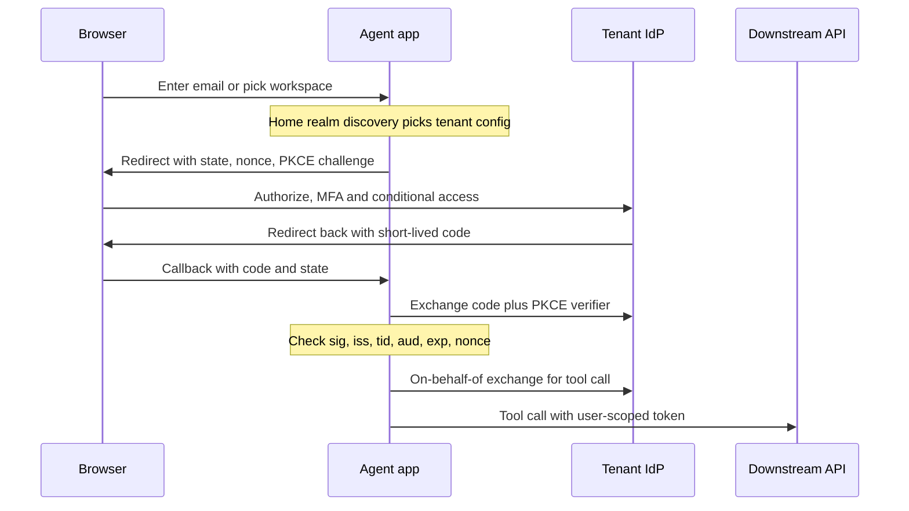

## TL;DR
An enterprise agent acts for a user whose identity lives in the customer's IdP (Okta or Entra ID), via
OIDC or SAML. Safe agents need tenant-bound token checks, an immutable user key, ID-based roles,
deprovisioning and delegated tokens per downstream tool call.

## For agent builders
- **Why it matters for agents.** Every tool call an agent makes is an action by someone. SSO tells you
  who the user is and which tenant they belong to; that identity decides which documents retrieval may
  return and which APIs the agent may call on their behalf.
- **Where it shows up in your stack.** The login in front of your agent UI, the session your agent runtime
  reads the user from, the on-behalf-of or token-exchange step before each downstream tool call, and the
  OAuth flows of MCP servers that call enterprise APIs.
- **What you control.** Per-tenant issuer validation, the stable user key you log on every agent trace,
  how roles from the token map to agent capabilities, session lifetime for long-running agent tasks, and
  never handing the agent a shared god-mode credential.
- **What you can skip.** Implementing OIDC yourself or memorising every claim. Use a maintained library;
  know the five validation checks, the Entra `tid` hole, groups overage and delegation flows.

## Why it exists
- **Enterprises run identity centrally.** Thousands of employees join, move and leave. Security enforces
  MFA, device posture and conditional access in one place, the IdP, and audits who can reach which app.
- **A vendor password store breaks every control.** Leavers keep access, MFA policy is bypassed, and
  passwords get reused. So "supports SSO with our Okta / Entra tenant" is a procurement checkbox, often a
  hard gate.
- **"Add a Sign in with Microsoft button" works for one tenant only.** As a B2B product it fails:
  - accepting any Entra token lets any organization's users into any customer's workspace;
  - keying by email breaks when an address changes or a mailbox is reassigned to a new hire;
  - reading group names fails when groups are renamed, or when a user has so many groups the token omits them.
- **Sign-in says nothing about the day someone is fired.** Your session keeps working unless you wire
  deprovisioning in, and so does any background agent task started under it. SSO integration is the set of
  decisions that make federated identity safe across many customer tenants.

## How it works
### Roles and protocols
| | OIDC | SAML |
|---|---|---|
| Your app's role | Relying party | Service provider |
| What comes back | Signed JWT ID token | Signed XML assertion |
| When | Default for new integrations | Still required by many enterprises (see the SAML lesson) |
| Okta and Entra ID | Supported | Supported |

### The login flow (OIDC authorization code with PKCE)
1. **Redirect to the tenant's authorization endpoint** with `client_id`, `redirect_uri`,
   `scope=openid profile email`, a random `state`, a random `nonce`, and a PKCE `code_challenge`. Store
   `state`, `nonce` and the PKCE verifier in the pre-login session, *because* each must later match *this*
   browser:
   - `state` defeats login CSRF;
   - `nonce` ties the ID token to this request;
   - PKCE stops a stolen authorization code from being redeemed by someone else.
2. **The IdP authenticates and applies its policies** (MFA, device compliance, conditional access), then
   redirects back with a short-lived `code`.
3. **Exchange the code at the token endpoint**, authenticating as the client (secret or, better, a
   certificate or private-key JWT). You receive an ID token (and an access token if you asked for API scopes).
4. **Validate the ID token, resolve the user, and issue your own session.** The IdP's tokens are not your
   session, *because* their lifetime and revocation are controlled elsewhere and you still need your own
   idle and absolute timeouts.

- **Step-up:** the ID token's `acr`/`amr` claims say how the user authenticated. If a tenant requires
  stronger authentication for some actions (an agent about to approve a payment, say), send them back to the
  IdP rather than trusting a stale login.

### Per-tenant configuration
- **Store per tenant:** protocol, issuer (or SAML entity ID), client ID, discovery or metadata URL, allowed
  email domains, and claim mappings.
- **Home realm discovery first**, *because* each customer brings its own IdP: the user types an email or
  picks a workspace, and you route them to that tenant's IdP.
- **Entra ID:** a SaaS app is typically registered once as multi-tenant and each customer's admin grants consent.
- **Okta:** each customer org adds your app (often from the Okta Integration Network) and you receive an
  org-specific issuer.
- **Okta has two issuer shapes.** The org authorization server (issuer `https://<org>.okta.com`) differs
  from custom authorization servers (issuer `https://<org>.okta.com/oauth2/<id>`, `default` being the common
  one). They have different issuers and keys, so record which one the customer configured.

### Validating the token
For every ID token check:
1. **Signature** against the issuer's JWKS.
2. **`iss`** equals the configured issuer for *this* tenant.
3. **`aud`** equals your client ID.
4. **`exp`/`nbf`** with small clock skew.
5. **`nonce`** equals the one you sent.

The Entra multi-tenant hole:
- **The issuer contains the tenant ID (`tid`)**, so you must check that `tid` belongs to a customer you
  onboarded. Signature validity alone proves only that *some* Entra tenant issued it.
- **Why it is common:** the multi-tenant discovery document (`/organizations` or `/common`) advertises an
  issuer containing a `{tenantid}` placeholder. Generic libraries cannot compare against it literally, and
  the tempting fix is to switch issuer validation off.
- **Correct fix:** substitute the onboarded tenant's ID and compare exactly.

### Stable identity
- **Key users by issuer plus `sub`, or in Entra by `tid` plus `oid`**, *because* those are immutable for
  the account; email and UPN are display attributes that change. Use the same key on agent traces, memory
  stores and audit logs, so a user's agent memory never follows a recycled mailbox to a new hire.

### Authorization inputs
- **Prefer admin-assigned app roles (Entra) or a filtered groups claim (Okta)** over raw group lists.
- **Entra caps groups in a token:** its documentation gives 200 for JWTs and 150 for SAML assertions.
  Above the cap it omits them and signals an overage (`_claim_names`/`_claim_sources` in a JWT), and you
  must fetch membership from Microsoft Graph.
- **Emit only groups assigned to the app** to avoid most overage, *because* users rarely hold more than a
  few of those.
- **Map group or role *IDs*, not display names.**

### Lifecycle and delegation
- **SSO controls sign-in, not existence.** Pair it with SCIM so deactivation reaches you, and keep session
  lifetime short enough that a disabled user cannot ride an old cookie for days.
- **Worst-case exposure after termination** ≈ time for SCIM deactivation to arrive + whatever your app does
  not revoke on receipt. If you revoke sessions on SCIM events, session length matters only as a backstop.
- **Back-channel logout:** where the IdP supports OIDC back-channel logout, it can tell you to end a
  session directly.
- **Agents act as the user.** When an agent calls downstream APIs as the user, use a delegation flow such
  as Entra's on-behalf-of or OAuth token exchange, so the downstream system sees the user's identity and
  scopes rather than a god-mode service account.
- **Long-running agent tasks need a lifecycle too.** A background task holding a refresh token outlives the
  browser session, so revoke the task's tokens on SCIM deactivation as well, and re-check the user is
  active before each consequential step.

## Diagram
The tenant is chosen before the IdP is contacted, the app issues its own session only after validation,
and the agent's downstream calls carry a delegated token derived from that user.



## Examples
### Validating ID tokens for many tenants with PyJWT
The tenant record comes from your onboarding table; the issuer and JWKS come from that tenant's discovery
document.

```python
import jwt, requests
from functools import lru_cache

TENANTS = {   # from your DB, written during customer onboarding
    "acme":   {"issuer": "https://login.microsoftonline.com/<acme-tenant-id>/v2.0",
               "client_id": "<our-app-client-id>"},
    "globex": {"issuer": "https://globex.okta.com/oauth2/default",
               "client_id": "<our-okta-client-id>"},
}

@lru_cache(maxsize=256)
def jwks_client(issuer: str) -> jwt.PyJWKClient:
    conf = requests.get(f"{issuer}/.well-known/openid-configuration", timeout=10).json()
    return jwt.PyJWKClient(conf["jwks_uri"])

def validate_id_token(tenant_slug: str, token: str, expected_nonce: str) -> dict:
    t = TENANTS[tenant_slug]                       # routed by home realm discovery, never by the token
    key = jwks_client(t["issuer"]).get_signing_key_from_jwt(token).key
    claims = jwt.decode(
        token, key, algorithms=["RS256"],
        audience=t["client_id"], issuer=t["issuer"],  # rejects tokens from any other tenant
        leeway=60, options={"require": ["exp", "iat", "iss", "aud", "sub"]},
    )
    if claims.get("nonce") != expected_nonce:
        raise PermissionError("nonce mismatch (possible replay)")
    user_key = (claims["iss"], claims.get("oid") or claims["sub"])  # stable, not email
    return {"user_key": user_key, "email": claims.get("email"),
            "roles": claims.get("roles", []), "groups": claims.get("groups", [])}
```

- **The crucial line is `issuer=t["issuer"]`**, chosen from the tenant the user was routed to. A valid
  token from Globex's Okta presented to Acme's workspace fails validation instead of logging someone in.

### Home realm discovery and the `{tenantid}` substitution
Pure Python, runnable: route by a verified-domain table, then build the exact Entra issuer to compare.

```python
TENANT_BY_DOMAIN = {"acme.com": "acme", "acme.co.uk": "acme", "globex.com": "globex"}
ONBOARDED_ENTRA = {"acme": "11111111-2222-3333-4444-555555555555"}   # tid stored at onboarding
ISSUER_TEMPLATE = "https://login.microsoftonline.com/{tenantid}/v2.0"  # as /organizations advertises

def home_realm(email: str) -> str:
    """Route by verified-domain table before login; the token never picks the tenant."""
    domain = email.rsplit("@", 1)[-1].lower()
    if domain not in TENANT_BY_DOMAIN:
        raise LookupError(f"no SSO configured for {domain}")
    return TENANT_BY_DOMAIN[domain]

def expected_entra_issuer(tenant: str) -> str:
    return ISSUER_TEMPLATE.replace("{tenantid}", ONBOARDED_ENTRA[tenant])  # exact compare, never skip

def check_entra_claims(tenant: str, claims: dict) -> tuple:
    tid = ONBOARDED_ENTRA[tenant]
    if claims.get("tid") != tid or claims.get("iss") != expected_entra_issuer(tenant):
        raise PermissionError("token from a tenant this workspace did not onboard")
    return (tid, claims["oid"])                                     # stable user key

t = home_realm("Ana@ACME.com")
print(expected_entra_issuer(t))   # .../11111111-2222-3333-4444-555555555555/v2.0
```

### An agent tool calling Microsoft Graph on behalf of the user
The agent backend holds the user's access token for itself and exchanges it for a Graph token with the
on-behalf-of grant, so Graph enforces the user's own permissions. Uses MSAL for Python.

```python
import msal, requests

app = msal.ConfidentialClientApplication(
    client_id="<agent-backend-client-id>",
    authority="https://login.microsoftonline.com/<acme-tenant-id>",   # the user's tenant, not /common
    client_credential="<secret-or-certificate>",
)

def list_my_recent_files(user_access_token: str) -> list[str]:
    """Tool: runs as the signed-in user; the model never sees either token."""
    result = app.acquire_token_on_behalf_of(user_assertion=user_access_token,
                                            scopes=["https://graph.microsoft.com/Files.Read"])
    if "access_token" not in result:                 # consent missing, user disabled, MFA needed
        return [f"auth error: {result.get('error')}"]  # tell the agent, do not fall back to an app token
    r = requests.get("https://graph.microsoft.com/v1.0/me/drive/recent",
                     headers={"Authorization": f"Bearer {result['access_token']}"}, timeout=15)
    r.raise_for_status()
    return [item["name"] for item in r.json()["value"]][:10]
```

- **No fallback to app-only credentials.** If the exchange fails, the tool reports it, because silently
  switching to a service token would let the agent see more than the user can.

### Worked scenario: how long does a leaver keep access?
Exposure ≈ deactivation delivery time + what the app does not revoke. Figures are illustrative.

| Setup | SCIM delivery | App behaviour on deactivation | Worst-case exposure |
|---|---|---|---|
| JIT only, no SCIM, 7-day sessions | never | nothing | up to 7 days, longer if sessions slide |
| SCIM, sessions not revoked, 8-hour absolute session | 40 min | marks user inactive only | about 8 h 40 min |
| SCIM with session revocation | 40 min | kills sessions and tokens | about 40 min |
| SCIM + revocation + back-channel logout | 40 min | IdP also ends session directly | minutes |

- **Add agents to the table.** A scheduled agent task that stored a refresh token keeps running after the
  browser session dies unless the deactivation handler also cancels tasks and revokes their tokens.

## Production patterns
- **Tenant-bound validation with a negative test.** Resolve the tenant from the login route, compare `iss`
  and `tid` exactly, and keep a CI test that presents a token from an unregistered tenant and must fail.
  Monitor validation failures by reason (issuer, audience, expiry, nonce).
- **JWKS caching that survives key rotation.** Cache each issuer's keys, and on an unknown `kid` refetch
  the JWKS once before rejecting, so IdP rotation does not cause a login outage. Monitor JWKS fetches and
  unknown-`kid` errors per tenant.
- **Revoke on SCIM deactivation, including agent tasks.** Treat a SCIM `active: false` or delete as a
  revoke-all-sessions event that also cancels the user's scheduled agent runs and drops stored refresh
  tokens, with session length as a backstop only. Monitor time from IdP deactivation to loss of access,
  tested monthly with a canary account.
- **Delegated tokens per tool call.** Exchange the user's token for a downstream token scoped to that tool
  (on-behalf-of or token exchange), keep tokens out of the model's context, and log the stable user key on
  every tool span. Monitor exchange failures by error code.
- **App roles over groups.** Ask the customer admin to assign app roles (Entra) or filter the groups claim
  (Okta) to app-specific groups; keep a Graph fallback for overage. Monitor how often overage occurs.
- **Per-tenant login dashboards.** Track login success rate per tenant so a customer's IdP change (new
  certificate, renamed claim, moved authorization server) shows up as one tenant's dip, not a support queue.

## Trade-offs
- **OIDC vs SAML.** OIDC is simpler to implement and debug, but some IdP policies or legacy setups mandate
  SAML. Supporting both doubles the test matrix, so add SAML when the first deal requires it.
- **JIT provisioning vs SCIM.** Just-in-time provisioning on first login needs no extra integration but
  never learns about leavers. SCIM adds that at the cost of another endpoint and per-IdP quirks.
- **Groups in tokens vs app roles.** Groups avoid extra calls but large memberships bloat tokens or trigger
  overage. App roles assigned by the customer admin keep tokens small and intent explicit.
- **Short vs long sessions.** Short sessions make deprovisioning effective quickly but force more IdP
  round-trips and interrupt long agent runs. Long sessions are smoother and acceptable only when SCIM
  revocation kills sessions immediately.
- **Delegated vs service credentials for agent tools.** Delegation keeps actions inside the user's
  permissions and auditable per person, at the cost of consent setup and exchange failures to handle. A
  service account is simpler and suits only system-level jobs with no user behind them.

## Pitfalls
- **Accepting any Entra tenant's token**, often by disabling issuer validation to get past the `{tenantid}`
  placeholder. Symptom: a user from an unrelated company reaches a customer workspace in a penetration test.
- **Email as the primary key.** Symptom: a rehired or renamed employee gets a second account, or a new hire
  inherits a predecessor's history and agent memory.
- **Permissions mapped by group display name.** Symptom: access silently disappears after the customer
  renames a group.
- **Ignoring groups overage.** Symptom: power users with many memberships have no permissions while
  everyone else works.
- **Agents calling downstream systems with a shared service credential.** Symptom: audit logs where every
  action belongs to one bot account. Fix: on-behalf-of or token exchange per tool call.
- **Putting tokens in the prompt or tool arguments.** Symptom: tokens show up in traces and model logs.
  Fix: tools read credentials from the runtime session, never from the model.

## When to use
- **Use when** selling a B2B product or agent to companies with more than a handful of users; plan it before
  the first enterprise deal, not after.
- **Start with** OIDC plus per-tenant issuer validation; add SAML and SCIM as customers require.
- **Route authorization** through a mapping layer rather than raw claims.
- **Delegate** whenever an agent tool touches a system where the user has their own permissions.
- **Measure:** login success rate per tenant, time from IdP deactivation to loss of access, and
  token-validation failures by reason.
- **Interviews:** know that SSO is authentication only, and explain tenant-bound issuer checks, stable keys
  and deprovisioning.

## Role lens
- **Engineer:** Implements discovery, JWKS caching, issuer and audience checks per tenant, stable user keys,
  and the groups-overage fallback to Microsoft Graph.
- **Architect:** Owns the identity model: which protocols are supported, where tenant-to-IdP mapping lives,
  session lifetime policy and how agent delegation preserves the user's identity downstream.
- **FDE:** Walks the customer's IAM admin through app registration, consent, claim configuration and test
  users, then verifies a deactivated test account loses access within the agreed time.

## Check yourself
**Q:** Your multi-tenant app accepts Entra ID tokens. A pen tester signs in to a customer's workspace using an
account from their own personal Entra tenant. What went wrong and how do you fix it?
**A:** The app verified the signature against Microsoft's common keys and the audience, but did not bind the
token to the customer's tenant. Every Entra tenant's tokens are signed by the same key set, so a valid
signature proves nothing about which organization issued it. The fix is to resolve the tenant from the login
route (workspace or email domain), then require `tid` and `iss` to match the tenant ID stored at onboarding,
and to key users by `tid` plus `oid`. Add a regression test with a token from an unregistered tenant.

## Interview questions
### What do `state`, `nonce` and PKCE each protect against in the OIDC code flow?
- **`state`** is matched against the browser's pre-login session, which defeats login CSRF.
- **`nonce`** is echoed inside the signed ID token, tying that token to this request and blocking replay.
- **PKCE** binds the authorization code to a verifier only your client holds, so a stolen code cannot be
  redeemed by someone else.

### A customer renamed their "AI-Users" group and everyone lost access. What happened and how do you prevent it?
- **Cause:** permissions were mapped by group display name, which is mutable.
- **Fix:** map group or app-role object IDs, ideally admin-assigned app roles so intent is explicit.
- **Guard:** alert when a mapped ID stops appearing in any token for a tenant.

### When is just-in-time provisioning enough, and when do you insist on SCIM?
- **JIT is enough** for a pilot or a small team where leavers are rare and sessions are short.
- **Insist on SCIM** when the customer's security team audits leaver access, because JIT never learns that
  someone left and their session lives on.

### How do you put a number on deprovisioning exposure for a security questionnaire?
- **Formula:** SCIM delivery time plus whatever the app does not revoke on receipt.
- **With revocation on SCIM events**, exposure is roughly the delivery time; session length is only a
  backstop.
- **Prove it** with a canary account deactivated on a schedule and a measured time to loss of access.

### An agent must create Jira issues as the signed-in user. How do you authenticate the downstream call?
- **Use delegation:** Entra's on-behalf-of or OAuth token exchange, so the downstream token carries the
  user's identity and scopes.
- **Not a shared service account**, because every action would then belong to one bot in the audit log and
  the agent could exceed the user's permissions.

### A nightly agent job keeps running for a user who left two weeks ago. Where is the gap?
- **The job holds its own credential**, usually a stored refresh token, so ending the browser session did
  nothing to it.
- **Fix the deactivation handler:** on SCIM deactivation, cancel the user's scheduled agent runs and revoke
  stored tokens, not just web sessions.
- **Defence in depth:** before each run and each consequential step, check the user is still active and the
  delegated token exchange still succeeds.

## Quiz
### Q: Why should users be keyed by issuer plus subject (or tid plus oid) rather than email?
- [ ] Email addresses are too long to index
- [x] Subject and object IDs are immutable for the account, while emails change and can be reassigned
- [ ] OIDC tokens never contain an email claim
- [ ] Email keys break the token signature
> Immutable identifiers keep one account per person across renames and prevent a recycled mailbox from
> inheriting someone else's data; email is a mutable display attribute, though usually present in tokens.

### Q: What does SSO by itself fail to handle when an employee leaves the customer?
- [ ] MFA enforcement on their next login
- [ ] Revoking their access at the IdP
- [x] Ending sessions and access already established in your application
- [ ] Signing the ID tokens they were issued
> Disabling the user at the IdP blocks new sign-ins, but your existing session lives on until it expires;
> SCIM deactivation plus session revocation or short sessions closes that gap.

### Q: An Entra user in many groups has an empty groups claim. What is the likely cause?
- [ ] The app registration is single-tenant
- [ ] The token signature failed verification
- [x] Group overage: Entra omitted the groups and expects the app to query Microsoft Graph for membership
- [ ] SCIM has not run yet
> When membership exceeds the token's limit, Entra sends an overage indicator instead of the list; apps must
> fall back to Graph, or better, use app roles assigned by the admin to keep tokens small.

## Use cases & projects
### Use cases
- **Employee copilots behind corporate SSO.** The agent UI signs users in through the customer's Okta or
  Entra tenant and logs the stable user key on every trace.
- **Agents that act in Microsoft 365 or Jira.** Each tool call exchanges the user's token on-behalf-of, so
  downstream permissions and audit logs stay per person.
- **Multi-tenant agent platforms.** Home realm discovery and tenant-bound validation keep one customer's
  users out of another's workspace and memory.
- **Scheduled and background agents.** Deactivation handlers cancel runs and revoke stored tokens when an
  employee leaves.

### Mini project
**Delegated identity for a two-tool agent (2-3 hours).**
- **Goal:** run a small agent whose tools act as the signed-in user, never as a shared account.
- **Steps:** set up a free developer tenant (Okta or Entra) with two test users; implement OIDC login with
  per-tenant issuer checks; give the agent a "list my files" or "my profile" tool that performs an
  on-behalf-of or token-exchange call; log the stable user key on each tool span; add a negative test with a
  token from another tenant.
- **Done when:** the two users get different tool results for the same prompt, the foreign-tenant token is
  rejected in CI, and disabling a user in the IdP makes their next tool call fail with a clear auth error.
