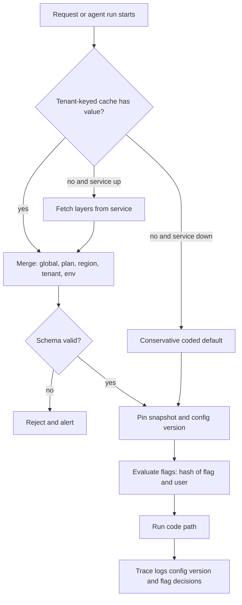

## TL;DR
One agent serves many customers: tenant configuration holds each one's model, prompt version, tool list
and guardrails as typed, versioned data resolved at runtime, and feature flags decide who gets which agent behaviour, so you
never fork the agent per customer.

## For agent builders
- **Why it matters for agents.** An agent's behaviour is mostly data: system prompt version, model, which
  tools are registered, retrieval sources, guardrail thresholds and step budgets. Each customer needs a
  different mix, and each of those changes more often than the agent's code.
- **Where it shows up in your stack.** The step where the agent is assembled for a run (prompt, model,
  tool registry), the trace attributes of each run, the eval gate in front of prompt changes, and the kill
  switch on-call uses to disable an external tool.
- **What you control.** The typed schema of what may vary, the layering order, pinning the resolved config
  at run start, and conservative defaults so a config outage removes tools rather than guardrails.
- **What you can skip.** Comparing flag vendors in depth; a vendor-neutral interface and a typed table you
  own cover most agent teams until flags multiply.

## Why it exists
- **Every customer wants something different.** The first gets the product as built. The second needs
  answers in German, Confluence rather than SharePoint, and a refusal policy for HR questions. The third
  is regulated and cannot use one of your model providers at all.
- **Hard-coded checks decay.** An `if customer == "acme":` ships fastest but scatters policy across the
  codebase, so nobody can answer "what is different about Acme?" without grepping, and every change must
  consider every special case by hand.
- **Per-customer branches are worse.** A security fix or model upgrade must be merged into N branches,
  testing multiplies by N, and branches drift until some customers run code months old. It works for the
  first three customers and becomes unmaintainable by the tenth.
- **One configuration for everyone fails the other way,** because enterprise deals are often won on
  exactly these differences.
- **What survives: two separations.** *What varies per tenant* (data, resolved at runtime) is separate
  from *the code that reads it* (one version, deployed everywhere); *configuration* (a durable statement
  about how this tenant works) is separate from *feature flags* (a usually temporary decision about who
  sees a code path). Differences become inspectable, testable and auditable, and change without a deploy,
  which in an AI product is frequent because prompts, models and thresholds change far more often than
  code.

## How it works
### What goes in tenant configuration
Typical per-tenant settings in an AI product:
- **Models:** allowed model providers and the default model.
- **Behaviour:** prompt template version, guardrail policy and thresholds, language and tone.
- **Data:** retrieval sources and their connector settings, data residency region.
- **Limits:** rate limits and token budgets.
- **Capabilities:** enabled integrations and which tools an agent may call.
- **Secrets are referenced, never stored.** API keys and connector credentials are *referenced* by name
  and stored in a secrets manager, because configuration is read widely, logged and diffed, and secrets
  must not be.

### Layered resolution
Configuration is resolved by merging layers from general to specific, with the most specific winning:

```
global defaults  <  plan tier  <  region / deployment  <  tenant  <  environment override
```

- **Why layers.** Most tenants differ in a handful of keys. Full configurations per tenant mean a new
  default must be copied into every tenant record; overrides alone mean a new default reaches everyone
  who has not opted out.
- **Validate the resolved result** against a typed schema before use, because a typo in a key or an
  out-of-range threshold should fail at write time in an admin tool, not at 2 a.m. inside a request.

### Versioning and audit
1. **Every change creates a new immutable version** with author, timestamp and reason.
2. **Every request logs the configuration version** it ran under. When a customer reports answers got
   worse on Tuesday, the first question is what changed, and a prompt version or retrieval threshold
   changed by an admin is as likely a cause as a deploy.
3. **Behaviour-changing config goes through the eval gate.** Run the tenant's regression suite against the
   new version before activating it, as you would for code.

### Feature flags, and their four kinds
A flag is a runtime decision about which code path runs, evaluated against a context (tenant, user,
environment, percentage bucket). Hodgson's taxonomy separates them by lifetime and owner, which is the
useful distinction:

| Kind | Purpose | Lifetime |
|---|---|---|
| **Release flags** | hide unfinished or unproven work | short; removed once on for everyone |
| **Experiment flags** | split traffic between variants (two prompts, two rerankers) | removed when the experiment concludes |
| **Ops flags / kill switches** | let on-call turn off an expensive or misbehaving path (a costly model, an external tool) without a deploy | long-lived by design |
| **Permission or entitlement flags** | gate features by plan or contract | effectively long-lived tenant configuration; better modelled as such |

Treating them the same causes trouble: release flags never removed become permanent branching, and
entitlements implemented as ad hoc flags get lost when someone cleans up "old flags".

### Evaluation mechanics
- **Serve from an in-process cache.** Lookups sit on the request path, so they come from a cache refreshed
  by polling or streaming from the flag service. During an outage it keeps serving last-known values.
- **The coded default must be conservative.** It is what a process uses with no value at all, typically a
  pod started while the service was unreachable. Make it the conservative path (feature off, stricter
  guardrail) *because* a config-service outage should degrade capability, not remove protections.
- **Hash a stable key for percentage rollouts.** Use tenant ID, or user ID within a tenant, so a user stays
  in the same bucket across requests, and salt it with the flag name so the same users are not first in
  line for every rollout.
- **Use a vendor-neutral interface.** SDK interfaces such as OpenFeature let application code evaluate
  flags without binding to one flag vendor.
- **Resolve once per unit of work and pin it.** An agent run or conversation that re-reads config at every
  step can switch prompt version, model or tool list halfway through when an admin saves a change,
  producing a run no single version explains and nobody can reproduce. Snapshot the resolved config and
  flag decisions at the start of the request, job or conversation, carry its version in the trace, and
  apply changes at the next unit.
- **Kill switches are the exception to pinning.** A switch exists to stop harm now, so the tool adapter
  checks it on every call and returns "tool unavailable" to the model, even inside a pinned run, because
  waiting for long runs to finish defeats the switch.
- **Key the cache by tenant,** *because* a cache keyed by flag name alone is a cross-tenant leak: the
  first tenant to resolve a key sets it for everyone.

### Assembling an agent from tenant config
At the start of each run the resolved, pinned config builds the agent, so the model never sees a tool or
prompt the tenant is not entitled to.
1. **Pick the prompt** by `prompt_version`, never by editing prompt text in place, so every run names the
   exact prompt it used.
2. **Filter the tool registry** to the tenant's enabled tools, then remove any tool whose kill switch is
   on. A tool that is not registered cannot be called, which is stronger than telling the model not to;
   a switch flipped mid-run is caught by the per-call check above.
3. **Apply limits** from config: step budget, token budget per run, allowed models and providers.
4. **Stamp the trace** with config version, prompt version, tool list and flag decisions, so an eval or
   incident can replay the run under the same settings.
- **Experiment flags for agents** split runs, not requests: bucket by conversation or run id so one run
  never mixes two prompts or two tool sets.

### Keeping the matrix testable
Each independent boolean doubles the possible combinations, so you cannot test them all:
- **Test what tenants actually run:** pull the resolved configs of live tenants into CI.
- **Keep the number of live flags small.**
- **Give each release flag an owner and a removal date.**

## Diagram
A request resolves its tenant's layered config once, validates it, pins it for the whole unit of work and
evaluates flags against it; an unreachable service falls back to the conservative default.



## Examples
### A layered resolver with validation and stable rollout buckets
A minimal layered resolver with validation, versioning and a conservative fallback. The schema is the
contract; overrides are partial dictionaries.

```python
from dataclasses import dataclass, replace, fields
import hashlib

@dataclass(frozen=True)
class TenantConfig:
    model: str = "default-large"
    prompt_version: str = "support-v7"
    retrieval_top_k: int = 8
    pii_redaction: bool = True
    allowed_providers: tuple = ("provider-a", "provider-b")
    new_reranker_pct: int = 0           # release flag: % of users on the new reranker

    def validate(self):   # explicit raises, not assert: asserts vanish under python -O
        if not 1 <= self.retrieval_top_k <= 50: raise ValueError("retrieval_top_k out of range")
        if not 0 <= self.new_reranker_pct <= 100: raise ValueError("new_reranker_pct out of range")
        if self.model_provider() not in self.allowed_providers:
            raise ValueError("model not allowed for tenant")

    def model_provider(self):
        return "provider-b" if self.model.startswith("b-") else "provider-a"

LAYERS = {  # in production: rows in a versioned config store
    "plan:enterprise": {"retrieval_top_k": 12},
    "tenant:acme": {"prompt_version": "support-v7-de", "allowed_providers": ("provider-a",)},
    "tenant:globex": {"new_reranker_pct": 25},
}

def resolve(tenant: str, plan: str) -> TenantConfig:
    cfg, known = TenantConfig(), {f.name for f in fields(TenantConfig)}
    for layer in (f"plan:{plan}", f"tenant:{tenant}"):
        override = LAYERS.get(layer, {})
        unknown = set(override) - known
        if unknown: raise ValueError(f"{layer}: unknown keys {unknown}")   # typo caught here
        cfg = replace(cfg, **override)
    cfg.validate()
    return cfg

def in_rollout(flag: str, user_id: str, pct: int) -> bool:   # stable bucket per user and flag
    return int(hashlib.sha256(f"{flag}:{user_id}".encode()).hexdigest(), 16) % 100 < pct

cfg = resolve("globex", "enterprise")
print(cfg.retrieval_top_k, in_rollout("new_reranker", "globex:u-1842", cfg.new_reranker_pct))
```

- **What each tenant gets.** Acme gets a German prompt and a single allowed provider; Globex gets a quarter
  of users on the new reranker; both inherit the enterprise `top_k`.
- **Where the rollout belongs.** The percentage sits in the config only to keep the sketch short; in
  practice it lives in the flag service with an owner and a removal date, the separation argued above.
- **Validation as contract.** Setting `model="b-large"` for Acme would fail validation before any request
  runs, because the contract forbids that provider for that tenant.

### Pinning the config for a conversation
A runnable sketch of why snapshots matter: an admin saves a new prompt version mid-conversation, and only
the pinned path stays consistent.

```python
store = {"acme": {"version": 41, "prompt_version": "support-v7-de"}}

def live_lookup(tenant):
    return store[tenant]

def run_conversation(tenant, turns, pin, admin_edit_at):
    snapshot = dict(live_lookup(tenant)) if pin else None
    used = []
    for turn in range(turns):
        if turn == admin_edit_at:   # admin saves a change mid-run
            store[tenant] = {"version": 42, "prompt_version": "support-v8-de"}
        cfg = snapshot if pin else live_lookup(tenant)
        used.append(cfg["version"])
    store[tenant] = {"version": 41, "prompt_version": "support-v7-de"}   # reset for the demo
    return used

print(run_conversation("acme", 4, pin=False, admin_edit_at=2))  # [41, 41, 42, 42] mixed run
print(run_conversation("acme", 4, pin=True, admin_edit_at=2))   # [41, 41, 41, 41] reproducible
```

### Building a tenant's agent with a kill switch
A sketch that turns the pinned config into the tool list the model sees. Tool names and the `KILL`
set are illustrative; in production the kill switches come from the flag service.

```python
ALL_TOOLS = {"search_kb": ..., "create_ticket": ..., "web_search": ..., "refund_order": ...}
TENANT_TOOLS = {"acme": ["search_kb", "create_ticket"], "globex": ["search_kb", "web_search", "refund_order"]}
KILL = {"web_search"}            # ops flag flipped by on-call: external tool misbehaving

def build_agent(tenant: str, plan: str, run_id: str) -> dict:
    cfg = resolve(tenant, plan)                     # typed, validated, pinned for this run
    tools = [t for t in TENANT_TOOLS.get(tenant, []) if t not in KILL]   # unknown tenant: no tools
    return {"run_id": run_id, "prompt_version": cfg.prompt_version, "model": cfg.model,
            "tools": tools, "trace_attrs": {"tenant": tenant, "tools": ",".join(tools)}}

print(build_agent("globex", "enterprise", "run-77")["tools"])   # ['search_kb', 'refund_order']
```

The model cannot call `web_search` while the switch is on, because the tool is absent from the request,
not merely discouraged in the prompt.

### Worked scenario: rolling a new model to fifty tenants
Illustrative plan using tenant config plus a release flag.

| Wave | Tenants | Gate before enabling | Result |
|---|---|---|---|
| 0 | 3 barred by contract | validation rejects the provider | never switched |
| 1 | 10 low-risk | regression suite per tenant | all pass, enabled |
| 2 | 35 standard | suite plus a week of feedback metrics on wave 1 | 33 pass; 2 held on a threshold tweak |
| 3 | 2 with past complaints | shadow traffic, then suite | enabled last |

After wave 3 the flag is removed and the new model becomes the default; the old one stays only as a kill
switch target.

## Production patterns
- **Resolved-config viewer with provenance.** Use as soon as layers exist. An admin view or CLI that prints
  each key's resolved value and the layer that set it. Monitor how many tenants override each key; a key
  everyone overrides should become the default.
- **Config changes through the eval gate.** Use for any key that changes model behaviour (prompt version,
  model, thresholds). Saving a new version triggers the tenant's regression suite, and activation waits
  on a pass. Monitor gate failures and time from save to activation.
- **Flag hygiene with owner and expiry.** Use for every release and experiment flag. Record an owner and a
  removal date at creation and fail CI or open a ticket when a flag passes its date. Monitor live flag
  count and median flag age.
- **Kill switches for expensive or external paths.** Use for costly models and third-party tools. A
  long-lived ops flag, default off-path when unknown, that on-call can flip without a deploy. Monitor how
  often it is flipped and time to recovery.
- **Config version in every trace.** Use always. Stamp the pinned config version and flag decisions on
  each request, job or conversation span. Monitor quality metrics broken down by config version so a
  regression is attributable to a save, not just a deploy.
- **Tool lists as entitlements, tool kill switches as ops flags.** Use for every agent with external or
  side-effecting tools. Store which tools a tenant may use in typed config, and give each external tool a
  long-lived kill switch that removes it from the registry. Monitor tool-call error rate per tool and how
  often each switch flips.

## Trade-offs
- **No-deploy changes vs config-caused breakage.** Runtime configuration changes tenant behaviour without
  a deploy, but a config change can break a tenant as surely as a code change, so it needs the same review
  and evaluation gate once it touches prompts, models or thresholds.
- **Small override records vs computed answers.** Layered overrides let new defaults propagate, but make
  "what does this tenant actually run?" a computed answer, so you need a tool showing the resolved config
  and which layer set each key.
- **Propagation cuts both ways.** Editing a global default changes every tenant that has not overridden
  it, so once a key affects model behaviour a default change needs a staged rollout (a release flag over
  the new default) rather than a single save.
- **Decoupled release vs test matrix.** Flags decouple deploy from release and give on-call kill switches,
  but each live flag doubles the theoretical test matrix; the benefit flips to a cost once flags outlive
  their purpose.
- **Managed flag service vs owned table.** A service gives targeting, audit and UI for free but adds a
  dependency on the request path; for a handful of long-lived entitlements a typed config table you own
  is simpler.
- **Deep customization vs N products.** It wins deals, but past some point you are running N products; the
  trade flips when requests start requiring code paths no other tenant uses.

## Pitfalls
- **Customer names in code** (`if tenant == "acme"`). Symptom: nobody can list a tenant's differences
  without grepping, and a refactor silently drops one customer's behaviour. Fix: move the difference into
  a typed config key.
- **Release flags that are never removed.** Symptom: dozens of stale flags, dead code paths that still
  need testing, and an incident when someone flips one nobody remembers. Fix: owner and removal date.
- **A fallback default that is the permissive path.** Symptom: during a flag-service outage, guardrails or
  redaction quietly switch off for every tenant. Fix: make the coded default the conservative path.
- **Not logging the config version per request.** Symptom: a quality regression report you cannot
  attribute, because a prompt version changed by an admin left no trace in the trace. Fix: stamp it on
  every span.
- **Secrets or connector credentials directly in tenant configuration.** Symptom: API keys appearing in
  admin UIs, config diffs and debug logs. Fix: store a secret-manager reference only.
- **Re-reading configuration at every step of a long agent run or conversation.** Symptom: a trace in which
  the prompt version or model changes mid-run, and a bug report nobody can reproduce because no single
  config version produced it. Fix: pin a snapshot at run start.
- **Disabling a tool by prompt instead of by registry.** Symptom: on-call adds "do not use web search" to
  the prompt during an incident and the agent still calls it on some runs. Fix: remove the tool from the
  request through a kill switch.
- **Unvalidated free-form JSON config.** Symptom: a typoed key is silently ignored, so the tenant runs the
  default and nobody notices until the customer does.

## When to use
- **Introduce tenant configuration** as soon as a second customer needs something the first does not, and
  before the first customer-specific `if` lands.
- **Type and validate from day one;** retrofitting a schema onto a pile of free-form overrides is painful.
- **Use release flags for every risky AI change** (a new model, prompt or retriever), enabling it tenant
  by tenant while watching each tenant's eval and feedback metrics. Use kill switches for anything
  expensive or external.
- **Measure:** the number of live flags, their age, and how many tenants run non-default values for each
  key; a key that every tenant overrides should become the new default.
- **Interviews:** expect to be asked how you would roll out a new model to fifty enterprise tenants
  without a fork per customer.

## Role lens
- **Engineer:** Implements the typed resolver, caches lookups on the request path, logs config version
  and flag decisions in every trace, and deletes release flags when the rollout completes.
- **Architect:** Decides what may vary per tenant and what may not, sets the layering model, and
  requires config changes affecting model behaviour to pass the same eval gate as code.
- **FDE:** Translates each customer requirement into configuration rather than custom code, and pushes
  back when a request would need a tenant-only code path the product team must then maintain.

## Check yourself
**Q:** You must move fifty enterprise tenants from one LLM to another. Three are contractually barred
from the new provider, and two have had quality complaints in the past. How do you structure the rollout?
**A:** Make the model a tenant configuration key constrained by each tenant's allowed-providers list, so
the three barred tenants cannot be switched even by mistake: validation rejects it. Gate the switch with
a release flag targeted by tenant. Run each tenant's regression suite against the new model before
enabling it for them, start with low-risk tenants, and leave the two sensitive ones until last, ideally
with shadow traffic first. Log model and config version per request so any regression is attributable,
keep the old model as the conservative fallback and a kill switch, and remove the flag once every
eligible tenant is migrated.

## Interview questions
### What is the difference between tenant configuration and a feature flag?
- **Configuration is a durable statement** about how a tenant works (allowed providers, residency region,
  prompt version), typed, versioned and audited.
- **A flag is a usually temporary decision** about who sees a code path; release and experiment flags
  should be deleted once their job is done.
- **Entitlements blur the line,** so model them as configuration; ad hoc entitlement flags get lost in
  flag clean-ups.

### A customer says their support agent got worse on Tuesday and there was no deploy. How do you investigate?
- **Pull the config and prompt versions from the agent's run traces** for that tenant before and after
  Tuesday; an admin change to a prompt version, tool list or retrieval threshold is as likely as a deploy.
- **Diff the resolved configs,** including inherited layers, since a global default edit also changes
  every non-overriding tenant.
- **Re-run the tenant's regression suite** on both versions to confirm, then roll back by activating the
  previous immutable version.

### What should a flag client do when the flag service is down, and why?
- **Serve last-known values from the in-process cache,** so most processes keep their current behaviour.
- **With no value at all, use the conservative coded default** (feature off, stricter guardrail), because
  an outage should reduce capability, not remove protections.

### When would you not use a managed feature-flag service?
- **When flags are few and long-lived.** A handful of entitlements fits a typed config table you own,
  without adding a dependency on the request path.
- **The service earns its place** when you run many short-lived release and experiment flags that need
  targeting, percentage rollouts, audit and a UI for non-engineers.

### An external tool your agent uses starts returning garbage. How do you contain it across all tenants?
- **Flip the tool's kill switch,** which removes it from every tenant's tool registry at the next run
  without a deploy; runs already in progress see it too, because the adapter checks the switch on every
  call and returns "tool unavailable" to the model.
- **Confirm from traces** that tool-call counts for it drop to zero, then check task success per tenant
  to see which agents depended on it and need a fallback.

### How do you keep the flag and config matrix testable as tenants grow?
- **Test the combinations tenants actually run** by pulling live resolved configs into CI, since each
  independent boolean doubles the theoretical matrix.
- **Cap live flags and expire them** with an owner and removal date.
- **Watch override counts per key** and promote universal overrides to defaults, shrinking variation.

## Quiz
### Q: Why should a feature-flag client fall back to the conservative path when the flag service is unreachable?
- [ ] Because the conservative path is always faster to execute
- [x] Because an outage of the config service should reduce capability, not remove protections such as guardrails
- [ ] Because flag services guarantee the last value is stale after a timeout
- [ ] Because percentage rollouts cannot be computed without the service
> If the default is permissive, a flag-service outage silently disables redaction or guardrails for every
> tenant. A conservative default turns the same outage into a temporary loss of new features instead.

### Q: What is the main advantage of storing tenant overrides rather than a full configuration per tenant?
- [ ] Overrides are cheaper to store in the database
- [ ] Overrides remove the need for schema validation
- [x] A new global default reaches every tenant that has not explicitly overridden that key
- [ ] Overrides make the resolved configuration easier to see at a glance
> With full copies, every new default must be backfilled into each tenant record. Overrides keep records
> small and let defaults propagate, at the cost of needing a tool to show the resolved result.

### Q: Which flag is expected to be long-lived by design?
- [ ] A release flag for a new reranker
- [ ] An experiment flag comparing two prompts
- [x] An ops kill switch that disables an expensive external tool
- [ ] A flag hiding a half-built admin page
> Kill switches exist for incidents that can happen at any time, so they stay. Release and experiment
> flags should be removed once the rollout or experiment ends, or they become permanent branching.

## Use cases & projects
### Use cases
- **Multi-tenant support agents.** Each customer gets its own prompt version, language, retrieval sources
  and tool list from one codebase.
- **Rolling a new model or prompt to an agent fleet.** A release flag targeted by tenant, gated by each
  tenant's regression suite, moves agents over in waves.
- **Incident response on agent tools.** A kill switch, checked on every tool call, takes a failing
  external tool away from every agent, in-flight runs included, without a deploy.
- **Prompt A/B tests on agents.** Experiment flags bucketed by run id compare two prompts without mixing
  them inside one run.

### Mini project
**Config-driven agent assembly with pinning (2 hours).**
- **Goal:** one agent factory that builds a different agent per tenant from layered config and keeps each
  run on one config version.
- **Steps:** define a typed config with prompt version, model, tool list and step budget; add global, plan
  and tenant layers; build the agent from the resolved config; add a kill switch for one tool; change the
  tenant's prompt version halfway through a 6-step run and log the version at every step.
- **Done when:** two tenants get different tools and prompts from the same code, the kill switch removes a
  tool on the next run, and every step of the edited run logs the same config version.
