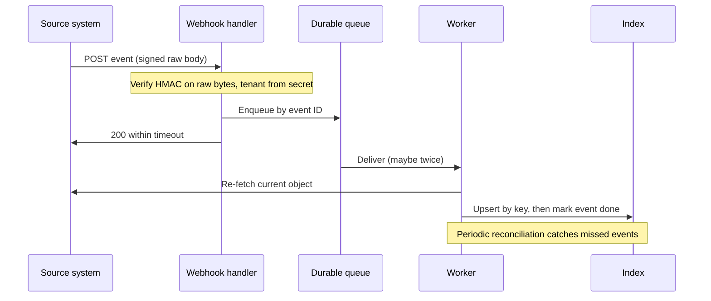

## TL;DR
A webhook is an HTTP POST a source sends when something changes, so you learn in seconds without
polling. Delivery is at-least-once, unordered and public, so verify, ack fast, queue, process
idempotently, re-fetch current state, and reconcile for events that never arrive.

## Why it exists
- **Freshness is the product.** An AI assistant indexed over Jira, Slack or SharePoint is only as fresh as
  its last sync.
- **Polling scales badly.** Calls multiply by tenants × containers × polls, most return "nothing changed",
  and minutes of staleness remain. Illustratively, 200 tenants with 50 watched containers each, polled every
  5 minutes, is 200 × 50 × 288 ≈ 2.9 million calls a day, and average staleness is still about half the
  interval. Halving staleness doubles the calls.
- **Agents feel the latency.** "When a ticket is assigned to the AI queue, draft a reply" waits on the poll.
- **Webhooks invert the direction**: the source tells you when something happens.
- **The naive receiver's three assumptions are false.** It works inside the handler, trusts the body, and
  expects exactly-once, in-order delivery:
  - the handler times out calling an LLM, the sender retries, and you process the event twice;
  - anyone who discovers the URL can post fake events, e.g. a forged "document updated" injecting attacker
    text into your index;
  - events for one object arrive out of order, so an older "updated" overwrites newer state;
  - senders drop events during outages on either side, or disable subscriptions that fail too often.

## How it works
### 1. Subscribe
- **Register your URL per tenant for specific event types.**
- **Prove ownership where required.** Slack sends a `url_verification` challenge you must echo; Microsoft
  Graph sends a `validationToken` you return as plain text.
- **Renew expiring subscriptions.** Graph subscriptions expire, so renew them on a schedule. Store
  subscription IDs and expiry, *because* an expired subscription fails silently: nothing arrives.
- **Handle lifecycle notifications.** Graph sends them (for example a subscription needs reauthorization, or
  notifications were missed); *because* "missed" is the sender telling you to run a catch-up sync.

### 2. Verify
- **Reject anything not provably from the sender.** Most use an HMAC of the raw body (often with a
  timestamp) under a shared secret; some use a client-state token you chose at subscription time, or mutual TLS.
- **Compare in constant time and reject old timestamps** to limit replay. Details are in the
  signature-verification lesson.
- **Verify the raw bytes before parsing.** That is the integration rule.
- **Derive the tenant from which secret verified the request** (or from the subscription ID you stored),
  never from a tenant field in the body, *because* the body is exactly what an attacker controls.

### 3. Acknowledge fast, process later
- **Return 2xx within the sender's timeout** after verifying and durably enqueueing (Slack, for example,
  expects a response within three seconds), *because* slow work in the handler causes timeouts, retries and
  duplicates.
- **Know what the sender does next.** Most retry with backoff a bounded number of times (Slack marks retries
  with `X-Slack-Retry-Num` and `X-Slack-Retry-Reason` headers); some disable a subscription whose endpoint
  keeps failing. Either way, your failure window becomes lost events.

### 4. Process idempotently
- **Deduplicate by the sender's event ID** (or a hash of the payload) in the consumer. Senders retry on
  non-2xx and sometimes even after success, so duplicates are normal.
- **A dedup table is an optimisation, not the guarantee.** Two workers can pick up the same event
  concurrently and both see "not seen yet".
- **The guarantee is idempotent processing:** re-fetch current state, upsert by key, so a duplicate that
  slips through does no harm.
- **Claim non-idempotent side effects** (posting a reply) with an atomic insert-if-absent before acting.

### 5. Treat payloads as hints
- **Many events are thin** (an ID and a type); even fat payloads may be stale by processing time.
- **Re-fetch the current object** and apply it, or compare a version or modified timestamp and discard older
  ones, *because* ordering is not guaranteed.

### 6. Reconcile
- **Run a periodic incremental sync** (delta query, `updated since` watermark) that catches whatever the
  webhooks missed. Webhooks give latency; reconciliation gives correctness.
- **Alert when reconciliation finds many undelivered changes**, since that usually means a broken subscription.

## Diagram
The handler only verifies and enqueues; all real work happens in a worker that re-fetches state, and a
reconciler covers what never arrives.



## Examples
### Slack Events API receiver in FastAPI
Verify the signature over the raw body, answer the URL challenge, enqueue and return immediately.

```python
import hashlib, hmac, json, os, time
from fastapi import FastAPI, Request, Response, HTTPException

app = FastAPI()
SECRET = os.environ["SLACK_SIGNING_SECRET"].encode()

def verify(raw: bytes, ts: str, sig: str) -> None:
    if abs(time.time() - int(ts)) > 300:                     # 5-minute replay window
        raise HTTPException(401, detail="stale timestamp")
    base = b"v0:" + ts.encode() + b":" + raw
    expected = "v0=" + hmac.new(SECRET, base, hashlib.sha256).hexdigest()
    if not hmac.compare_digest(expected, sig):               # constant-time compare
        raise HTTPException(401, detail="bad signature")

@app.post("/hooks/slack")
async def slack_events(req: Request):
    raw = await req.body()                                   # raw bytes, before any JSON parsing
    verify(raw, req.headers.get("X-Slack-Request-Timestamp", "0"),
           req.headers.get("X-Slack-Signature", ""))
    body = json.loads(raw)
    if body.get("type") == "url_verification":
        return {"challenge": body["challenge"]}
    await queue.enqueue("slack-events", key=body["event_id"], payload=body)  # durable, then ack
    return Response(status_code=200)

async def consume(msg):                                      # runs in a worker, not the handler
    if await dedup.seen(msg.key):                            # event_id seen before: retry duplicate
        return
    ev = msg.payload["event"]
    if ev["type"] == "message":
        m = ev.get("message") or ev.get("previous_message") or ev   # edits/deletes nest the original
        root = m.get("thread_ts") or m["ts"]
        current = await slack.conversations_replies(ev["channel"], root)
        await indexer.upsert_thread(msg.payload["team_id"], ev["channel"], current)  # re-fetched state
    await dedup.mark(msg.key)                                # mark only after success, so a crash retries
```

- **Whole-thread re-fetch.** The consumer re-fetches the thread rather than trusting the single message,
  which also handles edits and out-of-order delivery for that thread.
- **Nested messages on edits and deletes.** `message_changed` and `message_deleted` subtypes carry the
  affected message nested inside the event, and the event's own `ts` is not a message, so the root timestamp
  is read from the nested message.
- **Deleted roots.** A deleted thread root makes the re-fetch return not-found, which the indexer must treat
  as a delete.
- **Mark after success.** Marking the dedup key first would turn a worker crash into a silently dropped event.

### Atomic claim and version-guarded upsert
Pure Python with `sqlite3`, runnable. The same SQL shape works in Postgres with
`INSERT ... ON CONFLICT (event_id) DO NOTHING`.

```python
import sqlite3

db = sqlite3.connect(":memory:")
db.execute("CREATE TABLE claims (event_id TEXT PRIMARY KEY)")
db.execute("CREATE TABLE docs (id TEXT PRIMARY KEY, body TEXT, version INTEGER)")

def claim(event_id: str) -> bool:
    """Atomic insert-if-absent: exactly one worker wins, however many race on a retried event."""
    cur = db.execute("INSERT OR IGNORE INTO claims VALUES (?)", (event_id,))
    db.commit()
    return cur.rowcount == 1

def apply_if_newer(doc_id: str, body: str, version: int) -> bool:
    """Version-guarded upsert: an older event arriving late cannot overwrite newer state."""
    db.execute("INSERT OR IGNORE INTO docs VALUES (?, ?, -1)", (doc_id, body))
    cur = db.execute("UPDATE docs SET body = ?, version = ? WHERE id = ? AND version < ?",
                     (body, version, doc_id, version))
    db.commit()
    return cur.rowcount == 1

print(claim("Ev123"), claim("Ev123"))          # True False: second delivery does not post twice
print(apply_if_newer("PROJ-7", "v2 text", 2))  # True
print(apply_if_newer("PROJ-7", "v1 text", 1))  # False: late, older event discarded
```

### Worked numbers: polling vs webhooks plus reconciliation
200 tenants × 50 containers, illustrative 20,000 real changes a day.

| Design | API calls per day | Typical staleness |
|---|---|---|
| Poll every 5 minutes | 200 × 50 × 288 ≈ 2.9 million | about 2.5 minutes on average |
| Poll every minute | ≈ 14.4 million | about 30 seconds |
| Webhooks + one re-fetch per change | ≈ 20,000 | seconds |
| Plus hourly reconciliation per container | + 200 × 50 × 24 = 240,000 | missed events bounded to 1 hour |

## Production patterns
- **Durable enqueue before the 2xx.** Write the verified event to a durable queue or an outbox table and only
  then acknowledge; with Kafka, a producer configured with `acks=all` is the usual choice. Monitor enqueue
  latency against the sender's timeout and receiver error rate.
- **Subscription renewal with a horizon alert.** A scheduled job renews expiring subscriptions (Graph, for
  example) well before expiry and re-creates any that were removed. Monitor each tenant's subscription
  expiry horizon and alert when it falls below one renewal interval.
- **Lifecycle notifications trigger catch-up.** Set a lifecycle notification URL on Graph subscriptions and
  treat "missed" or "reauthorization required" as a signal to reauthorize and run reconciliation now. Monitor
  lifecycle events per tenant.
- **Dead-letter queue with replay.** After a bounded number of worker attempts, move the event to a DLQ with
  the error, and give operators a replay command. Monitor DLQ depth and age of the oldest message.
- **Dual secrets during rotation.** Accept signatures from the current and previous signing secret for a
  short overlap, then retire the old one. Monitor signature failures by tenant, which spike when a rotation
  goes wrong.

## Trade-offs
- **Freshness vs operational surface.** Webhooks cut lag to seconds and save API calls, but add a public
  endpoint, subscription lifecycle and secret management. Polling wins when changes are rare or the source
  has no webhooks.
- **Fat vs thin payloads.** Fat payloads avoid an API call per event but can be stale or out of order; thin
  payloads plus re-fetch cost a call each but always apply current state.
- **Ack-before-process vs durability.** Acknowledging first keeps the sender happy but makes your queue the
  durability boundary; if the enqueue is not durable, an acknowledged event can be lost for good.
- **Per-tenant vs shared subscriptions.** Per-tenant subscriptions isolate failures and secrets but multiply
  renewal jobs; one shared app-level subscription is simpler when the source supports routing by tenant ID.

## Pitfalls
- **Calling an LLM or indexer inside the handler.** Symptom: sender timeouts, retries, and the same document
  embedded or the same reply drafted twice.
- **Verifying over re-serialized JSON instead of raw bytes.** Symptom: every request fails verification,
  after which someone disables the check.
- **No reconciliation job.** Symptom: a few documents permanently stale after an outage, found only when a
  user complains.
- **Letting subscriptions expire or get disabled after repeated failures.** Symptom: a tenant's freshness
  quietly drops to the reconciliation interval.
- **Check-then-mark dedup for non-idempotent side effects.** Symptom: occasional double replies or double
  tickets under load, when two workers race on the same retried event.
- **Trusting payload content as instructions or index text** without fetching from the source. Symptom:
  forged events inject attacker-controlled text into retrieval.

## When to use
- **Use when** users or agents need changes within seconds and the source supports webhooks; keep a
  reconciliation sync regardless.
- **Prefer polling or delta sync alone** for low-change sources, sources without webhooks, or customers who
  will not allow inbound internet traffic (then consider a relay or a pull-based event API).
- **Measure:** end-to-end lag from source change to index, duplicate rate, signature failures, queue depth,
  subscription expiry horizon, and how many changes reconciliation catches that webhooks missed.
- **Interviews:** name at-least-once delivery, idempotency, fast ack and reconciliation.

## Role lens
- **Engineer:** Writes verified, fast-ack receivers, idempotent consumers keyed by event ID, re-fetch logic
  and subscription renewal jobs with alerting on expiry.
- **Architect:** Decides webhook versus polling per source, where the durable queue sits, and the
  reconciliation cadence that bounds worst-case staleness.
- **FDE:** Gets inbound endpoints allowed through the customer's network policy, configures subscriptions in
  their tenant and proves freshness with a live edit during acceptance testing.

## Check yourself
**Q:** After a two-hour outage of your queue, a customer reports that some Jira tickets edited during the
outage still show old content in the assistant. Webhooks are back. Why, and how do you prevent it?
**A:** The sender retried for a while, then gave up, or your endpoint returned errors and those events were
never redelivered; webhooks are not a durable log you can replay at will. Nothing will re-send those
changes, so they stay stale until the item changes again. Prevention is a reconciliation job: an incremental
query for items updated since the last confirmed watermark, run periodically and after any incident, which
re-fetches and upserts them. Also alert on receiver error rate and queue health so outages trigger an
immediate catch-up sync.

## Interview questions
### What delivery guarantees do webhooks give, and how does that shape the receiver?
- **At-least-once, unordered, best-effort:** retries create duplicates, events can arrive out of order, and
  some are lost for good.
- **So the receiver** verifies, acks fast after a durable enqueue, processes idempotently, re-fetches current
  state and relies on reconciliation for completeness.

### The assistant drafted the same Slack reply twice for one message. How do you debug and fix it?
- **Check for retries:** `X-Slack-Retry-Num` on the second delivery usually means the handler was slow and
  missed the timeout.
- **Check the dedup:** a check-then-mark table lets two workers race on the same retried event.
- **Fix:** ack after enqueue only, and claim the side effect with an atomic insert-if-absent on the event ID
  before posting.

### When would you not use webhooks?
- **Low-change sources**, where polling or delta sync is cheap and simpler.
- **Sources without webhooks**, or customers who will not allow inbound internet traffic; use a relay or a
  pull-based event API instead.
- **Never as the only mechanism**, because a missed event stays wrong until the item changes again.

### How do you size the reconciliation interval?
- **It is your worst-case staleness** for a missed event, so pick it from the freshness the customer needs.
- **Cost:** tenants × containers × runs per day of incremental queries; 200 × 50 hourly is 240,000 calls a
  day, far below 5-minute polling.
- **Watch the catch rate:** many changes found by reconciliation means a subscription is broken, not that
  the interval is wrong.

### How does a multi-tenant receiver know which tenant an event belongs to?
- **From the credential:** the secret that verified the signature, or the stored subscription ID.
- **Never from the body**, because a tenant field in the payload is exactly what a forger controls.

## Quiz
### Q: Why should a webhook handler return 2xx quickly and process the event asynchronously?
- [ ] Senders reject responses that contain a body
- [x] Slow handlers hit the sender's timeout, which triggers retries and duplicate processing
- [ ] Asynchronous processing makes the signature valid for longer
- [ ] 2xx responses guarantee exactly-once delivery
> Senders retry when they do not get a timely success; doing LLM or indexing work inline causes timeouts and
> duplicates. Fast ack after durable enqueue keeps delivery reliable, though still at-least-once.

### Q: Two events for the same document arrive out of order. What handling is safest?
- [ ] Apply them in arrival order
- [ ] Drop the second event as a duplicate
- [x] Re-fetch the current object, or compare versions and ignore older updates
- [ ] Ask the sender to resend both in order
> Ordering is not guaranteed, so applying payloads as they arrive can let stale data win; fetching current
> state or version-checking makes the outcome independent of delivery order.

### Q: Why keep a reconciliation sync if webhooks are working?
- [ ] Webhooks cannot deliver deletions
- [ ] Reconciliation is required to verify signatures
- [x] Events can be lost during outages or expired subscriptions, and only a sync recovers them
- [ ] Webhooks only work for the first tenant
> Push delivery gives low latency but no completeness guarantee; a periodic incremental sync bounds how long a
> missed change can stay wrong.
