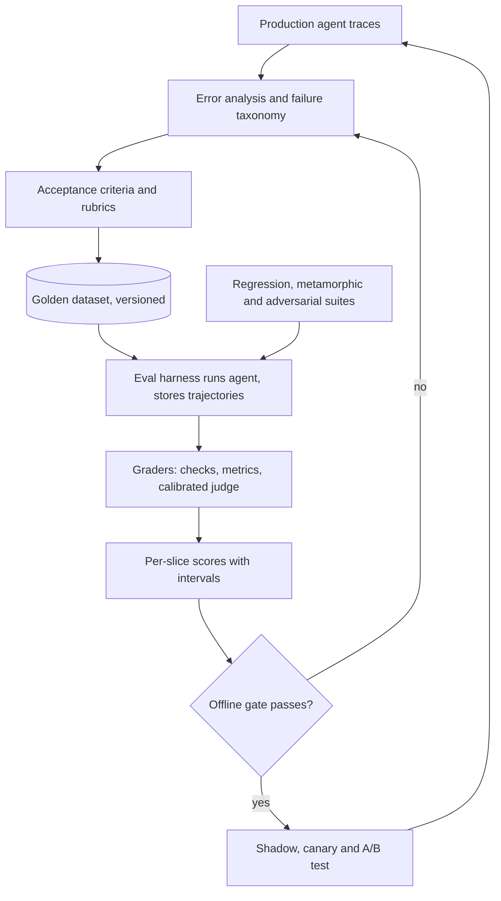

## Overview
This module is about producing numbers you can trust about whether an LLM system, and above all an
agent, does its job, and using those numbers to decide what ships. Every prompt, model, retriever or
tool change to an agent is non-local, so without a measured number you are shipping on a demo.

It starts by separating capability evaluation (what a model can do in general, answered by benchmarks)
from application evaluation (whether your prompt, retrieval, tools and model do your task on your
data). It then builds the core machinery of the second, which is what an agent team runs every week.

- **Specification and reference:** task-specific acceptance criteria that define "done", and a versioned golden dataset labeled by people with authority over the task.
- **Harness:** an eval harness that runs, grades, aggregates per slice with confidence intervals and compares runs, storing every output and trajectory.
- **Judges:** grading open-ended output leads to LLM-as-a-judge, which is only trustworthy once it is calibrated against human labels, scored with clear rubrics, compared pairwise where absolute scales fail, and anchored by inter-annotator agreement on the labels themselves.
- **Specialised metrics:** pass@k for executable tasks, retrieval metrics, faithfulness and hallucination evaluation for RAG.
- **Robustness and the worst case:** regression, metamorphic and property-based tests guard known behaviour and robustness without labels; adversarial evaluation and red teaming cover the worst case.
- **The loop:** offline and online evaluation, A/B tests, error analysis and eval-driven development close the loop from production failures back into the suite.

Which lessons matter most for agents:

- **Core (you use them directly):** model-evaluation, task-specific-acceptance-criteria, golden-dataset, eval-harness, error-analysis, pass-k, llm-as-a-judge, rubrics, judge-calibration-and-bias, retrieval-evaluation, faithfulness-groundedness, hallucination-evaluation, regression-tests, red-teaming, adversarial-evaluation, offline-vs-online-evaluation, eval-driven-development and tooling.
- **Useful (you meet them when choosing models, labeling or running experiments):** benchmarking, dataset-contamination, inter-annotator-agreement, pairwise-comparison, metamorphic-testing, property-based-testing and a-b-testing.
- **Background:** none of the lessons here are pure background; evaluation is something every agent builder does by hand.

Afterwards you can:

- Design, build and defend an evaluation stack for a real agent feature and gate releases on it.
- Grade agent trajectories and final state, not just the last reply, with deterministic checks first and calibrated judges for the rest.
- Turn red-team findings and production failures into versioned suites that run in CI.
- Plan an online rollout that checks offline measured the right thing.

It matters most for AI Engineers who change prompts and models every week, and for FDEs who need a
customer to sign off on what "working" means.

## Why it matters
- **Engineer:** You turn every prompt, model, retriever or tool change to your agent into a paired harness run against a golden set with per-slice intervals, read the items and trajectories that flipped, and refuse to merge a change whose eval diff you cannot explain.
- **Architect:** You decide where evaluation lives in the agent's delivery pipeline: which graders are deterministic (final sandbox state, tool-argument schema) versus judged, which suites gate CI versus releases, how offline scores are validated against online outcomes, and which tooling owns datasets, traces and experiments.
- **FDE:** You write acceptance criteria with the customer before committing to a date, build a golden set from their real documents and labelers, and show a calibrated report on the agent's answers and actions that makes sign-off unambiguous instead of resting on a demo that looked fine.

## Mental model
Hold one picture: an eval is a measuring instrument, and every part of it can be miscalibrated. Trust a
number only as far as its weakest layer.

| Layer | What it does | Its own error | Lessons |
|---|---|---|---|
| Specification | Acceptance criteria and rubrics say what to measure | Vague criteria | task-specific-acceptance-criteria, rubrics |
| Reference | A golden dataset whose labels humans agree on says what correct looks like | Noisy or leaked labels | golden-dataset, inter-annotator-agreement, dataset-contamination |
| Harness | Runs the agent under pinned configuration and stores raw outputs and trajectories | Unpinned config, graded-only outputs | eval-harness, tooling |
| Graders | Exact checks, executable tests, retrieval metrics and calibrated judges turn outputs into scores | Biased judges | llm-as-a-judge, judge-calibration-and-bias, pairwise-comparison, retrieval-evaluation, faithfulness-groundedness, hallucination-evaluation |
| Statistics | Paired comparisons, intervals and pass@k say whether a difference is real | Too few items | model-evaluation, pass-k, benchmarking |

Around the instrument runs a loop. Error analysis on real agent traces finds failure modes, and they
become criteria and items. Adversarial and metamorphic suites probe what averages hide. Offline gates
decide what ships, and online measurement checks that offline measured the right thing.

## Suggested order
1. model-evaluation — agent core: frames the capability-versus-application split and why every change needs a measured number, the lens for the whole module.
2. task-specific-acceptance-criteria — agent core: defines what "done" means for one task's outputs and actions before any dataset or grader is built.
3. golden-dataset — agent core: builds the agreed, versioned reference every eval number is computed against.
4. eval-harness — agent core: turns dataset, system and graders into a repeatable, comparable run with slices and intervals.
5. error-analysis — agent core: teaches reading real traces and counting failure modes, which is where criteria and items should come from.
6. pass-k — agent core: gives the correct estimator for sampled executable tasks, needed to read coding benchmarks and your own code and agent evals.
7. llm-as-a-judge — agent core: introduces model graders for open-ended outputs and trajectories that no exact check can score.
8. rubrics — agent core: shows how to turn "is it good?" into observable, mostly binary criteria a judge or human applies consistently.
9. inter-annotator-agreement — useful, but a prerequisite here: measures whether the human labels a judge is scored against are themselves reliable.
10. judge-calibration-and-bias — agent core: measures and mitigates position, length and self-preference bias against those human labels.
11. retrieval-evaluation — agent core: isolates the retriever with recall@k, MRR and NDCG, the first stage of any RAG eval.
12. faithfulness-groundedness — agent core: scores whether generated claims are supported by the retrieved context, the generation-side RAG metric.
13. hallucination-evaluation — agent core: generalises claim-level verification to fabrication, unanswerable items and abstention.
14. regression-tests — agent core: pins known behaviour and detects per-item flips across changes despite sampling noise.
15. red-teaming — agent core: discovers the attacks a goal-driven adversary would use against prompts, data and tools.
16. adversarial-evaluation — agent core: turns those discovered attacks into a versioned suite with attack success and over-refusal rates.
17. offline-vs-online-evaluation — agent core: lays out the ladder from offline gates through shadow mode and canaries to live measurement.
18. eval-driven-development — agent core: ties everything into a workflow where the eval suite is the executable specification of a feature.
19. tooling — agent core: maps Promptfoo, RAGAS, DeepEval, Braintrust, LangSmith and Langfuse onto the pipeline once you know what it must do.
20. benchmarking — useful: covers public benchmarks as a model-shortlisting filter once the difference from your own eval is clear.
21. dataset-contamination — useful: explains why benchmark and golden-set scores inflate through leakage, right after benchmarks are introduced.
22. pairwise-comparison — useful: offers relative judging, win rates and Bradley–Terry ranking once judge biases are understood.
23. metamorphic-testing — useful: checks label-free relations between outputs to expose brittleness the golden set cannot see.
24. property-based-testing — useful: applies generated inputs and shrinking to the deterministic scaffolding around the model.
25. a-b-testing — useful: gives the causal online answer, with randomisation unit, power, guardrails and no peeking.

## Capstone
### Brief
**Use case:** a company runs a RAG agent that answers employee questions about its HR and expense
policies by calling a policy-search tool.

You build and defend its evaluation stack, then use it to
decide a real change: swapping the generation model for a cheaper one and changing the chunking
strategy. This is the module's major project and takes several days.

Start by reading at least 50 traces from a baseline version and writing an error-analysis taxonomy
with counts. From it, write acceptance criteria that separate hard gates from soft thresholds with
slice floors, plus latency and cost limits. Hard gates are no invented policy and no answer to
out-of-scope or unanswerable questions.

Then build the instrument, layer by layer:

- **Reference:** a golden set of 150 to 300 stratified items, including unanswerable and false-premise questions, with a held-out split and a contamination check against any few-shot examples. Two people label an overlap sample to measure agreement.
- **Harness:** pins configuration, stores raw outputs and tool-call trajectories before grading, and reports retrieval recall@k and MRR, claim-level faithfulness, hallucination and abstention rates.
- **Judge:** a rubric-based LLM judge whose position bias and agreement with humans you have measured.
- **Extra suites:** a regression tier seeded from known bugs, a metamorphic suite (paraphrase, irrelevant-paragraph insertion), property tests on the chunker, and a small prompt-injection suite through poisoned documents.

Wire the fast tier into CI as a gate and write an online plan for the winning candidate.

### Deliverables
- An error-analysis sheet of at least 50 read traces with a failure taxonomy, counts per category, and the criteria and golden items each top category produced.
- An acceptance-criteria document listing hard gates, soft thresholds with slice floors, and latency and cost limits, each with its grader and scope.
- The versioned golden dataset with slice labels, a held-out split, a grader spec per item, an inter-annotator agreement report on the overlap sample, and a contamination-check script.
- The eval harness, runnable from one command, producing a per-slice report with confidence intervals, plus a CI configuration that runs the fast tier and fails the build on a hard-gate violation.
- A judge calibration report showing agreement and kappa against human labels next to human–human agreement, position-swap inconsistency rate, and length preference.
- Regression, metamorphic, property-based and adversarial suites, each with its own pass or violation rate on the baseline.
- A decision memo on the model swap and chunking change, citing paired per-item results, regressed items read, cost per answer, and an online rollout plan (shadow, canary, A/B with a power estimate and guardrails).

### Rubric
- Every reported metric carries a confidence interval or paired comparison, and the decision memo does not call a difference significant when its interval includes zero.
- The judge is not used as a release gate until its true-positive and true-negative rates against human labels are reported, and its agreement is within reach of the human–human ceiling measured on the same items.
- Running the harness twice on an unchanged system produces per-item flip rates below a stated flakiness tolerance, and the regression tier distinguishes a planted regression from that noise.
- The unanswerable and false-premise slices are present and reported separately, and the fabrication rate on them is a hard gate rather than averaged into overall accuracy.
- A planted prompt injection in a retrieved document is caught by the adversarial suite, and the report lists over-refusal on benign questions next to attack success rate.
- At least one golden item and one criterion trace back to a named category in the error-analysis taxonomy, and the held-out split was never used while tuning prompts.
