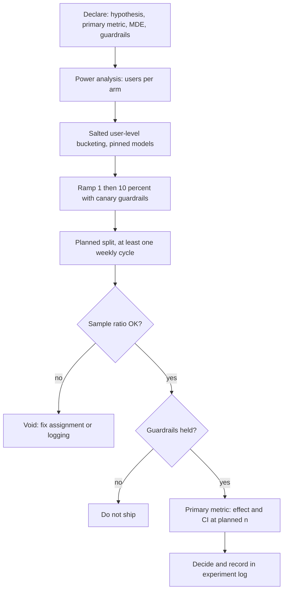

## TL;DR
An A/B test randomly assigns users to the current system or a candidate and compares a pre-declared
outcome, so differences are caused by the change. The discipline: right randomisation unit, one primary
metric, fixed sample size, no peeking.

## Why it exists
- **The real question is causal.** Did this prompt, model or retriever change make users better off?
- **Before-and-after cannot answer it,** because everything else moved too: the day of the week, a
  marketing campaign, a news event that changed what people ask, a provider update to the model behind
  the API.
- **Other shortcuts measure something else.** Offline evaluation measures proxies on a frozen dataset,
  not outcomes on real people. Asking users which version they prefer selects for survey-answerers. An
  LLM judge picking a winner on production traces measures the judge's taste.
- **LLM products need it more than classic software.** Changes are cheap (edit a prompt) and effects
  subtle (a few points of resolution rate), so shipping on a hunch is tempting and small regressions go
  unnoticed. Outcomes are behavioural and delayed: did the user come back, did the ticket stay closed.
  Costs move with quality: 1% more resolved tickets at 40% more tokens per conversation may be a loss.
- **Randomisation removes confounders.** With a coin-flip assignment the only systematic difference
  between arms is the change, so the outcome difference is effect plus quantifiable noise. It sits at
  the top of the evaluation ladder, not instead of it, because it is slow, needs traffic and exposes real
  users, so it is reserved for changes that passed the cheaper rungs.

## How it works
### One hypothesis, one primary metric, guardrails
Declare before starting:
- **The change.**
- **The primary outcome metric:** resolution without escalation, task completed, conversion, return
  within seven days. A single primary metric prevents fishing through twenty metrics for one that moved.
- **The minimum effect worth detecting.**
- **Guardrails that must not degrade:** p95 latency, cost per conversation, error rate, refusal rate,
  safety flags, escalations. They prevent "winning" by breaking something the primary metric does not see.

### The randomisation unit
- **User level for anything conversational:** `bucket = hash(user_id + experiment_salt) mod 100`, so a
  user always sees the same variant. A user who sees both arms confounds the comparison and notices the
  inconsistency.
- **Session level** for anonymous traffic; **request level** only for stateless one-shot tasks.
- **Analysis unit must match randomisation unit.** Randomising by user and counting requests as
  independent underestimates variance, because one user's requests are correlated, and produces false
  positives. For per-request metrics (latency, thumbs per answer) under per-user assignment, aggregate to
  one value per user, or use the delta method or cluster-robust standard errors for the ratio's variance.
- **Interference needs cluster randomisation.** When users interact (teammates sharing one assistant
  workspace, agents on a shared ticket queue), treatment leaks into control. Randomise by the enclosing
  cluster (team, tenant) and accept an effective sample size closer to the number of clusters.
- **Salt per experiment,** so assignments are independent across experiments instead of the same users
  always landing in treatment together.

### Sample size before, not after
Power analysis says how much traffic is needed to detect the minimum effect. For a proportion at
baseline *p₁* and target *p₂*, two-sided α = 0.05 and 80% power:

```
n per arm ≈ 16 · p(1 − p) / δ²        δ = p₂ − p₁
```

| Target | Calculation | Users per arm |
|---|---|---|
| 60% → 63% | 16 × 0.24 / 0.0009 | ≈ 4,270 (exact two-proportion formula in the example: about 4,130) |
| 1-point lift | δ is a third as large | nine times that |

- **Consequence:** low-traffic enterprise deployments often cannot A/B on outcomes at all and fall back to
  pairwise judging on shadow traffic, or to longer tests with larger expected effects.

### Variance reduction (CUPED)
- **The other lever is the variance term.** CUPED (Deng et al., described in Kohavi et al.) adjusts each
  user's outcome using the same metric measured before the experiment, *because* most variation between
  users (heavy versus light users, easy versus hard ticket mixes) existed before the change and is
  unrelated to it.
- **Variance falls by (1 − ρ²)** for a pre-period covariate with correlation ρ: ρ = 0.5 cuts the
  required sample by a quarter, ρ = 0.7 by about half.
- **Covariate choice.** Anything fixed before assignment works; the same metric's pre-period value is
  usually strongest. New users with no history get weaker covariates (customer tier, signup channel) that
  recover less.
- **Never use a covariate measured after assignment,** because the treatment may have moved it.

### Running it
1. **Ramp small** (1%, then 10%), guarded by the canary metrics.
2. **Move to the planned split,** usually 50/50 because it maximises power for a given total.
3. **Run at least one full weekly cycle,** so weekday and weekend users are both represented.
4. **Check the sample ratio.** A 50/50 assignment logging 52/48 on 10,000 users (z ≈ 4, p < 0.001) means
   biased bucketing or logging (a crash on one arm drops its users, say); the result is invalid regardless
   of the p-value.

### Analysis
- **Test:** a two-proportion z-test or a t-test on per-user means, reported as an effect size with a
  confidence interval, not just a p-value.
- **Do not peek.** Checking daily and stopping when significant inflates the false-positive rate well
  above the nominal 5%. If early stopping is needed, use a sequential method designed for it
  (group-sequential boundaries or always-valid p-values).
- **Segments generate hypotheses, not results,** because twenty segments at α = 0.05 produce a
  "significant" one by chance.
- **Watch for novelty:** compare week two with week one, since a new behaviour can draw attention that fades.

### LLM-specific wrinkles
- **Non-stationary models.** If model X is silently updated mid-test in "X vs Y", the comparison is
  confounded; pin snapshots or versions for the duration.
- **Shared caches.** Prefix or semantic caches shared across arms leak latency and cost between them;
  isolate per arm or exclude cache hits from guardrail metrics.
- **Judge-based primary metrics.** When outcome events are too sparse, a calibrated judge over sampled
  traces can be the primary metric, but validate it against outcomes first or the test measures the judge.
- **Interleaving for retrieval.** For rankers and retrievers, interleaving both systems' results in one
  list and counting which source gets clicks is far more sensitive than an A/B on the same traffic.
- **Bandits.** When exploiting the better arm during the test matters more than a clean estimate, a
  multi-armed bandit shifts traffic adaptively, at the cost of a harder-to-interpret result.

## Diagram
The test is designed before any traffic flows; the sample-ratio check and guardrails gate the analysis,
and the primary metric is read once, at the planned horizon.



## Examples
### Sample size, two-proportion test and SRM check
Sample size for a 60% to 63% lift, the test on the resulting data, and a sample-ratio check.

| Output | Value | Reading |
|---|---|---|
| Users per arm | roughly 4,129 | For a 3-point lift |
| Test on 2,460/4,100 vs 2,583/4,100 | z ≈ 2.8, p ≈ 0.005, 95% interval about +0.9 to +5.1 points | A real lift, if the arms are valid |
| SRM on 4,100 vs 4,350 logged users | p ≈ 0.007 | Assignment or logging is broken: the test is void |

```python
import math

def phi(x: float) -> float:                        # standard normal CDF
    return 0.5 * (1 + math.erf(x / math.sqrt(2)))

Z_ALPHA, Z_POWER = 1.959964, 0.841621              # two-sided alpha = 0.05, power = 0.80

def n_per_arm(p1: float, p2: float) -> int:
    pbar = (p1 + p2) / 2
    num = Z_ALPHA * math.sqrt(2 * pbar * (1 - pbar)) + Z_POWER * math.sqrt(p1 * (1 - p1) + p2 * (1 - p2))
    return math.ceil((num / abs(p2 - p1)) ** 2)

def two_proportion(x1: int, n1: int, x2: int, n2: int) -> dict:
    p1, p2, p = x1 / n1, x2 / n2, (x1 + x2) / (n1 + n2)
    z = (p2 - p1) / math.sqrt(p * (1 - p) * (1 / n1 + 1 / n2))
    se = math.sqrt(p1 * (1 - p1) / n1 + p2 * (1 - p2) / n2)
    lo, hi = p2 - p1 - Z_ALPHA * se, p2 - p1 + Z_ALPHA * se
    return {"lift_pp": round(100 * (p2 - p1), 2), "z": round(z, 2),
            "p_value": round(2 * (1 - phi(abs(z))), 4), "ci95_pp": (round(100 * lo, 2), round(100 * hi, 2))}

def sample_ratio_mismatch(n1: int, n2: int, expected: float = 0.5) -> float:
    n = n1 + n2
    z = (n1 - expected * n) / math.sqrt(n * expected * (1 - expected))
    return 2 * (1 - phi(abs(z)))                   # small p-value: assignment or logging is biased

print(n_per_arm(0.60, 0.63))                           # users per arm needed for a 3-point lift
print(two_proportion(x1=2460, n1=4100, x2=2583, n2=4100))
print(sample_ratio_mismatch(4100, 4350))               # planned 50/50; investigate before reading results
```

### CUPED and the cost of peeking, simulated
Runnable on Python 3.10+ (it uses `statistics.covariance` and `statistics.correlation`). The first part
shows ρ ≈ 0.7 halving variance; the second runs A/A tests with no real effect and stops at the first
"significant" daily look.

```python
import math, random, statistics as st

random.seed(7)

def cuped(pre: list[float], post: list[float]) -> list[float]:
    theta = st.covariance(pre, post) / st.variance(pre)   # same theta for both arms, from pooled data
    mu = st.mean(pre)
    return [y - theta * (x - mu) for x, y in zip(pre, post)]

# per-user minutes saved: last month's value predicts this month's (rho about 0.7)
pre = [random.gauss(10, 3) for _ in range(20_000)]
post = [0.7 * x + random.gauss(3, 3 * math.sqrt(1 - 0.7 ** 2)) for x in pre]
adj = cuped(pre, post)
print(f"rho={st.correlation(pre, post):.2f}  variance ratio={st.variance(adj) / st.variance(post):.2f}")

def peeking_false_positive_rate(n_tests=2000, days=14, users_per_day=200, p=0.6):
    hits = 0
    for _ in range(n_tests):                       # A/A tests: no real effect exists
        xa = xb = na = nb = 0
        for _ in range(days):
            xa += sum(random.random() < p for _ in range(users_per_day)); na += users_per_day
            xb += sum(random.random() < p for _ in range(users_per_day)); nb += users_per_day
            pool = (xa + xb) / (na + nb)
            z = (xb / nb - xa / na) / math.sqrt(pool * (1 - pool) * (1 / na + 1 / nb))
            if abs(z) > 1.96:                      # stop at the first "significant" day
                hits += 1
                break
    return hits / n_tests

print(f"false-positive rate with daily peeks: {peeking_false_positive_rate():.2f}")
# Prints rho=0.70, variance ratio about 0.51 (1 - 0.7^2), and a peeking false-positive rate
# around 0.2: fourteen daily looks turn a nominal 5% error rate into roughly 1 in 5.
```

## Production patterns
- **Deterministic salted bucketing with exposure logging.** Compute the bucket from user ID and a
  per-experiment salt at the edge, and log an exposure event (experiment, arm, model snapshot) on the same
  key as outcome events. Monitor exposure counts per arm daily.
- **Automated SRM gate.** Run the sample-ratio test before anyone can see the primary metric, and hide
  results while it fails. Monitor SRM p-values across all running experiments, since repeated failures
  point at the assignment or logging layer.
- **Pre-registered experiment record.** Store hypothesis, primary metric, minimum detectable effect,
  sample size and planned end date before launch, and the decision after. Monitor the share of
  experiments whose primary metric changed after launch (it should be zero).
- **Ramp with auto-stop.** Go 1%, then 10%, then 50/50, with automatic stop when a guardrail (error rate,
  p95 latency, cost per conversation, refusal rate) breaches its threshold. Monitor guardrails in short
  windows during the ramp.
- **CUPED by default.** Compute each user's pre-period value of the primary metric and apply the CUPED
  adjustment in the analysis pipeline. Monitor the achieved variance reduction per metric.
- **Per-arm cache keys and pinned snapshots.** Include the arm in prompt or semantic cache keys and pin
  model versions per arm for the test's duration. Monitor cache hit rate per arm for leakage.

## Trade-offs
- **Causality vs exposure.** Randomisation gives a causal answer no other method does, but costs calendar
  time and traffic, and exposes half your users to a possibly worse variant for the duration.
- **One primary metric vs missed wins.** It protects against fishing but can miss an improvement that
  shows up elsewhere; secondary metrics inform the next hypothesis, not this decision.
- **User-level assignment vs sample size.** Consistent experience and honest statistics, but a smaller
  effective sample than counting requests, which flips only for stateless tasks.
- **Sequential methods vs maximum sample.** Safe early stopping, but a larger maximum sample than a
  fixed-horizon test for the same power, so they pay off only when real effects often stop the test early.
- **Judge-scored metrics vs validity.** They make low-traffic tests feasible but move the question from
  "did users benefit" to "did the judge approve", acceptable only after the judge is validated.

## Pitfalls
- **Randomising by user, analysing by request.** Symptom: many "significant" results that fail to
  reproduce, because correlated requests counted as independent. Fix: per-user aggregation or delta method.
- **Peeking daily and stopping at the first significant day.** Symptom: a win rate across experiments far
  above what effects justify, and shipped changes that do nothing. Fix: fixed horizon or sequential tests.
- **Ignoring a sample ratio mismatch.** Symptom: a clean-looking lift caused by one arm silently dropping
  users who hit an error. Fix: SRM gate before analysis.
- **Model-vs-model without pinned versions.** Symptom: a result that flips halfway through when the
  provider updates one model. Fix: pin snapshots.
- **Declaring the primary metric after seeing data.** Symptom: every experiment "winning" on a different
  metric. Fix: pre-registration.
- **User randomisation when teammates share work.** Symptom: an effect that shrinks or vanishes at full
  rollout, because control users already benefited from treated colleagues. Fix: cluster randomisation.
- **Stopping after three days.** Symptom: a weekday-only population and a novelty effect reported as a
  durable lift. Fix: at least one weekly cycle.

## When to use
- **Use when:** a change is strategic or expensive enough to need a causal answer on user outcomes, the
  traffic exists to detect the effect within a few weeks, and the candidate already passed offline evals
  and shadow mode.
- **Avoid when:** it is a prompt tweak, an effect you could not act on, or the power analysis says six
  months. Use pairwise judging on shadow traffic and accept a weaker answer.
- **Measure:** the primary metric with a confidence interval, the guardrails and the sample ratio; record
  every experiment with its hypothesis and decision.
- **Interviews:** the randomisation-unit argument, a back-of-envelope sample size, and the peeking and SRM
  failure modes.

## Role lens
- **Engineer:** Implements deterministic bucketing with a per-experiment salt, logs assignment and
  outcome events on the same key, pins model versions per arm, and runs the SRM check before analysis.
- **Architect:** Owns the experimentation platform decisions: units of assignment, metric definitions,
  guardrails, and which changes require a test before a full rollout.
- **FDE:** Negotiates with the customer which outcome counts as success, sizes the test against their
  actual volume, and proposes shadow-mode pairwise judging when their traffic cannot power an A/B.

## Check yourself
**Q:** A team wants to A/B test a new model for a support assistant with about 1,500 conversations a
week, hoping to lift resolution rate from 70% to 72%. What do you tell them?
**A:** Run the numbers first: with *p* ≈ 0.71 and δ = 0.02, the per-arm requirement is roughly
16 × 0.206 / 0.0004 ≈ 8,240 users, so about 16,500 in total, which at 1,500 a week is around eleven
weeks even if every conversation is a distinct user. A model-vs-model test over that period is also
exposed to provider updates, so both versions must be pinned. The honest options are to accept a larger
minimum detectable effect, to run shadow mode with a validated pairwise judge and treat the result as
evidence rather than proof, to use a judge-scored metric on sampled traces as the primary metric after
validating it against resolution, or to run the test and pre-commit to the long horizon with no peeking.
Whatever they choose, assignment must be per user with a per-experiment salt, and the sample ratio and
guardrails (latency, cost, escalations) are checked before anyone reads the primary metric.

## Interview questions
### Why is an A/B test the only online method that gives a causal answer?
- **Randomisation balances everything else:** with a coin-flip assignment, time, traffic mix and provider
  updates hit both arms equally.
- **So the difference is effect plus noise,** and the noise can be quantified with a confidence interval.
- **Before-and-after comparisons** cannot separate the change from a holiday, a campaign or a silent
  model update.

### How would you choose the randomisation unit for a team-shared coding assistant?
- **Not request or session:** a user would see both variants, and correlated requests inflate significance.
- **Not plain user either:** teammates share work, so a treated user's output leaks into control users'
  outcomes.
- **Randomise by team or tenant,** analyse at that level, and accept an effective sample size close to
  the number of teams.

### The PM checks the dashboard daily and wants to stop when it turns green. What do you say?
- **Peeking inflates false positives:** in the simulation, fourteen daily looks at an A/A test produced
  a "significant" result about 1 time in 5 instead of 1 in 20.
- **Options:** commit to the planned horizon, or switch to a sequential method with valid early-stopping
  boundaries.
- **Speed up legitimately** with CUPED, which can halve the needed sample at ρ ≈ 0.7.

### The experiment shows a significant lift but the arms logged 4,100 and 4,350 users. Ship?
- **No:** a 50/50 split logging that imbalance has an SRM p-value of about 0.007, so assignment or
  logging is broken.
- **Typical causes:** one arm crashes or times out and drops users, or exposure is logged on different
  code paths.
- **Fix and rerun;** a lift computed on biased arms cannot be trusted.

### When would you not run an A/B test at all?
- **Too little traffic:** if the power analysis says months, as for small enterprise deployments.
- **Cheap, reversible changes:** prompt tweaks belong to offline evals and canaries.
- **Instead:** shadow mode with a validated pairwise judge, a larger minimum detectable effect, or
  interleaving for rankers and retrievers.

## Quiz
### Q: A team randomises by user but computes significance over individual requests. What goes wrong?
- [ ] The test loses power because users are counted once
- [x] Variance is underestimated because a user's requests are correlated, producing false positives
- [ ] The sample ratio check becomes impossible
- [ ] Nothing, as long as the primary metric is a proportion
> Requests from one user are not independent samples; treating them as such makes the standard error
> too small and the result look significant when it is not. The analysis unit must match the
> randomisation unit.

### Q: Why does checking the result every day and stopping when p < 0.05 invalidate the test?
- [ ] Daily traffic is too small to compute a p-value
- [ ] It violates the guardrail metrics
- [x] Repeated looks give many chances to cross the threshold by noise, inflating the false-positive rate
- [ ] It changes the randomisation unit mid-test
> A fixed-horizon p-value is valid for one look. Looking repeatedly and stopping on the first
> significant day turns a 5% error rate into a much larger one; sequential methods exist precisely to
> make early stopping valid.

### Q: A 50/50 experiment logged 4,100 users in control and 4,350 in treatment. What is the right action?
- [ ] Analyse as usual; the imbalance is within normal variation
- [ ] Reweight the control arm to match
- [x] Treat the test as invalid until the cause of the sample ratio mismatch is found
- [ ] Extend the test until the counts equalise
> A mismatch this large under a 50/50 split is very unlikely by chance and usually means one arm drops
> users (errors, logging failures), which biases who remains. Any result computed on biased arms is
> untrustworthy, so fix the pipeline first.
