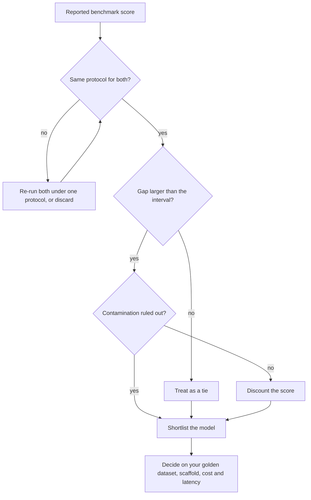

## TL;DR
A benchmark is a fixed dataset plus a fixed scoring rule so models can be compared on one task. For an
agent builder, MMLU, HumanEval, SWE-bench and GPQA shortlist the model behind your agent; they
saturate and leak, and never prove your agent works.

## For agent builders
- **Why it matters for agents.** Choosing the model that drives your loop is the first big decision,
  and vendor tables are where that choice starts. Reading them correctly (protocol, interval, scaffold)
  keeps you from paying for a "leader" that is a tie, or a scaffold effect.
- **Where it shows up in your stack.** Model-selection memos, vendor announcements, open harnesses
  (EleutherAI's lm-evaluation-harness, Inspect), and agentic benchmarks such as SWE-bench for coding
  agents; tool-calling leaderboards such as the Berkeley Function Calling Leaderboard and τ-bench-style
  customer-service tasks are the same idea for tool use.
- **What you control.** Which capability you shortlist on, whether you re-run scores under one
  protocol, and whether you run benchmark tasks through your own scaffold with cost per task logged.
- **What you can skip.** Memorizing current leaderboard numbers; they change monthly. Know the
  scoring rules, pass@k and the interval arithmetic, and that agentic scores belong to model plus
  scaffold.

## Why it exists
- **Before benchmarks, nothing was comparable.** Every lab reported results on tasks of its own choosing,
  with its own prompts and scoring.
- **A benchmark freezes three things:** the items, the prompt format and the scoring rule. A score from
  one lab then means the same as one from another, which makes model selection, progress tracking and
  claim verification possible at all.
- **Many exist because each targets one capability and has a lifetime.** It is informative while models
  score well below its ceiling and have not seen its items.
  - *Saturation:* as models improve, differences at the top fall within noise or label error.
  - *Contamination:* as items spread across the web, scores reflect memorization.
  - *Succession:* GPQA and SWE-bench (both 2023) took over from MMLU (2020) and HumanEval (2021) as the
    numbers people watch, and are themselves approaching their ceilings at the frontier as harder
    successors appear. Which benchmarks are "current" changes yearly; the cycle is the stable fact.
- **Picking from a vendor's announcement table fails** because:
  - numbers across reports are rarely comparable (different shot counts, chain-of-thought or not,
    pass@1 versus pass@k, subsets, sampling settings, agent scaffolds);
  - contamination inflates some models more than others;
  - a benchmark measures the model alone, not your prompt, retrieval and tools around it.

## How it works
### Anatomy of a benchmark
- **Four parts:** items, a prompt format, a scoring rule, and a reporting convention.
- **The scoring rule is underestimated.** A multiple-choice benchmark can be scored by comparing the
  log-probability of the four answer letters, or by generating text and parsing a letter out of it. The
  two give different numbers for the same model.
- **Always read how a score was produced** before comparing it.

### The four benchmarks at a glance
| | MMLU | HumanEval | SWE-bench | GPQA |
|---|---|---|---|---|
| Measures | Breadth of knowledge | Functional correctness of code | Resolving real issues | Expert reasoning search cannot shortcut |
| Size | ~14,000 test items, 57 subjects | 164 problems | ~2,300 instances; Lite 300; Verified 500 | 448 questions; Diamond 198 |
| Format | 4-option multiple choice, 5-shot | Python signature + docstring | Issue text + repo at pre-fix commit → patch | 4-option multiple choice |
| Scored by | Accuracy (chance 25%) | Hidden unit tests, pass@k | FAIL_TO_PASS and PASS_TO_PASS tests | Accuracy |
| Main weakness | Near ceiling, label errors, extraction-sensitive, everywhere on the web | Tiny, Python only, saturated, contaminated, sparse tests | A system score: scaffold moves it as much as the model | Size: wide confidence interval |

### MMLU: breadth of knowledge
- **What it is:** multiple-choice questions, four options each, across 57 subjects from elementary
  mathematics to professional law and medicine; roughly 14,000 test items. Original protocol is 5-shot.
- **Scoring:** accuracy; chance is 25%.
- **Measures** recall of world knowledge plus reading comprehension, not multi-step reasoning.
- **Known weaknesses:**
  - top models are close to its ceiling;
  - later audits found a non-trivial number of mislabeled or ill-posed questions in some subjects;
  - scores are sensitive to the answer-extraction method;
  - its items are everywhere on the web.
- **Successors** such as MMLU-Pro raise the option count and the reasoning load to restore headroom.

### HumanEval: functional correctness of code
- **What it is:** 164 hand-written Python problems, each a function signature with a docstring. The
  model completes the body; hidden unit tests decide pass or fail.
- **Metric: pass@k,** the probability that at least one of *k* samples passes, estimated without bias
  from *n* ≥ *k* samples, where *c* samples passed:

```
pass@k = 1 − C(n−c, k) / C(n, k)
```

- **Read it as counting.** Of all ways to choose *k* of the *n* samples, C(n−c, k) contain only
  failures; the fraction of size-*k* subsets with at least one pass is the estimate.
- **The plug-in 1 − (1 − c/n)^k is biased low,** *because* that function is concave in the pass
  probability, so averaging it over noisy per-problem estimates understates the true value. Drawing
  many samples and counting subsets avoids this.
- **pass@k rewards diversity.** A model that solves a problem 1 time in 10 scores 0.1 at pass@1 but 0.5
  at pass@5 on that problem. So pass@k suits settings with a verifier that can pick the passing sample,
  and misleads when a user gets one shot.
- **Design point:** grade code by *executing* it rather than by text similarity to a reference, which is
  why it displaced BLEU-style code metrics.
- **Weaknesses:** tiny (one problem is 0.6 points), Python only, saturated at the top, heavily
  contaminated because solutions are all over GitHub. Its original tests are sparse enough that
  extended suites (HumanEval+ from the EvalPlus project) catch solutions the originals passed.

### SWE-bench: resolving real issues
- **Task:** instances built from real GitHub issues in popular Python repositories. The model receives
  the issue text and the repository at the pre-fix commit and must produce a patch.
- **Grading:** apply the patch, run the tests the human fix made pass (FAIL_TO_PASS), and check that
  previously passing tests still pass (PASS_TO_PASS).
- **Sizes:** the full set has about 2,300 instances from a dozen repositories. SWE-bench Lite is a
  300-instance subset; SWE-bench Verified is a 500-instance subset screened by humans for solvable
  issues and fair tests.
- **Measures** agentic software engineering: navigating a codebase, editing, running tests.
- **Sharp edge: it is a *system* score.** The scaffold (agent loop, tools, retries) moves results as
  much as the model, so "model X scores Y%" is incomplete without the scaffold and the cost per task.

### GPQA: expert reasoning that search cannot shortcut
- **What it is:** 448 four-option questions in biology, physics and chemistry, written by domain experts
  who have or are pursuing PhDs, and validated by other experts.
- **"Google-proof" target:** experts score high while skilled non-experts with unrestricted web access
  score low. The paper reports roughly 65% for experts (about 74% discounting clear expert mistakes)
  versus about 34% for non-experts.
- **Diamond subset (198 questions):** keeps only items both expert validators answered correctly (or
  where the expert who erred later acknowledged the mistake) and that most non-experts got wrong. It is
  the number usually reported.
- **Measures** reasoning beyond retrieval; it is where reasoning-oriented models separate from others.
- **Weakness:** size; 198 items means a wide confidence interval.

### Reading a score
1. **Align the protocol:** shots, chain-of-thought, pass@1 versus pass@k, sampling temperature and
   number of samples averaged, subset (Diamond, Verified, Lite), scaffold, evaluation date, and whether
   the score is self-reported.
2. **Apply statistics:** a score is a proportion with standard error √(p(1−p)/n).

| Benchmark | n | SE at p = 0.6 | Meaning |
|---|---|---|---|
| GPQA Diamond | 198 | ±3.5 points | Two models four points apart are not distinguishable at 95% confidence |
| MMLU | ~14k | ±0.4 points | Small gaps can be real (if uncontaminated) |

- **Paired comparison is tighter.** Models evaluated on the *same* items can be compared by counting
  items where exactly one model is right, *because* item difficulty is shared. This needs per-item
  results, which published tables do not give you.
- **Repeat runs for sampled or reasoning models.** A single run adds sampling noise on top of item
  noise, so careful reports average several runs per item. One run on a 198-item set can move several
  points on a re-run with nothing changed.
- **Saturation, precisely.** The effective ceiling is below 100% whenever some items are mislabeled or
  ambiguous. Near that ceiling, remaining differences reflect which models happen to agree with the
  label errors rather than capability.
- **Ask about contamination;** the dataset-contamination lesson covers how to detect it.

### From benchmark to decision
- **Shortlist by capability:** a coding assistant looks at SWE-bench-style results and the scaffold
  used; a knowledge-heavy assistant at MMLU-style results; a scientific reasoning tool at GPQA.
- **Then build your own golden dataset,** because none of these contain your documents, your prompt or
  your failure modes.
- **Division of labour:** the benchmark answers "is this model capable enough to try"; your eval answers
  "does it work here".

### What agent builders take from this
| Your agent | Shortlist signal | Then decide on |
|---|---|---|
| Coding agent | SWE-bench Verified with scaffold and cost per task | Your repos and tasks through your own loop |
| Tool-calling support agent | Tool-calling benchmarks, instruction following | Your golden tasks with seeded tools, run several times each |
| Research or RAG agent | Knowledge and reasoning (MMLU-style, GPQA) | Your documents, retrieval and citation checks |

- **Agentic scores need a cost column.** A higher resolved rate bought with many more steps per task
  may lose on cost per resolved task, which is what your budget sees.
- **Reliability is not in the headline.** Most tables report one attempt or a best-of; an agent that
  must succeed every time for users needs repeated runs on your own tasks.

## Diagram
The decision path for a leaderboard number: each check can send the claim back for re-running, and
even a clean claim only earns a place on the shortlist. "Same protocol" means shots, chain-of-thought,
pass@1 or pass@k, subset and scaffold all match; contamination is checked against a private look-alike
set.



## Examples
### pass@k and benchmark intervals in pure Python
The unbiased pass@k estimator and a confidence interval for a reported score. With 10 samples per
problem of which 3 pass, pass@1 is 0.30 but pass@5 is about 0.92, so the two must never be compared as
if they were the same metric.

```python
from math import comb, sqrt

def pass_at_k(n: int, c: int, k: int) -> float:
    """Unbiased estimate of P(at least one of k samples passes) from n samples with c passes."""
    if n - c < k:
        return 1.0
    return 1.0 - comb(n - c, k) / comb(n, k)

def ci95(score: float, n_items: int) -> float:
    """Half-width of a 95% normal-approximation interval for a proportion over n_items."""
    return 1.96 * sqrt(score * (1 - score) / n_items)

print(round(pass_at_k(10, 3, 1), 3), round(pass_at_k(10, 3, 5), 3))   # 0.3  0.917

benchmarks = {"GPQA Diamond": 198, "HumanEval": 164, "SWE-bench Verified": 500, "MMLU": 14_042}
for name, n in benchmarks.items():
    print(f"{name:20s} n={n:6d}  score 0.60 -> ±{ci95(0.60, n):.3f}")
# GPQA Diamond         n=   198  score 0.60 -> ±0.068
# HumanEval            n=   164  score 0.60 -> ±0.075
# SWE-bench Verified   n=   500  score 0.60 -> ±0.043
# MMLU                 n= 14042  score 0.60 -> ±0.008

# Per-problem resolution: one HumanEval problem moves the score by 1/164 ≈ 0.61 points.
```

- **The intervals are the point:** a 5-point lead on GPQA Diamond or HumanEval is inside the noise of a
  single evaluation run, while on MMLU it is not.
- **Only a paired comparison** on the same items with the same protocol can tighten that.

### Agent scenario: picking the model for a coding agent
Numbers illustrative. Three candidates run 500 SWE-bench Verified instances through *your* agent loop
and tools, one attempt each, with token cost logged per task.

| Model | Resolved | 95% interval | Mean cost per task | Cost per resolved issue |
|---|---|---|---|---|
| A (vendor reports 70% in its own scaffold) | 58% | ±4.3 points | $1.10 | $1.90 |
| B | 55% | ±4.4 points | $0.45 | $0.82 |
| C | 47% | ±4.4 points | $0.30 | $0.64 |

- **A versus B is not settled:** a 3-point gap sits inside the interval; a paired count of instances
  only one model resolved is the next step.
- **The vendor's 70% was the scaffold:** in your loop A drops 12 points, which is the system-score
  effect in numbers.
- **Decision:** shortlist A and B, then run both on your own repository tasks; B is the default if the
  paired result is a tie, because it costs less than half per resolved issue.

### Worked scenario: auditing a vendor's leaderboard claim
A vendor table (numbers illustrative) shows model A ahead of model B. Walk the checklist before it
reaches a selection memo.

| Check | Finding | Effect on the claim |
|---|---|---|
| Metric | A reported pass@5 on HumanEval, B pass@1 | Not the same metric; the "20-point lead" may vanish under one protocol |
| Subset | A on SWE-bench Verified, B on Lite | Different item sets; not comparable |
| Scaffold | A used the vendor's own agent with retries | A system score, not a model property |
| Size | GPQA Diamond lead of 4 points, one run each | Inside ±7 points at 95%; does not rank the models |
| Source | B's number copied from an older report | Re-run both under one protocol or discard |
| Decision | Both models shortlisted | Run both through your golden dataset and scaffold |

## Production patterns
- **Model-selection memo with protocol and intervals.** For each shortlisted model, record the score,
  the subset, shots, chain-of-thought setting, pass@1 or pass@k, scaffold, date, and the 95% interval
  computed as above. Monitor how often memo rankings agree with the golden-dataset run that follows.
- **Reproduce before trusting.** Re-run claimed scores with an open harness such as EleutherAI's
  lm-evaluation-harness (for example `lm_eval --tasks mmlu --num_fewshot 5`, plus `--model` and
  `--model_args` naming the model under test) or Inspect, pinning the
  same protocol for every model. Monitor the gap between your number and the reported one.
- **Benchmark in your own scaffold.** For coding agents, run SWE-bench Verified instances through your
  agent loop and tools, and log resolved rate and cost per task together. Monitor cost per resolved
  issue across model candidates, not just resolved rate.
- **Repeat small benchmarks.** For sampled or reasoning models on sets like GPQA Diamond, average
  several runs per item and report mean and spread. Monitor run-to-run spread; if it exceeds the gap
  you are deciding on, the benchmark cannot decide.
- **Private look-alike set.** Keep a small unpublished set of items in the style of the public
  benchmark, written in-house. Monitor the gap between public and private scores as a contamination
  signal.
- **Re-screen on every model release.** When a provider ships a new snapshot, re-run the shortlist
  benchmarks in your scaffold and then your agent's golden tasks before switching the pinned model id.
  Monitor steps and cost per task alongside resolved rate, since newer models can change how long
  they loop.

## Trade-offs
- **Comparability vs decay.** Standardized items and scoring make models comparable across labs, but
  also make items easy to find and train on, so comparability decays with time.
- **Execution grading vs cost.** Execution-based grading (HumanEval, SWE-bench) is objective and resists
  paraphrase problems, but needs sandboxes, dependencies and time per item, and test coverage bounds
  what "correct" means.
- **Small expert sets vs precision.** Sets like GPQA are high in quality and were released with measures
  meant to keep them out of crawls (a canary string and a request not to post items in plain text).
  They are still public and not immune to contamination, and their size makes intervals wide and
  single-run comparisons unreliable.
- **Agentic realism vs reproducibility.** SWE-bench reflects real work far better than multiple choice,
  but measures model plus scaffold, so a score is reproducible only with the full harness and its cost.

## Pitfalls
- **Comparing pass@1 with pass@k or best-of-n** from another report. Symptom: a "20-point lead" that
  disappears when both are run under the same protocol.
- **Reading a 3-point difference on a 198-item set as a ranking.** Symptom: model rankings reorder
  between runs with no change to the models.
- **Treating a SWE-bench number as a model property.** Symptom: the model scores far lower in your own
  agent scaffold than in the vendor's report.
- **Ignoring contamination.** Symptom: a model aces HumanEval and fails on your private coding tasks of
  similar difficulty.
- **Choosing a domain model by MMLU score.** Symptom: a broad-knowledge leader underperforms a cheaper
  model on your extraction job because the task needs instruction following, not trivia.
- **Quoting self-reported scores as independent.** Symptom: a leaderboard entry nobody outside the
  vendor can reproduce.
- **Choosing an agent model on resolved rate alone.** Symptom: the "best" model doubles the monthly bill
  because it takes far more steps per task. Fix: report cost per resolved task next to the rate.

## When to use
- **Use when:** starting model selection, to shortlist candidates for the capability your task needs;
  and when tracking the field to see which capabilities are moving.
- **Avoid when:** gating a product release, proving a specific prompt works, or comparing models whose
  scores came from different protocols.
- **Measure what it measures:** for coding, run a SWE-bench-style harness yourself with your scaffold;
  for knowledge or reasoning, confirm on your own items.
- **Day to day:** a one-page model-selection memo citing scores with protocol and intervals, followed by
  a golden-dataset run that actually decides.
- **Interviews:** name what each of the four benchmarks measures and how, compute pass@k, and explain
  why a leaderboard lead can be noise, contamination or a scaffold effect.

## Role lens
- **Engineer:** Reproduces a benchmark score locally with an open harness before trusting it, and
  computes the interval before calling one model better than another.
- **Architect:** Uses benchmarks to narrow the model portfolio, then defines the task-specific eval that
  governs the actual choice, including cost and latency.
- **FDE:** Explains to a customer why the model with the best public scores is not automatically the
  right one for their documents, and proposes a pilot eval on their data.

## Check yourself
**Q:** A vendor claims their new model beats a competitor by 6 points on GPQA Diamond and 9 points on
HumanEval. What questions do you ask before accepting the claim, and what do the numbers actually
support?
**A:** First the protocol: same shots, same chain-of-thought setting, pass@1 on both, same sampling
temperature, same number of samples averaged, and whether the competitor's number was re-run or copied
from an older report. Then the statistics: GPQA Diamond has 198 items, so each score carries roughly
±7 points at 95% confidence and a 6-point gap is inside the noise unless the comparison is paired on
items and repeated; HumanEval has 164 items, so 9 points is about 15 problems, borderline and heavily
dependent on contamination, since HumanEval solutions are widespread online. Finally relevance: neither
benchmark contains my task. The claim supports shortlisting the model for a pilot on our own golden set,
nothing more.

## Interview questions
### What does each of MMLU, HumanEval, SWE-bench and GPQA measure, and how is it scored?
- **MMLU:** breadth of knowledge, about 14,000 four-option questions across 57 subjects, 5-shot,
  scored by accuracy with chance at 25%.
- **HumanEval:** functional correctness of 164 Python problems, graded by hidden unit tests and
  reported as pass@k.
- **SWE-bench:** patches for real GitHub issues, graded by FAIL_TO_PASS and PASS_TO_PASS tests.
  **GPQA:** 448 expert-written science questions (Diamond 198) that web search cannot shortcut.

### Explain pass@k and why the plug-in estimate is wrong.
- **Definition:** the probability that at least one of *k* samples passes, estimated from *n* ≥ *k*
  samples with *c* passes as 1 − C(n−c, k) / C(n, k).
- **The plug-in 1 − (1 − c/n)^k is biased low** because the function is concave, so averaging it over
  noisy per-problem estimates understates the true value.
- **Why it matters:** with 10 samples and 3 passes, pass@1 is 0.30 but pass@5 is about 0.92, so the two
  must never be compared as one metric.

### A model scores far lower in your coding agent than in the vendor's SWE-bench report. Why?
- **SWE-bench is a system score:** the scaffold (agent loop, tools, retries) moves the result as much as
  the model, and the vendor likely used its own.
- **Check the subset and protocol:** Verified (500), Lite (300) and the full set (about 2,300) are
  different item sets, and attempts allowed per task change the number.
- **Fix the comparison:** run SWE-bench Verified instances through your own scaffold and log resolved
  rate together with cost per task.

### How would you pick the model for a new tool-calling support agent?
- **Shortlist on public signals:** tool-calling and instruction-following benchmarks, read with their
  protocol and interval, plus price and latency, to get two or three candidates.
- **Decide on your own tasks:** run each candidate through your agent loop on golden tasks with seeded
  tools, several runs per task, and compare paired per-task results.
- **Weigh all axes:** success, hard-constraint violations, steps, cost per task and p95 latency, because
  a model that wins on success but loops longer can lose overall.

### When would you not use a public benchmark to choose a model?
- **For the final decision:** no benchmark contains your documents, prompt or failure modes, so the
  decision belongs to your golden dataset.
- **When scores came from different protocols** or one number was copied from an older report; re-run
  both or discard.
- **Trade-off:** benchmarks give free comparability for shortlisting, but that comparability decays as
  items saturate and leak into training data.

### Two frontier models score 89% and 91% on MMLU. Does the 2-point gap mean anything?
- **Statistically it can be real:** at p ≈ 0.9 and about 14,000 items the 95% interval is roughly
  ±0.5 points, so sampling noise alone does not explain 2 points.
- **But it may not be capability:** near the ceiling, mislabeled or ambiguous items cap the effective
  maximum below 100%, so the remaining gap can reflect which model agrees with the label errors.
- **Protocol and leakage can move it too:** log-probability versus generated-letter scoring, shot count
  and contamination each shift scores, so the gap supports a shortlist, not a ranking.

## Quiz
### Q: Why did HumanEval grade solutions by running unit tests instead of comparing them to a reference solution?
- [ ] Unit tests are cheaper than text comparison
- [x] Many different programs are correct, so text similarity to one reference does not measure correctness
- [ ] Reference solutions could not be written for the problems
- [ ] Text comparison cannot be automated for code
> Functional correctness is what matters for code and there are unboundedly many correct
> implementations. Execution against tests checks behaviour; similarity to one reference penalizes
> correct but different code and rewards incorrect but similar code.

### Q: Model A scores 62% and model B 58% on GPQA Diamond in one run each. What is the most defensible conclusion?
- [ ] A is better at expert science reasoning
- [ ] B is better because lower scores indicate less contamination
- [x] The difference is within the sampling noise of a 198-item set and does not rank the models
- [ ] GPQA is saturated and should not be used
> At p ≈ 0.6 and n = 198 the 95% interval is about ±7 points, wider than the 4-point gap. Ranking would
> need a paired comparison on the same items with the same protocol, ideally with several samples.

### Q: Why is a SWE-bench score best described as a system score rather than a model score?
- [ ] SWE-bench only evaluates proprietary systems
- [ ] The tests are run by the model itself
- [x] The agent scaffold (tools, loop, retries) materially changes how many issues get resolved with the same model
- [ ] Each instance is graded by human reviewers
> The task requires navigating a repository, editing files and running tests; how the harness exposes
> those actions, how many attempts it allows and what it costs all move the result. The same model in
> a different scaffold produces a different number.

## Use cases & projects
### Use cases
- **Shortlisting the model behind a new agent.** Public coding, reasoning and tool-calling benchmarks
  narrow the field to two or three candidates worth running on your own tasks.
- **Reading a vendor launch table.** Checking protocol, scaffold and interval tells you whether a "lead"
  is a real gap or a tie.
- **Choosing a model for a coding agent.** Agentic benchmarks such as SWE-bench show model plus scaffold;
  running the candidate through your own scaffold shows what you will actually get.
- **Cost-aware model selection.** Logging cost per task alongside score shows when a cheaper model is
  good enough for the agent's job.

### Mini project
**Re-run a small benchmark slice through your own agent scaffold (2-3 hours).**
- **Goal:** see how much the scaffold and protocol move a benchmark-style score for two candidate models.
- **Steps:** pick 30-50 public tool-calling or coding tasks with automatic scoring; run each candidate
  model once with a plain prompt and once inside your own tool-calling loop; keep sampling settings fixed;
  log pass/fail, steps and cost per task; compute pass rates with a rough interval.
- **Done when:** you have a table of score and cost per model and setup, and a short note on whether the
  ranking changed between the plain prompt and your scaffold.
