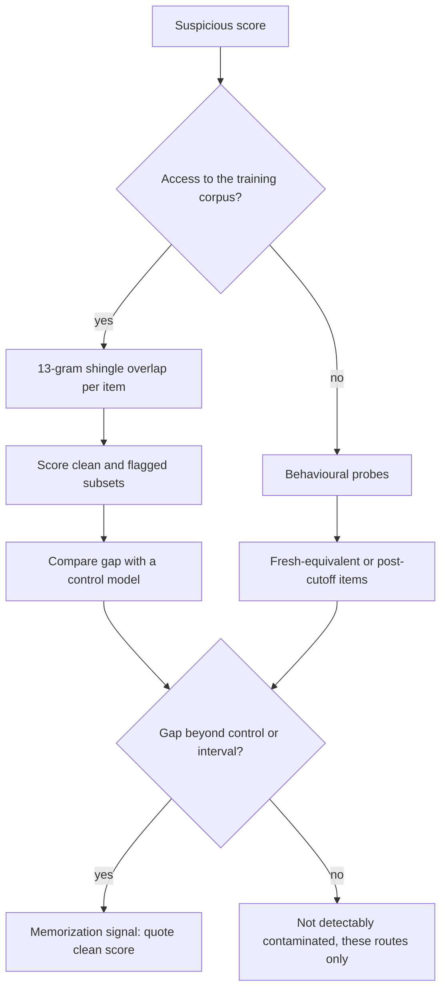

## TL;DR
Dataset contamination means eval items or answers reach the model through training data, prompts or,
for agents, tools and memory, so scores measure memorization or lookup, not capability. Web-scale
training makes it unavoidable, inflation is uneven, and your golden set leaks too.

## For agent builders
- **Why it matters for agents.** Agents add leak routes plain models lack: a web-search tool can fetch
  a benchmark's published answer, a sandbox repo can contain the commit that fixed the issue, long-term
  memory can carry one eval task's answer into the next, and fine-tuning on your own agent traces can
  absorb golden tasks.
- **Where it shows up in your stack.** Fine-tuning pipelines on agent traces, few-shot banks in the
  system prompt, the agent's memory store, search and browse tools during evals, and the model
  benchmarks you shortlist on.
- **What you control.** Isolation of the golden set from training files, prompts and memory; a fresh
  memory and sandbox per eval task; search tools restricted or audited during evals; canaries and
  overlap checks before every fine-tuning job.
- **What you can skip.** Running membership-inference research on hosted models. Behavioural probes,
  cutoff dates and your own leak guards cover what an agent team needs.

## Why it exists
- **The split is no longer yours.** In classical ML you held out rows and nothing in training could see
  them. Pretraining inverts this: the corpus is a crawl of the public internet, which contains
  benchmark repositories, papers with examples, blog posts walking through solutions, forum threads
  quoting questions, translations and paraphrases, and outputs of other models tuned on the benchmark.
- **Nobody knows exactly what was seen.** The model vendor rarely knows exactly what the crawl contains,
  and you, the downstream user, never do. It is train/test leakage at LLM scale.
- **Inflation is uneven, so rankings lie.** A model that memorized answers scores higher without being
  more capable. Inflation differs by model (crawl date, filtering) and by benchmark (how widely it was
  copied), so a leaderboard becomes a partial ranking of who saw what. Decisions on such scores are
  wrong in ways that only appear on your own data.
- **It bites inside teams too.** Copy five golden items into a few-shot prompt, or fine-tune on a dump
  that includes the eval set, and the offline score jumps while production does not.
- **Two naive defences fail.**
  - *"The vendor decontaminated"* usually means n-gram filtering against known benchmarks: it catches
    verbatim copies and misses paraphrases, translations and solution write-ups.
  - *"Use a newer benchmark"* works for a few months, until it is on GitHub and in the next crawl.
  - So contamination is a standing condition to measure and manage, not a bug to fix once.

## How it works
### Routes by which it happens
| Route | What happens |
|---|---|
| **Direct** | The test items, with or without answers, are in the pretraining or fine-tuning corpus |
| **Indirect** | Paraphrases, translations, worked solutions and discussions are in the corpus; the model learns the answer without seeing the exact text |
| **Transitive** | Training on synthetic data from another model that had seen the benchmark; knowledge moves without any benchmark text moving |
| **Temporal** | A benchmark published after the training cutoff is clean for that model but may be in its successor's crawl, so cross-generation comparisons are not like for like |
| **Evaluation-time** | Few-shot examples drawn from the test split, or a golden dataset also used for prompt tuning or fine-tuning; the route teams control and most often get wrong |
| **Tool-time (agents)** | During the eval the agent searches the web and finds the benchmark item with its answer, reads future commits in a sandbox repo, or recalls an earlier task from shared memory; the score measures lookup, not the capability you meant to test |

### Detecting it with corpus access
When you can see the training data (your own fine-tuning set, or an open pretraining corpus):
1. **Check n-gram overlap:** for each eval item, test whether any word n-gram of moderate length
   appears in the corpus.
2. **Split the score:** the GPT-3 report used 13-gram overlap to flag items, then reported scores on
   the clean and dirty subsets separately.
3. **Read the useful output:** not "is it contaminated" but "how much does the score change when flagged
   items are removed".

- **Cheap and conservative.** Hash the n-grams into a set or a Bloom filter. Conservative *because* it
  only catches near-verbatim text.

### Detecting it without corpus access
Most of the time you have only the model, so detection is behavioural:
- **Completion probes.** Give the first part of an item and ask the model to continue. Near-verbatim
  reproduction of the rest, including distinctive wording, means it has seen it. Comparing a guided
  prompt (naming the dataset and split) against a generic one sharpens the signal.
- **Likelihood gaps.** Memorized text tends to have lower perplexity than fresh paraphrases of the same
  content; a large gap between original and rewritten item is suspicious.
  - Min-K% Prob scores only the item's least likely tokens, *because* unseen text almost always has a
    few surprising tokens while memorized text does not.
  - These membership-inference signals need token log-probabilities (often unavailable from hosted APIs)
    and have proved weak and noisy on large pretrained models: hints, not verdicts.
- **Masked-option probes.** For multiple choice, hide one *wrong* option and ask the model to supply it.
  A wrong option has no reason to be guessable from the question, so exact reproduction points to
  having seen the item.
- **Fresh-equivalent sets.** Build new items matching the benchmark's distribution and difficulty (the
  GSM1k study did this for grade-school math) and compare. A marked drop on the fresh set means leaning
  on memorization; holding steady means not. Drops in that study ranged from negligible to substantial
  across model families: the inflation is uneven.
- **Perturbation sensitivity.** Shuffle options, rename variables, paraphrase the question. A capable
  model is barely affected; a memorizing model drops.
- **Canary strings.** Benchmark authors embed a unique random string in published files; if the model
  can reproduce it, the files were in training. This is what BIG-bench style canaries are for, and the
  same trick protects your own golden set.
- **Temporal splits.** Evaluate only on items created after the model's training cutoff (live-updated
  coding and reasoning benchmarks work this way), accepting that the clean window closes with every new
  model release.

### Why it is not binary
- **Degree matters.** An item seen once in a trillion tokens may leave no trace; one seen in a hundred
  copies with worked solutions is memorized.
- **Answers can leak without questions,** for example seeing "the answer is C" in a discussion.
- **Partial contamination** can shift an aggregate score by a few points, enough to reorder a
  leaderboard whose gaps are a few points.

### Preventing it for your own evaluations
- **Isolate the golden dataset** from every training set, few-shot prompt and synthetic-generation
  prompt.
- **Overlap-check before fine-tuning:** run n-gram overlap between fine-tuning data and the eval set;
  remove or quarantine hits.
- **Keep a private held-out split** never published or shared with the vendor. Running it through a
  hosted API sends every item to that provider: check the provider's data-use and retention terms (or
  use an option that excludes your traffic from training).
- **Add a canary string** to any eval file that leaves your repository.
- **Record provenance per item,** so when a public document it came from turns up in a crawl, you know
  which items to re-examine.
- **Report cutoffs:** when quoting a public benchmark, say whether the model's cutoff precedes the
  benchmark's publication.

### Preventing it in agent evals
- **Fresh memory per task.** Start each eval task with an empty or seeded memory store, *because* a
  shared store lets an answer written during task 12 surface in task 40.
- **Sandbox repos and data at the task's point in time.** Strip history after the base commit and any
  file that contains the reference solution, so the agent cannot read the answer from the environment.
- **Audit or restrict search tools.** Block the benchmark's own hosting sites, or log every fetched
  page and flag tool results that overlap the item's reference answer.
- **Keep agent traces from evals out of training data.** Traces of golden tasks carry the task and,
  after grading, often the correct answer; tag them at creation and exclude them from fine-tuning sets.

## Diagram
The detection path splits on one question, whether you can see the training data; both branches end in
a scoped claim, never "clean". The control is a comparable model that could not have seen the corpus;
the probes are completion, masked option, perturbation and canary checks.



## Examples
### Corpus-side overlap check with split scores
Hash every 13-word shingle in the training documents, flag each eval item whose shingles intersect the
set, and report accuracy on the clean and flagged subsets separately. The split-score comparison is the
actionable output. Numbers in the comment are illustrative.

```python
import hashlib, re
from collections import defaultdict

N = 13
def shingles(text: str, n: int = N):
    toks = re.findall(r"\w+", text.lower())
    for i in range(max(0, len(toks) - n + 1)):
        yield hashlib.blake2b(" ".join(toks[i:i + n]).encode(), digest_size=8).digest()

def build_index(train_docs) -> set:
    seen = set()
    for doc in train_docs:                      # streams a corpus; swap the set for a Bloom filter at scale
        seen.update(shingles(doc))
    return seen

def flag_items(eval_items, index: set) -> dict[str, bool]:
    return {it["id"]: any(s in index for s in shingles(it["question"] + " " + it["answer"]))
            for it in eval_items}

def split_scores(eval_items, flagged: dict, correct: dict) -> dict:
    buckets = defaultdict(list)
    for it in eval_items:
        buckets["flagged" if flagged[it["id"]] else "clean"].append(correct[it["id"]])
    return {k: (len(v), round(sum(v) / len(v), 3)) for k, v in buckets.items() if v}

index = build_index(iter_training_docs())       # your fine-tuning set, or an open pretraining shard
flagged = flag_items(eval_items, index)
print(split_scores(eval_items, flagged, model_correct))
# e.g. {'clean': (712, 0.78), 'flagged': (288, 0.93)}  -> a 15-point gap is a candidate memorization
# signal; report the clean-subset score and remove flagged items from fine-tuning data.
```

- **Read the gap carefully.** Flagged items are not a random subset: items copied around the web tend
  to be the famous, simpler or more canonical ones, so they may be easier for any model.
- **Use a control.** The cleaner test is whether the gap is larger for the model trained on the corpus
  than for a comparable model that could not have seen it (an earlier cutoff, or trained without that
  data). If both show the same 15 points, the flagged items are just easier.
- **Null results are the point.** The GPT-3 report found that for many benchmarks the clean-subset score
  barely moved, which is the kind of null result this analysis exists to produce.
- **Choosing n.** A short n-gram (5 or 8 words) over-flags common phrasing; a long one (20+) misses
  light edits. Thirteen is the GPT-3 report's choice and a common compromise, not a law (other reports
  use different lengths and overlap thresholds).
- **Two blind spots of this sketch:** an item shorter than 13 words produces no shingles and is never
  flagged, so handle short items separately; and it only catches near-verbatim overlap, so a clean
  result is "not detectably contaminated", not "clean".

### Worked scenario: is the 15-point gap memorization?
Same flagged/clean split, scored on the suspect model and on a control with an earlier cutoff. The two
control rows are alternative outcomes of that one control run, not two models (illustrative numbers).

| Model | Clean subset | Flagged subset | Gap |
|---|---|---|---|
| Suspect (trained on the corpus) | 0.78 | 0.93 | 15 points |
| Control, outcome A | 0.70 | 0.85 | 15 points |
| Control, outcome B | 0.70 | 0.74 | 4 points |

- **If outcome A:** the gap is the same, so flagged items are simply easier; no evidence of
  memorization.
- **If outcome B:** the suspect's gap exceeds the control's by 11 points, a memorization signal;
  quote the clean-subset score and remove flagged items from fine-tuning data.

### Leak guard before a fine-tuning job
Pure Python. Generates a canary for an eval set and blocks a fine-tuning file that contains the canary
or any golden input (after normalizing case and whitespace).

```python
import hashlib, json, re, uuid

def norm_hash(text: str) -> str:                 # case- and whitespace-insensitive fingerprint
    return hashlib.sha256(" ".join(re.findall(r"\w+", text.lower())).encode()).hexdigest()

CANARY = f"EVAL-CANARY {uuid.uuid4()}"            # generate once per eval set, store with it, never reuse

golden = [{"id": "g1", "input": "Can I get a refund after 30 days?"},
          {"id": "g2", "input": "My parcel shows delivered but never arrived."}]
finetune = ['{"prompt": "can I get a REFUND after 30 days?", "completion": "..."}',
            '{"prompt": "How do I change my address?", "completion": "..."}',
            json.dumps({"prompt": "header", "completion": CANARY})]

def leak_report(golden, finetune_lines, canary):
    fps = {norm_hash(g["input"]): g["id"] for g in golden}
    hits = []
    for n, line in enumerate(finetune_lines, 1):
        rec = json.loads(line)
        if canary in line:
            hits.append((n, "canary"))
        if (gid := fps.get(norm_hash(rec["prompt"]))):
            hits.append((n, f"golden item {gid}"))
    return hits

hits = leak_report(golden, finetune, CANARY)
print(hits)                                       # [(1, 'golden item g1'), (3, 'canary')]
raise SystemExit(1 if hits else 0)                # block the fine-tuning job on any hit
```

- **Exact-match guard plus shingles.** This catches copies of whole inputs; the 13-gram check above
  catches partial overlap. Run both; neither catches paraphrases.

### Agent scenario: catching answer lookup in a search-enabled agent's traces
After an eval run, scan each trace's tool results for the item's reference answer. A hit means the
agent may have found the answer rather than worked it out. Reuses `shingles` from the first example
with a shorter n, because answers are short.

```python
SEARCH_TOOLS = {"web_search", "fetch_url"}            # the tools that can bring outside text in

def lookup_flags(runs, items, n=6):
    """runs: id -> {"pass": bool, "trace": [{"tool": str, "result": str}, ...]}"""
    flags = {}
    for it in items:
        ans = set(shingles(it["answer"], n))
        pages = [str(t["result"]) for t in runs[it["id"]]["trace"] if t["tool"] in SEARCH_TOOLS]
        if not ans:                                   # answer shorter than n words: exact substring check
            hit = any(it["answer"].lower() in p.lower() for p in pages)
        else:
            hit = any(ans & set(shingles(p, n)) for p in pages)
        flags[it["id"]] = hit
    return flags

flags = lookup_flags(runs, eval_items)
passed = [i for i in flags if runs[i]["pass"]]
print(f"{sum(flags[i] for i in passed)} of {len(passed)} passes saw the answer in a tool result")
```

| Illustrative run, 165 research tasks | Count |
|---|---|
| Passed | 112 |
| Passed with the answer present in a fetched page | 31 |
| Score with those 31 counted as unverified | 81 of 165, about 49% instead of 68% |

- **Reading it:** the 31 lookups came from pages that publish the benchmark itself, so the headline
  68% partly measures search; report both numbers and block those domains in the next run.

## Production patterns
- **Overlap gate in the training pipeline.** Before any fine-tuning job, run the shingle check and the
  exact-match guard between the training file and every eval set, and fail the job on hits. Monitor hit
  counts per data source; a recurring source needs filtering upstream.
- **Canary per eval file, probed per model.** Put a unique canary in the header of every eval file that
  leaves the repository, and when a new model snapshot arrives, prompt it with the canary prefix to see
  whether it completes the rest. Treat any completion as strong evidence of a leak; a miss does not
  prove the file was unseen, since memorization of any one string is not guaranteed.
- **Private held-out under no-training terms.** Keep one split that is never published, and run it only
  through providers or settings whose data-use terms exclude your traffic from training. Monitor the
  gap between public-benchmark and private-split scores across model versions.
- **Clean-subset and cutoff reporting.** In model-selection memos, list each benchmark's publication
  date against the model's training cutoff, and quote clean-subset scores when a reporter provides them.
  Monitor how many cited scores lack either.
- **Rolling fresh items.** Add newly written or newly sampled items each month, dated, so there is always
  a slice created after every candidate's cutoff. Monitor the score gap between old and fresh slices.
- **Hermetic agent eval environments.** Give every eval task a fresh memory store and a sandbox built
  at the task's point in time, tag all eval traces so the training pipeline can exclude them, and log
  every page a search tool fetches. Monitor the share of passes whose tool results contained the
  reference answer.

## Trade-offs
- **N-gram overlap vs coverage.** Cheap, scalable and precise about verbatim copies, but misses
  paraphrases and translations entirely, so a clean result under it is weak evidence.
- **Fresh-equivalent sets vs cost.** The most convincing behavioural evidence, but writing items that
  match the original difficulty distribution is expensive, and the fresh set goes stale once shared.
- **Private held-out sets vs credibility.** Immune to crawl contamination while private, but results
  cannot be independently reproduced, so they carry less public credibility.
- **Restricting agent search during evals vs realism.** Blocking benchmark sites keeps the score about
  reasoning, but production agents will search freely, so a restricted run understates real success.
  Report the restricted score for capability and an unrestricted one for the product.
- **Aggressive decontamination vs model quality.** Removing every document that overlaps a benchmark
  protects the eval but also removes legitimate educational content and can reduce model quality.

## Pitfalls
- **Trusting a leaderboard without checking cutoffs.** Symptom: a model leads on a 2021 benchmark and
  underperforms a cheaper, newer model on private tasks of the same kind.
- **Few-shot examples drawn from the eval split.** Symptom: an offline jump of several points on the day
  the prompt changed, with no movement in production metrics.
- **Fine-tuning on a dump that includes golden items.** Symptom: near-perfect eval scores on the tuned
  model and a steep drop on a freshly labeled batch.
- **Treating an n-gram-clean benchmark as uncontaminated.** Symptom: the model reproduces the
  benchmark's answers for paraphrased questions while passing the overlap check.
- **Using a model to generate "new" eval items from public documents.** Symptom: items the model already
  answers from memory because the source documents were in its crawl.
- **Reading a clean-versus-flagged gap as proof without a control.** Symptom: an uncontaminated model
  shows the same "contamination effect", because flagged items were the easier, more widely quoted ones.
- **Shared memory across agent eval tasks.** Symptom: pass rate rises with item order in the run, and
  later tasks quote facts only an earlier task's tools returned. Fix: reset memory per task.
- **Publishing the golden set in a public repository.** Symptom: next year's model aces it and the team
  cannot tell improvement from memorization.

## When to use
- **Every decision on a benchmark score,** and every time an eval set or fine-tuning set changes hands.
- **Before trusting a public score:** check whether the model's training cutoff precedes the benchmark
  and whether the reporter separated clean and flagged subsets.
- **Before fine-tuning:** run an overlap check between training data and every eval set you care about.
- **Before sharing an eval set:** add a canary and keep a private held-out split.
- **Day to day:** a short script in the data pipeline and a line in the model-selection memo.
- **Interviews:** how to tell whether a model memorized a benchmark without seeing its training data;
  the strong answer names at least two behavioural probes.

## Role lens
- **Engineer:** Adds an overlap check between fine-tuning data and eval sets to the training pipeline,
  and keeps golden items out of few-shot prompts and generation scripts.
- **Architect:** Sets the policy for private held-out sets, canaries and provenance tracking, and
  requires clean-subset reporting when benchmark scores feed a model decision.
- **FDE:** Explains to a customer why a model's public benchmark lead may not transfer, and runs a
  fresh, customer-specific eval whose items the model cannot have seen.

## Check yourself
**Q:** You suspect a model's strong score on a public math benchmark is due to contamination, but you
have no access to its training data. Describe two independent ways to test the suspicion and what
result would confirm it.
**A:** First, a completion probe: feed the first half of benchmark problems and ask the model to
continue; near-verbatim reproduction of the remaining text, including idiosyncratic wording and
numbers, indicates the items were in training, and comparing a prompt that names the dataset against a
generic one strengthens the signal. Second, a fresh-equivalent set: write or commission new problems
matched in topic, difficulty and format, evaluate both sets under the same protocol, and compare; a
drop of several points on the fresh set, beyond the confidence interval of the set size, indicates the
original score leaned on memorization. A cheaper third check is perturbation: paraphrase questions or
change numeric values and watch whether accuracy collapses. Convergent evidence from two of these is
what I would act on.

## Interview questions
### What is dataset contamination, and why is it worse for LLMs than classical ML leakage?
- **Definition:** eval items, paraphrases or solutions are in the model's training data, so the score
  measures memorization rather than capability.
- **Worse for LLMs** because pretraining crawls the public web, which contains benchmark repositories,
  worked solutions and discussions, and neither the vendor nor you knows exactly what was seen.
- **Inflation is uneven** by model and benchmark, so a leaderboard partly ranks who saw what.

### A vendor says their model was decontaminated. What does that usually cover, and what does it miss?
- **Usually covers:** n-gram filtering against known benchmarks, which catches verbatim copies.
- **Misses:** indirect routes (paraphrases, translations, solution write-ups) and transitive ones such as
  synthetic data from another model that had seen the benchmark.
- **So ask for evidence:** clean-subset scores, the training cutoff against the benchmark's publication
  date, and results on fresh or post-cutoff items.

### Your clean subset scores 0.78 and the flagged subset 0.93. Is that memorization?
- **Not by itself:** flagged items tend to be the famous, simpler, widely quoted ones, so they may be
  easier for any model.
- **Use a control** that could not have seen the corpus: if it shows the same 15-point gap, the items are
  just easier; if its gap is 4 points, the extra 11 points are a memorization signal.
- **Then act:** quote the clean-subset score and remove flagged items from fine-tuning data.

### How do you choose the n-gram length for an overlap check, and what are its blind spots?
- **Trade-off:** a short n-gram (5 or 8 words) over-flags common phrasing; a long one (20+) misses light
  edits. Thirteen is the GPT-3 report's choice and a common compromise, not a law.
- **Blind spots:** items shorter than n produce no shingles and are never flagged, and paraphrases pass
  unnoticed.
- **So a clean result means** "not detectably contaminated", and you pair it with an exact-match guard
  and behavioural probes.

### Your search-enabled research agent scores far higher on a public benchmark than on your own tasks. What do you check?
- **Tool-time lookup:** scan each trace's fetched pages for the item's reference answer; pages that
  publish the benchmark turn the score into a search test.
- **Environment and memory leaks:** confirm each task started with fresh memory and a sandbox with no
  answer files or future history.
- **Then report two numbers:** the raw score and the score with lookup-tainted passes set aside, and
  block the offending domains in the next run.

### You fine-tune your agent on its own production traces. How do you stop the golden set contaminating future evals?
- **Gate the training pipeline:** run shingle overlap and an exact-match guard between every fine-tuning
  file and every eval set, and fail the job on any hit; exclude traces tagged as eval runs.
- **Mark and protect the files:** a unique canary per eval file that leaves the repository, and a private
  held-out split run only through providers whose terms exclude your traffic from training.
- **Keep a fresh slice:** add dated items monthly so some items always postdate every candidate's
  cutoff, and record provenance per item.

## Quiz
### Q: Why does an n-gram overlap check between training data and a benchmark give only weak evidence that the benchmark is clean?
- [ ] N-gram checks are too slow to run on full corpora
- [x] It only detects near-verbatim copies, so paraphrases, translations and solution write-ups pass unnoticed
- [ ] Models cannot memorize text shorter than the n-gram length
- [ ] Benchmarks are rarely copied verbatim onto the web
> Overlap matching is exact on token sequences. Indirect contamination through rewritten or discussed
> items leaves no matching 13-gram, yet still teaches the model the answers, so a clean overlap result
> rules out only one route.

### Q: A team fine-tunes a model on a customer data dump and the golden-set pass rate jumps from 71% to 98%. What should they check first?
- [ ] Whether the learning rate was too high
- [x] Whether the dump contained the golden items, by running an overlap check between the two
- [ ] Whether the eval harness cached old outputs
- [ ] Whether the judge model was changed
> A jump of that size is the classic symptom of evaluation-time contamination. Checking overlap between
> training data and the eval set is cheap and should precede any celebration or any other diagnosis.

### Q: What does a canary string in a published eval file allow you to do later?
- [ ] Decrypt the answers if the file is leaked
- [ ] Detect which users downloaded the file
- [x] Test whether a model saw the file in training by asking it to reproduce the string
- [ ] Prevent the file from being indexed by web crawlers
> A unique random string has no reason to appear in a model's output unless the file containing it was
> in the training data. It does not stop crawling or leaking; it makes the leak detectable after the
> fact.

## Use cases & projects
### Use cases
- **Fine-tuning a model on agent traces.** An overlap check against the golden set before each training
  job keeps eval tasks out of the training data.
- **Evaluating a web-browsing or research agent.** Restricting or auditing search during evals stops the
  agent from fetching a benchmark's published answer.
- **Agents with long-term memory.** A fresh memory store per eval task prevents one task's answer from
  leaking into the next.
- **Trusting a vendor's benchmark claim.** Cutoff dates and behavioural probes on recent items tell you
  how much of a score might be memorization.

### Mini project
**Add leak guards to an agent eval (1-3 hours).**
- **Goal:** detect and block the main ways golden tasks can leak into a tool-calling agent's runs.
- **Steps:** add a canary string to the golden set file; write an n-gram overlap check between the golden
  set and a fine-tuning file and few-shot bank; reset the agent's memory and sandbox per task; log every
  search-tool query and URL during eval runs and flag any that hit a list of known answer sources.
- **Done when:** a planted duplicate in the training file, a carried-over memory entry and a flagged
  search URL are each caught and reported by the checks.
