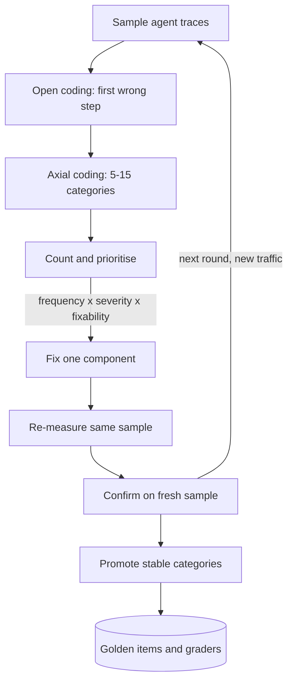

## TL;DR
Error analysis means reading agent traces one at a time, noting the first wrong step, grouping notes
into a failure taxonomy and counting. A score says *that* the agent fails; the counts say *why*, where,
and which fix buys most.

## For agent builders
- **Why it matters for agents.** An agent run is a chain of planning, tool calls, tool results and a
  final answer. A wrong final answer can start at any step, so without reading trajectories you patch
  the system prompt for a failure that was really a bad tool description or a stale data source.
- **Where it shows up in your stack.** Trace viewers and annotation queues in LangSmith or Langfuse, a
  sheet exported from your own OpenTelemetry spans, and the flip-diff between two eval-harness runs.
  The output feeds golden items, graders and CI gates.
- **What you control.** Which traces get sampled (random plus stratified by tool, route or step count),
  the stage-prefixed failure codes, the first-failure rule, who annotates, and which stable categories
  become graders.
- **What you can skip.** Fancy clustering tooling and inter-annotator statistics on round one. One
  domain expert, a notes column and an hour of reading move the roadmap more than any dashboard.

## Why it exists
- **A pass rate is a summary, and a summary cannot be fixed.** A support agent scores 71% on the golden
  set; the product owner asks for 90%. The engineer patches one failure remembered from last week's demo
  and re-runs: 72%. Nobody knows whether that failure was 1% of failures or 40%.
- **Fixes made by guessing accumulate.** Every fix made without the distribution is a guess, and guessed
  prompt fixes grow into a two-thousand-token system prompt of special cases that nobody dares to delete,
  re-sent on every agent step.
- **Classical ML already had the answer.** Ng's advice for a misbehaving classifier: read about a hundred
  misclassified dev-set examples by hand, tally the categories, work on the largest one, because an
  afternoon of counting beats a month of optimizing the wrong thing. For agents too, an afternoon with a
  few dozen to a hundred traces (illustrative) usually reorders the roadmap.
- **Agents make it more necessary, not less.** Outputs are free text, pipelines have several stages
  (retrieval, prompt, model, tools, post-processing), and failure modes are open-ended: you cannot define
  a metric for a failure you have not yet seen.
- **The naive alternatives all skip the reading.** "Trust the judge score" fails because a judge grades
  only the criteria you gave it and cannot see a failure mode you did not name; Shankar et al. found
  people's criteria drift as they read outputs. "Fix what you notice" is whack-a-mole with regressions
  elsewhere. "Collect thumbs-down" is biased toward failures users notice and bother to report.

## How it works
### 1. Sample traces, not just outputs
- **Pull whole traces:** input, retrieved context, tool calls and results, intermediate steps, final
  output. Attribution is impossible from the final answer alone, and for an agent the final answer is
  often the least informative span.
- **Random sample** from production or the last eval run, for honest prevalence numbers.
- **Stratified sample** (by feature, user segment, input length, tool used, step count, or the items that
  failed), so rare slices such as 15-step runs or a rarely used refund tool appear at all.
- **Stop at saturation:** keep reading until new traces stop producing new categories (the qualitative
  researchers' term). In practice, dozens to low hundreds of traces per round.

The sizing arithmetic: a failure mode with prevalence *p* appears at least once in *n* random traces with
probability:

```
P(seen at least once) = 1 − (1 − p)ⁿ
```

| Prevalence *p* | n = 100 | Takeaway |
|---|---|---|
| 2% | ≈ 87% chance of seeing it | usually found |
| 1% | ≈ 63% chance of seeing it | often missed |

Rare-but-severe modes (an agent issuing a refund it should not) therefore need the stratified sample,
not a bigger random one.

### 2. Open coding: write what went wrong, in free text
- **Per trace:** record pass/fail and a one- or two-sentence note on the **first** thing that went wrong,
  plus the step index where it happened.
- **First-failure rule,** *because* downstream errors are usually consequences. If retrieval returned the
  wrong policy document, the confident wrong answer that followed is not a generation bug, and counting
  it as one sends you to fix the prompt. In an agent, a wrong argument at step 2 explains the five
  confused steps after it.
- **No predefined categories yet:** free-form notes stop you forcing observations into the buckets you
  expected.
- **One domain-competent annotator at first,** *because* a committee negotiates definitions before it has
  data. Bring in a second annotator later to measure agreement on the definitions that emerge.

### 3. Axial coding: group notes into failure modes
- **Cluster the notes** into a taxonomy, typically five to fifteen categories, each with a crisp
  definition and one positive and one negative example.
- **An LLM may propose the first clustering** of the *human-written* notes, saving time on a few hundred
  rows. A person accepts, merges and renames the clusters, *because* the model groups by surface wording
  while the useful grouping is by remediation.
- **Merge** categories you cannot tell apart; **split** a category when its members need different fixes.
- **The behavioural test:** two people given the definition label the same trace the same way, and the
  category implies a specific remediation. "Model did not understand" fails; "answered for the wrong
  product tier" or "called `search_orders` without the customer id" passes.

### 4. Count, then prioritise
- **Tally and sort:** failures per category, a Pareto chart.
- **Priority ≈ frequency × severity × fixability.** Severity matters *because* a wrong refund amount at 6%
  of failures outranks a formatting slip at 20%. Fixability matters *because* a retrieval filter or a
  clearer tool description is a day's work while a model-capability gap may need a different model or
  product decision.
- **Ceiling analysis** (Ng's term): fixing a category perfectly raises the pass rate by at most that
  category's share of *all* traces, not of failures. A category with 13 of 100 traces caps the gain at 13
  points; if the target is +20 points, no single fix gets there, and you know it before writing code.
- **Noise:** counts from one round are estimates.

```
SE(13 in 100) = √(0.13 × 0.87 / 100) ≈ 3.4 points  →  95% interval ≈ 6–20%
```

- **So** two categories at 7 and 9 are effectively tied, and rankings among small categories should not
  drive the roadmap.
- **Closed label sets:** for classification, extraction or tool routing, the confusion matrix *is* the
  count table. The off-diagonal cells (intended tool vs chosen tool) are the failure modes; start with
  the largest.

### 5. Fix one thing and re-measure on the same sample
1. Change the top-priority component (a tool schema, the planner prompt, a retrieval filter).
2. Re-run the same traces plus the eval set.
3. Confirm the target category shrank and no other category grew.
4. Confirm on a fresh sample, *because* a fix tuned while staring at these exact traces can overfit them.

- **Why the same sample:** it removes input-sampling noise from the before/after comparison. It does not
  remove the model's own run-to-run variance, which compounds over many agent steps, so treat a change of
  one or two traces as noise.

### 6. Promote stable categories into evals
Each category that survives a couple of rounds becomes:
- **(a) Golden items:** the failing traces with a corrected expected output, expected tool sequence or
  rubric.
- **(b) A grader:** a deterministic assertion where the failure has an observable signature (cites a
  document id that exists in the retrieved set; contains a handoff when the question asks for account
  data; never calls a write tool before a confirmation step). Otherwise a binary LLM judge whose rubric
  is distilled from the annotation notes and calibrated against your labels.
- **Why this matters:** it is how an eval suite stays representative; its metrics are the failure modes
  that actually occurred.

### Attribution in multi-stage systems
| System | Split failures by | Why |
|---|---|---|
| RAG | retrieval (right chunk not in top-k) vs generation (chunk present, answer still wrong or unfaithful) | different owners, different fixes |
| Agents | first wrong step: wrong tool, wrong arguments, misread tool result, stopped early, looped | the per-step table shows where a guardrail or better tool description has most leverage |

### Cadence
- **Not a launch activity.** Re-run after each significant change (prompt, tool, model version) and on a
  schedule against production traffic, *because* the input distribution drifts.
- **Retire** categories whose count has been zero for several rounds; expect new ones.

## Diagram
The loop: notes come before categories, counts come before fixes, and stable categories leave the loop
as automated agent evals.



## Examples
### Worked round on a tool-calling support agent
Illustrative: a support agent with `search_kb`, `get_account`, `issue_refund` and `handoff` tools.
One hundred random production traces are read; 31 are failures, coded by first wrong step.

| First wrong step (stage-prefixed) | Count | Severity | Fix |
|---|---|---|---|
| `tool.wrong_args`: `get_account` called with the email, not the account id | 10 | 2 | tool description plus an argument example |
| `retrieval.wrong_doc`: `search_kb` top-5 misses the policy | 8 | 2 | hybrid search |
| `plan.skipped_tool`: answers account questions without calling `get_account` | 6 | 3 | grader plus a rule in the planner prompt |
| `loop.no_stop`: repeats the same search until the step cap | 4 | 1 | step budget and a repeated-call detector |
| `action.unconfirmed_refund` | 1 | 3 | confirmation gate before the write tool |
| Other | 2 | 1 | none yet |

- **Ceiling:** the top two categories hold 18 of 100 traces, so fixing both perfectly buys at most +18
  points of task success.
- **Severity reorders the list:** the single unconfirmed refund gets a deterministic gate the same day,
  because one bad write outweighs ten bad lookups.
- **The loop category** is cheap to fix and also cuts cost, because each looping run burned the full
  step budget in tokens.

### Worked round on a customer-support RAG assistant
Illustrative: one hundred random production traces are read; 36 are judged failures.

| First-failure category | Count before | After retrieval fix |
|---|---|---|
| Correct article not in the top-5 retrieved chunks | 13 | 4 |
| Correct article present, answer contradicts it | 7 | 7 (expected: generation untouched) |
| Needs account data the bot cannot see; guesses a number | 6 | 6 |
| Answer describes the wrong product tier | 5 | 2 (the tier filter) |
| Over-long or badly formatted | 3 | 3 |
| Other | 2 | 2 |
| **Total failures** | **36** | **24** |

- **First fix: retrieval** (hybrid search plus a tier filter), because retrieval is 36% of failures and
  the tier mix-up is mostly a metadata-filter problem.
- **Second fix: "guesses account data",** only 6 cases but highest severity, fixed with a handoff rule
  and a deterministic grader.
- **Ceiling analysis predicted the shape:** the two categories touched held 18 of 100 traces, so +18
  points was the most the fix could buy, and it bought +12.
- **Next round's agenda:** the remaining 24 failures are led by "contradicts context" (7) and "guessed
  account data" (6). A confirm run on a fresh 100 traces checks the gain was not specific to the traces
  the fix was tuned on.

### Annotation schema for agent traces
The schema and the counting are a few lines; the stage prefix rolls counts up to the component owner.

```python
from collections import Counter
from dataclasses import dataclass

@dataclass
class Annotation:
    trace_id: str
    passed: bool
    note: str           # free text, written first (open coding)
    first_failure: str  # "stage.category", assigned afterwards (axial coding); "" when passed
    step: int           # index of the first wrong step in the trajectory; -1 when passed
    severity: int       # 1 cosmetic, 2 wrong but harmless, 3 wrong facts or wrong action

rows = [
    Annotation("t-014", False, "search_kb top-5 all about SSO; question was about SCIM", "retrieval.wrong_doc", 1, 2),
    Annotation("t-021", False, "get_account called with email instead of account id", "tool.wrong_args", 2, 2),
    Annotation("t-033", False, "asked for last invoice total; never called get_account, invented a number", "plan.skipped_tool", 1, 3),
    Annotation("t-040", True, "", "", -1, 0),
    # ... ~100 rows, read in full, in random order
]

fails = [a for a in rows if not a.passed]
counts = Counter(a.first_failure for a in fails)
by_stage = Counter(a.first_failure.split(".")[0] for a in fails)
worst = {c: max(a.severity for a in fails if a.first_failure == c) for c in counts}
for cat, n in counts.most_common():
    print(f"{cat:22s} n={n:3d} share={n/len(fails):5.1%} severity={worst[cat]} priority={n*worst[cat]}")
print("by stage:", dict(by_stage))
```

The point is the two separate fields: `note` is written while reading, `first_failure` is assigned only
after all notes exist, so the taxonomy comes from the data rather than the other way round.

### Sizing and noise calculator
Pure Python: how many traces to read, and whether a category count is distinguishable from its neighbour.

```python
import math

def p_seen(p, n):
    """Chance a mode with prevalence p appears at least once in n random traces."""
    return 1 - (1 - p) ** n

def interval(k, n, z=1.96):
    """Normal-approximation 95% interval for a count k out of n traces."""
    r = k / n
    se = math.sqrt(r * (1 - r) / n)
    return se, max(0.0, r - z * se), r + z * se

print(f"{p_seen(0.02, 100):.0%} {p_seen(0.01, 100):.0%}")   # 87% 63%
se, lo, hi = interval(13, 100)
print(f"se={se:.1%} interval={lo:.0%}-{hi:.0%}")             # se=3.4% interval=6%-20%
for k in (7, 9):
    _, lo, hi = interval(k, 100)
    print(k, f"{lo:.0%}-{hi:.0%}")                           # overlapping: effectively tied
```

## Production patterns
- **Weekly reading hour on a shared queue.** When the agent has live traffic, push a random plus
  stratified sample into an annotation queue (LangSmith and Langfuse both have annotation queues) or a
  sheet with a notes column, and read for one hour a week. Monitor traces read per round and new
  categories per round; when new categories stop appearing you have hit saturation.
- **Flip-diff on every eval run.** After any change to a prompt, tool or model, join the old and new runs
  on item id and pull the pass→fail and fail→pass items before looking at the aggregate. Read those
  trajectories first. Monitor the flip counts per slice, not just the net change in pass rate.
- **Stage-tagged failure codes.** Store `first_failure` with a stage prefix (for example
  `retrieval.wrong_doc`, `tool.wrong_args`) so counts roll up by component owner. Monitor the share of
  failures per stage, which tells you whose roadmap the next fix belongs on.
- **Stratify by trajectory shape.** Over-sample runs that hit the step cap, called a write tool, retried
  a tool error or ran far longer than the median, because those are where costly agent failures hide.
  Monitor the failure rate per stratum against the random sample.
- **Promote with a calibration set.** When a category is stable for two rounds, write its grader and keep
  the human-labelled traces as the grader's test set. Monitor the grader's agreement with human labels
  (true-positive and true-negative rates) before trusting it in CI.
- **Category trend table.** Keep one row per round with counts per category and the share of failures
  covered by the top three. Monitor whether a fix reduced its target category on a fresh sample, and
  retire categories at zero for several rounds.

## Trade-offs
- **Discovery vs expert hours.** Reading traces by hand costs expert hours and cannot cover every trace,
  but it finds failure modes no predefined metric could. Once a category is stable, automate it and spend
  the human time on the next unknown.
- **One annotator vs two.** A single annotator is fast and consistent but encodes one person's blind
  spots. This flips when the domain is specialised or "what counts as a failure" is contested; then a
  second annotator and an agreement measure are worth the slowdown.
- **Stratified vs random sampling.** Stratified sampling surfaces rare but severe failures a random
  sample would miss, at the price of distorting prevalence. Keep the random sample for counts and the
  stratified one for discovery.
- **First-failure rule vs compounding failures.** The rule keeps counts attributable but hides
  compounding failures. When traces fail in several independent ways, record secondary failures in their
  own field rather than in the primary count.
- **Fixed taxonomy vs fresh eyes.** A fixed taxonomy makes categories measurable over time but ossifies.
  Re-open-code every few rounds, or the analysis only ever finds the failures you already know about,
  which matters most after you add a new tool.

## Pitfalls
- **Fixing while reading.** A failure gets patched before the counting is done. Symptom: the prompt grows
  with special cases and the aggregate barely moves, because the patched category was 3% of failures.
- **Sampling only thumbs-down conversations or escalations.** Symptom: the taxonomy is dominated by tone
  and formatting complaints while silent wrong answers, which users rarely flag, go uncounted.
- **Letting an LLM judge do the open coding.** Symptom: categories sound generic ("inaccurate",
  "unhelpful"), match the judge's prior rather than your data, and suggest no concrete fix.
- **Grading the final answer without the trace.** Symptom: "hallucination" is the biggest category, yet
  every prompt fix fails, because the real cause was retrieval or a tool returning stale data.
- **Categories defined by unobservable cause** ("model got confused") instead of observable behaviour.
  Symptom: annotators disagree and counts swing between rounds with no change to the system.
- **Skipping the re-measure on the same sample after a fix.** Symptom: a change "felt better" in the
  playground, and the next round shows the category unchanged or a neighbouring one larger.

## When to use
- **Before writing any agent evals,** to learn which failure modes exist.
- **When the aggregate plateaus** or a change has an effect you cannot explain.
- **On a cadence against production traffic.** It is never a substitute for automated evals, because its
  output *is* the next set of automated evals.
- **Measure:** traces read per round, the categories and their counts, the share of failures covered by
  the top three categories, and whether a fix reduced its target category on a fresh sample.
- **Day to day:** a shared sheet or trace viewer with a notes column and a weekly hour of reading.
- **Interviews:** answer "the score dropped after your change, what do you do?" with "diff the runs, pull
  the items that flipped, read their traces, count", not with "try a different prompt".

## Role lens
- **Engineer:** Builds the trace sampler and annotation sheet, reads the traces, and converts stable
  categories into graders and golden items that run in the eval harness and CI.
- **Architect:** Decides where traces are captured and retained so failures are attributable per stage,
  and maps failure categories to component ownership (retrieval, prompt, tools, model).
- **FDE:** Runs annotation sessions with the customer's subject-matter experts on the customer's own
  traces, because they define what counts as a failure, and turns the taxonomy into acceptance criteria.

## Check yourself
**Q:** Your RAG assistant's golden-set pass rate fell from 82% to 74% after you swapped the embedding
model. The product owner wants it reverted today. What do you do in the next two hours, and what do
you ship?
**A:** Diff the two runs item by item and pull the items that flipped, in both directions, since some
will have improved. Read their full traces, not the answers alone, and note the first failure for each.
If most pass→fail items are "correct chunk no longer in top-k", it is a retrieval regression; check
whether the flips cluster in a slice such as short keyword queries or product codes. Count. Then decide
with evidence: revert if the regressed slice matters to users and there is no quick fix; otherwise ship
hybrid search or a re-chunk together with the new regression tests. Either way, promote the flipped
items into the golden set so the next embedding change is caught before merge, and report the counts
and slices, not the aggregate, to the product owner.

## Interview questions
### What is error analysis, and why not just trust the aggregate score?
- **Definition:** reading a sample of full traces, writing a free-text note on the first failure in each,
  grouping notes into a taxonomy and counting.
- **Why:** an aggregate says the system fails but not where. Without the distribution every fix is a
  guess, and a patched failure may be 1% of failures or 40%.

### Your agent's task success dropped five points overnight. How do you debug it?
- **Diff first:** join yesterday's and today's runs on item id and pull the items that flipped in both
  directions. If nothing was deployed, suspect a provider model update, a changed tool or data source,
  or drifted traffic, and check which of those the flips line up with.
- **Read whole traces** and record the first wrong step: wrong tool, wrong arguments, misread tool
  result, stopped early, looped.
- **Count by step and slice,** then fix the top category and re-measure on the same items before
  confirming on a fresh sample.

### How would you set up error analysis for a new tool-calling agent before launch?
- **Capture full trajectories** from day one: every tool call, its arguments and result, with a run id,
  so failures can be attributed to a step rather than to the final answer.
- **Read 50 to 100 internal or beta runs,** stratified by tool and task type, and code the first wrong
  step with a stage prefix such as `tool.wrong_args`.
- **Promote the stable categories** into golden tasks and graders that gate the agent in CI before it
  sees real users.

### When would you not record only the first failure in a trace?
- **When failures are independent:** a trace can retrieve the wrong document and also break the output
  format. Keep the primary count on the first failure for attribution, but record secondary failures in
  a separate field.
- **Trade-off:** the first-failure rule keeps counts attributable and fixes well-targeted, at the price
  of hiding compounding failures if you never look at the secondary field.

### How many traces do you need to read per round, and why?
- **Until saturation,** usually dozens to low hundreds of traces: stop when new traces stop producing new
  categories.
- **Numbers:** a mode with prevalence p appears in n random traces with probability 1 − (1 − p)ⁿ. At 100
  traces a 2% mode shows up about 87% of the time, a 1% mode about 63%.
- **So** rare, severe modes need a stratified sample, not a larger random one.

### How do you turn a failure category into an automated eval you can trust?
- **Golden items:** the failing traces with corrected expected outputs or rubrics.
- **Grader:** a deterministic assertion when the failure has an observable signature, otherwise a binary
  LLM judge with a rubric distilled from the annotation notes.
- **Calibrate it:** measure the judge's agreement with your human labels on held-out traces before it
  gates CI, because an uncalibrated judge reports its own prior.

## Quiz
### Q: Why record only the first failure in a multi-step trace during open coding?
- [ ] Because annotators rarely have time to read past the first step
- [x] Because later errors are usually consequences of the first, so counting them inflates the wrong categories and misdirects the fix
- [ ] Because LLM judges can only evaluate one error per response
- [ ] Because the first step is always retrieval, which is the most important component
> A wrong retrieved document produces a confidently wrong answer; counting that answer as a generation
> failure would send effort to the prompt when the fix belongs in retrieval. Secondary failures can be
> recorded separately, but the primary count must be attributable.

### Q: A team runs error analysis only on conversations where users clicked "thumbs down". What is the main problem?
- [ ] Thumbs-down data is too sparse to form any categories
- [ ] Users who click thumbs down are usually wrong about answer quality
- [x] The sample is biased toward failures users notice and report, so silent wrong answers and rare slices are under-counted
- [ ] It makes the sample too large to annotate by hand
> Explicit feedback over-represents tone, formatting and obvious refusals, and under-represents
> plausible-sounding wrong answers that users accept. A random sample of all traffic is needed for
> prevalence; flagged traces are a useful supplement for discovery.

### Q: What is the right output of an error-analysis round, beyond a list of fixes?
- [ ] A new system prompt with one paragraph per failure category
- [ ] A retrained LLM judge that reports a single overall quality score
- [x] A failure taxonomy with counts, plus new golden items and graders for the stable categories so they are measured automatically from then on
- [ ] A larger random sample to be read in the next round
> The counts decide priority, and promoting each stable category into golden items and a grader is what
> keeps the eval suite representative of real failures. A single overall score or a longer prompt would
> throw away the attribution the round produced.

## Use cases & projects
### Use cases
- **Triaging a new agent before launch.** Reading the first batch of staging traces tells the team
  whether failures sit in planning, tool choice, tool arguments or retrieval, before anyone rewrites the
  system prompt.
- **Explaining a score drop after a change.** The flip-diff between two harness runs, read trace by
  trace, shows which tasks regressed and at which step, so the fix targets the real cause.
- **Prioritising the agent roadmap.** Failure counts per category turn "the agent feels flaky" into a
  ranked list of fixes with the share of failures each one addresses.
- **Growing the golden set from production.** Stable categories found in sampled production traces become
  new golden items and graders, keeping the eval suite close to real traffic.

### Mini project
**Run one error-analysis round on a small tool-calling agent (2-3 hours).**
- **Goal:** produce a failure taxonomy with counts for an agent you can run locally, and turn the top
  category into an automated check.
- **Steps:** build or reuse a small agent with two or three tools; run it on about 30-50 varied tasks and
  save full traces; read each trace and note the first wrong step in a sheet; group notes into
  stage-prefixed codes (for example plan, tool-choice, tool-args, retrieval, answer); count them; write a
  golden item and a simple grader for the most frequent category.
- **Done when:** you have a sheet with one note per failing trace, a taxonomy table with counts and
  percentages, and a grader that flags the top category on the saved traces and passes on the good ones.
