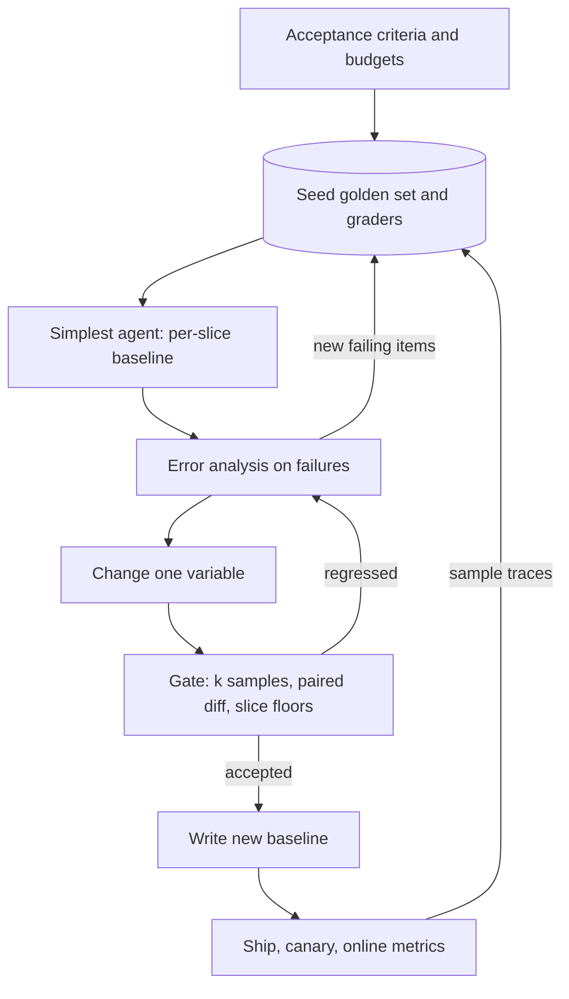

## TL;DR
Eval-driven development makes the eval suite the executable spec of your agent: criteria and seed tasks
come first, every prompt, tool or model change is judged by eval numbers, and failures grow the suite,
because "worked in the playground" misses non-local regressions.

## For agent builders
- **Why it matters for agents.** An agent changes in many places at once: system prompt, tool
  descriptions, tool code, model, step budget. A one-line tool-description edit can change which tool
  the planner picks on tasks nobody re-ran, so only a suite run on every change tells you what moved.
- **Where it shows up in your stack.** A pytest or eval-runner job in CI (LangSmith, Braintrust,
  promptfoo or Inspect), golden task files in the repo next to the prompts, a baseline file of per-task
  scores, and a PR comment carrying the eval diff.
- **What you control.** The acceptance criteria (task success, cost and step budgets, benign refusal
  rate), the graders on outcome and trajectory, *k* samples per task, the tolerance band, slice floors
  and which tier blocks a merge.
- **What you can skip.** Elaborate statistics on day one. A few dozen tasks, deterministic graders, *k*
  samples and a paired flip count against the last accepted run carry most of the value.

## Why it exists
- **LLM features break the ordinary loop three ways.** Non-deterministic: the same input gives different
  outputs. Non-local: a prompt sentence added for case A changes cases B and C nobody re-checked.
  Open-ended: no compiler or type checker flags a wrong answer. Tweak, try three examples, ship survives
  none of these.
- **The usual trajectory is a prompt nobody understands.** A user hits a failure, a line is added, and six
  months later the prompt is two thousand tokens of special cases; nobody knows which lines still matter
  or what the last change broke. And a bug without a failing eval item is never reliably fixed.
- **Model deprecations make it worse.** The vendor retires your model; the replacement is "better on
  benchmarks"; you swap it with no way to say whether your feature got better or worse.
- **The naive alternatives each fail.** Evals written after building encode what the system already does,
  so they pass by construction. Vendor benchmarks measure generic tasks, not your prompt and data.
  Production metrics alone are weeks too slow, too noisy to attribute to one change, and arrive after
  the damage.
- **TDD solved this for ordinary code.** Write the failing test first, so it describes the requirement,
  not the implementation. Eval-driven development adds two adjustments: tests are probabilistic and graded
  with thresholds, and the suite grows from production data, not from the specification alone.

## How it works
### The loop
1. **Define before building.** With the domain owner, write the task, the acceptance criteria (metric,
   threshold, and the slices where it must hold), the budgets that are also requirements (p95 latency,
   cost per request, benign refusal rate), and a handful of hand-written good and bad outputs. Do it
   before seeing outputs *because* criteria written afterwards anchor on current behaviour; Shankar et al.
   observed this drift in people grading outputs.
2. **Seed the golden set.** A few dozen items (illustrative size) covering the main input types and known
   hard cases, with expected outputs or a rubric. First graders are deterministic where possible (schema
   valid, cites an id present in the context, within length limits), plus an LLM judge for what code
   cannot check.
3. **Build the simplest version** (one prompt, one model) and run the eval for a per-slice baseline, not
   just an overall number.
4. **Error analysis on the failures** produces new categories; each becomes items and, when stable, a
   grader. The rule that grows the suite: a bug is not fixed until an eval item fails before the change
   and passes after.
5. **Change one variable at a time** (prompt, retrieval, model, decoding). Compare to the baseline with
   the harness's confidence intervals and record the configuration hash with the score, *because* a
   number without its configuration cannot be compared with anything.
6. **Gate by cost.** See the pyramid below; it exists *because* judge calls cost money and minutes, and a
   gate that takes an hour gets skipped.
7. **Ship and close the loop.** Sample production traces back into the golden set; use online metrics to
   check that the offline score still predicts what users experience.

| Gate tier | What runs | When |
|---|---|---|
| Fast | deterministic graders | every commit |
| Medium | judge-graded evals | each pull request or nightly |
| Slow | human review or an online A/B | before release |

### Why thresholds rather than exact assertions
- **Sampling noise:** an item may pass seven times in ten. Temperature zero reduces but does not remove
  variance.
- **So the gate** runs *k* samples per item, compares against the previous accepted run with a tolerance
  band, and lists per-item regressions rather than asserting 100%.
- **A flaky gate is worse than none,** *because* people learn to re-run it until it is green.

### Compare runs paired, item by item
- **Why:** most variance in a pass rate comes from which items are hard, and that variance is identical
  in both runs. The per-item difference (candidate minus baseline) has a much smaller spread than either
  mean.
- **How:** a paired test, or simply counting items that flipped in each direction.
- **Payoff:** it detects a real 2-point change on a set where comparing two unpaired means could not.

### Keeping the evals honest
- **Held-out subset you rarely inspect,** *because* tuning a prompt against the items you look at
  overfits them exactly as training on the test set would.
- **Version prompts and datasets together** with their scores.
- **Calibrate every judge against human labels** before it gates anything; otherwise you optimise the
  judge rather than the product.
- **Retire or harden items** that have passed for months; a suite at 100% carries no information, though
  a few should stay as smoke tests.

### What changes for agents
- **Grade outcome and trajectory separately.** Outcome: did the task end in the right state (ticket
  resolved, record updated, answer correct)? Trajectory: were the required tools called, forbidden ones
  avoided, and was a confirmation present before any write? Both become per-task graders.
- **Budgets are acceptance criteria.** Steps per task, tokens or cost per task, and wall-clock time get
  thresholds like quality does, *because* a prompt change that adds three tool calls per task can pass
  on quality and still double the bill.
- **Fresh sandbox per task.** Each run gets its own fixture data and stubbed or sandboxed tools, so one
  task's side effects cannot change another task's result.
- **Variance compounds over steps,** so agents need *k* samples per task even more than single-call
  features do.

### What changes for the team
- **A prompt change is a pull request with an eval diff attached,** like a test report.
- **"Did you run the evals?"** replaces "did you try it?".
- **The golden set is reviewed like code,** and product owners write and accept eval items, because the
  eval is the specification they can read.

## Diagram
Read it as TDD with probabilistic tests: criteria come first, every change is compared against the last
accepted baseline, and production traffic feeds new items back in.



## Examples
### One iteration, concretely
Illustrative round: a user reports the assistant quotes the 30-day refund window to customers on the
annual plan, whose window is 14 days.

| Step | What happens |
|---|---|
| Reproduce as an eval | add six items for annual-plan refund questions; current system passes 1 of 6, so the bug is now a failing eval, not an anecdote |
| One change | add plan tier to the retrieval filter |
| Eval diff on the PR | six new items 1 → 6 passing; across the other 194 items, 3 improved, 2 regressed; mean 0.81 → 0.84; every slice still above its floor |
| Review regressions | of the two regressed traces, one is noise (passes on re-run), one is a real loss on a question spanning both tiers |
| Grow the suite | that cross-tier case becomes an item; the next iteration starts from there |

Nothing in this loop required anyone to have "tried it in the playground".

### One iteration on a tool-calling agent
Illustrative: a support agent on 120 golden tasks, *k* = 3, comparing a planner-prompt change against the
last accepted baseline.

| Metric | Baseline | Candidate | Gate |
|---|---|---|---|
| Task success (outcome grader) | 0.74 | 0.79 | pass: 14 tasks up, 4 down, sign test p ≈ 0.03 |
| Write without confirmation (trajectory grader) | 0 tasks | 1 task | fail: zero-tolerance criterion |
| Mean steps per task | 6.1 | 7.4 | warn: budget is 8 |
| Cost per task | $0.041 | $0.052 | within the $0.06 budget |

- **The higher mean does not ship:** one task now writes without confirming, which is a hard criterion.
  That trace goes to error analysis, the fix is a tool-description change, and the task stays in the
  suite as a regression item.
- **Steps rose by 1.3,** so the next iteration watches the step budget, not only success.

Trajectory graders are small functions over the logged tool calls:

```python
# calls: list of {"name": str, "args": dict} logged for one agent run
WRITE_TOOLS = {"issue_refund", "update_record"}

def confirmed_before_write(calls):
    confirmed = False
    for c in calls:
        if c["name"] == "ask_user_confirmation":
            confirmed = True
        if c["name"] in WRITE_TOOLS and not confirmed:
            return False
    return True

def used_required_tools(calls, required):          # required comes from the golden task
    return set(required) <= {c["name"] for c in calls}

def within_budget(calls, max_steps=8):
    return len(calls) <= max_steps
```

### CI gate in pytest
It runs each golden item *k* times, scores with a deterministic check and a calibrated judge, and fails
only on a drop beyond a noise band against the last accepted run, or a slice below its floor.

The band is not a constant to copy: its width depends on item count and on how much the score moves
between identical runs.

```python
# tests/test_eval_gate.py — runs in CI on every prompt, retrieval or model change
import functools, json, statistics
from my_app import answer                          # system under test: answer(question, context) -> str
from graders import cites_valid_source, faithful   # deterministic check + judge calibrated on human labels

DATASET = [json.loads(l) for l in open("evals/support_v7.jsonl")]   # versioned golden set
BASELINE = json.load(open("evals/baseline_v7.json"))                # per-item scores of last accepted run
TOLERANCE, K = 0.03, 3   # illustrative: set the band from repeated baseline runs (~2-3 SD); K samples/item

@functools.lru_cache(maxsize=None)
def run():
    scores = {}
    for item in DATASET:
        outs = [answer(item["question"], item["context"]) for _ in range(K)]
        passes = sum(cites_valid_source(o, item["context"]) and faithful(o, item["context"]) for o in outs)
        scores[item["id"]] = passes / K
    return scores

def test_mean_did_not_drop():
    now, base = statistics.mean(run().values()), statistics.mean(BASELINE.values())
    assert now >= base - TOLERANCE, f"pass rate fell {base:.3f} -> {now:.3f}"

def test_few_items_regressed():
    # an item regressed if it lost at least two of its K samples versus the baseline run
    regressed = [i for i, s in run().items() if round((BASELINE.get(i, 0) - s) * K) >= 2]  # count, not float
    assert len(regressed) <= 0.02 * len(DATASET), f"regressed items: {regressed[:10]}"

def test_every_slice_above_floor():
    for name in {i["slice"] for i in DATASET}:
        ids = [i["id"] for i in DATASET if i["slice"] == name]
        assert statistics.mean(run()[i] for i in ids) >= 0.80, f"slice {name} below floor"
```

- **Baseline update:** when the gate passes and the change is accepted, the new per-item scores are
  written to `baseline_v7.json`, so the next change is compared against what actually shipped.
- **Same items on both sides:** `test_mean_did_not_drop` averages the baseline over its own ids, so after
  adding items (like the six above) compare means over the shared ids, or re-baseline first; otherwise
  the gate measures the new items' difficulty, not the change.
- **Sizing `TOLERANCE`:** re-run the unchanged system a handful of times and look at the spread of the
  mean. Rough guide below; a 0.03 band can still trip on pure noise now and then, and a larger set or a
  paired per-item test narrows it.

```
pass rate ≈ 0.8, same 200 items × 3 samples = 600 graded outputs
SE of one run   ≤ √(0.8 × 0.2 / 600) ≈ 0.016   (less when many items always pass or always fail)
SE of a diff    ≤ about 0.023                    (two such runs)
```

### Paired flip count with an exact sign test
Pure Python, no dependencies: count the items that flipped each way and ask whether the imbalance could
be chance.

```python
from math import comb

def flips(base, cand):
    """Items that went fail->pass (b) and pass->fail (c) between two runs."""
    b = sum(1 for i in base if base[i] < 0.5 <= cand[i])
    c = sum(1 for i in base if cand[i] < 0.5 <= base[i])
    return b, c

def sign_test(b, c):
    """Exact two-sided sign test on the flipped items only."""
    n, k = b + c, min(b, c)
    if n == 0:
        return 1.0
    tail = sum(comb(n, j) for j in range(k + 1)) / 2 ** n
    return min(1.0, 2 * tail)

base = {"q1": 1.0, "q2": 0.0, "q3": 1.0, "q4": 0.0, "q5": 0.33}
cand = {"q1": 1.0, "q2": 1.0, "q3": 0.33, "q4": 0.67, "q5": 0.0}
print(flips(base, cand))                 # (2, 1)
print(round(sign_test(8, 2), 3))         # 0.109: 8 up, 2 down could still be noise
print(round(sign_test(15, 3), 3))        # 0.008: unlikely to be chance
```

## Production patterns
- **Eval diff as a PR comment.** When any prompt, retrieval or model file changes, a CI job runs the
  gate and posts the per-slice table, the mean with its interval, and the list of regressed item ids
  with trace links. Monitor how often PRs merge with unread regressions; reviewers should open each one.
- **Configuration hash on every score.** Hash the prompt template, model id, decoding settings, retrieval
  parameters, grader versions and dataset version, and store it with each run. Refuse to compare runs
  whose hashes differ in more than the variable under test. Monitor runs stored without a hash.
- **Failing item before the fix.** Make "link the eval item that failed before this change" a required
  field in the bug-fix PR template. Monitor time from "bug reported" to "failing eval item added".
- **Accept-only baseline refresh.** Write the baseline file only on merge to main, never from a branch
  run, so every gate compares against what actually shipped. Pair the tolerance band with a trend chart
  across accepted runs to catch slow drift.
- **Agent eval tiers per change type.** A tool-description or prompt change runs the full golden task set
  with trajectory graders; a tool-code change also runs that tool's contract tests; a model swap runs
  everything plus the adversarial suite. Monitor runtime and cost per tier so the per-PR tier stays
  fast enough that nobody bypasses it.
- **Offline-to-online check.** After each release, compare the offline score change with the online
  metric it should predict (task completion, escalation rate, thumbs-down rate). Monitor the correlation
  over releases; when it weakens, the golden set has drifted from real traffic.

## Trade-offs
- **Evals first vs a fast first demo.** Writing evals before building delays the first demo by days but
  makes every later iteration measurable. It flips for a throwaway spike whose purpose is to learn what
  the task even is; even then the evals come before the second iteration.
- **Larger golden set vs loop speed.** A larger set gives tighter confidence intervals but a slower,
  costlier loop. Split it into a fast smoke subset per commit and the full set nightly or per release.
- **Tolerance band vs slow drift.** A band absorbs sampling noise but lets slow drift through across many
  small accepted drops. Pair the gate with a trend chart across runs.
- **Deterministic graders vs judges.** Deterministic graders are cheap and trustworthy but cover only part
  of quality; judges cover the rest at the cost of calibration work and per-run spend. Use a judge in the
  gate only once its agreement with human labels has been measured; until then it informs review but
  should not block.
- **Held-out items vs inspectability.** Holding out items prevents overfitting but means you cannot freely
  inspect their failures. Rotate items between the dev and held-out sets periodically.

## Pitfalls
- **Evals written after the system exists.** Symptom: 100% from day one while users keep reporting
  failures, because the items describe current behaviour rather than the requirement.
- **Tuning the prompt against the full eval set repeatedly.** Symptom: the eval climbs while production
  quality does not, and the held-out slice, if there is one, stays flat.
- **A hard threshold on a noisy metric.** Symptom: CI fails every third run with no change, and engineers
  re-run until green or mark the test skipped.
- **Treating the vendor's benchmark as your eval.** Symptom: a model swap "improves" on a leaderboard
  while a key slice of your task regresses unnoticed.
- **Judge-only evals with no human calibration.** Symptom: scores rise after changes that only make
  outputs longer or more confident, which the judge happens to prefer.
- **A golden set that never grows from production.** Symptom: the same forty items for a year while the
  input distribution moves, and an eval that predicts nothing about user complaints.
- **Scores stored without prompt and dataset versions.** Symptom: nobody can say whether Tuesday's 83%
  and Friday's 80% were measured on the same thing.

## When to use
- **Use when** model output reaches users or triggers actions; most strictly before model swaps, prompt
  refactors and retrieval changes.
- **Skip only** for a one-day spike.
- **Measure:** the eval's coverage of known failure modes, time from "bug reported" to "failing eval item
  added", CI eval runtime and cost, and the correlation between the offline score and the online metric
  it should predict.
- **Day to day:** a pull request whose description is an eval diff.
- **Interviews:** answer "how do you know your prompt change is an improvement?" with a baseline run,
  *k* samples per item, per-slice scores, a list of regressed items you have read, a held-out check, and
  a calibrated judge. "It looked better" is the wrong answer.

## Role lens
- **Engineer:** Writes the graders and the CI gate, adds a failing eval item before fixing any reported
  bug, and attaches the eval diff to every prompt or model pull request.
- **Architect:** Sets the gate pyramid (what runs per commit, per PR, per release), the thresholds per
  risk tier, and the rule that nothing ships without a comparable eval run.
- **FDE:** Has the customer's experts author acceptance criteria and golden items before the build
  starts, so the eval becomes the shared definition of done in the statement of work.

## Check yourself
**Q:** Your vendor is deprecating the model behind your feature in six weeks; the replacement is
"better on benchmarks". Walk through how eval-driven development handles the migration, and what would
make you refuse to switch.
**A:** First make sure the suite is current: run error analysis on recent production traces and add
items for any new failure modes and slices. Re-run the current model with *k* samples per item to pin a
fresh per-slice baseline, since the old one may have drifted. Run the candidate under identical
configuration: same prompts, retrieval, graders and dataset version. Compare per item, not just the
mean; list regressions and improvements and read the regressed traces. Check that the judge still
agrees with humans on the new model's outputs, because a different style can fool a judge. Try prompt
adaptations as separate, recorded experiments. Canary in production and compare online metrics with
the offline prediction. Refuse to switch if a high-severity slice regresses with no fix, if cost,
latency or benign refusals exceed budget, or if the judge cannot yet be trusted on the new outputs.

## Interview questions
### How is eval-driven development different from test-driven development?
- **Same core idea:** write the failing check first so it describes the requirement, not the
  implementation, and never call a bug fixed without a failing-then-passing item.
- **Two differences:** the checks are probabilistic and graded with thresholds and *k* samples, and the
  suite grows from production traces and error analysis, not from the specification alone.

### Your agent team ships prompt and tool-description changes daily. How do you structure eval gates so they do not slow it down?
- **Tier by cost:** deterministic outcome and trajectory graders on every commit, a judge-graded smoke
  subset per pull request, the full task set nightly, human review or an online A/B before release,
  because a gate that takes an hour gets skipped.
- **Make it trustworthy:** *k* samples per item, a tolerance band sized from repeated baseline runs
  (roughly 2-3 standard deviations), per-slice floors and a list of regressed items, so it does not flake.
- **Promote judges carefully:** a judge blocks merges only after its agreement with human labels is
  measured; until then it informs review.

### You are adding a new tool to a working agent. How do you develop it eval-first?
- **Write tasks that need the tool** and tasks that must not use it, with outcome graders and a
  trajectory grader for correct use, before writing the tool description.
- **Run the existing suite too,** because a new tool changes the planner's choices on old tasks; compare
  paired against the baseline and read the flips.
- **Add budgets:** steps and cost per task, since an extra tool often adds calls without adding success.

### When would you not write evals before building?
- **A one-day throwaway spike** whose purpose is to learn what the task even is; there is no stable
  requirement to encode yet.
- **But** the evals come before the second iteration, because from then on every change needs a
  baseline to be compared with.

### A candidate prompt lifts the mean from 0.81 to 0.83. Is that real?
- **Compare paired, not as two means:** count items that flipped each way and run a sign test or paired
  test, because item difficulty variance cancels in the per-item difference.
- **Check noise:** at 200 items × 3 samples near 0.8, one run's SE is about 0.016 and a difference of two
  runs about 0.023, so a 2-point change of means alone is not convincing.
- **Read the regressed traces** and check the held-out slice before accepting.

### How do you keep a golden set from going stale or being overfit?
- **Hold out a subset** you rarely inspect and rotate items between dev and held-out periodically.
- **Grow it from production:** sample recent traces and add items for new failure modes after each round
  of error analysis.
- **Retire or harden** items that have passed for months, keeping a few as smoke tests, because a suite
  at 100% carries no information.

## Quiz
### Q: Why write acceptance criteria and golden items before building the first version?
- [ ] Because the model cannot be called until a dataset file exists
- [x] Because criteria written after seeing outputs anchor on the model's current behaviour instead of the user's need, so they pass by construction
- [ ] Because CI pipelines require a baseline file before the first run
- [ ] Because vendor benchmarks are only valid for pre-registered tasks
> Criteria written first describe the requirement; criteria written after describe the implementation,
> which is why post-hoc evals start at 100% and catch nothing. The ordering, not the tooling, is what
> makes the eval a specification.

### Q: A CI eval gate uses a fixed 95% pass threshold and fails roughly every third run with no code change. What is the best fix?
- [ ] Lower the threshold to 80% so it passes reliably
- [ ] Set temperature to zero and keep the hard threshold
- [x] Gate on a significant drop against a baseline run using several samples per item and a tolerance band, and list per-item regressions
- [ ] Re-run the job until it passes before merging
> The failures are sampling noise, so the gate must compare distributions, not assert a point value.
> Temperature zero reduces but does not remove variance, and lowering the bar or re-running trains the
> team to ignore the gate.

### Q: Why keep a held-out subset of eval items that you rarely inspect?
- [ ] To reduce CI cost by running fewer items per commit
- [x] Because repeatedly tuning prompts against the items you inspect overfits them, so only the held-out set estimates real generalisation
- [ ] Because LLM judges need unseen items to stay calibrated
- [ ] Because the vendor requires test-data isolation for compliance
> Iterating on a prompt against visible items is training on the test set; the dev-set score keeps
> rising while production does not. A held-out slice, rotated occasionally, is the only unbiased
> offline estimate of how the change will behave on inputs you have not tuned for.

## Use cases & projects
### Use cases
- **Starting a new agent.** Writing acceptance criteria and seed tasks first gives the team a definition
  of done for the agent before the first prompt is tuned.
- **Reviewing prompt and tool-description PRs.** An eval diff in the PR shows which tasks flipped, so a
  one-line tool-description edit is judged on the whole suite, not on the example the author tried.
- **Model migrations.** Swapping the underlying model is accepted or rejected on task success, cost and
  step budgets per slice, compared against the last accepted baseline.
- **Turning incidents into tests.** Each production failure becomes a golden task, so the suite grows
  toward the failures users actually hit.

### Mini project
**Put a small agent under an eval gate in CI (2-3 hours).**
- **Goal:** make a merge fail when a change lowers agent task success beyond a tolerance band.
- **Steps:** write acceptance criteria and about 20 golden tasks with deterministic graders for a small
  tool-calling agent; keep a held-out subset you do not inspect; run each task *k* times and store a
  baseline file of per-task scores; add a CI job that re-runs the suite on each PR, counts paired flips
  against the baseline and posts the diff; then make a deliberately bad tool-description edit.
- **Done when:** the bad edit fails the gate with a diff naming the flipped tasks, a harmless change
  passes, and the held-out score is reported separately from the dev score.
