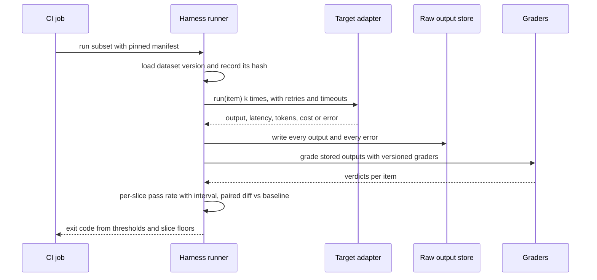

## TL;DR
An eval harness runs your agent over a versioned task set in fresh sandboxes with pinned configuration,
stores every output and trajectory, grades them, and reports per-slice scores with intervals: a
repeatable artifact with the status of a test suite.

## For agent builders
- **Why it matters for agents.** An agent run is many LLM calls plus tool side effects, so the failure
  modes of a notebook loop (dropped errors, overwritten outputs, unpinned config) multiply. The harness
  is what lets you say "the new planner prompt fixed 9 tasks and broke 2" with traces to prove it.
- **Where it shows up in your stack.** Eval runners in LangSmith, Braintrust, promptfoo or Inspect, or
  your own script; a target adapter that calls your agent (LangGraph graph, OpenAI Agents SDK runner,
  or a hand-rolled loop); a CI job that turns thresholds into an exit code.
- **What you control.** The target adapter, the sandbox per task, the step, token and wall-clock
  budgets, what goes in the run manifest, the graders, sample count *k*, and which runs block merges.
- **What you can skip.** Building dashboards before the basics. Pinning, stored raw outputs and
  trajectories, error reporting and a paired diff against a baseline matter far more.

## Why it exists
- **The notebook loop works once.** Iterate over a CSV, call the model, eyeball outputs, count passes.
  The second time, the prompt changed, the temperature differed, half the calls hit a rate limit and
  were silently skipped, and the raw outputs were overwritten. Nobody can say whether the new 83% beats
  the old 80% or is just a different 80%. The problem is everything the loop does not record.
- **Non-reproducibility.** Without pinned model id, prompt hash, sampling parameters, dataset version
  and grader version, a score cannot be attributed to a change.
- **Lost evidence.** If only the aggregate is kept, you cannot re-grade when the rubric improves,
  inspect the twelve items that regressed, or show a stakeholder a concrete failure.
- **Operational fragility.** Hundreds of LLM calls hit rate limits, timeouts and transient errors; a
  loop that drops them biases the score toward whichever items happened to succeed.
- **"Just be careful" does not survive a team.** Two engineers running the same notebook get numbers
  that differ for reasons neither can explain. A harness makes carefulness structural: same inputs,
  configuration and graders every time, with everything written down.

## How it works
### The components
```
dataset (versioned) → target adapter → runner → raw outputs (stored) → graders → scores → aggregator → report + gate
```

| Component | What it does | Because |
|---|---|---|
| **Dataset loader** | Reads a specific version of the golden dataset and records its hash | A changed dataset changes the metric |
| **Target adapter** | Wraps the system under test behind one function, `run(item) -> output`; it may be a single prompt, a RAG chain or a multi-step agent | The harness should outlive any one architecture |
| **Runner** | Concurrent execution with retries, backoff and timeouts; caches by (configuration hash, item id) so a re-run after a grader change costs nothing; samples each item *k* times above temperature zero | A single sample of a stochastic system is a coin flip, not a measurement |
| **Raw output store** | Writes every output with the request, latency, token counts and cost, before any grading | Running is expensive; grading is cheap and changes often, so they are separated |
| **Graders** | Pluggable: deterministic checks (schema, exact, regex, unit tests), LLM judges with their own pinned model and prompt version, a human-review queue; grader version recorded with the score | A grader change can move a score without any change to the system |
| **Aggregator** | Pass rate per slice with a confidence interval, plus latency percentiles and cost per item | Quality is one of three axes; accuracy alone hides the trade-off |
| **Reporter and gate** | Run manifest (who, when, every pinned value) and a comparison with a baseline: which items flipped, which direction, which slice; thresholds become an exit code | CI can block a merge |

### Design choices and their reasons
- **Pin everything in a manifest.** Model id, prompt text hash, temperature, seed, max tokens,
  retrieval index version, dataset version, grader versions, git SHA. A diff between two manifests
  should explain any diff between two scores.
- **Compare paired, not averaged.** Both runs use the same items, so the harness lists flipped items. A
  net +15 of 300 with 27 gains and 12 losses says far more than "78% → 83%", and the 12 losses are
  where the next bug lives.
- **Fail loudly on dropped items.** An errored item is reported as an error, not excluded, and the
  summary says how many; a quiet 5% drop rate is a biased score.
- **Make subsets cheap.** Same code path, different selectors:

| Run | Scope | Samples |
|---|---|---|
| Pull request | 50 items, minutes | 1 |
| Nightly | Everything | 1 or more |
| Release | Everything | *k* = 5 per item |

- **Do not assume temperature 0 is deterministic.** Hosted models often return different text for the
  same request at temperature 0 (batching and floating-point effects on the server, silent snapshot
  updates), and many APIs treat a seed as best-effort.
- **Measure the noise floor.** Run the baseline twice with no change and count items that flip. A later
  change that flips no more items than that has not been shown to do anything.
- **Key the cache on everything that can change the output.** Configuration hash, item id *and* sample
  index, so *k* samples are *k* distinct cache entries, not one output read back *k* times.

### Harnesses for agents and multi-step systems
An agent changes the shape of `run(item)`:
- **Environment per item.** A sandboxed filesystem, a seeded database, mocked or recorded tools,
  created fresh per item and torn down afterwards, *because* state left by one item (a file written, a
  row deleted) silently changes the next item's starting point.
- **Grade the final state,** not the final message (did the ticket get the right status, do the
  repository's tests pass), since many different action sequences are correct.
- **Store the full trajectory** (every tool call, argument and result) with the output, *because* when
  an agent fails, the step where it went wrong is the evidence.
- **Budgets on every run:** maximum steps, tokens and wall-clock time, so a looping agent becomes a
  recorded failure instead of a hung CI job.
- **Pin the tool layer too.** Tool schema version, tool descriptions and any recorded tool responses
  go in the manifest, *because* a reworded tool description changes agent behavior as much as a prompt.
- **Record vs live tools.** Recorded (replayed) tool responses make runs repeatable but break when the
  agent takes a new path the recording never saw; a seeded fake backend handles new paths at more
  build cost.

### Capability harnesses versus application harnesses
- **Capability harnesses** such as EleutherAI's lm-evaluation-harness and Inspect standardize prompting
  and scoring for public benchmarks, so an MMLU number from one lab is comparable with another's.
- **Application harnesses** (hosted products, open-source libraries or a few hundred lines you own)
  point at your dataset and your graders.
- **Same structure;** the difference is who owns the dataset and the grading rules. The tooling lesson
  in this module compares the options.

### Integration with the delivery pipeline
- **Runs in CI like tests:** a fast subset on every pull request that touches a prompt, chain or
  retrieval config; a full run nightly or before a release; results stored so trends are visible.
- **Thresholds** come from task-specific acceptance criteria.
- **Flaky items** (those that flip between samples with no change) are tracked separately rather than
  blocking merges, and their count is itself a quality signal.

## Diagram
One CI run end to end: the target adapter runs the agent per item in its own sandbox, and raw outputs
and trajectories are stored before grading, so graders can be re-run without calling the agent again.



## Examples
### A minimal harness in one file
A run manifest, concurrent execution with retries, stored raw outputs, pluggable graders, and a
per-slice summary with a Wilson confidence interval. `target` is any callable, so the same code
evaluates a prompt or an agent.

```python
import hashlib, json, math, time
from collections import defaultdict
from concurrent.futures import ThreadPoolExecutor

GRADERS = {
    "exact": lambda out, item: out.strip() == item["expected"].strip(),
    "contains_all": lambda out, item: all(s in out for s in item["expected"]),
}

def run_eval(items, target, config: dict, out_path: str, workers=8, retries=3):
    manifest = {**config, "dataset_sha": hashlib.sha256(json.dumps(items, sort_keys=True).encode()).hexdigest()[:12],
                "prompt_sha": hashlib.sha256(config["prompt"].encode()).hexdigest()[:12], "started": time.time()}

    def one(item):                                      # run only: retries cover the call, not grading
        last = None
        for attempt in range(retries):
            try:
                t0 = time.time(); out = target(item, config)
                return {"id": item["id"], "slice": item["slice"], "output": out,
                        "latency_s": round(time.time() - t0, 3), "error": None}
            except Exception as e:                      # rate limit, timeout, transient error
                last = repr(e)
                if attempt < retries - 1: time.sleep(2 ** attempt)
        return {"id": item["id"], "slice": item["slice"], "output": None, "error": last}

    with ThreadPoolExecutor(workers) as ex:
        results = list(ex.map(one, items))
    with open(out_path, "w") as f:                      # raw outputs first; grading can be redone later
        f.write(json.dumps({"manifest": manifest}) + "\n")
        for r in results: f.write(json.dumps(r) + "\n")
    by_id = {it["id"]: it for it in items}              # separate grading pass over the stored outputs
    for r in results:
        it = by_id[r["id"]]
        r["pass"] = None if r["error"] else GRADERS[it["grader"]](r["output"], it)
    return summarize(results)

def summarize(results):
    by_slice = defaultdict(list)
    for r in results: by_slice[r["slice"]].append(r)
    report = {}
    for s, rs in sorted(by_slice.items()):
        graded = [r for r in rs if r["pass"] is not None]
        n, k = len(graded), sum(r["pass"] for r in graded)
        report[s] = {"n": n, "pass": round(k / n, 3) if n else None,
                     "ci95": wilson(k, n), "errors": len(rs) - n}
    return report

def wilson(k, n, z=1.96):          # stays sane at 10/10 or 0/10, where the normal approximation gives ±0
    if n == 0: return None
    p, d = k / n, 1 + z * z / n
    c, h = (p + z * z / (2 * n)) / d, z * math.sqrt(p * (1 - p) / n + z * z / (4 * n * n)) / d
    return (round(c - h, 3), round(c + h, 3))
# e.g. {'billing': {'n': 60, 'pass': 0.817, 'ci95': (0.701, 0.894), 'errors': 0}, ...}
```

- **Reading the `billing` line:** the interval is about 19 points wide at n = 60, so a 5-point change
  in that slice needs the paired flipped-item view or more items, not a victory lap.
- **Why Wilson, not p ± 1.96·SE:** small slices with perfect scores are common in a harness. The normal
  approximation reports a 10/10 slice as 100% ± 0, which is false confidence; Wilson gives roughly 72%
  to 100% for the same slice.

### Agent scenario: a target adapter with a sandbox, budgets and a trajectory
The same `run_eval` drives an agent when `target` builds a fresh sandbox, runs the loop under budgets
and returns the final state plus the trace. `agent_step` stands for one call of your agent framework
or model API; `seed_db` and `TOOLS` are your fixtures.

```python
import copy, time

class BudgetExceeded(Exception): pass

def agent_target(item, config):
    db = copy.deepcopy(seed_db(item["seed"]))           # fresh state per item, never shared
    tools = {name: (lambda f: lambda **a: f(db, **a))(f) for name, f in TOOLS.items()}
    messages, trace, t0, tokens = [{"role": "user", "content": item["input"]["message"]}], [], time.time(), 0
    for step in range(config["max_steps"]):            # e.g. 10
        action = agent_step(messages, config)          # -> {"tool", "args"} or {"final"}, plus "usage_tokens"
        tokens += action["usage_tokens"]
        messages.append({"role": "assistant", "content": action})   # the call precedes its result
        if tokens > config["max_tokens"] or time.time() - t0 > config["max_seconds"]:
            raise BudgetExceeded(f"step {step}")
        if "final" in action:
            return {"final": action["final"], "state": db, "trace": trace, "steps": step + 1, "tokens": tokens}
        result = tools[action["tool"]](**action["args"])
        trace.append({"tool": action["tool"], "args": action["args"], "result": result})
        messages.append({"role": "tool", "name": action["tool"], "content": str(result)})
    raise BudgetExceeded("max_steps")                  # a looping agent is a recorded failure

def grade_agent(out, item):                            # outcome first, path only where it matters
    exp = item["expected"]
    state_ok = all(out["state"][k] == v for k, v in exp["final_state"].items())
    called = [t["tool"] for t in out["trace"]]
    path_ok = all(t in called for t in exp["required_tools"]) and not set(called) & set(exp["forbidden_tools"])
    return state_ok and path_ok and out["steps"] <= exp["max_steps"]
```

| Run of 120 refund tasks, *k* = 3 (illustrative) | Count |
|---|---|
| Passed (state, path and budget) | 291 of 360 |
| Failed on final state | 41 |
| Failed on forbidden or missing tool | 16 |
| `BudgetExceeded` (recorded as failures, not dropped) | 12 |

- **Reading it:** the 12 budget errors cluster on 4 tasks where the agent re-calls `lookup_order` in a
  loop; the stored trace shows the tool returned an error string the prompt never explains.
- **One adjustment to `run_eval`:** catch `BudgetExceeded` before the generic handler and record the
  run as failed (`pass = False`), without retrying, because it is an agent failure, not a transient
  provider error; retry and report as errors only rate limits and timeouts.

### A CI gate against a baseline
Pure Python. It compares graded results from a baseline and a candidate run on the same items, fails on
errors and slice floors, and reports whether the flip count clears the measured noise floor.

```python
import sys

def gate(base, cand, noise_floor, slice_floor, max_error_rate=0.0):
    """base, cand: id -> {"slice": str, "pass": bool | None}; None means the item errored."""
    problems, notes = [], []
    errors = sum(r["pass"] is None for r in cand.values())
    if errors / len(cand) > max_error_rate:
        problems.append(f"{errors} errored items (reported, not dropped)")
    both = [i for i in base if base[i]["pass"] is not None and cand[i]["pass"] is not None]
    gained = sum(1 for i in both if cand[i]["pass"] and not base[i]["pass"])
    lost = sum(1 for i in both if base[i]["pass"] and not cand[i]["pass"])
    if gained + lost <= noise_floor:
        notes.append(f"{gained + lost} flips <= noise floor {noise_floor}: no demonstrated effect")
    for s, floor in slice_floor.items():
        rs = [r["pass"] for r in cand.values() if r["slice"] == s and r["pass"] is not None]
        if rs and sum(rs) / len(rs) < floor:
            problems.append(f"slice {s}: {sum(rs)}/{len(rs)} below floor {floor}")
    return problems, notes, (gained, lost)

base = {str(i): {"slice": "billing" if i < 60 else "other", "pass": i % 5 != 0} for i in range(300)}
cand = {k: dict(v) for k, v in base.items()}
for i in range(0, 60, 5): cand[str(i)]["pass"] = True        # 12 gains in billing
for i in [j for j in range(60) if j % 5][:12]: cand[str(i)]["pass"] = False   # 12 losses, also billing
problems, notes, flips = gate(base, cand, noise_floor=11, slice_floor={"billing": 0.85})
print(flips, problems, notes)
sys.exit(1 if problems else 0)
# (12, 12) ['slice billing: 48/60 below floor 0.85'] []
```

| Signal (illustrative numbers) | Value | Reading |
|---|---|---|
| Baseline vs itself, no change | 11 items flip | This is the noise floor |
| Candidate vs baseline | 24 flips (12 gained, 12 lost) | Above the floor, but net zero |
| Billing slice | 48/60 = 0.80 vs floor 0.85 | Gate fails; exit code 1 blocks the merge |

## Production patterns
- **Tiered runs from one code path.** Use dataset selectors (by tag or slice) so the pull-request job
  runs a 50-item smoke subset, the nightly job runs everything, and the release job runs *k* = 5
  samples per item. Monitor wall-clock time and token cost per tier.
- **Manifest diff in the PR comment.** Post the two manifests side by side with the paired diff, so a
  reviewer sees which pinned values changed alongside which items flipped. Monitor runs where more than
  one field changed at once.
- **Pin snapshots, never aliases.** Resolve any alias such as `latest` to a dated model snapshot before
  the run and record the resolved id. Monitor score moves on runs with an otherwise empty diff; they
  signal provider-side changes.
- **Recalibrate the noise floor.** Re-run the unchanged baseline twice whenever the model snapshot or
  provider changes, and store the flip count as the gate's threshold. Monitor its trend; a rising floor
  means more flaky items.
- **Quarantine flaky items.** Keep items that flip with no change in a tracked list that reports but
  does not block. Monitor the list's size and review it weekly instead of letting it grow silently.
- **Hermetic agent environments.** Build each agent item's sandbox from a seed (a container or a fresh
  temp directory plus a seeded database), enforce step, token and wall-clock budgets, and store the
  trajectory. Monitor budget-exceeded counts.
- **Trace link on every result.** Store the trace id from your tracing tool next to each graded item,
  so the PR comment's list of flipped tasks opens straight into the step where the agent diverged.
  Monitor items with missing traces, since those failures cannot be diagnosed.

## Trade-offs
- **Stored outputs vs storage.** Storing every raw output makes re-grading free and failures
  inspectable, but the store grows by items × samples × runs and may contain customer data that needs
  retention rules.
- **Concurrency vs measurement.** High concurrency makes a 500-item run take minutes instead of an hour,
  but can trip provider rate limits and distort the latency numbers you also measure; use a separate
  latency run.
- **Caching vs staleness.** Caching by configuration hash saves money on repeated runs, but a cache that
  ignores any pinned value (a changed retrieval index, a new model snapshot behind the same alias)
  silently returns stale outputs.
- **Hosted product vs owned code.** A hosted eval product gives dashboards, trend history and
  human-review queues out of the box, but owns your dataset format and graders. A few hundred lines you
  own are portable but need maintenance.
- **Recorded tools vs seeded fakes.** Replaying recorded tool responses is cheap and exact, but fails
  when a new prompt makes the agent take a path the recording lacks. Seeded fake backends answer any
  path at the cost of building and maintaining them; use recordings for read-only tools.

## Pitfalls
- **Dropping errored items from the denominator.** Symptom: the score improves on the day the provider
  has an outage, because the hardest, longest items are the ones that timed out. Diagnose: compare the
  graded count with the dataset size and plot error rate per run. Fix: report errors, retry, never drop.
- **Changing grader and system in the same run.** Symptom: a score movement nobody can attribute.
  Diagnose: diff the two manifests; more than one changed field is the cause. Fix: change one at a time,
  re-grading stored outputs first.
- **One sample per item at temperature 0.7.** Symptom: the score moves several points between identical
  runs on a few-hundred-item set, which the team reads as regressions and improvements. Diagnose: run
  the unchanged baseline twice and count flips. Fix: *k* samples and a noise-floor gate.
- **Grading inside the run loop and never storing outputs.** Symptom: a rubric fix forces a full,
  expensive re-run just to see new scores.
- **Overall pass rate without intervals or slices.** Symptom: a merged prompt change that lifted the
  average by lowering the one slice a key customer uses.
- **Reading the model alias (`latest`) instead of a pinned snapshot.** Symptom: a score change with an
  empty diff.
- **Reusing one environment across agent items.** Symptom: results depend on item order; an item passes
  alone and fails when run after another that changed shared state. Diagnose: shuffle item order with a
  fixed seed and diff verdicts. Fix: a fresh sandbox per item.
- **Retrying agent failures as if they were transient.** Symptom: a looping task burns three full step
  budgets per sample and the run cost triples. Fix: retry only provider errors; record budget overruns
  once as failures.

## When to use
- **Build it before the first eval:** a harness is needed the moment a prompt or chain is evaluated
  more than once, and that is the second run.
- **Cadence:** the fast subset on every change touching model-facing code, the full set before
  releases, multi-sample runs when the decision is close.
- **Measure in one report:** pass rate per slice with intervals, error rate, latency percentiles and
  cost per item.
- **Frameworks:** if you adopt one, keep the target adapter and dataset format yours so you can leave it.

## Exercise
**Goal:** turn the minimal harness above into one that gates pull requests for an agent you have (or a
two-tool toy agent). No solution is given.
- **Inputs:** a JSONL task set with seeds and expected end states; your agent behind `run(item)`.
- **Deliver:** a sandbox per task, step, token and wall-clock budgets, `BudgetExceeded` recorded as a
  failure without retry, a cache keyed on configuration hash, item id and sample index, a manifest, and a
  CI exit code from slice floors and the noise floor.
- **Acceptance:** two unchanged runs give a stored noise-floor flip count; a deliberately broken prompt
  exits 1; an injected timeout shows as an error, not a failure; shuffled order changes no verdict;
  changing the rubric re-grades without calling the agent.

## Role lens
- **Engineer:** Owns the harness code, the target adapter and the grader registry, and wires the subset
  run into the pull-request pipeline with a threshold gate.
- **Architect:** Sets the standard: what every run manifest must pin, where raw outputs live and for how
  long, and which runs block a release versus merely report.
- **FDE:** Stands up a harness inside the customer's environment against their data and credentials,
  so eval numbers can be reproduced by their team after the engagement ends.

## Check yourself
**Q:** A colleague reports that the summarizer's eval score rose from 80% to 86% after their prompt
change, from a notebook run. Which questions do you ask before believing it, and what would a harness
have answered already?
**A:** Were both runs on the same dataset version and the same items? Same model snapshot, temperature
and max tokens, or did one run use a new model alias? How many items errored and were they excluded?
One sample per item or several, and at what temperature? Did the grader change at the same time?
Which items flipped, and does any slice regress? A harness answers all of these from two manifests and
a paired diff: it pins the dataset hash, model id, prompt hash and grader version, reports error counts
instead of silently dropping items, stores raw outputs so the flipped items can be read, and gives a
per-slice interval that says whether six points at that n is signal at all.

## Interview questions
### An agent task passes when run alone but fails in the full harness run. What is wrong?
- **Shared state between items:** an earlier item wrote a file, row or ticket the later one reads, so
  results depend on order. Fix with a fresh sandbox per item, built from the item's seed.
- **Shared caches or rate limits:** a tool response cached under too coarse a key, or a tool throttled
  under concurrency, returns something different in the full run.
- **Confirm it:** shuffle item order with a fixed seed and compare; order-dependent flips prove the
  harness, not the agent, is at fault.

### The model is nondeterministic even at temperature 0. How do you set a gate that is not just noise?
- **Measure the noise floor:** run the unchanged baseline twice and count items that flip; a candidate
  that flips no more items than that has not been shown to do anything.
- **Sample where it matters:** *k* samples per item on release runs, with the cache keyed on sample
  index so the *k* outputs are distinct, because more items do not shrink per-item sampling variance.
- **Keep the floor current:** re-measure whenever the model snapshot or provider changes, and quarantine
  items that flip with no change into a tracked list that reports but does not block.

### Why use a Wilson interval rather than p ± 1.96·SE for per-slice scores?
- **Small slices hit the edges:** at 10/10 the normal approximation reports 100% ± 0, which is false
  confidence.
- **Wilson stays sane** at 0/n and n/n; the same 10/10 slice gives roughly 72% to 100%.
- **Practical reading:** at n = 60 a Wilson interval is about 19 points wide, so a slice-level change
  needs the paired view or more items.

### How do you keep harness cost and runtime under control in CI?
- **Tier the runs:** a 50-item subset on each pull request, everything nightly, *k* = 5 samples per item
  for releases, all from one code path with dataset selectors.
- **Cache by configuration hash, item id and sample index,** so re-grading after a rubric change costs
  nothing, and the cache key includes every value that can change the output.
- **Trade-off:** high concurrency shortens runs but can trip rate limits and distort latency, so measure
  latency in a separate run.

## Quiz
### Q: Why does a well-designed harness store raw outputs before any grading happens?
- [ ] Graders require outputs on disk to run
- [x] Running is expensive and grading is cheap and changes often, so outputs must survive grader changes
- [ ] Storing outputs is required by most providers' terms of service
- [ ] It lets the harness skip items that already passed
> Separating the two means a rubric fix or a new grader can be applied to existing outputs for free,
> and failures can be inspected. Skipping passed items would bias future runs, which is the opposite of
> the goal.

### Q: During a run, 6% of items fail with provider-side timeouts (the API, not your system, is overloaded). What should the harness do with them?
- [ ] Exclude them from the denominator so the score reflects completed items
- [ ] Mark them as failed, since a timeout is a bad user experience
- [x] Report them as errors with their count, separate from the pass rate, and retry them
- [ ] Replace them with cached outputs from the previous run
> Excluding errored items biases the score, because timeouts cluster on the hardest items; marking them
> failed mixes an infrastructure problem into a quality metric. Reporting and retrying keeps both
> signals honest.

### Q: A nightly run with no code, prompt, dataset or grader change scores four points below last night's. The manifest records the model as the alias "latest". What is the harness design flaw?
- [ ] The harness should have reused last night's cached outputs, since nothing in the repository changed
- [x] The manifest pins an alias rather than a dated snapshot, so a provider-side model update cannot be told apart from noise
- [ ] The grader should have been an LLM judge
- [ ] Concurrency was too high and caused rate limiting
> A manifest must pin every value that can move the score. An alias can resolve to different weights
> over time, so an empty diff cannot rule out a model change; pinning the snapshot makes the cause
> attributable. Reusing cached outputs keyed on the alias would be worse: it would hide the change.

## Mastery test
**Problem:** a team's harness reports a new planner prompt at 88% versus 84% on 250 coding-agent tasks
at *k* = 3. The run cost a third of the usual, and 31 items show `output: None`.

Every task's sandbox is one shared git checkout reset only at the start. The cache key is (config hash,
item id). Would you approve?

**A strong answer:**
- rejects the comparison until the 31 errored items are retried and reported: if they left the
  denominator, the score is biased toward easy tasks;
- spots that a third of the cost at *k* = 3 means the cache returned one output three times; the key
  needs the sample index;
- calls out shared checkout state as order dependence, fixed by a fresh sandbox per task;
- asks for the paired diff and noise floor after the fixes before any decision.

## Use cases & projects
### Use cases
- **CI gate for an agent repository.** Every pull request runs the task set and fails the build when a
  slice drops below its threshold, the same way unit tests do.
- **Nightly runs against a pinned model snapshot.** Stored manifests and trajectories show whether a
  score change came from your code or from the provider.
- **Re-grading old runs when the rubric improves.** Because raw outputs and traces are kept, a new
  grader can be applied without re-running the agent.
- **Investigating "fixed 9, broke 2".** A paired per-task diff against the baseline points straight at
  the trajectories that changed.

### Mini project
**Write a minimal agent eval harness (2-3 hours).**
- **Goal:** run a small tool-calling agent over a task set reproducibly, with every output and trace kept.
- **Steps:** load tasks from a JSONL file; create a fresh fake-tool sandbox per task; cap steps and
  tokens per run; retry transient errors and record any that still fail as errors, not passes; write a
  run manifest (model id, prompt hash, sampling settings, dataset and grader versions); store each
  trajectory; grade final state with code; diff per task against a saved baseline run.
- **Done when:** two runs of the unchanged baseline give you a noise-floor flip count, errors are
  reported separately from failures, and the diff of a changed prompt lists flipped tasks with their
  traces next to that floor.
