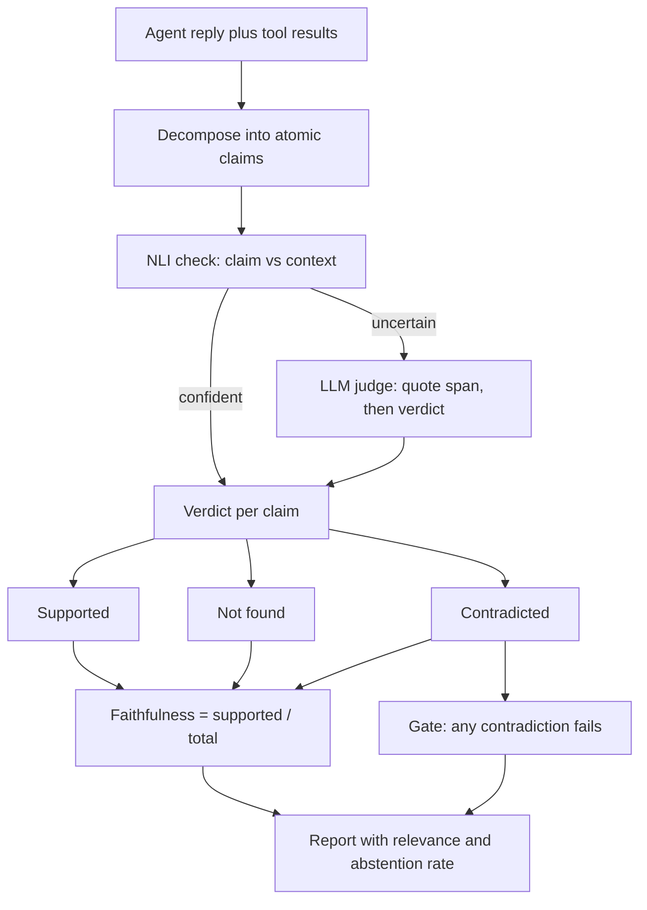

## TL;DR
Faithfulness (groundedness) asks whether every claim in an agent's reply is supported by what it was
given, retrieved chunks and tool results, not whether it is true. Verify atomic claims one by one; no
reference is needed, so it runs on live traces.

## For agent builders
- **Why it matters for agents.** An agent's reply summarises what its tools returned and what it did.
  The worst unfaithful claims are about actions ("I have issued the refund") or figures copied wrongly
  from a tool result, and both read exactly like grounded prose.
- **Where it shows up in your stack.** Faithfulness or groundedness evaluators in RAG and eval tools
  (Ragas defines the metric; LangSmith, Braintrust and similar tools run judge-based versions), online
  scoring of sampled traces, and a guard step that checks the draft reply before the agent sends it.
- **What you control.** What counts as context (retrieved chunks, tool results, the record of tool
  calls made), claim granularity, NLI versus LLM verifier, the contradiction gate, and the sampling rate
  on production traffic.
- **What you can skip.** Training your own NLI model or reproducing FActScore. A decomposition prompt,
  a context-only verifier, a number guard and a labeled claim set cover agent work.

## Why it exists
- **RAG's promise is not enforced.** "The answer comes from your documents" is the promise, but nothing
  in the architecture enforces it. The model can answer from parametric memory and ignore the context,
  blend memory with context, misread the context (a wrong number, the wrong entity, a dropped negation),
  or turn a specific statement into a general one. All of these produce confident prose that looks
  grounded.
- **Agents add a second promise.** "I did what the tools say I did." A reply can claim a refund, a
  booking or a file change that no tool call ever made, and nothing but a check against the trace
  catches it.
- **Fluent, even correct, answers can be unsupported,** and those break when the documents change.
- **Correctness and faithfulness are different axes,** and the 2×2 below is diagnostic. An end-to-end
  correctness score collapses it into one number and points you at the wrong fix.
- **The naive alternatives fail.** Comparing to a reference answer needs references for every item and
  conflates retrieval and generation errors. A one-shot "is this hallucinated?" verdict over a paragraph
  misses the one wrong figure among six correct sentences. N-gram overlap with the context rewards
  copying and penalises paraphrase.
- **Claim-level, reference-free checking fixes both,** because granularity makes the check accurate and
  actionable, and a reference-free metric is the only one you can run on live traffic.

## How it works
### The correctness × faithfulness 2×2
| | Faithful (supported by context) | Unfaithful (not supported) |
|---|---|---|
| **Correct** | the goal | answered from memory: right today, unverifiable, uncitable, drifts when facts change |
| **Wrong** | the context itself is wrong or stale: an ingestion or freshness problem | the classic hallucination |

- **For an agent, "context" is the whole evidence of the run:** retrieved chunks, every tool result,
  and the list of tool calls actually made. A faithful-but-wrong reply often means a tool returned stale
  data, so the fix is in the tool or its source, not the prompt.

### Step 1: decompose the answer into atomic claims
- **An LLM splits the answer into self-contained factual statements,** one fact each, with pronouns and
  references resolved so every claim can be judged in isolation.
- **Why:** a paragraph-level verdict hides a single wrong number, while atomic claims localise the
  failure and give a ratio.
- **Granularity is a design choice:** too coarse and errors hide inside compound claims; too fine and
  trivial claims ("the policy exists") inflate the score.
- **Action claims count too.** "I cancelled your order" is a claim whose support is a matching tool call
  with a success result in the trace.
- **Lineage:** FActScore applied the same atomic-fact idea to long-form factuality against a knowledge
  source; faithfulness applies it against the retrieved context.

### Step 2: verify each claim against the context only
Each claim gets one of three verdicts:

| Verdict | Meaning | Maynez et al. term |
|---|---|---|
| **supported** | entailed by the context | — |
| **contradicted** | the context says otherwise | intrinsic hallucination |
| **not found** | the context is silent | extrinsic hallucination |

- **The three-way split matters** because *contradicted* is worse than *not found*, and the two call for
  different responses.

Two families of verifier:

| Verifier | How | Strengths | Weaknesses |
|---|---|---|---|
| **NLI model** | premise = context, hypothesis = claim | cheap, fast, deterministic | limited by input length; weaker when support needs combining sentences or light reasoning |
| **LLM judge** | use only the context, quote the supporting or contradicting span, then give a verdict | long multi-passage contexts and reasoning | higher cost; the usual judge biases, notably leniency toward paraphrases that quietly change scope ("all" became "most", a figure got rounded) |

- **A hybrid is common:** NLI first, LLM only on uncertain claims.
- **Agent traces favour the LLM judge,** because support often spans several tool results (an order
  record plus a policy chunk), which is the multi-sentence case NLI handles worst.

### Step 3: aggregate
- **faithfulness = supported claims / total claims,** which is the RAGAS definition.
- **Report alongside the mean:** the share of answers with at least one contradiction (a gating signal)
  and the unsupported count.
- **Citation groundedness** when the system emits citations:
  - *citation precision:* does the cited span entail the sentence it is attached to?
  - *citation recall:* does every sentence that needs support carry a citation?

### The abstention loophole
- **"I could not find that in the documents" contains no claims,** so its faithfulness is trivially 1.
  Optimise faithfulness alone and the system learns to say nothing.
- **Pair it with answer relevance and completeness:** the "RAG triad" of context relevance, groundedness
  and answer relevance.
- **Pair it with retrieval recall** to separate "answered from memory because retrieval failed" from
  "answered from memory despite good context".
- **For agents, pair it with task success** too: an agent that stops calling tools and hedges scores
  well on faithfulness while resolving nothing.

### Calibrating the verifier
1. **Treat it as a judge:** build a human-labeled set of (claim, context, label) triples.
2. **Measure agreement per label class,** not overall.
3. **Run a shuffled-context sanity test:** faithfulness should fall toward zero. If it does not, the
   judge is using its own knowledge rather than the context.

## Diagram
Extract-then-verify on an agent run: the reply becomes claims, each claim is checked only against the
run's tool results and retrieved chunks, and contradictions stay visible as a gate.



## Examples
### Extract-then-verify pipeline
A minimal pipeline with an abstract `llm` callable, followed by a worked case where the first sentence of
the answer is correct and the answer still fails.

```python
import json

EXTRACT = """Split the answer into atomic factual claims, one fact each, with pronouns resolved.
Answer: {answer}
Return a JSON list of strings."""

VERIFY = """Use ONLY the context below. Decide whether the claim is SUPPORTED (entailed by the context),
CONTRADICTED (the context states otherwise) or NOT_FOUND (the context is silent).
Quote the relevant span from the context, then write the verdict alone on the last line.
Context:
{context}

Claim: {claim}"""

def faithfulness(answer: str, context: str, llm) -> dict:
    claims = json.loads(llm(EXTRACT.format(answer=answer)))
    verdicts = [llm(VERIFY.format(context=context, claim=c)).strip().splitlines()[-1].strip()
                for c in claims]
    n = len(claims)
    return {
        "faithfulness": sum(v == "SUPPORTED" for v in verdicts) / n if n else 1.0,  # no claims: trivially faithful
        "contradicted": sum(v == "CONTRADICTED" for v in verdicts),
        "claims": list(zip(claims, verdicts)),
    }

# Context: "Standard plans may be refunded within 30 days of purchase. Enterprise plans are non-refundable."
# Answer:  "Standard plans can be refunded within 30 days. This also applies to Enterprise plans.
#           Refunds go back to the original payment method."
# Claims -> "Standard plans can be refunded within 30 days"   SUPPORTED
#           "Enterprise plans can be refunded within 30 days" CONTRADICTED
#           "Refunds go to the original payment method"       NOT_FOUND
# faithfulness = 1/3, contradicted = 1  ->  fails a contradiction gate despite a correct first sentence.
```

- **Averaged over an eval set,** the headline is the mean faithfulness, but the decision-relevant numbers
  are the fraction of answers with any contradicted claim and the per-claim log that shows *which* fact
  was invented.

### Deterministic number guard (runnable)
Pure Python. Invented figures are the most damaging unfaithful claims and the easiest to catch without a
judge: every number in the answer must appear in the context.

```python
import re

NUM = re.compile(r"\d+(?:[.,]\d+)*%?")

def numbers(text):
    """Figures as written, with thousands separators removed: '$1,500' -> '1500', '30%' -> '30%'."""
    return {m.replace(",", "") for m in NUM.findall(text)}

def unsupported_numbers(answer, context):
    return sorted(numbers(answer) - numbers(context))

context = ("Standard plans may be refunded within 30 days of purchase. "
           "Accidental damage is covered up to $1,500 per claim, with a 10% excess.")
good = "You can get a refund within 30 days, and damage is covered up to $1,500 (10% excess)."
bad  = "You can get a refund within 30 days, and damage is covered up to $2,000 (10% excess)."
print(unsupported_numbers(good, context))   # []
print(unsupported_numbers(bad, context))    # ['2000']  -> gate: regenerate, abstain or send to review
```

- **Limits:** it misses figures written as words ("thirty days") and flags legitimate reformatting
  ("1.5k"), so it is a gate in front of the judge, not a replacement for it.

### Agent scenario: grounding a support agent's reply in its own trace
The context is built from the run itself: tool results are the evidence, and the tool calls made are the
only support for claims about actions. Reuses `unsupported_numbers` from the guard above.

```python
def grounding_context(trace: list[dict]) -> str:
    """Only what the tools returned this run counts as evidence."""
    return "\n".join(m["content"] for m in trace if m["role"] == "tool")

def actions_taken(trace: list[dict]) -> list[str]:
    return [m["tool_call"] for m in trace if m.get("tool_call")]

trace = [
    {"role": "user", "content": "Can I get a refund on order 8812?"},
    {"role": "assistant", "content": "", "tool_call": "get_order(8812)"},
    {"role": "tool", "content": "order 8812: Standard plan, purchased 12 days ago, $240"},
    {"role": "assistant", "content": "", "tool_call": "search_policy('refund window')"},
    {"role": "tool", "content": "Standard plans may be refunded within 30 days of purchase."},
    {"role": "assistant", "content": "Yes: order 8812 is 12 days old, inside the 30-day window. "
                                     "I have issued a $240 refund to your card."},
]
reply, ctx = trace[-1]["content"], grounding_context(trace)
print(unsupported_numbers(reply, ctx))   # []  every figure is in a tool result
print(actions_taken(trace))              # ['get_order(8812)', "search_policy('refund window')"]
# Claim "a $240 refund was issued" -> NOT_FOUND: no refund tool was ever called.
# Claim "refunded to your card"    -> NOT_FOUND: no tool result mentions the payment method.
```

| Check | Result | What it says |
|---|---|---|
| Number guard | passes | figures were copied correctly from tool results |
| Claim verification | 3 of 5 claims supported, 0.6 | two claims have no support in the trace |
| Action claims vs tool calls | 1 unsupported action | the agent says it refunded but never called a refund tool |
| Decision | block the reply | regenerate with the instruction to call the refund tool or say a refund is possible |

- **The lesson:** a cheap number guard is necessary but not sufficient. Action claims need their own
  check against the tool-call record, and they belong behind a hard gate (illustrative numbers above).

### Worked scenario: reading a faithfulness report
An eval run over 400 answers (illustrative numbers).

| Signal | Value | What it says |
|---|---|---|
| Mean faithfulness | 0.93 | looks healthy, but it is an average of ratios |
| Answers with any contradicted claim | 4% (16 answers) | the gating number: 16 answers contradict the documents |
| Answers with an unsupported number | 2% (8 answers) | invented figures; route to the number guard |
| Abstention rate vs last release | up from 5% to 12% | part of the faithfulness gain is the system saying less |
| Shuffled-context faithfulness | 0.41 | too high: the judge leans on its own knowledge |

- **Decision:** do not ship on the mean. Fix the 16 contradictions, recalibrate the judge, and check
  answer relevance before crediting the gain.

## Production patterns
- **Sampled online faithfulness on agent traces.** Run extract-then-verify asynchronously on a sample of
  production traces, off the request path, with tool results as context, and attach the per-claim log to
  the trace. Monitor the contradiction rate and the unsupported-claim rate per route, per tool and per
  document source.
- **Contradiction gate in release evals.** Any contradicted claim fails the item, and the release is
  blocked when the share of answers with a contradiction rises above the agreed threshold. Monitor the
  gate rate separately from mean faithfulness.
- **Cheap guards on the serve path.** Apply a deterministic check for numbers, dates and amounts before
  the agent returns a reply; on failure, regenerate, abstain or route to human review. Monitor how often
  the guard fires and what share of fired answers humans confirm as wrong.
- **Action-claim check against the tool log.** Before sending, match claims of completed actions
  (refunded, booked, deleted, emailed) against successful tool calls in the trace. Block on any mismatch
  and monitor the rate per action type.
- **NLI-first cascade.** Score claims with a small NLI model and send only low-confidence claims to an LLM
  judge to cut cost. Monitor the escalated share and the cascade's agreement with the labeled claim set.
- **Shuffled-context canary and one triad dashboard.** On a schedule, run the verifier with contexts
  shuffled across items; the score should collapse toward zero, so alert when it does not, because the
  judge is answering from memory. Show faithfulness, answer relevance and abstention rate side by side,
  so a faithfulness gain from saying less is visible immediately.

## Trade-offs
- **Precision vs cost.** Claim-level verification is precise and diagnostic but costs one judge call per
  claim, often five to fifteen per answer (illustrative); at production volume, sample traffic or fall
  back to a single-pass NLI check.
- **NLI vs LLM verifier.** NLI verifiers are cheap and deterministic but short-context and weak on
  multi-sentence support; LLM judges handle long contexts and reasoning but add cost and bias; the
  crossover is set by context length and volume, and long agent traces push it toward the judge.
- **Strictness vs helpfulness.** Strict faithfulness penalises helpful additions such as unit conversions
  or a plain-language gloss; if the product wants the model to add general knowledge, define the allowed
  class of "world knowledge" claims explicitly rather than loosening the metric.
- **Reference-free vs blind to bad context.** Being reference-free lets the metric run on live traffic,
  but it cannot tell whether the context itself is wrong; pair it with ingestion freshness checks,
  tool-output validation and retrieval evaluation.
- **Pre-send guard vs latency.** Checking a reply before the agent sends it stops bad claims reaching
  users but adds a model call to every turn; keep only deterministic and action checks inline and move
  full claim verification to async sampling.

## Pitfalls
- **Scoring at answer level instead of claim level.** Symptom: 95% "grounded" answers while a slice of
  them carry wrong numbers or dates. Fix: atomic claims.
- **Leaving tool results out of the context.** Symptom: correct agent replies about order status scored
  NOT_FOUND because the verifier saw only retrieved chunks. Fix: build the context from every tool
  result in the run.
- **Optimising faithfulness in isolation.** Symptom: a rising abstention rate and falling answer relevance
  as the assistant learns that silence is safe. Fix: report the triad.
- **Collapsing NOT_FOUND and CONTRADICTED into one "unsupported" bucket.** Symptom: an answer that
  directly contradicts policy shipping with a respectable 0.8. Fix: three-way verdicts and a gate.
- **A judge that uses its own knowledge.** Symptom: faithfulness staying high when the context is
  shuffled or emptied, which the sanity test catches. Fix: tighten the "context only" instruction,
  require a quoted span, and recalibrate on the labeled claim set.
- **Decomposition that is too fine.** Symptom: scores inflating as answers get wordier because trivial
  claims are all supported. Fix: a decomposition prompt with examples of the intended granularity.
- **Reporting faithfulness as if it were accuracy.** Symptom: a stakeholder reading 0.9 as "90% of
  answers are correct" when the context itself was never checked. Fix: label it "supported by context"
  and report correctness separately.

## When to use
- **Use for any system that generates from supplied context:** RAG question answering, summarisation,
  document extraction, agent reports built from tool outputs.
- **It is the core metric for the generation step,** always reported with retrieval recall and answer
  relevance, with a hard gate on contradictions and a sampled run on production traffic.
- **Use it on every agent that reports what it did,** with the tool-call record as context for action
  claims.
- **Avoid for tasks meant to draw on parametric knowledge,** such as open-domain creative writing, where
  it is not meaningful.
- **Day to day,** it is the per-claim log attached to a trace.
- **Interviews:** expect to lay out the correctness-versus-faithfulness 2×2, the claim-decomposition
  pipeline and the abstention loophole.

## Role lens
- **Engineer:** Implements extract-then-verify with structured outputs, runs it on a sample of production
  traces, alerts on the contradiction rate, and maintains a labeled set to check the verifier itself.
- **Architect:** Sets the faithfulness threshold and the contradiction gate for release, decides whether
  unfaithful-but-correct answers are acceptable in this domain, and budgets the judge sampling rate.
- **FDE:** Shows the customer the 2×2 on their own data, so a failure is attributed to their documents
  (faithful but wrong) or to the system, which decides whether the fix is ingestion or the generator.

## Check yourself
**Q:** A RAG assistant for an insurer scores 0.91 faithfulness on your eval set, yet the compliance team
found three answers quoting coverage limits that appear nowhere in the policy documents. Explain how both
can be true and what you would change.
**A:** 0.91 is an average of per-answer claim ratios; a 9% unsupported share across thousands of claims easily contains
three invented coverage limits, and averages hide gated failures. Other contributors: decomposition too
coarse, so a figure sits inside a long claim judged "mostly supported"; judge leniency on numbers; the
judge drawing on its own knowledge; or NOT_FOUND and CONTRADICTED collapsed together. Changes: gate any
answer with a contradicted claim or an unsupported monetary or numeric claim; add a deterministic
number check that extracts figures from the answer and string-matches them against the context;
calibrate the judge on a hard numeric set and run the shuffled-context sanity test; report the share of
answers with at least one unsupported claim rather than the mean; and route gated answers to abstain
or to human review.

## Interview questions
### What is the difference between faithfulness and correctness?
- **Faithfulness asks whether the context supports each claim;** correctness asks whether the claim is
  true in the world.
- **They diverge in both directions:** a correct answer from memory is unfaithful, and a faithful answer
  built on a stale document is wrong.
- **The distinction picks the fix:** faithful-but-wrong points at ingestion and freshness; unfaithful
  points at the generator or prompt.

### How would you implement a faithfulness metric for a RAG agent from scratch?
- **Decompose** each answer into atomic, self-contained claims with an LLM and structured output.
- **Verify each claim against the context only,** meaning the retrieved chunks and tool results of that
  run, with three verdicts and a quoted span, using NLI first and an LLM judge for uncertain claims.
- **Aggregate** supported / total per answer, plus the share of answers with any contradiction, and
  calibrate the verifier on a labeled claim set with a shuffled-context test.

### Your support agent tells users "your refund has been issued", but finance finds no refund. How do you catch this before users see it?
- **Treat action statements as claims** whose only valid support is a successful matching tool call in
  the same trace, not a policy chunk saying refunds are allowed.
- **Add a pre-send check** that matches completed-action claims against the tool log and blocks or
  regenerates the reply on a mismatch.
- **Measure it offline too:** add these traces to the eval set and track unsupported action claims per
  action type as a gated metric.

### A user reports a wrong refund window, but that trace scored faithfulness 1.0. How do you debug it?
- **Read the retrieved context first:** if it states the wrong window, the answer is faithful but wrong,
  so the fault is in the documents, not the generator.
- **Check document versions and freshness:** a superseded policy still in the index, or an old version
  ranking above the new one, produces exactly this.
- **Fix upstream:** re-ingest, deduplicate versions, add freshness metadata to filters, and add the case
  to the retrieval eval set.

### When would you not use faithfulness as a release metric?
- **When the task should use parametric knowledge,** such as open-domain writing or brainstorming,
  where unsupported is expected.
- **When the product deliberately adds general knowledge** like unit conversions, unless you define that
  allowed claim class explicitly.
- **Never as the only metric:** it cannot detect a wrong context, so pair it with retrieval evaluation and
  freshness checks.

### How do you afford claim-level checking on a million agent replies a day?
- **Sample:** run the full pipeline asynchronously on a fraction of traces, stratified by route, rather
  than on every request.
- **Cascade:** cheap deterministic guards (numbers, dates) and an NLI model handle most claims, and the
  LLM judge sees only uncertain ones; at five to fifteen claims per answer, judge calls dominate cost.
- **Gate where it matters:** keep the serve-path checks for high-risk fields such as amounts and limits,
  and for claims that an action was completed.

## Quiz
### Q: An answer matches the gold label exactly, but none of its claims appear in the retrieved context. What is its faithfulness, and how should it be treated?
- [ ] High, because the answer is correct
- [x] Low: it came from parametric memory, is unverifiable and uncitable, and is usually treated as a failure for a RAG system
- [ ] Undefined, because faithfulness requires a reference answer
- [ ] Exactly 0.5, splitting correctness and support
> Faithfulness measures support by the context, not truth. A correct answer the documents do not support
> will drift when the facts change and cannot be cited, which is the failure RAG was meant to prevent.

### Q: Why decompose the answer into atomic claims instead of asking for one grounded / not grounded verdict?
- [ ] It is cheaper, because short claims use fewer tokens
- [x] A single verdict averages over the whole answer and misses one wrong figure among many correct sentences; per-claim verdicts localise the error and yield a ratio
- [ ] LLM judges cannot produce a reliable yes/no answer
- [ ] It removes the need to pass the context to the judge
> Holistic judgments are dominated by the bulk of correct text. Atomic claims make each fact a separate
> check, which is more accurate and tells you exactly what was invented.

### Q: A team raises faithfulness from 0.80 to 0.97 through prompt changes alone. What should they check before celebrating?
- [ ] Retrieval latency, which may have regressed
- [x] Answer relevance and the abstention rate, because refusing or hedging more raises faithfulness trivially
- [ ] Total token count of the answers
- [ ] The judge's sampling temperature
> An answer with no claims is perfectly faithful, so the cheapest way to improve the metric is to say
> less. Relevance and completeness are the counterweights that keep the gain honest.

## Use cases & projects
### Use cases
- **RAG agents over company documents.** Faithfulness on sampled traces shows whether answers come from
  the indexed policies or from the model's memory.
- **Support and operations agents that take actions.** Action claims checked against the tool log stop
  replies that promise refunds, bookings or cancellations that never happened.
- **Agents that summarise tool output.** Research and reporting agents are scored on whether every
  figure and finding in the report appears in what their tools returned.
- **Release gates for prompt and model changes.** A contradiction gate and the triad dashboard keep a
  "more faithful" release from simply saying less.

### Mini project
**Groundedness checker for a tool-calling support agent (2-3 hours).**
- **Goal:** score 30-50 agent traces for faithfulness to their own tool results and catch unsupported
  action claims.
- **Steps:** build a small agent with an order-lookup tool, a policy-search tool and a refund tool; log
  full traces; implement the number guard, an action-claim check against tool calls and an
  extract-then-verify judge with tool results as context; hand-label the claims of 10 traces to
  calibrate the judge; run the shuffled-context test.
- **Done when:** a report lists mean faithfulness, the share of replies with a contradiction, unsupported
  numbers and unsupported action claims, the judge's agreement with your labels, and the shuffled-context
  score.
