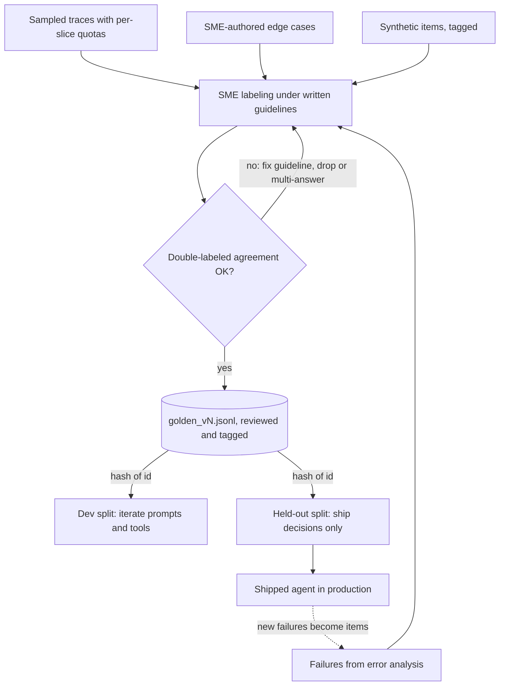

## TL;DR
A golden dataset is the curated, versioned set of agent tasks (input, starting state, what success
looks like) that task owners agree is correct. Every agent eval number refers to it; "golden" means
agreed and authoritative, not perfect or large.

## For agent builders
- **Why it matters for agents.** An agent eval item is a task, not a string pair: the user request, the
  tool and environment state it starts from, and the expected final state or answer. Without that fixed
  set, "the new tool description helped" cannot be checked or reproduced.
- **Where it shows up in your stack.** Datasets in LangSmith, Braintrust or promptfoo, a
  `golden_vN.jsonl` in the repo, and seed fixtures for the sandboxed backends your tools call during
  evals.
- **What you control.** Which tasks are in it (sampled traces, failures, SME edge cases, synthetic
  fills), per-slice quotas by intent and tool, the grader spec per task, the dev/held-out split, and the
  rule that every production failure becomes a task.
- **What you can skip.** Huge scraped sets. A few hundred well-labeled, stratified tasks with replayable
  state beat ten thousand unlabeled transcripts.

## Why it exists
- **A score is "the fraction of *this set* that passed".** If the set changes between runs, the score is
  meaningless as a comparison; if it is not representative, it is meaningless as a prediction.
- **"Use production logs directly" fails.** Realistic inputs, but no labels, no stable composition (this
  week's traffic has a billing spike, last week's did not), and privacy constraints that keep the data
  out of CI. Agent traces also depend on tool state that has since changed, so they cannot be replayed
  as-is.
- **"Have the model generate test cases" fails.** Inputs share the generator's blind spots and phrasing.
  If the same model also writes the expected answers, the eval is circular: it measures agreement with
  itself.
- **"The engineer writes twenty examples" fails.** The set is biased toward cases the engineer already
  handled, and the same engineer then tunes the prompt until those twenty pass: overfitting with extra
  steps.
- **What a golden set buys.** Subject-matter experts sign off on expected outputs, so "is this answer
  right" is argued once, during labeling, not in every review. Versioning makes a score reproducible,
  so two prompts, two models or two weeks can be compared. Every production failure becomes an item, so
  the set grows toward failures that actually occur rather than ones imagined up front.
- **Quality beats size.** A few hundred well-chosen, well-labeled items beat ten thousand scraped ones,
  provided they are stratified across the cases that matter and kept out of prompts and training data.

## How it works
### What a record contains
Each item needs enough to reproduce the request and to grade the response:
- **Input**, complete: the user message, the system context that matters (retrieved documents or their
  ids, account state, conversation history), and any tool state the system reads. For an agent, that
  means a seed for every backend its tools touch, so the run is replayable.
- **Expected output or label.** Closed tasks: a label or exact value. Extraction: a set of fields.
  Open-ended tasks: a reference answer *plus* a grading spec (rubric, must-contain facts, acceptable
  alternatives), *because* a single reference string would fail correct paraphrases. Agent tasks: the
  expected final state, plus required and forbidden tool calls where the path matters.
- **Grader spec**: which grader applies (exact, JSON-schema, tests, state assertion, rubric judge) and
  its parameters.
- **Metadata**: slice tags (intent, language, difficulty, customer segment, tools involved), provenance
  (sampled from logs on date X, authored by SME Y, synthetic from generator Z), labeler ids, and a
  version.
- **Storage:** JSONL under version control, or a dataset store with immutable versions. Changing the
  dataset changes the metric, so every run records which dataset version it used.

### Where items come from
Four sources, in rough order of value per item:
1. **Sampled real traffic, stratified.** Production distributions are long-tailed: uniform random
   sampling gives hundreds of the common easy intent and zero of the rare one that causes escalations.
   Set a quota per slice so each slice can be measured on its own.
2. **Failures from error analysis.** Every bug found in production or review becomes an item. Highest
   signal, *because* it encodes a failure mode you know exists: a wrong tool, a loop that never ends, an
   action taken without confirmation.
3. **SME-authored edge cases**: boundary conditions, ambiguous inputs that should trigger a clarifying
   question, policy exceptions. Experts know where the task is hard.
4. **Synthetic generation** to fill coverage gaps (rare languages, adversarial phrasing, prompt
   injection inside tool results). Labeled by humans, not the generator, and tagged as synthetic so you
   can check whether synthetic and real items behave differently.

### Labeling
1. **Write labeling guidelines first;** they become the task definition.
2. **Double-label a subset and measure agreement** (see inter-annotator agreement).
3. **Resolve legitimate expert disagreement:** the item is either ambiguous (fix the guideline or drop
   it) or multi-answer (store all acceptable answers or end states).

- **Low agreement points at the task.** Among qualified labelers it is usually a property of the task
  definition rather than the people (check labeler expertise and training too).
- **Labels cap grader reliability.** A grader cannot be more reliable than the labels it is checked
  against.

### Size and statistics
For a pass rate *p* on *n* items the standard error is √(p(1−p)/n). At p = 0.8:

| n | Standard error | ≈ 95% interval |
|---|---|---|
| 100 | ±4 points | ±8 points |
| 400 | ±2 points | ±4 points |
| 1,000 | ±1.3 points | ±2.5 points |

- **Per-slice numbers need per-slice *n*,** which is why stratification matters more than total size.
- **The real question is detection:** not "how precise is one score" but "can it detect the
  improvement I care about".

```
independent runs (80% power, α = 0.05):  n ≈ (1.96 + 0.84)² · 2p(1−p) / δ²   per version
paired runs, discordant fraction d:      n ≈ (1.96 + 0.84)² · d / δ²
```

- **Independent:** detecting δ = 5 points at p = 0.8 needs about 1,000 items per version.
- **Paired needs far fewer,** *because* only items that flip carry information. If about 13% of items
  flip (a typical prompt change; measure yours from two runs), the same 5-point effect needs roughly
  400 items.
- **So:** harnesses pair runs, and "how many items do we need" depends on how much versions disagree,
  not only on the pass rate. Agent runs flip more between repeats, so measure d on your agent.
- **Starting point** (illustrative, not a rule): tens to a hundred items per slice you need to decide
  on, grown by every failure found afterwards.

### Splits and hygiene
- **Dev split** for iterating on prompts and tool descriptions; **held-out split** looked at only when
  deciding to ship, *because* a prompt tuned against the full set has been fitted to it.
- **Never copy golden items** into few-shot examples, fine-tuning data on agent traces or
  synthetic-generation prompts. That contaminates your own eval; the symptom is a perfect offline score
  with unchanged production quality.

### Maintenance
- **Items go stale** when the product, policy or tool schemas change.
- **Labels turn out wrong** when a "failure" is inspected and found correct.
- **Sets saturate.** Once every candidate passes 97% of it, it no longer separates good versions from
  great ones; the remaining budget belongs on harder items drawn from recent failures.
- **Treat it like code:** changes go through review, versions are tagged, and a changelog says why an
  item was added, relabeled or retired.
- **Re-baseline on version change.** Re-run the baseline on the new version before comparing,
  *because* a score on v3 and a score on v4 are different metrics.

## Diagram
Four sources feed one labeling step; the reviewed, versioned task set splits by id hash, and new agent
failures flow back in as the next version.



## Examples
### Agent scenario: one golden task record
A support-agent task with seeded tool state, an expected end state and path constraints. The grader
reads the sandbox after the run and the trace for tool calls.

```json
{
  "id": "refund-0142",
  "input": {"message": "I was charged twice for order 8812, please fix it"},
  "seed": {"orders": [{"id": "8812", "charges": 2, "amount": 49.0}], "refunds": []},
  "expected": {
    "final_state": {"refunds": [{"order_id": "8812", "amount": 49.0}]},
    "required_tools": ["lookup_order", "issue_refund"],
    "forbidden_tools": ["escalate"],
    "max_steps": 8,
    "reply_rubric": "confirms one refund of 49.00, no promise of extra credit"
  },
  "grader": "state_assert+trajectory+rubric_v2",
  "slice": {"intent": "refund", "lang": "en", "tools": "write"},
  "provenance": {"source": "ticket", "labeler": "sme-07", "added": "golden_v4"}
}
```

### Stratified sampling and a stable split
Sample agent sessions from logs with per-intent quotas, split dev/held-out deterministically by id
hash, and print the standard error to expect. Replace `fetch_logs` with your trace store.

```python
import hashlib, json, math, random
from collections import defaultdict
from dataclasses import dataclass, asdict, field

@dataclass
class Item:
    id: str; input: dict; expected: dict; grader: str
    slice: dict = field(default_factory=dict)      # {"intent": "billing", "lang": "en"}
    provenance: dict = field(default_factory=dict) # {"source": "logs", "sampled": "2026-10-01"}

def stratified(logs, quota: dict[str, int], seed=0) -> list[Item]:
    by_intent = defaultdict(list)
    for row in logs: by_intent[row["intent"]].append(row)
    rng, out = random.Random(seed), []
    for intent, n in quota.items():                 # a quota per slice, not a global random sample
        for row in rng.sample(by_intent[intent], min(n, len(by_intent[intent]))):
            out.append(Item(id=row["id"], input={"message": row["message"], "doc_ids": row["doc_ids"]},
                            expected={}, grader="rubric_v1",      # expected filled by SMEs, not by a model
                            slice={"intent": intent}, provenance={"source": "logs", "sampled": "2026-10-01"}))
    return out

def split(item: Item) -> str:                       # stable: the same id always lands in the same split
    h = int(hashlib.sha256(item.id.encode()).hexdigest(), 16) % 100
    return "dev" if h < 70 else "heldout"

def stderr(p: float, n: int) -> float:
    return math.sqrt(p * (1 - p) / n)

items = stratified(fetch_logs(days=30), {"billing": 60, "refund": 60, "shipping": 40, "cancel": 40})
with open("golden_v3.jsonl", "w") as f:
    for it in items: f.write(json.dumps({**asdict(it), "split": split(it)}) + "\n")
print(len(items), "items;", f"SE at p=0.8 ≈ {stderr(0.8, len(items)):.3f}")   # 200 items -> 0.028
print(f"per-slice SE for billing (n=60) ≈ {stderr(0.8, 60):.3f}")               # -> 0.052
```

- **What the output says:** overall differences under about 6 points are inside the noise.
- **The billing slice alone** cannot resolve anything under about 10 points.
- **For agents,** an SME then fills `expected` with the end state and any tool constraints, and a seed
  is captured from the backend snapshot at sampling time.

### How many items do I need? A sample-size calculator
Pure Python; plug in your baseline pass rate, the effect you care about, and the flip rate measured
from two runs of the same set.

```python
import math

Z = 1.96 + 0.84                     # two-sided alpha 0.05, 80% power

def n_independent(p, delta):        # items per version, two unpaired runs
    return math.ceil(Z**2 * 2 * p * (1 - p) / delta**2)

def n_paired(d, delta):             # items, same set graded twice; d = fraction of items that flip
    return math.ceil(Z**2 * d / delta**2)

for delta in (0.05, 0.10):
    print(f"delta={delta:.2f}  independent={n_independent(0.8, delta)}  paired(d=0.13)={n_paired(0.13, delta)}")
# delta=0.05  independent=1004  paired(d=0.13)=408
# delta=0.10  independent=251  paired(d=0.13)=102
```

| Decision you need | Independent runs | Paired runs (13% flip) |
|---|---|---|
| Detect a 5-point change | ~1,000 items | ~400 items |
| Detect a 10-point change | ~250 items | ~100 items |

## Production patterns
- **Dataset as a versioned artifact.** Keep `golden_vN.jsonl` in the repo (or an immutable dataset
  store), change it only through reviewed pull requests with a changelog line, and write the dataset
  version into every eval result. Monitor runs whose baseline used a different version.
- **Production-failure intake.** Route escalations, bug tickets, low-scoring sampled live traces and
  runs that hit the step limit into a labeling queue; an SME writes the expected outcome and a grader
  spec before the item joins the dev split. Monitor items added per week and per slice.
- **Per-slice quotas with re-weighting.** Sample by quota so each slice (intent, tool, read versus
  write action) has measurable *n*, and compute the headline number by weighting slices by their share
  of traffic. Monitor per-slice *n* against the sample-size calculator for the decisions you make.
- **Replayable tool state.** Store a seed or fixture per task for every backend the agent's tools hit,
  and reset the sandbox before each run. Monitor tasks that fail at setup or depend on live services,
  since they make the score drift with no code change.
- **Hash-based split, rotated deliberately.** Assign splits by hashing the item id so they are stable
  across versions; for small sets, rotate the held-out split on a schedule rather than fixing it
  forever. Monitor the gap between dev and held-out scores.
- **Leak check before release.** Search prompts, few-shot banks and fine-tuning files for golden item
  ids or exact input strings as a CI step. Monitor for any match; one match blocks the run.

## Trade-offs
- **Stratified quotas vs a representative average.** Every slice gets measurable *n*, but the overall
  average drifts from the production mix. Report per slice, or weight by traffic for a headline number.
- **Real traffic vs synthetic.** Real items are realistic but need privacy review and redaction before
  they sit in a repository. Synthetic items avoid that at the cost of sharing the generator's phrasing
  and blind spots.
- **Held-out split vs iteration data.** It protects against overfitting prompts but removes a share of
  items from iteration (30% in the example above). With small sets, rotate the split periodically.
- **Expert labels vs cheap labels.** Expert labeling is expensive and slow, but cheap labels (crowd, or
  the model itself) move the error from the system into the reference, where it is harder to notice and
  impossible to fix by prompting.
- **Single-turn tasks vs multi-turn with a simulated user.** Single-turn tasks are cheap and
  deterministic; multi-turn tasks with a scripted or LLM-played user cover clarifying questions but add
  a second source of noise. Use multi-turn only for slices where dialogue is the point.

## Pitfalls
- **Label errors in the reference.** Symptom: a pass-rate ceiling below 100% where the "failures" turn
  out, on inspection, to be correct outputs disagreeing with a wrong label.
- **A set that is too easy** because it came from happy-path traffic. Symptom: 98% offline while
  support tickets keep arriving about cases the set never contained.
- **Golden items reused as few-shot or fine-tuning data.** Symptom: a jump in offline score with no
  movement in production metrics.
- **One reference string for an open-ended task.** Symptom: correct, differently worded outputs fail
  exact or overlap matching, and the team "fixes" the prompt to mimic the reference wording.
- **Never retiring stale items.** Symptom: a stable score that no longer tracks what the system is
  supposed to do, and arguments about whether old failures still count.
- **No per-slice quotas.** Symptom: a rare but critical intent with three items, so its pass rate swings
  between 33% and 100% run to run.
- **Comparing across dataset versions.** A new run on v4 against a baseline scored on v3. Symptom: a
  "regression" or "improvement" that vanishes when the baseline is re-run on the same version.
- **Tasks without captured tool state.** Symptom: an agent task that passed last month fails today
  because the live order it looked up was deleted. Fix: seed every backend per task.

## When to use
- **Build one early:** as soon as a prompt, tool set or agent loop will change more than once, which is
  always.
- **Start small and targeted:** a few dozen items per slice that matters, each labeled by someone with
  authority over the task, with a grader spec per item.
- **Measure its reach:** compute the standard error before trusting a result; grow it where decisions
  are tight and where production failures appear.
- **Avoid:** using it for training or few-shot prompting, or letting the people tuning prompts see the
  held-out split.
- **Interviews:** how you would build one for a given product, how big it must be to detect a given
  improvement, and how you keep it from leaking into the system under test.

## Role lens
- **Engineer:** Writes the sampling and split code, keeps the JSONL under version control, and turns
  every production bug into a new item with a grader spec.
- **Architect:** Defines the slices that must be represented, the ownership and review process for
  labels, and the rule that dataset versions are recorded with every eval run.
- **FDE:** Runs labeling sessions with the customer's experts, turns their disagreements into written
  guidelines, and uses the per-slice numbers to agree what "done" means.

## Check yourself
**Q:** You inherit a 2,000-item eval set generated by prompting the production model to write questions
and answers about the company's documents. Offline pass rate is 96%; users complain daily. What is
wrong with the set and how would you rebuild it?
**A:** The set is circular: the model wrote both inputs and references, so it rewards the model's own
phrasing and misses what real users ask, and the "labels" were never checked by anyone with authority.
I would sample real questions from logs with per-intent quotas so rare but costly intents have enough
items, pull every recent complaint in as an item, have subject-matter experts write or verify the
expected answers under written guidelines, double-label a subset to measure agreement, attach a grader
spec per item instead of exact-match on a reference, split into dev and held-out by id hash, and
version the result. A few hundred such items will say more than two thousand synthetic ones.

## Interview questions
### What makes a dataset "golden", and why not just use production logs?
- **Golden means agreed and authoritative:** expected outputs signed off by the people who own the task,
  versioned so a score is reproducible, not a claim that the set is perfect or large.
- **Raw logs fail as a reference** because they have no labels, their composition shifts week to week,
  and privacy constraints keep them out of CI.
- **Logs are still the best source of inputs,** sampled with per-slice quotas and then labeled by SMEs.

### What goes into a golden item for a tool-calling agent, beyond input and expected answer?
- **Replayable starting state:** a seed for every backend the tools touch, so the same task runs the
  same way next month.
- **An outcome to assert:** the expected final state (records written, tickets closed), because many
  tool paths are valid and the state is what the user gets.
- **Path constraints only where they matter:** required lookups before writes, forbidden tools, a step
  budget, plus slice tags for intent and tools so regressions can be localized.

### How do you label an open-ended task where several answers are correct, and what if experts disagree?
- **Store a reference plus a grading spec,** not one string: a rubric, must-contain facts and acceptable
  alternatives, because a single reference fails correct paraphrases and pushes the team to make the
  prompt mimic its wording.
- **Write guidelines first and double-label a subset** to measure agreement; the guidelines become the
  task definition.
- **Resolve each disagreement:** an ambiguous item gets a fixed guideline or is dropped, a multi-answer
  item stores every acceptable answer, and persistently low agreement means the task definition needs
  work, since no grader can be more reliable than its labels.

### How many items do you need to detect a 5-point improvement at an 80% pass rate?
- **Independent runs:** n ≈ (1.96 + 0.84)² · 2p(1−p) / δ², about 1,000 items per version at 80% power
  and α = 0.05.
- **Paired runs:** n ≈ (1.96 + 0.84)² · d / δ²; with about 13% of items flipping that is roughly 400
  items, because only discordant items carry information.
- **So measure your flip rate** from two runs before sizing the set, and size per slice for the
  decisions you make per slice.

### Your agent's offline score jumped 8 points but production quality did not move. What do you suspect?
- **Leakage first:** golden items copied into few-shot examples, fine-tuning data or generation prompts
  make the eval measure recall, not capability.
- **Check:** search prompts and training files for golden ids or exact input strings, and compare the
  dev score with the held-out split.
- **Then check composition:** a set drawn from happy-path traffic, or a changed dataset version compared
  against an old baseline, produces the same symptom.

### When do you retire or relabel items, and what does it cost?
- **Retire stale items** when product, policy or tool changes make the expected output wrong, and
  relabel when an inspected "failure" turns out to be a correct output against a wrong label.
- **Replace saturated material:** once every candidate passes 97% of it, budget goes to harder items
  drawn from recent failures.
- **The cost is comparability:** every change is a new version, so re-run the baseline on it before
  comparing, and keep a changelog of why each item changed.

## Quiz
### Q: Why sample golden items with per-slice quotas rather than uniformly at random from production logs?
- [ ] Uniform sampling violates privacy rules
- [x] Rare but important slices would otherwise have too few items to measure on their own
- [ ] Quotas make the overall pass rate match production
- [ ] Random sampling cannot be reproduced
> Traffic is long-tailed, so a random sample is dominated by the common intent and leaves rare ones
> with a handful of items whose pass rate is pure noise. Quotas trade a distorted average for
> measurable slices; the average can be re-weighted if needed.

### Q: A prompt engineer copies five golden items into the system prompt as few-shot examples. What happens to the eval?
- [ ] Nothing, five items are statistically negligible
- [ ] The eval becomes stricter because the model now knows the format
- [x] The eval is contaminated: those items no longer measure generalization and the score inflates
- [ ] The held-out split absorbs the effect automatically
> Items the model has seen verbatim in its prompt measure recall, not capability, and the effect
> spreads because the prompt is now tuned to the set. The symptom is a higher offline score with no
> change in production quality.

### Q: Two experts disagree on the expected answer for 20% of items in a new golden set. What does this most likely indicate?
- [ ] One expert should be replaced
- [ ] The model will also fail those items, so they are good hard cases
- [x] The task definition or labeling guideline is ambiguous and must be fixed before grading means anything
- [ ] The set needs more items to average out the disagreement
> Disagreement between qualified experts usually points at the task definition, not the people. A
> grader cannot be more reliable than its labels, so the guideline must be sharpened, ambiguous items dropped or made multi-answer, and
> agreement re-measured before the set is used.

## Use cases & projects
### Use cases
- **Launching a support or operations agent.** A signed-off set of tasks per intent and tool gives the
  first eval a fixed, agreed target instead of a handful of demo prompts.
- **Turning production incidents into regression tasks.** Each failed trace becomes a task with its
  starting tool state and expected outcome, so the same failure cannot silently return.
- **Comparing agent versions over months.** A versioned set keeps last quarter's score comparable to
  this week's, even as prompts, tools and models change.
- **Guarding a fine-tuning run on agent traces.** A held-out split kept out of training data tells you
  whether the tuned model learned the task or just the eval.

### Mini project
**Build a versioned golden set for a ticket-triage agent (2-3 hours).**
- **Goal:** assemble a small, stratified, replayable task set an agent eval can run against.
- **Steps:** define 4-5 intents and the tools each needs; write or sample 40 tasks with a quota per
  intent; for each, record the request, the seed state of the fake backend and the expected final state
  or answer; split into dev and held-out; save as a versioned JSONL file with a short changelog.
- **Done when:** a script loads the file, seeds the fake backend per task, and prints counts per intent
  and split; a second person can read any task and agree on what success means.
