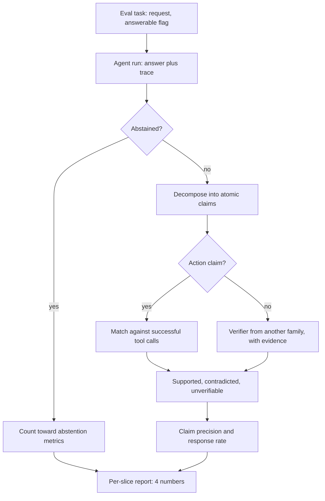

## TL;DR
Hallucination evaluation measures how often your agent asserts things its tools, documents and trace do
not support, including actions it never took. Split answers into atomic claims, verify each against
evidence, and report claim precision, response rate and abstention per slice.

## For agent builders
- **Why it matters for agents.** An agent's evidence is its trace: retrieved chunks and tool results. It
  can contradict them, invent an order ID, or say "I've issued your refund" when no refund call
  succeeded. Users act on these claims, so the fabrication rate is a release number, not a vibe.
- **Where it shows up in your stack.** Groundedness or faithfulness evaluators in LangSmith, Braintrust,
  Ragas or promptfoo, a custom decompose-and-verify step in your eval harness, and sampled audits of
  production traces.
- **What you control.** The reference (tool outputs, retrieved context, a versioned KB), the verifier
  model, the unanswerable and false-premise slices, and the gate pair: fabrication rate plus a ceiling
  on false abstention.
- **What you can skip.** The survey's taxonomy debates; intrinsic vs extrinsic, the three reference
  regimes and the four numbers are enough.

## Why it exists
- **The failure is fluent and expensive.** Confident, well-structured text with one wrong number, a
  citation that does not exist, a quote attributed to the wrong person or an API parameter the library
  never had. Whole-response grading hides it, because the answer still reads as correct.
- **Agents add action hallucinations.** A final message claiming a tool call happened, or reporting a
  field the tool never returned, is the agent-specific form, and only the trace can disprove it.
- **Models produce it by design.** When the model lacks the fact, the most probable continuation is still
  a plausible-looking fact; nothing in next-token prediction prefers "I do not know" over a well-formed
  guess. The reader only sees the error by checking every claim, the slow step the model was meant to save.
- **Ordinary metrics miss it.** Exact match scores a response 0 or 1 and is undefined for open-ended
  text. A judge asked "is this a good answer" rewards fluency and accepts plausible claims it cannot
  verify. String overlap cannot tell "revenue grew 12%" from "revenue grew 21%".
- **The naive fixes fail.** "Ask the model whether it hallucinated" reuses the knowledge that produced
  the error, so it defends a confident fabrication. Hand spot-checks do not scale and miss exactly the
  errors that look right.
- **Cost is asymmetric.** One fabricated figure in a financial summary costs more than ten honest
  abstentions, so one averaged score under-weights the only failures that matter.

## How it works
### Define what counts
| Term | Meaning | Reference |
|---|---|---|
| **Intrinsic** hallucination | Contradicts the source the model was given | The source (Ji et al. survey split) |
| **Extrinsic** hallucination | Cannot be verified from that source at all | The source |
| RAG failure | "Unsupported by context", even when true in the world | Retrieved context (overlaps faithfulness, its own lesson) |
| Closed-book failure | False in the world | A trusted corpus approximating the world |
| Action hallucination (agents) | Claims a tool call or result the trace does not contain | The agent's tool-call log |

- **Non-claims are excluded.** Opinions, hedges and questions back to the user do not count, because the
  metric is about asserted facts.

### Choose the reference
Three regimes, in decreasing order of reliability:
1. **Context-grounded.** Reference = the documents in the prompt; for an agent, every retrieved chunk and
   tool result in the trace. A verifier (an entailment model, or an LLM judge required to quote its
   evidence) labels each claim supported, contradicted or unverifiable.
2. **Corpus-grounded.** Reference = a trusted source: product docs, an internal KB, a versioned API spec,
   an encyclopedia. FActScore is the template: decompose into atomic facts, retrieve passages per fact,
   judge each supported or not, score the fraction supported. It is a *precision* measure: how much of
   what was said is true, not whether the answer was complete.
3. **Reference-free.** No source. SelfCheckGPT uses a behavioural signature: real knowledge is
   reproduced consistently across samples, a confabulated detail varies. Draw several responses at
   non-zero temperature and score each sentence of the main response by how often samples contradict it.
   - *Strength:* cheap, needs no corpus.
   - *Limit:* it is a proxy; a model that is consistently wrong (because its training data was) passes.

### Decompose into claims
- **You need both levels.** Twelve claims with one false is 92% claim precision and 100% hallucinated at
  the response level.
  - Claim precision tracks "how much can I trust the text".
  - Response rate tracks "how often does a user receive something wrong".
- **Decomposer.** A model prompted to emit atomic, self-contained statements with pronouns resolved,
  because "it was founded then" cannot be verified alone.
- **Route by claim type in agents.** Fact claims go to the verifier with tool outputs and retrieved
  evidence; action claims ("I cancelled it") are checked deterministically against successful tool calls.

### The metrics
- **Claim precision:** supported claims / all claims, averaged per response, then per slice.
- **Response hallucination rate:** fraction of responses with at least one contradicted claim (strict
  variant: at least one unsupported claim).
- **Severity weighting:** numbers, names, dates, citations and legal or medical statements weigh more
  than descriptive filler, because that is where the cost lives. For agents, add claimed actions.
- **Fabrication on unanswerable items:** for a question whose answer is absent from the context, or a
  false premise ("why did the 2019 merger fail" when there was none), the right behaviour is to say so.
  Confident answers here are the purest signal, which is why SQuAD 2.0-style unanswerable questions and
  TruthfulQA's false-belief questions exist.
- **False abstention:** refusing or hedging on answerable items. Report it next to fabrication, because
  the cheapest way to drive hallucination to zero is to answer nothing.
- **Citation precision:** whether each cited passage actually supports the sentence citing it. A real
  document that says something else is a hallucination wearing a reference.

### Build the dataset for it
A golden set of only answerable, well-covered questions underestimates the rate badly. Add slices:
- questions answerable only from context;
- questions answerable from general knowledge;
- questions whose answer is missing from the context (for agents: the tool returns empty or an error);
- false-premise questions;
- questions about entities that do not exist (an order ID the lookup tool cannot find);
- questions about facts past the model's training cutoff.

Fabrication concentrates in the last four, so the metric moves there when you change the prompt, tool
descriptions or retrieval.

### Size the slices before trusting a difference
- **Critical slices are small and noisy.** A 10% fabrication rate on 50 unanswerable items has a 95%
  interval of roughly ±8 points (1.96 · √(0.1 · 0.9 / 50)), so "12% → 8%" there is not evidence.
- **Fix:** grow critical slices to a few hundred items, or compare versions on the same items and look at
  which items flipped, as a regression suite does.

### Trust the verifier only after measuring it
- **Measure agreement** with human claim labels on a few hundred claims (Cohen's kappa) before using its
  numbers.
- **Use a different model family** from the generator, because models trained on overlapping data share
  false beliefs and agree with each other's fabrications.

## Diagram
Each agent answer is split into claims; fact claims are checked against evidence, action claims against
the tool-call log, and the labels roll up into four numbers reported per slice.



## Examples
### Agent scenario: grounding a support agent's answer in its own trace
The reference is the trace itself. Fact claims are verified against tool results; action claims must
match a tool call that succeeded. `call_model` is a verifier from a different model family; it is canned
here so the script runs as is (tested on Python 3.12).

```python
import json

def call_model(prompt: str) -> str:          # replace with a verifier from a different family
    if prompt.startswith("Split"):
        return json.dumps([{"claim": "Order 123 shipped on May 3", "action": None},
                           {"claim": "I issued your refund", "action": "refund"}])
    return "SUPPORTED"

ACTIONS = {"refund": "issue_refund", "cancel": "cancel_order", "email": "send_email"}
CLASSIFY = ("Split the agent's final message into atomic claims. For each, return "
            '{{"claim": str, "action": one of {acts} or null}}. JSON list only.\n\n{text}')
VERIFY = ("Tool results:\n{evidence}\n\nClaim: {claim}\nAnswer with exactly one word: "
          "SUPPORTED, CONTRADICTED or UNVERIFIABLE.")

def score_agent_answer(final_text: str, trace: list[dict]) -> dict:
    ok_calls = {s["tool"] for s in trace if s["type"] == "tool_call" and s["status"] == "ok"}
    evidence = "\n---\n".join(json.dumps(s["output"]) for s in trace if s["type"] == "tool_result")
    claims = json.loads(call_model(CLASSIFY.format(acts=list(ACTIONS), text=final_text)))
    labels = []
    for c in claims:
        if c["action"]:                          # deterministic: did the call actually succeed?
            labels.append("SUPPORTED" if ACTIONS.get(c["action"]) in ok_calls else "CONTRADICTED")
        else:
            labels.append(call_model(VERIFY.format(evidence=evidence, claim=c["claim"])).strip(" .\n").upper())
    n = len(labels)
    return {"n_claims": n,
            "claim_precision": labels.count("SUPPORTED") / n if n else None,
            "hallucinated": "CONTRADICTED" in labels,
            "action_hallucination": any(c["action"] and l == "CONTRADICTED" for c, l in zip(claims, labels))}

trace = [{"type": "tool_call", "tool": "lookup_order", "status": "ok"},
         {"type": "tool_result", "output": {"order": 123, "shipped": "May 3"}},
         {"type": "tool_call", "tool": "issue_refund", "status": "error"}]
print(score_agent_answer("Order 123 shipped on May 3. I issued your refund.", trace))
# {'n_claims': 2, 'claim_precision': 0.5, 'hallucinated': True, 'action_hallucination': True}
```

Illustrative run on 300 support-agent traces (not a benchmark), before and after making the final-answer
step quote tool results:

| Metric | Before | After |
|---|---|---|
| Responses with a contradicted claim | 51 (17%) | 24 (8%) |
| Action hallucinations ("refund issued", no successful call) | 9 | 1 |
| Claims marked UNVERIFIABLE | 14% | 6% |

- **Action hallucinations are the headline.** Nine customers told a refund happened when it did not is
  a support incident, which is why they get their own count and a zero-tolerance alert.

### Claim-level pipeline against a trusted corpus
`call_model` is any chat model (not the one that wrote the responses) and `search` retrieves from your
own knowledge source, not the open web. The output separates claim precision, response-level rate,
fabrication on unanswerable items and false abstention.

```python
import json
from collections import Counter

def call_model(prompt: str) -> str: ...                 # a different model family from the generator
def search(claim: str, k: int = 3) -> list[str]: ...    # trusted corpus, versioned
def is_abstention(text: str) -> bool: ...               # small classifier or judge: "says it cannot answer"

DECOMPOSE = ("Split the text into atomic, self-contained factual claims. Resolve pronouns. "
             "Return a JSON list of strings.\n\nTEXT:\n{text}")
VERIFY = ("Evidence:\n{evidence}\n\nClaim: {claim}\nAnswer with exactly one word: "
          "SUPPORTED, CONTRADICTED or UNVERIFIABLE.")

def score_response(text: str) -> dict:
    claims = json.loads(call_model(DECOMPOSE.format(text=text)))
    labels = Counter()
    for c in claims:
        evidence = "\n---\n".join(search(c))
        labels[call_model(VERIFY.format(evidence=evidence, claim=c)).strip(" .\n").upper()] += 1
    n = len(claims)                     # an abstention has no claims: precision is undefined, not 0
    return {"n_claims": n, "abstained": is_abstention(text),
            "claim_precision": labels["SUPPORTED"] / n if n else None,
            "hallucinated": labels["CONTRADICTED"] > 0,
            "unsupported_rate": (labels["CONTRADICTED"] + labels["UNVERIFIABLE"]) / n if n else None}

def mean(rows: list[dict], key: str) -> float:     # skips undefined values; bools count as 0/1
    vals = [float(r[key]) for r in rows if r.get(key) is not None]
    return sum(vals) / len(vals) if vals else float("nan")

def evaluate(items: list[dict]) -> dict:   # item: {"question", "answerable": bool, "response"}
    rows = [{**it, **score_response(it["response"])} for it in items]
    ans = [r for r in rows if r["answerable"]]
    answered = [r for r in ans if not r["abstained"]]   # abstentions would dilute the rate toward 0
    unans = [r for r in rows if not r["answerable"]]
    return {"claim_precision": mean(answered, "claim_precision"),
            "response_hallucination_rate": mean(answered, "hallucinated"),
            "false_abstention": mean(ans, "abstained"),
            "fabrication_on_unanswerable": 1 - mean(unans, "abstained")}
```

### Reading the output: prompt A vs prompt B
Illustrative numbers, not a benchmark. 400 answerable and 100 unanswerable items. Prompt B adds "answer
only from the documents; say so if they do not contain the answer".

| Metric | Prompt A | Prompt B |
|---|---|---|
| Claim precision | 0.95 | 0.96 |
| Response hallucination rate | 0.22 | 0.15 |
| False abstention | 0.03 | 0.09 |
| Fabrication on unanswerable | 0.41 | 0.12 |

- **Claim precision barely moved**, which is why it is a poor headline: the gain is in the other three.
- **B fabricates** on roughly one unanswerable item in eight instead of two in five.
- **The price** is six more points of false abstention, about 24 answerable questions now refused.
  Whether that is a good trade is a product decision, visible only because all four numbers are reported.
- **Rates use answered items.** Had abstentions counted as "not hallucinated", B's response rate would
  look better simply because it answers less.

### Is the slice big enough to see the change?
Pure Python, runnable: the normal-approximation 95% half-width for a rate on a slice of size `n`.

```python
from math import sqrt

def half_width(p: float, n: int, z: float = 1.96) -> float:
    return z * sqrt(p * (1 - p) / n)

for n in (50, 100, 400):
    print(n, f"±{100 * half_width(0.10, n):.1f} points")
# 50 ±8.3 points   -> "12% -> 8%" is noise
# 100 ±5.9 points
# 400 ±2.9 points  -> per run; comparing two runs widens it by about 1.4x (±4.2)
```

- **Comparing two versions is noisier than one run.** The difference of two independent rates has a
  half-width about √2 times larger, so at 400 items a 4-point move is still borderline. Paired
  comparison on the same items (which ones flipped) is tighter.

## Production patterns
- **Unanswerable slice as a release gate.** Keep a few hundred unanswerable, false-premise and
  nonexistent-entity tasks (empty tool results, unknown IDs) in the agent's golden set; gate on
  fabrication rate there together with a ceiling on false abstention. Monitor both per release.
- **Action claims checked against the tool log.** Parse every final message for claimed actions and
  match them to successful tool calls in the same trace, deterministically, on 100% of production
  traffic. Alert on any mismatch, because it is cheap and each one is a user-facing incident.
- **Cross-family verifier with its own calibration set.** Pin the verifier model version, keep a few
  hundred human-labelled claims, and re-measure Cohen's kappa whenever the verifier or generator changes.
  Monitor kappa and the share of UNVERIFIABLE labels.
- **Sampled offline audits of live traces.** Log answers with their tool results and retrieved context,
  run the decompose-and-verify pipeline asynchronously on a fixed daily sample, and trend the response
  hallucination rate per route. Monitor sudden jumps after prompt, model, tool or index changes.
- **Severity-tagged claims.** Tag claims containing numbers, dates, names or citations (a regex or NER
  pass is enough) and alert on any contradicted high-severity claim, not on the average. Monitor the
  count of contradicted high-severity claims per week.
- **Versioned reference corpus.** Record the corpus snapshot in every eval report, so a stale KB that
  turns correct new answers into "contradicted" is visible. Monitor contradicted labels that trace to
  documents older than the latest snapshot.

## Trade-offs
- **Precision of claim decomposition vs cost.** Precise, actionable numbers, but several model calls per
  response; affordable on a 500-item set run nightly, not on every PR, so tier it like any eval. Action
  checks against the tool log cost nothing and can run everywhere.
- **Corpus grounding vs corpus quality.** Only as good as the corpus: an out-of-date internal KB turns
  correct new answers into "contradicted" and hides the model's real errors behind retrieval noise.
- **Reference-free checks vs systematic errors.** No labels or corpus and they catch random
  confabulation, but they are blind to systematic errors, so they suit triage and monitoring, not
  release decisions.
- **Strict response-level gate vs evasiveness.** "Any unsupported claim fails" is a good gate for
  high-stakes domains, but on chatty assistants it pushes teams toward terse, evasive answers unless
  false abstention is gated too.
- **Severity weighting vs agreement.** It makes the score match business cost but adds a judgment layer
  that must be agreed with the domain owner, or two teams report different numbers for the same outputs.

## Pitfalls
- **Measuring only answerable questions.** Symptom: near-zero hallucination in the eval and a stream of
  invented policies in production, because fabrication was never provoked. Diagnose: count items per
  slice; zero unanswerable or false-premise items is the tell. Fix: add the four risky slices.
- **Grading the final message without the trace.** Symptom: "I've updated your address" passes the
  judge although the update tool returned an error. Diagnose: join claimed actions to tool statuses in
  a sample of traces. Fix: give the verifier the tool results and check action claims against the call log.
- **Using the generating model as verifier.** Symptom: high "supported" rates on claims a human later
  finds false, since the verifier shares the generator's beliefs. Diagnose: kappa against 200 human
  claim labels. Fix: a different model family.
- **Claim precision without response-level rate.** Symptom: a 95% score while one in three answers
  contains something wrong. Diagnose: compute both on the same run. Fix: report both.
- **Driving fabrication down without watching false abstention.** Symptom: "I cannot determine that from
  the provided information" to questions answered on page one. Diagnose: abstention rate on the
  answerable slice, before and after. Fix: gate the pair.
- **Counting a citation correct because the document exists.** Symptom: footnotes that say something
  else when opened. Fix: verify each cited passage supports its sentence.
- **Merging unverifiable and contradicted.** Symptom: a rate that jumps whenever the corpus is thin, not
  whenever the model is wrong. Diagnose: chart the two labels separately per corpus snapshot. Fix: keep
  three labels.

## When to use
- **Use when:** the agent asserts facts or actions a user might act on: contract or medical-record
  summaries, support answers about policy, code that names APIs, analytics narratives with numbers,
  confirmations of refunds or bookings.
- **Pick the reference:** context-grounded for RAG and tool-using agents, corpus-grounded for closed-book
  assistants over a domain you own, consistency-based when you have neither and need a monitoring signal.
- **Measure:** claim precision, response-level rate, fabrication on unanswerable items and false
  abstention together, per slice; gate releases on the pair that matters for the product.
- **Avoid when:** creative or opinion tasks where "unsupported" is the point; skip the heavy pipeline.

## Exercise
**Goal:** measure fabrication and false abstention for an agent you can run (or a RAG chain over a
small document set), and decide whether one prompt change is worth shipping. No solution is given.
- **Inputs:** 40 answerable tasks and 40 risky ones (missing from context, false premise, unknown ID,
  tool returns an error), plus the agent's traces for two prompt versions.
- **Deliver:** a script that prints the four numbers per slice and per version, lists each contradicted
  claim with its trace ID, and flags action claims with no successful tool call.
- **Acceptance:** your verifier agrees with your own labels on 50 claims (report kappa); at least one
  action hallucination (plant one if none occur) is caught by the tool-log check alone; you state whether the difference between
  versions exceeds the interval for your slice size.

## Role lens
- **Engineer:** Builds the decompose-and-verify pipeline, adds unanswerable and false-premise slices to
  the golden set, and wires the four numbers into the eval report with per-slice breakdowns.
- **Architect:** Decides the reference regime and the gate: which domains require a strict response-level
  limit, what false-abstention ceiling balances it, and which corpus is authoritative for verification.
- **FDE:** Runs claim-level audits on the customer's real documents with their experts, because the
  customer's definition of "wrong" (a rounding difference, a stale policy) is what the verifier must learn.

## Check yourself
**Q:** A team reports "hallucination rate 2%" from an LLM judge that grades each answer as correct or
not on a golden set of answerable support questions. The customer keeps finding invented refund terms.
What is wrong with the measurement and how would you redesign it?
**A:** Three things. The judge grades whole responses holistically, so an answer that is mostly right
with one invented clause is scored correct; the fix is claim decomposition with per-claim verification
against the policy corpus, reporting both claim precision and the fraction of responses containing any
contradicted claim. The set contains only answerable questions, so fabrication is never provoked; add
questions whose answer is absent from the policy, false-premise questions and edge cases past the
corpus, and report fabrication rate on them separately. And the judge is probably the same model family
as the generator and was never validated; measure its agreement with human claim labels and use a
different model. Finally gate on false abstention too, or the fix will be a model that refuses.

## Interview questions
### Your support agent tells users "your refund has been issued" when the refund tool failed. How do you catch this systematically?
- **Treat it as an action hallucination:** extract claimed actions from the final message and match
  each to a successful tool call in the same trace, deterministically rather than with a judge.
- **Run it on all traffic:** it is a log lookup, so it is cheap enough to alert on every mismatch, not a
  sample.
- **Fix at the source too:** have the answer step read tool statuses explicitly and add failing-tool
  tasks to the golden set so the regression is gated.

### How would you evaluate hallucination for a RAG agent that calls several tools per task?
- **Reference is the whole trace:** every retrieved chunk and tool result, not only the last retrieval.
- **Route claims:** fact claims to a cross-family verifier with that evidence, action claims to the
  tool-call log, and report both rates per slice.
- **Provoke it:** include tasks where tools return empty results, errors or unknown IDs, because that is
  where agents invent plausible values.

### Your prompt change cut fabrication on unanswerable items from 41% to 12%. Ship it?
- **Check false abstention first:** in the worked example it rose from 3% to 9%, about 24 answerable
  questions now refused, a product trade-off rather than a free win.
- **Check slice size:** on 100 unanswerable items the interval is wide but a 29-point move is far
  outside it; on 50 items a 4-point move would not be.
- **Check the denominator:** rates over answered items only, so answering less does not look better.

### How would you evaluate hallucination for a closed-book assistant with no retrieved context?
- **Corpus-grounded:** decompose answers into atomic facts, retrieve evidence per fact from a trusted,
  versioned source, and judge each, FActScore style.
- **Reference-free as a monitor:** sample several responses at non-zero temperature and flag sentences
  the samples contradict, SelfCheckGPT style.
- **Know the gap:** consistency checks miss beliefs the model holds firmly but wrongly, so they triage
  rather than gate.

### Hallucination rate jumped overnight with no model change. How do you debug it?
- **Split the labels:** if UNVERIFIABLE rose rather than CONTRADICTED, suspect the reference corpus or
  retrieval, not the generator.
- **Check the corpus snapshot:** a stale or partially re-indexed KB marks correct new answers as
  contradicted.
- **Compare item by item** with the previous run to see which items flipped and what they share.

## Quiz
### Q: Why does hallucination evaluation decompose responses into atomic claims instead of grading each response once?
- [ ] Atomic claims are cheaper to grade than whole responses
- [x] A single invented detail inside an otherwise correct response is invisible to holistic grading but visible per claim
- [ ] Judges cannot read responses longer than a few sentences
- [ ] Claim decomposition removes the need for a reference corpus
> Holistic judges reward fluency and completeness and accept plausible claims they cannot verify, so a
> response with one false figure passes. Verifying each atomic claim against evidence exposes it; it costs
> more calls, not fewer, and still needs a reference.

### Q: A closed-book assistant scores 97% claim precision on a golden set of answerable questions. What slice is missing before you trust the number?
- [ ] Longer questions, because precision drops with length
- [ ] Questions with multiple correct answers
- [x] Unanswerable and false-premise questions, where fabrication actually concentrates
- [ ] Questions phrased in a second language
> Fabrication is provoked when the model lacks the fact, so a set of well-covered questions never
> triggers it. Add questions with no answer in the corpus and false-premise questions, and report the
> fabrication rate on them alongside false abstention on answerable ones.

### Q: What kind of hallucination does a SelfCheckGPT-style consistency check across samples fail to detect?
- [ ] Hallucinated numbers, because digits are sampled deterministically
- [x] Systematically wrong facts the model reproduces consistently because its training data was wrong
- [ ] Hallucinations in the first sentence of a response
- [ ] Any hallucination when temperature is above zero
> Consistency checks rely on confabulated details varying between samples. A false belief the model holds
> firmly is reproduced identically every time and looks exactly like real knowledge, so only a reference
> corpus or human check can catch it.

## Mastery test
**Problem:** a travel-booking agent searches flights, holds seats and emails itineraries. Users report
flight numbers that appear in no search result, and "your seat is held" when the hold API timed out
(some timed-out holds did succeed server-side).

The eval shows 98% claim precision on 300 tasks, about 10 claims per answer. Design the evaluation
that would have caught both, and say what you gate on.

**A strong answer:**
- explains why 98% hides it: if errors are spread out, 1 − 0.98^10 ≈ 18% of answers contain one, and
  no response-level rate was reported;
- checks identifiers (flight numbers, prices) by exact match against the trace's search results, since
  a verifier with world knowledge accepts plausible flight numbers;
- treats a timeout as unknown, not failed: "held" is supported only by a confirmed hold, and the right
  answer is "pending", checked on all traffic;
- adds slices for empty results, timeouts and nonexistent routes, large enough to see the change;
- gates on fabrication there plus a false-abstention ceiling and zero action hallucinations.

## Use cases & projects
### Use cases
- **Gating a RAG support agent release.** Claim precision against retrieved chunks, plus a ceiling on
  false abstention, decides whether a new prompt or retriever ships.
- **Auditing production traces.** A weekly sample of live conversations, decomposed and verified, tracks
  the fabrication rate per intent after launch.
- **Testing abstention on unanswerable requests.** A false-premise and out-of-KB slice shows whether the
  agent says it does not know instead of inventing an answer.

### Mini project
**Build a claim-level groundedness checker for a RAG agent (2-3 hours).**
- **Goal:** score how many of an agent's claims are supported by the context and tool results in its own
  trace.
- **Steps:** collect 30 agent traces (question, retrieved chunks, tool outputs, final answer), including
  5 unanswerable questions; use an LLM to split each answer into atomic claims; ask a verifier model to
  label each claim supported, contradicted or unverifiable against that trace only; check whether any
  claimed action matches a successful tool call; hand-label 40 claims to measure verifier agreement.
- **Done when:** a script prints claim precision, response rate and abstention on the unanswerable
  slice, lists every unsupported claim with its trace ID, and reports verifier agreement with your labels.
