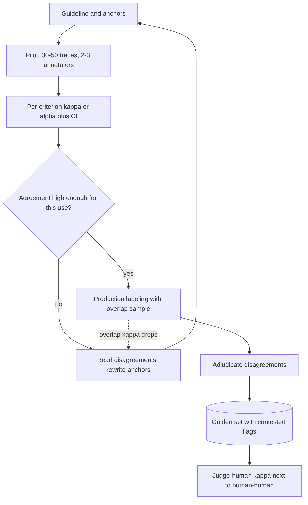

## TL;DR
Inter-annotator agreement (IAA) measures how consistently independent humans label the same agent
traces. Those labels score your agent evals and its judges, so their noise is in every score. Use
chance-corrected κ or α, not raw agreement.

## For agent builders
- **Why it matters for agents.** Before a judge may gate an agent release, you need human labels on
  traces and proof they are consistent. Criteria such as "should it have asked a clarifying question?"
  split reviewers far more than "was the ticket resolved?", and IAA shows which.
- **Where it shows up in your stack.** Annotation queues where reviewers label agent traces (in eval
  tools such as LangSmith or Braintrust, or a labeling tool), the export script that computes κ per
  criterion, and the judge calibration report that puts judge–human κ next to human–human κ.
- **What you control.** The overlap share of traces labeled twice, hiding the first label from the
  second reviewer, per-criterion guidelines with examples, and the agreement bar a criterion must clear
  before it can gate.
- **What you can skip.** Deriving the statistics. Know which one to pick (Cohen's κ for two reviewers,
  Krippendorff's α for partial overlap) and that raw agreement lies when most runs pass.

## Why it exists
- **One labeler cannot separate model error from label error.** A golden set of 500 support answers is
  labeled "acceptable" or "not" by one subject-matter expert, and the model scores 85%. Is the missing
  15% model error or label error? With one labeler you cannot know.
- **A second labeler exposes the noise.** If a second expert agrees with the first on 78% of items, at
  least a fifth of the set is ambiguous enough that two experts read it differently. The model's "85%"
  carries label noise of that size; if two experts agree only 70% of the time, the noise is larger still.
- **Everything downstream inherits it,** from "prompt B is 3 points better" to "the judge agrees with
  humans 88% of the time". Low agreement usually means the guideline, not the model, is the problem.
- **Percent agreement fails under class imbalance.** If 95% of answers are acceptable, two annotators who
  label everything acceptable agree 95% of the time while conveying nothing about the 5% that matter.
- **Chance correction fixes that.** Cohen's κ, Fleiss' κ and Krippendorff's α subtract the agreement
  expected from the label frequencies alone and report only what is left, because raw agreement is
  inflated whenever one label dominates.

## How it works
### What agreement is for
| Job | What it gives you |
|---|---|
| **Reference point** | human–human agreement is what "as good as a person" looks like on these labels |
| **Guideline diagnosis** | low agreement on one criterion means the definition is ambiguous; fix it by rewriting anchors, not by replacing annotators |
| **Process sizing** | how many annotators per item, whether adjudication is needed, how much overlap to keep during production labeling |

- **The reference point is not a hard ceiling.** A perfect judge would agree with each annotator as often
  as that annotator is right, which is higher than two error-prone annotators agree with each other, so a
  strong judge can land slightly above it.
- **What the labels cannot do** is *demonstrate* that a judge is better than the people who wrote them.

### What is different about labeling agent traces
- **Outcome criteria agree well; judgment-call criteria do not.** "Order cancelled?" is visible in the
  tool results; "was the clarifying question necessary?" or "was the plan reasonable?" depends on how
  each reviewer would have solved the task.
- **Reviewers must see the same slice.** One reviewer reading only the final reply and another reading
  the full trajectory are labeling different things; show tool calls and results to both.
- **Long traces cause fatigue disagreement.** Agreement on a 40-step trace tends to be lower than on a
  5-step one (practitioner experience), so segment κ by trace length.
- **Agent pass rates are skewed.** Most production runs succeed, so raw agreement is high by default and
  the kappa paradox below is the normal case, not the exception.

### Choosing the statistic
| Situation | Statistic | Why |
|---|---|---|
| Two raters, nominal labels | Cohen's κ | chance correction from each rater's own marginals |
| Two raters, ordinal labels | weighted κ (linear or quadratic) | charges a one-level disagreement less than a three-level one |
| Fixed panel, same number of raters per item | Fleiss' κ | generalises κ to many raters |
| Any number of raters, missing ratings, any scale | Krippendorff's α | the general case; when in doubt, report α |
| Numeric scores | intraclass correlation (ICC) | captures absolute agreement, unlike Pearson or Spearman |
| Rankings | Kendall's τ | rank agreement |

### Cohen's kappa: two raters, nominal labels

```
κ = (p_o − p_e) / (1 − p_e)        p_e = Σ_c P_A(c) · P_B(c)
```

- **p_o** is the observed agreement; **p_e** is the agreement expected by chance, computed from each
  rater's marginal label distribution.
- **Reading it:** the denominator is the agreement available beyond chance and the numerator is how much
  of it was achieved, so κ = 1 is perfect, 0 is chance level and negative values are worse than chance.
- **Weighted kappa** for ordinal labels uses linear or quadratic weights; quadratic-weighted κ is
  numerically close to an intraclass correlation.

### Fleiss' kappa: many raters, same count per item
- **How:** p_o becomes the mean pairwise agreement within each item; p_e uses the pooled label
  proportions.
- **Requirement:** each item is rated by the same *number* of raters, though not the same raters.
- **Right tool for** a fixed panel of three SMEs labeling every item.

### Krippendorff's alpha: the general case

```
α = 1 − D_o / D_e        (observed disagreement over expected disagreement)
```

- **A distance function chosen for the scale:** nominal, ordinal, interval or ratio.
- **Tolerates any number of raters and missing ratings,** which is the normal situation in a real project
  where annotators overlap only partially.

### Continuous scores and rankings
- **Pearson or Spearman correlation is tempting but ignores systematic offset.** A rater who is
  consistently one point higher gets r = 1 while the scores are not interchangeable.
- **ICC captures absolute agreement;** for rankings use Kendall's τ.

### Interpreting the number
| κ band (Landis and Koch) | Label |
|---|---|
| 0.41–0.60 | moderate |
| 0.61–0.80 | substantial |
| above 0.80 | almost perfect |

- **The bands are a convention, not a law.** What is acceptable depends on use: gating labels for a
  release need high agreement; preference labels for training tolerate less.
- **Kappa paradox 1:** high p_o with low κ when one class dominates, because most agreement was
  predictable.
- **Kappa paradox 2:** *higher* κ for raters whose marginals differ than for raters with matched
  marginals at the same p_o, because mismatched label rates lower p_e. So a systematic difference between
  raters can make κ look better.
- **So report p_o, κ and the confusion table together,** with a bootstrap interval over items, because
  κ = 0.7 on 30 items has a wide interval.

### The process around the number
1. **Pilot** on 30–50 items with two or three annotators.
2. **Compute agreement per criterion** and read every disagreement.
3. **Rewrite the ambiguous anchors** and re-pilot.
4. **In production labeling, keep a fraction of items double-labeled** for monitoring.
5. **Resolve disagreements by adjudication** (a third rater or discussion) and keep the "contested" flag
   on those items, because they are the ones a model will also get wrong for defensible reasons.
6. **Compare an LLM judge the same way:** compute judge–human κ and put it next to human–human κ. A judge
   at the human level is another annotator, not a better one.

## Diagram
The labeling loop for agent traces: agreement is measured per criterion before labels can gate
anything, low agreement sends you back to the guideline, and the same statistic later scores the judge
that grades the agent.



## Examples
### The kappa paradox, by hand
Cohen's kappa on two pilots of 100 support answers labeled pass or fail by two SMEs. The second pilot has
*higher* raw agreement and a much *lower* kappa, which is the paradox you need to recognise.

```python
from collections import Counter

def cohen_kappa(a, b):
    n = len(a)
    p_o = sum(x == y for x, y in zip(a, b)) / n
    ca, cb = Counter(a), Counter(b)
    p_e = sum((ca[c] / n) * (cb[c] / n) for c in set(a) | set(b))
    return p_o, p_e, (p_o - p_e) / (1 - p_e)

# Pilot 1: both pass 50, both fail 30, A pass / B fail 12, A fail / B pass 8
A = ["pass"] * 50 + ["fail"] * 30 + ["pass"] * 12 + ["fail"] * 8
B = ["pass"] * 50 + ["fail"] * 30 + ["fail"] * 12 + ["pass"] * 8
print("pilot 1: p_o=%.2f p_e=%.3f kappa=%.2f" % cohen_kappa(A, B))   # 0.80 0.519 0.58

# Pilot 2: both pass 90, both fail 2, A pass / B fail 4, A fail / B pass 4
A2 = ["pass"] * 90 + ["fail"] * 2 + ["pass"] * 4 + ["fail"] * 4
B2 = ["pass"] * 90 + ["fail"] * 2 + ["fail"] * 4 + ["pass"] * 4
print("pilot 2: p_o=%.2f p_e=%.3f kappa=%.2f" % cohen_kappa(A2, B2))  # 0.92 0.887 0.29
```

| | Pilot 1 | Pilot 2 |
|---|---|---|
| Pass labels | A marks 62 pass, B marks 58 | both raters pass 94% |
| Chance agreement p_e | 0.62 × 0.58 + 0.38 × 0.42 ≈ 0.519 | 0.94 × 0.94 + 0.06 × 0.06 ≈ 0.887 |
| Raw agreement p_o | 0.80 | 0.92 (92%) |
| κ | (0.80 − 0.519) / (1 − 0.519) ≈ 0.58 | 0.29 |

- **Look at the failures, which are what the eval cares about.** In pilot 2 the two raters flagged ten
  distinct items between them and agreed on only two.
- **Consequence:** a golden set built from pilot 2 would have a "fail" label that is mostly one person's
  opinion.

### Krippendorff's alpha with missing ratings (runnable)
Pure Python. Three SMEs rate helpfulness 1–3; each item has two or three ratings, so Fleiss' κ does not
apply. The distance function makes near-misses cheap on a graded scale.

```python
from collections import Counter
from itertools import permutations

def alpha(units, delta=lambda c, k: c != k):
    """units: one tuple of ratings per item, None = not rated. Items with <2 ratings are skipped."""
    o = Counter()                                   # coincidence matrix
    for u in units:
        vals = [v for v in u if v is not None]
        if len(vals) < 2:
            continue
        for i, j in permutations(range(len(vals)), 2):
            o[vals[i], vals[j]] += 1 / (len(vals) - 1)
    n_c = Counter()
    for (c, _), w in o.items():
        n_c[c] += w
    n = sum(n_c.values())
    d_o = sum(w * delta(c, k) for (c, k), w in o.items())
    d_e = sum(n_c[c] * n_c[k] * delta(c, k) for c in n_c for k in n_c) / (n - 1)
    return 1 - d_o / d_e

N = None
ratings = [(3, 3, N), (2, 3, 3), (1, 1, N), (3, N, 2), (2, 2, 2),
           (1, 2, N), (3, 3, 3), (N, 1, 1), (2, N, 3), (3, 3, N)]
print(round(alpha(ratings), 2))                                  # 0.47 nominal: every miss counts fully
print(round(alpha(ratings, lambda c, k: (c - k) ** 2), 2))       # 0.73 interval: 2-vs-3 costs little
```

- **Reading it:** the disagreements are mostly one level apart, so the graded metric is much higher.
- **For truly ordinal labels** use the rank-based ordinal metric from a library implementation (the
  `krippendorff` package on PyPI is one) rather than treating levels as evenly spaced numbers.
- **Sanity check:** this function reproduces α = 0.743 (nominal) and 0.849 (interval) on the worked
  reliability-data example in Krippendorff's own computing notes.

### Worked scenario: how big must the pilot be?
Same label mix as pilot 1 (50/30/12/8 per 100), different sizes; 95% bootstrap intervals over items.

| Pilot size | κ | 95% interval (bootstrap, illustrative) | Usable as a gate decision? |
|---|---|---|---|
| 30 | 0.59 | about 0.26–0.86 | no: spans "fair" to "almost perfect" |
| 100 | 0.58 | about 0.41–0.74 | rough guidance only |
| 400 | 0.58 | about 0.50–0.66 | yes, the band is clear |

- **This is why κ = 0.7 on 30 items, then 0.45 on the next batch,** is not evidence the process changed:
  both are inside the 30-item interval.

### Agent scenario: which trace criteria can gate a release?
Two reviewers independently label 120 support-agent traces (full trajectory shown) on three pass/fail
criteria. Counts are illustrative; κ is computed with `cohen_kappa` above.

| Criterion | Both pass | Both fail | Only A passes | Only B passes | p_o | p_e | κ |
|---|---|---|---|---|---|---|---|
| Task resolved (visible in tool results) | 70 | 38 | 7 | 5 | 0.90 | 0.535 | 0.78 |
| Reply grounded in tool results | 80 | 18 | 12 | 10 | 0.817 | 0.633 | 0.50 |
| Asked a clarifying question when needed | 88 | 6 | 14 | 12 | 0.783 | 0.733 | 0.19 |

- **"Task resolved" can gate,** and a judge for it can be calibrated against these labels.
- **"Clarifying question" cannot yet:** 78% raw agreement looks fine, but chance agreement is already
  about 73%, κ = 0.19 is near chance, and
  the two reviewers agreed on only 6 of the 32 runs either of them failed. Rewrite the guideline with
  examples of ambiguous versus clear requests, then re-pilot.
- **A judge scored on that criterion today** would be measured against labels that are mostly one
  reviewer's opinion, so its "agreement" would mean little.

## Production patterns
- **Agreement in the labeling export.** Compute per-criterion, per-pair κ on every export, for example
  `sklearn.metrics.cohen_kappa_score(a, b, weights="quadratic")` (checked on scikit-learn 1.6) for ordinal labels, and α for partial
  overlap. Monitor the lowest criterion, not the average.
- **Same trace view for every reviewer.** Render tool calls, results and the reply identically in the
  annotation queue, and log which view each label came from. Monitor κ by trace length bucket, since
  long trajectories are where reviewers drift apart.
- **Standing overlap sample.** Route a fixed fraction of production agent traces to a second annotator
  without showing the first label. Monitor overlap κ per week and per annotator pair; a drop means drifting
  guidelines or a new annotator who needs calibration.
- **Adjudication queue with a contested flag.** Send disagreements to a third rater or a review
  discussion, store the final label plus `contested=true`, and report model scores with and without
  contested items. Monitor the contested share per criterion.
- **Agreement gate on golden sets.** A golden set may gate releases only after its per-criterion κ, with
  interval, clears the threshold the team set for that use. Monitor that new items added to the set go
  through the same overlap.
- **Same code for the agent's judges.** Score the LLM judge that grades agent traces against the
  adjudicated label with the exact function used for humans, and publish judge–human κ next to
  human–human κ. Monitor both on every judge or prompt change.

## Trade-offs
- **Correctness vs explainability.** Chance-corrected statistics are harder to explain to stakeholders
  than "they agreed 92%", but raw agreement misleads under imbalance; report both, and show the
  confusion table when the two disagree.
- **Label quality vs cost.** More annotators per item improve label quality and make agreement
  measurable, but multiply cost; once agreement is established, drop to a monitoring overlap of a
  fraction of items.
- **Clean gold vs imported bias.** Adjudication by discussion produces cleaner gold labels but imports
  the most senior annotator's bias; for subjective criteria, a majority of independent labels or an
  explicit "contested" tag is safer.
- **High agreement vs real ambiguity.** Tightening guidelines until agreement is high can define away the
  genuinely ambiguous cases; if the product must handle those, keep them labeled as ambiguous rather than
  forcing a verdict.

## Pitfalls
- **Reporting only percent agreement.** Symptom: 95% agreement on the pilot while model accuracy on the
  minority class turns out to be near random. Diagnose: compute p_e from the label rates; when it is
  near p_o, κ is near zero. Fix: κ plus the confusion table.
- **One global kappa pooled across criteria or categories.** Symptom: an acceptable aggregate hiding a
  criterion that sits at chance. Diagnose: sort per-criterion κ and read the lowest. Fix: per-criterion κ.
- **Pearson correlation for score agreement.** Symptom: r = 0.9 while one rater is consistently two
  points higher, so the two raters' scores cannot be mixed in one dataset. Diagnose: compare each rater's
  mean score. Fix: ICC.
- **Annotators who are not independent** (one sees the other's labels, or they confer during the pilot).
  Symptom: a high pilot kappa followed by a much lower production kappa. Diagnose: check whether the
  queue showed prior labels. Fix: hide labels, no conferring.
- **Comparing an LLM judge with labels from a single annotator.** Symptom: a judge that "beats humans",
  which often means it matches one person's habits. Diagnose: compute its κ against each annotator
  separately. Fix: score it against an adjudicated or majority label from two or more annotators.
- **Reviewers seeing different slices of an agent trace.** Symptom: low agreement on "action
  completed" because one reviewer trusted the final reply and the other read the failed tool result.
  Diagnose: split κ by the logged trace view. Fix: one rendered trajectory view for everyone.
- **Small pilots without intervals.** Symptom: κ = 0.7 on 30 items followed by 0.45 on the next batch
  with no change in process. Fix: bootstrap intervals and a larger pilot.

## When to use
- **Measure before any agent-trace criterion gates a release,** at the start of every labeling effort,
  continuously on an overlap sample during production labeling, and whenever you evaluate an LLM judge
  against humans.
- **Compute per criterion and per annotator pair** with bootstrap intervals; a single global number hides
  the one criterion that is broken.
- **Set the target by use:** labels that gate a release need agreement at the high end; preference labels
  for training can tolerate less.

## Exercise
**Goal:** decide which trace criteria of an agent you have (or a small tool-calling agent you build) are
reliable enough to gate a release. No solution is given.
- **Inputs:** 80 traces with tool calls and results, 4-5 pass/fail criteria, and two independent labelers
  (a colleague, or you a week apart blind to your first labels); a third labeler on 20 traces.
- **Constraints:** both labelers see the same rendered trajectory; no conferring until labels are in.
- **Deliver:** per-criterion p_o, κ with a bootstrap interval and the confusion table; Krippendorff's α
  over all three labelers; a guideline rewrite for the weakest criterion and its re-measured κ.
- **Acceptance:** your κ matches `sklearn.metrics.cohen_kappa_score` within 0.001 and your α matches
  the `krippendorff` package (nominal, rows = labelers; checked on 0.8.1); each criterion is marked
  gate or informational with the interval that justifies it.

## Role lens
- **Engineer:** Adds the kappa or alpha computation to the labeling export, routes disagreements to
  adjudication, and reuses the same code to score judge–human agreement.
- **Architect:** Sets the agreement threshold a golden set must meet before it can gate releases, and the
  overlap percentage budgeted for ongoing double-labeling.
- **FDE:** Runs the pilot with the customer's SMEs and shows them where they disagreed with each other;
  it turns "your model is wrong" into "we have not yet defined what right means".

## Check yourself
**Q:** Two SMEs label 200 answers pass/fail with 88% raw agreement, and your LLM judge matches SME-1 on
90% of items. The customer concludes the judge is better than a human. What do you say?
**A:** Start by computing κ: if most answers pass, much of the 88% is chance and the real agreement is
lower. Then note that matching one annotator at 90% while the two humans agree at 88% does not show the
judge is better: a two-point gap on 200 items is inside the noise (the standard error is about two
points), and even a merely human-level judge can match one SME slightly more often than the two SMEs
match each other. Check its agreement with SME-2 as well, since it may simply share SME-1's habits. The fair
comparison is the judge against the adjudicated or majority label on the items where the humans agree,
which are the only items with a defensible truth, reporting judge–human κ next to human–human κ with
bootstrap intervals. If the judge's κ is close to the humans', it is as reliable as another annotator and
can scale the labeling; the contested items still need humans, and the judge's errors there cannot be
measured at all.

## Interview questions
### Why use Cohen's kappa instead of percent agreement?
- **Percent agreement counts chance matches.** When 95% of items pass, two raters who pass everything
  agree 95% while telling you nothing about the failures.
- **Kappa subtracts the agreement expected from each rater's label rates** and scales by what was left
  to achieve, so 0 means chance and 1 means perfect.
- **Report both plus the confusion table,** because kappa has its own paradoxes under skewed or mismatched
  marginals.

### Per-criterion agreement is fine everywhere except "completeness" at κ 0.3. What do you do?
- **Read the disagreed items together** with the annotators; isolated low agreement points at the
  criterion's definition, not at the people.
- **Look for the usual causes:** a double-barreled criterion, no stated applicability condition, or no
  example of each level.
- **Rewrite anchors and re-pilot on 30–50 items,** keeping a confidence interval so you know whether the
  new number is actually better.

### Which statistic would you pick for five annotators who each labeled a different subset on a 1–5 scale?
- **Krippendorff's alpha,** because it tolerates any number of raters and missing ratings.
- **With an ordinal or interval distance,** so a 4-vs-5 disagreement costs less than 1-vs-5.
- **Not Fleiss' kappa,** which needs the same number of raters per item and treats labels as nominal,
  and not averaged pairwise Cohen's kappa, which mishandles partial overlap.

### When is it acceptable to ship with moderate agreement?
- **When the labels feed training preferences** rather than gate releases; noisy preferences still carry
  signal in aggregate.
- **When the ambiguity is real product ambiguity:** keep those items labeled as contested rather than
  tightening guidelines until the hard cases disappear.
- **Not for release gates,** where label noise of 20% swamps a 3-point model difference.

### How much double-labeling would you budget for labeling 10,000 production agent traces?
- **Pilot first:** 30–50 items fully double- or triple-labeled until per-criterion agreement is stable.
- **Then a monitoring overlap** of a small fixed fraction, chosen so the weekly overlap sample is large
  enough for a usable interval; around 100 items gives a κ interval roughly ±0.16 wide in the pilot-1
  example above.
- **Raise the overlap temporarily** when guidelines change, new annotators join, or the agent gains a
  new tool whose traces reviewers have not labeled before.

## Quiz
### Q: Two annotators agree on 92% of items, yet Cohen's kappa is 0.29. What is the most likely explanation?
- [ ] There is a bug in the kappa computation
- [x] The labels are heavily skewed toward one class, so most of the agreement is expected by chance
- [ ] The annotators colluded during the pilot
- [ ] The sample is too small for kappa to be meaningful
> Kappa subtracts chance agreement, and when one label dominates, chance agreement is already very
> high; the leftover agreement on the rare class is what kappa measures, and it was small.

### Q: Five annotators label an ordinal 1–3 scale, with each item labeled by two or three of them. Which statistic fits?
- [ ] Cohen's kappa averaged over all annotator pairs
- [ ] Fleiss' kappa
- [x] Krippendorff's alpha with an ordinal distance function
- [ ] Pearson correlation between annotators
> Fleiss' kappa needs the same number of raters per item and ignores the ordinal structure; averaged
> Cohen's kappa mishandles the missing overlaps. Alpha handles both, and the ordinal metric charges
> near-misses less than far-misses.

### Q: An LLM judge agrees with human labels at κ = 0.62, while human–human agreement is κ = 0.65. What is the correct conclusion?
- [ ] The judge is worse than humans and should not be used
- [ ] The judge is better than humans because its interval overlaps theirs
- [x] The judge is roughly as reliable as another human annotator; the three-point gap is within noise, so check where its disagreements fall before letting it replace a person
- [ ] Nothing can be concluded without an accuracy figure
> Human–human agreement is the reference level for comparisons against human labels, so a judge near it
> has reached annotator quality. Calling it better or worse than humans overreads a three-point difference,
> and with no ground truth beyond the labels, agreement is the accuracy figure you have.

## Mastery test
**Problem:** a legal-review agent's golden set has 600 traces labeled by four lawyers, each trace seen by
one or two of them, on a 1–4 "risk correctly flagged" scale. 90% of traces get a 4. The vendor reports
"93% agreement" and a judge at "95% agreement with lawyers". Can this set gate releases?

**A strong answer:**
- rejects both percentages: with 90% of labels at one value, chance agreement is high, and only some
  traces have two labels, so it computes Krippendorff's α with an ordinal distance on the overlapped
  traces, with an interval;
- checks whether the overlap is large enough for a usable interval, and asks for more double-labeling
  if not;
- scores the judge against adjudicated labels with the same α next to the human α, and focuses on the
  rare traces scored below 4, which decide the gate.

## Use cases & projects
### Use cases
- **Deciding which criteria may gate a release.** Criteria whose human κ clears the agreed bar can block
  a deploy; low-agreement ones stay informational until the guidelines are fixed.
- **Running a trace-labeling program.** A fixed overlap share of double-labeled traces tracks reviewer
  drift as the agent and the reviewer pool change.
- **Building a golden set for a customer agent.** Agreement on a pilot batch shows whether the labeling
  guide is ready before thousands of traces are labeled.

### Mini project
**Measure agreement on agent trace criteria (1-2 hours).**
- **Goal:** find which of four or five trace criteria are reliable enough to gate an agent release.
- **Steps:** export 40-60 traces from a small agent; have two people (or you, a week apart, blind to your
  first labels) label each criterion; compute raw agreement and Cohen's κ per criterion; rewrite the
  guideline for the weakest criterion with examples and relabel a fresh batch.
- **Done when:** a table shows raw agreement and κ per criterion before and after the rewrite, with each
  criterion marked gate or informational.
