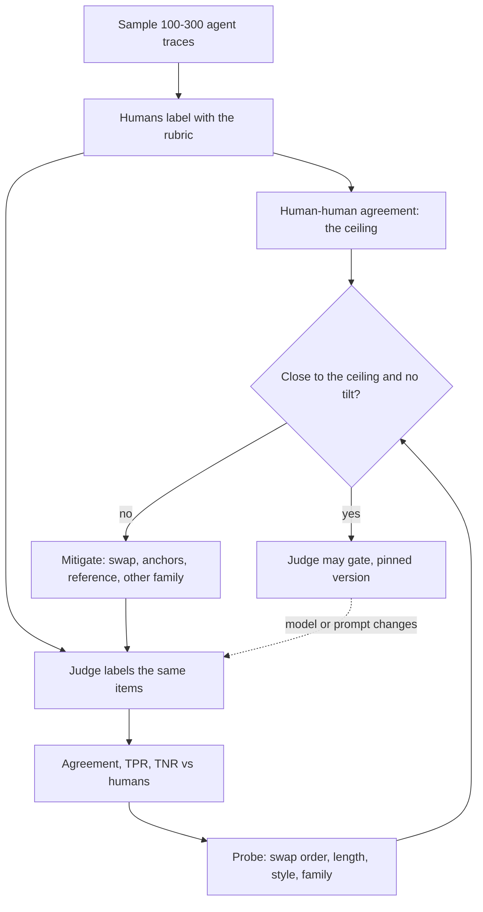

## TL;DR
The judge that grades your agent's traces is an instrument with systematic errors: it favours the
first answer, the longer one, its own family's style, and scores high. Measure it against human labels
before it gates an agent release.

## For agent builders
- **Why it matters for agents.** Most agent quality checks that are not assertions (did it resolve the
  ticket, was the reply grounded in the tool results, was the plan sensible) end up with an LLM judge.
  An uncalibrated judge turns "the agent got wordier" into "the agent got better".
- **Where it shows up in your stack.** Evaluators in LangSmith, Braintrust, promptfoo or Inspect,
  online scoring of sampled production traces, and critic or reflection steps inside the agent that
  approve a draft before it is sent.
- **What you control.** What slice of the trace the judge sees (final reply only, or tool calls and
  results too), the judge family relative to the agent's model, order swapping, the pinned judge
  version, and the TPR/TNR bar a judge must clear before it may block a deploy.
- **What you can skip.** Judging anything checkable: final sandbox state, tool-argument schema, step
  counts, test results. Assert those in code and calibrate the judge only for the rest.

## Why it exists
- **Judges are cheap, so they get trusted.** A judge model scales to thousands of outputs, which makes it
  attractive, but like every instrument it has two kinds of error.
- **Variance averages away; bias does not.** *Variance* is noise: run twice, get slightly different
  numbers, so repeat and average. *Bias* is a systematic tilt that no amount of repetition removes.
- **Bias manufactures wins.** If the judge likes long answers and a new agent prompt makes replies 30%
  longer (or adds tool calls that change nothing), it reports an improvement users may never feel, and
  every repeat confirms the same wrong conclusion.
- **"Use the strongest model and trust it" fails.** Stronger judges still show these biases, just less,
  and without human labels you cannot tell how much.
- **Biases are invisible in an aggregate score.** They must be probed deliberately with controlled
  inputs, not discovered by accident after a bad release. Skip this and a judge score measures the judge,
  not your system.

## How it works
### The known biases
| Bias | What it looks like | Evidence |
|---|---|---|
| **Position** | verdict changes when the two candidates are swapped | Zheng et al. (GPT-4-class judges, MT-Bench); Wang et al. showed it alone can reorder a leaderboard |
| **Verbosity** | longer answers win even when the extra text adds nothing | Zheng et al. |
| **Self-enhancement** | a judge rates outputs from itself or its own family higher | Zheng et al.; later work showed judges recognise and favour their own generations |
| **Style** | markdown headings and confident tone beat plain correct prose | practitioner experience |
| **Scale compression** | on a 1–10 scale almost everything lands at 7–9, so real differences vanish into rounding | practitioner experience |
| **Knowledge-gap leniency** | a fluent but wrong proof passes when the judge cannot do the math either | practitioner experience |
| **Anchoring** | any hint in the prompt (a reference answer, a label like "improved version") pulls the verdict | practitioner experience |

### How the biases look on agent traces
Practitioner experience, not a published taxonomy; probe each one on your own traces.

| Bias on a trajectory | What it looks like | Probe |
|---|---|---|
| **Taking the agent's word** | the final reply says "I've issued the refund", the judge passes it, but the tool call returned an error | label traces where claimed and actual tool outcomes differ |
| **Effort as merit** | longer trajectories with more tool calls score higher, even when a 2-step run solved the task | compare judge and human preference on short-vs-long runs that both succeed |
| **Shared family** | the agent and the judge run on the same model family, so the agent's phrasing reads as "correct" | re-judge the same traces with a judge from another family |
| **Leniency on silence** | an agent that asks a needless clarifying question, or stops early, is rarely failed | seed the calibration set with should-have-acted traces |

- **The fix for most of them is input design:** show the judge the tool calls and results it needs,
  not only the final message, and ask one criterion per call.

### Step 1: build a calibration set
1. **Sample real inputs**, on the order of 100–300 items (illustrative). For an agent these are whole
   traces from production or the eval harness, stratified by task type and outcome.
2. **Have humans label them with the exact rubric** the judge will use.
3. **Seed it with bias-exposing cases:** correct-but-terse answers, wrong-but-eloquent ones, pairs that
   differ only in formatting, and genuine ties.
4. **Measure inter-annotator agreement first**, because it is the yardstick. A judge cannot be shown to
   be more accurate than the labels it is compared against, and its agreement only means something next
   to human–human agreement computed the same way.

### Step 2: measure agreement, not just scores
- **Pick the right statistic:** accuracy for pairwise verdicts, Cohen's kappa for pass/fail, Spearman
  correlation for ordinal scores, each against the human majority.
- **Compare like for like:** judge versus each annotator next to annotator versus annotator, or judge
  versus the majority next to each annotator versus the majority of the others.
- **Why it matters:** agreement with a majority label is naturally higher than with one noisy person, so
  mixing the two makes a judge look better than it is.
- **Read the result:** within a few points of human–human agreement, the judge is "another annotator";
  far below, it is not usable as a gate.
- **Look at *where* it disagrees.** Disagreements concentrated on one failure mode (say, numeric claims)
  mean the judge cannot evaluate that criterion, so a human or a programmatic check must.

### Step 2b: split the two error rates and correct the aggregate
- **One agreement number hides which way a pass/fail judge errs.** Measure **TPR** (share of human-pass
  items the judge passes) and **TNR** (share of human-fail items it fails) separately.
- **Judges are typically lenient**, so TPR is high and TNR is the weak side.
- **Accuracy alone is not enough:** a judge that passes everything scores 90% accuracy on a set where 90%
  of items pass.
- **The two rates bias the headline number predictably**, because:

```
p_obs = TPR · p + (1 − TNR) · (1 − p)     →     p = (p_obs + TNR − 1) / (TPR + TNR − 1)
```

where p is the true (human) pass rate.

| TPR = 0.95, TNR = 0.70 | True pass rate | Judge shows |
|---|---|---|
| System A | 80% | 82% |
| System B | 70% | 75.5% |
| Gap | 10 points | 6.5 points |

- **The gap shrinks** because every difference is scaled by TPR + TNR − 1 = 0.65.
- **Inverting the formula recovers the true rate**, but only as well as TPR and TNR are known. They are
  estimated on the human-labeled set, so include enough human-fail items to pin TNR down, and bootstrap
  the correction.
- **As TPR + TNR − 1 approaches 0** the judge carries no information and the correction explodes: the
  quantitative form of "this judge cannot gate".
- **Check probabilistic calibration too** if the judge emits a confidence or score: bucket verdicts by
  stated confidence and confirm "90% sure" verdicts agree with humans about 90% of the time, so
  low-confidence items can be routed to people.

### Step 3: probe each bias with controlled perturbations
- **Position.** Judge every pair in both orders. The inconsistency rate (verdict flips when swapped) is
  the direct measure; among the flipped pairs, count how often the first slot won.
- **Length.** On pairs where humans preferred the shorter answer, how often does the judge pick the
  longer one? Or regress judge preference on length difference while holding the human label fixed.
- **Self-preference.** Have the same candidate outputs judged by models from two or three families and
  compare the rankings they produce.
- **Style.** Reformat identical content (bullets vs prose, with and without headings) and check whether
  the score moves.
- **Scale use.** Histogram the scores. If 80% of mass sits on two adjacent values, the scale is compressed
  and deltas between variants are mostly noise.

### Step 4: mitigate what you found
| Bias found | Mitigation | Cost or caveat |
|---|---|---|
| Position | run both orders and average, or count only consistent verdicts and treat flips as ties | doubles judge cost, which is why you measure first; if flips are rare for your task, skip it |
| Length | length-controlled win rate; tell the judge length is not a merit; few-shot examples where the shorter answer wins | needs a fitted model |
| Scale compression | rubric-anchored levels, binary per-criterion checks, or pairwise comparison (no absolute scale at all) | loses some gradation |
| Knowledge gaps | reference-guided grading: give a gold answer or test results so it checks consistency instead of solving the problem itself | penalises valid alternatives |
| Self-preference | a judge from a different family than the system under test, or a small cross-family panel with a majority vote | more calls |
| Reasoning-heavy comparisons | short analysis before the verdict, then a structured final field | gain is model-dependent, so verify it on your set |
| Drift | pin the judge model version; treat the judge prompt as versioned code; re-run calibration when either changes | vendor model updates silently move the instrument |

- **Length-controlled win rate, concretely:** fit a model of preference with the length difference as a
  covariate and read off the prediction at zero difference. This is the idea behind length-controlled
  AlpacaEval.

### Step 5: report with uncertainty
- **Bootstrap a confidence interval** over items for the headline score.
- **Always publish the judge's agreement with humans next to it.** A win rate without an agreement number
  is an unlabeled gauge.

## Diagram
The calibration loop for an agent's judge: it earns the right to gate a deploy only after its agreement
with humans on real traces is close to human–human agreement; every bias found feeds a protocol change
and a re-measure.



## Examples
### Both-order calibration harness
Runs each pair in both orders and measures position inconsistency, agreement with human labels on the
consistent pairs, and the judge's preference for the longer answer relative to the humans'. The `judge`
function wraps whatever LLM call you use and returns `"A"` or `"B"`.

```python
import statistics as st

def judge(question, first, second) -> str:
    """Show `first` as A and `second` as B; return 'A' or 'B'. Wrap your LLM call here."""
    raise NotImplementedError

def calibrate(pairs, human):
    """pairs: [(q, x, y)]; human: [1 or 2] = which of x, y the human majority preferred."""
    flips = first_slot_wins = agree = 0
    judge_longer, human_longer = [], []
    for (q, x, y), h in zip(pairs, human):
        v1 = judge(q, x, y)                       # x in slot A
        v2 = judge(q, y, x)                       # y in slot A
        pick1 = 1 if v1 == "A" else 2             # map both verdicts back to x=1, y=2
        pick2 = 2 if v2 == "A" else 1
        if pick1 != pick2:                        # verdict depended on order
            flips += 1
            first_slot_wins += (v1 == "A") + (v2 == "A")
            continue                              # treat as a tie; exclude from accuracy
        agree += pick1 == h
        longer = 1 if len(x) > len(y) else 2
        judge_longer.append(pick1 == longer); human_longer.append(h == longer)
    n, consistent = len(pairs), len(pairs) - flips
    print(f"position-inconsistent pairs: {flips}/{n} ({flips/n:.0%}); "
          f"first slot won {first_slot_wins}/{2*flips or 1} of those verdicts")
    print(f"agreement with humans (consistent pairs): {agree}/{consistent} ({agree/max(consistent,1):.0%})")
    print(f"chose longer answer: judge {st.mean(judge_longer):.0%} vs humans {st.mean(human_longer):.0%}")
```

Illustrative output on 200 pairs:

| Measure | Result | Reading |
|---|---|---|
| Position-inconsistent pairs | 46 (23%) | first slot won 72 of the 92 verdicts in those pairs: a clear first-position bias |
| Agreement on the 154 consistent pairs | 128 (83%) | annotators agreed with the majority of the others on 86%, so close to annotator quality |
| Chose the longer answer | judge 68% vs humans 55% | a verbosity tilt of roughly 13 points that rewards any change making outputs wordier |

The first-slot count is always even, because a flipped pair contributes either two first-slot wins or none.

### Correcting a lenient judge's pass rate
Pure Python. Uses the TPR/TNR inversion from Step 2b and bootstraps the calibration set so the corrected
number carries an interval.

```python
import random

def corrected(p_obs, tpr, tnr):
    j = tpr + tnr - 1                     # how much information the judge carries
    if j <= 0.05:
        raise ValueError("judge carries ~no information; it cannot gate")
    return min(1.0, max(0.0, (p_obs + tnr - 1) / j))

def bootstrap(judge, human, p_obs, n=2000, seed=0):
    """judge, human: parallel 0/1 lists on the human-labeled calibration set."""
    rng, pairs, out = random.Random(seed), list(zip(judge, human)), []
    for _ in range(n):
        s = [rng.choice(pairs) for _ in pairs]
        pos = [j for j, h in s if h == 1]; neg = [j for j, h in s if h == 0]
        tpr = sum(pos) / len(pos); tnr = 1 - sum(neg) / len(neg)
        try: out.append(corrected(p_obs, tpr, tnr))
        except ValueError: pass
    out.sort()
    return out[int(0.025 * len(out))], out[int(0.975 * len(out))]

# Calibration set: 200 human-pass items (judge passes 190), 100 human-fail (judge fails 70)
human = [1] * 200 + [0] * 100
judge = [1] * 190 + [0] * 10 + [0] * 70 + [1] * 30
print(round(corrected(0.82, 0.95, 0.70), 3))   # 0.8: the 82% headline is really ~80%
print(round(corrected(0.755, 0.95, 0.70), 3))  # 0.7
print(bootstrap(judge, human, p_obs=0.82))     # roughly (0.75, 0.85) on this set
```

- **Why 100 human-fail items:** with only 20, the standard error of TNR grows by about √5 ≈ 2.2×
  (it scales with 1/√n), and the corrected interval widens with it. The 0.05 floor on TPR + TNR − 1 is an illustrative guard, not a
  standard.

### Agent scenario: a "ticket resolved" judge that read only the final reply
A support agent calls `lookup_order`, `issue_refund` and `send_email` tools. The team calibrates a
"ticket resolved" judge on 300 human-labeled traces (200 human-pass, 100 human-fail), first showing the
judge only the final reply, then the reply plus every tool call and result. Numbers are illustrative.

| Judge input | Passes of 200 human-pass | Fails of 100 human-fail | TPR | TNR | TPR + TNR − 1 |
|---|---|---|---|---|---|
| Final reply only | 192 | 60 | 0.96 | 0.60 | 0.56 |
| Reply plus tool calls and results | 190 | 85 | 0.95 | 0.85 | 0.80 |

- **Why TNR was low:** most of the 40 missed failures were replies that claimed an action ("your
  refund is on its way") whose tool call had returned an error. The judge took the agent's word.
- **What it does to a release decision:** agent v2 truly resolves 80% of tickets versus 75% for v1.

| Judge | Shows v1 | Shows v2 | Visible gap |
|---|---|---|---|
| Final reply only | 0.96 × 0.75 + 0.40 × 0.25 = 82% | 84.8% | 2.8 points |
| With tool results | 0.95 × 0.75 + 0.15 × 0.25 = 75% | 79% | 4 points |

```python
def judge_view(trace, include_tools=True):
    """Render the slice of an agent trace the judge sees. trace: list of step dicts."""
    lines = []
    for step in trace:
        if step["type"] == "tool_call" and include_tools:
            lines.append(f"TOOL CALL {step['name']}({step['args']})")
        elif step["type"] == "tool_result" and include_tools:
            lines.append(f"TOOL RESULT {step['name']}: {step['output']}")   # errors included verbatim
        elif step["type"] == "assistant":
            lines.append(f"AGENT: {step['text']}")
    return "\n".join(lines)
# Calibrate each view on the same labeled traces; keep the one whose TNR clears your bar.
```

## Production patterns
- **Calibration job in the agent's CI.** When the judge model, judge prompt, the agent's tools or the
  task changes, re-run the judge on the versioned set of human-labeled traces and fail the build if
  kappa or TNR falls below a threshold set relative to human–human agreement. Monitor agreement, TPR
  and TNR per release.
- **Give the judge the evidence, not the claim.** Render tool calls and results into the judge input
  for any criterion about actions taken, and assert final state in code where the sandbox exposes it.
  Monitor TNR on traces where the agent's reply and its tool results disagree.
- **Pin the judge by dated snapshot.** Call a dated model version rather than a moving alias and store the
  judge prompt hash with every score. Monitor for step changes in historical trends on days your system
  did not change.
- **Swap-and-tie for pairwise gates.** Judge each pair in both orders, count flips as ties, and log the
  flip rate as its own metric. If it rises above what you measured at calibration, re-calibrate before
  trusting the win rate.
- **Cross-family judge panel for agent model swaps.** When the candidate agent models include the
  judge's own family, use two or three judges from different families and take a majority vote.
  Monitor how often panel members disagree.
- **Route low-confidence verdicts to humans.** Use the confidence buckets from Step 2b to send verdicts
  below a chosen confidence to a review queue. Monitor queue volume and human–judge agreement on the
  routed items.
- **Ongoing human spot checks on live traces.** Sample a small fixed share of production-judged agent
  traces each week for human labels, and add them to the calibration set. Monitor agreement over time
  to catch drift as users and tools change.
- **Calibrate in-agent critics too.** A reflection or critic step that approves the agent's draft is a
  judge on the serve path; measure its TPR and TNR on the same labeled traces before trusting it.
  Monitor how often it triggers a revision and whether revisions pass the offline judge more often.

## Trade-offs
- **Bias removal vs cost.** Position swapping removes the largest pairwise bias but doubles judge cost;
  skip it only after you have measured a low inconsistency rate on your own calibration set, not because a
  paper reported one.
- **Accuracy vs valid alternatives.** Reference-guided grading sharply improves accuracy on tasks with a
  checkable answer, but penalises valid alternatives; it flips to a liability on open-ended tasks with
  many acceptable answers.
- **Strength vs independence.** A stronger judge agrees more with humans but costs more and is more
  likely to share a family with the system under test; once the candidate is the judge's sibling, a
  weaker judge from another family wins.
- **Binary checks vs gradation.** Binary rubric checks cure scale compression but lose gradation; when
  the differences you care about sit inside a single criterion, a short anchored scale (3 levels) is the
  better compromise.
- **Label cost vs drift detection.** Human calibration labels are expensive, but they are reusable across
  judge versions and are the only way to detect drift; a few hundred pairwise labels usually suffice for
  an accuracy estimate.

## Pitfalls
- **Publishing a win rate without agreement.** Symptom: a prompt change that "improves" the score while
  user complaints rise. Fix: report agreement with humans next to every judge score.
- **Generating and judging with the same family.** Symptom: the candidate beats stronger external models
  suspiciously often, and the ranking changes when the judge family changes. Fix: cross-family judge.
- **A compressed score distribution.** Symptom: every variant scores 8.2–8.6 with differences inside the
  bootstrap interval, so the eval cannot distinguish anything. Fix: anchored levels or pairwise.
- **Silent vendor upgrades of the judge.** Symptom: a step change in a historical trend chart on the day
  nothing in your system changed. Fix: pin the version and re-calibrate on change.
- **Reporting only overall accuracy for pass/fail.** Symptom: a judge that "agrees 90%" yet catches few
  of the failures, visible as a low TNR once human-fail items are counted separately. Fix: report TPR
  and TNR side by side.
- **Leaking metadata into the judge prompt** (model names, "v2", "improved"). Symptom: verdicts flip
  when the labels are swapped while the content stays the same. Fix: strip identifiers.
- **Judging in one fixed order.** Symptom: a leaderboard that reorders when candidate A and B are
  exchanged. Fix: both-order judging.
- **Judging an agent from its final message.** Symptom: high judged resolution rate while users report
  refunds or bookings that never happened. Fix: include tool calls and results in the judge input, and
  seed the calibration set with claimed-but-failed traces.

## When to use
- **Use when a judge gates a decision:** agent prompt or tool releases, model swaps, fine-tune
  selection, vendor comparisons, and any critic step inside the agent loop. Calibrate once per combination of judge model, judge prompt and task, and again whenever
  any of the three changes.
- **Measure three numbers:** position inconsistency rate, agreement with humans next to human–human
  agreement (split into TPR and TNR for pass/fail judges), and the judge's length preference relative to
  humans.
- **Avoid when an executable check exists** (tests, exact match, schema validation): do not use a judge
  at all.
- **Day to day:** this is the calibration job in CI that fails when agreement drops.
- **Interviews:** "how do you know your judge is right?" expects exactly this: a labeled set,
  swap-and-average, length control, and kappa against the human ceiling.

## Role lens
- **Engineer:** Implements both-order judging, structured verdict output, a pinned judge version, and a
  calibration job that reports agreement and fails the build when it degrades.
- **Architect:** Decides which judge families may evaluate which systems, the minimum agreement a judge
  needs before it can gate a release, and the human relabeling budget per quarter.
- **FDE:** When a customer's SMEs disagree with the judge, runs the calibration on their data and uses
  the agreement number to negotiate what "good" means rather than arguing case by case.

## Check yourself
**Q:** Your team replaced a 1–10 judge with pairwise comparison against the production prompt, and the new
prompt wins 64% of comparisons. What do you check before shipping, and why?
**A:** First, position consistency: run every pair in both orders; if a large share of verdicts flip, part
of the 64% is slot order, so recompute on consistent pairs or average. Second, length: if the new prompt
produces longer outputs, compute a length-controlled win rate or restrict to length-matched pairs, because
verbosity bias alone can manufacture a double-digit swing in win rate. Third, agreement with humans on a labeled
subset of about a hundred pairs, compared with human–human agreement, to confirm the judge is tracking
quality on this task. Fourth, self-preference: if the change involved a model swap, make sure the judge is
from a different family. Finally, bootstrap a confidence interval; if it still excludes 50% after these
controls, ship behind an online A/B to confirm.

## Interview questions
### What is the difference between judge variance and judge bias, and why does it matter?
- **Variance is noise.** Running the same judge twice gives slightly different numbers; repeating and
  averaging shrinks it.
- **Bias is a systematic tilt** (first position, longer answer, own family) that every repeat reproduces,
  so averaging only makes the wrong answer look more certain.
- **So the remedy differs:** variance needs more samples; bias needs human labels to detect it and a
  protocol change (swap order, length control, other family) to remove it.

### Your judge says a new prompt improved pass rate from 80% to 86%, but support tickets went up. How do you debug it?
- **Check what changed in the outputs.** If the new prompt made answers longer or more formatted,
  suspect verbosity or style bias first.
- **Measure against humans on fresh items:** label 100 or so recent outputs from both prompts and compute
  the judge's TPR and TNR separately, because a lenient judge with low TNR passes the new failures.
- **Probe directly:** compare judge length preference against human length preference on the same pairs;
  a gap of double digits explains a manufactured gain.

### When would you not use an LLM judge at all?
- **When an executable check exists:** unit tests, exact match, schema validation or a numeric
  tolerance are cheaper, deterministic and unbiased.
- **When the judge cannot do the task itself,** such as checking a hard proof or a domain calculation;
  knowledge-gap leniency means fluent wrong answers pass. Use reference-guided grading or experts.
- **When TPR + TNR − 1 is near zero** on your calibration set, the judge carries no information and cannot
  gate anything.

### A pass/fail judge has TPR 0.95 and TNR 0.70. It reports 82% pass. What is the true rate and what does this do to comparisons?
- **Invert the formula:** p = (0.82 + 0.70 − 1) / (0.95 + 0.70 − 1) = 0.52 / 0.65 = 0.80, so the true pass
  rate is about 80%.
- **Differences shrink:** every true gap is scaled by 0.65, so a real 10-point gap shows as 6.5 points
  and small real improvements fall inside the noise.
- **Bootstrap the correction** over the calibration set, because TPR and TNR are themselves estimates.

### Your support agent's judged resolution rate is 90%, but refunds users were promised never happened. What is wrong with the judge?
- **It is probably taking the agent's word:** it sees the final reply ("refund issued") and not the
  `issue_refund` result, so claimed-but-failed actions pass and TNR is low.
- **Measure it:** label traces where the reply and the tool results disagree and compute TPR and TNR
  separately; a single agreement number hides this because most traces pass.
- **Fix the input and the oracle:** render tool calls and results into the judge prompt, and assert the
  refund in the sandbox or order system state in code wherever that is possible.

### How do you keep an agent's judge trustworthy over months in production?
- **Pin a dated judge model and version the judge prompt,** storing both with every score.
- **Re-run the calibration set in CI** whenever the judge, its prompt or the task changes, and fail the
  build if agreement or TNR drops below the agreed threshold.
- **Spot-check weekly:** route a small sample of production-judged items to humans and add them to the
  calibration set, so drift shows up as falling agreement.

## Quiz
### Q: A judge's verdict changes for 30% of pairs when the two answers are swapped. What is being measured, and what is the fix?
- [ ] Verbosity bias; fix it by truncating both answers to the same length
- [x] Position bias; run both orders and average, or treat inconsistent pairs as ties
- [ ] Self-preference bias; switch to a judge from a different model family
- [ ] Scale compression; switch from scores to pairwise comparison
> A verdict that depends on which slot an answer occupies is position bias by definition. Both-order
> judging cancels it; truncation and judge-family changes target different biases.

### Q: A report says the judge agrees with the human majority label 92% of the time, while two human annotators agree with each other only 78%. What should you conclude first?
- [ ] The judge is genuinely better than the human annotators
- [ ] Position bias inflated the judge's accuracy
- [x] The two numbers are not like for like: agreement with a majority label is naturally higher than agreement between two individuals; recompute both the same way, with intervals, before concluding anything
- [ ] Kappa was computed with the wrong marginals
> A majority label is less noisy than any single annotator, so judge-versus-majority can exceed
> annotator-versus-annotator even for a merely human-level judge. Labels written by these humans also
> cannot demonstrate that the judge is better than them; position bias and kappa marginals do not explain the gap.

### Q: Which mitigation specifically targets self-enhancement (self-preference) bias?
- [ ] Judging each pair in both orders
- [ ] Giving the judge a reference answer
- [x] Using a judge from a different model family than the system being evaluated
- [ ] Lowering the judge's sampling temperature
> Self-preference is a judge favouring outputs that resemble its own; changing the judge family removes
> that resemblance. Order swapping fixes position bias, references fix knowledge gaps, and temperature
> only affects variance.
