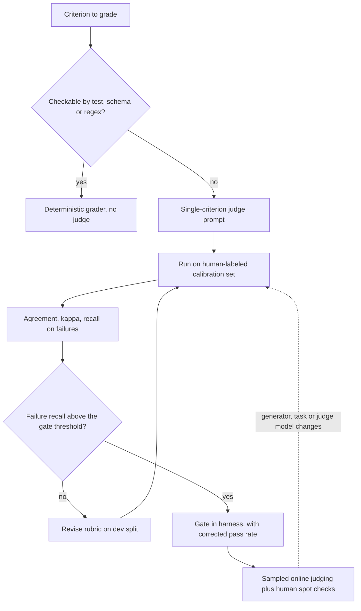

## TL;DR
LLM-as-a-judge has a model grade open outputs against a rubric, often with a reference. It scales
grading, but is only as good as its measured agreement with humans: judges carry position, verbosity
and self-preference biases and grade confidently, right or wrong.

## Why it exists
- **Open-ended outputs have no exact match.** A summarizer, a support reply or an agent's final report
  cannot be graded by string equality.
- **Cheap metrics measure the wrong thing.** BLEU and ROUGE, inherited from machine translation, reward
  wording, not correctness, and correlate poorly with human judgment on open-ended tasks. Embedding
  similarity cannot see that one number in a financial summary is wrong.
- **Humans do not scale.** A prompt iteration loop needing 300 outputs graded ten times a day is a
  full-time reviewer per engineer, and human grading drifts over a long session anyway.
- **A strong model with a clear rubric fills the gap**: a grader that is cheap, fast, consistent and
  *good enough*.
  - *It can work:* in the MT-Bench study, a capable judge with pairwise prompts reached agreement with
    human preferences comparable to human-human agreement.
  - *It can fail:* the same line of work found judges prefer the first position, longer answers and
    their own model family's style, and struggle to verify math and code by reading.
- **"Rate it 1 to 10" fails.** An undefined scale compresses toward 7 or 8, varies with phrasing, and
  gives a number you cannot act on or audit. The pattern is "design a grader, calibrate it against
  humans, and keep it calibrated".

## How it works
### Modes
| Mode | Judge sees | Use it for | Because |
|---|---|---|---|
| **Pointwise with a rubric** | One output + rubric → pass/fail or a small scale | Absolute gates | Binary verdicts per criterion are easier to calibrate and act on than a 1–10 score, and a decomposed rubric tells you *what* failed |
| **Reference-guided** | Output + golden answer | Correctness | Far more reliable than unguided judging: the judge no longer has to know the answer, only compare |
| **Pairwise** | Outputs A and B → preference | Relative comparisons (prompt v1 vs v2, model X vs Y) | Must run in both orders because of position bias; a preference that flips with order is a tie |
| **Probability-weighted** | Score-token probabilities → expected value | Finer-grained scores | Turns a coarse 1–5 scale into a continuous score that ties less often |
| **Reference-free quality** | Answer + retrieved context, e.g. faithfulness | RAG grounding | The "reference" is the context; rubric is "supported, not supported, contradicted" |

- **Probability-weighted detail.** G-Eval reads the probabilities the judge assigns to each score token
  and reports the expected value, after a chain-of-thought step that writes out the evaluation steps. A
  judge torn between 3 and 4 reports 3.5 instead of whichever token it sampled. It needs
  log-probabilities from the judge API.

### Designing the judge prompt
1. **State the task** the output was supposed to do.
2. **State the criterion concretely,** with examples of pass and fail.
3. **Ask for a short justification *before* the verdict,** *because* reasoning first often improves
   agreement with humans (evidence is mixed and model-dependent, so measure it on your calibration set)
   and always produces an audit trail for when the judge is wrong.
4. **Return structured output** (JSON with `verdict` and `reason`) so the harness never parses prose.

- **One criterion per call,** *because* a judge asked to assess accuracy, tone and completeness at once
  blurs them into one score.
- **Few-shot anchors** from human-labeled cases, kept out of the calibration set, anchor the scale.

### Known biases and their mitigations
| Bias | What it does | Mitigation |
|---|---|---|
| **Position** | Prefers the first (or second) candidate | Swap and require consistency |
| **Verbosity** | Prefers longer, more detailed-looking answers | Instruct explicitly; prefer binary criteria length cannot satisfy |
| **Self-enhancement** | Prefers outputs in its own style | Judge from a different model family than the generator, or at least check agreement by generator |
| **Surface anchoring** | Rewards outputs echoing the reference's wording | Reference-guided rubrics ask about facts, not phrasing |
| **Reasoning limits** | Misgrades math and code by inspection | Use execution and tests; keep the judge for what cannot be executed |

### Calibration: the step that makes it an eval
1. **Build a human-labeled set** for the criterion: on the order of a hundred or two items
   (illustrative), with both passes and failures represented.
2. **Run the judge and compute** agreement, Cohen's kappa (agreement corrected for chance), and
   per-class recall.
3. **For a gate, read recall on *failures*,** *because* a judge that passes 95% of items while missing
   a quarter of real failures is a leaky gate.
4. **Iterate on a dev split, confirm on a held-out split,** the same discipline as any model.

### Correcting the headline number
A judge with recall *r_pass* on human passes and *r_fail* on human failures reports a pass rate biased
toward whichever error it makes more often. If you trust those two rates (the Rogan–Gladen correction
from diagnostic testing):

```
true ≈ (observed + r_fail − 1) / (r_pass + r_fail − 1)
```

- **Limits:** only as good as the calibration set, and it fails when the generator changes and its
  errors stop resembling those the judge was calibrated on.
- **The point:** an uncorrected judge score is an estimate of the judge, not of the system.

### When one judge is not enough
- **Ensemble:** several judges from different model families, or the same judge with candidate order
  swapped, combined by majority vote.
- **Route disagreement to humans:** disagreement between judges flags items for a human.
- **Re-calibrate** when the generator, the task or the judge model changes, and keep sampling live
  outputs for human spot checks so drift is caught.

### Cost and placement
- **Judge cost can exceed generation cost:** a judge call costs tokens per item per criterion.
- **Spend wisely:** deterministic checks for anything deterministic, a smaller model for simple criteria
  once calibrated, and batch offline.
- **Placement:** judges belong in the offline harness and in sampled online monitoring. A synchronous
  guardrail adds a full model call to every request's latency and should be a deliberate decision.

## Diagram
The path a criterion takes to become a trusted grader: deterministic checks first, then a judge that
must pass calibration before it may gate. The judge prompt grades one criterion, sees the reference or
retrieved context, and writes its reason before a JSON verdict.



## Examples
### Reference-guided binary judge and its calibration
Single criterion, reasoning-first JSON verdict, then the calibration numbers that decide whether it can
be trusted. `llm` is any chat-completion call returning text; the judge prompt is the part that matters.

```python
import json
from itertools import product

JUDGE_PROMPT = """You are grading a customer-support answer for FACTUAL CORRECTNESS only.
Task the answer was meant to solve: {task}
Reference answer written by an expert: {reference}
Answer to grade: {answer}

Pass only if every factual claim in the answer agrees with the reference; wording, tone and length
do not matter. Fail if any claim contradicts the reference or adds an unsupported fact.
Reply with JSON: {{"reason": "<one or two sentences>", "verdict": "pass" | "fail"}}"""

def judge(task: str, reference: str, answer: str) -> dict:
    raw = llm(JUDGE_PROMPT.format(task=task, reference=reference, answer=answer), temperature=0)
    out = json.loads(raw[raw.find("{"): raw.rfind("}") + 1])
    assert out["verdict"] in ("pass", "fail")
    return out

def calibrate(items, human: dict[str, bool]) -> dict:
    """items: labeled cases; human: id -> True if humans marked it a pass."""
    pred = {it["id"]: judge(it["task"], it["reference"], it["answer"])["verdict"] == "pass" for it in items}
    n = len(items)
    cm = {(h, p): sum(human[i] == h and pred[i] == p for i in pred) for h, p in product([True, False], repeat=2)}
    acc = (cm[True, True] + cm[False, False]) / n
    p_yes = (cm[True, True] + cm[False, True]) / n * (cm[True, True] + cm[True, False]) / n
    p_no = (cm[True, False] + cm[False, False]) / n * (cm[False, True] + cm[False, False]) / n
    kappa = (acc - (p_yes + p_no)) / (1 - (p_yes + p_no))
    fail_recall = cm[False, False] / max(1, cm[False, False] + cm[False, True])
    return {"n": n, "agreement": round(acc, 3), "kappa": round(kappa, 3), "fail_recall": round(fail_recall, 3)}

# Worked numbers for 200 items, 140 human-pass / 60 human-fail; judge passes 150:
#   135 true passes, 15 fails marked pass, 5 passes marked fail, 45 fails marked fail
#   agreement = 180/200 = 0.90, chance agreement = 0.75*0.70 + 0.25*0.30 = 0.60, kappa = 0.75
#   fail_recall = 45/60 = 0.75  -> the judge misses one real failure in four: not yet a release gate.
#   observed pass rate 0.75 vs true 0.70; correction: (0.75 + 0.75 - 1) / (135/140 + 0.75 - 1) ≈ 0.70
```

| Calibration number | Value | Reading |
|---|---|---|
| Agreement | 90% | Looks fine, but most items pass |
| Recall on failures | 75% | Misses one real failure in four: not yet good enough to gate a release |
| Missed failures | 15 | Where to look to improve the rubric |
| Headline bias | +5 points | Observed 0.75 vs true 0.70 |

- **Why the bias matters:** when comparing two systems, if version B's errors are the kind this judge
  misses more often, B can look better than A while being worse.

### Pairwise in both orders, plus the corrected pass rate
Pure Python. Counts order-consistent wins, treats flips as ties, tests the decisive items, and applies
the correction above.

```python
from math import comb

def order_consistent(b_second: dict, b_first: dict) -> dict:
    """Each dict: item id -> winning candidate ('A' or 'B'), named by candidate, not position.
    b_second: run with A shown first; b_first: run with B shown first."""
    tally = {"A": 0, "B": 0, "tie": 0}
    for i in b_second:
        tally[b_second[i] if b_second[i] == b_first[i] else "tie"] += 1   # flips with order = tie
    return tally

def sign_test(wins: int, losses: int) -> float:              # two-sided exact test on decisive items
    n, k = wins + losses, min(wins, losses)
    return min(1.0, 2 * sum(comb(n, j) for j in range(k + 1)) / 2**n)

def rogan_gladen(observed: float, r_pass: float, r_fail: float) -> float:
    return (observed + r_fail - 1) / (r_pass + r_fail - 1)

# 100 items: B wins 68 when shown first, 44 when shown second (the quiz scenario)
b_first = {i: "B" if i < 68 else "A" for i in range(100)}
b_second = {i: "B" if i < 44 else "A" for i in range(100)}
t = order_consistent(b_second, b_first)
print(t, "p =", round(sign_test(t["B"], t["A"]), 3))
print("corrected pass rate:", round(rogan_gladen(0.75, 135 / 140, 0.75), 3))
# {'A': 32, 'B': 44, 'tie': 24} p = 0.207
# corrected pass rate: 0.7
```

- **Reading it:** a 56% average for B hides 24 order-driven ties. On the 76 decisive items, 44 vs 32
  is not significant (p ≈ 0.21), so the judge has not shown B is better.

## Production patterns
- **Judge as a versioned artifact.** Store the judge prompt, the pinned judge model snapshot and its
  latest calibration report together, and record the judge version in every eval manifest. Monitor
  score moves that coincide with a judge-version change.
- **Calibration gate before gating.** Allow a judge to block releases only after its recall on human-
  labeled failures clears a threshold set from the cost of a missed failure; re-run calibration when
  the generator, task or judge model changes. Monitor failure recall per calibration run.
- **Order-swapped pairwise by default.** Run every pairwise comparison in both orders and count flips
  as ties, as in the example. Monitor the tie rate; a rising rate means position is driving verdicts.
- **Sampled online judging with a human queue.** Judge a fixed sample of live traffic asynchronously,
  off the request path, and route judge disagreements and low-scoring items to human reviewers.
  Monitor judge-human agreement on the reviewed sample week over week.
- **Structured verdicts, errors kept separate.** Request JSON (a structured-output or JSON mode where
  the API offers one), validate the `verdict` field, and count unparseable replies as grader errors,
  not as fails. Monitor the parse-error rate.
- **Cross-family panel for high-stakes criteria.** Use judges from model families other than the
  generator, combined by majority vote. Monitor per-judge agreement by generator to catch
  self-preference.

## Trade-offs
- **Speed vs bias.** A judge grades hundreds of outputs in minutes for a few dollars, but every verdict
  carries the judge's biases, so the savings are real only after calibration against human labels on
  this task.
- **Reference-guided accuracy vs labeling.** Far more accurate for correctness, but needs a golden
  answer per item, the expensive thing a judge was supposed to avoid; it moves labeling, not removes it.
- **Pairwise sensitivity vs gating.** More sensitive than absolute scores for comparing two versions,
  but needs two runs per item in both orders and yields no absolute pass rate to gate on.
- **Cheap judge vs subtle errors.** A smaller judge model cuts eval cost sharply, but its agreement must
  be re-measured per criterion; cheap judges fail first on subtle factual errors.
- **Reasoning-first vs cost.** It usually helps agreement and always helps auditability, but adds
  output tokens and latency per item, which matters when the judge is sampled online.

## Pitfalls
- **Shipping a judge never compared with human labels.** Symptom: a stable, high offline score
  alongside user complaints about exactly the failures the judge passes.
- **Pairwise in one order only.** Symptom: a preference rate near 60–70% for whichever candidate is
  listed first, regardless of content.
- **One judge for many criteria with a 1–10 score.** Symptom: scores clustered at 7–8 with no way to
  say what changed when the average moves by 0.3.
- **Judging the generator with the same model.** Symptom: a persistent preference for the house style
  that disappears when a different judge family is used.
- **Verifying arithmetic or code by reading.** Symptom: confidently passed outputs that fail when
  executed.
- **Never re-calibrating after a generator change.** Symptom: failure recall quietly drops as the new
  generator's errors look different from the ones the rubric anticipated.

## When to use
- **Use when:** the criterion cannot be checked deterministically: factual agreement with a reference,
  faithfulness to retrieved context, instruction adherence, tone and policy compliance.
- **Avoid when:** a test, a schema check or a regex will do; and never as the sole gate before its
  failure recall on human-labeled items is known.
- **Measure:** agreement, kappa and per-class recall, reported next to the scores the judge produces,
  plus continual spot checks of live outputs.
- **Day to day:** the judge is a versioned prompt in the harness with its own calibration report.
- **Interviews:** name the biases, explain why binary rubric criteria beat numeric scales, and describe
  how you would prove a judge is trustworthy before gating a release on it.

## Role lens
- **Engineer:** Writes single-criterion judge prompts with structured verdicts, runs the calibration
  script, and versions the rubric alongside the grader in the harness.
- **Architect:** Decides which criteria may be judge-graded, which require execution or humans, what
  minimum failure recall a gate needs, and which model families may judge which generators.
- **FDE:** Builds the human-labeled calibration set with the customer's reviewers and shows them the
  agreement numbers, so the customer trusts the automated scores that follow.

## Check yourself
**Q:** Your team wants to replace the weekly human review of chatbot answers with an LLM judge and use
its pass rate as the release gate. What would you need to see before agreeing, and how would you set
it up?
**A:** I would want a human-labeled calibration set of a couple of hundred answers covering real
failures, a judge designed as one rubric criterion per call with reference or retrieved context
supplied, reasoning before a binary verdict in JSON, and a calibration report showing agreement,
kappa and especially recall on failures above a threshold we set from the cost of a missed failure. I
would check for position and verbosity effects, use a judge from a different model family than the
chatbot, and keep execution-based checks for anything computable. After that, the judge gates releases
in the harness, the humans move to spot-checking a sample of live outputs weekly, and any disagreement
feeds back into the rubric and triggers re-calibration when the generator changes.

## Interview questions
### What is LLM-as-a-judge, and why not use ROUGE or embedding similarity instead?
- **Definition:** a model grades open-ended outputs against a rubric, often with a reference answer,
  in place of a human reviewer.
- **Why not overlap metrics:** BLEU and ROUGE reward wording, not correctness, and embedding similarity
  cannot see that one number in a financial summary is wrong.
- **The catch:** a judge is only as good as its measured agreement with humans on this task, because
  judges carry position, verbosity and self-preference biases.

### Design a judge for faithfulness of RAG answers.
- **Reference-free mode:** give the judge the answer plus the retrieved context, and ask per claim
  whether it is supported, not supported or contradicted.
- **Prompt shape:** one criterion per call, a short justification before the verdict, JSON output with
  `verdict` and `reason`, few-shot anchors kept out of the calibration set.
- **Before trusting it:** calibrate on a human-labeled set with both passes and failures, and use a
  judge from a different model family than the generator.

### Your judge agrees with humans 90% of the time. Is it ready to gate releases?
- **Not necessarily.** With most items passing, high agreement is compatible with missing many
  failures; read recall on failures, which was 75% in the worked example.
- **Check kappa too:** agreement corrected for chance (0.75 in the example) shows how much of the 90% is
  more than base rate.
- **Correct the headline:** the observed 0.75 pass rate was really about 0.70 after the Rogan–Gladen
  correction, a 5-point bias that can flip a comparison.

### When should you not use an LLM judge?
- **Executable artifacts:** SQL, code and arithmetic should be run against fixtures or tests, because
  judges misgrade them by inspection.
- **Deterministic properties:** schema validity, length or regex-checkable content need no model call.
- **Synchronous guardrails by default:** a judge on the request path adds a full model call to latency,
  so it should be a deliberate decision rather than the default.

### Judge costs now exceed generation costs. How do you bring them down?
- **Move deterministic criteria off the judge** and keep it only for what cannot be checked otherwise.
- **Use a smaller judge model per criterion** once its agreement has been re-measured, knowing cheap
  judges fail first on subtle factual errors.
- **Batch offline and sample online:** grade a fixed sample of live traffic asynchronously rather than
  every request, and weigh the extra output tokens of reasoning-first prompts.

## Quiz
### Q: Why should a judge used as a release gate be evaluated on recall of failures rather than overall agreement with humans?
- [ ] Overall agreement cannot be computed for binary verdicts
- [x] Most items pass, so high agreement is compatible with missing a large share of the rare failures that the gate exists to catch
- [ ] Recall is cheaper to compute than agreement
- [ ] Humans only label failures
> With 70% passes, a judge that marks almost everything pass still agrees with humans most of the
> time. The gate's job is catching failures, so the fraction of real failures it flags is the quantity
> that determines whether it is doing that job.

### Q: In a pairwise comparison, prompt B is preferred 68% of the time when listed first and 44% when listed second. What is going on?
- [ ] B is better, since the average preference is above 50%
- [x] The judge shows position bias; the comparison needs both orders per item and inconsistent pairs counted as ties
- [ ] The golden dataset is too small
- [ ] The judge needs a higher temperature to break ties
> A 24-point swing from ordering alone means position, not content, is driving many verdicts. B's
> 56% average across orders is not evidence on its own: count each item whose verdict flips with the
> order as a tie and decide on the order-consistent wins, which shows how much real signal is left.

### Q: Which criterion is the worst fit for an LLM judge?
- [ ] Whether a support reply's tone matches the brand guidelines
- [ ] Whether every claim in a RAG answer is supported by the retrieved passages
- [x] Whether a generated SQL query returns the correct rows
- [ ] Whether an answer addresses every part of a multi-part customer question
> Judges misgrade executable artifacts by inspection. A SQL query can be run against a fixture and
> compared to the expected rows deterministically, which is cheaper and more reliable than any judgment.
> Tone, groundedness and completeness against the question are the kinds of criteria that need a judge.
