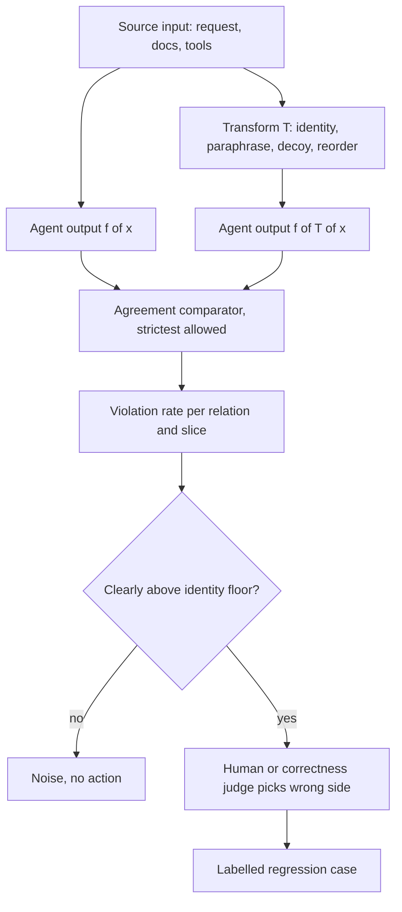

## TL;DR
Metamorphic testing checks an agent without knowing the right answer: transform the input predictably
(paraphrase the request, add an irrelevant document or tool, reorder results) and assert the relation
between the two outputs. It needs no labels and exposes brittleness golden sets miss.

## For agent builders
- **Why it matters for agents.** Agents pick tools from text, so a reworded request, a reordered tool
  list or one extra retrieved chunk can change which tool runs and with what arguments. Relations turn
  thousands of unlabelled production requests into stability tests of those decisions.
- **Where it shows up in your stack.** A relation table in your eval harness or CI (pytest, promptfoo
  assertions, a LangSmith or Braintrust experiment per transform), run over sampled request logs, plus
  order-swapped runs of any pairwise judge you use to grade agents.
- **What you control.** The transforms (request paraphrase, distractor tool, tool-list order, noise in
  tool results, document order), the comparator (exact match on tool name and arguments is the
  strictest and best), and the identity noise floor.
- **What you can skip.** The software-testing theory; INV, DIR and the identity floor are enough.

## Why it exists
- **Testing needs an oracle, and labels are expensive.** For an LLM system the oracle is a human label,
  so a golden set has a few hundred items while the input space is every sentence a user might type.
- **Each golden item is tested in one surface form.** A system can pass them all and still fail the user
  who adds a typo, reorders the question or writes a longer preamble, because models are sensitive to
  surface form in ways unrelated to the task. "It worked in the demo" is usually an invariance failure.
- **Relations sidestep the oracle.** Metamorphic testing came from software testing before ML needed it.
  You may not know the refund window for annual plans, but the answer must not change when the question
  is rephrased, a newsletter is added to the context, or the documents are reordered.
- **Each relation is a free family of checks.** One input becomes many tests with no labelling cost, and
  they test stability, a property accuracy on a fixed set cannot measure at all.
- **The naive alternatives are weaker.** "Label more data" scales linearly in cost and still tests one
  form per item. "LLM-judge every output" needs a rubric or reference, the same oracle problem, and the
  judge is itself sensitive to surface form. Relations need only a reliable way to say two outputs agree.

## How it works
### A relation, not an expected value
| Part | Symbol | Example |
|---|---|---|
| Source input | *x* | "What is the refund window?" plus retrieved docs |
| Transformation | *T*, giving *T(x)* | Reverse the document order |
| Relation | *R* between *f(x)* and *f(T(x))* | The two answers say the same thing |

- **The test passes if *R* holds.** Nothing says whether *f(x)* was correct, which is the point.
- **A violation is still a bug report.** Provided the relation genuinely holds for that input (the
  paraphrase really kept the meaning), a violation proves at least one output is wrong, without saying which.

CheckList (Ribeiro et al.) organised the idea for NLP:
- **INV, invariance tests:** the output should not change.
- **DIR, directional expectation tests:** the output should move in a known direction.
- **MFT, minimum functionality tests:** ordinary labelled unit tests, the complement, not a metamorphic
  relation.

### A catalogue of relations for LLM systems
- **Invariance.** Paraphrase; casing, whitespace and punctuation; bounded typos; the language of the
  instruction (not of the content); reordering independent list items or retrieved documents; an added
  irrelevant document or earlier turn; a changed date format. Each holds *because* the task is defined
  independently of that surface feature, so sensitivity to it is a defect.
- **Mapping.** Rename an entity consistently in the input and the same rename must appear in the output;
  translate the question and the answer must translate back to the same content. The relation is an
  equivalence up to a known substitution.
- **Directional.** Add a constraint and the valid answers must shrink or the constraint be acknowledged;
  stronger supporting evidence must not lower stated confidence; a larger length budget must keep every
  fact kept before; a strongly negative sentence must not raise a sentiment score.
- **Symmetry and consistency.** In a pairwise judge, swapping A and B must swap the verdict (the standard
  position-bias check); a question and its negation must get consistent answers; asking the model to
  verify its own answer must not contradict that answer.
- **Composition.** Facts extracted from a summary of a document must be a subset of the facts extracted
  from the document itself.
- **Agent relations.** Reordering the tool list, adding an unrelated tool, or adding an irrelevant field
  to a tool result must not change the chosen tool or its arguments; paraphrasing the request must not
  change the end state. These hold because tool choice should depend on the task, not on list position.

### Deciding whether two text outputs agree
Outputs are text, so "equal" is defined per task, in increasing order of leniency:
1. **Exact equality** for structured fields: a label, a number, a JSON field, a tool name.
2. **Normalised comparison** for short answers.
3. **Embedding similarity** above a threshold.
4. **A narrow LLM judge:** "do these two answers say the same thing", a far easier and more reliable
   judgment than "is this answer correct".

Choose the strictest definition the task allows, because a lenient comparator hides real violations.

### The noise floor
- **Run the identity transformation first:** the same input twice. Models are nondeterministic, so its
  violation rate is the noise floor.
- **Only the excess is a finding.** 4% paraphrase violations against a 3% identity rate is noise; 25%
  document-order violations against 3% is a finding.
- **"Clearly above" is a statistical claim, so size it.**

| On 200 questions | Counts | Two-proportion test |
|---|---|---|
| 3% vs 6% | 6 violations vs 12 | z ≈ 1.5, not distinguishable from chance |
| 3% vs 25% | 6 vs 50 | Unmistakable |

- **Pair it.** Both relations run on the same questions, so the sharper check counts items that violate
  under the transform but agreed under identity.
- **Report per relation and per slice.** It shows *which* sensitivity you have, more actionable than one
  robustness number.

### From violations to action
1. A violated pair goes to a human or a correctness judge to decide which side is wrong.
2. The losing side becomes a labelled regression case.
3. Over time the suite feeds adversarial evaluation: the transforms that violate most are worth
   hardening against.

## Diagram
One source input fans out into transformed variants; each pair of outputs is compared, and only rates
above the identity floor go to triage.



## Examples
### Agent scenario: tool-choice invariance on unlabelled requests
`first_tool_call` runs the agent until its first tool call and returns it; here it is a toy router
where the first matching tool wins, so the script runs as is (Python 3.12). The comparator is exact
equality on tool name and arguments, so there is no judge noise.

```python
import random
from statistics import mean

def first_tool_call(request: str, tools: list[dict]) -> tuple[str, dict]:  # replace with your agent
    words = set(request.lower().strip("?").split())
    for t in tools:                       # position-biased: the first overlapping description wins
        if words & set(t["description"].lower().rstrip(".").split()):
            return t["name"], {}
    return "none", {}

DECOY = {"name": "get_weather", "description": "Current weather for a city.",
         "parameters": {"type": "object", "properties": {"city": {"type": "string"}}}}

AGENT_RELATIONS = {
    "identity":     lambda r, t: (r, t),                                  # noise floor
    "tool_order":   lambda r, t: (r, random.Random(0).sample(t, len(t))), # fixed shuffle
    "decoy_tool":   lambda r, t: (r, t + [DECOY]),
    "polite_frame": lambda r, t: ("Hi! Quick question. " + r + " Thanks!", t),
}

def tool_choice_violations(requests: list[str], tools: list[dict]) -> dict[str, float]:
    base = {r: first_tool_call(r, tools) for r in requests}   # compute once, reuse per relation
    rates = {}
    for name, transform in AGENT_RELATIONS.items():
        rates[name] = mean(first_tool_call(*transform(r, tools)) != base[r] for r in requests)
    return rates

TOOLS = [{"name": "get_order", "description": "Order status and details."},
         {"name": "track_parcel", "description": "Parcel tracking for an order."},
         {"name": "refund", "description": "Refund a payment."}]
print(tool_choice_violations(["where is my order", "refund my payment"], TOOLS))
# {'identity': 0, 'tool_order': 0.5, 'decoy_tool': 0, 'polite_frame': 0}  overlapping tools, order wins
```

Illustrative run on 500 logged requests against a 14-tool agent (made-up numbers):

| Relation | Violation rate | Reading |
|---|---|---|
| identity | 0.02 | Floor |
| polite_frame | 0.03 | At floor |
| decoy_tool | 0.04 | Slightly above: inspect the 20 pairs |
| tool_order | 0.12 | Six times the floor: two tools with overlapping descriptions; the first listed wins |

- **The fix is in the tool descriptions,** not the model: make the two overlapping tools' "use when"
  text mutually exclusive, then rerun the table.

### Five relations against a RAG question-answering function
`same_meaning` is a narrow agreement comparator (normalised equality for short answers, a "do these say
the same thing" judge otherwise). The identity relation measures the noise floor; the others are
compared against it.

```python
import re
from statistics import mean

def rag_answer(question: str, docs: list[str]) -> str: ...     # system under test
def same_meaning(a: str, b: str) -> bool: ...                    # agreement comparator, not a correctness judge

NOISE_DOC = "Office newsletter: plants were watered on Tuesday. Parking lot B is closed this week."

def paraphrase(q: str) -> str:   # cheap and deterministic; a model paraphraser works too
    for a, b in [("What is", "Tell me"), ("How do I", "What's the way to"), ("?", ", please?")]:
        q = q.replace(a, b, 1)
    return q

RELATIONS = {
    "identity":   lambda q, d: (q, d),                               # noise floor
    "paraphrase": lambda q, d: (paraphrase(q), d),
    "noise_doc":  lambda q, d: (q, d + [NOISE_DOC]),
    "doc_order":  lambda q, d: (q, list(reversed(d))),
    "whitespace": lambda q, d: (re.sub(r"\s+", "  ", q) + "\n", d),
}

def violation_rates(cases: list[tuple[str, list[str]]]) -> dict[str, float]:
    rates = {}
    for name, transform in RELATIONS.items():
        violations = []
        for q, docs in cases:
            base = rag_answer(q, docs)
            q2, docs2 = transform(q, docs)
            violations.append(not same_meaning(base, rag_answer(q2, docs2)))
        rates[name] = mean(violations)
    return rates

# Read the table against "identity": a relation whose rate sits well above it is a real sensitivity.
# A high doc_order rate in RAG usually points at position effects in the context window.
```

### Reading an illustrative run on 300 support questions
Made-up numbers, chosen to show how to read the table.

| Relation | Violation rate | vs identity floor | Reading |
|---|---|---|---|
| identity | 0.03 | floor | Run-to-run noise |
| whitespace | 0.03 | at floor | Not reacting to formatting |
| paraphrase | 0.06 | modestly above | Pull the 18 violating pairs first: a few may be paraphrases that changed the question |
| noise_doc | 0.11 | roughly four times | One irrelevant newsletter changes about one answer in ten: weak grounding, the model uses whatever is in context |
| doc_order | 0.21 | seven times | The headline: the answer depends on which document comes first |

- **Doc_order has two candidate causes:** the retriever's top hit dominates, or the model under-reads
  the middle of the context.
- **Each diagnosis suggests a different fix:** reranking, context ordering, or a "cite the passage"
  instruction. None of them needed a single label.

### Symmetry relation for a pairwise judge
Pure Python, runnable with toy judges. Swapping A and B must swap the verdict; a position-biased judge
violates it every time.

```python
SWAP = {"A": "B", "B": "A", "tie": "tie"}

def swap_violation_rate(judge, pairs) -> float:
    bad = 0
    for q, a, b in pairs:
        bad += judge(q, b, a) != SWAP[judge(q, a, b)]
    return bad / len(pairs)

first_wins = lambda q, a, b: "A"                                   # pure position bias
longer_wins = lambda q, a, b: "A" if len(a) > len(b) else "B" if len(b) > len(a) else "tie"

pairs = [("q1", "short", "a longer answer"), ("q2", "same", "same"), ("q3", "detailed reply", "ok")]
print(swap_violation_rate(first_wins, pairs))    # 1.0: verdict ignores content
print(swap_violation_rate(longer_wins, pairs))   # 0.0: symmetric (verbosity bias is a separate test)
```

## Production patterns
- **Relation table on every prompt change.** Run identity plus a fixed set of relations on a few hundred
  unlabelled production questions in CI and fail when a relation's paired excess over identity exceeds
  its threshold. Monitor the per-relation rate per version.
- **Context perturbations for RAG.** Always include "append one distractor document" and "reverse
  document order" relations, rerun them when the retriever, reranker or chunker changes. Monitor
  noise_doc and doc_order rates per index version.
- **Tool-list perturbations for agents.** Whenever a tool is added, renamed or re-described, rerun
  tool-order and decoy-tool relations on logged requests with exact tool-and-argument comparison. Monitor
  the tool_order excess per agent version; a jump names the overlapping tools.
- **Order-swapped pairwise judging.** Run every pairwise judgment in both orders and count a verdict that
  does not swap as a tie. Monitor the swap-violation rate as the judge's position-bias metric.
- **Compute the base output once.** Cache *f(x)* per question and reuse it across relations, paying one
  extra call per relation (identity included) instead of two, as the tool-choice example does. Monitor
  total calls per run against the budget.
- **Triage queue into regressions.** Send violated pairs to a reviewer or correctness judge; promote the
  wrong side to a labelled regression case. Monitor the queue size and promotion rate.
- **Customer-sourced transforms.** Build paraphrase and template transforms from real phrasing variants
  in logs, so measured robustness matches what users do. Monitor violation rate per customer slice.

## Trade-offs
- **No labels vs no diagnosis.** Coverage scales with compute instead of annotation budget, but a
  violation says something is wrong without saying which output or how; triage is still human.
- **Easy invariances vs legitimate sensitivity.** Easy to write and interpret, but a casing change inside
  a code snippet changes meaning, so each relation must be scoped to where it truly holds.
- **Strict vs lenient comparator.** Strict catches more violations but flags harmless rewording; lenient
  misses real drift; the right choice flips with how structured the output is.
- **Automated vs model transforms.** Automated transforms are cheap but can produce invalid follow-ups (a
  paraphrase that changes the question); model transforms add cost and errors, so validate on a sample.
- **Noise-floor cost vs interpretability.** One more relation's worth of calls every run, yet without it
  any rate is uninterpretable; skip it only when outputs are fully deterministic.

## Pitfalls
- **Skipping the identity baseline.** Symptom: a "12% paraphrase sensitivity" that is the model's own
  run-to-run variance. Diagnose: run the same input twice and compare the rates. Fix: always report
  against identity.
- **A correctness judge as comparator.** Symptom: violations that depend on the judge's opinion of the
  answer, not on whether the two answers agree. Diagnose: feed the comparator identical outputs; any
  "violation" is the judge. Fix: ask only "same meaning?".
- **Blaming the transformed output.** Symptom: "fixes" that make the original, actually-wrong answer the
  standard. Fix: triage which side is wrong.
- **Invariance where the feature matters.** Symptom: a flood of violations on code, IDs or case-sensitive
  names that nobody acts on. Diagnose: tag violations by input type and look for clusters. Fix: scope
  the relation.
- **Relations only on the question.** Symptom: a RAG system that passes paraphrase tests and still
  answers differently when one extra document is retrieved. Fix: perturb the context too.
- **Comparing only the agent's final text.** Symptom: stable-looking replies while the agent called a
  different tool under the transform. Diagnose: diff the logged tool calls of each pair. Fix: compare
  tool calls and end state exactly, and the text only with a "same meaning" judge.

## When to use
- **Use when:** you have many unlabelled inputs and stability matters: RAG answers, classifiers,
  extractors, pairwise judges, agents reading tool output. It is the cheapest way to measure robustness
  to surface form and to find position and context-length effects.
- **Avoid when:** it would be the only eval. It says nothing about correctness, so pair it with a golden set.
- **Measure:** violation rate per relation against the identity floor, tracked per version; feed violated
  pairs into the regression suite.

## Exercise
**Goal:** find which surface feature your agent or RAG chain is most sensitive to, with no labels. No
solution is given.
- **Inputs:** 100 logged or hand-written requests and an agent with at least 4 tools, or a RAG chain
  with 3+ retrieved chunks per question.
- **Deliver:** identity plus four relations (one each on the request, the tool list or document order,
  the context, and a decoy), a strict comparator, and a table of violation rates with the paired excess
  over identity.
- **Acceptance:** identity is run first and reported; a two-proportion or paired test says which
  relations are above the floor; you triage 10 violated pairs by hand and turn at least one into a
  labelled regression case.

## Role lens
- **Engineer:** Writes the transform functions and the agreement comparator, runs the relation table on
  every prompt change, and promotes violated pairs into labelled regression cases.
- **Architect:** Decides which relations are requirements (a pairwise judge must be order-invariant, a
  RAG answer must survive an irrelevant document) and sets the violation thresholds a release must meet.
- **FDE:** Uses the customer's real phrasing variants, templates and document mixes as the transforms, so
  the robustness measured is the robustness their users will experience.

## Check yourself
**Q:** You have 2,000 unlabelled customer questions and a RAG assistant. Without labelling anything,
how would you measure whether it is robust, and how would you know the numbers mean something?
**A:** Define metamorphic relations whose outputs must agree: paraphrased question, question with
bounded typos, retrieved documents reversed, one irrelevant document appended, an irrelevant earlier
turn prepended. Run each question through the original and the transformed form and compare answers
with a narrow agreement comparator, exact for extracted fields and a "same meaning" judge for prose.
First run the identity transform to get the noise floor from nondeterminism, then report each
relation's violation rate against it, per slice. A relation well above the floor is a real sensitivity;
document-order violations point at position effects, noise-document violations at weak grounding.
Violated pairs are then triaged by a human to decide which side is wrong and become labelled regression
cases. Correctness still needs a golden set; this measures stability, which the golden set cannot.

## Interview questions
### What is the oracle problem, and how does metamorphic testing get around it?
- **Oracle problem:** testing needs something that says what the correct output is; for LLMs that is a
  human label, which is expensive and covers each item in one surface form only.
- **Workaround:** assert a relation between outputs of related inputs, such as "a paraphrase gives the
  same answer", which needs no expected value.
- **Limit:** it measures stability, not correctness, so it complements a golden set.

### Give three metamorphic relations for a contract-clause extractor.
- **Invariance:** reformatting whitespace or reordering independent sections must not change the
  extracted clauses.
- **Mapping:** renaming a party consistently in the contract must rename it in the extraction.
- **Composition:** clauses extracted from a summary must be a subset of those extracted from the full
  contract.

### Paraphrase violations are 8%. Is that bad?
- **Compare with the identity floor first:** if the same input twice disagrees 7% of the time, 8% is noise.
- **Size the gap:** on 200 questions even 3% versus 6% gives z ≈ 1.5, not significant; use the paired
  count of items that violate only under the transform.
- **Then read the pairs:** some violations are paraphrases that changed the question, a transform bug.

### How would you test that a tool-calling agent's tool choice is stable without labelling any requests?
- **Relations on the tool list:** shuffle tool order, add an unrelated decoy tool, add irrelevant fields
  to tool results; the chosen tool and arguments must not change.
- **Strict comparator:** exact equality on tool name and arguments, against an identity floor from
  running each request twice.
- **Act on the excess:** a high tool-order rate usually means overlapping tool descriptions, fixed by
  rewriting their "use when" text.

### Your RAG agent shows doc_order violations seven times the noise floor. What do you do?
- **Diagnose:** either the top retrieved document dominates or the model under-reads the middle of the
  context.
- **Try targeted fixes:** reranking, deliberate context ordering, or an instruction to cite the passage.
- **Verify:** rerun the relation table and promote triaged violated pairs into the regression suite.

## Quiz
### Q: What does a metamorphic test require that a golden-set test does not, and what does it do without?
- [ ] It requires a larger labelled set and does without a judge
- [x] It requires a predictable relation between outputs of related inputs and does without knowing the correct output
- [ ] It requires deterministic outputs and does without a comparator
- [ ] It requires a reference answer and does without a transform
> The test asserts a relation such as "paraphrase gives the same answer", so it never needs the expected
> answer itself. A comparator is still needed to decide whether two outputs agree, and nondeterminism is
> handled by measuring a noise floor.

### Q: Why run the identity transformation (same input twice) before interpreting any other relation's violation rate?
- [ ] To warm the model's cache so later relations run faster
- [ ] Because the identity relation is the only one that can be graded exactly
- [x] To measure run-to-run nondeterminism, so a relation counts as a finding only when its rate exceeds that floor
- [ ] Because paraphrase relations are undefined without a baseline answer
> A model at non-zero temperature, or even at zero, disagrees with itself some of the time. A paraphrase
> violation rate equal to the identity rate is noise; only the excess over the floor is sensitivity to
> the transform.

### Q: A paraphrase relation is violated on an item. What can you conclude?
- [ ] The paraphrased output is wrong and should be added as a failing case
- [ ] The original output is wrong, since the paraphrase is a cleaner input
- [x] At least one of the two outputs is wrong, but which one needs a human or a correctness judge
- [ ] The comparator is too strict and should be relaxed
> The relation only states that the two outputs must agree. Assuming the paraphrase kept the meaning,
> disagreement proves inconsistency, not which side is correct; assuming either direction is a common mistake that can enshrine the wrong
> answer as the expectation.

## Mastery test
**Problem:** a SQL-writing agent turns analyst questions into queries over a warehouse. There are no
labelled queries, and analysts complain that "the same question, asked slightly differently, gives
different numbers". Design a metamorphic suite that finds the cause, and say how you compare outputs.

**A strong answer:**
- compares executed result sets (or normalised SQL), not query text, because equivalent SQL differs in
  wording; results are compared as multisets on a pinned warehouse snapshot, so row order and new data
  are not counted as violations;
- runs identity first to separate sampling noise from real sensitivity;
- uses relations that fit SQL: paraphrase, reordered schema or table list, an added unused table,
  a changed date format, plus a directional one (adding a filter must not grow the row count);
- triages pairs from relations above the floor into regression cases.

## Use cases & projects
### Use cases
- **Checking tool-choice stability.** Paraphrased requests must route to the same tool with the same
  arguments, which catches brittle tool descriptions before users do.
- **Testing robustness to distractors.** Adding an irrelevant tool to the list or an off-topic chunk to
  the context should not change the agent's action.
- **Validating a pairwise judge.** Swapping the order of the two candidates must not flip the verdict,
  or the judge's agent rankings are partly position bias.

### Mini project
**Build a metamorphic suite for an agent's tool router (1-2 hours).**
- **Goal:** measure how often the agent's first tool call changes under transforms that should not
  change it.
- **Steps:** take 40 requests for an agent with 4-5 tools; write three INV transforms (paraphrase,
  add a distractor tool, shuffle the tool list); run each original and transformed request; compare tool
  name and arguments exactly; run an identity transform (the same input twice) to measure the noise floor.
- **Done when:** a table shows the violation rate per transform next to the identity floor, and each
  violation above the floor is listed with both outputs for review.
