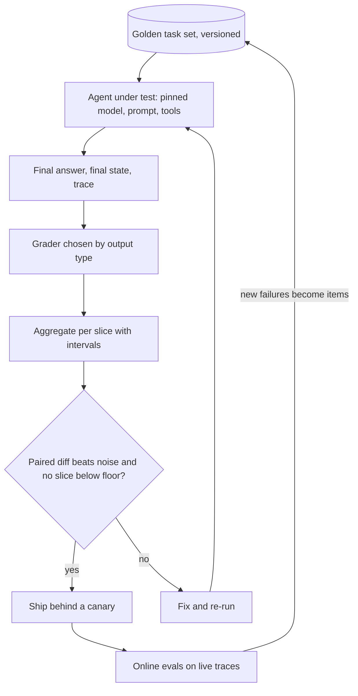

## TL;DR
Evaluation gives you a trustworthy number for whether your agent (model, prompt, tools, retrieval and
loop together) does the job. Benchmarks shortlist models; your own task set and graders decide every
prompt, tool or model change.

## For agent builders
- **Why it matters for agents.** An agent multiplies uncertainty: a model choice, a system prompt, tool
  schemas, retrieval and a multi-step loop. One reworded tool description can change which tool gets
  picked on step 3. Without an eval, every such edit is a guess you ship to users.
- **Where it shows up in your stack.** Eval frameworks and tracing platforms (LangSmith, Braintrust,
  promptfoo, Inspect, OpenAI Evals) store datasets, run your agent over them and attach graders to
  traces; a CI job runs them on every pull request.
- **What you control.** The task set, what you grade (final answer, final state, the trajectory of tool
  calls), the grader for each, the slices you report, and the rule that turns scores into ship or block.
- **What you can skip.** Building yet another leaderboard or arguing about benchmark rankings. Know how
  to read a pass rate with its noise and run a paired comparison; that settles most agent decisions.

## Why it exists
- **LLMs break classical ML evaluation.** The old recipe was tidy: hold out a test set, compute one
  metric, compare. LLMs break three of its assumptions at once, and agents compound each one.
  - *Open-ended outputs:* there is rarely a single correct string to match, and an agent has many valid
    tool-call paths to the same result.
  - *Stochastic and prompt-sensitive:* the same input can score differently across runs and trivial
    rewordings; over ten steps small variations compound.
  - *Black box you did not train:* you cannot reason about what it learned from its data; you can only
    observe it.
- **The vibe check fails.** A handful of playground prompts has a sample size in the single digits, a
  selection bias toward inputs the author thought of, and no memory: nobody can say whether last week's
  version was better.
- **The leaderboard fails.** The highest public benchmark score measures general capability on tasks
  that are not yours, on data the model may have seen in training, and says nothing about your
  retrieval, prompt or tools.
- **Wait-for-production fails.** Reading thumbs-up rates after shipping is slow, confounded by traffic
  mix, and lets the regression reach users first; for an agent that acts, it may already have issued
  a wrong refund.
- **What evaluation buys.** A change becomes decidable before it ships: a repeatable measurement on a
  fixed set of inputs, graders checked against humans, and enough samples that the difference between
  two versions is larger than the noise.

## How it works
### Two questions, two kinds of evaluation
| | Capability (model) evaluation | Application (system) evaluation |
|---|---|---|
| Question | "What can this model do in general?" | "Does my prompt + retrieval + tools + model do my task on my data?" |
| Measures | Models against each other on standardized tasks (MMLU, HumanEval, SWE-bench, GPQA) | Your whole pipeline: system prompt, retrieved context, tool calls, output parsing and model together |
| Job | Model selection and progress tracking | Deciding whether a specific change (new prompt, new chunking, new tool, cheaper model) is safe |
| Needs | Public benchmark | A dataset you own and graders tied to your task |
| Weakness | Contamination, saturation, ignores everything you add around the model | Only covers what you put in the dataset |

Nearly all day-to-day eval work on an agent is application evaluation.

### The anatomy of an eval
Every evaluation, from a benchmark to a one-off regression check, has the same data flow:

```
dataset item  →  system under test  →  raw output  →  grader  →  score  →  aggregate over items (and slices)
```

Each box is a design decision with a reason behind it:
- **Dataset.** A fixed, versioned set of inputs with expected outputs or labels (the golden dataset).
  Fixed, *because* a number is only comparable to another number computed on the same items. For an
  agent an item is a task: user request, starting environment state, and what success looks like.
- **System under test.** Pinned model id, prompt hash, temperature, retrieval index version, tool
  schema version and step budget. Pinned, *because* otherwise a changed score cannot be attributed to
  the change you made.
- **Grader.** Chosen by output type, not by convenience (table below).
- **Aggregation.** Report per slice (intent, language, difficulty, customer), *because* a 95% average
  can hide a 40% slice that matters most.

| Output type | Grader |
|---|---|
| Classification (router, intent) | Accuracy, precision, recall, F1 |
| Extraction (tool arguments) | Field-level precision/recall against labels |
| Code | Unit tests pass or fail |
| Open text | A rubric applied by a calibrated LLM judge or a human |
| RAG | Retrieval recall/precision plus faithfulness of the answer to the retrieved context |
| Agent final state | Assert on the sandbox after the run (row written, ticket closed, file correct) |
| Agent trajectory | Required tools called, forbidden tools not called, step count within budget |

- **String overlap is a weak proxy.** BLEU and ROUGE are weak proxies for open-ended quality and should
  not be the headline.
- **Prefer outcome over path.** Grade the final state first; grade the trajectory only for properties
  that matter (safety, cost, a required confirmation step), because many paths are valid.

### Levels of evaluation
- **Component (unit) evals** test one stage: did retrieval return the right chunk, did the router pick
  the right route, did the tool-call extractor fill the right fields. They localize failures.
- **End-to-end evals** test the user-visible result; this is what stakeholders care about.
- **You need both.** An end-to-end failure with no component evals is undiagnosable. Green component
  evals with a red end-to-end eval tells you the integration (often the loop itself) is the problem.
- **Offline evals** run on the fixed dataset before a change ships; they are for decisions.
- **Online evals** (A/B tests, sampled judge scoring of live traffic and traces, user feedback) run
  after; they catch what the dataset did not cover and feed new items back into it.

### Reading the number
A pass rate is an estimate from a sample. For a proportion *p* on *n* items:

```
standard error = √(p(1−p)/n)        # p = 0.8, n = 100  →  0.04  →  95% interval ≈ ±8 points
```

- **Small gaps are noise.** Two prompts scoring 81% and 84% on 100 items are indistinguishable.
- **Compare on the same items and count flips.** A paired comparison has far less noise than two
  independent averages, *because* item difficulty is shared by both versions and cancels. Only items
  that changed verdict carry information about the difference.
- **Repeat items when temperature is above zero.** There are two sources of variance: which items you
  picked and which sample each item drew. The second does not shrink by adding items. Agents need this
  most, because one different early tool choice changes the whole run.
- **Grow the dataset where the decision is tight**, not everywhere.

### Quality is a vector, not a scalar
- **Axes:** task correctness, safety and policy compliance, format validity (does the downstream parser
  or tool accept it), latency and cost per request; for agents also steps and tool calls per task.
- **They do not average.** A 2-point quality gain that doubles p95 latency, or a cheaper model equal on
  average but failing a hard safety check, is a different decision from "the score went up".
- **Practice:** report each axis separately, decide in advance which are hard constraints and which are
  traded, and compute them in the same run so they describe the same outputs.

### The loop
Evaluation is not a phase; it is a loop:
1. Look at real failures (error analysis), usually by reading agent traces.
2. Turn each failure class into a criterion and a few dataset items.
3. Add the grader to the harness.
4. Gate releases on the result.
5. Monitor production and feed new failures back in.

- **Tuning spoils the estimate.** Any set you tune against stops being an unbiased estimate of quality
  (Goodhart's law applied to prompts). So the dataset keeps a held-out split read only when deciding to
  ship, and online signals remain the final check.
- The remaining lessons in this module are the pieces of that loop.

## Diagram
Follow one agent task through the eval, then the loop back: per-slice scores gate the release, and
production failures return to the dataset.



## Examples
### Worked scenario: swapping the embedding model in a RAG assistant
Numbers illustrative. The golden dataset has 300 questions stratified across six intents, each with a
reference answer and the ids of the document chunks that answer it.

| Level | Metric | Old | New |
|---|---|---|---|
| Component | Retrieval hit rate@5 | 0.84 | 0.90 |
| End-to-end | LLM-judge pass rate (judge previously checked against human labels) | 0.78 | 0.83 |

- **Hit rate@5** is the fraction of items with at least one correct chunk in the top five. It is often
  loosely called recall@5, which strictly is the fraction of all relevant chunks retrieved.
- **Is +5 points real? Unpaired, no.** The standard error at p ≈ 0.8, n = 300 is
  √(0.8 × 0.2 / 300) ≈ 0.023, so each number carries roughly ±4.5 points. An unpaired test on the
  difference (standard error ≈ 0.032, z ≈ 1.5) cannot call it.
- **Paired, probably yes.** It ignores unchanged items: 27 items flipped fail → pass and 12 flipped
  pass → fail. Net +15 of 300 is the +5 points; an exact sign (McNemar) test on 27 versus 12 gives
  p ≈ 0.02.
- **Slice view.** Of the 12 regressions, 9 are in the "billing" intent, where the new embeddings rank a
  policy FAQ above the customer's own invoice data.
- **Decision.** Not "ship" or "don't ship" but: fix billing retrieval, re-run, then ship behind a canary
  while sampling live answers through the same judge. That is a specific, attributable, slice-level
  reason rather than an overall feeling.

### Agent scenario: a cheaper model for a support agent with tools
Numbers illustrative. 200 tasks, each run 3 times in a sandbox with `lookup_order`, `issue_refund` and
`escalate` tools. Graders: final-state assertion, a forbidden-action check, steps and cost from traces.

| Axis | Current model | Cheaper model |
|---|---|---|
| Task success (final state correct), mean of 3 runs | 0.86 | 0.84 |
| Tasks passing all 3 runs | 0.79 | 0.70 |
| Refund issued without required lookup (hard constraint) | 0 | 4 tasks |
| Mean steps per task | 5.1 | 6.8 |
| Cost per task | $0.042 | $0.019 |

- **The mean hides the story.** Success is within noise, but all-3-runs reliability fell 9 points and
  the cheaper model breaks a hard constraint on 4 tasks.
- **The saving is smaller than the price sheet says.** About 33% more steps per task eat part of the
  per-token saving, which only the trace-level step count reveals.
- **Decision.** Block on the hard constraint; fix the prompt or add a code-level guard that refuses
  `issue_refund` before `lookup_order`, then re-run the same 200 tasks.

### Paired comparison in pure Python
Runnable with the standard library; reproduces the numbers of the RAG scenario from per-item verdicts.
The same function works on per-task agent verdicts.

```python
from math import comb, sqrt

def paired_report(old, new):
    """old, new: dicts item_id -> bool (pass), graded on the SAME items."""
    ids = old.keys() & new.keys()
    gained = sum(1 for i in ids if not old[i] and new[i])   # fail -> pass
    lost = sum(1 for i in ids if old[i] and not new[i])     # pass -> fail
    n, k = gained + lost, min(gained, lost)
    p_exact = min(1.0, 2 * sum(comb(n, j) for j in range(k + 1)) / 2**n)  # two-sided sign test
    p_new = sum(new[i] for i in ids) / len(ids)
    se = sqrt(p_new * (1 - p_new) / len(ids))
    return dict(n=len(ids), gained=gained, lost=lost, p_value=round(p_exact, 3),
                new_rate=round(p_new, 3), ci95=round(1.96 * se, 3))

# Rebuild the scenario: 300 items, 234 pass before (0.78), 27 gained, 12 lost -> 249 pass (0.83)
old = {i: i < 234 for i in range(300)}
new = dict(old)
for i in range(234, 261): new[i] = True      # 27 fail -> pass
for i in range(0, 12):    new[i] = False     # 12 pass -> fail
print(paired_report(old, new))
# {'n': 300, 'gained': 27, 'lost': 12, 'p_value': 0.024, 'new_rate': 0.83, 'ci95': 0.043}
```

## Production patterns
- **Eval gate in CI.** Run the harness on every pull request that touches a prompt, model id, retrieval
  setting or tool definition, and block merge when a hard-constraint axis fails. Monitor run cost and
  flaky items that flip with no change.
- **Paired diff report on every change.** Post the gained/lost item lists and the sign-test p-value as
  the PR comment instead of two averages, so reviewers see which tasks moved and can open their traces.
  Monitor the share of changes merged with p above your threshold.
- **Per-slice floors.** Declare a minimum pass rate per intent, language, tool or customer next to the
  overall target, and fail the run when any slice drops below it. Monitor the weakest slice, not the
  mean.
- **Held-out split read only at ship time.** Keep a split that prompt iteration never touches and log
  every read of it. Monitor the gap between dev and held-out scores; a growing gap means overfitting.
- **Every production bug becomes a dataset item.** Triage tickets, sampled low-scoring live traces and
  failed tool calls into labeled tasks with a source tag. Monitor how many new items arrive per week and
  which failure classes they cover.
- **Sandboxed final-state grading.** Run agent tasks against a seeded copy of the tools' backends and
  assert on the state afterwards, so side effects are graded without touching production. Monitor tasks
  whose sandbox setup fails, since those silently drop out of the score.

## Trade-offs
- **Deterministic graders vs judges and humans.** Deterministic graders are cheap, fast and exact, but
  only apply when the output has a checkable form. Once the task is open-ended you pay for judges or
  humans and inherit their noise.
- **Dataset size vs cost.** A larger golden dataset tightens confidence intervals, but every item costs
  labeling time and every run costs tokens; an agent task can cost many calls. The right size is the
  smallest one at which your typical decisions are clear.
- **Public benchmarks vs relevance.** They give comparability across models for free, but stop being
  informative once contamination or saturation sets in, and never measured your task in the first place.
- **Offline vs online.** Offline evals are reproducible and fast but only cover what you thought to
  include. Online evaluation catches the rest at the price of exposing real users and slower, confounded
  signals.
- **Outcome grading vs trajectory grading.** Outcome checks accept any valid path but miss a lucky
  success via a forbidden step; trajectory checks catch it but fail valid new paths. Grade outcome by
  default and add path assertions only for safety and cost.

## Pitfalls
- **Confusing capability with application evaluation.** Symptom: a "state of the art" model from the
  leaderboard underperforms the cheaper one on your own extraction job. Cause: the task eval was skipped.
  Diagnose: run both models on your golden set and diff per item. Fix: shortlist by benchmark, decide on
  your eval.
- **Reporting a single aggregate.** Symptom: a stable overall score while one customer segment or intent
  quietly degrades. Diagnose: group pass-to-fail flips by slice. Fix: per-slice reporting and floors.
- **Treating a 3-point move on 100 items as a result.** Symptom: prompt changes that "improved things"
  regress on the next run with no change at all. Cause: the gap is inside sampling noise. Diagnose:
  re-run the unchanged baseline and count items that flip on their own. Fix: paired comparison, more items.
- **String-overlap metrics as the headline for open text.** Symptom: correct answers scored as failures
  because they are phrased differently from the reference. Diagnose: read the failures with the highest
  judge or human score. Fix: rubric grading.
- **Trusting an uncalibrated LLM judge.** Symptom: a high eval score alongside user complaints the judge
  is blind to. Diagnose: label 50-100 items by hand and measure agreement. Fix: calibrate first.
- **Iterating against the release set.** Symptom: a dev-set score that keeps climbing while the held-out
  split and production metrics stay flat. Diagnose: log reads of the held-out split. Fix: read it only
  at ship time.
- **One run per agent task.** Symptom: the same task passes on Monday and fails on Tuesday with no code
  change. Fix: run each task several times and report both mean success and all-runs-pass reliability.

## When to use
- **Default, not exception:** any change to a prompt, model, retrieval setting or tool definition that
  reaches users is measured against a fixed dataset first.
- **Benchmarks only to shortlist:** use capability benchmarks to shortlist models, then decide on your
  own eval.
- **Measure at the decision's level:** a retrieval change needs retrieval metrics; a prompt change needs
  end-to-end pass rates per slice; a tool-schema change needs tool-selection and argument accuracy.
- **Day to day:** a harness run in CI, a dashboard of per-slice pass rates with intervals, and a rule that
  every production bug becomes a dataset item.

## Exercise
**Goal:** decide, with evidence, whether a cheaper model can replace the current one in an agent you
have (or a two-tool toy agent). No solution is given.
- **Inputs:** at least 40 tasks with a checkable final state or answer, tagged by slice; two model ids;
  a budget of 3 runs per task.
- **Deliver:** a table per axis (success, all-runs-pass, hard-constraint violations, steps, cost per
  task), the paired gained/lost counts with a sign-test p-value, the weakest slice, and a one-line verdict.
- **Acceptance:** the report shows the baseline-versus-itself flip count next to the comparison's
  flips; every pass-to-fail item links to its trace; the verdict names which axis decided it.

## Role lens
- **Engineer:** Builds the dataset and harness, picks graders by output type, and refuses to merge a
  prompt change without a paired comparison on the same items.
- **Architect:** Decides which metrics are release gates, what per-slice floors exist, and how offline
  evaluation connects to online monitoring across the platform.
- **FDE:** Translates the customer's definition of "works" into labeled examples and graders, and uses
  slice-level results to explain a regression to a skeptical stakeholder.

## Check yourself
**Q:** A product manager shows you that model B scores six points higher than model A on a well-known
benchmark and asks you to switch the production summarizer to B. How do you respond, and what would
you do before deciding?
**A:** The benchmark measures general capability on its own tasks, probably under a different prompt
format, and B may have seen it in training, so the six points say little about summarization of our
documents through our prompt. I would run both models through our harness on the golden dataset,
grading summaries with the rubric judge we calibrated against human labels, and compare per slice
with a paired analysis: which items flipped and in which direction. I would also record latency and
cost per summary, since a quality gain that doubles cost is a different decision. If the paired
comparison shows a gain larger than the noise with no slice regressing, we switch behind a canary;
if not, the benchmark number is irrelevant.

## Interview questions
### What is the difference between capability evaluation and application evaluation, and why does it matter?
- **Capability evaluation** compares models on standardized tasks such as MMLU or SWE-bench; it answers
  "what can this model do in general" and is useful for shortlisting.
- **Application evaluation** runs your whole pipeline (prompt, retrieval, tools, parsing) on a dataset
  you own, because that is the only thing that predicts whether your change works on your task.
- **Why it matters:** a leaderboard gain can be contamination, a different prompt format or an
  irrelevant task, so model choice is shortlisted by benchmark and decided by your own eval.

### How would you evaluate a tool-calling agent that can take many valid paths to the same result?
- **Grade the outcome first:** seed a sandbox per task and assert on the final state or final answer,
  so any valid sequence of tool calls passes.
- **Add path assertions only where they matter:** forbidden tools, a required confirmation or lookup
  before a write, and a step or cost budget, read from the trace.
- **Run each task several times:** report mean success and the share of tasks that pass every run,
  because agent reliability, not average luck, is what users feel.

### Your agent's end-to-end pass rate dropped 6 points after a release. How do you find the cause?
- **Confirm it is real:** check the run used the same dataset version and pinned config, and do a
  paired comparison against the baseline to list which items flipped.
- **Slice the losses:** group the pass-to-fail items by intent, language, customer and tool; a cluster
  in one slice usually points at one change.
- **Use component evals and traces to localize:** if retrieval hit rate fell, the index or embedding
  changed; if tool selection fell, look at tool descriptions; if both are green, look at the prompt,
  model or output parsing.

### Prompt v2 scores 3 points higher on 300 items. How would you decide whether to ship it?
- **Do not compare two averages.** At p ≈ 0.8 and n = 300 each score carries roughly ±4.5 points, so
  an unpaired 3-point gap cannot be called.
- **Count flips on the same items** and run an exact sign (McNemar) test on gained versus lost; only
  discordant items carry information.
- **Check the other axes and slices:** latency, cost, format validity and per-slice floors in the same
  run, then ship behind a canary if all hold.

### When would you not rely on an LLM judge as your main grader?
- **When the output is checkable:** classification, extraction, tool arguments, final sandbox state and
  code have exact graders (F1, field-level precision and recall, assertions, unit tests) that are
  cheaper, faster and exact.
- **When the judge is uncalibrated:** without measured agreement against human labels, a judge score is
  another vibe check and can be blind to the failures users complain about.
- **Trade-off:** judges unlock open-ended tasks at the price of cost and noise, so use them only where a
  deterministic grader cannot express the criterion.

## Quiz
### Q: A team wants to evaluate a free-text customer-support reply. Which grading approach is most defensible as the headline metric?
- [ ] ROUGE-L against a single reference reply
- [ ] Cosine similarity between the reply and the reference embedding
- [x] A rubric applied by an LLM judge whose verdicts were checked against human labels
- [ ] Exact match on the first sentence of the reply
> Open-ended replies have many correct phrasings, so overlap and similarity metrics reward wording
> rather than correctness. A rubric judge can assess the content, but only once its agreement with
> humans has been measured; an unchecked judge is just a different vibe check.

### Q: Prompt v2 scores 84% and prompt v1 scores 81% on the same 100-item golden set. What is the right conclusion?
- [ ] v2 is better and should ship
- [x] The difference is within sampling noise; compare which items flipped and consider a larger set
- [ ] v1 is better because shorter prompts generalize more
- [ ] The dataset is too easy and should be replaced
> At n = 100 and p ≈ 0.8 the standard error is about 4 points, so a 3-point gap is not evidence. A
> paired look at flipped items, and more items where the decision is tight, is how to resolve it.

### Q: Why keep component-level evals (for example retrieval recall) alongside end-to-end evals?
- [ ] Component evals are cheaper, so end-to-end evals can be skipped once they pass
- [ ] End-to-end evals cannot be automated
- [x] Component evals localize the cause when the end-to-end score drops
- [ ] Stakeholders prefer component metrics in reports
> An end-to-end failure alone does not say whether retrieval, the prompt or the model is at fault.
> Component evals attribute the drop; they do not replace the end-to-end check, which is what users
> experience.

## Mastery test
**Problem:** a coding agent's new system prompt raises the end-to-end pass rate from 70% to 76% on 150
tasks, one run each at temperature 0.7. Retrieval hit rate is unchanged, mean steps rose from 9 to 12,
and the gain is concentrated in Python tasks. The team wants to ship today. What do you do?

**A strong answer:**
- notes one run per task at temperature 0.7 mixes item and sampling noise, so it re-runs each task
  several times and compares paired flips, not two averages (SE about 3.6 points each at n = 150);
- checks the non-Python slices for regressions against a floor;
- treats 33% more steps as a cost and latency axis to decide, not a footnote;
- ships behind a canary only if the paired gain holds and no hard constraint or slice fails.

## Use cases & projects
### Use cases
- **Swapping the model behind an agent.** A paired run of old and new model on the same task set shows
  whether the cheaper model holds the pass rate, slice by slice, before any traffic moves.
- **Editing a tool description or system prompt.** Small wording changes shift which tool gets picked;
  an eval run on every pull request catches the regression before users do.
- **Debugging a RAG agent that got worse.** Component evals on retrieval and on the answer step say
  whether the drop came from search, the prompt or the model.
- **Release sign-off for an agent that takes actions.** A pass rate with its noise band and per-slice
  results turns "it seems fine" into a ship or block decision stakeholders can audit.

### Mini project
**Run a paired eval on a small tool-calling agent (2-3 hours).**
- **Goal:** decide, with evidence, whether a prompt change to a two-tool agent is an improvement or noise.
- **Steps:** build a tiny agent with two fake tools (for example order lookup and refund); write 30 tasks
  with an expected final state each; grade final state with code; run the baseline and the changed prompt
  over the same tasks several times; compute per-task pass rates and the paired difference.
- **Done when:** you have a table of per-task results for both versions, the overall difference with a
  rough interval, and a one-paragraph verdict on whether the change should ship.
