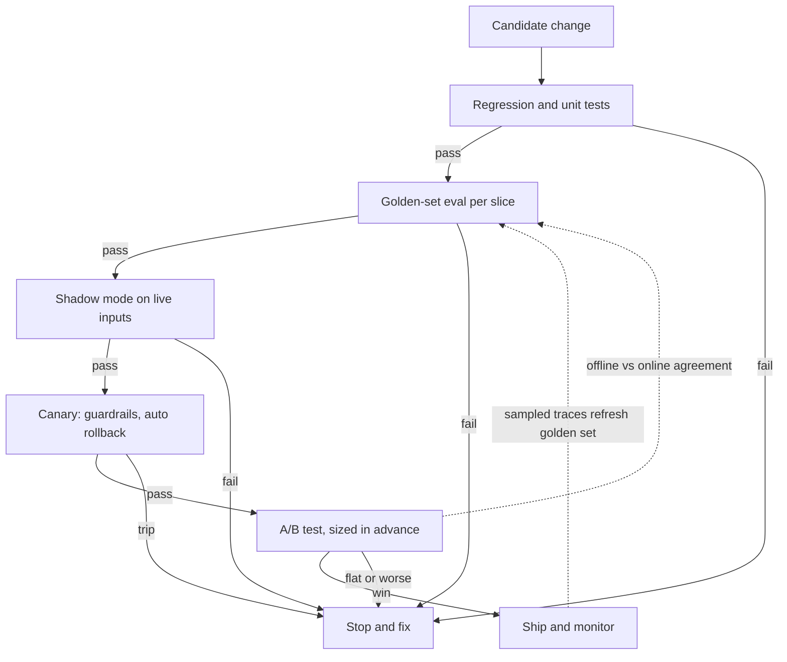

## TL;DR
Offline evaluation replays a fixed task set against your agent before users see a change; online
evaluation measures live traffic. Offline is fast and safe but proxy-bound; online is outcome truth but
slow and noisy. Offline gates, online validates, traces refill it.

## For agent builders
- **Why it matters for agents.** Agent quality is an outcome (ticket resolved, order placed, PR merged)
  reached over many steps and turns, and offline replay with stubbed tools never fully matches
  production's latencies, index freshness and user follow-ups. You need both rungs and a measured link
  between them.
- **Where it shows up in your stack.** Offline experiments over datasets in LangSmith, Braintrust or
  your own harness; online, trace logging with sampled judging, task-completion events keyed by
  conversation ID, shadow runs, canary rollouts and feature-flagged A/B splits.
- **What you control.** Which rungs a change must climb, the primary outcome event, how side-effecting
  tools behave in shadow (dry-run, never real), the trace sample that refreshes the golden set, and the
  launch log that tracks offline-online agreement.
- **What you can skip.** Building a full experimentation platform up front. A launch log, a trace
  sampler and one outcome event get most of the value.

## Why it exists
Offline scores and real outcomes drift apart for four structural reasons:
- **The golden set ages.** It is last quarter's traffic, and the intent mix shifts every week.
- **The grader is a proxy.** "The judge says the answer is correct" is not "the customer's ticket was
  resolved without a human".
- **Users adapt.** They rephrase, retry, give up, or learn which questions the system answers well, so
  inputs change in response to outputs.
- **Production has unmodelled effects.** Tool latencies, an index refreshed hours later than the eval
  copy, conversations that run eight turns instead of one. An offline-only team ships a version that
  scores higher, performs worse, and cannot see why.

"Ship it and watch the dashboard" fails just as reliably:
- **No counterfactual.** Did satisfaction move because of the prompt, the holiday, the marketing
  campaign, or the provider's silent model update?
- **Sparse, noisy outcomes.** Detecting a real change takes weeks of traffic.
- **Failures reach users first**, and a regression cannot be bisected across the ten changes shipped
  that fortnight.

The resolution is a ladder, each rung more expensive and more truthful than the one below, with defined
hand-offs: offline catches what is cheap to catch, online confirms what only users can, and the two are
reconciled whenever they disagree.

## How it works
### What each one measures
| | Offline | Online |
|---|---|---|
| Inputs | Fixed golden set with slices | Whatever arrives |
| Graders | Code checks, reference comparisons, judges | Implicit behaviour, explicit ratings, sampled-trace judging, controlled experiments |
| Output | Per-slice scores, comparable across versions, reproducible on demand | Outcome signals on the real distribution |
| Measures | Capability under the dataset's distribution | What users actually experience |

Online signal types:
- **Implicit behaviour:** thumbs, regenerate, copy, abandonment, escalation to a human, a
  task-completion event (an order placed, a PR merged), return visits.
- **Explicit ratings.**
- **Sampled-trace judging:** a judge or rubric scores a stratified sample of production traces
  continuously.
- **Controlled experiments:** traffic randomised between variants for a causal estimate. Only this one
  answers "did the change cause the difference".

### The ladder
1. **Regression and unit tests** (offline, every change): catch breakage in minutes.
2. **Golden-set evaluation** (offline, before release): capability per slice, with confidence intervals.
3. **Shadow mode** (online inputs, no user exposure): the candidate runs alongside production on live
   traffic; outputs are logged, never shown, and graded against production's by judge or pairwise
   comparison.
   - *Gives* the real input distribution without user risk, *because* nobody sees the candidate.
   - *Cannot* measure, for the same reason: user reaction, latency under real load, or multi-turn effects
     where the user's next message depends on the candidate's reply.
   - *Agents need dry-run tools:* a shadow agent must never really refund, email or write. Route its
     side-effecting tools to recorders that return a plausible stub, and let read-only tools hit
     production. Compare the intended writes, not only the text.
4. **Canary** (a small percentage of users): guardrail metrics (error rate, latency, cost, refusal rate,
   safety flags) with automatic rollback. It catches catastrophes, not quality: a few percent watched for
   hours or a day collects far too few conversations to detect a modest quality change.
5. **A/B test** (randomised, sized in advance for the primary metric): the causal answer about outcomes.
6. **Monitoring** (ongoing): drift alerts on input mix, sampled judging, outcome dashboards.

Promote only after the rung below passes, because a cheaper rung that fails stops you earlier and tells
you more precisely what broke.

### Closing the loop
- **Online feeds offline.** Sample production traces stratified by intent, including ones users flagged
  or judges scored low, label them, and add them to the golden set, so the next offline run measures
  this quarter's distribution.
- **Validate the proxy.** Periodically score the same traces with the offline judge and the online
  outcome and compare. When offline says better and the A/B says flat or worse, the offline metric is
  wrong: fix the grader, do not argue with the users.

### Track offline-online agreement as a number
Keep a launch log, one row per change that went through an online test: offline delta, online delta
with its interval, decision. Two readings matter:
- **Directional agreement:** of changes with a conclusive online result, how often did offline point the
  same way?
- **Rank agreement:** does a bigger offline gain predict a bigger online gain?

| Agreement | Verdict |
|---|---|
| Direction yes, magnitude no | Still a usable gate |
| No better than a coin flip | Stop gating releases on it until repaired |

- **Expect decay** even with nobody changing the grader, because teams optimise against whatever the
  offline metric rewards (Goodhart's law). That is a second reason to re-validate on every A/B test.

### Signal quality online
- **Implicit signals are biased.** Thumbs come from users at the extremes; "regenerate" may mean a bad
  answer or a curious user; a longer session may mean engagement or struggle.
- **Define one primary outcome per product** (resolution without escalation, task completed, code
  merged) and treat the rest as guardrails or diagnostics.

### The latency of truth
| Signal | Arrives in | Drives |
|---|---|---|
| Offline | Minutes | Prompt iteration |
| Shadow | Hours or days | Model swaps (which then also earn an A/B), large prompt changes |
| A/B | Days or weeks | Model swaps, expensive or strategic changes |

No team should wait two weeks to learn that a prompt broke JSON output.

## Diagram
Each rung is more expensive and more truthful than the one below; a failure stops promotion, and
production traces flow back to refresh the golden set and re-validate the offline metric.



## Examples
### Agent scenario: shadow-running a candidate agent with dry-run write tools
The candidate sees the same live request as production. Read tools are shared; write tools are swapped
for recorders, so the comparison covers intended actions without any real side effect.

```python
import asyncio, json, logging

log = logging.getLogger("shadow")
WRITE_TOOLS = {"issue_refund", "send_email", "update_address"}     # side effects: never real in shadow

def dry_run_tools(tools: dict, recorded: list) -> dict:
    def recorder(name):
        def fake(**args):
            recorded.append({"tool": name, "args": args})
            return {"status": "ok", "dry_run": True}            # plausible stub so the loop continues
        return fake
    return {n: (recorder(n) if n in WRITE_TOOLS else fn) for n, fn in tools.items()}

async def shadow(request_id: str, msg: str, candidate, tools: dict, prod_actions: list):
    intended = []
    try:
        out = await asyncio.wait_for(candidate(msg, dry_run_tools(tools, intended)), timeout=60)
        log.info(json.dumps({"request_id": request_id, "text": out["text"],
                             "intended_writes": intended, "prod_writes": prod_actions}))
    except Exception as e:                                       # shadow must never affect the user
        log.warning(json.dumps({"request_id": request_id, "error": repr(e)}))

# In the handler, after production has answered:
#   asyncio.create_task(shadow(req_id, msg, candidate_agent, TOOLS, prod_trace_writes))
# A pairwise judge compares texts later; intended_writes vs prod_writes is compared exactly.
```

- **Read the action diff first:** a candidate that intends a refund where production did not is a
  policy question no text judge will surface.

### Worked scenario: offline win, online flat
Illustrative numbers for a support agent, chosen to show the failure mode rather than to report any
real system.

| Rung | v1 | v2 | Reading |
|---|---|---|---|
| Offline judge helpfulness (600-item golden set) | 78% | 86% | Looks like a big win |
| Offline faithfulness | 94% | 94% | Unchanged |
| Shadow, 5,000 live tickets, pairwise judge | | prefers v2 on 58% | Same judge, same bias |
| Canary at 5% of traffic | | no guardrail tripped | p95 latency up 40%; replies about 60% longer |
| Canary escalation to a human | 14.0% | 15.5% | Inside the noise at a few hundred conversations |
| A/B, two weeks, roughly 40,000 conversations split evenly | 60.2% resolution | 61.0% | Confidence interval includes zero; satisfaction flat |
| Cost per conversation | | up 35% | Paid for length |

- **Decision:** do not ship v2 as it stands.
- **Diagnosis, the more important output:** the offline judge rewarded length and thoroughness, which
  users did not value, and the golden set had no cost or length criterion.
- **Fix the measurement:** add a length penalty and a resolution-shaped rubric, then re-validate the judge
  against the A/B traces before the next iteration. Shipping on the 86% would have paid 35% more for
  nothing.

### Launch-log agreement and A/B sizing
Pure Python, runnable. It scores how well the offline metric predicted online results and sizes an A/B
test for a two-proportion outcome.

```python
from math import ceil

def n_per_arm(p: float, delta: float, z_alpha: float = 1.96, z_power: float = 0.8416) -> int:
    q = p + delta                                  # two-proportion test, two-sided alpha 0.05, 80% power
    return ceil((z_alpha + z_power) ** 2 * (p * (1 - p) + q * (1 - q)) / delta ** 2)

def ranks(xs):
    order = sorted(range(len(xs)), key=lambda i: xs[i])
    r = [0] * len(xs)
    for rank, i in enumerate(order):
        r[i] = rank
    return r

def spearman(xs, ys):                              # no-ties version, enough for a launch log
    rx, ry, n = ranks(xs), ranks(ys), len(xs)
    d2 = sum((a - b) ** 2 for a, b in zip(rx, ry))
    return 1 - 6 * d2 / (n * (n * n - 1))

# launch log: (offline delta in points, online delta in points, online CI excludes zero?)
LOG = [(+8.0, +0.8, False), (+3.0, +1.9, True), (+5.0, +2.6, True), (+1.0, -1.2, True),
       (+2.0, +0.4, False), (+6.0, +3.1, True), (+4.0, -0.5, False)]

conclusive = [(off, on) for off, on, sig in LOG if sig]
direction = sum((off > 0) == (on > 0) for off, on in conclusive) / len(conclusive)
print(f"directional agreement on {len(conclusive)} conclusive launches: {direction:.0%}")   # 75%
print(f"rank agreement (Spearman): {spearman(*zip(*conclusive)):.2f}")                      # 1.00
print(n_per_arm(0.60, 0.03), n_per_arm(0.60, 0.01))   # 4126 37511: ~4,000 and ~37,000 per arm
```

- **Reading the log:** only 4 of 7 launches were conclusive online, which is itself a finding about
  traffic. Of those, the offline metric got direction right 3 times in 4 and ranked them perfectly: a
  usable gate, with the +1-point offline gain that lost online worth investigating.

## Production patterns
- **Shadow traffic mirroring.** Duplicate live requests to the candidate asynchronously, never return its
  output, and log both responses under the same request ID for a pairwise judge. For agents, swap write
  tools for dry-run recorders and log intended actions. Monitor shadow preference, action disagreement,
  candidate latency and cost per request.
- **Canary with automatic rollback.** Route a few percent of traffic to the new version and roll back
  automatically when error rate, p95 latency, cost per conversation or refusal rate crosses a threshold.
  Monitor these in short windows; do not read quality from the canary.
- **Weekly stratified trace sampling.** Pull production traces by intent, oversampling flagged and
  low-scored ones, label them, and add them to the golden set with a version bump. Monitor the distance
  between the golden set's intent mix and production's.
- **Launch log with agreement metrics.** One row per online-tested change with both deltas and the
  decision, as in the example. Monitor directional agreement; stop gating on a metric that falls to
  coin-flip level.
- **Sampled online judging off the request path.** Judge a fixed sample of live traces asynchronously,
  with the same pinned judge version as offline, so the two are comparable. Monitor judge score against
  the primary outcome on the same conversations.
- **One instrumented primary outcome.** Emit an explicit event (escalated, resolved, order placed) keyed
  by conversation ID so outcomes join to traces. Monitor event coverage, since missing events silently
  bias the metric.

## Trade-offs
- **Reproducible offline vs frozen distribution.** Cheap enough for every commit, but a frozen
  distribution with proxy graders; the gap grows with every week the golden set is not refreshed.
- **Shadow safety vs blindness to users.** Real inputs with no user risk, but no user reaction or
  multi-turn effects, which matters more the more conversational the product.
- **A/B causality vs traffic.** Causal answers need traffic, time and tolerance for exposing users to a
  worse variant. A 3-point change in a 60% resolution rate needs roughly 4,000 conversations per arm
  (80% power, α = 0.05), a 1-point change roughly 37,000, so low-traffic products rarely get a
  conclusive answer.
- **Sampled online judging vs judge bias.** Continuous and cheap, but it inherits every judge bias and
  must be re-validated against outcomes, or it becomes a second offline metric with a live data feed.
- **Canary speed vs sensitivity.** Catches catastrophes fast but nothing subtle, so canary-only teams
  ship slow quality regressions invisibly.

## Pitfalls
- **Shipping on an offline gain without online confirmation.** Symptom: higher dashboard scores and
  higher cost or escalation in the field, as in the example. Fix: climb the ladder.
- **A shadow agent with live write tools.** Symptom: customers receive two emails or a duplicate refund
  the week shadow mode starts. Fix: dry-run every side-effecting tool in shadow and test that wrapper.
- **Reading shadow preference as user preference.** Symptom: a candidate that "wins" shadow and loses the
  A/B because its replies are slower or longer. Fix: treat shadow as a distribution check.
- **Implicit signals as the primary metric.** Symptom: optimising thumbs-up from the vocal few while the
  silent majority escalates. Fix: one primary outcome per product.
- **Never feeding traces back into the golden set.** Symptom: a steady high offline score while
  production's intent mix has moved on. Fix: scheduled stratified sampling.
- **Treating offline validity as settled once.** Symptom: launches that each win offline by a few points
  while the online outcome stays flat quarter after quarter. Fix: the launch log.
- **Week-over-week comparisons as experiments.** Symptom: a "regression" that was a holiday, a campaign
  or a provider update. Fix: randomise.

## When to use
- **Offline:** every iteration decision: prompt edits, retriever settings, parser changes, regression
  gates.
- **Shadow mode:** the candidate is a different model or a large prompt change and you need the real
  distribution before exposure.
- **Canary:** every production rollout, for guardrails only.
- **A/B test:** the change is expensive or strategic enough to need a causal answer on outcomes, and the
  traffic exists to get one.
- **Measure:** offline-online agreement over time; that number is the health of the whole evaluation stack.
- **Interviews:** describe the ladder, say what shadow mode cannot measure, and explain what you do when
  offline and online disagree.

## Role lens
- **Engineer:** Builds the shadow pipeline and the trace sampler, keeps the golden set refreshed from
  production, and wires judge scores and outcome events into the same dashboard.
- **Architect:** Defines the ladder for the organisation: which changes need which rungs, the guardrail
  metrics for canaries, and the primary outcome metric each product is evaluated against.
- **FDE:** Sets up shadow mode inside the customer's environment before cutover, because the customer's
  live traffic is the only distribution that matters and it cannot leave their network for a lab eval.

## Check yourself
**Q:** Your offline judge says a new prompt is 8 points better, shadow mode agrees, and a two-week A/B
test shows no change in resolution rate with 35% higher cost. What happened, and what do you do next?
**A:** The offline metric and the shadow judge were measuring something users do not value, most
likely length or thoroughness, since both rely on the same judge and the cost rose with output size.
The A/B test is the causal signal, so the change does not ship. The actionable step is to repair the
measurement: pull the A/B traces, compare judge scores with resolution outcomes on the same
conversations, find what the judge rewards that outcomes do not, and add that to the rubric as a
penalty or a constraint. Then add cost and length as offline criteria and guardrails, refresh the
golden set from the A/B traffic, and re-run the candidate offline. If the repaired offline metric now
calls the candidate flat, the evaluation stack is consistent again and the next iteration can trust it.

## Interview questions
### What is the difference between offline and online evaluation, and why do you need both?
- **Offline:** fixed dataset and graders, minutes per run, reproducible and safe, but a proxy on last
  quarter's distribution.
- **Online:** live traffic and real outcomes, the truth, but slow, noisy and confounded without
  randomisation.
- **Together:** offline gates what ships, online checks offline measured the right thing, and production
  traces refresh the offline set.

### How would you shadow-test a new version of an agent that can issue refunds and send emails?
- **Dry-run the write tools:** replace side-effecting tools with recorders that return a stub, keep
  read-only tools live, and run the candidate asynchronously off the request path.
- **Compare actions, then text:** diff intended writes against production's actual writes per request ID,
  then run a pairwise judge on the replies.
- **Know the limit:** a stubbed result can differ from what the real tool returns, so later steps may
  diverge; the canary and A/B rungs cover that.

### What can shadow mode not tell you?
- **User reaction:** nobody sees the candidate, so there are no thumbs, escalations or retries.
- **Multi-turn effects:** the user's next message responds to production's reply, not the candidate's.
- **Latency under real load** and anything else that depends on serving the candidate for real.

### Why is a canary not a quality test?
- **Too little data:** a few percent of traffic for hours or a day is a few hundred conversations; a
  1.5-point escalation move sits inside the noise.
- **Its job is catastrophes:** error rate, latency, cost, refusals and safety flags with automatic
  rollback.
- **Quality needs an A/B test** sized in advance for the primary metric.

### Your support agent gets 2,000 conversations a week. How do you evaluate a prompt change?
- **A/B is mostly out of reach:** a 3-point change on a 60% rate needs roughly 4,000 per arm, about a
  month of all traffic.
- **Lean on the lower rungs:** offline golden set with intervals, shadow mode on live inputs, a canary
  for guardrails.
- **Strengthen the proxy:** validate the offline judge against outcomes on past traces so offline gains
  can be trusted.

### How do you know your offline metric is still trustworthy?
- **Keep a launch log** of offline and online deltas per change.
- **Track directional and rank agreement**; a metric no better than a coin flip stops gating.
- **Re-validate after every A/B,** because Goodhart's law erodes agreement as teams optimise against the
  metric.

## Quiz
### Q: What does shadow mode give you that a golden-set eval does not, and what can it still not measure?
- [ ] Causal estimates of outcome changes; it cannot measure latency
- [x] The live input distribution without user risk; it cannot measure user reaction or multi-turn effects
- [ ] User satisfaction ratings; it cannot measure cost
- [ ] Reproducible scores; it cannot run judges
> Shadow mode runs the candidate on real traffic but never shows its output, so inputs are realistic
> and users are safe. Because nobody sees the candidate, there is no behavioural signal and no user
> follow-up turn conditioned on its reply.

### Q: Offline scores rise after a change, but an A/B test sized in advance for that effect shows no outcome improvement. What is the right response?
- [ ] Ship the change, since offline evals are more precise than noisy online metrics
- [ ] Extend the A/B test until it confirms the offline result
- [x] Treat the offline metric as broken, diagnose what it rewards that users do not, and fix the grader
- [ ] Replace the A/B test with a larger golden set
> The experiment is the causal measurement of outcomes; a proxy that disagrees with it is measuring the
> wrong thing. Extending the test to chase a result is p-hacking, and shipping on the proxy pays for
> nothing.

### Q: Why keep offline evaluation at all once online evaluation is in place?
- [ ] Online evaluation cannot use LLM judges
- [ ] Offline evaluation is required for regulatory audits
- [x] Offline runs are fast, cheap, reproducible and safe, so they catch most breakage before any user sees it
- [ ] Online metrics cannot be computed per slice
> Online truth arrives in days or weeks and exposes users to failures. Offline checks run in minutes on
> every change, stop regressions early and point at what broke; online evaluation then confirms what only
> users can confirm.

## Use cases & projects
### Use cases
- **Shipping a new planner prompt.** It must pass the offline task set, then a shadow or canary rung,
  before a full rollout is judged on task completion.
- **Running shadow traffic safely.** A candidate agent replays live requests with side-effecting tools
  in dry-run mode, so real-world behaviour is observed without real actions.
- **Refreshing the golden set from traces.** Sampled production conversations, especially failures,
  are added offline so the eval tracks this month's intent mix.
- **Checking whether offline scores predict outcomes.** A launch log of offline deltas against online
  results shows whether the offline gate can be trusted.

### Mini project
**Wire an offline-to-online loop for a support agent (2-3 hours).**
- **Goal:** connect an offline eval score to a live outcome signal and see whether they agree.
- **Steps:** run a 30-task offline eval of two agent versions; log every live (or simulated-live)
  conversation with version, conversation ID and a resolution event; sample 20 traces per version and
  judge them; add the 5 worst traces to the offline set; record offline delta and online delta in a
  launch log.
- **Done when:** a single report shows offline score, sampled online judge score and resolution rate per
  version, and the offline set has grown from production traces.
