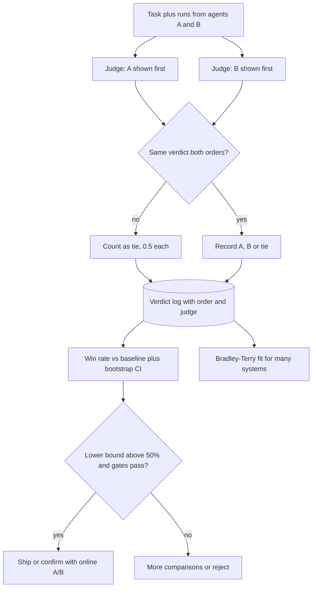

## TL;DR
Pairwise comparison asks "which of these two agent runs is better?" instead of "rate this 1–10". With
no shared scale, verdicts are more consistent; they become a win rate against your production agent, a
Bradley–Terry ranking, or preference data.

## For agent builders
- **Why it matters for agents.** Choosing between two agent prompts, models or tool sets is a "B or
  A?" decision. Pairwise judging of replies and trajectories answers it directly, while absolute
  scores of each version drift and compress.
- **Where it shows up in your stack.** Side-by-side experiment views and pairwise evaluators in eval
  tools such as LangSmith or Braintrust, SME review sessions comparing two agent versions, and
  (prompt, chosen, rejected) data for DPO or reward models on agent traces.
- **What you control.** The baseline (your production agent), what the judge sees (final reply or the
  whole trajectory), both-order judging, tie handling, and the rule that outcome checks and gates run
  before any preference counts.
- **What you can skip.** Elo and leaderboard machinery unless you rank many variants; for one candidate
  against production, a win rate with a bootstrap interval is the whole method.

## Why it exists
- **Absolute scores drift.** The same annotator gives a 7 on Monday and an 8 on Friday for equivalent
  answers; different annotators carry different scales; an LLM judge compresses almost everything into
  7–9. The few points of quality you want to detect drown in scale noise.
- **Side-by-side judgment removes the scale.** A rater who cannot say whether an answer is a 6 or a 7 can
  usually say which of two is better, and will say the same tomorrow. Comparative judgments are more
  reliable than absolute ones, an old psychometrics result; 1950s paired-comparison models now back LLM
  leaderboards.
- **Omissions become visible.** A judge scoring one answer alone cannot notice what it *omitted*; with a
  second answer next to it, the omission shows.
- **Scoring separately and comparing averages fails.** It suffers from scale noise and from drift between
  the two scoring sessions, and answers the wrong question: a release decision wants "is B better than
  A", which a pairwise verdict measures directly.
- **The real cost: no absolute bar.** Winning 70% of comparisons against a bad baseline does not make a
  product usable, so pairwise is combined with a fixed strong baseline and absolute rubric gates.

## How it works
### The unit: one comparison
- **Inputs:** one prompt, two responses A and B. **Output:** a verdict in {A, B, tie}.
- **Judge:** a human or an LLM, free or rubric-guided.
- **Record the verdict, the order shown and the judge**, because order matters: LLM judges show position
  bias, so each pair is judged in both orders (or inconsistent pairs are treated as ties). For human
  raters the order is randomised.

### Pairwise for agents: outcome first, preference second
1. **Replay both agent versions on the same tasks,** each from a fresh sandbox, so differences come from
   the agent and not the environment.
2. **Score the outcome with code** (final state, tests). A run that failed its task loses outright; no
   judge needed.
3. **Judge preference only where both succeeded,** on the reply (clarity, faithfulness to tool results)
   or the trajectory (fewer wasted calls), in both orders.
4. **Report both numbers:** the paired outcome difference and the preference win rate on the
   both-succeeded subset, because a nicer reply never compensates for a failed task.

- **Judge a rendered trajectory, not raw logs.** Long traces amplify verbosity bias: the run with more
  tool calls looks more thorough. Show steps compactly and tell the judge that fewer steps to the same
  outcome is better.

### Aggregation 1: win rate against a baseline
1. **Fix a baseline**, usually the production system or a reference model, and compare each candidate to it.
2. **Compute** win rate = (wins + 0.5 × ties) / n.
3. **Attach binomial noise:** standard error ≈ √(p(1−p)/n).

| n | p | Standard error | 95% interval |
|---|---|---|---|
| 200 | 0.6 | about 0.035 | roughly ±7 points |
| 100 | 0.57 | about 0.05 | roughly 47–67%, includes 50% |

- **Resolving 55% from 50%** needs the interval half-width below 5 points, which works out to several
  hundred comparisons.
- **So "B won 57 of 100" is not yet a decision.**

### Aggregation 2: ranking many systems with Bradley–Terry
- **The problem:** with more than two systems you want one consistent ranking from an incomplete,
  unbalanced set of comparisons (not every pair compared, and not equally often).
- **The model:** each system gets a strength β_i, and

```
P(i beats j) = e^{β_i} / (e^{β_i} + e^{β_j}) = sigmoid(β_i − β_j)
```

- **Fit:** maximum likelihood over all observed comparisons.
- **Why use it:** it turns heterogeneous pairwise outcomes into one scale, handles missing pairs
  naturally, and has a likelihood you can bootstrap for confidence intervals.
- **Only differences in β matter**, so one system is anchored.
- **Fitting is a short fixed-point iteration** (Hunter's MM algorithm). With p_i = e^{β_i}, W_i the total
  wins of i, and n_ij the number of games between i and j:

```
p_i ← W_i / Σ_{j≠i} n_ij / (p_i + p_j)      then renormalise
```

### Bradley–Terry vs Elo
| | Elo | Bradley–Terry (batch MLE) |
|---|---|---|
| How | sequential: update two ratings after every game with a step size K | joint fit over all comparisons |
| Built for | live play where the sequence matters | static datasets |
| On a static dataset | result depends on the order comparisons are fed in; noisier | order-independent; bootstrap intervals |

Leaderboards such as Chatbot Arena moved from Elo-style updates to Bradley–Terry maximum likelihood with
bootstrapped intervals for this reason.

### Ties, intransitivity and design
- **Ties** are split as half a win each, or modelled explicitly with a tie parameter.
- **Preferences can be intransitive across prompt categories** (A beats B on code, B beats C on writing,
  C beats A on safety). Bradley–Terry assumes a single scale, so check per-category win rates before
  trusting a global rank.
- **Comparison budget is quadratic** in the number of systems, so compare each new system against a few
  anchors rather than everything, and spend extra comparisons where the interval is widest.

### The same pairs train models
- **RLHF reward models** train on exactly these (prompt, chosen, rejected) triples with the Bradley–Terry
  likelihood as the loss.
- **DPO** optimises the same preference likelihood directly against the policy.
- **Consequence:** evaluation and training share a model, so any bias in your pairwise judging (a
  preference for length, say) is learned by the policy. Debiasing the judge is also debiasing the
  training data.
- **For agents,** pairs of trajectories on the same task (a successful run as chosen, a failed or
  wasteful one as rejected) are a common source of preference data for fine-tuning a tool-calling
  model; the same both-order and length checks apply before training.

## Diagram
One pair of agent runs on the same task travels through both orders, ties are split, and the verdicts
feed two aggregations: a win rate against the production agent for a ship decision, or a Bradley–Terry
fit for a ranking.



## Examples
### Fitting Bradley–Terry strengths for four systems
Four systems compared on 100 prompts per pair; `wins[i, j]` counts how often system i beat system j,
with ties pre-split as 0.5. The MM iteration fits strengths; the last line converts two strengths into a
predicted head-to-head probability.

```python
import numpy as np

names = ["prod", "promptB", "promptC", "ft-model"]
wins = np.array([[ 0, 42, 55, 30],
                 [58,  0, 61, 38],
                 [45, 39,  0, 27],
                 [70, 62, 73,  0]], dtype=float)      # wins[i, j]: i beat j this many times

def bradley_terry(wins, iters=200):
    n = len(wins)
    games = wins + wins.T                              # n_ij = comparisons between i and j
    W = wins.sum(axis=1)                               # total wins per system
    p = np.ones(n)
    for _ in range(iters):                             # MM / fixed-point iteration (Hunter, 2004)
        denom = np.array([sum(games[i, j] / (p[i] + p[j]) for j in range(n) if j != i)
                          for i in range(n)])
        p = W / denom
        p /= p.sum()                                   # strengths are relative; fix the scale
    return np.log(p)                                   # beta_i

beta = bradley_terry(wins)
for name, b in sorted(zip(names, beta), key=lambda t: -t[1]):
    print(f"{name:9s} beta = {b:+.2f}")
i, j = names.index("ft-model"), names.index("prod")
print(f"P(ft-model beats prod) = {1 / (1 + np.exp(-(beta[i] - beta[j]))):.2f}")
# Confidence intervals: resample the individual comparisons with replacement, refit,
# and report the 2.5th and 97.5th percentiles of each beta.
```

- **Result:** ft-model first, promptB second, prod third, promptC last; ft-model is predicted to beat
  prod about 70% of the time, close to the directly observed 70/100.
- **The value of the fit** is not that observed pair but one consistent ranking of all four from
  unequal evidence, with bootstrap intervals.

### Win rate with ties, a bootstrap interval and a sample-size check (runnable)
Pure Python. The candidate is B, the production baseline is A.

```python
import math, random

def win_rate(verdicts):
    """verdicts: list of 'B' (candidate won), 'A' (baseline won) or 'tie'."""
    return sum(1.0 if v == "B" else 0.5 if v == "tie" else 0.0 for v in verdicts) / len(verdicts)

def interval(verdicts, n_boot=5000, seed=0):
    rng = random.Random(seed)
    stats = sorted(win_rate(rng.choices(verdicts, k=len(verdicts))) for _ in range(n_boot))
    return stats[int(0.025 * n_boot)], stats[int(0.975 * n_boot)]

def comparisons_needed(p, half_width, z=1.96):
    return math.ceil(z**2 * p * (1 - p) / half_width**2)

verdicts = ["B"] * 52 + ["A"] * 38 + ["tie"] * 10       # 57 wins once ties are split
print(win_rate(verdicts), interval(verdicts))           # 0.57, roughly (0.48, 0.66)
print(comparisons_needed(0.55, 0.05))                   # 381 to tell 55% from 50%
print(comparisons_needed(0.60, 0.07))                   # 189: the n = 200, ±7-point case
print(comparisons_needed(0.60, 0.035))                  # 753: halving the interval costs 4x
```

| Question | Answer from the code |
|---|---|
| Is 57/100 a win? | interval ≈ 48–66% includes 50%: not yet |
| Comparisons to resolve a five-point difference | ≈ 381 |
| Cost of halving the interval | about 4× the comparisons, because SE scales with 1/√n |

### Agent scenario: new planner prompt versus the production agent
Both agent versions replay 300 support tasks from fresh sandboxes. Outcome is checked in code first;
the pairwise judge sees only tasks both versions solved. Numbers are illustrative.

| Outcome per task | Count |
|---|---|
| Both succeeded | 210 |
| Only the new agent succeeded | 30 |
| Only production succeeded | 18 |
| Both failed | 42 |

| Number | Calculation | Reading |
|---|---|---|
| Task success | new 240/300 = 80% vs production 228/300 = 76% | the 4-point gain rests on 30 vs 18 discordant tasks; read those 48 traces |
| Preference on the 210 both-succeeded | new 98, production 82, ties 30 → (98 + 15) / 210 ≈ 0.54 | SE ≈ √(0.54 × 0.46 / 210) ≈ 0.034, so roughly 47–61%: no clear reply-quality win |
| Mean tool calls per solved task | new 6.1 vs production 4.3 | check whether the judge's wins sit in the longer runs |

- **The outcome gain is suggestive, not yet decisive.** A paired (McNemar) test on the 30 vs 18
  discordant tasks gives z = 12 / √48 ≈ 1.7, p ≈ 0.08, so add tasks or re-run before calling it.
- **The reply preference is a tie.** Its interval includes 50%, so it neither helps nor blocks.
- **Before shipping,** read the 48 discordant traces and confirm the 18 production-only tasks are not
  a safety-relevant category.

## Production patterns
- **Anchor every candidate to the production agent.** Keep a frozen task set with production runs, and
  judge each new agent variant against them in both orders on every pull request. Monitor win rate with
  its bootstrap interval and the position-consistency rate.
- **Outcome before preference.** Score task success in code on fresh sandboxes for both versions, and
  send only both-succeeded pairs to the pairwise judge. Monitor the discordant counts (tasks only one
  version solved) next to the win rate.
- **Ship rule = interval plus gates.** Require the lower bound of the win-rate interval to exceed 50% and
  the candidate to pass rubric gates on its own. Monitor per-category win rates so a global win cannot
  hide a loss on safety-sensitive prompts.
- **Adaptive comparison budget.** Run a first round of about 40 comparisons per variant against
  production, drop clear losers, and spend the rest where intervals overlap. Monitor interval width per
  surviving variant.
- **Length and step-count guard.** Log the mean reply-length and tool-call-count difference between
  arms next to every win rate, and compute a length-controlled win rate when it is non-trivial. Monitor
  whether wins concentrate in the longer arm or the arm with more tool calls.
- **Debias before reusing pairs as training data.** Before turning judged pairs or agent trajectories
  into DPO or reward-model data, keep only position-consistent verdicts and check the chosen-vs-rejected
  length gap. Monitor output length and steps per task across training rounds against human preference.

## Trade-offs
- **Consistency vs absolute bar.** Pairwise verdicts are more consistent than absolute scores but say
  nothing about absolute acceptability; for a release gate, pair them with rubric criteria that an answer
  must pass on its own.
- **Cheap comparisons vs quadratic coverage.** Each comparison is cheap, but full coverage of n systems
  needs n(n−1)/2 pairs; once n grows past a handful, anchor every candidate to a baseline instead of
  comparing all pairs.
- **Both orders vs cost.** Judging both orders doubles LLM-judge cost but is required to cancel position
  bias; with many human raters, randomising the order across raters is enough.
- **Side-by-side vs length bias.** Side-by-side presentation amplifies length and style bias because the
  longer answer looks more thorough; when variants differ in length, a length-controlled win rate is worth
  the modelling effort.
- **Graded preferences vs agreement.** "Slightly better" / "much better" carry more information per
  comparison but lower agreement; use them only with several raters per item.

## Pitfalls
- **A high win rate against a weak baseline.** Symptom: 80% wins and a product nobody can use, because
  the baseline was never a bar. Diagnose: run the rubric gates on the candidate alone. Fix: a strong
  fixed baseline plus rubric gates.
- **Dropping ties instead of splitting them.** Symptom: a win rate that swings several points depending
  on tie handling. Fix: count ties as 0.5.
- **No confidence interval.** Symptom: leaderboard positions reshuffling between runs on the same data.
  Diagnose: bootstrap and check whether neighbours' intervals overlap. Fix: bootstrap every win rate and
  strength.
- **One global win rate over mixed categories.** Symptom: a variant that wins overall but loses on the
  category that matters most, such as safety-sensitive requests. Diagnose: break the win rate down by
  category and compare BT predictions with observed head-to-heads. Fix: per-category win rates.
- **Elo on a static dataset.** Symptom: ratings that change when the comparison order is shuffled. Fix:
  batch Bradley–Terry fit.
- **Letting a nicer reply outvote a failed task.** Symptom: the new agent "wins" 60% of pairwise
  comparisons while its task success rate fell. Diagnose: count discordant outcomes per pair before any
  preference. Fix: check outcome in code first and judge preference only where both runs succeeded.
- **Reusing LLM-judged pairs as DPO data without debiasing.** Symptom: a model whose outputs get longer
  every training round while human preference stays flat. Diagnose: log the chosen-minus-rejected length
  gap per round. Fix: keep only position-consistent verdicts and close that gap before training.

## When to use
- **Use when** comparing variants of one agent or system (prompt A vs B, a model upgrade, a new tool
  set, a fine-tune), collecting preference data for training, or whenever humans judge subjective
  quality where an absolute scale would not hold.
- **Avoid** using it alone for release gating, or for tasks with an executable check.
- **Measure** win rate with a bootstrap interval, position-consistency rate, per-category win rates and
  the length difference between arms.

## Exercise
**Goal:** decide with pairwise evidence whether version 2 of an agent (yours, or a small tool-calling
agent with two planner prompts) should replace version 1. No solution is given.
- **Inputs:** 60-120 tasks with a code-checkable outcome, run from fresh state; an other-family judge.
- **Constraints:** outcome is scored in code before any preference; every pair is judged in both orders;
  inconsistent pairs count as ties.
- **Deliver:** discordant outcome counts with a McNemar z, the win rate on both-succeeded pairs with a
  bootstrap interval, the position-flip rate, the tool-call-count difference, and a ship call.
- **Acceptance:** shuffling the verdict order leaves every point estimate unchanged; your bootstrap
  half-width agrees with 1.96 × √(p(1−p)/n) within a point; the decision names the number that decided it.

## Role lens
- **Engineer:** Builds the comparison harness: randomised order, both orders for an LLM judge, tie
  capture, a Bradley–Terry fit with bootstrap intervals, and a win-rate-versus-prod check per pull request.
- **Architect:** Chooses the baseline every comparison is anchored to and the win-rate-plus-interval
  threshold that justifies a switch, and decides when offline pairwise evidence must be confirmed by an
  online A/B test.
- **FDE:** Runs side-by-side sessions with customer SMEs, because "which is better?" is a question they
  answer quickly and consistently, then turns their preferences into a ranking of candidate configurations.

## Check yourself
**Q:** You have five candidate prompt variants and a budget of 300 human comparisons. How do you
allocate them, and how do you turn the verdicts into a decision?
**A:** Comparing all ten pairs evenly gives 30 comparisons each, far too few to separate anything. Anchor
instead: compare each variant against production first, around 40 each, drop the clear losers, then spend
the remainder on the top two against each other and against production. Randomise order; if an LLM judge
is used anywhere, judge both orders. Fit Bradley–Terry on every comparison for a joint ranking and
bootstrap intervals on the strengths. The decision rule is a variant whose interval against production
excludes 50% and which passes the rubric gates, with per-category win rates and the length difference
checked. If intervals overlap, buy more comparisons or move to an online A/B test.

## Interview questions
### Why do pairwise judgments tend to be more reliable than absolute scores?
- **No shared scale is needed.** Raters disagree about what a 7 means and drift between sessions, but
  usually agree on which of two answers is better, and repeat that verdict later.
- **Omissions become visible** because the second answer shows what the first left out.
- **It answers the release question directly:** "is B better than A" is what the comparison measures,
  with no subtraction of two noisy averages.

### Your new agent prompt wins 68% against production offline, then loses in an online A/B. What went wrong?
- **Check position and length first:** were both orders judged, and is the new prompt's output longer
  or its trajectory busier? Side-by-side presentation amplifies length and style bias.
- **Check outcomes:** if preference was judged on replies alone, the new agent may write nicer replies
  while completing fewer tasks; compare task success in code on the same tasks.
- **Check categories:** a global win can hide a loss on the traffic slice that dominates production.
- **Check the prompt set:** if the offline prompts do not match the live distribution, the win rate
  measured a different product. Rebuild the set from sampled production traffic.

### How would you run a pairwise comparison between two versions of a tool-calling agent?
- **Replay both on the same frozen task set from fresh sandboxes,** and check task success in code
  first; a failed run loses without a judge.
- **Judge preference only on tasks both solved,** in both orders, on a compact rendered trajectory and
  reply, telling the judge that fewer steps to the same outcome is better.
- **Report the paired success difference and the win rate with an interval,** plus the tool-call-count
  difference, so a verbosity or effort bias is visible.

### When would you not use pairwise comparison?
- **As the only release gate,** because a high win rate against a weak baseline says nothing about
  absolute acceptability; pair it with rubric gates.
- **When an executable check exists** such as tests or exact match.
- **When you must rank many systems all-pairs:** n(n−1)/2 pairs grows quadratically, so anchor to a
  baseline or a few reference systems instead.

### How many comparisons do you need to detect a 5-point win-rate difference?
- **Use the binomial interval:** n ≈ z² p(1−p) / h². For p = 0.55 and half-width 0.05 that is about 381.
- **Halving the interval costs about 4x** the comparisons, because the standard error scales with 1/√n.
- **Spend adaptively:** a cheap first round drops clear losers, and the remaining budget goes where
  intervals overlap.

## Quiz
### Q: Why did large preference leaderboards move from Elo-style updates to Bradley–Terry maximum likelihood?
- [ ] Elo cannot handle more than two competitors
- [x] Elo is a sequential update whose result depends on the order of comparisons and is noisier; the batch fit uses all comparisons jointly and supports bootstrap intervals
- [ ] Bradley–Terry corrects for length bias automatically
- [ ] Elo requires the same number of games for every pair
> On a fixed dataset there is no reason to process comparisons sequentially; the joint maximum-likelihood
> fit is order-independent and comes with a likelihood you can resample. Neither method addresses length bias.

### Q: A new variant wins 57 of 100 comparisons against production. Should it ship?
- [ ] Yes, 57% is above 50%
- [ ] No, a variant needs at least 60% to be meaningful
- [x] Not yet: the binomial standard error is about 5 points, so the 95% interval includes 50%; collect more comparisons or check per category
- [ ] Yes, provided ties were counted as wins
> √(0.57 × 0.43 / 100) ≈ 0.05, giving an interval of roughly 47–67%. The data is consistent with no
> difference; a fixed 60% bar is arbitrary and counting ties as wins would bias the result.

### Q: Under Bradley–Terry, P(A beats B) = 0.73 and P(B beats C) = 0.73. What does the model imply for P(A beats C)?
- [ ] Exactly 0.73, the same as the other two
- [ ] About 0.53, the product of the two probabilities
- [x] About 0.88, because strengths add on the log-odds scale; if observed data disagrees strongly, the preferences are intransitive and a single scale fits poorly
- [ ] Nothing can be inferred without a direct comparison
> logit(0.73) ≈ 0.99, so β_A − β_C ≈ 1.99 and sigmoid(1.99) ≈ 0.88. A large gap between that prediction
> and the observed A-vs-C rate is the standard check for intransitive preferences.

## Mastery test
**Problem:** six agent configurations (two models × three tool sets) must be ranked for a customer by
Friday. Your budget is 450 LLM-judge calls, each task has a code-checkable outcome, and one model is
from the judge's family. Design the comparison and the decision rule.

**A strong answer:**
- scores outcome in code on every configuration first, so judge calls go only to both-succeeded pairs;
- anchors to the current configuration instead of all 15 pairs; both orders halve the budget to about
  225 verdicts, roughly 45 per challenger (±15 points), so outcome rates rank and the judge breaks
  near-ties, with a second round where intervals overlap;
- fits Bradley–Terry with bootstrap intervals, checks per-category intransitivity and length or step
  gaps, and swaps in a cross-family judge for the sibling model.

## Use cases & projects
### Use cases
- **Shipping a new agent prompt or model.** The candidate is judged against the production agent on the
  same tasks, and a win rate with a bootstrap interval decides the launch.
- **Choosing among several agent variants.** Bradley–Terry strengths rank many prompt, model and tool-set
  combinations from a sparse set of comparisons.
- **Preference data for tuning.** The (prompt, chosen, rejected) pairs collected during evals feed DPO or
  a reward model trained on agent traces.

### Mini project
**Pairwise eval of two planner prompts (1-3 hours).**
- **Goal:** decide whether a new planner prompt beats the current one on a small tool-calling agent.
- **Steps:** run both agent versions on the same 50-100 tasks from a fresh state; check task success
  in code and count the discordant tasks (only one version succeeded); judge the both-succeeded pairs
  in both orders with ties allowed; compute the win rate and a bootstrap interval; record how often the
  two orders disagreed.
- **Done when:** you have the paired success difference, a win rate with its interval, the
  order-disagreement rate, a ship or no-ship call, and three example pairs explaining the verdict.
