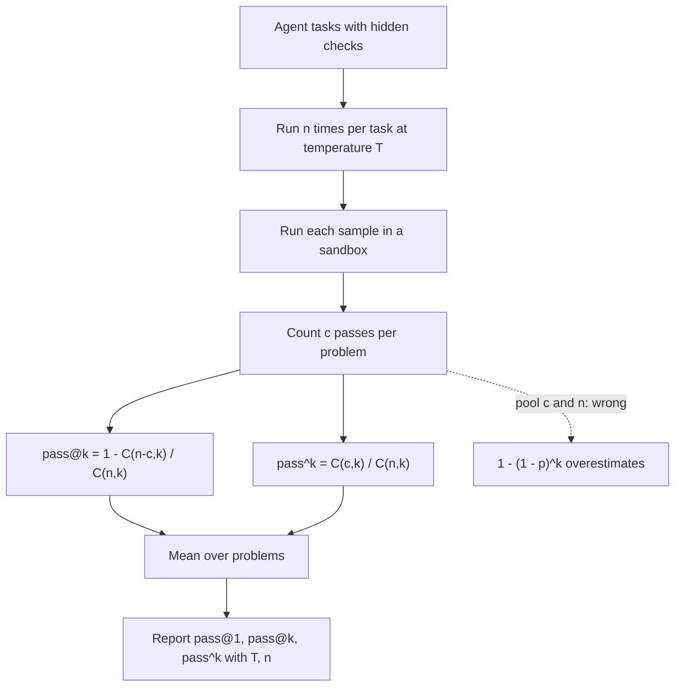

## TL;DR
pass@k is the chance at least one of k agent runs or samples passes an executable check; pass^k is the
chance all k do. Estimate both from n ≥ k runs per task: pass@k is retry headroom, pass^k the
reliability users feel.

## For agent builders
- **Why it matters for agents.** Agents are stochastic: the same task passes on some runs and fails on
  others. One run per task hides that. pass@k says what retries plus a verifier could deliver; pass^k
  says how often a user who runs the task every day gets a working result every time.
- **Where it shows up in your stack.** Repeated-trial settings in agent eval harnesses, τ-bench-style
  reliability reports, best-of-n or retry-until-tests-pass loops in coding agents, and the sandbox that
  resets state between runs.
- **What you control.** Runs per task (n), the sampling temperature you ship with, whether retries are
  safe (idempotent tools or a sandbox), whether a cheap verifier exists to pick the passing run, and
  which k matches your reliability promise.
- **What you can skip.** Proving the estimator. Use the product form for pass@k and C(c, k) / C(n, k)
  for pass^k, average per task, never pool.

## Why it exists
- **Some tasks can be checked by running the output.** Code generation has a property most LLM tasks
  lack: correctness is executable. Before functional metrics, generated code was scored by text
  similarity to a reference (BLEU), which fails both ways: a correct program written differently scores
  low, and a wrong one that copies most of the reference scores high. Running tests fixes that.
- **Generation is stochastic, so "did it pass?" is about a distribution.** pass@k, introduced for
  program synthesis by Kulal et al. and adopted for LLM evaluation in the Codex paper, asks the question
  about samples, not one output.
- **Greedy accuracy answers the wrong question for sample-and-verify systems.** Production systems often
  draw several samples, run the tests and keep a passing one, or rank with a verifier. They need "how
  likely is at least one of k attempts correct". A system that shows one answer cares about pass@1 only,
  so the metric must be explicit about k.
- **The naive estimators fail.** Drawing exactly k samples per problem is unbiased but very noisy, one
  coin flip per problem. The shortcut 1 − (1 − p̂)^k with p̂ the benchmark-wide pass rate is
  systematically wrong: it **overestimates** pass@k, sometimes by a lot.
- **Why the shortcut overestimates:** problems differ, some solved nine times out of ten, others never.
  Because 1 − (1 − p)^k is concave, averaging it over problems gives less than applying it to the mean p.

## How it works
### Definition
- **Per problem:** with true per-sample success probability p, pass@k = 1 − (1 − p)^k.
- **Benchmark score:** the mean over problems.
- **pass@1** is simply the mean of p, the expected success of a single sample at the chosen temperature.

### The unbiased estimator
1. **Draw n ≥ k samples** for each problem.
2. **Count the c** that pass.
3. **Estimate:**

```
pass@k ≈ 1 − C(n − c, k) / C(n, k)
```

- **The logic:** among the C(n, k) possible k-subsets of your n samples, the ones with *no* passing
  sample are the k-subsets of the n − c failures, C(n − c, k) of them.
- **Why it is unbiased:** the ratio is the probability a random k-subset fails entirely, and its
  expectation over the sampling is exactly (1 − p)^k, because the n samples are independent draws.
- **Why it has low variance:** it averages over all k-subsets instead of looking at one. Chen et al. used
  n = 200 samples per problem to report k up to 100.

### Computing it without overflow
- **Floating-point factorials overflow:** 200! ≈ 7.9 × 10^374, far beyond float64's ≈ 1.8 × 10^308.
- **The standard implementation uses the numerically stable product form:**

```
pass@k ≈ 1 − Π_{i = n − c + 1}^{n} (1 − k / i)
```

- **Edge case:** return 1 when n − c < k, since every k-subset then contains a pass.

### Temperature changes the answer
| Metric | Best temperature | Because |
|---|---|---|
| pass@1 | low | the model commits to its most likely program |
| pass@100 | higher | diversity lets a hundred samples cover more of the solution space |

- **Every pass@k figure is tied to a temperature.** Comparing two models' pass@1 sampled at different
  temperatures, or greedy versus sampled, is not a comparison.

### Reading the gap
- **pass@1 = 30% with pass@10 = 70%** says many problems are solvable *sometimes*: a verifier that picked
  the right sample would more than double accuracy.
- **The pass@k − pass@1 gap is the headroom for selection work:** test-based filtering, reranking,
  verifiers, majority voting.
- **A small gap** means the model either solves a problem reliably or not at all, so the lever is the
  model or the prompt, not sampling.

### Relatives that answer different questions
| Metric | Question | Note |
|---|---|---|
| **maj@k** (majority vote over k) | what does voting deliver? | bounded above by pass@k; usually between pass@1 and pass@k, but can fall below pass@1 when wrong answers agree with each other more often than right ones |
| **best-of-n with a verifier** | what does my selection strategy deliver? | also bounded by pass@k; the deployable number |
| **pass^k** (from τ-bench) | do *all* k attempts succeed? | p^k per problem, estimated by C(c, k) / C(n, k); the reliability a daily user experiences |

- **pass@k and pass^k diverge sharply as k grows.** A customer who uses an agent every day experiences
  pass^k, not pass@k.
- **For multi-step agents, "pass" means the final state checks out.** Retrying k times only makes sense
  when side effects are idempotent, so pass@k for agents assumes a sandbox or safe rollback.

### Which number an agent design actually delivers
| Agent design | Deliverable number | Condition |
|---|---|---|
| One run, answer shown to the user | pass@1 | none |
| Retry until a check passes (tests, schema, state assertion) | close to pass@k, at k× worst-case cost | a cheap, trustworthy verifier and safe retries |
| Best-of-n runs ranked by an LLM judge | between pass@1 and pass@k | the judge's accuracy at picking the passing run |
| The same workflow run every day by one user | pass^k over the days | none; this is the reliability promise |

- **Measure per task, not just overall.** pass^k is dominated by flaky tasks: a task at p = 0.95 keeps
  pass^8 ≈ 0.66, while one at p = 0.6 drops to about 0.02.

## Diagram
The evaluation pipeline for an agent or a code model: run n times per task at a fixed temperature,
verify each final state in a sandbox, estimate per task, then average. The dotted path is the pooled shortcut that overestimates.



## Examples
### The estimator and the pooled shortcut
The estimator in the numerically stable product form, applied to one problem and then to a small
benchmark, with the pooled shortcut computed alongside to show how far off it is.

```python
import numpy as np

def pass_at_k(n: int, c: int, k: int) -> float:
    """Unbiased pass@k from n samples of which c passed (Chen et al., 2021)."""
    if n - c < k:
        return 1.0                                  # every k-subset contains a passing sample
    return 1.0 - np.prod(1.0 - k / np.arange(n - c + 1, n + 1))

# One problem: 20 samples at T=0.8, 4 passed the hidden tests.
for k in (1, 5, 10):
    print(f"n=20 c=4  pass@{k} = {pass_at_k(20, 4, k):.3f}")
# pass@1 = 0.200   pass@5 = 0.718   pass@10 = 0.957

# A five-problem benchmark, (n, c) per problem. Average per problem; never pool c and n.
results = [(20, 4), (20, 0), (20, 20), (20, 1), (20, 9)]
pooled_p = sum(c for _, c in results) / sum(n for n, _ in results)        # 0.34
for k in (1, 5):
    per_problem = np.mean([pass_at_k(n, c, k) for n, c in results])
    shortcut = 1 - (1 - pooled_p) ** k
    print(f"pass@{k}: mean over problems = {per_problem:.3f} | pooled shortcut = {shortcut:.3f}")
# pass@1: 0.340 vs 0.340   (identical: k=1 is linear in p)
# pass@5: 0.588 vs 0.875   (the shortcut overstates by almost 30 points)
```

- **The problem with c = 0 is why the shortcut fails:** no amount of sampling solves it, but pooling
  spreads its zero across the other problems as if sampling could.

### pass@k versus pass^k for an agent (runnable)
Pure Python with exact integers. One agent task run 20 times in a fresh sandbox; 12 runs succeeded.

```python
from math import comb

def pass_at_k(n, c, k):            # at least one of k succeeds
    return 1 - comb(n - c, k) / comb(n, k)

def pass_hat_k(n, c, k):           # all k succeed (tau-bench's pass^k)
    return comb(c, k) / comb(n, k)

for k in (1, 2, 4, 8):
    print(f"k={k}: pass@k={pass_at_k(20, 12, k):.3f}  pass^k={pass_hat_k(20, 12, k):.3f}")
# k=1: pass@k=0.600  pass^k=0.600
# k=2: pass@k=0.853  pass^k=0.347
# k=4: pass@k=0.986  pass^k=0.102
# k=8: pass@k=1.000  pass^k=0.004
```

| Claim on a slide | Number | What the daily user sees |
|---|---|---|
| "Succeeds within 4 tries" | pass@4 ≈ 99% | only if retries are free, safe and someone checks each one |
| "Works every day for a 4-day week" | pass^4 ≈ 10% | the reliability promise; far lower |

- **Why 0.102 and not 0.6^4 ≈ 0.13:** C(c, k) / C(n, k) draws k of the 20 observed runs without
  replacement, which makes it unbiased for p^k. Plugging the observed rate into p̂^k is biased upward,
  because x^k is convex.

### Agent scenario: a per-task reliability report from repeated runs
A support agent's eval harness runs each task 10 times from a fresh sandbox and asserts the final
state. The report puts pass@1, pass@3 and pass^3 per task side by side.

```python
from math import comb

def pass_at_k(n, c, k):
    return 1.0 if n - c < k else 1 - comb(n - c, k) / comb(n, k)

def pass_hat_k(n, c, k):
    return comb(c, k) / comb(n, k)

# 10 runs per task from a fresh sandbox; c = runs whose final state passed the assertions
runs = {"refund_simple": (10, 10), "refund_partial": (10, 8),
        "change_address": (10, 9), "cancel_after_ship": (10, 4)}
k = 3
print(f"{'task':18s} pass@1  pass@{k}  pass^{k}")
for task, (n, c) in runs.items():
    print(f"{task:18s} {c/n:6.2f} {pass_at_k(n, c, k):7.2f} {pass_hat_k(n, c, k):7.2f}")
mean = lambda f: sum(f(n, c) for n, c in runs.values()) / len(runs)
print(f"{'mean':18s} {mean(lambda n, c: c / n):6.2f} {mean(lambda n, c: pass_at_k(n, c, k)):7.2f} "
      f"{mean(lambda n, c: pass_hat_k(n, c, k)):7.2f}")
# refund_simple        1.00    1.00    1.00
# refund_partial       0.80    1.00    0.47
# change_address       0.90    1.00    0.70
# cancel_after_ship    0.40    0.83    0.03
# mean                 0.78    0.96    0.55
```

| Reading | Consequence |
|---|---|
| pass@3 = 0.96 overall | only reachable if the agent can retry safely and something checks each attempt |
| pass^3 = 0.55 overall | a user doing three such tasks a week sees all succeed about half the time |
| cancel_after_ship at pass^3 = 0.03 | one flaky task drags the reliability number; fix it first |

### Worked scenario: why concavity matters
Two problems, k = 5. Problem 1 has p = 0.9; problem 2 has p = 0.

| Method | Calculation | pass@5 |
|---|---|---|
| Per problem, then mean (correct) | (1 − 0.1^5 + 0) / 2 | ≈ 0.50 |
| Pooled p = 0.45, then formula (shortcut) | 1 − 0.55^5 | ≈ 0.95 |

- **The shortcut nearly doubles the score** because it pretends the unsolvable problem can be sampled
  into success.

## Production patterns
- **Sandboxed execution against hidden tests.** Run each sample in an isolated container with no network
  and a CPU and wall-clock limit, and record infra errors (timeouts, sandbox crashes) separately from test
  failures. Monitor the infra-error rate, because counting it as failure silently lowers pass@k.
- **Small-n pass@1 in CI, large-n for model choice.** Sample a handful per problem at the shipping
  temperature on every commit and show a noise band from the sample count; reserve large n for careful
  model comparisons. Monitor the standard error next to the trend line.
- **Sample-and-verify at serve time.** Generate several candidates in parallel, discard those that fail to
  parse or violate the schema, execute survivors and keep a passing one or majority-vote on results.
  Monitor the realised success rate (maj@k or verifier@k), not pass@k, plus p95 latency and cost per
  request.
- **pass^k for agent releases.** Run each agent task k times from a fresh sandbox state and gate on
  pass^k at the k that matches the usage promise. Monitor tasks whose individual success rate falls,
  since one flaky task dominates pass^k.
- **Retry loops only behind a verifier and idempotent tools.** A coding agent may loop "edit, run tests,
  retry" up to a fixed attempt cap; an agent that sends emails or moves money must not retry blindly.
  Monitor attempts per task, cost per solved task and the share of tasks solved only on a retry.
- **Flaky-task triage from the per-task table.** Sort tasks by individual success rate and read the
  failed traces of the flakiest ones first; they are usually ambiguous instructions or a tool that
  returns inconsistent data. Monitor how many tasks sit between always-pass and always-fail.
- **Protocol stamped on every result.** Store model version, temperature, n, k and test-suite version
  with each score, and refuse comparisons across protocols. Monitor a private held-out set for
  contamination gaps against public benchmark numbers.

## Trade-offs
- **Headroom vs realisability.** A larger k reveals headroom, but that headroom is only realisable with a
  verifier or test oracle; with no cheap check, pass@1 or maj@k is the honest number to publish.
- **Variance vs inference cost.** More samples per problem reduce estimator variance but cost n×
  inference; use a small n for the pass@1 trend in CI and a large n only when comparing models carefully.
- **pass@k vs pass@1 temperature.** Higher temperature raises pass@k for large k and lowers pass@1; a
  product that serves one answer should tune and report at the temperature it ships with.
- **Objective vs incomplete oracle.** Tests are objective but incomplete: a sample can pass visible tests
  and still be wrong; once the model can see the tests, hidden tests become necessary.

## Pitfalls
- **Computing pass@k from greedy decoding,** so all k samples are identical. Symptom: pass@10 equal to
  pass@1 to the last decimal. Fix: sample at a real temperature.
- **Pooling c and n across problems.** Symptom: a pass@k that does not reproduce when someone recomputes
  it per problem. Fix: estimate per problem, then average.
- **Computing the binomials with floating-point factorials** (or a float `comb`) at n = 200. Symptom:
  `inf` or a NaN in the report. Python's exact-integer `math.comb` avoids this, but the product form is
  simpler and vectorises.
- **Comparing pass@1 across protocols.** Symptom: a model "winning" by a margin that vanishes when both
  use the same temperature and sample count. Fix: re-run both models under one stamped protocol.
- **Describing agent reliability with pass@k.** Symptom: pass@5 = 90% on the slide while customers who
  get one attempt see failures most of the time. Fix: report pass@1 and pass^k.
- **Public benchmark contamination.** Symptom: pass@1 far above what the model achieves on a private set
  of equivalent difficulty. Fix: keep a private set.

## When to use
- **Use for any task with executable verification:** agent tasks with state assertions, code against
  tests, SQL against expected result sets, math with checkable answers.
- **Report by purpose:** pass@1 as the user-facing number, pass@k for headroom analysis when considering a
  sample-and-verify design, and pass^k when repeated reliability is the product promise.
- **Protocol:** fix the temperature, use n ≥ k samples, keep tests hidden, and check for contamination
  with a private set.
- **Interviews:** derive the estimator, explain why the pooled shortcut overestimates, and separate pass@k
  from pass^k.

## Role lens
- **Engineer:** Implements the product-form estimator, runs samples in a sandbox against hidden tests,
  and tracks pass@1 per commit with a noise band from the sample count.
- **Architect:** Decides whether latency and cost budgets allow best-of-n with a verifier, where the
  pass@k headroom matters, or force a single-shot design where only pass@1 counts.
- **FDE:** Builds the test oracle for a customer's code-migration or text-to-SQL deployment from their
  own cases and reports pass@1 and pass^k so expectations match what their users experience.

## Check yourself
**Q:** A vendor reports pass@1 = 45% and pass@10 = 80% on your internal text-to-SQL benchmark. Your
product returns one query per request within a two-second budget. What do these numbers tell you, and
what would you build?
**A:** pass@1 is today's user experience: 45% of queries correct on the first try. The 35-point gap is
headroom that exists only with selection, so the question is whether you can verify cheaply within two
seconds. Candidates: sample several queries in parallel, discard those that fail to parse or violate the
schema, execute the survivors and majority-vote on result sets (maj@k), or rank with a verifier. Measure
that strategy directly rather than assuming you get 80%; expect something between the two numbers. Check
which temperature the vendor used, re-run on a private set to rule out contamination, and if customers
rerun similar queries daily, report pass^k as well, since reliability is what they will feel.

## Interview questions
### What is pass@k, and why is it not the same as accuracy?
- **Definition:** the probability that at least one of k samples passes an executable check, averaged over
  problems; pass@1 equals the mean per-sample success rate.
- **Why it differs:** for k > 1 it assumes an oracle that picks the passing sample, so it measures what
  sample-and-verify could extract, not what one user request gets.
- **Always state k and the temperature,** because both change the number.

### Walk me through deriving the unbiased estimator.
- **Draw n ≥ k samples, count c passes.** A random k-subset fails entirely only if it is drawn from the
  n − c failures: probability C(n − c, k) / C(n, k).
- **Its expectation is (1 − p)^k** because the samples are independent, so 1 minus it is unbiased for
  pass@k.
- **Implement it as a product** 1 − Π (1 − k / i) over i from n − c + 1 to n, returning 1 when n − c < k,
  to avoid factorial overflow.

### Someone reports pass@1 = 52% and pass@10 = 52.0% exactly. What happened?
- **Most likely greedy decoding or near-zero temperature,** so every sample is the same program.
- **Check the sampler config and sample diversity** (distinct outputs per problem) before concluding the
  model has no headroom.
- **If samples are diverse and the gap is still tiny,** the model is bimodal per problem, and the fix is
  the model or prompt rather than a verifier.

### When would you refuse to report pass@k to a customer?
- **When there is no cheap verifier in the product:** headroom you cannot select for is not delivered.
- **For agents with side effects:** retries are only meaningful with a sandbox or idempotent actions, and
  the user experiences pass@1 per attempt and pass^k over days.
- **Then report pass@1 and pass^k,** for example a task with p = 0.6 has pass^4 = 0.6^4 ≈ 13% for a
  four-run reliability promise.

### Your coding agent solves 78% of tasks on one run and 96% "within 3 tries". What do you put on the release report?
- **pass@1 as the user-facing number,** unless the product really retries: a test-gated "edit, run tests,
  retry" loop with an attempt cap does approach pass@k, at up to 3× the cost.
- **pass^k for the reliability promise,** computed per task from repeated runs with C(c, k) / C(n, k);
  in the per-task example above it is 0.55 at k = 3.
- **The per-task table,** because one flaky task (pass^3 = 0.03) dominates the reliability number and is
  the first thing to fix.

### How would you budget samples for a 500-problem benchmark?
- **For a pass@1 trend in CI,** a few samples per problem at the shipping temperature is enough when the
  per-problem estimates are averaged over 500 problems.
- **For pass@k at large k,** n must be at least k and preferably well above it; Chen et al. used n = 200
  to report up to k = 100.
- **Cost scales as problems × n × sandbox time,** so run the large-n protocol only for model selection.

## Quiz
### Q: With n = 20 samples of which 4 passed, why is 1 − C(16, 5) / C(20, 5) preferred over drawing 5 samples and checking whether any passed?
- [ ] It corrects for test leakage between samples
- [x] It averages over every possible 5-subset of the 20 samples, so it has much lower variance than one 5-sample draw while staying unbiased
- [ ] It is biased upward, which gives a more optimistic figure
- [ ] It allows k to be larger than n
> Both estimators are unbiased, but the single draw is one coin flip per problem; the combinatorial
> estimator uses all 20 samples for every k, which is the whole point of drawing n ≥ k.

### Q: Your benchmark shows pass@1 = 30% and pass@10 = 31%. What does that tell you?
- [ ] The tests are broken and need rewriting
- [ ] The sampling temperature was too high
- [x] Provided the samples were drawn at a normal sampling temperature, the model either solves a problem reliably or not at all, so sampling plus verification has little headroom; improve the model or the prompt
- [ ] A verifier would roughly double accuracy
> A tiny pass@k − pass@1 gap means extra samples rarely find a solution the first sample missed, the
> opposite of the case where a verifier pays off. Rule out near-greedy sampling first: identical samples
> also produce this gap, and a high temperature would widen it, not shrink it.

### Q: Which metric describes "the agent completes the task on every one of k repeated attempts"?
- [ ] pass@k
- [ ] maj@k
- [x] pass^k
- [ ] recall@k
> pass@k needs only one success among k tries, maj@k needs a majority to agree, and recall@k is a
> retrieval metric; pass^k is p^k per problem and is the reliability figure for repeated use.

## Use cases & projects
### Use cases
- **Reliability reports for customer agents.** pass^k shows how often a task that users repeat daily
  works every time, which single-run accuracy hides.
- **Sizing retry and best-of-n loops.** The gap between pass@1 and pass@k says how much a verifier plus
  retries can recover, and at what cost in runs.
- **Coding agents with test suites.** Retry-until-tests-pass loops deliver roughly pass@k because the
  tests act as the verifier.
- **Finding flaky tasks.** Per-task pass counts over n runs separate tasks that always fail from tasks
  the agent solves only sometimes.

### Mini project
**Repeated-trial reliability report for a small agent (2-3 hours).**
- **Goal:** measure pass@1, pass@k and pass^k for a tool-calling agent on 20-30 tasks with executable
  checks.
- **Steps:** write tasks whose success is checked in code (final state or tool arguments); reset state
  between runs; run each task n times at your shipping temperature; compute per-task estimates with the
  unbiased formulas and average over tasks, never pooling.
- **Done when:** a table lists pass@1, pass@k and pass^k for two values of k, flags the flakiest tasks,
  and states which number you would put on a release report and why.
