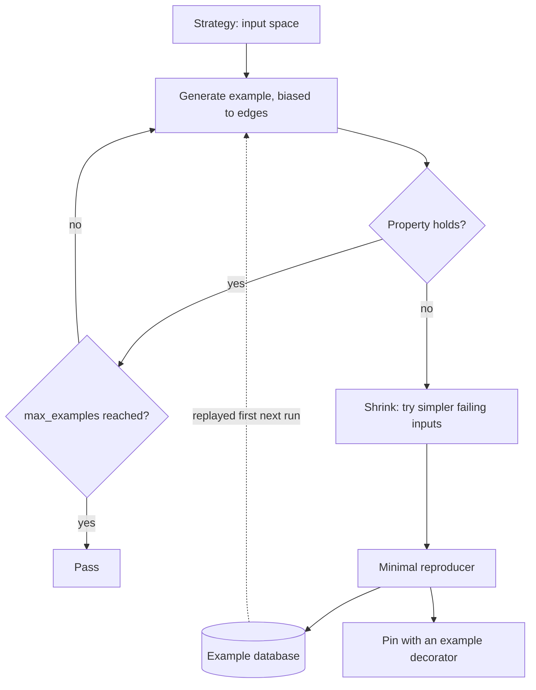

## TL;DR
Property-based testing generates hundreds of random inputs, asserts a property for each, and shrinks any
failure to the smallest one. In agents it finds silent bugs in tool-argument parsers, memory trimmers,
chunkers and prompt renderers; model-output properties cost one call per example.

## For agent builders
- **Why it matters for agents.** The deterministic code around the model is where agents crash: the
  parser that turns model JSON into tool arguments, the history trimmer that keeps the context under
  budget, the step and cost counters. Model output is an adversarial input generator, so example tests
  written by hand miss what it emits.
- **Where it shows up in your stack.** Hypothesis with pytest for Python agents, typically on Pydantic
  or dataclass tool-argument models, memory and scratchpad managers, RAG chunkers and prompt templates,
  with stateful tests for anything that changes across turns.
- **What you control.** The strategies (shaped like real model JSON and real user text), the properties
  (round trip, typed errors only, budget invariants), the CI and nightly profiles and the pinned
  counterexamples.
- **What you can skip.** QuickCheck history and advanced shrinking internals; generators, properties,
  shrinking and `RuleBasedStateMachine` cover agent plumbing.

## Why it exists
- **Example tests encode what their author imagined.** The chunker is tested on a three-paragraph
  document, never on an empty string, a single 50,000-character line, text shorter than the overlap, or a
  string of combining Unicode marks.
- **Real inputs are adversarial.** The prompt renderer never sees user content with a triple backtick, a
  `{placeholder}`, or a line beginning with `### ` that the template reads as a section header. The
  tool-argument parser never sees real model JSON with a number as a string and a trailing comma. The
  input space is "anything a user sends, plus anything a model produces".
- **The naive fixes do not close the gap.** More examples are still bounded by imagination. Random-byte
  fuzzing finds crashes but not wrong answers, because without a property there is nothing to assert, and
  without shrinking a failure is a 4 KB blob nobody can read.
- **Property-based testing changes the division of labour.** Begun as QuickCheck: the engineer states
  what must be true for *all* inputs, the framework explores, and a counterexample is minimised into
  something a human understands in five seconds.
- **It is the cheapest edge-case finder for plain code.** Those edge cases otherwise surface as a 3 a.m.
  production exception inside a retrieval pipeline.

## How it works
### Three parts
1. **Generators** (strategies in Hypothesis) describe the input space: `st.text()`,
   `st.integers(min_value=0)`, `st.lists(...)`, `st.builds(MyDataclass, ...)`, `st.recursive(...)` for
   JSON-like trees.
   - They compose, and the framework biases them toward boundary and simple values (empty collections,
     zero, the ends of a declared range, unusual Unicode), because that is where bugs cluster.
   - `st.text()` excludes surrogate code points by default, so ask for them explicitly if your code
     handles raw UTF-16 data.
2. **A property** is a test function with asserts that must hold for every generated input.
3. **The runner** executes a configured number of examples (Hypothesis defaults to 100). On failure it
   **shrinks**: tries simpler inputs that still fail, guided by the strategy's structure, until it reaches
   a minimal reproducer.
   - It stores that example in a local database so the next run replays it first, which turns a found bug
     into a regression test automatically.

### Finding properties worth stating
The property must not re-implement the function, or a bug in the logic appears in both.

| Shape | Example |
|---|---|
| **Round trip** | `parse(render(x)) == x` for tool-call arguments and structured outputs |
| **Invariant** | Every chunk is at most `size` characters; a rendered prompt never exceeds the token budget for any user input under *N* characters |
| **Idempotence** | Normalising a query twice equals normalising it once |
| **Oracle comparison** | A fast token estimator agrees with the real tokenizer within a tolerance; a cached scorer agrees with the uncached one |
| **Metamorphic relation** | The sibling lesson's relations, with the generator supplying the inputs |
| **No crash** | The weakest property, still worth having for parsers facing model output |

### AI-specific targets
- **Chunking and splitting:** coverage (concatenation reconstructs the text), size bound, overlap is
  real overlap, no empty chunks, Unicode safety.
- **Prompt templating:** user content cannot escape its delimiters (put injection-shaped strings in the
  generator); token count stays within the context limit.
- **Tool-call argument validation:** any JSON the model could emit either validates into a typed object
  or raises one typed error, never a `KeyError` three frames deep inside the tool.
- **Output parsers:** markdown fence stripping, partial or streamed JSON, numbers emitted as strings.
- **Retrieval plumbing:** top-k returns at most k, scores are sorted, metadata filters are respected, for
  generated metadata and queries.
- **Cost and budget accounting:** non-negative, additive across turns.

### Stateful properties for components with memory
- **Some risky plumbing is not a pure function:** a conversation-history trimmer, a response cache, a
  tool-call budget tracker, an agent's scratchpad. Bugs appear only after a particular *sequence* of
  operations, so a single generated input never reaches them.
- **Hypothesis stateful testing** (`RuleBasedStateMachine` with `@rule` and `@invariant` methods)
  generates random operation sequences (add a user turn, add a 3,000-token tool result, trim, summarise).
- **Invariants run after every step:** the system prompt is still first, the total stays under the token
  budget, the latest user turn is never dropped, a cache hit returns what was stored under that exact key.
- **Shrinking works on the sequence too.** A failure found after 40 random operations is reported as the
  shortest breaking sequence, often three or four steps, which reads like a bug report.

### Properties on model outputs
Generate inputs, call the model, assert a property: schema valid, no echo of a planted secret, reply
language matches the input, length within bounds. Three adjustments, *because* each example costs a
network call and the model is nondeterministic:
1. **Cap `max_examples` low and disable the per-example deadline** (200 ms by default, far below a model
   call).
2. **Cache responses** keyed by model, parameters and prompt, so re-runs are free.
3. **Report failures as a measured rate** in the eval harness, not as a hard assertion blocking every PR.

Record-and-replay turns these into fast tests of the parser around the model rather than of the model.

### Shrinking is the feature
- **The minimal case is the diagnosis.** A failing 2,000-character string shrinks to `""` or to a single
  `"́"`: empty input, or a combining character split from its base.
- **Pin it.** Add an explicit `@example(...)` decorator so shrunk counterexamples survive database cleanup
  and document the bug.

## Diagram
The runner loops generate, check, and on failure shrink; the minimal case is stored and replayed first
on the next run.



## Examples
### Three properties over an overlapping chunker
The kind of helper every RAG pipeline carries. A naive version without the empty-text guard fails the
"no empty chunks" assertion and Hypothesis shrinks the counterexample to `text=''`, exactly the bug.

```python
# pip install hypothesis  ->  pytest -q test_chunk.py
from hypothesis import given, settings, strategies as st

def chunk(text: str, size: int, overlap: int) -> list[str]:
    if not text:                          # without this guard the loop emits one empty chunk for ""
        return []
    step, chunks, i = size - overlap, [], 0
    while True:                           # emit windows until one reaches the end of the text
        chunks.append(text[i:i + size])
        if i + size >= len(text):
            return chunks
        i += step

params = st.integers(min_value=1, max_value=200).flatmap(
    lambda size: st.tuples(st.just(size), st.integers(min_value=0, max_value=size - 1)))

@settings(max_examples=500)
@given(text=st.text(max_size=2000), p=params)
def test_chunk_properties(text, p):
    size, overlap = p
    step = size - overlap
    chunks = chunk(text, size, overlap)
    assert all(0 < len(c) <= size for c in chunks)                 # size bound and no empty chunks
    rebuilt = "".join(c[:step] for c in chunks[:-1]) + (chunks[-1] if chunks else "")
    assert rebuilt == text                                         # coverage: nothing lost or duplicated
    for a, b in zip(chunks, chunks[1:]):
        assert b.startswith(a[step:])                              # the overlap is real overlap
    assert (len(chunks) == 0) == (text == "")
```

### Agent scenario: stateful test that catches a memory trimmer dropping the user's turn
Runnable with `pip install hypothesis pytest`. The naive trimmer drops the oldest non-system turn until
the history fits, which can delete the only user turn.

```python
from hypothesis import strategies as st
from hypothesis.stateful import RuleBasedStateMachine, rule, invariant

BUDGET = 8_000                                   # token budget for the whole history

class History:                                   # system under test: naive oldest-first trimmer
    def __init__(self, system_tokens: int):
        self.turns = [("system", system_tokens)]
    def add(self, role: str, tokens: int):
        self.turns.append((role, tokens))
        while sum(t for _, t in self.turns) > BUDGET and len(self.turns) > 2:
            del self.turns[1]                    # drop the oldest non-system turn

class HistoryMachine(RuleBasedStateMachine):
    def __init__(self):
        super().__init__()
        self.h, self.saw_user = History(system_tokens=500), False

    @rule(tokens=st.integers(1, 2_000))
    def user_turn(self, tokens):
        self.h.add("user", tokens); self.saw_user = True

    @rule(tokens=st.integers(1, 3_000))
    def tool_result(self, tokens):
        self.h.add("tool", tokens)

    @invariant()
    def system_prompt_first(self):
        assert self.h.turns[0][0] == "system"

    @invariant()
    def within_budget(self):
        assert sum(t for _, t in self.h.turns) <= BUDGET

    @invariant()
    def latest_user_turn_kept(self):
        assert not self.saw_user or any(role == "user" for role, _ in self.h.turns)

TestHistory = HistoryMachine.TestCase
# Fails latest_user_turn_kept, shrunk to a short sequence (typically four steps), e.g. user_turn(tokens=1),
# tool_result(tokens=1500), tool_result(tokens=3000), tool_result(tokens=3000):
# 500 + 1 + 1500 + 3000 + 3000 = 8001 > 8000, so the trimmer drops the only user turn.
```

| Step | History (tokens) | Total |
|---|---|---|
| Start | system 500 | 500 |
| user_turn(1) | system 500, user 1 | 501 |
| tool_result(1500) | + tool 1500 | 2001 |
| tool_result(3000) | + tool 3000 | 5001 |
| tool_result(3000) | over budget at 8001, oldest non-system turn (the user's) dropped | 8000 |

The fix (never evict the latest user turn, summarise tool results instead) is now tested by the same
invariant forever.

### Agent scenario: round trip and typed errors for a tool-argument parser
A typed error matters to the agent loop: it can be returned to the model as a tool error so the model
retries with fixed arguments, while a stray `KeyError` crashes the run.

Runnable with Hypothesis. Any JSON-shaped input either parses into the typed object or raises
`ToolArgError`; any other exception fails the test.

```python
import json
from dataclasses import dataclass, asdict
from hypothesis import given, strategies as st

class ToolArgError(ValueError): ...

@dataclass(frozen=True)
class Refund:
    order_id: str
    amount_cents: int

def parse_refund(raw: str) -> Refund:
    try:
        d = json.loads(raw)
        if not isinstance(d, dict):
            raise ToolArgError("arguments must be a JSON object")
        amount, order_id = d["amount_cents"], d["order_id"]
        if isinstance(amount, str) and amount.isascii() and amount.isdigit():
            amount = int(amount)                      # models often emit numbers as strings
        if type(amount) is not int or amount < 0:     # type() check rejects True/False too
            raise ToolArgError("amount_cents must be a non-negative integer")
        if not isinstance(order_id, str):
            raise ToolArgError("order_id must be a string")
        return Refund(order_id, amount)
    except (json.JSONDecodeError, KeyError) as e:
        raise ToolArgError(f"bad arguments: {e}") from e

refunds = st.builds(Refund, order_id=st.text(), amount_cents=st.integers(min_value=0))
json_like = st.recursive(
    st.none() | st.booleans() | st.integers() | st.text(),
    lambda kids: st.lists(kids) | st.dictionaries(st.text(), kids), max_leaves=10)
model_ish = st.fixed_dictionaries({}, optional={
    "order_id": json_like, "amount_cents": json_like | st.integers(0, 10**6).map(str)})

@given(refunds)
def test_round_trip(r):                                    # typed object -> JSON -> same object
    assert parse_refund(json.dumps(asdict(r))) == r

@given(st.one_of(st.text(), json_like.map(json.dumps), model_ish.map(json.dumps)))
def test_only_typed_errors(raw):                           # any other exception fails the test
    try:
        parse_refund(raw)
    except ToolArgError:
        pass
```

The `isascii()` guard matters: `"²".isdigit()` is true but `int("²")` raises `ValueError`, exactly the
kind of input a Unicode-aware generator eventually produces.

## Production patterns
- **CI and nightly settings profiles.** Register profiles with `settings.register_profile("ci",
  max_examples=...)` and a larger "nightly" one, then call `settings.load_profile(...)` from an
  environment variable in `conftest.py`. Monitor run time per profile and bugs found by nightly only.
- **Persist the example database.** Hypothesis keeps found failures in the `.hypothesis/` directory;
  cache it between CI runs so known failures replay first, and pin important ones with `@example(...)`.
  Monitor how many pinned examples each property accumulates.
- **Model-output properties as a nightly rate.** Use `@settings(max_examples=20, deadline=None)` (a low
  count, no deadline), cache responses by model, parameters and prompt, and report the failure rate in
  the eval harness. Monitor the rate per model version.
- **Strategies from real data.** Build strategies from the customer's document formats, identifier
  patterns and logged model JSON (for example `st.sampled_from(real_examples)` combined with mutations),
  including tool arguments that failed validation in production agent traces. Monitor production parser
  errors that the strategies did not generate, and tool-validation error rate per model version.
- **Contract-boundary requirement.** Every tool schema, prompt template and chunking library ships with a
  round-trip or invariant property, enforced in code review. Monitor the share of boundary modules with
  at least one property.
- **Agent-loop budget machine.** Model the loop's bookkeeping (step counter, token and cost budget,
  retry limit per tool) as a stateful test whose rules are "model calls tool", "tool errors", "tool
  times out", with invariants that the loop always terminates within the step limit and spend never goes
  negative or past the cap. Monitor production runs that hit the step limit.
## Trade-offs
- **Coverage vs determinism.** Hundreds of inputs per property give coverage no example suite reaches,
  but runs are slower and vary in what they explore, so CI relies on the example database and pinned
  `@example` cases for known failures.
- **Classes of bugs vs weak properties.** Properties catch classes, not instances, but "does not crash"
  passes wrong answers; the value scales with how specific the property is.
- **Realistic strategies vs effort.** A model-shaped distribution (realistic JSON, realistic questions)
  finds more relevant bugs than uniform random text, at the cost of writing custom strategies.
- **Model-output properties vs cost.** They test the real system, but each example costs money and time
  and fails randomly, so they belong in a nightly job with caching, not a PR gate; that flips if
  responses are recorded and replayed.
- **Minimal reproducers vs realism.** For generators with complex constraints shrinking can be slow, or
  produce a minimal case that is valid but unrealistic and still needs interpretation.

## Pitfalls
- **The property copies the implementation.** Symptom: a test that passes forever and a bug that ships
  in both. Fix: state independent facts (coverage, bounds, round trip).
- **Over-filtering with `assume`.** Symptom: a `FailedHealthCheck` error (`filter_too_much`), or, if
  someone suppresses it, a test that effectively ran ten examples. Fix: build valid inputs directly.
- **Model-calling property on default deadline and example count.** Symptom: a flaky, slow test marked
  skip within a week. Fix: low count, no deadline, caching, a rate.
- **Patching for the original 2 KB input, ignoring the shrunk one.** Symptom: the same bug reappears
  with a different long input. Fix: debug the minimal case and pin it.
- **ASCII-only alphabets for the chunker.** Symptom: production failures on emoji, CJK text or combining
  marks the generator would have found in seconds. Fix: use the default `st.text()` alphabet.

## When to use
- **Use when:** a pure function sits between the user and the model or between the model and a tool:
  chunkers, renderers, parsers, validators, budgeters, routers. It pays off most where inputs are
  open-ended and edge cases cannot be enumerated.
- **On the model itself:** sparingly, with caching and as a rate, using metamorphic relations as the
  properties.
- **Avoid when:** only a label can judge the behaviour; that is the golden set's job.
- **Measure:** how many distinct bugs the properties found and how often a shrunk counterexample became
  a pinned case.
- **Interviews:** name a non-trivial property for a chunker or parser, explain shrinking, and say why
  model-output properties need different settings.

## Role lens
- **Engineer:** Writes strategies that resemble real user and model output, states round-trip and
  invariant properties for every parser and renderer, and pins shrunk counterexamples as examples.
- **Architect:** Requires property tests on the contract boundaries of the platform (tool schemas,
  prompt templates, chunking libraries) so every team's edge cases are found before integration.
- **FDE:** Generates inputs from the customer's real document formats and identifier patterns, because
  their edge cases (legacy encodings, odd date formats) are not in anyone's default strategy.

## Check yourself
**Q:** You inherit a prompt-rendering function that inserts user text between delimiters and a
tool-argument parser that turns model JSON into a typed object. What properties would you write, and
what would you avoid?
**A:** For the renderer: for any user string, the rendered prompt still contains the delimiters in the
expected positions and the user text appears only between them, with a generator that includes the
delimiter strings, backticks, braces and heading markers; and the rendered token count stays under the
budget for inputs up to the allowed length. For the parser: a round trip from a generated typed object
through JSON and back is identity; for arbitrary JSON-shaped input, including numbers as strings and
missing keys, the parser either returns a valid object or raises one typed validation error, never an
unexpected exception. Avoid restating the implementation as the property, avoid ASCII-only generators,
and keep any model-calling property out of the PR gate with caching and a low example count.

## Interview questions
### What is property-based testing, and how does it differ from fuzzing?
- **Definition:** a generator produces many inputs and a stated property must hold for every one; failures
  shrink to a minimal reproducer.
- **Versus fuzzing:** random bytes find crashes, but without a property there is nothing to assert about
  wrong answers, and without shrinking a failure is an unreadable blob.
- **Why it matters for AI:** inputs are whatever users send plus whatever models produce, and nobody
  writes the example that breaks a chunker or parser.

### Which properties would you write for a RAG chunker?
- **Coverage:** concatenating chunks minus overlap reconstructs the text exactly.
- **Bounds:** every chunk is non-empty and at most `size` characters.
- **Overlap:** each chunk starts with the previous chunk's overlap region; plus Unicode safety, with the
  default text alphabet rather than ASCII.

### Your agent crashes a few times a day inside a tool with a KeyError on model-produced arguments. How do you make that class of bug impossible?
- **Typed boundary:** parse every tool's arguments into a typed object that either validates or raises
  one typed error the loop returns to the model as a tool error, so it can retry.
- **Property test it:** a round trip from generated typed objects, plus "only typed errors" over
  arbitrary JSON-shaped input, including numbers as strings and missing keys.
- **Seed from traces:** add the arguments that crashed in production to the strategy and pin them with
  `@example(...)`.

### An agent's memory bug appears only after long sessions. How would you test for it?
- **Stateful testing:** a `RuleBasedStateMachine` with rules for user turns, tool results and trimming,
  and invariants checked after every step.
- **Invariants:** system prompt first, total under budget, latest user turn kept.
- **Payoff:** a failure after dozens of operations shrinks to a short sequence, like the four-step
  8,001-token case in the example.

### When would you not gate PRs on a property test?
- **When it calls a model:** each example is a slow, paid, nondeterministic call, so cap examples, set no
  deadline, cache responses and report a nightly rate.
- **When the property is weak:** "does not crash" alone gives false confidence about correctness.
- **When only a label can judge the output:** use a golden set instead.

### Your property test passes locally but fails in CI with a different input each time. What is going on?
- **Exploration differs between runs:** generation is random, so CI found new cases; that is a real bug,
  not flakiness, if it reproduces.
- **Stabilise:** persist the `.hypothesis/` database between runs and pin the shrunk case with
  `@example(...)`.
- **Check the deadline:** timing-dependent failures on slow CI machines point at the 200 ms default
  deadline rather than the logic.

## Quiz
### Q: What does shrinking contribute beyond finding a failing input?
- [ ] It proves the property holds for all smaller inputs
- [x] It reduces the failure to a minimal case that directly points at the cause
- [ ] It removes the need for an example database
- [ ] It increases the number of examples run per test
> Shrinking turns a random 2 KB failing string into something like an empty string or a single
> combining character, which is the diagnosis itself. It does not prove anything about other inputs and
> the database is still what replays known failures.

### Q: Why do properties over model outputs need different settings from properties over pure code?
- [ ] Model outputs cannot be generated by strategies
- [ ] Hypothesis cannot assert on strings returned by a network call
- [x] Each example costs a slow, paid, nondeterministic model call, so examples must be capped, cached and treated as a rate
- [ ] Models always satisfy schema properties, so the tests are redundant
> A property that calls a model is still valid, but 100 examples with the default deadline is slow,
> expensive and flaky. Cap the count, disable the deadline, cache responses and report failures as an
> eval rate rather than a hard CI assertion.

### Q: Which property for a chunker is least useful?
- [ ] Concatenating the chunks (minus overlap) reconstructs the original text
- [ ] Every chunk is non-empty and at most the configured size
- [x] The output equals the output of a second copy of the same chunking code
- [ ] Each chunk begins with the previous chunk's overlap region
> Comparing against a copy of the implementation reproduces its bugs on both sides. Coverage, size bound
> and overlap are independent statements about what a correct chunker must do, so they can fail when the
> code is wrong.
