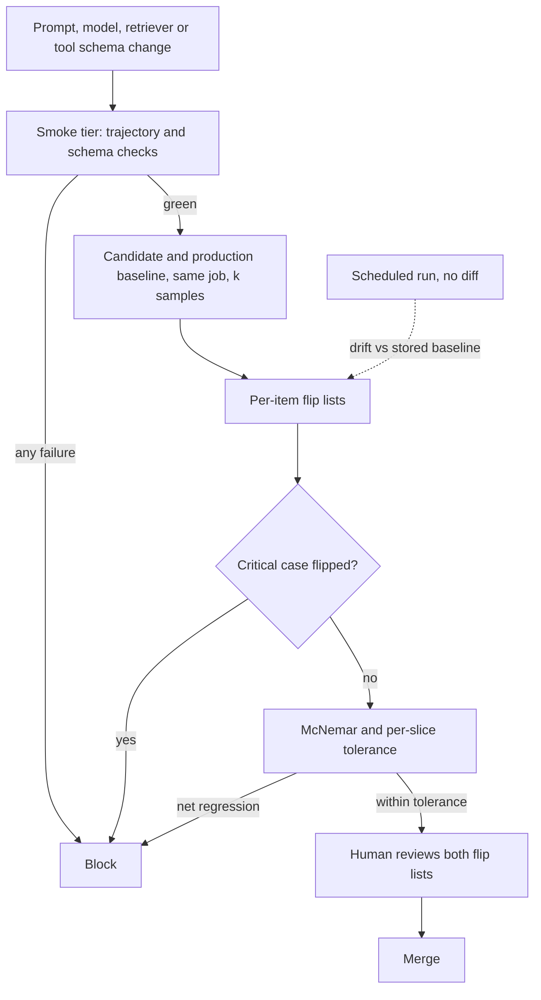

## TL;DR
An agent regression test re-runs pinned tasks whenever the prompt, model, retriever or tool schemas
change, and fails the change if passing tasks now fail. Changes are non-local, so the hard part is
telling real regressions from noise with paired, per-item comparisons.

## For agent builders
- **Why it matters for agents.** Editing one tool description or the system prompt changes which tool
  the agent picks on every task, and a model snapshot swap changes how strictly it fills arguments. A
  pinned suite is the only memory that the refund bug you fixed last month stays fixed.
- **Where it shows up in your stack.** pytest or promptfoo in CI, datasets and experiment comparison in
  LangSmith or Braintrust, recorded tool fixtures (for example vcrpy cassettes), and a scheduled job that
  runs with no code diff.
- **What you control.** Case contents (input, stubbed tool responses, expected trajectory or end state),
  grader order, *k* samples per case, the critical tag, the same-job baseline and the gate policy.
- **What you can skip.** Exotic statistics. Flip lists, pass^k and McNemar's 3.84 threshold cover nearly
  every gate decision.

## Why it exists
- **A prompt is one shared artifact.** In ordinary code a change to function A does not alter B. A
  prompt shapes every output at once: "always use ISO dates" changes the tone of refund answers; a newer
  model version follows a JSON schema more or less strictly; a higher retriever top-k changes citations.
- **Fixes reintroduce old bugs.** Fixing bug #1 brings back bug #3 fixed last month, and nobody notices
  until the customer does. Without a pinned suite the team plays whack-a-mole with no memory.
- **The system changes with no commit.** Hosted models are updated, deprecated and re-routed; a
  dependency bumps the tokenizer; the index is rebuilt with a different chunker. A diff-only suite never
  sees these.
- **The naive alternatives fail.** Re-checking the five remembered examples is biased toward the cases
  just fixed. "Full eval before release" finds regressions weeks late across dozens of commits, with no
  cheap bisect. Exact-string snapshots fail on every harmless rephrasing, so someone adds a skip flag.
- **Agents multiply the surface.** A change can now alter tool choice, argument values, step count and
  the final state of a backend, not only the text, so a suite that only reads the final message misses
  most regressions.

## How it works
### The suite is a golden set with a contract
Each case holds:
- an input, plus any context, tool stubs or conversation history;
- one or more graders and the expected behaviour; for an agent, the required tool calls and arguments,
  forbidden calls, a step budget and the expected end state of the stubbed backend;
- tags: slice, criticality, the incident it came from.

| Tier | Size and graders | When it runs | Catches |
|---|---|---|---|
| **Smoke** | A few dozen cases, deterministic graders (schema valid, must or must not contain, tool-call sequence, refuses or not) | Every pull request, in minutes | Obvious breakage |
| **Full** | Hundreds of cases, including judge-graded ones | Nightly and before release | Smaller and quality regressions |
| **Scheduled, no diff** | The full tier | On a schedule regardless of commits | Provider-side drift: if Tuesday differs from Monday with nothing committed, the model changed under you |

### Graders ordered by determinism
1. **Code graders first:** schema, regex, numeric tolerance, set equality on extracted entities,
   tool-trace match (required calls present, forbidden calls absent, arguments correct, steps within
   budget), and end-state checks on the stubbed backend.
2. **Then reference-based judges**, then rubric judges.
- **Why the order matters:** a flaky grader makes a flaky suite, and a flaky suite is ignored within weeks.
- **Narrow judge questions.** A judge-graded case carries a reference answer and asks "does the answer
  state the 30-day window?", not "is this good".

### Handle nondeterminism explicitly
- **Temperature 0 reduces variance but does not remove it.** Batched inference, floating-point ordering
  and provider changes all still move outputs.
- **Run each case *k* times** and record a pass rate. For a critical case "pass" means all *k* passed
  (pass^k, the reliability reading of pass@k).
- **Read flips against noise.** 3 of 5 before and 3 of 5 after is no regression; 5/5 to 2/5 is.
- **Pin everything pinnable:** model identifier with version or snapshot, prompt hash, index version,
  seed where the API supports it, and recorded external tool responses, so the test exercises the model,
  not the weather API.

### Compare per item, paired, not by aggregate
- **Aggregates say little.** 82% versus 80% could be two items, or ten flipping each way.
- **Two lists.** Regressions are items that went pass to fail; improvements the reverse. A human reviews
  both, because a "regressed" item may have a stale expectation.
- **McNemar's test on discordant pairs** checks paired pass/fail significance:

```
statistic = (b − c)² / (b + c)      b = fail→pass flips, c = pass→fail flips
significant at p < 0.05 (one degree of freedom) when statistic > 3.84
```

| Scenario | Value |
|---|---|
| 300 items, 20 fail→pass, 14 pass→fail | (20 − 14)² / (20 + 14) ≈ 1.06 < 3.84: no claim of net improvement |
| What it still gives you | The 14 regressed items to inspect |
| Resolution with 34 discordant pairs | Net difference must be at least 12 (23 against 11) to clear 3.84 |
| Few discordant pairs (under about 25) | Use the exact binomial version, not the chi-squared approximation |

- **Publish the minimum detectable effect** next to the suite, so nobody reads a two-item difference as
  a result.

### Run the baseline in the same job
- **Pair in time as well as by item.** A baseline from last month differs from today's candidate by the
  change *and* by drift (a provider snapshot, a rebuilt index), so the flip list mixes both.
- **Re-run production config** on the same cases in the same job, or at least the same night, and diff
  against that.
- **The stored baseline** then serves only the no-diff drift run, where drift is what you want to see.

### Gate policy
| Condition | Action | Because |
|---|---|---|
| Any smoke failure | Block | Cheap, deterministic |
| Any flip of a case tagged critical (from production incidents or contractual requirements) | Block | Cheap to run, expensive to break |
| Net regression beyond a tolerance on the full tier, per slice and overall | Block | A real aggregate loss |
| Judge-graded single-item flip | Warn, do not block | Judge noise would otherwise block every PR; it should drive review |

### The growth loop
1. **Every production incident** becomes a case tagged with its ticket.
2. **Every resolved review disagreement** ("should it have refused?") becomes a case.
3. **Intended behaviour changes** update the case's expectation in the same commit as the prompt.
4. **Version the suite with the prompt**, so a baseline is always comparable with its own expectations.

## Diagram
A pull request runs the smoke tier, then candidate and production baseline run together on the same
cases; the flip list, not the average, drives the gate.



## Misconceptions
- **"Temperature 0 makes regression runs deterministic."** Batched inference, floating-point ordering and
  provider-side changes still move outputs. Run each case *k* times and read flips against that noise.
- **"If the aggregate pass rate held, nothing regressed."** 80% to 80% can hide 9 pass-to-fail flips,
  two of them incident cases. Gate on per-item flip lists and critical tags, not the average.
- **"No commit means no regression."** Hosted models are updated and re-routed, and indexes get rebuilt.
  Only a scheduled run with no diff sees drift that arrives without a pull request.
- **"A stored baseline from the last release is good enough to diff against."** It differs from today's
  candidate by the change and by drift, so the flip list mixes both. Run the production config in the
  same job.
- **"A strict suite asserts the exact text or the exact tool sequence."** Both fail on harmless
  rephrasings or an extra lookup step, and a suite that cries wolf gets disabled. Assert required and
  forbidden calls, key arguments, a step budget and the end state.
- **"A regression suite tells you whether the new version is better."** It is a safety net of known
  behaviour built from incidents; capability needs a held-out golden set.

## Examples
### Agent scenario: a trajectory case and its deterministic grader
A smoke-tier case for a support agent. Tools are stubbed with recorded responses, so the grader checks
which calls the agent made and the backend state it left, not the wording of its reply.

```python
# evals/cases/refund_outside_window.json (one line of regression.jsonl, pretty-printed here)
CASE = {
    "id": "refund-outside-window", "tags": ["critical", "INC-412", "slice:refunds"],
    "input": "I bought this 45 days ago, refund please. Order A-1009.",
    "tool_stubs": {"get_order": {"id": "A-1009", "days_since_purchase": 45, "total": 89.0}},
    "graders": [
        {"type": "must_call", "tool": "get_order", "args": {"order_id": "A-1009"}},
        {"type": "must_not_call", "tool": "issue_refund"},      # policy: 30-day window
        {"type": "max_steps", "value": 4},
        {"type": "judge_ref", "question": "Does the reply state the 30-day window?"},
    ],
}

def grade_trajectory(trace: list[dict], g: dict) -> bool:
    calls = [s for s in trace if s["type"] == "tool_call"]
    if g["type"] == "must_call":
        return any(c["tool"] == g["tool"] and all(c["args"].get(k) == v for k, v in g["args"].items())
                   for c in calls)
    if g["type"] == "must_not_call":
        return all(c["tool"] != g["tool"] for c in calls)
    if g["type"] == "max_steps":
        return len(calls) <= g["value"]
    raise ValueError(g["type"])                  # judge graders run in the nightly tier

trace = [{"type": "tool_call", "tool": "get_order", "args": {"order_id": "A-1009"}},
         {"type": "tool_call", "tool": "issue_refund", "args": {"order_id": "A-1009"}}]
print([grade_trajectory(trace, g) for g in CASE["graders"] if g["type"] != "judge_ref"])
# [True, False, True]  -> the forbidden refund call fails the case
```

Illustrative effect of one edit to the `issue_refund` tool description ("use whenever the customer asks
for a refund"), on a 120-case agent suite with *k* = 3:

| Measure | Baseline | Candidate |
|---|---|---|
| Aggregate pass | 88% | 87% |
| Pass→fail flips | – | 6, all in slice:refunds |
| Critical flips | 0 | 2 (`must_not_call issue_refund` violated) |
| Gate | – | Blocked: the agent now refunds outside the window |

### pytest suite over a JSONL case file
Each case runs *k* times, critical cases must pass every time, other cases fail only if they clearly
got worse than the recorded baseline, and the fixture writes candidate pass rates so a separate step can
diff them per slice. Checked with pytest 9.1 against a stub `myapp`.

```python
# tests/test_regression.py  ->  pytest -q tests/test_regression.py
import json, pathlib, pytest
from myapp import answer                      # system under test: (input, context, model) -> dict
from myapp.graders import GRADERS             # {"schema": fn, "contains": fn, "judge_ref": fn, ...}

CASES = [json.loads(l) for l in pathlib.Path("evals/regression.jsonl").read_text().splitlines()]
# {case_id: pass_rate}, written by running the production config in the same CI job just before this
BASELINE = json.loads(pathlib.Path("evals/baseline_results.json").read_text())
K = 3                                         # samples per case

@pytest.fixture(scope="session")
def results():
    r = {}
    yield r
    pathlib.Path("evals/candidate_results.json").write_text(json.dumps(r, indent=1))
    # a separate step diffs candidate vs baseline per slice and runs McNemar on the flips

def passes(case) -> int:                      # integer count avoids float edge cases like 2/3 < 1 - 1/3
    n = 0
    for _ in range(K):
        out = answer(case["input"], context=case.get("context"), model=case["pinned_model"])
        n += all(GRADERS[g["type"]](out, g) for g in case["graders"])
    return n

@pytest.mark.parametrize("case", CASES, ids=[c["id"] for c in CASES])
def test_no_regression(case, results):
    n = passes(case)
    results[case["id"]] = n / K
    if "critical" in case["tags"]:
        assert n == K, f"critical case {case['id']} failed {K - n}/{K} runs"
    else:
        base = round(BASELINE.get(case["id"], 0.0) * K)   # baseline pass count at the same K
        # tolerate one sample of noise; a drop larger than that is a real per-item regression
        assert n >= base - 1, f"{case['id']} regressed: {base}/{K} -> {n}/{K}"
```

### The diff step: flip lists and McNemar
Pure Python, runnable. It treats a case as passing when its pass rate is 1.0, builds both flip lists
and reports the chi-squared statistic plus the exact binomial p-value for small counts.

```python
from math import comb

def flips(base: dict, cand: dict) -> tuple[list, list]:
    ok = lambda r: r >= 1.0
    up = [c for c in cand if c in base and not ok(base[c]) and ok(cand[c])]
    down = [c for c in cand if c in base and ok(base[c]) and not ok(cand[c])]
    return up, down

def mcnemar(b: int, c: int) -> tuple[float, float]:
    n = b + c
    chi2 = (b - c) ** 2 / n if n else 0.0
    exact_p = min(1.0, 2 * sum(comb(n, i) for i in range(min(b, c) + 1)) / 2 ** n)
    return round(chi2, 2), round(exact_p, 3)

print(mcnemar(20, 14))   # (1.06, 0.392)  not significant: review the 14 regressions anyway
print(mcnemar(23, 11))   # (4.24, 0.058)  clears 3.84, but borderline on the exact test
print(mcnemar(6, 0))     # (6.0, 0.031)   few pairs: trust the exact p-value
```

### Worked scenario: a "neutral" model upgrade
Illustrative numbers. The provider's new snapshot is swapped in; the full tier has 400 items.

| Step | Observation |
|---|---|
| Aggregate | 80% → 80%, looks harmless |
| Flip lists | 9 fail→pass, 9 pass→fail |
| Critical tags | 2 of the 9 regressions are incident cases (refund window, PII redaction) |
| Gate | Blocked on critical flips, regardless of the flat average |
| Fix | Prompt clarification, re-run in the same job: critical cases 3/3 again |

## Production patterns
- **Three cadences in CI.** Smoke tier on every pull request, full tier nightly, and the same full tier
  on a scheduled trigger with no diff (for example a cron `schedule` in GitHub Actions). Monitor
  no-diff flip counts as the provider-drift signal.
- **Incident-to-case as part of the postmortem.** The postmortem is not closed until the triggering
  input is a case tagged `critical` with the ticket ID and an owner. Monitor the share of incidents with
  a linked case.
- **Same-job baseline.** The CI job first runs the production config, writes the baseline file, then
  runs the candidate, as in the example. Monitor flips on cases the change could not plausibly affect.
- **Record and replay external tools.** Store tool and HTTP responses as fixtures (for example with
  vcrpy cassettes) so agent cases are hermetic and never touch real refunds or emails, plus a small live
  suite against a sandbox for integration. Monitor fixture age.
- **Tool-schema changes trigger the suite.** Treat tool names, descriptions and JSON schemas as prompt
  code: a change to any of them runs the smoke tier and the slices that use that tool. Monitor flips
  concentrated in the slices of the edited tool.
- **Flakiness budget.** Periodically run the suite twice on an identical config and count items whose
  pass rate differs; fix graders before adding cases when it exceeds the tolerance. Monitor the
  flakiness rate per grader type.
- **Published resolution.** Print the minimum detectable effect (from McNemar on the expected number of
  discordant pairs) at the top of each report. Monitor reviewers citing differences below it.

## Trade-offs
- **k samples vs cost.** Running each case *k* times multiplies cost and time by *k*, but without it one
  unlucky sample blocks a PR; drop to *k* = 1 only for deterministic graders on temperature-0
  structured outputs.
- **Deterministic vs judge graders.** Deterministic graders are stable and fast but blind to quality;
  judges see quality but add noise, so the mix shifts toward judges from smoke tier to nightly tier.
- **Blocking on critical flips vs tax.** Right when cases come from incidents, a tax if "critical" is
  applied loosely; the tag needs an owner and a justification per case.
- **Recorded tool responses vs integration coverage.** Hermetic and cheap, but they hide integration
  breakage, which then needs its own smaller live suite.
- **Suite size vs speed.** A large suite detects small regressions but runs longer and costs more per
  PR; small smoke plus nightly full is the usual compromise, and it flips when the model is cheap or
  self-hosted.

## Pitfalls
- **Comparing aggregate pass rates.** Symptom: "82% vs 81%, looks fine" while ten items flipped each
  way and a customer-facing case is among the losses. Diagnose: count discordant pairs per slice. Fix:
  review the flip lists.
- **Asserting exact output strings.** Symptom: failures on every harmless rephrasing until someone
  disables the suite. Diagnose: diff failing outputs against expectations; same meaning, new wording.
  Fix: behavioural assertions and narrow judges.
- **Asserting the exact tool sequence.** Symptom: an agent that adds a harmless lookup step fails half
  the suite. Diagnose: list the extra or reordered calls in failing traces. Fix: assert required and
  forbidden calls, key arguments, a step budget and the end state, not the full ordered list.
- **Running only on diffs.** Symptom: a regression on a day with no commits, traced weeks later to a
  provider model update. Fix: the scheduled no-diff run.
- **Stale expectations after an intended change.** Symptom: a permanent red test everyone ignores, which
  hides the next real failure. Diagnose: list cases failing for more than a week. Fix: update
  expectations in the same commit.
- **Diffing against a weeks-old baseline.** Symptom: flips on cases the change could not plausibly
  affect. Diagnose: compare the model snapshot and index version logged with each run. Fix: same-job
  baseline.
- **Cases leaking into the prompt as few-shot examples.** Symptom: a perfect suite score and unchanged
  production quality. Fix: keep cases out of prompts.
- **A judge tuned on the same cases.** Symptom: the suite passes outputs the customer rejects. Fix: tune
  judges on a separate split.

## When to use
- **Start:** the day the first production bug is found, with that bug as case one.
- **Run:** the smoke tier on every change to a prompt, model setting, retriever or tool schema; the
  full tier before any release and on a schedule regardless of commits. For agents, include every
  tool name, description and argument schema in what counts as a change.
- **Measure:** per-item flips, per-slice pass rates and the suite's own flakiness (items whose pass rate
  differs between two identical runs); if flakiness exceeds your tolerance, fix graders first.
- **Avoid when:** measuring capability, and never reuse cases as few-shot examples. The suite is a
  safety net of known behaviour; a golden set with held-out items answers "is the new version better".

## Exercise
**Goal:** build a regression gate for a small tool-calling agent that blocks a real regression and
passes harmless changes. No solution is given.
- **Inputs:** an agent with 2-3 stubbed tools, 20 cases from imagined or real incidents (5 tagged
  critical), and two candidate edits: a tool-description rewrite and a reworded final-answer style.
- **Deliver:** trajectory and end-state graders, a CI command that runs baseline and candidate in the
  same job with *k* = 3, and a report with both flip lists, McNemar statistic and exact p-value.
- **Acceptance:** running the identical config twice shows a flakiness rate you report; the
  tool-description edit that breaks tool choice blocks with the flipped case IDs named; the rewording
  passes; one hand-computed McNemar value matches the script.

## Role lens
- **Engineer:** Owns the case file and graders, wires the smoke tier into CI, pins model and index
  versions, and reviews the flip list on every change rather than the headline number.
- **Architect:** Sets the gate policy: which slices and critical tags block a release, what tolerance
  applies to judge-graded tiers, and how the suite is versioned alongside prompts and models.
- **FDE:** Turns each customer incident into a tagged case in that customer's suite and runs it before
  every prompt change, so "we fixed it last time" is a test, not a memory.

## Check yourself
**Q:** A prompt change raises the nightly suite from 80% to 83% on 400 items, and the team wants to
merge. What would you look at before agreeing, and what could make 83% worse than 80%?
**A:** First the flip lists, not the aggregate: which items went fail-to-pass and which went
pass-to-fail. A 3-point gain can hide, say, 30 improvements and 18 regressions, and if any regression is
a critical case from a production incident the change is blocked regardless of the average. Then the
per-slice view, because a gain concentrated in one intent can mask a loss in another that matters more
to the customer. Then noise: with *k* samples per item, how many flips are within one sample of
baseline, and does McNemar on the discordant pairs even reach significance at this suite size. Finally
whether any expectations were edited in the same change, which would be a prompt tuned to the test.

## Interview questions
### How is a regression test for an LLM system different from a unit test?
- **Same shape:** fast, automatic, run on every change, blocking on failure.
- **Different assertions:** behavioural checks and narrow reference-based judges replace string
  equality, because harmless rephrasings would break snapshots.
- **Different pass rule:** each case runs *k* times and the comparison is against a noise-aware baseline,
  because outputs are not deterministic even at temperature 0.

### What does a regression case for a tool-calling agent assert, and why not the final text?
- **The trajectory:** required calls with key arguments, forbidden calls (no refund outside policy) and
  a step budget, checked deterministically from the trace.
- **The end state:** what the stubbed backend looks like afterwards, because a polite reply can hide a
  wrong write.
- **Text last:** a narrow reference judge for the one fact the reply must state, run in the nightly tier
  because judges add noise.

### Your agent's regression suite flips after a teammate rewords one tool description. How do you decide whether to merge?
- **Read the flip list by slice:** flips concentrated in tasks that use that tool are signal, not noise.
- **Check critical tags first:** any critical flip, such as a forbidden call now made, blocks the merge
  regardless of the aggregate.
- **Separate noise:** with *k* samples, drops of one sample are tolerated; McNemar on the discordant
  pairs says whether a net change is real.

### A regression appears on a Tuesday when nothing was merged. How do you find the cause?
- **Confirm with the no-diff run:** flips against Monday's stored baseline with no commit point at drift.
- **Check pinned versions:** model snapshot, index version, tokenizer and dependency versions; an
  unpinned model alias is the usual culprit.
- **Bisect the environment,** not the code: re-run with yesterday's index or model snapshot to isolate
  which component moved.

### How do you keep a regression suite from becoming flaky and ignored?
- **Order graders by determinism**, using judges only with a reference and a narrow question.
- **Pin and record:** model snapshot, prompt hash, index version, seeds where supported, recorded tool
  responses.
- **Measure flakiness** by running an identical config twice, and fix graders before adding cases when
  it exceeds the tolerance.

## Quiz
### Q: Why are regression results compared per item as paired pass/fail flips rather than as two aggregate pass rates?
- [ ] Aggregate rates cannot be computed for judge-graded items
- [x] Equal aggregates can hide many items flipping in both directions, and the pass-to-fail list is what needs review
- [ ] Per-item comparison avoids the need for a baseline run
- [ ] Aggregates are only valid when every case is deterministic
> Two runs at 82% and 80% could differ on two items or on twenty flipping each way. Pairing by item
> isolates the regressed set for human review and allows a proper paired test (McNemar) on discordant
> pairs; the baseline is still required.

### Q: Why should the full regression suite also run on a schedule when nothing has been committed?
- [ ] To warm the model provider's cache before the working day
- [ ] To accumulate enough samples for the aggregate score
- [x] To detect changes in hosted models, indexes or dependencies that arrive without a code diff
- [ ] Because judge graders need repeated runs to converge
> Hosted models get updated under the same name, indexes get rebuilt and tokenizers get bumped. A run
> that differs from yesterday's with no commit is the only way to catch that drift before a customer
> does.

### Q: A team asserts exact string equality on every regression case. What happens within a few weeks?
- [ ] The suite becomes fully deterministic and stays green
- [x] Harmless rephrasings fail constantly and the suite gets skipped or disabled
- [ ] The model learns to produce the expected strings
- [ ] Judge graders become unnecessary
> Free-text outputs vary in wording even when the behaviour is identical, so snapshot equality flags
> every run. The practical response is to replace it with behavioural assertions, schema checks and
> narrow reference-based judges.

## Mastery test
**Problem:** a coding agent's suite has 150 cases, one sample each, and compares against a baseline
stored three weeks ago. A change to the `run_tests` tool schema shows 7 pass→fail and 4 fail→pass flips,
none critical.

30 of the 150 cases call `run_tests`, and 6 of the 7 regressions are among them. The author says
"noise, merge it".

What do you check, and what would you change about the suite?

**A strong answer:**
- computes McNemar ((7 − 4)² / 11 ≈ 0.82; exact p ≈ 0.55 on 11 pairs): the net change is not
  significant, but that is not proof of noise;
- tests the clustering: under noise each regression lands in the `run_tests` slice with probability
  0.2, so 6 or more of 7 has probability ≈ 0.0004; that is signal, and it blocks;
- reruns the baseline in the same job, since three weeks of drift contaminates the flips;
- moves to *k* samples, tags incident cases critical, and measures flakiness on an identical rerun.

## Use cases & projects
### Use cases
- **Gating prompt and tool-schema edits in CI.** Every pull request that touches the system prompt or a
  tool description re-runs the pinned tasks and blocks on new failures in critical cases.
- **Approving a model snapshot swap.** Running the suite on the old and new model in the same job gives a
  flip list that shows exactly which tasks broke before the switch.
- **Detecting drift with no commit.** A scheduled run with no code diff catches provider-side model
  updates, index rebuilds and dependency bumps.

### Mini project
**Build a CI regression gate for a tool-calling agent (2-3 hours).**
- **Goal:** fail a change when tasks that passed on the baseline now fail, without failing on noise.
- **Steps:** write 25 cases for a small agent with 2-3 tools, each with input, recorded tool responses
  and an expected end state or tool trajectory; tag 5 as critical; run each case *k* times on the
  baseline and the candidate in the same job; compute per-case pass rates and a flip list; fail on any
  critical-case regression or a significant paired drop.
- **Done when:** changing one tool description in a way that breaks tool choice fails the gate with the
  flipped cases named, and a harmless rewording of the final answer passes.
